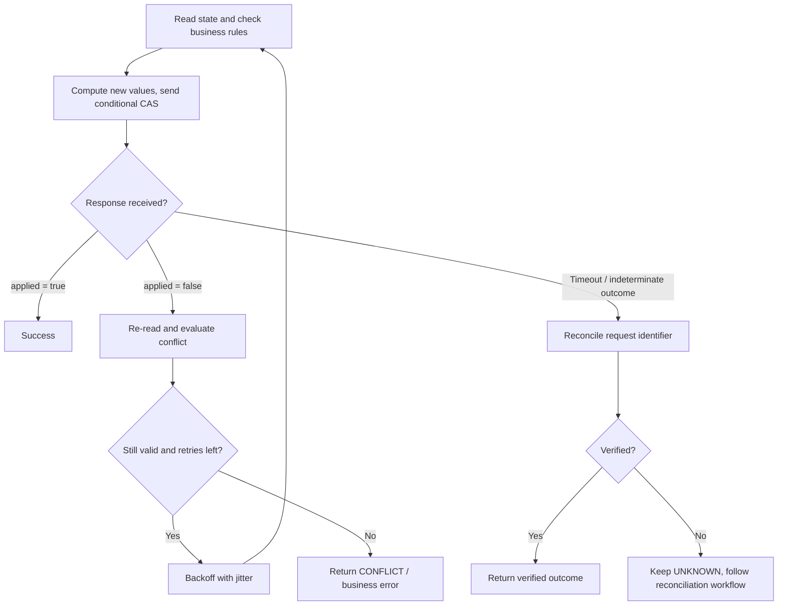

# Retrying LWTs, Handling Contention, and Avoiding Unintended Condition Changes

> **Chapter:** LWT and Concurrency  
> **Scope:** Apache Cassandra, CQL, and Java application connectivity; focuses on retry policies when using *lightweight transactions* (LWT) to update data with multiple contending actors.

## 1. Why Can a Retry Corrupt Data?

Apache Cassandra is a distributed *wide-column* database: partition keys govern data distribution to replicas, and schemas should be designed around target queries. For regular writes, Cassandra prioritizes distributed write availability and does not check a business condition the application read earlier. LWT provides conditional writes such as `INSERT ... IF NOT EXISTS` and `UPDATE ... IF version = ?`, using Paxos to coordinate and finalize *compare-and-set* (CAS) outcomes before writing.

Suppose inventory holds `5` items at version `8`. Two services both read this state:

- A wants to sell `1` item, intending to write `available = 4, version = 9`.
- B wants to sell `3` items, intending to write `available = 2, version = 9`.

Both submit CAS with condition `IF version = 8`. **Only one condition can win on that state.** The losing actor must re-read and recompute from the new state. If B wins (leaving `2` in stock) and A blindly changes its condition to `IF version = 9` while **keeping its precomputed value `4`**, A can overwrite the quantity from `2` back up to `4`: the retry accidentally undid B's sale.

The core rule is: **changing the CAS condition means making a new decision based on new state**, so you must re-read, re-verify business invariants, and recompute the written values. Never turn a rejected CAS into an unconditional write.

## 2. Three Outcomes to Distinguish Before Retrying

A CQL LWT result contains the special `[applied]` column. A network error lacks this column and is not equivalent to a rejected CAS.

| Client Observation | Valid Conclusion | Appropriate Action |
| --- | --- | --- |
| Received `[applied] = true` | The condition held at CAS decision time; this statement's change was applied. | Confirm success; do not resend "just to be sure." |
| Received `[applied] = false` | The condition failed; **this conditional write was not applied**. | Analyze conflict, re-read necessary data, then decide whether to try a new CAS. |
| Timeout, connection drop, or indeterminate result | Client **does not know for sure** whether CAS finalized. | Transition to `UNKNOWN`; reconcile using a request ID or durable tracking before concluding. |

When `IF version = 8 AND state = 'ACTIVE'` fails, Cassandra returns `[applied]` along with the current values of **the columns named in the `IF` clause** (here `version` and `state`). `available` does not appear automatically. On a failed `INSERT ... IF NOT EXISTS`, the result may include the existing row's data; on a failed `IF EXISTS`, do not expect row content columns.

Therefore, if you need to recompute inventory quantity, **do not infer stock from a CAS row containing only `version`**. `SELECT` the relevant columns again at an appropriate consistency level.

Note: `[applied] = false` is a *known* condition conflict, whereas a timeout is an *unknown-outcome* situation. If a prior write succeeded while its response was lost, resending the old condition typically returns `false` because the version incremented. A `false` result on **a retry** does not prove the first attempt failed.

## 3. CQL Practice with Version and Request Identifier

Assume a practice keyspace is selected. The table is queried by `sku` (partition key) so CAS operations on the same item stay within one partition.

```cql
CREATE TABLE IF NOT EXISTS inventory_by_sku (
    sku text PRIMARY KEY,
    available int,
    version bigint,
    state text,
    last_op_id uuid
);

INSERT INTO inventory_by_sku (sku, available, version, state)
VALUES ('BOOK-42', 5, 8, 'ACTIVE')
IF NOT EXISTS;
```

`version` is an **application-managed** version. Every actor authorized to modify `available` or `state` must follow the same version-update and LWT rules; even one regular `UPDATE` bypassing CAS can defeat this protection.

### A. Correct Conditional Update

Service A reads `available = 5`, `version = 8`, and `state = 'ACTIVE'`. A wants to deduct one item and assigns a stable business identifier to the request:

```cql
UPDATE inventory_by_sku
SET available = 4,
    version = 9,
    last_op_id = 11111111-1111-4111-8111-111111111111
WHERE sku = 'BOOK-42'
IF version = 8 AND state = 'ACTIVE';
```

If applied, Cassandra returns:

```text
 [applied]
-----------
      True
```

Then B, still holding stale data, sends:

```cql
UPDATE inventory_by_sku
SET available = 2,
    version = 9,
    last_op_id = 22222222-2222-4222-8222-222222222222
WHERE sku = 'BOOK-42'
IF version = 8 AND state = 'ACTIVE';
```

Illustrative result:

```text
 [applied] | version | state
-----------+---------+--------
     False |       9 | ACTIVE
```

B has not sold three items yet. The current version is `9`; current stock must be re-read if B wants to try again.

```cql
SELECT available, version, state, last_op_id
FROM inventory_by_sku
WHERE sku = 'BOOK-42';
```

Suppose re-reading returns `available = 4`, `version = 9`, and `state = 'ACTIVE'`. B can recompute selling three items as `available = 1`. If business rules still permit, B sends a **new CAS** with `IF version = 9`, setting `available = 1`, `version = 10`, and *B's same `last_op_id`*. If another actor bumps the version before this new CAS runs, B receives `false` again and must re-evaluate.

### B. Anti-Pattern: Changing the Condition While Keeping Precomputed Values

```cql
-- DO NOT DO THIS: only updating expected version after rejection,
-- while keeping SET values computed from the stale snapshot.
UPDATE inventory_by_sku
SET available = 2, version = 10
WHERE sku = 'BOOK-42'
IF version = 9;
```

In this example, B computed `available = 2` from `5`, while A had already subtracted one item down to `4`. If B actually sells three items, the true remaining quantity must be `1`. That "retry" leaves `available = 2`, corrupting total units sold.

Two more risky variants:

```cql
-- DO NOT DO THIS: dropping version check under contention.
UPDATE inventory_by_sku
SET available = 2
WHERE sku = 'BOOK-42';

-- DO NOT DO THIS: switching condition to IF EXISTS to force it through.
UPDATE inventory_by_sku
SET available = 2
WHERE sku = 'BOOK-42'
IF EXISTS;
```

`IF EXISTS` checks only row existence; it does not guard the read version and cannot replace the original CAS condition.

## 4. A Safe Retry Loop When `[applied] = false`

Retry a *version* conflict only while business rules still allow it. A sound handling loop:

1. **Identify the outcome:** if `[applied] = true`, finish; if `false`, record conflict; if no definitive reply arrived, branch into indeterminate-outcome reconciliation.
2. **Re-read required state:** load `available`, `version`, `state`, and any request identifier; do not rely on columns omitted from a failed `IF` response.
3. **Re-check invariants:** does the row still exist, is the item still active for sale, is stock sufficient, was this request already completed earlier, have business limits changed?
4. **Recompute the change:** e.g., for selling `3` items, compute `newAvailable = currentAvailable - 3` after confirming `currentAvailable >= 3`.
5. **Build a fresh CAS from the newly observed state:** `SET available = newAvailable, version = currentVersion + 1` with `IF version = currentVersion AND state = 'ACTIVE'`. Both the condition and `SET` values must come from **the same state snapshot**.
6. **Cap attempts and latency:** enforce a bounded retry budget and backoff with jitter under contention; once exhausted, return `CONFLICT` or escalate to the application layer.



**Never retry infinitely.** On a hot partition key, many CAS operations contending on one partition increase failure rates and Paxos latency. Use progressive backoff with jitter (e.g., a random delay between `0` and an exponentially bounded cap), cap total duration, and offload non-urgent work to key-partitioned queues.

Nor is every `false` a reason to retry: if `state = 'CLOSED'`, the transition is no longer valid; if `available` is insufficient, that is a business rejection. Retrying is pointless until data or the request changes deliberately.

## 5. Timeouts: Retrying the Same CAS Is Still Not Enough to Know What Happened

In distributed LWT, replicas or a coordinator may finish enough Paxos steps to apply a write while the response to the client is delayed or lost. Even when the client hits a timeout, Cassandra **may already have applied** that operation.

Consider request A with ID `11111111-1111-4111-8111-111111111111`:

1. A sends CAS `version: 8 → 9`, `available: 5 → 4`.
2. Client wait deadline expires and throws a timeout.
3. If A resends the **exact old statement**, it may get `[applied] = false` because the version is now `9`. This does not tell whether A wrote successfully the first time or another actor claimed version `9`.
4. A reads `last_op_id`. If the value matches A's ID and the data reflects A's intended effect, that is helpful reconciliation evidence.
5. If a request B subsequently updated the row and overwrote `last_op_id`, A **cannot conclude** from the `last_op_id` column alone whether request A ever applied.

Therefore, use **one stable business identifier** across every attempt of the same request. When requests involve payments, stock deductions, or notifications, maintain durable idempotency/operation tracking for long-lived status checks. A single `last_op_id` column in a row stores only **the most recent request**, not a complete log, and does not create atomic transactions with external services.

If the system cannot distinguish "already applied" from "not applied," return `UNKNOWN` for business reconciliation instead of falsely reporting success or re-triggering side effects. A regular `SELECT` at low consistency is also not absolute proof that an in-flight CAS was rejected; when you must inspect Paxos state, consider reading at `SERIAL` or `LOCAL_SERIAL` per your topology and consistency design.

## 6. Java Driver 4.x Pattern: Single CAS Attempt and Outcome Classification

The example below performs **one** inventory update attempt using data already read and validated in the business layer. The caller handles the retry loop per the diagram above. `wasApplied()` separates applied from rejected LWT results; timeouts are classified separately as `UNKNOWN`.

```java
import java.util.UUID;

import com.datastax.oss.driver.api.core.CqlSession;
import com.datastax.oss.driver.api.core.DefaultConsistencyLevel;
import com.datastax.oss.driver.api.core.DriverTimeoutException;
import com.datastax.oss.driver.api.core.cql.BoundStatement;
import com.datastax.oss.driver.api.core.cql.PreparedStatement;
import com.datastax.oss.driver.api.core.cql.ResultSet;
import com.datastax.oss.driver.api.core.cql.Row;
import com.datastax.oss.driver.api.core.servererrors.WriteTimeoutException;

public final class ConditionalInventoryWrite {
    public enum Outcome {
        APPLIED, CONFLICT, UNKNOWN
    }

    // newAvailable was computed from the exact same snapshot
    // that provided observedVersion for the IF check.
    public static Outcome attemptOnce(
            CqlSession session,
            String sku,
            int newAvailable,
            long observedVersion,
            UUID requestId) {

        PreparedStatement prepared = session.prepare(
            "UPDATE inventory_by_sku " +
            "SET available = ?, version = ?, last_op_id = ? " +
            "WHERE sku = ? IF version = ? AND state = 'ACTIVE'"
        );

        BoundStatement statement = prepared.bind(
                newAvailable,
                observedVersion + 1,
                requestId,
                sku,
                observedVersion)
            .setConsistencyLevel(DefaultConsistencyLevel.LOCAL_QUORUM)
            .setSerialConsistencyLevel(DefaultConsistencyLevel.LOCAL_SERIAL)
            .setIdempotent(false);

        try {
            ResultSet result = session.execute(statement);
            if (result.wasApplied()) {
                return Outcome.APPLIED;
            }

            // Only columns named in IF are guaranteed to appear
            // when an UPDATE condition fails.
            Row conflict = result.one();
            if (conflict == null) {
                throw new IllegalStateException("LWT missing result row");
            }

            Long actualVersion = conflict.isNull("version")
                    ? null : conflict.getLong("version");
            String actualState = conflict.getString("state");

            System.out.printf(
                "CAS conflict: sku=%s, actualVersion=%s, state=%s%n",
                sku, actualVersion, actualState
            );
            return Outcome.CONFLICT;

        } catch (DriverTimeoutException | WriteTimeoutException e) {
            // Outcome of the just-sent operation is unconfirmed.
            // Do not treat as false and do not blindly resend.
            return Outcome.UNKNOWN;
        }
    }
}
```

Key points when using this pattern:

- `newAvailable` **must not** be computed from a different snapshot than `observedVersion`. The caller must read the row, verify `state` and sufficient stock, and only then invoke `attemptOnce`.
- On `CONFLICT`, the caller must `SELECT` all needed fields again, re-check business rules, recompute `newAvailable`, and use the new version. Never just bump `observedVersion` and resend the old `newAvailable`.
- On `UNKNOWN`, the caller must reconcile using `requestId` or a durable idempotency store. The snippet catches two common timeout exceptions for illustration; connection errors, other write errors, or application exceptions must be classified separately by sent/unsent certainty and never equated with a CAS rejection.
- `setIdempotent(false)` states that the driver must not assume automatic retries are safe. If the application, HTTP layer, or message queue also retries, those layers must obey the same rules. Never enable speculative execution blindly on conditional operations.
- `LOCAL_QUORUM` is the consistency level for the regular write phase; `LOCAL_SERIAL` is the level for the local-datacenter CAS/serial phase. Use `QUORUM`/`SERIAL` as dictated by multi-DC design. Never mix settings inconsistently across writers.
- `attemptOnce` intentionally omits loops, re-reads, and backoff: those policies depend on each request's time budget, business rules, and `UNKNOWN` handling.

## 7. Design Mistakes That Commonly Cause Contention or Wrong Writes

| Mistake | Consequence | Fix |
| --- | --- | --- |
| Getting `false` and changing `IF version = 8` to `IF version = 9` while keeping `SET`. | Overwrites another actor's result. | Re-read, recompute `SET`, and build a new CAS. |
| Changing `IF version = ?` to `IF EXISTS`, or removing `IF`. | Loses stale-data protection. | Keep the condition protecting business invariants. |
| Treating timeout as `false` and immediately issuing a new request. | Risks duplicating an operation that succeeded. | Keep request ID fixed; reconcile indeterminate outcomes. |
| Generating a new `requestId` on every retry of the same request. | Hard to recognize that the same action already applied. | Generate ID once at the business boundary and pass across all attempts. |
| Checking only `version` while another actor edits `state` without bumping version. | Statements can pass invalid state checks. | Enforce versioning/LWT on all write paths; check state conditions too when needed. |
| Unlimited retries on a hot partition. | Spikes latency, Paxos load, and conflict rates. | Bound attempts, apply backoff, monitor contention, and throttle load. |
| Treating `last_op_id` as a permanent idempotency log. | Cannot verify older requests once overwritten. | Build a durable idempotency/operation log scoped to business needs. |

In particular, when multiple services write to the same partition, **never combine LWT with regular writes that skip conditions** on protected fields. LWT does not turn independent outside operations into an ordered linearizable transaction.

## 8. Controlling Load and Operational Observability

LWT requires extra Paxos communication rounds and therefore costs more than regular `INSERT`/`UPDATE`. Use CAS only where atomic conditions are needed; pick partition keys matching query patterns and minimize many actors contending on a single hot key.

Track at least:

- `[applied] = false` rate by operation type and partition key (or redacted key group).
- Average retry count, retry-budget exhaustion rate, and number of requests in `UNKNOWN` state.
- LWT p95/p99 latency, timeouts, and replica/coordinator errors.
- True business rejections (out of stock, closed state) versus retryable version conflicts.
- Frequency of idempotency reconciliations triggered by lost responses.

These metrics separate a genuinely high-contention workload from blind retry storms or misclassified business vs. infrastructure errors. Replication, consistency levels, and multi-DC topology must be evaluated together when choosing `SERIAL` vs. `LOCAL_SERIAL`.

## 9. Verification Exercises

1. Create `inventory_by_sku` in a test keyspace and insert `BOOK-42` with `available=5`, `version=8`. Send CAS A, then CAS B with the same `version=8`, and explain why B receives `false`.
2. Write B's retry step. Specify which `SELECT` runs, the recomputed quantity, and the new `IF` condition. Verify that after A sells `1` and B sells `3`, remaining stock is `1` when both are permitted.
3. Test `IF state='ACTIVE' AND version=?`, then transition `state` to `CLOSED` via an administrative action that increments version; explain why the app must not continue CAS merely because the version changed.
4. Simulate a client losing the response after sending A. If a re-read shows A's `last_op_id`, what can you infer? If a re-read shows B's `last_op_id`, why can you not prove A never succeeded?
5. Propose a retry budget for a sales API and monitoring metrics to detect contention on hot-selling SKUs.

**Remember:** `[applied] = false` is a signal to **recompute against fresh data**, not merely tweak `IF`. Timeouts require **reconciling indeterminate outcomes**. One business request must keep the same identifier across attempts, and the CAS condition and `SET` values must always describe the exact same verified snapshot.
