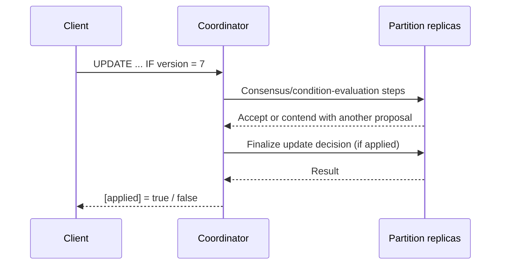

# Measuring LWT Cost and Verifying Concurrent Update Histories in Apache Cassandra

## 1. Problem Statement and Goals

In the **distributed wide-column database Apache Cassandra**, regular updates optimize for low-latency writes and availability at the chosen consistency level. When you need conditional operations such as "create only if absent" or "update only if the current version matches what was read," Cassandra provides **lightweight transactions (LWT)** via CQL `IF NOT EXISTS` or `IF ...` syntax. LWT uses a Paxos-based consensus protocol to coordinate a partition's replicas. In exchange for conditional compare-and-set guarantees, it adds message-exchange overhead and is sensitive to contention.

This lesson belongs to the **LWT and Concurrency** chapter of the `DATABASE_ENGINE_WIDE_COLUMN_CASSANDRA` module. It focuses on two related questions that must be measured separately:

1. **What is the actual cost of LWT?** Compare latency, throughput, resource usage, and condition-application rates across varying client counts, hot keys, consistency levels, topologies, and contention levels.
2. **Do concurrent updates form a valid history?** Record invoke/complete timestamps and outcomes for each CAS statement; find a sequential ordering consistent with business rules **and** the real-time ordering of non-overlapping operations.

The goal is not to produce a single "LWT is X times slower" figure for every cluster. Results depend on Cassandra version, replica count, network, load level, request type, partition count, hot keys, and client retry behavior. Likewise, a clean latency chart **does not prove** that the update history is correct.

## 2. What Does LWT Guarantee, and Where Does Cost Come From?

Example safe replacement for a conditional operation:

```sql
-- Execute only when current version equals 7.
UPDATE lwt_lab.account_by_id
SET balance = 420, version = 8
WHERE account_id = 00000000-0000-0000-0000-000000000001
IF version = 7;
```

On the same partition, if two clients concurrently submit `IF version = 7`, **two updates cannot both succeed observing version 7**, assuming only compliant LWT operations run and no other path overwrites or resets `version`. The CQL result returns `[applied]`: `true` when applied, `false` when the condition failed; on failure, the response usually includes current values of the conditioned columns so the client can resolve the conflict.

Conceptual diagram:



This is an **abstract** diagram. Specific Paxos phases, fast/slow paths, and network round trips vary by Cassandra version and contention state; never assume every LWT always takes a fixed four round trips. Compared to a regular `UPDATE`, LWT cost comes primarily from reaching consensus, reading/evaluating the condition, handling contention, and committing the outcome.

### Two Consistency Levels to Distinguish

| Setting | Role | Example |
| --- | --- | --- |
| **Regular/write consistency** | Number of replicas required to acknowledge the write per CQL | `LOCAL_QUORUM` |
| **Serial consistency** | Consensus scope for the LWT operation | `SERIAL` or `LOCAL_SERIAL` |

`SERIAL` uses cluster-wide scope per protocol rules; `LOCAL_SERIAL` restricts consensus to replicas in the local DC when topology/config are appropriate. Comparing the two modes requires documenting client datacenter, per-DC RF, and write consistency level, since changing coordination scope changes both latency and guarantees during cross-DC failures.

**Guarantee scope:** LWT provides linearizable compare-and-set on **a single partition**. Do not extrapolate general ACID transactions, global linearizable ordering across **multiple partitions**, or atomic updates across multiple distributed tables. Avoid mixing regular writes and LWTs on the same row/partition during verification: unconditional writes do not follow CAS rules and render history models meaningless.

## 3. Creating Reproducible Experiment Data

The examples below use CQL and a test keyspace. Choose a DC name matching `nodetool status` in your environment; `dc1` is an **illustrative placeholder**. Never run on a production keyspace.

```sql
CREATE KEYSPACE IF NOT EXISTS lwt_lab
WITH replication = {
  'class': 'NetworkTopologyStrategy',
  'dc1': 3
};

CREATE TABLE IF NOT EXISTS lwt_lab.account_by_id (
    account_id uuid PRIMARY KEY,
    balance bigint,
    version bigint,
    updated_by text
);

-- Seed row once; verify [applied] = true or existing row.
INSERT INTO lwt_lab.account_by_id (account_id, balance, version, updated_by)
VALUES (00000000-0000-0000-0000-000000000001, 0, 0, 'seed')
IF NOT EXISTS;
```

Common statements used for test updates:

```sql
-- Unconditional baseline: measures only regular write-path cost.
UPDATE lwt_lab.account_by_id
SET balance = 10, version = 1, updated_by = 'baseline'
WHERE account_id = 00000000-0000-0000-0000-000000000001;

-- LWT CAS: applies only if version currently equals 1.
UPDATE lwt_lab.account_by_id
SET balance = 20, version = 2, updated_by = 'client-a'
WHERE account_id = 00000000-0000-0000-0000-000000000001
IF version = 1;

-- Same target, will return [applied] = false after the CAS above succeeds.
UPDATE lwt_lab.account_by_id
SET balance = 30, version = 2, updated_by = 'client-b'
WHERE account_id = 00000000-0000-0000-0000-000000000001
IF version = 1;
```

These three statements demonstrate mechanics, **not** a literal sequence for benchmarking. Across multiple runs, seed/reset data **before** each run outside the measurement window. Never reset `version` with a regular `UPDATE` while collecting CAS history. Every writer touching a tested partition must be controlled and logged.

Pick a fixed key set of `account_id` UUIDs and keep payload and table size comparable across runs. Each account is one **partition**; switching from one hot UUID to thousands of UUIDs separates same-partition contention from pure protocol cost. For history verification, prefer **a small `(balance, version)` state pair per account** rather than CQL counters, since counters have different update semantics.

## 4. Designing Benchmarks: Measuring What Matters

### 4.1. Controlling Experimental Variables

Record configuration for every measurement run:

| Category | Required Details |
| --- | --- |
| Cassandra | Version, node and DC count, RF per DC, topology/rack, partitioner, relevant LWT/Paxos config |
| Hardware | CPU, RAM, disk, network; client placement relative to DCs |
| Data | Partition count, hot-key ratio, row size, seed data, ops per key |
| Java Client | Driver version, pool/concurrency, retries, speculative execution, timeouts, contact points/local DC |
| Consistency | Regular CL, serial CL, CQL type; specify `UPDATE`, `IF version`, or `IF NOT EXISTS` |
| Offered Load | Target requests/s, worker count, warm-up duration, measurement duration, repetitions |

Comparing regular `UPDATE` with `UPDATE ... IF` shows **the added cost of conditions**, yet they are **not functionally equivalent**. Never cite an unconditional baseline as proof that the system still prevents lost updates. To evaluate architecture choices, examine **both** latency **and** data correctness guarantees.

### 4.2. Workload Matrix to Execute

| Workload | Key Distribution and Success Rate | Purpose |
| --- | --- | --- |
| A. Regular write | Many partitions, unconditional `UPDATE` | Regular write baseline |
| B. Low-contention LWT | Many partitions; at most one active client per key at a time | LWT cost when `[applied]≈100%` |
| C. Failing-condition LWT | Many partitions; intentionally supply stale versions | Cost of evaluating failed conditions |
| D. Hot-key LWT | Many clients running CAS on **one partition** | Measure contention, retries, and tail latency |
| E. Skewed LWT | E.g., 80% of requests to 20% of keys at same total load | Measure realistic application skew |
| F. High-concurrency LWT | Step up concurrency while holding key mix constant | Find saturation point and useful throughput |

In workload B, to keep the condition true, each operation must use that partition's latest version with no concurrent writers on the same partition. In workload D, many clients may read `version = 7` and all send `IF version = 7`; **one succeeds and the rest are typically rejected**, unless clients recompute conditions and submit fresh CAS rounds. This separates "total CAS attempts" from "completed logical business updates."

### 4.3. Execution Procedure

1. Create/seed a fixed key set; verify all nodes are `UN` with no topology changes or abnormal maintenance tasks. Record Cassandra and driver versions.
2. Warm up long enough for sessions, connections, prepared statements, caches, and Java JIT to stabilize. **Exclude** warm-up data from results.
3. Run each workload at matched load first, then step up concurrency and offered load. Separately note **closed-loop** (client waits for response before sending next) vs. **open-loop** (fixed target arrival rate), as closed-loop masks queuing delays when the server slows down.
4. Measure duration with a monotonic clock **covering from before send until result/error**, including timeouts and retries. Load generators must account for scheduled-but-unserved requests to avoid *coordinated omission* when reporting p99.
5. Run each iteration long enough for meaningful p99 sample counts, repeat across runs at the same config, and report run-to-run variance. Never merge percentiles from differently distributed runs as if they were one homogeneous workload.
6. Collect server metrics over the exact same time window; end cleanly and let the system stabilize before starting the next workload.

### 4.4. Metrics and Formulas

| Metric | How to Measure | Meaning |
| --- | --- | --- |
| **Client latency p50/p95/p99/p99.9** | Latency distribution across all attempts, plus separate success/fail/timeout | Median and tail latency |
| **Attempt throughput** | Requests/CAS attempts processed per second | Total load the system bears |
| **Applied goodput** | Confirmed `[applied] = true` CAS ops per second | Useful conditional updates |
| **Not-applied rate** | `[applied] = false` count / valid CAS responses | Contention, stale versions, or unmet business conditions |
| **Timeout/unknown rate** | Indeterminate attempts / total attempts | Unresolved portion of history |
| **Server resources** | CPU, GC, disk I/O, network, pending tasks, version-appropriate Paxos/CAS metrics | Backend cost and bottlenecks |

```text
latency_overhead_p99 = p99(LWT latency) / p99(regular UPDATE latency)
applied_goodput      = confirmed_applied_CAS / measurement_seconds
conflict_fraction    = known_not_applied_CAS / known_completed_CAS
unknown_fraction     = unknown_outcome_attempts / total_attempts
```

Compute `latency_overhead_p99` only when both runs share topology, write CL, payload, and comparable load; use **two independent p99s**, never treating it as a per-request latency ratio. When a CAS is rejected, `[applied] = false` is still a **valid protocol outcome**: the condition check worked properly, not an infrastructure error. Evaluate goodput against business semantics: if clients loop CAS until incrementing version succeeds, report **attempts per logical operation** and **end-to-end latency per logical operation** separately.

**Hypothetical sample numbers**, solely to illustrate how to read a report:

| Scenario | Client p99 | Attempts/s | Applied/s | False/s | Timeout/s |
| --- | ---: | ---: | ---: | ---: | ---: |
| Regular, many keys | 7 ms | 7,000 | — | — | 0 |
| LWT, many keys | 25 ms | 3,000 | 2,990 | 10 | 0 |
| LWT, one hot key | 210 ms | 800 | 140 | 650 | 10 |

Do not conclude "LWT is always 3.6x slower" from rows 1 and 2 if throughput or saturation differ. The table shows that on a hot key, **attempts/s can look fairly high while applied/s is very low**: many clients burn resources only to receive `[applied] = false`.

### 4.5. Metrics to Correlate

When p99 spikes, align charts over the **exact same time window**:

- Client latency, in-flight attempts, connection saturation, retries, and timeouts.
- Cassandra CAS/Paxos timings/counts, read/write latencies, pending threads/tasks, and request errors; metric names, JMX domains, and phases vary across versions. Check metrics for **your running version** rather than assuming one metric name exists everywhere.
- CPU, GC pauses, disk utilization, network RTT, compaction backlog, and replica status.
- `nodetool status`, `nodetool tpstats`, `nodetool tablestats lwt_lab.account_by_id` during investigation; enable tracing only selectively since tracing adds overhead.

If LWT latency rises together with **not-applied rate**, check hot partitions and stale-version retry bugs first. If regular writes slow down too, check resource or network saturation. If only one DC slows down, inspect `SERIAL`/`LOCAL_SERIAL`, client local DC config, and inter-DC links. Never tweak consistency levels just to make charts look prettier without analyzing correctness impact.

## 5. Recording Concurrent Update Histories for Verification

A **performance** benchmark needs histograms and server metrics; a **correctness** test needs a per-operation history (*operation history*) containing enough data to reconstruct CAS semantics. Checking only final `SELECT` states **is not enough** to prove all concurrent updates were valid.

### 5.1. State Model and CAS Contract

For each `account_id`, sequential specification:

```text
State(account_id) = (balance, version, updated_by)

CAS(account_id, expected_version, new_balance, new_version, actor):
    if state.version == expected_version:
        state = (new_balance, new_version, actor)
        return applied = true
    else:
        leave state unchanged
        return applied = false and relevant state values
```

To make `version` a monotonically increasing counter, **application convention** sets `new_version = expected_version + 1`; Cassandra does not auto-increment it. Without that rule, two clients could rewrite the same version value if the app deliberately did so, so the checker must model **all exact sent values** rather than assuming version always increases.

When testing `IF version = x`, record `new_balance`, `new_version`, `updated_by`, and expected version in full. An `[applied] = false` reply may carry current columns; those columns provide extra verification facts, but compare only columns actually returned per your driver/Cassandra version.

### 5.2. Operation Log Schema

| Field | Reason |
| --- | --- |
| `op_id`, `logical_op_id`, `attempt_no` | Separate logical business operations from attempts/retries |
| `client_id`, `account_id` | Reconstruct per-client and per-partition histories |
| `invoke_time`, `complete_time` | Real-time ordering constraints |
| `expected_version`, `new_version`, `new_balance` | Evaluate conditions and simulate state transitions |
| `outcome` | `applied`, `not_applied`, or `unknown` |
| `observed_version` | Returned version when `[applied] = false`, if present |
| `regular_cl`, `serial_cl`, `coordinator` | Reproduce environment and diagnose faults |
| `exception`, `request_timeout`, `retry_count` | Trace missing responses and retry behavior |

Each request must log an **invoke event before sending** and a **complete event upon response/error**. Persist logs durably **outside the tested partition itself**—for example, an append-only file with sequence ordering and a test-run checksum. Avoid logging only on success: if an app crashes, pending invocations vanish from history and yield false conclusions.

Latency on **a single client** should use a monotonic clock (e.g., `System.nanoTime()`). To infer time ordering **across multiple client machines**, use a synchronized time source with bounded/measured skew, or collect events through a single runner/collector. If clock skew is unmeasured, **do not enforce** ordering between close requests merely because wall-clock timestamps differ by a few milliseconds; mark uncertainty windows to avoid false positives.

### 5.3. Example Valid History

Suppose initially `version = 0`. Times below are milliseconds from the test harness's single monotonic clock; `A`, `B` are two clients:

| Op | Start | End | Condition/Write | Result |
| --- | ---: | ---: | --- | --- |
| `A` | 0 | 30 | `IF v=0 THEN v=1` | `applied=true` |
| `B` | 10 | 20 | `IF v=0 THEN v=1` | `applied=false, observed_v=1` |
| `C` | 40 | 60 | `IF v=1 THEN v=2` | `applied=true` |

`A` and `B` **overlap in time**. One valid sequential order is `A → B → C`: A applies version 1, B sees current version 1 so `v=0` fails, and C updates to version 2. B may return before A even though A is **linearized** before B, because A and B overlapped and had no forced real-time order between them.

By contrast, the following history is **invalid** when no reset/other version operation occurred and all responses are confirmed:

| Op | Start | End | Condition/Write | Result |
| --- | ---: | ---: | --- | --- |
| `A` | 0 | 10 | `IF v=0 THEN v=1` | `applied=true` |
| `B` | 20 | 30 | `IF v=0 THEN v=1` | `applied=true` |

Because `A` **finished before** `B` began, B must come after A in real time; the state after A is `v=1`, so B cannot also succeed with condition `v=0`. This is a minimal, easy-to-report counterexample—much better than merely saying "there were two true responses."

### 5.4. Linearizability Definition and Checking Algorithm

A history is **linearizable** if there exists a sequential ordering of the operations such that:

1. Each operation obeys the CAS model on the state produced by the preceding operation.
2. If operation X **finished before** Y was invoked, X precedes Y.
3. Overlapping operations may be ordered in any consistent way (not necessarily by start time or response time).

For a single `account_id`, write a state-search and *backtracking* checker:

```text
check(history, initial_state):
    remaining = completed ops with responses and ops with outcome=unknown
    search for a linear sequence explaining the history:
        pick an op whose mandatory real-time predecessors are already placed
        if op returned applied=true:
            valid only if expected_version == current.version;
            apply new_balance/new_version/updated_by
        if op returned applied=false:
            valid only if condition fails;
            verify observed_version if returned
            keep state unchanged
        if op has outcome=unknown:
            allow either the unapplied branch OR the applied branch,
            exploring corresponding possible states
        continue until exhausted; PASS if at least one valid ordering exists
```

This is a **sketch**, not an optimized production checker for large histories. In practice you must model dangling invocations, unreturned operations, and retry counts while bounding state space. You can use history checkers like **Knossos/Jepsen** or **Porcupine** with a custom CAS model, verifying how they handle unknown outcomes, real-time ordering, and initial state. Run the checker per partition first; across independent partitions, splitting histories shrinks the search space, though results do not prove cross-partition atomic transactions.

**An unknown outcome is not a CAS failure.** When a request times out or disconnects after sending, the server may have applied the change even though the client never saw the reply. Never assign `applied=false` to a timeout. If a checker forces an assumption on unknowns, state it explicitly; if indeterminate, report **inconclusive** and provide the counterexample or missing-data history.

### 5.5. Verification Goals and Observation Limits

- The strongest verification here is **the history of conditional LWT operations on a single partition**, with known initial state and no unlogged writers.
- Regular `SELECT`s at `ONE` or another read level **cannot automatically** be dropped into the same checker as linearizable reads. Cassandra offers many consistency options; to verify reads too, explicitly design a **read protocol** with the required guarantees and model it separately.
- A valid final state **does not** prove intermediate operations were valid; conversely, a final read before replicas converge is insufficient to conclude a CAS failed.
- A **PASS** from the checker proves only that no violation was found within **the tested histories and assumptions**—not that bugs are impossible.
- Whenever a counterexample is found, preserve raw logs, timestamps, configs, seeds, versions, and network faults for reproduction; check first for buggy client retries, missing logs, or clock skew.

## 6. Java Driver 4.x Sample Recording a CAS Attempt

This example uses a prepared statement and two explicit consistency levels. It targets **Java 17+** for text blocks; for older Java versions, replace text blocks with regular strings. Assume `CqlSession session` is already created with the proper local datacenter and credentials.

```java
import com.datastax.oss.driver.api.core.CqlSession;
import com.datastax.oss.driver.api.core.DefaultConsistencyLevel;
import com.datastax.oss.driver.api.core.cql.BoundStatement;
import com.datastax.oss.driver.api.core.cql.PreparedStatement;
import com.datastax.oss.driver.api.core.cql.ResultSet;
import com.datastax.oss.driver.api.core.cql.Row;
import java.util.UUID;

// Prepare once and reuse across attempts.
PreparedStatement cas = session.prepare("""
    UPDATE lwt_lab.account_by_id
    SET balance = ?, version = ?, updated_by = ?
    WHERE account_id = ?
    IF version = ?
    """);

UUID id = UUID.fromString("00000000-0000-0000-0000-000000000001");
long expectedVersion = 7;
BoundStatement request = cas.boundStatementBuilder()
    .setLong(0, 420)
    .setLong(1, expectedVersion + 1)
    .setString(2, "client-a")
    .setUuid(3, id)
    .setLong(4, expectedVersion)
    .setConsistencyLevel(DefaultConsistencyLevel.LOCAL_QUORUM)
    .setSerialConsistencyLevel(DefaultConsistencyLevel.LOCAL_SERIAL)
    .setIdempotent(false)
    .build();

long startNs = System.nanoTime();
String outcome;
Long observedVersion = null;
try {
    ResultSet result = session.execute(request);
    Row row = result.one();
    if (row == null) {
        throw new IllegalStateException("Missing LWT [applied] row");
    }
    boolean applied = row.getBoolean("[applied]");
    outcome = applied ? "applied" : "not_applied";
    if (!applied && !row.isNull("version")) {
        observedVersion = row.getLong("version");
    }
    // result.getExecutionInfo().getCoordinator() captures the coordinator.
} catch (RuntimeException error) {
    // When uncertain whether the request reached the server, log 'unknown';
    // classify specific errors afterward. Never equate timeout with not_applied.
    outcome = "unknown";
    // Record error type, stack trace, timeout/retry details for investigation.
} finally {
    long elapsedNs = System.nanoTime() - startNs;
    // Log completion event: op_id, attempt_no, key, expected/new values,
    // elapsedNs, outcome, observedVersion, CL, serial CL, coordinator...
}
```

`setIdempotent(false)` prevents treating a CAS like a regular write that can be retried arbitrarily; real retry policies also depend on error type, driver configuration, and application logic. The snippet above is the core attempt-recording logic—it does **not** yet include durable event logs, metric export queues, or session lifecycle management. In real implementations, generate a unique `op_id` **before sending**, write `invoke` immediately on start, write `complete` after receiving an outcome, and ensure non-blocking logging does not skew latency measurements (keep logging overhead separate from CAS measurements).

### Handling Conflicts and Timeouts

1. When `[applied] = false`, the outcome is known: the version or condition no longer matches. The application can read/extract current state, recompute business logic, and issue a **new logical operation** or cleanly traced attempt. Never retry indefinitely with the same `expected_version`.
2. On timeout/connection loss, the outcome is **indeterminate** if the request may have reached replicas. Query state per business rules, checking transaction/operation identifiers and recorded versions; a retry with the same `IF version` may return `false` simply because the prior attempt actually succeeded. Never treat a retry's `false` response as proof the first attempt failed.
3. If the business requirement is "credit balance exactly once," raw CAS alone only prevents **two writes with the same expected version**. To prevent business-level duplicates after timeouts/crashes, add idempotency keys/deduplication or an appropriate event model, and verify that design separately.

## 7. Testing Contention, Disconnects, and Fault Recovery

Run in a stable test cluster first, then **perform intentional fault injection** with full logging. Isolate test cases so any violation's root cause is clear:

| Test | Action | What to Observe |
| --- | --- | --- |
| Same version, two clients | A/B both run `IF version = x` on one key | At most one `applied=true` without resetting version |
| Many clients, hot key | 8/16/32 workers contend on one partition | Applied/s, false/s, p99, retries, backlog |
| Many partitions | Each worker uses its own key | Baseline LWT cost under low contention |
| Coordinator timeout | Inject latency or drop client link in lab | Unknown attempts; checker must not treat as `false` |
| Replica failure | Stop one replica in lab, respecting RF and CL | Availability, timeouts, recovery time, history validity |
| Cross-DC | Compare `SERIAL` vs. `LOCAL_SERIAL` in suitable topology | Network/latency and coordination-scope differences |

Never treat one timed-out request or a couple of high-p99 samples as proof that Paxos is broken. If the checker finds a counterexample, shrink the history to the smallest violating subset of operations and include `op_id`, intervals, inputs, outputs, and initial state. If errors appear only when unconditional writes interleave, isolate that experiment: the "CAS-only" assumption was broken.

## 8. Sample Report Template for Dev/Ops Teams

Every measurement run should record at least:

```text
Cluster: Cassandra <version>; DC=dc1, RF=3, nodes=3
Client: Java Driver 4.x; local DC=dc1
Statement: UPDATE ... IF version = ?
Regular CL: LOCAL_QUORUM; Serial CL: LOCAL_SERIAL
Workload: 16 clients, 1 hot partition, constant offered load
Duration: warm-up 2m / measure 10m (example, not a mandatory standard)
Latency: p50=<...> p95=<...> p99=<...>; timeout=<...>
Outcome: attempts=<...>, applied=<...>, not_applied=<...>, unknown=<...>
Resource: CPU/disk/network/Paxos-CAS metrics <...>
History checker: model=<...>, operations=<...>, result=PASS|FAIL|INCONCLUSIVE
Evidence: raw history path, seed, load generator commit, clock accuracy,
          server config + metrics window + minimal counterexample if FAIL
```

**How to draw conclusions:** if multi-partition LWT has acceptable p99 and valid histories, the cost likely fits the CAS requirement. If a hot partition causes low goodput and high p99, revisit the **partition key**, contention distribution, or per-key concurrency limits; adding tokens/vnodes on nodes does not split a single hot partition. If the history cannot be verified due to unresolved timeouts or missing logs, report **INCONCLUSIVE** and improve observability before claiming correctness.

## 9. Self-Check Questions

1. Why is comparing p99 of regular `UPDATE` vs. `UPDATE ... IF` insufficient to decide whether to drop LWT?
2. With 100 clients contending on one `account_id`, why can attempt throughput look high while applied goodput is very low?
3. Two CAS calls both conditioned on `IF version = 5` return `[applied] = true`; what else must be checked before concluding the history is invalid?
4. Why does `A` starting before `B` yet returning after `B` not necessarily violate linearizability?
5. How should a timed-out CAS be represented in the history? Why is retrying and receiving `false` insufficient to prove the first attempt did not apply?
6. When verifying histories from three different hosts, what information is required to establish valid real-time ordering?

**Main takeaway:** use LWT when conditional per-partition updates are required, measure **real cost and successful goodput** under contention, and verify correctness with **invoke/complete histories against a CAS model and real-time constraints**. Performance metrics and linearizability checks answer two distinct questions; a trustworthy Cassandra design requires understanding both.
