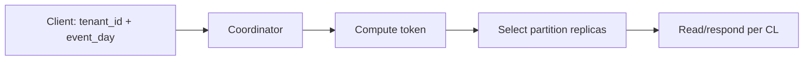
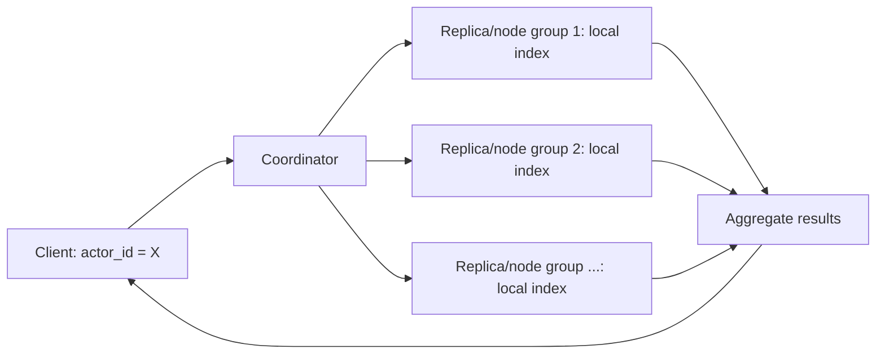

# Choosing Columns, Cardinality, and Query Distribution to Evaluate Indexes

> **Chapter:** Indexes  
> **Module:** `DATABASE_ENGINE_WIDE_COLUMN_CASSANDRA` — Apache Cassandra, a distributed wide-column database.  
> **Objective:** Choose columns to index based on actual data and query workloads, rather than creating an index by default for every column appearing in a `WHERE` clause.

Cassandra is designed to distribute partitions across multiple nodes according to **partition key, token, and replication strategy**. Consequently, an index's effectiveness does not depend solely on how many distinct values a column has. We must also evaluate **how many rows a value matches, how frequently that query runs, whether it is bounded by partition/time, and how many nodes must be contacted**.

This lesson focuses on choosing indexes for wide-column data, integrating query-driven table design, CQL, consistency levels, write/compaction overhead, and Java application usage. Examples involving **Storage-Attached Index (SAI)** apply when your deployed Cassandra version supports SAI (notably Apache Cassandra 5.0+); **legacy secondary indexes (2i)** and other versions must be evaluated under their own mechanisms. Never apply one syntax or performance conclusion universally across all Cassandra releases.

## 1. Learning outcomes

After studying this lesson, you will be able to:

1. Distinguish **cardinality**, **selectivity**, **skew**, and **query frequency**.
2. Compute selectivity for **the actual queried values**, rather than looking only at a column's distinct value count.
3. Explain why an index on distributed data does not automatically turn a partition-keyless query into a single-node read.
4. Choose among **no index**, **appropriate SAI/2i**, a **dedicated query table**, or a **specialized search/analytics system**.
5. Design experiments measuring latency, fan-out, load distribution, and write overhead to accept or reject an index.

## 2. Starting point: Cassandra reads fastest when the partition key is known

Consider an events table designed so users can view events for a tenant on each day:

```sql
-- Assume the lab keyspace has already been created with test-appropriate replication.
CREATE TABLE lab.events_by_tenant_day (
    tenant_id uuid,
    event_day date,
    created_at timestamp,
    event_id timeuuid,
    actor_id uuid,
    status text,
    event_type text,
    payload text,
    PRIMARY KEY ((tenant_id, event_day), created_at, event_id)
) WITH CLUSTERING ORDER BY (created_at DESC, event_id DESC);
```

The partition key is **`(tenant_id, event_day)`**. Cassandra hashes **that exact combination** into a token; the clustering columns `created_at` and `event_id` only determine row order within the same partition.

A query matching the table design:

```sql
SELECT created_at, event_id, status, event_type
FROM lab.events_by_tenant_day
WHERE tenant_id = 11111111-1111-1111-1111-111111111111
  AND event_day = '2026-11-21'
LIMIT 50;
```

Because the full partition key is supplied, the coordinator can locate the responsible replica set via token and query within a properly organized data scope. The next query has a different shape:

```sql
-- Requires considering an index or a different table model:
-- "Find all events performed by an actor across multiple tenants/days"
SELECT tenant_id, event_day, created_at, event_id
FROM lab.events_by_tenant_day
WHERE actor_id = 22222222-2222-2222-2222-222222222222
LIMIT 50;
```

`actor_id` is not part of the partition key. Without a supporting access structure, this query is invalid as an efficient partition-key lookup. An index may allow querying by `actor_id`, yet it **does not alter the original partition key**. The query may have to coordinate across many replicas/nodes because the tokens of partitions containing that actor are unknown beforehand.

### 2.1. An index is not a second table ordered arbitrarily

In relational databases, we commonly associate indexes with B-trees that let us find records by any indexed column. In Cassandra:

- The **primary access path** is the partition key, which determines replica placement in the cluster.
- **Secondary indexes** store lookup structures for other columns where the data lives; different index mechanisms build and query them differently.
- **SAI** attaches index structures to the SSTable and memory lifecycle; it supports efficient filtering for certain query patterns, yet still incurs distributed cost when the partition key is missing.
- **Replicas and consistency level (CL)** still govern reads and writes. Indexes do not bypass replication, quorum, or data liveness validation.

The question to answer before creating an index: **does this query retrieve a small, widely scattered set of rows, or does it try to process a large dataset for which the current schema is not optimized?**

## 3. Four variables to distinguish clearly

### 3.1. Cardinality — how many distinct values does the column have?

Let:

- `N`: number of rows in the scope being evaluated.
- `D`: number of distinct values in the column.
- `n(v)`: number of rows carrying value `v`.

Example across 10 million events:

| Column | Example cardinality | Interpretation |
|---|---:|---|
| `status` | 3 | Low: only SUCCESS/ERROR/PENDING |
| `event_type` | 25 | Relatively low |
| `actor_id` | 400,000 | High: many distinct actors |
| `event_id` | Nearly 10,000,000 | Very high: almost unique |

**High cardinality does not guarantee an index is good.** A typical `actor_id` might have only 8 events, while one special actor generates 350,000 events. On the exact same column, two values can have drastically different query costs.

Cardinality must also be evaluated within the **proper scope**: whole cluster, one datacenter, one tenant, or one partition/day. A value can be rare globally yet overwhelmingly common inside one tenant.

### 3.2. Selectivity — how many rows match the queried value?

Common definition:

\[
s(v)=\frac{n(v)}{N}
\]

The **smaller** the fraction `s(v)`, the **more selective** the query is for that value (fewer matching results in scope N). Another phrasing is **rejection rate** `1 - s(v)`: the fraction of non-matching rows.

| Queried value | `n(v)` out of 10M rows | `s(v)` | Notes |
|---|---:|---:|---|
| `status = 'SUCCESS'` | 8,000,000 | 80% | Very poor selectivity |
| `status = 'ERROR'` | 40,000 | 0.4% | More selective than SUCCESS, yet still 40,000 rows |
| `actor_id = X` (typical actor) | 12 | 0.00012% | Small result set |
| `actor_id = Y` (heavy-load actor) | 350,000 | 3.5% | Same column, completely different selectivity |

All numbers in this table are **hypothetical examples for learning evaluation**, not Cassandra benchmarks.

Note: `s(v)` is not execution time. It does not reveal how many nodes/SSTables hold the data, tombstone counts, row sizes, concurrency, or replica load speed.

### 3.3. Skew — which values concentrate too much data?

In real datasets, distributions are rarely uniform. Relying solely on the average `N/D` can lead to severe mispredictions.

For example, `N = 10,000,000` and `D(actor_id) = 400,000`:

\[
\text{Average}=10,000,000/400,000=25\ \text{events/actor}
\]

Yet actor Y has 350,000 events—14,000 times the average. When a client queries actor Y:

- The index can return a huge candidate list.
- Base-row reads, coordinator memory, network traffic, and p99 latency spike.
- If value Y is queried continuously, a subset of nodes/replicas may receive disproportionate load.
- `LIMIT 50` caps returned rows; it **does not guarantee** the server does only 50 rows' worth of work when locating/merging results across many partitions.

Collect **top values** (most frequent values), percentiles of `n(v)`, and per-tenant/per-day distributions. Uniformity is an assumption to verify, never a default given.

### 3.4. Query distribution — who queries, what, and how often?

Even a highly selective value can still make a poor index if applications query it 10,000 times per second cluster-wide.

Track:

- **QPS by query pattern:** call rate per `WHERE` shape, not just total service QPS.
- **QPS by value:** which `actor_id` or `status` values are queried most often; whether request distribution is skewed.
- **Read scope:** is the partition key known, is it one day or full history, is it tenant-scoped?
- **Read/write ratio and fan-out:** how many nodes, SSTables, or partitions participate; extra writes/index updates incurred.
- **User goal:** fetching the top few dozen hits, exporting full history, or computing aggregate statistics?
- **SLOs:** p95/p99 latency under real load; CL; timeout and retry tolerance.
- **Growth:** a rare value today may become hot six months from now.

## 4. Why does query distribution matter on a distributed cluster?

Suppose six nodes store a table's replicas. For a query with a full partition key, the typical path is:



When filtering only by `actor_id` (without a partition key), indexes are built over each node's local data rather than a single global key map. Conceptual diagram:



This is a **simplified diagram**: the actual number of nodes contacted and execution plan depend on index type, token ranges, replication, predicates, and Cassandra version. The key takeaway is that **an index does not inherently tell Cassandra which partition holds the data when the query lacks the full partition key**.

Therefore, separate two questions:

1. **Does the index reduce candidate-finding work per node?** Selectivity and index implementation can help here.
2. **Must the system fan out to many nodes overall?** If so, thousands of queries per second incur heavy network requests and coordinator work even when each query returns few rows.

### 4.1. A cost estimation aid for reasoning, not a benchmark formula

Let:

- `Q` = queries per second for the pattern.
- `F` = average number of nodes/replica branches contacted per query.
- `R` = average candidate/matching rows processed.
- `W` = writes per second to the indexed table.

We can reason with two observable quantities:

\[
\text{node contacts per second}\ \approx Q\times F
\]

\[
\text{result processing volume per second}\ \propto Q\times R
\]

This is strictly a **comparative mental model**. Actual cost also depends on per-node selectivity, caches, SSTables, row sizes, tombstones, CL, and engine optimizations. It is not a query latency prediction formula.

For example, with the same `F = 6`:

- Query X: `Q = 10`/sec → roughly 60 node contacts/sec.
- Query Y: `Q = 2,000`/sec → roughly 12,000 node contacts/sec.

Even if both have `R = 12`, Y can still overwhelm coordinators and the network because of sheer frequency. This is why **good selectivity alone is not enough to approve an index**.

## 5. Decision matrix: which columns are actually worth indexing?

Assume 10 million events and an illustrative workload:

| Query pattern | Assumed QPS | Data characteristics | Preferred approach |
|---|---:|---|---|
| Events by `tenant_id + event_day` | 800 QPS | Full partition key supplied, fetch latest 50 records | **No index needed**; schema already fits |
| Lookup by `actor_id = X` | 20 QPS | Most actors have 5–30 events, a few huge actors | **Try SAI** if version supports it; measure skewed cases |
| Lookup by `actor_id = X` | 2,000 QPS | Few results, but wide fan-out | **Consider a table by actor** to read directly by partition key |
| Cluster-wide `status = 'SUCCESS'` | 100 QPS | Matches 80% of table | **Avoid indexing this query**; narrow scope or design summary streams/tables |
| Full-history `status = 'ERROR'` | 5 QPS | Matches 0.4%, yet 40,000 rows | Benchmark SAI if ad-hoc lookup is needed; for continuous dashboards, **bucket by day/tenant** |
| Export all 12 months of events | 1 req/min | Must read massive data volume | **Design pipeline/export/analytics**; indexes are not for bulk scans |

**There is no magic threshold** such as "index if cardinality exceeds 1,000" or "under 1% is always fast." Combine absolute result-set size, fan-out, QPS, write load, and p99.

### 5.1. Usually sensible priority order

1. **Does the query already have a full partition key and clustering slice?** Optimize schema, day/tenant bounds, page size, and partition size control first.
2. **Rare new query with very few results?** SAI can be an option to test if version and data types fit.
3. **High-frequency, steady query with tight SLAs?** Consider a dedicated table partitioned for that query; data duplication cost often buys predictable read paths.
4. **Broad scans, multi-dimensional filtering/grouping/aggregation?** Consider a search tier, OLAP engine, or precomputation instead of expecting Cassandra indexes to act as an analytics engine.
5. **Very high write load?** Measure index update cost, flush/compaction/repair overhead, and resource limits before deciding.

## 6. Comparing SAI, legacy 2i, and query-driven tables

| Criterion | Storage-Attached Index (SAI) | Legacy secondary index (2i) | Query-driven table |
|---|---|---|---|
| Role | Supports filtering indexed columns; suits many selective lookup patterns | Legacy index mechanism with tighter limits and costs to weigh carefully | Designs partition key/clustering directly for the query pattern |
| Prerequisites | Requires Cassandra/distribution supporting SAI within data-type/operator limits | Must evaluate per version; do not assume SAI-level performance | Requires changing data model and write path |
| When partition key is missing | May still contact multiple nodes | Can still distribute widely and become costly | Typically knows the new table's partition key |
| Best fit | Small result filtering, low/moderate QPS, known data distribution | Narrow, validated workloads on running legacy versions | High-frequency workloads requiring predictable latency |
| Cost | Index storage, write path, flush/compaction, and query resources | Storage and legacy index maintenance overhead | Extra row storage, dual-table sync, write-path operations |
| Risk | Hot values, fan-out, query/type limitations | Load skew, wide queries, hard to predict at large scale | Data drift if dual-writes lack solid design and recovery |

Operational notes:

- **SAI** and **legacy 2i** have different architectures; do not compare them solely by `CREATE INDEX`. Identify the exact Cassandra version/engine and index type being created.
- **SASI** is another index mechanism that appeared in some Cassandra versions; do not choose SASI by default for new designs without compatibility justification, version docs, and validation.
- **Materialized views** are not a default replacement for query-driven tables. If evaluated, inspect version support, consistency, operational cost, and known limitations.
- **SAI does not guarantee global sorting or aggregation.** `LIMIT 50` on an indexed query does not mean returning the "50 newest records across the cluster" without an appropriate ordering model.

## 7. CQL practice: testing column selection on a workload

### 7.1. Unindexed baseline

Assume `lab.events_by_tenant_day` is populated across multiple tenants/days. Set consistency and enable tracing in **cqlsh** for only a few sample queries during experimentation:

```sql
CONSISTENCY LOCAL_QUORUM;
TRACING ON;

SELECT created_at, event_id, status
FROM lab.events_by_tenant_day
WHERE tenant_id = 11111111-1111-1111-1111-111111111111
  AND event_day = '2026-11-21'
LIMIT 50;

TRACING OFF;
```

This is the partition-keyed read path. Record p50/p95/p99 under realistic load, returned row count, page size, and signs of tombstone/SSTable reads. Never draw conclusions from a single `cqlsh` run due to caching and lack of realistic concurrency.

### 7.2. Testing SAI on actor_id

**Run only if your lab Cassandra version supports SAI and this syntax.** SAI is commonly created via `CREATE CUSTOM INDEX ... USING 'StorageAttachedIndex'` on Cassandra 5.x; verify your running version's documentation before applying to production.

```sql
CREATE CUSTOM INDEX IF NOT EXISTS events_actor_sai
ON lab.events_by_tenant_day (actor_id)
USING 'StorageAttachedIndex';

SELECT tenant_id, event_day, created_at, event_id, status
FROM lab.events_by_tenant_day
WHERE actor_id = 22222222-2222-2222-2222-222222222222
LIMIT 50;
```

To evaluate properly, measure separately:

- Typical actor with a handful of rows.
- Infrequent actor whose partitions span many days.
- Very large actor (e.g., 350,000 rows).
- Non-existent actor.
- Reading with `LIMIT 10` vs. `LIMIT 100`, and paginated reads through a driver when many results are needed.

If this approach works well for infrequent lookups, document its **operating boundaries**, such as prohibiting full-history scans of massive actors.

### 7.3. Evaluating status under uneven distribution

Do not ask merely, "status has 3 values—can it be indexed?" Ask:

- What percentage of rows are `SUCCESS`, and how concentrated are they in certain tenants?
- Is `ERROR` truly rare every week, or do incident spikes cause huge bursts?
- Does the dashboard need the **10 most recent records** or **counts of all errors**?
- Can queries filter by time or tenant upfront?
- Does the query run at 5 QPS in the lab or 500 QPS in production?

If you want to test a `status` index in a **separate experiment**, you can create SAI where supported:

```sql
CREATE CUSTOM INDEX IF NOT EXISTS events_status_sai
ON lab.events_by_tenant_day (status)
USING 'StorageAttachedIndex';

SELECT tenant_id, event_day, created_at, event_id
FROM lab.events_by_tenant_day
WHERE status = 'ERROR'
LIMIT 100;
```

Benchmark both `ERROR` and `SUCCESS` before concluding. For very common statuses, an index may face enormous matching sets; if the system needs time-based dashboards, tables/aggregates partitioned by day and error type are usually far more predictable.

### 7.4. Combining multiple indexed predicates

On SAI versions supporting predicate combinations, you can test:

```sql
SELECT tenant_id, event_day, created_at, event_id
FROM lab.events_by_tenant_day
WHERE actor_id = 22222222-2222-2222-2222-222222222222
  AND status = 'ERROR'
LIMIT 50;
```

The intersection of two predicates may be small even when **each predicate individually is very common**. Performance still depends on the planner, node distribution, base-row read cost, and version. Do not assume having two indexes means the query contacts only one node. Nor should you assume every combination of `OR`, `ORDER BY`, `GROUP BY`, or data types is supported; check CQL/SAI compatibility explicitly.

## 8. When a query-driven table beats an index

If the product frequently displays an actor's recent per-day history, add a dedicated table:

```sql
CREATE TABLE lab.events_by_actor_day (
    actor_id uuid,
    event_day date,
    created_at timestamp,
    event_id timeuuid,
    tenant_id uuid,
    status text,
    event_type text,
    PRIMARY KEY ((actor_id, event_day), created_at, event_id)
) WITH CLUSTERING ORDER BY (created_at DESC, event_id DESC);
```

Query:

```sql
SELECT tenant_id, created_at, event_id, status, event_type
FROM lab.events_by_actor_day
WHERE actor_id = 22222222-2222-2222-2222-222222222222
  AND event_day = '2026-11-21'
LIMIT 50;
```

**Trade-offs:**

- **Pros:** query supplies the full partition key, is ordered by `created_at` within the day, paginates cleanly, and avoids distributed index scans.
- **Cons:** must write to both `events_by_tenant_day` and `events_by_actor_day`, adding disk/compaction/repair cost; requires write logic, retries, and reconciliation to limit drift.
- **Limitation:** if an actor emits millions of events per day, an actor/day partition can still grow too large or hot. Consider finer buckets (hours, or sharding with aligned read/write strategies) and re-measure under real load.

Cassandra does not promise general multi-table transactions with global atomicity for all dual-writes. Multi-table write paths may require idempotent writes, controlled retries, CDC/queues, backfill jobs, and reconciliation.

### 8.1. When an index still makes more sense

If an admin screen rarely looks up an actor by ID, result sets are only a few rows, latency requirements are moderate, and you want to avoid expanding the write path for a secondary query, SAI can avoid duplicating a rarely queried table. The decision trades **distributed read cost for storage/write/data-maintenance cost**, backed by benchmarks.

## 9. Designing proper experiments: measuring with real data and load

### 9.1. Building the input sheet

Before testing an index, gather at minimum:

| Category | Metrics to collect |
|---|---|
| Schema | Partition key, clustering, per-DC RF, current index types, Cassandra version |
| Data | Estimated row count, size, partition sizes, tombstones, TTL, growth rate |
| Column | Cardinality `D`, `n(v)` distribution, top 1/10/100 values, null/missing values |
| Queries | `WHERE` combinations, `LIMIT`, page size, CQL ordering, CL |
| Load | QPS by query shape and value, read/write ratio, peak concurrency |
| Infrastructure | DC/racks, free disk headroom, CPU, I/O, network, compaction |
| Outcomes | p50/p95/p99, timeouts/unavailable, node fan-out, rows and SSTables read, post-index write cost |

**Never run `COUNT(*)` across an entire production table to "quickly count N"**: Cassandra is not optimized for wide-scan counting. Use application metrics, ingestion telemetry, sampling, or dedicated analytics jobs.

### 9.2. Comparing three options under identical conditions

Define three candidates:

- A. Keep the existing schema and read solely by partition key.
- B. Create SAI on the candidate column (only on supporting engines).
- C. Add a query-driven table with a new partition key.

Benchmark across the **same value distribution**:

1. Generate a production-like dataset including common rows, rare values, hot actors, large partitions, and tombstones/TTL if applicable.
2. Run a no-index baseline for existing query paths and standard write load.
3. Test the index with full data after build completion; measure latency/writes/compaction and query percentiles.
4. Test the query-driven table, including dual-write overhead, recovery, historical backfill, and time-bounded reads.
5. Measure **steady state** and **burst**: low QPS, high QPS, common values, missing values, and elevated write ratios.
6. Evaluate p99, stability, and resource headroom; eliminate options that cause timeouts, hot nodes, or unacceptable compaction debt.

Claims like "10x faster" are meaningless without cluster type, RF/CL, size, QPS, distribution, exact query, and measurement methodology.

### 9.3. Signals to inspect in Cassandra

Use operational commands matching your deployed version:

```bash
nodetool status
nodetool tablestats lab.events_by_tenant_day
nodetool compactionstats
nodetool tpstats
```

Combine with dashboard/driver metrics: coordinator read latency, timeouts, unavailable errors, per-node request counts, saturation, and p95/p99. `TRACING ON` in `cqlsh` helps trace **a few sample queries**, but continuous production tracing burns resources; never use it as a load-benchmarking tool.

### 9.4. Outcome decision sheet

Fill out a "decision card" for each candidate column:

| Question | Example satisfactory answer |
|---|---|
| Which real query needs this column? | "Lookup actor in recent minutes, 15 QPS, no global sort needed" |
| How many rows does the most common value match? | "Median 12, p99 2,500, max 350,000 rows" |
| How much fan-out does the index cause? | "Measured on a 6-node cluster at target CL, broken down by value" |
| Extra write/compaction load? | "Baseline vs. post-build steady-state measurements recorded" |
| Does it meet SLOs at peak? | "p99 below product threshold, no abnormal timeout spikes" |
| What happens at 10x data or if a hot value appears? | "Growth scenario tested and schema migration plan ready" |

If any row still says "unknown," the right conclusion is **measure or gather data first**, not blindly add an index.

## 10. Common misconceptions

### 10.1. "The column only has two values, so an index will be super fast"

For instance, `is_active` is `true` in 97% of rows. `WHERE is_active = true` can return massive results with wide network/read overhead. Narrow the domain by partition key, time, or a dedicated business table/view.

### 10.2. "The column is almost unique, so an index is definitely great"

`external_ref` is nearly unique, making single-value lookups highly selective. Yet if that lookup is a hot 5,000 QPS cluster-wide path, fan-out can cost more than a dedicated `by_external_ref` table. **High cardinality is a signal to evaluate, not the final decision.**

### 10.3. "With LIMIT 10, even if status matches millions of rows it stays lightweight"

`LIMIT` caps displayed rows; it does not prove the index automatically locates the desired rows in global order. For "10 newest errors system-wide," you need a time/bucket data model with controlled aggregation, or a system built for that query pattern.

### 10.4. "Once an index is added, we don't need repair or compaction monitoring"

Indexes are maintained alongside stored data, incur write/flush/compaction costs, and require version-specific build/rebuild management. Replica consistency, repair, and backups remain Cassandra operational responsibilities. An index never replaces backups or repairs.

### 10.5. "It was fast on 100,000 rows in the lab, so production will be fine"

Small-dataset benchmarks fail to expose fan-out, tombstones, compaction debt, cache misses, and hot values. Test with realistic data distributions, multi-node clusters, and production-like replication and CL.

### 10.6. "Using ALLOW FILTERING as an indexing solution"

`ALLOW FILTERING` permits certain broad filtering queries; it **never creates an index or optimizes queries**. Running without syntax errors does not mean meeting SLOs. Revisit the table model, supported indexes, or access paths.

## 11. Connecting to Java applications

The Java Driver performs token-aware routing efficiently when a statement supplies the full partition key and metadata is up to date. When filtering solely on an SAI column without a partition key, do not expect token-aware routing to target a single replica.

**Java Driver 4.x** example on an SAI-supporting cluster after creating the `actor_id` index:

```java
try (CqlSession session = CqlSession.builder()
        .addContactPoint(new InetSocketAddress("127.0.0.1", 9042))
        .withLocalDatacenter("dc1")
        .build()) {
    PreparedStatement statement = session.prepare(
        "SELECT tenant_id, event_day, created_at, event_id " +
        "FROM lab.events_by_tenant_day " +
        "WHERE actor_id = ? LIMIT 50"
    );

    UUID actorId = UUID.fromString("22222222-2222-2222-2222-222222222222");
    BoundStatement bound = statement.bind(actorId)
        .setConsistencyLevel(DefaultConsistencyLevel.LOCAL_QUORUM)
        .setPageSize(50);

    ResultSet rows = session.execute(bound);
    rows.forEach(row -> System.out.println(row.getUuid("tenant_id")));
}
```

Illustrative classes belong to `com.datastax.oss.driver.api.core.CqlSession`, `...cql.PreparedStatement`, `...cql.BoundStatement`, `...cql.ResultSet`, and `...DefaultConsistencyLevel`, along with `java.net.InetSocketAddress` and `java.util.UUID`. Adjust to your project's dependencies.

Applications should log **query shape**, actor/value class, request count, p99, timeouts, and pages read. In the Java Driver, paginated reads can trigger multiple round trips; `pageSize` is a page-size hint, not a cap on total work or proof of a cheap query.

When an index is overloaded, avoid infinite retry loops: retries amplify QPS at coordinators and worsen incidents. For hot queries, consider rate-limiting QPS, appropriate caching, key-based tables, or time-bounded APIs.

## 12. Applied exercises

**Exercise 1 — Distinguish D and s(v).**  
A table has 20 million rows. The `state` column has 5 values, with `'OPEN'` appearing in 17 million rows and `'FAILED'` in 15,000 rows. Compute `s('OPEN')` and `s('FAILED')`, and explain why both filters cannot be evaluated solely from `D = 5`.

**Exercise 2 — High-cardinality column.**  
`user_id` has 2 million distinct values. `user_id = ?` is called at 1,500 QPS returning 1–5 rows. The cluster has 10 nodes; most requests lack a partition key. Name two measurements needed before choosing SAI over a `by_user_id` table.

**Exercise 3 — Skewed top values.**  
A `category` column has 100 values, yet one value accounts for 70% of data. A dashboard filters by that category and asks for the 20 newest DC-wide records. Why are `LIMIT 20` and an index insufficient to guarantee low p99 and accurate ordering?

**Exercise 4 — Designing a new table.**  
An application needs an actor's 50 most recent events per day. Propose a partition key and clustering columns for the new table, and state one operational risk if an actor generates 10 million events/day.

**Exercise 5 — Evidence-based decision.**  
An indexed query shows good p50 but terrible p99 at high QPS. List which metrics or distributions you would inspect to distinguish hot values, fan-out, compaction, and timeouts.

### Answer hints

1. `s('OPEN') = 17/20 = 85%`; `s('FAILED') = 15,000/20,000,000 = 0.075%`. Two values in the same column have vastly different selectivity.
2. Measure at least **fan-out/coordinator latency at target QPS** and **p95/p99 on hot values**, plus write/compaction overhead; at 1,500 QPS, benchmark a user-keyed table.
3. The index matches a large set and `LIMIT` does not create global ordering; design a time/bucketed table or a properly ordered aggregation path.
4. Example `PRIMARY KEY ((actor_id, event_day), created_at, event_id)` with `DESC` clustering on time. Very hot actors can create oversized/hot partitions, requiring finer buckets or sharding.
5. Compare p99 across value buckets, node fan-out, per-node CPU/I/O/network, read latency, compaction/tombstones, and retries/timeouts under peak load.

## 13. Pre-approval checklist for an index

- [ ] A **real query pattern** and clear functional requirement exist.
- [ ] The existing partition key is understood, along with why it cannot satisfy the query.
- [ ] Cardinality, `n(v)` distribution, top values, and selectivity are measured for **the actual queried values**.
- [ ] Average and peak QPS are known per query shape and hot values.
- [ ] Fan-out and target CL are evaluated on a multi-node cluster.
- [ ] SAI, 2i, and your running version's exact mechanics are clearly distinguished.
- [ ] Before/after baselines exist for p50/p95/p99, timeouts, reads/writes, compaction, and headroom.
- [ ] Compared against a query-driven table or analytics pipeline where appropriate.
- [ ] Data growth, TTL/tombstones, pagination, maintenance, and mitigation plans if SLOs fail have been reviewed.

**Key takeaway:** Choosing an index in Cassandra is a **data- and workload-driven decision**. Cardinality tells you how many distinct values exist; selectivity tells you how many rows a **specific value** matches; query distribution tells you **how often those values are queried and across how many nodes**. Only by combining all three perspectives with write/compaction costs and SLOs do you have sound evidence to create SAI, keep partition-key queries, or design a separate table.
