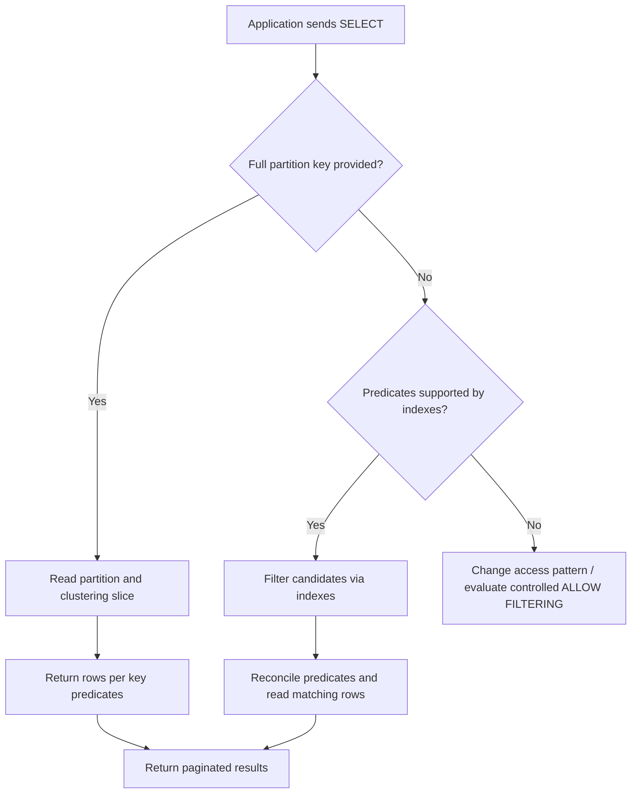

# Combined Filter Predicates and Supported Syntax Scope

**Chapter:** Indexes  
**Module:** `DATABASE_ENGINE_WIDE_COLUMN_CASSANDRA` — Apache Cassandra (wide-column database)

Lesson scope: *Understand Apache Cassandra's distributed architecture and wide-column model, specifically partition keys, query-driven table design, and read/write consistency levels. Practice CQL, replication, compaction, repair, troubleshooting, and connecting from Java applications.*

A familiar SQL clause like `WHERE category = 'ssd' AND price < 2000000 ORDER BY price` may be valid in a relational database, yet is neither automatically valid nor efficient in Cassandra. Cassandra distributes data by **partition key**, orders rows within a partition by **clustering columns**, and builds secondary indexes only on explicitly declared columns. Therefore, before combining predicates in `WHERE`, answer three separate questions:

1. **CQL syntax:** Does your Cassandra version support the operator and predicate combination?
2. **Data access path:** Does the query use a full partition key, clustering key, or appropriate index?
3. **Operational cost:** Does an accepted query scan too many partitions, filter massive candidate sets, or contact too many nodes?

The objective is to test all three layers through reproducible experiments, especially when combining conditions across multiple columns backed by **Storage-Attached Index (SAI)**.

## 1. Learning objectives and version scope

Upon completing this lesson, you should be able to:

- Predict which queries run purely via partition/clustering keys and which depend on indexes.
- Write and read combined predicates using `AND`, `=`, `>`, `>=`, `<`, `<=`, avoiding unfounded assumptions about `OR`, `IN`, `LIKE`, and `ORDER BY`.
- Distinguish SAI filtering from legacy secondary indexes (2i) or `ALLOW FILTERING`.
- Measure results and latency of multi-predicate filters on common values, rare values, and multi-node communication.
- Decide when to continue using an index versus creating a dedicated query-driven table.

**Primary hands-on scope:** Apache Cassandra **5.0+**, with built-in SAI. The `CREATE CUSTOM INDEX ... USING 'StorageAttachedIndex'` statements in the lab require a version supporting SAI. On Apache Cassandra 4.x, do not copy SAI commands expecting them to run: verify your version's capabilities and use keyed queries or actually available indexing mechanisms. Some Cassandra-compatible systems or custom distributions have different feature sets; examples here do not automatically apply to every such product.

In CQL, a query can be **syntactically valid yet lack an efficient access path**, or **executable yet unsuitable for production load**. Evaluate those two cases separately.

## 2. Map: how can each column be filtered?

Consider a typical table:

```sql
CREATE TABLE shop.orders_by_customer (
    customer_id uuid,
    ordered_at timestamp,
    order_id uuid,
    state text,
    total_cents bigint,
    PRIMARY KEY ((customer_id), ordered_at, order_id)
) WITH CLUSTERING ORDER BY (ordered_at DESC, order_id ASC);
```

This statement illustrates key structure; `shop` must be an existing keyspace before running it.

| Column role | Natural access path | Example | Key point |
| --- | --- | --- | --- |
| `customer_id` — partition key | `=`, and querying a list of partitions via `IN` within CQL syntax limits | `customer_id = ?` | Full partition key locates data before reading clustering rows. |
| `ordered_at` — first clustering column | Equality or range within an identified partition | `customer_id = ? AND ordered_at >= ?` | Cassandra reads an ordered slice in the partition without needing a secondary index. |
| `order_id` — next clustering column | Constrained by preceding clustering columns' order | `customer_id = ? AND ordered_at = ? AND order_id = ?` | Do not skip a prefix expecting to select an interior clustering column alone. |
| `state`, `total_cents` — regular columns | Requires a suitable index or a different table model if filtering across partitions | `state = 'PAID'` | Appearing in `SELECT` does not make a column usable in `WHERE`. |

Predicates on the primary key represent **storage-structure data access**. Index filtering is an **auxiliary access path**. Never view indexes as a way to turn arbitrary SQL combinations into efficient Cassandra queries.

Example matching query-driven table design:

```sql
-- Query targeting an exact partition and time range:
SELECT ordered_at, order_id, state, total_cents
FROM shop.orders_by_customer
WHERE customer_id = 00000000-0000-0000-0000-000000000101
  AND ordered_at >= '2026-11-01T00:00:00Z'
  AND ordered_at <  '2026-12-01T00:00:00Z';
```

Here `AND` combines **key predicates**, requiring no secondary index.

## 3. Setting up the SAI dataset to test predicate combinations

Run on a **test cluster** running Cassandra 5.0+, verifying the actual datacenter name first. The example uses `datacenter1` and replication factor 1 so it can run on a single node; RF=1 is strictly for practice, not fault-tolerant production.

```bash
nodetool status
cqlsh
```

In `cqlsh`:

```sql
SELECT data_center, release_version FROM system.local;

CREATE KEYSPACE IF NOT EXISTS lab_indexes
WITH replication = {
    'class': 'NetworkTopologyStrategy',
    'datacenter1': 1
};

CREATE TABLE IF NOT EXISTS lab_indexes.items_by_id (
    item_id uuid PRIMARY KEY,
    category text,
    brand text,
    price_cents bigint,
    state text,
    title text
);

CREATE CUSTOM INDEX IF NOT EXISTS idx_items_category
ON lab_indexes.items_by_id (category)
USING 'StorageAttachedIndex';

CREATE CUSTOM INDEX IF NOT EXISTS idx_items_brand
ON lab_indexes.items_by_id (brand)
USING 'StorageAttachedIndex';

CREATE CUSTOM INDEX IF NOT EXISTS idx_items_price
ON lab_indexes.items_by_id (price_cents)
USING 'StorageAttachedIndex';

-- Intentionally DO NOT index state and title yet.
```

If your datacenter is not `datacenter1`, adjust the name in `CREATE KEYSPACE`. Wait for all indexes to finish building before comparing results; index builds can be asynchronous when data already exists. Verify the schema via `system_schema.indexes` and logs/tracing rather than assuming the `CREATE` return means readiness.

Insert rows containing both repeated and distinct values:

```sql
INSERT INTO lab_indexes.items_by_id (item_id, category, brand, price_cents, state, title)
VALUES (00000000-0000-0000-0000-000000000001, 'ssd', 'Aster', 1200000, 'ACTIVE', 'SSD 1 TB');

INSERT INTO lab_indexes.items_by_id (item_id, category, brand, price_cents, state, title)
VALUES (00000000-0000-0000-0000-000000000002, 'ssd', 'Aster', 1900000, 'ACTIVE', 'SSD 2 TB');

INSERT INTO lab_indexes.items_by_id (item_id, category, brand, price_cents, state, title)
VALUES (00000000-0000-0000-0000-000000000003, 'ssd', 'Boreal', 1600000, 'INACTIVE', 'SSD 512 GB');

INSERT INTO lab_indexes.items_by_id (item_id, category, brand, price_cents, state, title)
VALUES (00000000-0000-0000-0000-000000000004, 'ram', 'Aster', 1100000, 'ACTIVE', 'RAM 16 GB');

INSERT INTO lab_indexes.items_by_id (item_id, category, brand, price_cents, state, title)
VALUES (00000000-0000-0000-0000-000000000005, 'ram', 'Boreal', 2200000, 'ACTIVE', 'RAM 32 GB');

INSERT INTO lab_indexes.items_by_id (item_id, category, brand, price_cents, state, title)
VALUES (00000000-0000-0000-0000-000000000006, 'ssd', 'Aster', 2500000, 'INACTIVE', 'SSD Pro');

CONSISTENCY ONE
```

This small dataset makes manual verification easy. For performance evaluation, load a sufficiently large dataset with realistic key distributions; six rows do not show read amplification, cardinality, or index posting-list intersection cost.

## 4. `AND` across SAI-indexed columns

### 4.1. Intersection of two equality predicates

```sql
SELECT item_id, category, brand, price_cents
FROM lab_indexes.items_by_id
WHERE category = 'ssd'
  AND brand = 'Aster';
```

Expected results: three IDs ending in `001`, `002`, and `006`. Both `category` and `brand` have SAI indexes, so the engine can use them to narrow candidate rows.

Easy to reason about with set logic:

- Set A = items with `category = 'ssd'` ⇒ {001, 002, 003, 006}.
- Set B = items with `brand = 'Aster'` ⇒ {001, 002, 004, 006}.
- `A AND B` ⇒ {001, 002, 006}.

This is a **logical interpretation**, not a guarantee that Cassandra physically executes two separate steps and materializes an intersection. Execution plans and costs depend on version, statistics, and how SAI evaluates queries.

### 4.2. Intersecting equality and numeric range predicates

```sql
SELECT item_id, category, brand, price_cents
FROM lab_indexes.items_by_id
WHERE category = 'ssd'
  AND brand = 'Aster'
  AND price_cents >= 1500000
  AND price_cents <  2200000;
```

Expected result: **only ID 002** (price 1,900,000). The range predicate on `price_cents` is supported via numeric SAI and combined with equality predicates using `AND`. The two bounds `>=` and `<` define the half-open interval `[1,500,000, 2,200,000)`. You can use `>`/`<=` depending on boundary semantics.

Verify boundaries by changing `price_cents < 2200000` to `price_cents <= 1900000` or `price_cents < 1900000`. With this dataset, the latter excludes ID 002. Do not generalize range support to **every data type** from a numeric example: data type, index type, and version all govern supported operators.

### 4.3. `AND` between indexed and unindexed columns

Try the following query **before indexing `state`**:

```sql
SELECT item_id, category, state
FROM lab_indexes.items_by_id
WHERE category = 'ssd'
  AND state = 'ACTIVE';
```

If the system rejects it for requiring filtering, that is expected behavior to recognize. Having an index on `category` does not automatically provide a supported, optimal access path for `state`. Some versions/configurations may allow post-filtering in specific cases; **never** treat the statement succeeding on tiny data as proof it is efficient on large datasets.

The proper solution for frequent queries is indexing `state` (if workload and cardinality fit) or creating a dedicated query table:

```sql
CREATE CUSTOM INDEX IF NOT EXISTS idx_items_state
ON lab_indexes.items_by_id (state)
USING 'StorageAttachedIndex';

SELECT item_id, category, state
FROM lab_indexes.items_by_id
WHERE category = 'ssd'
  AND state = 'ACTIVE';
```

Expected results once the index is ready: `001` and `002`.

**Operational note:** `state = 'ACTIVE'` may match most of the dataset. An index on a low-selectivity value can still examine huge numbers of items; testing on a handful of records does not reflect real cost. If you frequently need paginated, ordered, region- or category-scoped lists of ACTIVE items, see the query-driven table model in section 9.

## 5. Syntax scope: what is typically supported vs. unsupported

The table below separates **CQL syntax** from **access paths**. The "conclusion" column refers to Apache Cassandra 5.x in this lesson's context and does not replace version-specific docs or empirical testing.

| Syntax/intent | Compact example | Conclusion with Cassandra + SAI |
| --- | --- | --- |
| `AND` across SAI columns | `category = 'ssd' AND brand = 'Aster'` | Usable to combine predicates supported by indexes. |
| Equality + numeric range on SAI | `category = 'ssd' AND price_cents >= 1500000` | Usable when column type and index support ranges. |
| Multiple bounds on one numeric column | `price_cents >= 100 AND price_cents < 200` | Supported for SAI-indexable numeric types to form a range. |
| General `OR` operator | `category = 'ssd' OR brand = 'Aster'` | Not general CQL `WHERE` Boolean syntax in this scope. Split into multiple queries and merge, or redesign the model. |
| `IN` on partition key | `item_id IN (uuid1, uuid2)` | CQL supports querying a set of partition keys, but bound key count and fan-out cost. |
| `IN` as an `OR` substitute on any index | `category IN ('ssd','ram')` | Do not assume it is supported or optimal just because SAI exists; check your exact version and index type. |
| SQL-style `LIKE` | `title LIKE '%SSD%'` | Not supported out of the box by SAI; substring/full-text search requires dedicated tools and strategies. |
| `CONTAINS` on collections | `tags CONTAINS 'java'` | Collection-element operator with appropriate schema/index, **not** substring search inside strings. |
| `CONTAINS KEY` on maps | `attrs CONTAINS KEY 'color'` | Applies only to maps with supported index/access paths. |
| `ORDER BY` any SAI column | `ORDER BY price_cents ASC` | Filtering indexes do not grant arbitrary sorting. CQL `ORDER BY` ties primarily to clustering order under valid conditions. |
| `LIMIT n` | `LIMIT 20` | Caps returned rows, not the number of partitions or index entries scanned. |
| `ALLOW FILTERING` | `... WHERE state = 'ACTIVE' ALLOW FILTERING` | Permits extra scanning/filtering per CQL rules, easily expensive; not a "use index" directive. |
| `!=`, arbitrary arithmetic, regex | `price_cents * 2 > 100` | Do not assume relational SQL `WHERE` semantics; rewrite the query or data model. |

**Rule:** "An index exists" is only one prerequisite in certain cases. CQL still enforces rules on operators, columns, keys, ordering, and filtering. Never assume that because SAI supports `AND`, arbitrary `(A OR B) AND (C NOT D)` expressions work.

### 5.1. `OR` and `IN`: two distinct meanings

CQL does not provide arbitrary `OR` like relational SQL:

```sql
-- ILLUSTRATION OF UNSUPPORTED / DISCOURAGED QUERY:
-- SELECT item_id FROM lab_indexes.items_by_id
-- WHERE category = 'ssd' OR brand = 'Boreal';
```

If business logic needs the union of multiple sets, execute separate valid queries and merge by `item_id` in the application layer:

```sql
SELECT item_id FROM lab_indexes.items_by_id
WHERE category = 'ssd';

SELECT item_id FROM lab_indexes.items_by_id
WHERE brand = 'Boreal';
```

When merging, deduplicate `item_id` and account for pagination, deadlines, CL, and possible data mutations between the two reads. Two separate queries do not yield an atomic point-in-time snapshot.

By contrast, `IN` on a partition key means "look up a **specific list of keys**":

```sql
SELECT item_id, title
FROM lab_indexes.items_by_id
WHERE item_id IN (
    00000000-0000-0000-0000-000000000001,
    00000000-0000-0000-0000-000000000004
);
```

This returns two rows identified by primary key—**fundamentally different** from finding all rows matching either of two index predicates. Never pass unboundedly large `IN` lists in a single request, as they fan out into many internal partition reads.

### 5.2. `CONTAINS` is not equivalent to `LIKE`

Suppose a table has column `tags set<text>`. Intent:

```sql
-- Collection operator, requires matching table/index structure:
-- SELECT item_id FROM ... WHERE tags CONTAINS 'hardware';
```

This checks **collection elements**, not whether the substring "hardware" appears in `title`. For maps, `CONTAINS KEY` exists and indexes target keys/values/entries differently; check the exact index type, version, and schema. Never infer that an SAI text index supports arbitrary substring or fuzzy matching by default.

**SASI**, if encountered in older docs or clusters, is a separate indexing mechanism with its own limits and analyzer options. SASI `LIKE` examples are not a general contract for legacy 2i or SAI. When full-text search, diacritic-aware matching, ranking, or linguistic analysis is needed, evaluate a dedicated search engine or build normalized search keys.

### 5.3. `ORDER BY` and `GROUP BY` are not arbitrarily unlocked by SAI

An index on `price_cents` selects candidates; it **does not** turn `items_by_id` into a table physically sorted by price.

```sql
-- NOT a valid sorted query merely because price_cents has SAI:
-- SELECT * FROM lab_indexes.items_by_id
-- WHERE category = 'ssd' ORDER BY price_cents ASC;
```

To retrieve the "20 cheapest SSDs" under high load, design a purpose-built table:

```sql
CREATE TABLE lab_indexes.items_by_category_price (
    category text,
    price_cents bigint,
    item_id uuid,
    brand text,
    title text,
    PRIMARY KEY ((category), price_cents, item_id)
) WITH CLUSTERING ORDER BY (price_cents ASC, item_id ASC);

-- Data in this new table must be maintained separately by the app/pipeline.
SELECT price_cents, item_id, title
FROM lab_indexes.items_by_category_price
WHERE category = 'ssd'
LIMIT 20;
```

This new table **partitions by category**; if any single category grows huge, add a bucketing strategy with appropriate pagination and result merging. `CREATE TABLE` does not automatically sync rows from the base table.

Similarly, `GROUP BY` in CQL is tightly constrained to primary-key and column ordering. Do not use SAI to mimic cluster-wide SQL warehouse `GROUP BY brand, date` reports.

## 6. `ALLOW FILTERING`: valid syntax does not mean valid design

A query filtering only on an unindexed column:

```sql
-- Typically rejected when no suitable key/index lookup predicate exists.
SELECT item_id FROM lab_indexes.items_by_id
WHERE title = 'SSD 1 TB';
```

You may see a message like `Cannot execute this query as it might involve data filtering`. CQL offers:

```sql
SELECT item_id FROM lab_indexes.items_by_id
WHERE title = 'SSD 1 TB'
ALLOW FILTERING;
```

In a six-row lab, results arrive instantaneously. Across millions of partitions, the coordinator may read and discard vast amounts of data before finding matching rows. `ALLOW FILTERING` is an **explicit acknowledgment of potentially expensive filtering when permitted by the engine**, not a way to force Cassandra to use SAI or create an index.

When mixing an indexed predicate and an unindexed predicate:

```sql
-- Example requiring careful evaluation of post-filtering:
SELECT item_id FROM lab_indexes.items_by_id
WHERE brand = 'Aster'
  AND title = 'SSD 1 TB'
ALLOW FILTERING;
```

Do not assume that having an index on `brand` guarantees the volume scanned is small. If `brand` appears in most rows, candidate sets remain large. Nor should you automatically append `ALLOW FILTERING` whenever the driver rejects a query: that masks key-design bugs, introduces unstable latency, and spikes node load.

**Safe response when a query is rejected:**

1. Record the exact CQL statement, key schema, index types, and error message.
2. Check if the filter can be expressed via partition/clustering keys.
3. If it is a rare, selective access pattern, evaluate creating a suitable index.
4. If it needs sorting, stable pagination, or frequent queries over large sets, design a query-driven table instead of using `ALLOW FILTERING`.

There is no single universal solution; decide based on cardinality, frequency, SLAs, partition size, and write/index overhead.

## 7. Step-by-step experiments and prediction table

After section 3 and once indexes are ready, execute each query in `cqlsh`, write down your "expectation" first, and compare with reality. In this lab, `CONSISTENCY ONE` is a single-node RF=1 choice; in production, read consistency must reflect business guarantees and topology.

| ID | Condition | Prediction on sample data | What to check |
| --- | --- | --- | --- |
| Q1 | `category = 'ssd'` | 4 rows (001, 002, 003, 006) | Equality on one index. |
| Q2 | `category = 'ssd' AND brand = 'Aster'` | 3 rows (001, 002, 006) | Intersection of two indexed predicates. |
| Q3 | Q2 plus `price_cents >= 1500000 AND price_cents < 2200000` | 1 row (002) | Adding numeric range intersection. |
| Q4 | `category = 'ssd' AND state = 'ACTIVE'` before indexing state | Likely rejected due to filtering | Inspect the error; do not "fix" by guessing. |
| Q5 | Q4 after creating and building state index | 2 rows (001, 002) | Multi-index filtering. |
| Q6 | `category = 'ssd' OR brand = 'Boreal'` | Not a general CQL Boolean `OR` query | Split into two SELECTs and union/dedup in app. |
| Q7 | `item_id IN (001, 004)` | 2 rows (001, 004) | Partition-key set lookup. |
| Q8 | `title = 'SSD 1 TB' ALLOW FILTERING` | 1 row (001), if accepted | May scan heavily; never extrapolate performance from lab. |
| Q9 | `category = 'ssd' ORDER BY price_cents` | Does not become valid sorting via SAI | Use `items_by_category_price` for sorted access. |

Q4 is a "pre-index" test; if you already ran section 4.3 and `state` is indexed, skip Q4 or test on a separate lab table. Avoid `DROP INDEX` while another application uses it.

### 7.1. Observing queries with tracing

`cqlsh` supports tracing queries during testing:

```sql
TRACING ON;

SELECT item_id FROM lab_indexes.items_by_id
WHERE category = 'ssd' AND brand = 'Aster';

SELECT item_id FROM lab_indexes.items_by_id
WHERE category = 'ssd'
  AND brand = 'Aster'
  AND price_cents >= 1500000
  AND price_cents < 2200000;

TRACING OFF;
```

Extract events from the trace covering index lookups, replica requests, base-row reads, and completion timings (when recorded). Tracing is a diagnostic tool with runtime cost; enable it sparingly. Never assume Cassandra offers a general SQL `EXPLAIN` like PostgreSQL.

Inspect index definitions in the schema:

```sql
SELECT keyspace_name, table_name, index_name, kind, options
FROM system_schema.indexes
WHERE keyspace_name = 'lab_indexes';
```

Results should verify column names and implementations of newly created indexes. If datacenter names or versions mismatch, fix the **lab environment** before concluding a filter syntax is unsupported.

### 7.2. What to measure beyond "it returns rows"?

When scaling data volume up, compare at minimum:

- **Latency**: p50/p95/p99 for each pattern Q1–Q5, not a single `SELECT` timing.
- **Selectivity**: matching rows over total rows; rare/common value distributions and per-node spread.
- **Fan-out and resources**: trace/metric evidence of replica requests, CPU, disk reads, and index memory.
- **Read consistency**: hold CL constant when comparing; under concurrent writes, reads at different moments can differ independently of index syntax.
- **Pagination**: `LIMIT 10` does not guarantee low resource usage; with the Java Driver, use paging state and controlled page sizes instead of emulating `OFFSET`.

Hold dataset and conditions fixed across runs. If you alter indexes, cluster topology, or data volume between runs, document it because it is no longer an apples-to-apples comparison.

## 8. When combining predicates touches distributed data

Conceptual diagram:



Cassandra indexes do not gather all data onto one node to execute arbitrary SQL joins. In `items_by_id` keyed by UUID, rows sharing a category span countless partitions distributed across replicas. SAI helps select which rows to read, yet still incurs index lookups, multi-replica coordination, and base-row fetches.

When adding more `AND` predicates:

- If each predicate eliminates many candidates, combining indexes can save work.
- If one predicate is almost always true (e.g., `state = 'ACTIVE'` on 99% of rows), it barely reduces candidates.
- If cross-partition sorting or "top N" is required, a filtering secondary index alone generally cannot satisfy it directly.
- If a query needs stable latency, runs very frequently, and requires ordered results, a query-driven table can outperform intersecting multiple indexes.

There is no "more indexes means faster" rule: each index adds write, storage, compaction, and operational costs and can alter ingestion throughput.

## 9. Redesigning a table for fixed predicate combinations

Suppose the UI needs **active** products by `category` and `brand`, sorted ascending by `price_cents`. This fixed access pattern can be optimized with a dedicated table:

```sql
CREATE TABLE lab_indexes.active_items_by_category_brand_price (
    category text,
    brand text,
    price_cents bigint,
    item_id uuid,
    title text,
    PRIMARY KEY ((category, brand), price_cents, item_id)
) WITH CLUSTERING ORDER BY (price_cents ASC, item_id ASC);
```

When writing an ACTIVE item, the application writes or updates this table as well. When an item stops being ACTIVE, the application deletes the corresponding row and manages consistency per business rules. Cassandra does not automatically maintain this table from `items_by_id`.

Query:

```sql
SELECT price_cents, item_id, title
FROM lab_indexes.active_items_by_category_brand_price
WHERE category = 'ssd'
  AND brand = 'Aster'
  AND price_cents >= 1500000
  AND price_cents <  2200000
LIMIT 20;
```

Here:

- `(category, brand)` is a **composite partition key**, identifying the group of rows to read.
- `price_cents` is a clustering column, so the price range scans ordered rows.
- `item_id` breaks ties for items with the same price.
- "ACTIVE" is encoded by **dedicated table membership**: only active rows are maintained, removing `state` from `WHERE`.

In return, the table requires synchronization and protection against oversized partitions. If you need flexible filtering across unpredictable attributes, SAI may be preferable to creating endless tables per combination. Choose based on **real queries and real metrics**.

## 10. Querying and pagination example from Java

With Java Driver 4.x, use prepared statements and set the consistency level matching application requirements; never concatenate user-supplied strings directly into CQL predicates.

```java
import com.datastax.oss.driver.api.core.CqlSession;
import com.datastax.oss.driver.api.core.DefaultConsistencyLevel;
import com.datastax.oss.driver.api.core.cql.PreparedStatement;
import com.datastax.oss.driver.api.core.cql.ResultSet;
import com.datastax.oss.driver.api.core.cql.Row;

public final class ItemSearch {
    public static void search(CqlSession session,
                              String category,
                              String brand,
                              long minPrice,
                              long maxPriceExclusive) {

        PreparedStatement statement = session.prepare(
            "SELECT item_id, title, price_cents " +
            "FROM lab_indexes.items_by_id " +
            "WHERE category = ? AND brand = ? " +
            "AND price_cents >= ? AND price_cents < ?"
        );

        ResultSet result = session.execute(
            statement.bind(category, brand, minPrice, maxPriceExclusive)
                     .setConsistencyLevel(DefaultConsistencyLevel.ONE)
                     .setPageSize(100)
        );

        // The driver may fetch subsequent pages while iterating; not all rows
        // are necessarily retrieved immediately upon execute().
        for (Row row : result) {
            System.out.println(row.getUuid("item_id") + " | " +
                row.getString("title") + " | " +
                row.getLong("price_cents"));
        }
    }
}
```

This illustrates a read at lab RF=1. In production, configure local datacenter/contact points, CL matching RF, timeouts, maximum page limits, retry policies, and metrics. `setPageSize(100)` controls page size, **not** turning a query with millions of matches into a cheap operation; the `for` loop can fetch page after page until exhausted.

If users add new filters like `state` or substring matching on `title`, the backend must verify feature support and schema before building CQL. Never automatically append `ALLOW FILTERING` when queries fail. For optional filters, prepare statements only for combinations **supported by the schema and Cassandra version**.

## 11. Common errors and diagnostic reasoning

| Symptom | Causes to inspect | Remediation |
| --- | --- | --- |
| `WHERE A AND B` rejected even though A has SAI | B is unindexed or operator on B unsupported; current version filtering rules | Inspect schema, error message, version; add appropriate index or change query/table. |
| `OR` causes syntax error | No general Boolean OR in CQL for this scope | Split into multiple queries and union with deduplication, or change access pattern. |
| `LIKE '%x%'` fails | Confusing text equality/range index with substring/full-text search | Verify supported index features; consider search engine or custom lookup keys. |
| `ALLOW FILTERING` runs in lab but times out on real data | Overly broad scan, poor cardinality, or heavy fan-out | Remove broad filtering; add proper index or query-driven table. |
| `LIMIT 10` is still slow | Engine processes many candidates before finding 10 rows | Inspect trace/metrics and selectivity; review clustering design. |
| `ORDER BY price_cents` rejected | SAI index does not establish primary-key ordering | Cluster by price within an appropriately chosen partition. |
| Q2/Q3 returns unexpected rows vs. sample | Leftover lab data, index still building, CL/topology, incomplete writes, or typo in ID | Verify each UUID by primary key, schema/index state, and write timing. |
| `IN` with thousands of keys is very slow | Queries too many partitions and large result sets | Split into controlled small batches, bound fan-out, or revisit access pattern. |

When comparing post-write results, remember Cassandra uses **replication** with separate read/write CLs. A query missing rows does not automatically prove an index bug: verify rows by primary key, consistency level, node health, and write timing. Repair/compaction issues must be assessed independently of filter syntax.

## 12. Self-check exercises

1. Using `items_by_id` and indexes on `category`, `brand`, `price_cents`, write the query for Aster SSDs priced from 1,500,000 up to (excluding) 2,200,000. Explain each predicate and predict the UUID.
2. Drop the `brand` index. Why can `WHERE category='ssd' AND brand='Aster'` fail? Why can't you infer from the word `AND` alone that execution will be efficient?
3. Contrast `OR` and `IN` on the partition key via two requirements: "fetch exact 2 UUIDs" vs. "fetch all SSDs or RAM." Which one can be executed directly with `item_id IN (...)`?
4. Why is `CONTAINS` on `set<text>` not a replacement for `LIKE '%word%'` on `text`?
5. Is `ORDER BY price_cents` supported simply because an SAI index exists on price? Design a query-driven table for "active items in a category and brand, ordered ascending by price."
6. Does adding `LIMIT 20` to a broad scan guarantee Cassandra reads only 20 rows? Name two metrics you would check to verify.
7. Propose one use case suited for SAI flexible multi-predicate filtering and one use case suited for a query-driven table. Justify via frequency, selectivity, ordering, and update cost.

### Checklist before shipping combined filters to an application

- [ ] Verify Cassandra version, index types, index build state, and actual schema.
- [ ] Distinguish predicates on partition/clustering keys from predicates requiring indexes.
- [ ] Check **every operator** in `WHERE`; never extrapolate from relational SQL.
- [ ] Confirm the combined query runs in the target environment, then test with realistic data scale.
- [ ] Measure latency, matching fraction, fan-out, read CL, and pages read.
- [ ] Never use `ALLOW FILTERING` as a default query fix.
- [ ] For `OR`, cross-partition sorting, or cross-partition pagination, revisit the access pattern/table before adding indexes.
- [ ] Keep a way to verify base data by primary key when filtered results look unexpected.

**Key takeaway:** In Cassandra, `WHERE A AND B` only expresses logical criteria. It becomes a sound query only when **CQL syntax supports it**, **keys/indexes provide an appropriate read path**, and **cost on real data is acceptable**. SAI expands available combined filters; it does not replace query-driven data modeling.
