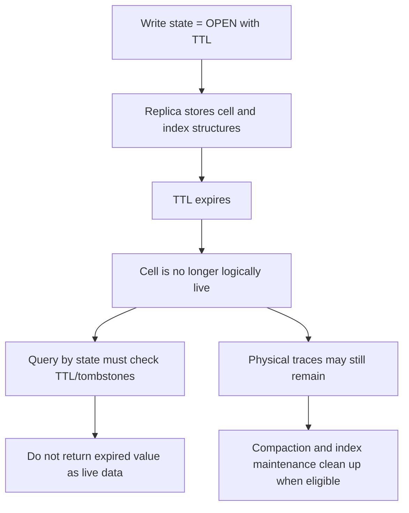

# Indexes When Data Expires or Has Tombstones in Apache Cassandra

## 1. The problem to understand

In Apache Cassandra, an **index** helps locate data by a column outside the primary `PRIMARY KEY` lookup path. However, data in a distributed wide-column system does not vanish immediately from disk upon **TTL (time to live)** expiration or when an application executes `DELETE`. Cassandra typically records deletion state using **tombstones**, then reclaims physical records later when safe.

This creates two distinct questions:

- **Is the data still logically live?** A cell whose TTL expired or that is shadowed by a tombstone is not considered live at read time.
- **Do physical traces still exist in SSTables and index structures?** An old record or related index entry can remain on disk for some time until compaction and index maintenance process it.

Confusing these two questions leads applications to design queries that scan massive numbers of tombstones, misjudge index costs, or assume waiting for TTL immediately frees disk space.

This lesson belongs to the **Indexes** chapter of the `DATABASE_ENGINE_WIDE_COLUMN_CASSANDRA` module and focuses on the interplay among query-driven table design, partition keys, replication, compaction, repair, and Java connectivity when data expires or is deleted.

### After this lesson, you will be able to

1. Distinguish expired data, tombstones, physically lingering index entries, and live data returned by queries.
2. Explain the impact of TTL/`DELETE` on secondary indexes and Storage-Attached Index (SAI) accurately for your running Cassandra version.
3. Practice CQL to observe TTL expiration and column deletion on an indexed column.
4. Diagnose slow queries caused by tombstones/index churn and propose improvements via table design, retention, and cluster operations.

## 2. How do TTL and tombstones work?

**TTL** is the lifespan in seconds assigned to data written to Cassandra. TTL applies to **cell values** of regular columns, not primary-key components. Cells within the same row can carry different TTLs. Upon expiration, a value is no longer logically live even while its physical bytes may remain on disk.

A **tombstone** is a timestamped deletion marker that lets replicas and data reconciliation know an old value was deleted. Tombstones appear when applications delete data via CQL and are also associated with TTL-expired data. They are an essential part of the distributed data model, not merely "garbage" to wipe out as fast as possible.

| Scenario | Logical impact | What may remain on disk |
| --- | --- | --- |
| `INSERT ... USING TTL 120` | TTL-bound values stop being live after the deadline | Expired cells, TTL/deletion metadata, and related index structures |
| `UPDATE ... USING TTL 120 SET state = ...` | Only values updated with that TTL expire | Other columns in the row stay live; old data/index entries may await compaction |
| `DELETE state FROM ...` | The `state` column has no live value | Column tombstone and existing value/index traces |
| `DELETE FROM ... WHERE ...` | Specified row or range is logically deleted | Tombstones shadowing data across different SSTables |
| Updating an indexed value | New value supersedes old value per timestamp rules | Old versions or related index entries may persist until merged/cleaned |

At **TTL expiration time**, clients do not send a new `DELETE` command. Cassandra uses TTL metadata and write timestamps to recognize expired values during reads and reclaim them physically later.

### Column-level TTL differs from row-level TTL

Suppose a row has `event_id`, `state`, and `detail`:

- `state` is written with a 90-second TTL.
- `detail` is written without a TTL.

After 90 seconds, `state` expires while `detail` remains live. A query by `event_id` still reads the row with `state` as `null` and `detail` intact; an indexed query `state = 'OPEN'` must not treat that row as a valid match for the expired status.

Therefore, deletion/expiration design must account for **cell, row, and partition levels**, never assuming a single column's TTL deletes the whole row.

## 3. Where do indexes live in the distributed architecture?

In Cassandra, secondary indexes are typically **replica-local indexes**: each node manages the index portion covering data stored on that node. There is no standalone "global lookup table" capable of answering every query without contacting data-holding replicas.

Two common mechanisms:

| Mechanism | High-level organization | Key concerns with TTL and tombstones |
| --- | --- | --- |
| **Traditional secondary index (2i)** | Stores column-value-to-row-key lookup structures on each node; maintained alongside base writes | Old/deleted values can leave tombstones and index read/cleanup work, especially on high-churn columns |
| **Storage-Attached Index (SAI)** | Builds index components attached to data/SSTables with dedicated lookup structures | Entries pointing to expired/deleted data can persist in index files until handled through flush/compaction; liveness must still be checked |

**Version note:** SAI support, index creation syntax, and internal details depend on Cassandra version/distribution. Verify available features on your cluster before choosing 2i or SAI. The CQL examples below use **traditional secondary indexes** so they do not require a specific SAI-enabled version.

Across every index type, **result correctness relies on currently live data**, factoring in timestamps, TTLs, tombstones, and the read's consistency level. A lingering physical index entry **never proves** the corresponding row is still live or still matches the indexed value.

### Lifecycle of an indexed value that expires



This diagram illustrates **logical and physical lifecycles**, not an instant synchronous index mutation fired the exact second TTL expires. Candidate filtering and file organization vary across 2i, SAI, and versions.

## 4. CQL practice: an indexed column expiring via TTL

Examples assume a datacenter named `dc1` with replication factor = 3. Adjust DC name and RF to match your actual cluster.

```sql
CREATE KEYSPACE IF NOT EXISTS index_lab
WITH replication = {
    'class': 'NetworkTopologyStrategy',
    'dc1': 3
};

CREATE TABLE IF NOT EXISTS index_lab.events_by_id (
    event_id uuid PRIMARY KEY,
    state text,
    detail text,
    created_at timestamp
);

CREATE INDEX IF NOT EXISTS events_state_idx
ON index_lab.events_by_id (state);
```

The base table looks up quickly by `event_id`. The `state` index enables querying by status with its own cost; this is a functional experiment, not an optimal design for scanning every event in a large system.

### Step 1 — Write data with a long-lived column and a short-lived column

```sql
INSERT INTO index_lab.events_by_id (event_id, detail, created_at)
VALUES (
    aaaaaaaa-aaaa-4aaa-8aaa-aaaaaaaaaaaa,
    'Long-lived detail',
    toTimestamp(now())
);

UPDATE index_lab.events_by_id
USING TTL 90
SET state = 'OPEN'
WHERE event_id = aaaaaaaa-aaaa-4aaa-8aaa-aaaaaaaaaaaa;
```

Only the `state` column in this `UPDATE` receives the 90-second TTL; pre-existing `detail` and `created_at` do not inherit the TTL.

### Step 2 — Observe before TTL expiration

```sql
SELECT event_id, state, detail, TTL(state) AS state_ttl
FROM index_lab.events_by_id
WHERE event_id = aaaaaaaa-aaaa-4aaa-8aaa-aaaaaaaaaaaa;

SELECT event_id, state
FROM index_lab.events_by_id
WHERE state = 'OPEN';
```

On the initial read, `TTL(state)` returns remaining live seconds (counting down over time). Querying `state = 'OPEN'` finds the sample record while the value is live. In an environment with many events, results include other matching records as well.

### Step 3 — Observe after 90 seconds have elapsed

Re-run both `SELECT` statements after TTL expiration:

- The primary-key query still returns `detail` and `created_at`, while `state` and `TTL(state)` no longer have live values.
- The indexed query `state = 'OPEN'` no longer treats the sample row as a valid match once `state` has expired.
- SSTable/index size **does not necessarily shrink immediately**. This is expected because physical reclamation happens later, asynchronously from TTL expiration.

Regarding replication and consistency levels, replicas may receive writes at slightly different times or lag. Use an appropriate read CL (such as `LOCAL_QUORUM` if topology and app requirements allow) when observing steady results; never treat a single `ONE` read against a lagging replica as proof the whole cluster has converged.

## 5. CQL practice: deleting an indexed column

Insert another row:

```sql
INSERT INTO index_lab.events_by_id (event_id, state, detail, created_at)
VALUES (
    bbbbbbbb-bbbb-4bbb-8bbb-bbbbbbbbbbbb,
    'OPEN',
    'Detail still retained',
    toTimestamp(now())
);

DELETE state
FROM index_lab.events_by_id
WHERE event_id = bbbbbbbb-bbbb-4bbb-8bbb-bbbbbbbbbbbb;
```

Once the delete is acknowledged at an appropriate consistency level:

```sql
SELECT event_id, state, detail
FROM index_lab.events_by_id
WHERE event_id = bbbbbbbb-bbbb-4bbb-8bbb-bbbbbbbbbbbb;

SELECT event_id, state
FROM index_lab.events_by_id
WHERE state = 'OPEN';
```

Expected results:

1. The row still exists because `detail` was not deleted.
2. The `state` column on this row is no longer live.
3. Querying the `state = 'OPEN'` index no longer returns this row as currently having `OPEN`; actual observations still depend on the contacted replica and chosen consistency level.
4. Tombstones and related index structures may still occupy disk until physical purge conditions are met.

**Distinction:** `DELETE state` deletes only that column's value. `DELETE FROM ... WHERE event_id = ...` logically deletes the entire row, whereas deleting a clustering range in a multi-row/partition table creates a range tombstone. These tombstone forms differ in scope and affect index reads differently.

## 6. Why can indexed queries slow down after heavy TTL expiration/deletes?

Suppose a service writes millions of events with `state = 'PENDING'` and a short TTL, then constantly updates states. The application repeatedly queries:

```sql
SELECT event_id, state, detail
FROM index_lab.events_by_id
WHERE state = 'PENDING';
```

When large volumes of data expire or get deleted, an indexed query can pay the cost of:

- **Looking up and filtering stale candidates:** index structures may still reference dead column/row versions; the engine must inspect current record metadata before returning results.
- **Reading multiple SSTables:** newer data, older data, and tombstones reside across separate SSTables not yet merged by compaction.
- **Scanning across nodes/partitions:** a replica-local index does not turn a common status query into a single-partition read.
- **Pagination and result volume:** when `state` matches many rows, paging only chunks result delivery; total server-side work stays high.
- **Index churn:** constantly mutating an indexed column drives writes, flushes, compaction, and index maintenance.

Having tombstones does not mean a query is "wrong." The real issue is the **cost of finding live records** and the I/O/CPU burned inspecting large amounts of dead data. Additionally, a lagging node may temporarily observe a different state than up-to-date nodes; choosing the right CL and fixing replica health are distinct from query performance.

### Visualizing the workload

```text
1,000,000 rows that once had state = 'PENDING'
  ├─  50,000 still live
  └─ 950,000 TTL-expired / deleted / overwritten

A query by state must return only live data.
Depending on index type, cleanup, and SSTable state:
  -> lingering old traces may still need checking/filtering
  -> returned row count does not reflect total internal work.
```

These numbers are an illustrative scenario, **not a formula for how many index entries are scanned**. Actual cost depends on version, index type, data layout, and compaction state.

## 7. What roles do compaction, gc_grace_seconds, and repair play?

Cassandra uses an LSM-tree storage engine, writing to memtables and flushing to SSTables. **Compaction** merges SSTables, discards shadowed versions, and reclaims expired data/tombstones **when safe**.

`gc_grace_seconds` is a crucial safety buffer giving replicas that missed a delete time to learn about the tombstone via repair/synchronization. Dropping tombstones too early while a replica still holds old data risks resurrecting deleted data (*zombie data*) when that replica returns.

| Component | Accurate for indexes and tombstones | Misconception to avoid |
| --- | --- | --- |
| **TTL** | Sets logical lifespan of a value | Entry vanishes physically the instant TTL expires |
| **Tombstone** | Preserves deletion markers for accurate reads/reconciliation | Tombstones are always bugs and can be deleted arbitrarily |
| **Compaction** | Merges SSTables and may purge obsolete data/tombstones/index entries | Any compaction pass always purges all tombstones |
| **gc_grace_seconds** | Retains deletion markers long enough per cluster safety policy | Setting to 0 speeds things up without risk |
| **Repair** | Converges data and missed tombstones across replicas | Replaces Paxos, replaces compaction, or fixes poor index design |

Tombstone purging also depends on tombstone age, overlapping SSTables, and data needed to prevent resurrection. Therefore, **there is no guarantee compaction reclaims disk space the moment `gc_grace_seconds` elapses**.

For high-TTL tables written predominantly in time order, **TimeWindowCompactionStrategy (TWCS)** can fit well when time windows rarely receive cross-window updates and retention is well designed. However, TWCS does not cure low-selectivity index queries or data from mixed time ranges residing in the same SSTables.

Maintain a repair schedule aligned with your tombstone policy and Cassandra version requirements. When severe index corruption occurs, use index verification/rebuild tools appropriate **for your running version**; rebuilding indexes neither replaces good data modeling nor acts as a periodic TTL cleanup job.

## 8. Query-driven table design: when to drop the index?

An index on `state` helps when values are selective enough and query scope is bounded. But if the real requirement is:

> "Fetch up to 100 OPEN events for tenant X on day Y, newest first."

Then a query-oriented table can outperform a cluster-wide index on `state`:

```sql
CREATE TABLE IF NOT EXISTS index_lab.events_by_tenant_day_state (
    tenant_id text,
    event_day date,
    state text,
    event_time timestamp,
    event_id uuid,
    detail text,
    PRIMARY KEY ((tenant_id, event_day, state), event_time, event_id)
) WITH CLUSTERING ORDER BY (event_time DESC, event_id ASC);
```

Query:

```sql
SELECT event_id, event_time, detail
FROM index_lab.events_by_tenant_day_state
WHERE tenant_id = 'tenant-a'
  AND event_day = '2026-11-21'
  AND state = 'OPEN'
LIMIT 100;
```

Here, `(tenant_id, event_day, state)` forms the **partition key**, while `event_time` and `event_id` are clustering columns. Cassandra goes directly to the designed partition and returns results in the desired order without cluster-wide status index scans.

However, this design carries trade-offs:

- Partitions must not grow unboundedly; choose an appropriate day/hour bucket width and row limit.
- If an event changes `state`, the application must **delete from the old state partition and insert into the new state partition**. There is no automatic cross-partition CAS across two partitions.
- If keeping `events_by_id` alongside this query table, synchronize both projections per business rules; replication does not perform cross-table dual writes automatically.
- TTLs on the query table must align consistently with event retention. Different tables expiring at different times can present inconsistent views during convergence.

**Choosing an index vs. a dedicated table** depends on partition keys, query patterns, value selectivity, mutation rate, TTL, contacted nodes, and latency SLAs. `ALLOW FILTERING` is not a default remedy for schema-induced slow queries.

## 9. Java application: reading via indexes while bounding queries

Example using **Apache Cassandra Java Driver 4.x** with a `CqlSession` configured for the appropriate cluster and datacenter:

```java
import com.datastax.oss.driver.api.core.CqlSession;
import com.datastax.oss.driver.api.core.DefaultConsistencyLevel;
import com.datastax.oss.driver.api.core.cql.BoundStatement;
import com.datastax.oss.driver.api.core.cql.PreparedStatement;
import com.datastax.oss.driver.api.core.cql.ResultSet;
import com.datastax.oss.driver.api.core.cql.Row;

import java.util.ArrayList;
import java.util.List;
import java.util.UUID;

public final class EventRepository {
    private final CqlSession session;
    private final PreparedStatement byState;

    public EventRepository(CqlSession session) {
        this.session = session;
        this.byState = session.prepare(
            "SELECT event_id, state FROM index_lab.events_by_id " +
            "WHERE state = ?"
        );
    }

    public List<UUID> findCurrentIdsByState(String state) {
        BoundStatement statement = byState.bind(state)
            .setConsistencyLevel(DefaultConsistencyLevel.LOCAL_QUORUM)
            .setPageSize(100);

        ResultSet resultSet = session.execute(statement);
        List<UUID> ids = new ArrayList<>();
        for (Row row : resultSet) {
            ids.add(row.getUuid("event_id"));
        }
        return ids;
    }
}
```

This illustrates configuring CL and page size in the driver. It **still iterates through every result page** if the caller exhausts the loop; `setPageSize(100)` is not a cap on total returned rows. In production systems, enforce application-level limits/budgets and prefer query-oriented partition keys if `OPEN` holds large volumes.

Never cache index lookup results indefinitely without an invalidation policy: TTL expiration or `DELETE` inside Cassandra will not notify external caches. When checking the current state of a specific event, reading directly by primary key at an appropriate CL is usually far cleaner.

## 10. Diagnosing load caused by indexes and tombstones

When indexed queries slow down after mass TTL expirations, investigate systematically:

1. **Query shape:** is it reading a single partition or scanning a column value across many partitions? Should pagination or schema change?
2. **TTL and write volume:** how many values expire per second? Are indexed columns updated repeatedly on the same rows?
3. **Replicas and consistency:** are read/write CLs, available replicas, inter-DC latency, and repair status healthy?
4. **Tombstones and SSTables:** tombstone warning metrics/logs, SSTables read per query, compaction pressure, and disk/CPU/GC headroom.
5. **Index query path:** use controlled tracing to see which nodes are contacted and where time is spent; never leave tracing on across all production traffic.

You can practice in `cqlsh`:

```text
CONSISTENCY LOCAL_QUORUM;
TRACING ON;
```

Then run a sample `SELECT ... WHERE state = 'OPEN'`, inspect the trace, and disable tracing:

```text
TRACING OFF;
```

These are **`cqlsh` commands**, not CQL syntax sent from the Java Driver. Use tracing sparingly because it carries runtime overhead. Depending on version and runbooks, `nodetool tablestats` and `nodetool compactionstats` help inspect SSTable and compaction metrics; never declare an index broken from a single metric alone.

### Symptom and action table

| Symptom | Hypothesis to test | Action |
| --- | --- | --- |
| TTL expired yet disk space hasn't dropped | SSTables/indexes still hold physical traces; purge conditions unmet | Check compaction, retention, and tombstone age |
| Indexed queries very slow after mass expirations | Churn, many stale candidates, or too many partitions/rows scanned | Inspect traces/metrics, bound query scope, consider query-driven table |
| Unstable results across repeated reads | Replica lag, low CL, concurrent writes/deletes | Check replication, repair, and use an appropriate CL |
| Rising timeouts / tombstone warnings | Scanning heavily deleted data/SSTables or overloaded cluster | Reduce scans, fix schema/retention, relieve cluster load |
| Tombstones remain after compaction | Purge not yet safe or overlapping SSTables remain | Check `gc_grace_seconds` policy and purge safety conditions |
| Frequent status queries needed across all tenants | Poor selectivity and wide fan-out | Consider projections keyed by tenant/time/state |

Specifically, **never set `gc_grace_seconds` to 0 or force mass tombstone purges just to cut latency** without proving repair workflows and safety guarantees. Choosing the right data model yields far more durable improvements.

## 11. Common misconceptions

| Misconception | Accurate understanding |
| --- | --- |
| "Once TTL expires, data and index entries vanish from disk instantly." | TTL expires values logically; physical reclamation happens later. |
| "If an index entry exists, the row must be returned." | Results must respect live data/tombstones/timestamps and the query's consistency level. |
| "Indexes solve every non-primary-key query." | Indexes incur fan-out, update, and read costs; query-driven tables may fit better. |
| "Tombstones are pure waste." | Tombstones preserve necessary deletion state in distributed systems and prevent zombie data. |
| "Compaction always deletes all tombstones." | Purge occurs only when safety rules and SSTable layout permit. |
| "SAI has zero cost under continuous TTL/deletes." | SAI differs architecturally from 2i yet still incurs expiration filtering, index cleanup, and compaction costs. |
| "`setPageSize(100)` caps the query at 100 rows." | It sets page size; iterating the whole `ResultSet` still reads all pages. |

## 12. Self-check practice exercises

**Exercise 1 — Single-column TTL.** A row has `id`, `state` (60-second TTL), and `detail` (no TTL). After two minutes, how do a primary-key query and an index query on `state` differ? Why hasn't disk usage necessarily dropped?

**Exercise 2 — Deletes and overwrites.** Two clients update `state` from `OPEN` to `CLOSED` and then delete `state`. Explain the roles of timestamps, tombstones, replica lag, and why physical index entry presence cannot establish current state.

**Exercise 3 — Query optimization.** A system stores 50 million events/day, mostly `state = 'DONE'` with a 24-hour TTL. An API constantly requests the 100 newest events for a tenant on a given day. Compare a cluster-wide index on `state` with `events_by_tenant_day_state`; identify pros and dual-write risks.

**Exercise 4 — Operations.** After mass TTL expirations, indexed query latency jumps from 50 ms to several seconds. Propose which metrics/logs/traces to inspect and explain why setting `gc_grace_seconds = 0` is not a safe default reaction.

**Answer guidelines:**

- **Exercise 1:** `detail` stays live so the PK read finds the row, while expired `state` no longer matches the indexed query. Physical traces await purge conditions.
- **Exercise 2:** Current value is governed by timestamp reconciliation and deletion markers; lagging replicas may differ while converging. Physical index presence never implies live data.
- **Exercise 3:** Partitioning by tenant/day/state bounds reads and supports chronological ordering. State transitions require maintaining multiple projections, managing consistency and aligned TTLs.
- **Exercise 4:** Monitor query latency, traces, tombstone warnings, SSTables/compaction, row/partition sizes, CL, and replica health. Lowering grace arbitrarily risks zombie data.

## Key takeaways

In Cassandra, **TTL expiration and tombstones represent logical deletion states; indexes and SSTables may still hold physical traces** until reclamation conditions are met. To query accurately and efficiently, combine **query-aligned partition keys**, version- and workload-appropriate 2i/SAI evaluation, proper consistency levels, safe repair/compaction practices, and cost controls under continuous expiration.
