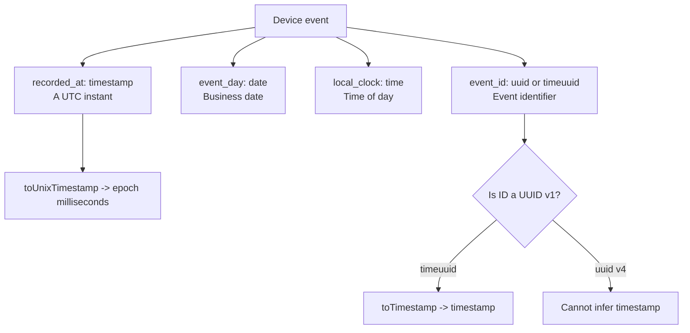
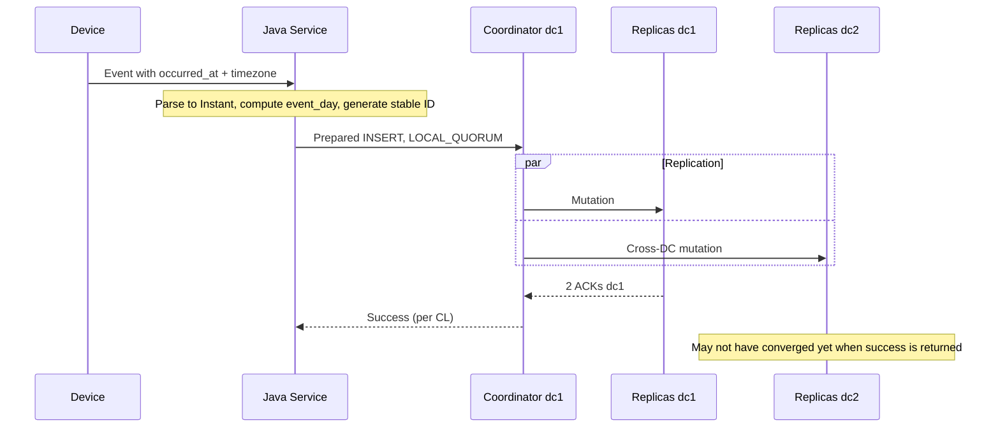

# Type Conversion Functions, UUID/timeuuid, and Date/Time Handling

In Apache Cassandra, many data bugs do not stem from lost replicas, but from **misunderstanding CQL types**: storing timestamps as strings and filtering in the wrong order, using a random `uuid` as a time-ordered key, converting `timestamp` to `date` while forgetting the timezone, or calling `now()` again when retrying a write. These bugs are especially hard to detect in a distributed cluster because the same partition can be read through different coordinators, while the Java application and servers may use different default timezones.

This lesson belongs to the **Advanced CQL** chapter of the **DATABASE_ENGINE_WIDE_COLUMN_CASSANDRA** module, connecting knowledge of data types, query-driven wide-column table design, replication, consistency levels, error handling, and the Java Driver. The goal is to understand **how values are stored and compared**, rather than merely memorizing function names.

After this lesson, you will be able to:

- Distinguish between `uuid`, `timeuuid`, `timestamp`, `date`, `time`, and Unix time.
- Use `CAST(expression AS type)` within its proper scope and understand the limitations of type casting.
- Use `now()`, `toTimestamp`, `toDate`, `toUnixTimestamp`, `minTimeuuid`, and `maxTimeuuid` under appropriate conditions.
- Design event tables with partition keys and time-based clustering, and query using **half-open** intervals `[start, end)`.
- Use `Instant`, `LocalDate`, `LocalTime`, `ZoneId`, and `UUID` in Java Driver 4.x.
- Avoid confusing **event time**, **write time**, **CQL TTL**, **writetime**, and **timeuuid timestamp**.

## 1. Map of CQL Time and Identifier Types

| CQL Type | Represented Value | Key Characteristics | Common Java Driver 4.x Type |
|---|---|---|---|
| `uuid` | 128-bit UUID, not constrained to encode time. | Commonly uses UUID v4 for random IDs; time cannot be inferred from UUID v4. | `java.util.UUID` |
| `timeuuid` | **Version 1** UUID with a time component. | CQL orders timeuuids, which is useful for clustering; not an absolute business clock. | `java.util.UUID` (must be an appropriate UUID v1) |
| `timestamp` | An **instant** on the Unix timeline. | Storage precision is typically **milliseconds**; does not store the original timezone name. | `java.time.Instant` |
| `date` | A **calendar date** without time-of-day/timezone. | Suitable for day buckets already computed in a business timezone. | `java.time.LocalDate` |
| `time` | Time of day without date/timezone. | Has nanosecond resolution at the data type level; not a standalone instant. | `java.time.LocalTime` |
| `bigint` storing Unix time | Application-defined integer, e.g., milliseconds since 1970-01-01T00:00:00Z. | Must explicitly state the **unit**, as epoch seconds, milliseconds, and microseconds differ. | `long` / `Long` |
| `duration` | Duration consisting of months, days, and nanoseconds per Cassandra's model. | Does not correspond to a fixed number of milliseconds in all cases. | Depends on driver API/version; check specific mapping. |

**Key takeaway:** `timestamp` represents **when** on the UTC timeline; `date` represents a **calendar date**; `time` is **time of day**; `timeuuid` is an **ID with a time component**, not a renamed `timestamp`.



The diagram describes **semantics**; it does not mean Cassandra automatically generates or maintains relationships between columns. If the application writes an `event_day` that does not match `recorded_at`, the database can still store both; consistency between them is the application design's responsibility.

## 2. Choose the Data Model Before Choosing Conversion Functions

For example, an IoT system needs two queries:

1. Retrieve the 20 latest measurement points for **a device on a given day**.
2. Retrieve connection events for **a device within a time range**, ordered by time.

Because Cassandra optimizes tables around query patterns, we illustrate two tables. This is a schema for a **test cluster with DCs `dc1` and `dc2` having enough nodes for RF=3**:

```sql
CREATE KEYSPACE telemetry
WITH replication = {
    'class': 'NetworkTopologyStrategy',
    'dc1': 3,
    'dc2': 3
};

CREATE TABLE telemetry.samples_by_device_day (
    tenant_id uuid,
    device_id uuid,
    event_day date,
    recorded_at timestamp,
    event_id uuid,
    local_clock time,
    reading_count int,
    PRIMARY KEY (
        (tenant_id, device_id, event_day),
        recorded_at,
        event_id
    )
) WITH CLUSTERING ORDER BY (
    recorded_at DESC, event_id ASC
);

CREATE TABLE telemetry.events_by_device_day (
    device_id uuid,
    event_day date,
    event_id timeuuid,
    event_type text,
    PRIMARY KEY ((device_id, event_day), event_id)
) WITH CLUSTERING ORDER BY (event_id DESC);
```

In `samples_by_device_day`:

- `(tenant_id, device_id, event_day)` is a **composite partition key**; all three values are encoded and hashed to determine the token/replicas.
- `recorded_at` is a clustering column, enabling **time-range** queries once the full partition key is specified.
- `event_id uuid` distinguishes two events sharing the same `recorded_at` millisecond; UUID v4 is not used to infer timestamps.
- `local_clock time` only stores the time of day for appropriate display/analysis and **does not replace** `recorded_at timestamp`.

In `events_by_device_day`, `event_id timeuuid` serves as both the ID and the time-carrying component for sorting within **a device/day partition**. If a stable event ID across retries is needed, generate the ID exactly once before sending or use another idempotency strategy.

**Warning:** The example with RF=3 across two DCs requires sufficient nodes and matching DC names. On a single Cassandra instance, do not copy this configuration verbatim and expect all quorum operations to succeed. Adjust RF and DC to match your test environment.

## 3. CAST: Expression Type Conversion in CQL

Basic syntax:

```sql
CAST(expression AS target_type)
```

`CAST` converts a value to **a Cassandra-supported type** in an expression context; it is neither an arbitrary parser for date/time strings nor a schema-altering command.

Suppose `reading_count` is `int`. It can be returned as a floating-point number:

```sql
SELECT recorded_at,
       reading_count,
       CAST(reading_count AS double) AS count_as_double
FROM telemetry.samples_by_device_day
WHERE tenant_id = 11111111-1111-1111-1111-111111111111
  AND device_id = 22222222-2222-2222-2222-222222222222
  AND event_day = '2026-11-21'
LIMIT 20;
```

| Scenario | Approach | Notes |
|---|---|---|
| `int` → `double` | `CAST(reading_count AS double)` | The result type changes, while the table still stores `int`. |
| `timestamp` → calendar date | `toDate(recorded_at)` | Dedicated time functions are clearer than assuming arbitrary casting. |
| `timeuuid` → timestamp | `toTimestamp(event_id)` | Must be a valid UUID v1/timeuuid. |
| String `'21/11/2026'` → timestamp | Normalize and parse with timezone on the client, then bind as `timestamp`. | Do not expect `CAST` to understand arbitrary locale formats. |
| `blob` ↔ primitive types | Functions like `intAsBlob`, `blobAsInt` in supported versions. | Converts **binary representation**, not arbitrary JSON/text parsing. |

**Do not assume every type pair can be cast.** Some numeric conversions can lose precision or cause overflow/narrowing; invalid type conversions may be rejected by Cassandra. Check the source-target pair in the documentation for your running version.

### CAST Differs from ALTER TABLE

`CAST(reading_count AS double)` in `SELECT` **does not** change the column type in the schema, modify SSTables, or backfill data. To change the storage type of a column, verify Cassandra's `ALTER TABLE` capabilities or design a **new column/table and migrate data** safely.

### CAST Does Not Optimize a Query

Putting `CAST` in the `SELECT` clause does not give Cassandra a new index or change how partitions are selected. With large datasets, you still need the full **partition key** and an appropriate clustering range. Do not think of casting in `WHERE` as a fix for a table design that does not serve the query pattern.

## 4. Time Conversion Functions in CQL

Common CQL functions:

| Function | Typical Input | Result | Purpose |
|---|---|---|---|
| `toTimestamp(value)` | `date` or `timeuuid` | `timestamp` | Converts a date/UUID v1 to a Cassandra instant. |
| `toDate(value)` | `timestamp` or `timeuuid` | `date` | Extracts the date part according to Cassandra's conversion semantics. |
| `toUnixTimestamp(value)` | `timestamp`, `date`, or `timeuuid` depending on version | `bigint` | Milliseconds since the Unix epoch. |
| `now()` | No arguments | `timeuuid` | Generates a UUID v1 using the clock at execution time, suitable for certain event keys. |
| `minTimeuuid(timestamp)` | Timestamp value | Synthetic lower-bound `timeuuid` | Creates a **range filter bound** for `timeuuid` clustering. |
| `maxTimeuuid(timestamp)` | Timestamp value | Synthetic upper-bound `timeuuid` | Creates a **range filter bound** with upper-bound semantics. |
| `uuid()` | No arguments, in supported versions | Random `uuid` | Generates an ID with no time ordering. |

Some historical function names like `dateOf(timeuuid)` or `unixTimestampOf(timeuuid)` may appear in legacy code; on supported versions, prefer **`toTimestamp`** and **`toUnixTimestamp`** for new code. Functions such as `currentTimestamp()`, `currentDate()`, `currentTime()`, and `currentTimeUUID()` exist in certain CQL releases; verify against your version rather than assuming they exist on every cluster.

### Example Reading Conversions Directly on a Table

```sql
SELECT recorded_at,
       toDate(recorded_at) AS converted_day,
       toUnixTimestamp(recorded_at) AS epoch_millis
FROM telemetry.samples_by_device_day
WHERE tenant_id = 11111111-1111-1111-1111-111111111111
  AND device_id = 22222222-2222-2222-2222-222222222222
  AND event_day = '2026-11-21'
LIMIT 10;
```

The `epoch_millis` result is in **milliseconds**. Do not confuse it with `WRITETIME(column)`, which typically represents the internal write timestamp in **microseconds**.

## 5. UUID: Identifier Does Not Imply Timestamp

A **UUID** has 128 bits, but different **versions** are generated differently. In CQL, the `uuid` type can hold general UUIDs; the `timeuuid` type is specifically designed for **version 1** UUIDs that contain a time component.

| Property | Random `uuid` (typically v4) | `timeuuid` (v1) |
|---|---|---|
| Primary purpose | Nearly unique identifier, implies no time order. | Identifier with a timestamp component for time sorting. |
| Example generation | `UUID.randomUUID()` in Java, or `uuid()` if supported by CQL version. | `now()` in CQL or a suitable UUID v1 generator library. |
| Extract event timestamp? | **No**, v4 contains no meaningful timestamp. | Can use `toTimestamp(timeuuid)`. |
| Filter with `minTimeuuid` | Semantically invalid. | Appropriate when the column is a `timeuuid` clustering column. |
| Use as secret auth token? | Not by default. | No; UUID v1 contains generation time/node info, not a secret. |

**UUID is not a cluster-wide clock.** Two coordinators can have clock skew. A UUID v1 contains a generation timestamp per its clock plus auxiliary fields to disambiguate IDs; it does not guarantee exact "ground-truth order" for all cross-DC events when hosts have skewed clocks.

### Why Java's UUID.randomUUID() Cannot Be Used for timeuuid

The JDK's `UUID.randomUUID()` normally generates a **version 4** UUID. It fits a `uuid` column but is the wrong type for a `timeuuid` column. If the application needs to generate a timeuuid before sending, use a **verified driver/version-compatible UUID v1 generator** and reuse that exact ID across all retries of the same event.

A UUID v1 also encodes time in 100-nanosecond ticks in the **ID format**; this **does not** mean the host clock has actual 100-nanosecond accuracy or provides a reliable total order across all hosts.

## 6. now(): Generating a timeuuid, Not Recording an Application Timestamp

The `events_by_device_day` table has clustering key `event_id timeuuid`:

```sql
INSERT INTO telemetry.events_by_device_day
    (device_id, event_day, event_id, event_type)
VALUES (
    22222222-2222-2222-2222-222222222222,
    '2026-11-21',
    now(),
    'CONNECTED'
);

SELECT event_id,
       toTimestamp(event_id) AS event_at,
       toDate(event_id) AS event_date,
       toUnixTimestamp(event_id) AS event_epoch_ms,
       event_type
FROM telemetry.events_by_device_day
WHERE device_id = 22222222-2222-2222-2222-222222222222
  AND event_day = '2026-11-21'
LIMIT 20;
```

In this example, `now()` generates a **timeuuid** when the server evaluates the expression. It does not return a `timestamp` type. To get a `timestamp` from a stored timeuuid, use `toTimestamp(event_id)`.

**Retry risk:** each execution of `now()` can generate a new ID. If a client times out after some replicas wrote the data and retries the exact same `INSERT`, the system may store **two events with different IDs** for the same business event. For events requiring application-level exactly-once semantics, generate/preserve a stable event ID before sending and design controlled retries.

### Real-Time Clock vs. Event Time

`now()` reflects the time the ID was generated at execution time, not necessarily when the device emitted the event. If a device loses connectivity and sends yesterday's data later, using `now()` as the "measurement time" places it in today. Keep **`occurred_at`/`recorded_at` supplied by the data source** separate from **ingested_at** determined by the receiving system whenever business logic requires distinguishing them.

## 7. minTimeuuid and maxTimeuuid: Filter Bounds, Not Event IDs

With a `timeuuid` clustering key, to read events within a time window you can use **synthetic bound generator functions**:

```sql
SELECT event_id, event_type
FROM telemetry.events_by_device_day
WHERE device_id = 22222222-2222-2222-2222-222222222222
  AND event_day = '2026-11-21'
  AND event_id >= minTimeuuid('2026-11-20 17:00:00+0000')
  AND event_id <  minTimeuuid('2026-11-21 17:00:00+0000')
ORDER BY event_id DESC
LIMIT 50;
```

This is a **half-open interval** for **2026-11-21 in Vietnam time (UTC+07:00)**: local midnight at the start of the day corresponds to 17:00 UTC of the previous day, and the start of the next day corresponds to 17:00 UTC of the current day.

**Note:** `event_day` must already be computed by the application using the **same timezone convention**. If the application assigns `event_day` in UTC but filters `minTimeuuid` using Vietnam time, the two conditions can exclude valid data.

### Why Use [start, end)?

- `>= start` includes events occurring right at the start of the interval.
- `< next_start` excludes events occurring right at the start of the next interval.
- Adjacent intervals do not overlap and leave no gaps from choosing "23:59:59.999".
- Using `minTimeuuid` creates a synthetic lower bound to query UUID v1 values starting from the given instant.

`maxTimeuuid(timestamp)` creates a **synthetic upper bound** useful for boundary condition variants. However, standardize on **`>= minTimeuuid(start)` and `< minTimeuuid(end)`** for half-open intervals rather than mixing inclusive/exclusive bounds inconsistently.

### Synthetic UUIDs Are Not Data to INSERT

`minTimeuuid` and `maxTimeuuid` are not tools for generating real event IDs. Their outputs are solely for **range comparisons**, holding synthetic values rather than representing an actual event. Querying a table with a `uuid` v4 primary key using `minTimeuuid` is semantically wrong and does not turn random UUIDs into time-ordered data.

## 8. Timeuuid: Clustering Order and Practical Limitations

If `event_id timeuuid` is a clustering column with `DESC`, Cassandra can scan events in a partition in the time order represented by UUID v1. However, consider:

1. **Clock skew:** two nodes generating timeuuids may have skewed clocks; timeuuid order may not reflect business event order.
2. **Precision:** `toTimestamp(timeuuid)` converts to millisecond `timestamp`; two distinct timeuuids can produce the same timestamp after conversion.
3. **Uniqueness:** a proper v1 generator must manage the clock sequence/node component rather than manually concatenating timestamps to construct an ID.
4. **Partition boundary:** clustering only sorts **within a single partition**. It does not turn all events across the cluster into a global chronological log.
5. **Pagination:** use the driver's paging state or ordered range conditions with an explicit partition key, rather than using `toTimestamp(event_id)` as the sole cursor because it loses ID disambiguation.

If business logic requires **strict causal ordering** across multiple writers, timeuuid alone is insufficient. Design an appropriate sequence, consensus, or application-level ordering mechanism.

## 9. timestamp and Timezones: Stores an Instant, Not the Zone Name

`timestamp` in Cassandra represents a point on the Unix epoch timeline. When parsing a literal with a timezone, it resolves to an instant; **the original zone name such as Asia/Ho_Chi_Minh is not stored in the timestamp field**.

The following two strings represent the exact same instant:

```text
Vietnam time: 2026-11-21 08:30:00 +0700
UTC time:     2026-11-21 01:30:00 +0000
Java Instant: 2026-11-21T01:30:00Z
```

When writing timestamp strings, **specify the offset/timezone explicitly**:

```sql
INSERT INTO telemetry.samples_by_device_day
    (tenant_id, device_id, event_day,
     recorded_at, event_id, local_clock, reading_count)
VALUES (
    11111111-1111-1111-1111-111111111111,
    22222222-2222-2222-2222-222222222222,
    '2026-11-21',
    '2026-11-21 08:30:00+0700',
    33333333-3333-4333-8333-333333333333,
    '08:30:00',
    17
);
```

Here `event_id` is simply a valid example UUID (for the `uuid` column), not a timeuuid. Using a timestamp literal **without an offset** can lead to unexpected results depending on how the tool/client or environment configuration interprets it. In Java, it is best to pass `Instant` as a **typed bound parameter** rather than concatenating date-time strings into CQL statements.

### Why a 7-Hour Display Offset Does Not Necessarily Mean Bad Data

A `timestamp` value may be displayed in `cqlsh`/client's timezone; the same instant might appear as `01:30 UTC` or `08:30 UTC+07:00`. Inspect **epoch millis** or convert to the same `ZoneId` before comparing, rather than relying on the formatted hour text.

## 10. date and time: No Timezone, Cannot Replace timestamp

`date` is a **calendar date**: `2026-11-21`. `time` is **time of day**: `08:30:00`, or more precisely `08:30:00.123456789` if required by the source. Neither **contains timezone information**.

| Value | Correct Meaning | Cannot Be Inferred Without Other Data |
|---|---|---|
| `date = 2026-11-21` | Calendar date per data convention. | Is this the date in UTC, Vietnam, or New York? |
| `time = 08:30:00` | Wall-clock time of day. | Which date, which zone, which UTC instant? |
| `timestamp = 2026-11-21T01:30Z` | Determinable instant. | Which timezone name did the user originally enter? |
| `date` + `time` + `ZoneId` | Can be resolved to an instant using zone rules. | If it falls in a DST gap/overlap, a handling policy may be needed. |

In Vietnam, `Asia/Ho_Chi_Minh` currently uses offset UTC+07:00. However, when data involves timezones that shift seasonally, such as regions with **daylight saving time (DST)**, a local day can be **23 or 25 hours** long, not always 24 hours. Therefore, do not use `startInstant + 86_400_000 ms` as the end of a local day for arbitrary timezones.

### toDate(timestamp) and Local Date

`toDate(recorded_at)` converts an instant to `date` according to Cassandra's function rules. **Do not treat it as a business-date calculation for arbitrary customer timezones**. If events are grouped by `Asia/Ho_Chi_Minh` date or a tenant-specific zone, **compute that date in the application with an explicit ZoneId** and store it in `event_day`.

### duration Differs from a Point in Time

`duration` can represent **months + days + nanoseconds**, so "one month" does not have a fixed number of milliseconds without knowing the start date. Do not use `duration` instead of `timestamp` as an event marker, and do not arbitrarily convert every month to 30 days.

## 11. Time-Range Queries on a Clustering Timestamp

In `samples_by_device_day`, `recorded_at timestamp` is the first clustering column, and `event_id uuid` is the second clustering column. After specifying the full partition key, you can filter `recorded_at` by range.

For example, retrieving measurements for **21/11/2026 in Vietnam time**:

```sql
SELECT recorded_at,
       event_id,
       reading_count,
       local_clock
FROM telemetry.samples_by_device_day
WHERE tenant_id = 11111111-1111-1111-1111-111111111111
  AND device_id = 22222222-2222-2222-2222-222222222222
  AND event_day = '2026-11-21'
  AND recorded_at >= '2026-11-20 17:00:00+0000'
  AND recorded_at <  '2026-11-21 17:00:00+0000'
LIMIT 50;
```

Because the partition includes `event_day`, specifying the right date/zone targets a single partition, and the range restricts the clustering slice read. Cassandra does not need to scan the entire keyspace or filter non-clustering time columns.

### Why Not Use BETWEEN '00:00' AND '23:59:59'?

A **half-open interval** `[start, nextStart)` is cleaner:

- `recorded_at >= start` includes values at exactly 00:00.
- `recorded_at < nextStart` excludes events at the exact start of the next day.
- Avoids guessing the underlying type precision or appending `.999999`.
- Supports computing day boundaries via `ZoneId`, including days with DST transitions.

If the query only needs the "20 most recent measurements of the day", you can omit the range condition and leverage the DESC clustering order:

```sql
SELECT recorded_at, event_id, reading_count
FROM telemetry.samples_by_device_day
WHERE tenant_id = 11111111-1111-1111-1111-111111111111
  AND device_id = 22222222-2222-2222-2222-222222222222
  AND event_day = '2026-11-21'
LIMIT 20;
```

**Limitation:** Cassandra does not automatically distribute a hot partition just because `LIMIT` is present; the partition key still determines the natural replicas. If a single device generates massive volume every day, consider hourly bucketing or an alternative data model instead of only tuning time functions.

## 12. Date/Time Conversion on Server vs. Application

Cassandra provides conversion functions, but deciding **which timezone a business day belongs to** usually belongs in the application/domain layer. The table below separates responsibilities:

| Task | Where Should It Happen? | Reason |
|---|---|---|
| Parse ISO 8601 with offset from API | Java application. | Can validate format and zone before binding to CQL. |
| Convert `LocalDateTime + ZoneId` to an instant | Java application. | Understands DST rules and tenant timezones. |
| Compute `event_day` for partitioning | Java application. | Prevents coordinators/clients from interpreting dates under different rules. |
| Convert stored `timeuuid` to `timestamp` for quick display | `toTimestamp(event_id)` in `SELECT` or in Java. | Convenient CQL function when the source is a timeuuid. |
| Get epoch milliseconds from CQL timestamp | `toUnixTimestamp(recorded_at)` if needed. | Returns a consistent unit for reconciliation/logging. |
| Route reads by day/time range | Partition + clustering design, query with typed bounds. | Efficient along Cassandra's storage path without post-read over-filtering. |
| Calculate business duration across zones/DST | Usually in the application. | Cannot be replaced by a simple CAST. |

### "Current Time" Functions Depend on Where They Execute

`now()` and other current-time functions execute in the context of the Cassandra request, not the original sensor's clock. If a request is retried on a different coordinator, the resulting time can differ.

Example on supported CQL releases:

```sql
-- Exact function and name depend on the running Cassandra version.
SELECT now() AS generated_timeuuid
FROM system.local;
```

The command above illustrates `now()` returning a `timeuuid`; it is not a "transaction clock" capable of guaranteeing total order across DCs. When ingestion time is needed, the application can supply a single `Instant` for the event, or deliberately choose a server-time mechanism and document its semantics.

## 13. Java Driver 4.x: Binding Instant, LocalDate, and LocalTime Properly

In Java, use **`java.time`** instead of formatting times as strings to concatenate into CQL. Driver 4.x typically maps:

- CQL `timestamp` ↔ `Instant`.
- CQL `date` ↔ `LocalDate`.
- CQL `time` ↔ `LocalTime`.
- CQL `uuid`/`timeuuid` ↔ `UUID`.

This example normalizes time in `Asia/Ho_Chi_Minh`, generates the event ID once before writing, and queries a time range:

```java
import com.datastax.oss.driver.api.core.CqlSession;
import com.datastax.oss.driver.api.core.DefaultConsistencyLevel;
import com.datastax.oss.driver.api.core.cql.BoundStatement;
import com.datastax.oss.driver.api.core.cql.PreparedStatement;
import com.datastax.oss.driver.api.core.cql.Row;

import java.net.InetSocketAddress;
import java.time.Instant;
import java.time.LocalDate;
import java.time.LocalDateTime;
import java.time.LocalTime;
import java.time.ZoneId;
import java.time.ZonedDateTime;
import java.util.UUID;

public class CassandraDateTimeExample {
    public static void main(String[] args) {
        UUID tenantId = UUID.fromString(
            "11111111-1111-1111-1111-111111111111");
        UUID deviceId = UUID.fromString(
            "22222222-2222-2222-2222-222222222222");
        UUID eventId = UUID.randomUUID(); // v4, valid for uuid column

        ZoneId businessZone = ZoneId.of("Asia/Ho_Chi_Minh");
        LocalDateTime localInput =
            LocalDateTime.of(2026, 11, 21, 8, 30, 0);
        ZonedDateTime zoned = localInput.atZone(businessZone);

        Instant recordedAt = zoned.toInstant();
        LocalDate eventDay = zoned.toLocalDate();
        LocalTime localClock = zoned.toLocalTime();

        // Half-open interval for the local day.
        Instant dayStart = eventDay.atStartOfDay(businessZone).toInstant();
        Instant nextDayStart = eventDay.plusDays(1)
            .atStartOfDay(businessZone).toInstant();

        // Documentation IP; replace with real cluster contact points.
        try (CqlSession session = CqlSession.builder()
                .addContactPoint(new InetSocketAddress("192.0.2.11", 9042))
                .addContactPoint(new InetSocketAddress("192.0.2.12", 9042))
                .withLocalDatacenter("dc1")
                .build()) {

            PreparedStatement insert = session.prepare(
                "INSERT INTO telemetry.samples_by_device_day " +
                "(tenant_id, device_id, event_day, recorded_at, " +
                "event_id, local_clock, reading_count) " +
                "VALUES (?, ?, ?, ?, ?, ?, ?)");

            BoundStatement write = insert.bind(
                    tenantId, deviceId, eventDay, recordedAt,
                    eventId, localClock, 17)
                .setConsistencyLevel(DefaultConsistencyLevel.LOCAL_QUORUM);
            session.execute(write);

            PreparedStatement select = session.prepare(
                "SELECT event_day, recorded_at, event_id, " +
                "local_clock, reading_count " +
                "FROM telemetry.samples_by_device_day " +
                "WHERE tenant_id = ? AND device_id = ? " +
                "AND event_day = ? AND recorded_at >= ? " +
                "AND recorded_at < ? LIMIT 50");

            BoundStatement query = select.bind(
                    tenantId, deviceId, eventDay, dayStart, nextDayStart)
                .setConsistencyLevel(DefaultConsistencyLevel.LOCAL_QUORUM)
                .setIdempotent(true); // SELECT has no side effects

            for (Row row : session.execute(query)) {
                Instant utcInstant = row.getInstant("recorded_at");
                System.out.printf(
                    "day=%s, utc=%s, local=%s, clock=%s, id=%s, count=%d%n",
                    row.getLocalDate("event_day"),
                    utcInstant,
                    utcInstant.atZone(businessZone),
                    row.getLocalTime("local_clock"),
                    row.getUuid("event_id"),
                    row.getInt("reading_count"));
            }
        }
    }
}
```

**Implementation notes:**

- The `192.0.2.0/24` range is for documentation only and must be replaced with real endpoints; `dc1` must match the actual DC.
- Create the schema, ensure enough replicas for RF, and configure appropriate TLS/authentication before running.
- Applications should keep `CqlSession` long-lived; this is only a demonstration program.
- Java `Instant` supports nanosecond precision, whereas CQL `timestamp` usually stores **milliseconds**. Do not assume Cassandra preserves the entire fractional sub-millisecond part of a bound nanosecond value.
- For multi-tenant/multi-timezone data, `eventDay` must be computed per business rules **before binding**, independent of the JVM's default timezone.
- The event ID is generated before the first write; if the same event must be retried, **reuse the same ID, event values, and timestamp** per business rules.

### Why Use atStartOfDay(zone) Instead of Adding 24 Hours?

`eventDay.plusDays(1).atStartOfDay(zone)` finds the start of the next calendar day according to timezone rules. In zones with DST, the interval between two day starts can be **23 or 25 hours**. Adding a fixed `86_400_000 ms` produces the wrong upper bound on transition days.

### Why Not Use LocalDateTime Directly as a Timestamp?

`LocalDateTime` **contains no offset or ZoneId**. For example, `2026-11-21 08:30` is insufficient to identify an instant if senders can be in multiple timezones. Attach the right zone/offset, handle ambiguous or nonexistent times during DST transitions, and convert to `Instant`.

## 14. Java and timeuuid: Correct Type and Retry Strategy

The Java Driver returns `timeuuid` as `UUID`. However, to **write a new timeuuid key**, the ID source must be an appropriate **UUID version 1** generator.

Two approaches:

| Approach | Pros | Risks to Address |
|---|---|---|
| CQL `now()` in `INSERT` | Easy to test from `cqlsh`; no need to generate IDs yourself. | Retries create a new ID; delayed events carry ingestion time. |
| Generate UUID v1 once in the app, bind as `UUID` | Keeps key stable across retries; can tie to a business request ID. | Requires a reliable UUID v1 generator; clock skew and valid version. |

Do not bind `UUID.randomUUID()` to a `timeuuid` column. For a **standalone business ID** that does not need time ordering, `uuid` v4 is usually simpler. For **time-based history queries**, you can use a `timestamp` column for ordering plus a `uuid` column to disambiguate events, or use `timeuuid` if you fully understand its trade-offs.

An example of reading `timeuuid` via the driver using a prepared statement:

```java
PreparedStatement ps = session.prepare(
    "SELECT event_id, event_type, toTimestamp(event_id) AS occurred_at " +
    "FROM telemetry.events_by_device_day " +
    "WHERE device_id = ? AND event_day = ? LIMIT 20");

BoundStatement statement = ps.bind(
    deviceId, LocalDate.of(2026, 11, 21));

for (Row row : session.execute(statement)) {
    UUID timeUuid = row.getUuid("event_id");
    Instant occurredAt = row.getInstant("occurred_at");
    System.out.printf("%s at %s%n", timeUuid, occurredAt);
}
```

This snippet is an **extension inside a program that already has `session` and `deviceId`**, not a second standalone Java file. `toTimestamp(timeuuid)` is used in the projection; do not use the resulting timestamp as the sole cursor if you need to distinguish two UUIDs falling within the same millisecond.

## 15. CQL Functions in SELECT Are Not Arbitrary Filters

A common misconception is seeing `toDate(recorded_at)` in a projection and thinking you can write `WHERE toDate(recorded_at) = '2026-11-21'` and expect Cassandra to use an efficient index or time-range scan.

In Cassandra's standard model, **efficient filtering depends on the partition key and clustering columns**, not on evaluating arbitrary functions per row. CQL is not a general-purpose relational SQL engine that automatically optimizes arbitrary expressions in `WHERE`.

Recommended path:

```sql
-- Good: specifies the exact partition and clustering timestamp range.
SELECT recorded_at, reading_count
FROM telemetry.samples_by_device_day
WHERE tenant_id = 11111111-1111-1111-1111-111111111111
  AND device_id = 22222222-2222-2222-2222-222222222222
  AND event_day = '2026-11-21'
  AND recorded_at >= '2026-11-20 17:00:00+0000'
  AND recorded_at <  '2026-11-21 17:00:00+0000';
```

If you need to query "all failing devices in an hour" when the current partition key requires `device_id`, merely adding `CAST` or `toDate` will not solve the problem. You need a **query-driven table**, bucketing, an appropriately evaluated index, or a separate analytics pipeline.

### Type Conversion Does Not Alter Tokens as Desired

A partition's token is derived from **the partition key value with its specific data type and binary representation**. Converting an integer to a string and hashing it manually in Java does not reproduce Cassandra's token; use `token(...)`, driver metadata, or appropriate tooling for investigation when needed.

## 16. Event Time, Write Time, and TTL Are Three Different Things

Consider a device that records a temperature at 08:30, loses connectivity, and only sends the record at 09:15:

| Concept | Example Value | Role |
|---|---|---|
| `recorded_at timestamp` | 08:30 Vietnam time. | Time **the event occurred**, as reported by the data source. |
| Ingestion time | 09:15 Vietnam time. | When the system received/wrote the event. |
| `WRITETIME(reading_count)` | An internal timestamp in microseconds. | Timestamp used to reconcile cell values in Cassandra; does not automatically equal `recorded_at`. |
| `TTL(reading_count)` | Remaining valid seconds at read time, if the column has a TTL. | Remaining lifetime of the cell, **not the age of the event**. |

Example writing a cell with a 24-hour TTL counted from write time (per Cassandra TTL semantics), not 24 hours from `recorded_at`:

```sql
INSERT INTO telemetry.samples_by_device_day
    (tenant_id, device_id, event_day, recorded_at,
     event_id, local_clock, reading_count)
VALUES (
    11111111-1111-1111-1111-111111111111,
    22222222-2222-2222-2222-222222222222,
    '2026-11-21',
    '2026-11-21 08:30:00+0700',
    44444444-4444-4444-8444-444444444444,
    '08:30:00',
    19
) USING TTL 86400;

SELECT recorded_at,
       WRITETIME(reading_count) AS internal_write_us,
       TTL(reading_count) AS seconds_remaining
FROM telemetry.samples_by_device_day
WHERE tenant_id = 11111111-1111-1111-1111-111111111111
  AND device_id = 22222222-2222-2222-2222-222222222222
  AND event_day = '2026-11-21'
LIMIT 20;
```

**Important note on units:** `toUnixTimestamp(recorded_at)` returns epoch **milliseconds**, whereas `WRITETIME(reading_count)` returns the cell timestamp in **microseconds**. Comparing the two large numbers directly without dividing/multiplying by 1,000 easily leads to ordering bugs or inaccurate reports.

### USING TIMESTAMP Does Not Set Event Time

CQL has `USING TIMESTAMP` to supply the mutation's **internal write timestamp** (in microseconds in CQL) for timestamp-based reconciliation. It **does not automatically populate `recorded_at`**, change `event_day`, or generate a timeuuid. Customizing write timestamps requires extreme caution because a late write with a larger timestamp can overwrite another value under last-write-wins, while a smaller timestamp can be shadowed.

### TTL and Retries

If a write with a TTL times out and is retried at a later moment, the expiration time can differ depending on how the mutation is built and applied. Thus "same partition key and same values" **does not automatically guarantee** identical semantics on retry when using TTL, automatic timestamps, or concurrent updates. Explicit retry, idempotency, and retention policies are required at the application layer.

## 17. Clocks, Replication, and Consistency Level

Time conversion functions only change **value representation**; they do not alter replication mechanics. For the `telemetry` keyspace:

- `RF_dc1 = 3`, `RF_dc2 = 3` specify the desired number of natural replicas in each DC.
- `LOCAL_QUORUM` when the coordinator is in `dc1` requires **two responses from `dc1` replicas**, not just any two responses across the whole cluster.
- A written `timestamp` or `timeuuid` value may not yet have reached every replica in a remote DC when the client receives success at a local CL.
- Reading back at a low CL from an unconverged replica can return stale data; converting `timeuuid` to `timestamp` **does not** solve that.

For concurrent writes, Cassandra relies on **cell/mutation timestamps and reconciliation rules**; if producers have unsynchronized clocks or set inconsistent timestamps manually, update order may diverge from business order.



A cross-DC failure can cause both sides to write/read at their respective `LOCAL_QUORUM` and temporarily observe different states. Having a time component in `timeuuid` **does not change** request consistency, nor does it provide cluster-wide transactions. If business logic requires conditional updates, consider LWT and separately understand its cost and semantics.

## 18. Common Pitfalls When Handling Types and Date/Time

| Symptom | Possible Cause | Remediation |
|---|---|---|
| Timestamp displays off by 7 hours | Client displays UTC instead of UTC+07, or input lacked an offset. | Compare `Instant`/epoch ms; format with an explicit `ZoneId`. |
| Event has the right date in the app, missing in that day's query | `event_day` was computed in one zone, range query used another. | Pick one business date convention and apply it to both writes and queries. |
| `InvalidType` when binding `UUID.randomUUID()` to `timeuuid` | UUID v4 is not v1. | Use a `uuid` column or generate a valid UUID v1. |
| Retrying an `INSERT ... now()` creates two rows | `now()` generates a new ID each time. | Generate a stable event ID before writing; do not retry blindly. |
| Two `timeuuid` values yield the same `toTimestamp` | Converting to millisecond timestamp drops sub-millisecond ID resolution. | Use the full UUID for IDs/cursors, not just the timestamp. |
| Local-day query misses boundary data | Used 00:00 UTC instead of local midnight; wrong inclusive upper bound. | Use `[start, nextStart)` per `ZoneId`. |
| CAST rejected or loses precision | Unsupported type pair or numeric narrowing. | Check the conversion matrix/result types for your version. |
| TTL still has plenty of time even for an old event | TTL counts from write time, not event timestamp. | Design retention explicitly around ingestion vs. event time. |
| Epoch value looks way too large or too small | Confused seconds, milliseconds, and microseconds. | Document units clearly; use `Instant.ofEpochMilli`/matching conversion. |
| Query filtering on `toDate(column)` fails or performs poorly | Projection functions do not replace partition/clustering conditions. | Design a `date` bucket in the key and range on `timestamp`. |
| Data appears to "go back in time" after replica convergence | Clock skew, competing write timestamps, late-arriving events. | Synchronize clocks, separate event-time and write-time, control timestamps. |

### Four Quick Diagnostic Questions

1. **What is the value's type?** `uuid` or `timeuuid`, `timestamp` or `date`?
2. **What is the unit?** Seconds, milliseconds, microseconds, or nanoseconds?
3. **Which timezone does it belong to?** UTC instant, client offset, or business date in a `ZoneId`?
4. **Which moment is this?** Event-time, ingestion-time, cell write-time, or TTL expiry?

Only after answering all four questions should you conclude a value was "stored with the wrong time".

## 19. Verification Procedure in a Test Environment

A safe lab procedure includes the following steps:

1. Create the keyspace/tables from section 2, adjusting RF to match **your test cluster's** topology.
2. Insert two measurement points at the exact same `recorded_at` millisecond with different `event_id uuid` values; verify the primary key distinguishes the two rows.
3. Read `toDate(recorded_at)`, `toUnixTimestamp(recorded_at)`, and `CAST(reading_count AS double)`; record the types/units of the results.
4. Write an event using `now()` into the table with `timeuuid` clustering, then read `toTimestamp(event_id)`.
5. Filter events with `minTimeuuid(start)` and `minTimeuuid(nextStart)` for the start and end of a day in the chosen zone.
6. Run the Java sample, compare `recordedAt` against `eventDay` and `localClock`; verify UTC and local values represent the same instant.
7. Test month/year boundary dates and a DST-observing zone in Java unit tests, **without** changing the OS timezone of production nodes.
8. Test `TTL` in the test environment, comparing `TTL(column)` and `WRITETIME(column)` units.
9. Simulate application-level retry logic using **the same event ID**; you do not need to take a Cassandra node offline to understand the risk of `now()`.
10. Verify queries do not use `ALLOW FILTERING` and do not scan unnecessary partitions.

You can use read-only queries to inspect the schema and cluster:

```sql
SELECT keyspace_name, replication
FROM system_schema.keyspaces
WHERE keyspace_name = 'telemetry';

SELECT table_name, column_name, kind, type
FROM system_schema.columns
WHERE keyspace_name = 'telemetry'
  AND table_name = 'events_by_device_day';
```

```bash
nodetool status
```

`nodetool status` checks DC/rack layout and node status; it **does not** prove all replicas hold the same value or that clocks are synchronized. If you encounter timeouts or `Unavailable`, check RF, CL, the coordinator node, and replica status before blaming date/time functions.

## 20. Scenario Exercises with Solutions

**Case A — Vietnam time to UTC.** An event occurs at `2026-11-21 08:30:00+0700`. What is the corresponding UTC instant? **`2026-11-21T01:30:00Z`**. The same instant can be formatted in many timezones.

**Case B — Local date and UTC.** What UTC time corresponds to the start of `2026-11-21` in UTC+07? **`2026-11-20 17:00:00Z`**. The start of the next day corresponds to `2026-11-21 17:00:00Z`.

**Case C — UUID v4.** Java generates `UUID.randomUUID()` and wants `toTimestamp(uuid_value)` to return the event time. Is this semantically valid? **No**; UUID v4 has no event timestamp. Use a separate `timestamp` column or an appropriate UUID v1/timeuuid.

**Case D — Retrying now().** Two `INSERT` statements have the same device/day/event_type, each calling `now()`. Can this produce two rows? **Yes**, because two calls can generate different timeuuids, creating two clustering keys.

**Case E — Precision.** Two distinct timeuuids generated very close together return the same millisecond from `toTimestamp`. Can that timestamp be used as a unique ID? **No**, the distinguishing part of the timeuuid has been lost.

**Case F — Half-open range.** Will an event at the exact start of the next day appear in `event_id < minTimeuuid(nextStart)`? **No**; the upper bound is excluded, which cleanly avoids overlap between adjacent day windows.

**Case G — TTL.** An event occurred yesterday but is written today with `USING TTL 86400`. Does it expire one day after event-time or roughly one day after write-time? **Per TTL semantics from write time**, not automatically from `recorded_at`.

**Case H — Quorum.** With RF=3 in `dc1`, a client writes at `LOCAL_QUORUM`. Does `toUnixTimestamp` reduce the number of ACKs needed? **No**, two local responses are still required, because conversion does not change RF/CL.

**Case I — Bucketing.** The event `2026-11-21T00:30:00+07:00` is the 21st in Vietnam but still the 20th in UTC. Which bucket is correct? **Depends on the chosen business rule**; you cannot mix both arbitrarily.

**Case J — CAST.** Does `SELECT CAST(reading_count AS double)` alter the `reading_count` column from `int` to `double`? **No**, it only converts the value in the projection result.

**Case K — Duration.** Does "1 month" always equal 30 days in all time calculations? **No**, month lengths vary and DST can affect the instant corresponding to a local date/time.

**Case L — Hot partition.** A single device produces millions of events per hour with daily `event_day` buckets; should you just add `minTimeuuid` to fix the hot partition? **No**. Range conditions help queries, not write distribution for a single partition; revisit bucketing or the data model.

## 21. Misconceptions to Eliminate

| Misconception | Correct Interpretation |
|---|---|
| "You can extract a timestamp from any UUID." | Only certain versions like UUID v1/timeuuid carry a time component; random UUID v4 has no such meaning. |
| "timeuuid is an exact 100 ns timestamp." | That is the ID field's resolution, not a guarantee of clock accuracy or causal order. |
| "now() returns a timestamp." | `now()` returns a `timeuuid`; use `toTimestamp` when you need a `timestamp` type. |
| "minTimeuuid creates the earliest event ID." | It creates a **synthetic comparison bound**, not a business ID. |
| "CAST can parse any date-time string." | Only predefined conversions are supported; business timezone/format parsing belongs in Java. |
| "CQL timestamp stores the original timezone." | Timestamp represents an instant; the original zone is not preserved in the value itself. |
| "Combining date and time always yields an instant." | It lacks `ZoneId`/offset, and can hit DST ambiguity. |
| "toDate(timestamp) gives every tenant's local date." | Zone-dependent business dates must be computed explicitly by the application. |
| "TTL starts from event-time." | Cell TTL follows write-time semantics, not an event-time column directly. |
| "WRITETIME is epoch millis." | It is typically in microseconds, unlike `toUnixTimestamp` in milliseconds. |
| "A successful LOCAL_QUORUM write means all DCs have the new value." | It only confirms quorum in the coordinator's DC; remote replicas may not have converged yet. |
| "Adding a function to WHERE creates an index automatically." | Cassandra still requires a proper partition/clustering model and does not optimize arbitrary expressions. |

## 22. Summary: Choosing Types by Business Question

```text
Application receives an event
       |
       +--> Has event timestamp + offset/zone?
       |       |
       |       +--> Parse in Java -> Instant -> CQL timestamp
       |       |
       |       +--> eventDay = Instant in business ZoneId -> CQL date
       |
       +--> Need an immutable ID across retries?
       |       |
       |       +--> No time order needed in ID -> uuid (typically v4)
       |       |
       |       +--> Need clustering by UUID v1 time -> timeuuid
       |               |                         |
       |               +--> toTimestamp           +--> minTimeuuid/maxTimeuuid
       |
       +--> Need to display time of day?
       |       +--> CQL time, does not replace timestamp
       |
       +--> Need to compute/display epoch?
       |       +--> toUnixTimestamp -> milliseconds
       |
       +--> Need range filtering?
               +--> Full partition key + clustering range [start, end)
```

**Quick selection rule:** use `timestamp` for an **instant**; use `date` for a **zone-resolved calendar date**; use `time` for **time of day**; use `uuid` for **time-agnostic IDs**; use `timeuuid` only when you truly need **a v1 ID ordered by time within a partition**. `CAST` only changes types within supported bounds, while `toTimestamp`/`toDate`/`toUnixTimestamp` convert time representations intentionally.

Before storing or querying, establish **type, unit, timezone, business moment, and partition key**. After writing, you still must account for **RF/CL, replicas, timeouts, and retries**: a correct time conversion does not turn a distributed system into one with a global clock or an exactly-once guarantee. Combining an explicit CQL model with `java.time` and prepared statements is the foundation for accurate, verifiable, and maintainable time handling in Cassandra.
