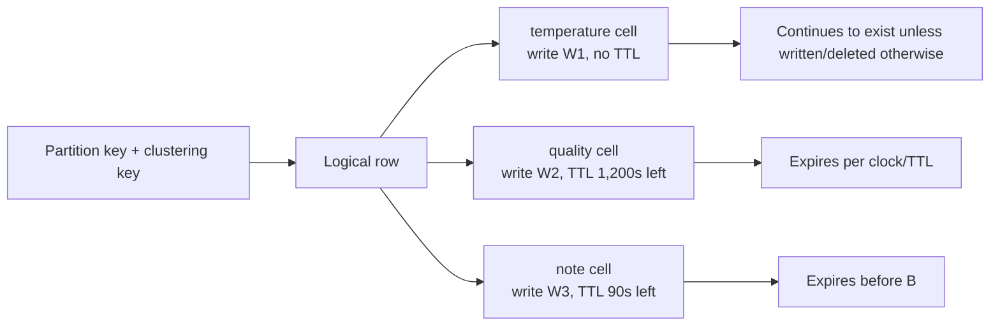
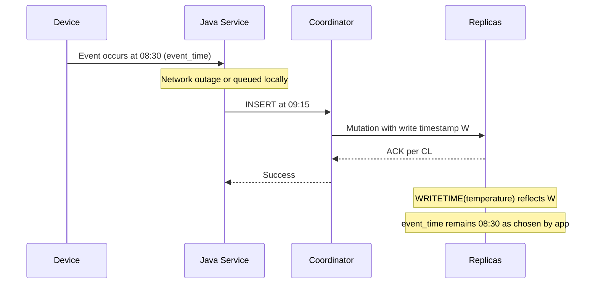
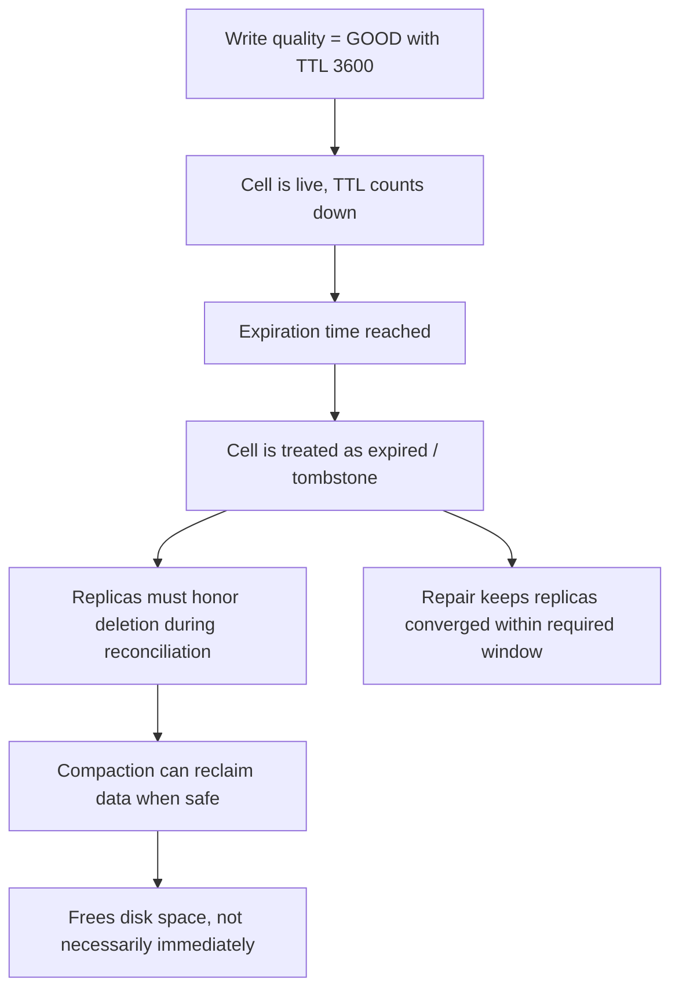
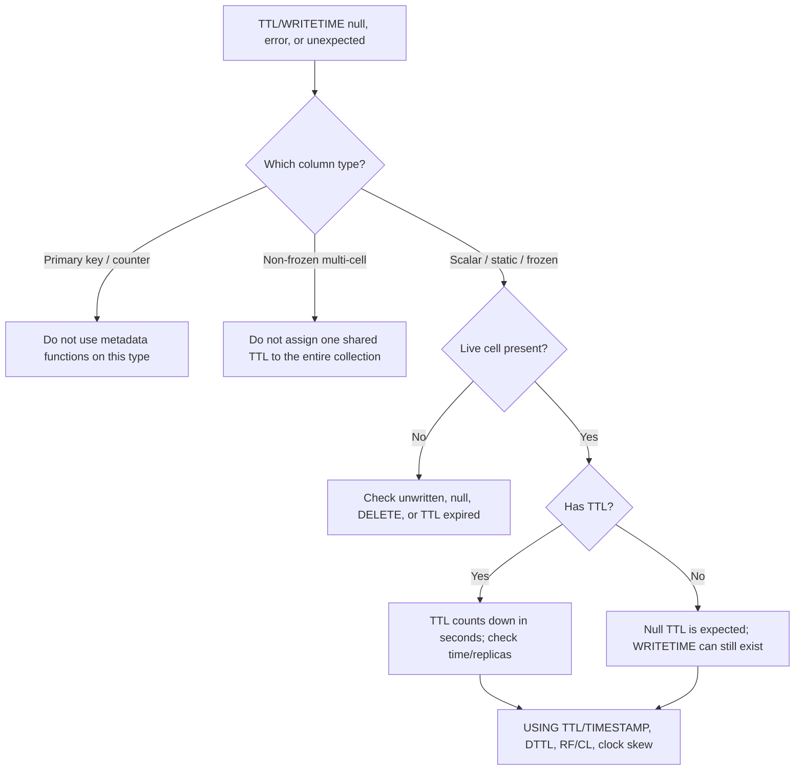

# WRITETIME/TTL and Applicability Rules by Column Type

In Apache Cassandra, a CQL row is not a simple relational record with a single update timestamp and a single expiration time. Wide-column data can be stored as **cells** with independent metadata, including a **write timestamp** and, when applied, a **time-to-live (TTL)**. Consequently, two columns in the same row can be written at different times, have different TTLs, or one column can persist indefinitely while the other expires.

Two advanced CQL functions commonly used to observe this behavior are:

- `WRITETIME(column)`: returns the **write timestamp of the currently visible cell value**, typically in **microseconds since the Unix epoch**. This is the timestamp used by Cassandra's data version reconciliation mechanism, **not necessarily the wall-clock time the mutation reached the server**.
- `TTL(column)`: returns the **remaining TTL in seconds** of the currently visible cell value when the cell has an expiration time. If the existing value has no TTL, the result is typically `null`.

However, **not every column type supports these two functions**. Partition keys, clustering keys, counters, and multi-cell collections have different rules from regular scalar columns. To use them properly, you need to understand **column types**, **time units**, **write/overwrite semantics**, **tombstones**, **replication**, and **consistency levels**.

This lesson belongs to the **Advanced CQL** chapter of the `DATABASE_ENGINE_WIDE_COLUMN_CASSANDRA` module and connects directly to partition keys, query-driven table design, CQL, repair, compaction, error handling, and the Java Driver.

After this lesson, you will be able to:

1. Read and interpret `WRITETIME`/`TTL` on valid values without confusing them with an `event_time` column.
2. Distinguish the behavior of regular columns, `static` columns, primary keys, `counter` columns, `frozen` collections, and multi-cell collections.
3. Control mutation TTLs with `USING TTL` and understand the impact of `default_time_to_live`.
4. Distinguish between **TTL expiration**, **writing null**, **UNSET**, **cell deletion**, and **timestamp reconciliation**.
5. Avoid unsafe retries when using `USING TIMESTAMP`, TTL, or timed-out writes.
6. Write CQL and Java Driver 4.x code to inspect TTL/write time, observe metadata, and design appropriate retention.

## 1. Think in Terms of Cells, Not Just Rows

Suppose a single row for device D has:

| Cell | Current Value | Logical Write Time | Remaining TTL |
|---|---|---|---|
| `temperature` | `36.7` | Write timestamp `W1` | No TTL |
| `quality` | `'GOOD'` | Write timestamp `W2` | 1,200 seconds |
| `note` | `'recheck'` | Write timestamp `W3` | 90 seconds |

CQL returns rows as multiple columns, but Cassandra can manage metadata for **non-key cells** independently. Therefore, you should not ask "What is the TTL of the entire row?" if the cells actually have different lifetimes.



This diagram is a conceptual model: Cassandra also has row/partition tombstones, cell deletions, markers, and version-dependent storage details. **Keys do not carry TTLs like regular cells**; once all non-key values vanish, a row may no longer be returned as before.

### Time Units to Remember

| Value | Unit | Is It Event Time? |
|---|---|---|
| `WRITETIME(temperature)` | **Microseconds** since Unix epoch | Not by default. |
| `TTL(quality)` | **Remaining seconds** | No, it is remaining valid duration. |
| `toUnixTimestamp(event_time)` | **Milliseconds** since Unix epoch | If `event_time` is designed as the event time. |
| `event_day date` | Calendar date | Contains no hour/timezone in the value. |
| `USING TTL 3600` | TTL seconds **requested on write** | Not an epoch timestamp. |
| `USING TIMESTAMP 1735689600000000` | Microseconds write timestamp **explicitly specified** | Not event time by default. |

Never compare `WRITETIME` directly with `toUnixTimestamp` without the factor of **1,000**. Never subtract `TTL` from an epoch timestamp without normalizing units and understanding the evaluation instant.

## 2. Example Schema: Multiple Column Types in One Table

Let's build a per-day device monitoring example. In a multi-DC test cluster with matching topology, you might define:

```sql
CREATE KEYSPACE telemetry
WITH replication = {
    'class': 'NetworkTopologyStrategy',
    'dc1': 3,
    'dc2': 3
};

CREATE TABLE telemetry.readings_by_device_day (
    tenant_id uuid,
    device_id uuid,
    event_day date,
    event_time timestamp,
    event_id uuid,
    temperature double,
    quality text,
    note text,
    tags set<text>,
    extra frozen<map<text, text>>,
    device_state text static,
    PRIMARY KEY (
        (tenant_id, device_id, event_day),
        event_time,
        event_id
    )
) WITH CLUSTERING ORDER BY (
    event_time DESC,
    event_id ASC
) AND default_time_to_live = 0;
```

Column types:

- `tenant_id`, `device_id`, `event_day`: **partition key**; all three together determine the token and the set of natural replicas.
- `event_time`, `event_id`: **clustering key**; distinguishes and orders rows within a partition.
- `temperature`, `quality`, `note`: **regular scalar cells**; ideal examples for observing `WRITETIME` and `TTL`.
- `device_state`: **static column**; one value belongs to the **partition** rather than repeating independently per clustering row.
- `tags set<text>`: **non-frozen collection**; multiple elements can be stored as multiple cells.
- `extra frozen<map<text,text>>`: **frozen** collection; the column's value is handled as a single cell.

**Scope limitation of the example:** making `device_state` `static` in a partition keyed by **device/day** means there is one static state *per device/day*, not a single device state across all days. If you need a device-wide state, design a separate `device_state_by_id` table. This is a consequence of the data model, not a TTL limitation.

RF = 3 in `dc1` and `dc2` only works if the actual environment has enough replicas. A single-node cluster requires a different keyspace/replication setup for lab testing.

## 3. Writing Data and Reading Basic WRITETIME/TTL

Insert a row with a one-hour TTL to observe:

```sql
INSERT INTO telemetry.readings_by_device_day (
    tenant_id, device_id, event_day, event_time, event_id,
    temperature, quality, note
) VALUES (
    11111111-1111-1111-1111-111111111111,
    22222222-2222-2222-2222-222222222222,
    '2026-11-21',
    '2026-11-21 08:30:00+0700',
    33333333-3333-4333-8333-333333333333,
    36.7,
    'GOOD',
    'initial reading'
) USING TTL 3600;
```

Then query:

```sql
SELECT event_time,
       event_id,
       temperature,
       WRITETIME(temperature) AS temperature_write_us,
       TTL(temperature) AS temperature_ttl_s,
       quality,
       WRITETIME(quality) AS quality_write_us,
       TTL(quality) AS quality_ttl_s,
       note,
       TTL(note) AS note_ttl_s
FROM telemetry.readings_by_device_day
WHERE tenant_id = 11111111-1111-1111-1111-111111111111
  AND device_id = 22222222-2222-2222-2222-222222222222
  AND event_day = '2026-11-21'
LIMIT 20;
```

Interpretation:

1. `USING TTL 3600` requests a 3,600-second TTL for the eligible cells written by this mutation. **Primary key columns do not have cell TTLs like regular columns.**
2. `TTL(temperature)`, `TTL(quality)`, and `TTL(note)` count down over time. They will not necessarily equal exactly 3,600 because the clock has ticked since the write.
3. `WRITETIME(temperature)` and `WRITETIME(quality)` may share the same timestamp when written in a single mutation, but later updates can make them diverge.
4. `event_time` holds 08:30 as supplied by the application; **do not assume** `WRITETIME(temperature)` equals 08:30.

Each row can carry different metadata. During a failure window, a `LOCAL_ONE` read from a lagging replica may observe an older version and a different TTL than a quorum read; this is about replication and CL, not a bug in the `TTL` function.

## 4. Which Timestamp Does WRITETIME Actually Return?

**`WRITETIME(column)` returns the logical write timestamp of the winning cell at read time**, not:

- When the device recorded the data.
- When the SSTable was flushed/compacted.
- When the coordinator returned success to the Java Driver.
- The last time someone read the row.
- When the value will expire.

In Cassandra, this timestamp is used to reconcile cell versions and tombstones. Normally, the default timestamp is assigned along the write/CQL path, or the client can **supply an explicit timestamp**.



**Delayed writes:** a device records an event yesterday but sends it today. `event_time` may be yesterday, while `WRITETIME` corresponds to when the mutation was created/stamped today. If the application explicitly uses `USING TIMESTAMP`, the write timestamp can even lie **in the past or future** relative to the wall clock at read time.

### Results Can Be Null

`WRITETIME(quality)` can return `null` when there is no live cell value for `quality` in the read result—for example, if the column was never written, was deleted, or expired. Do not use `WRITETIME` to trace a full mutation history, because shadowed versions and tombstones do not appear as a complete audit log.

## 5. TTL: Remaining Duration, Not a Fixed Expiration Date in the Column

`TTL(column)` typically returns the **number of seconds remaining** before the cell is considered expired. If a live cell has no TTL, the returned value is typically `null`. Therefore, always read **both the cell value and its TTL**:

| CQL Result | Sound Interpretation |
|---|---|
| `quality = 'GOOD'`, `TTL(quality) = 1800` | Cell currently exists, with roughly 1,800 seconds of TTL remaining. |
| `quality = 'GOOD'`, `TTL(quality) = null` | Cell currently exists and has no TTL on the version being read. |
| `quality = null`, `TTL(quality) = null` | No live cell value is visible; it may never have been written, was deleted, or expired. |
| `temperature = 36.7`, `TTL(quality) = 900` | Metadata for `quality` does not describe the TTL of `temperature`. |

**There is no default "TTL(row)" function** suitable for every wide-column table. When a table has multiple cells with different lifetimes, specify **which column** you are measuring.

### TTL Counts from the Mutation, Not from event_time

Suppose a device measures at 08:30, the server receives it at 09:15, and writes with `USING TTL 3600`. The cell can persist until approximately 10:15 per Cassandra's semantics and clock, **not automatically expire at 09:30**. If business retention is based on event time rather than ingestion time, calculate remaining TTL in the application with a consistent policy and check behavior for late-arriving events.

### TTL Is Not an Instant Deletion Cron

When a TTL expires, Cassandra treats the cell as **expired/tombstoned** and stops returning a live value. The SSTable files containing the historical data do not necessarily disappear at the exact second of expiration; space reclamation depends on compaction and safety conditions around replicas/tombstones.

## 6. Writing One Column with a Different TTL from Another

In the initial write, `temperature`, `quality`, and `note` all received a 3,600-second TTL. Now update only `note` with a 10-minute TTL:

```sql
UPDATE telemetry.readings_by_device_day
USING TTL 600
SET note = 'manual review'
WHERE tenant_id = 11111111-1111-1111-1111-111111111111
  AND device_id = 22222222-2222-2222-2222-222222222222
  AND event_day = '2026-11-21'
  AND event_time = '2026-11-21 08:30:00+0700'
  AND event_id = 33333333-3333-4333-8333-333333333333;
```

When reading `WRITETIME/TTL` of the three columns again, you may see:

| Column | What Changes After Updating note | What Does Not Automatically Change |
|---|---|---|
| `note` | Value, write timestamp, and new cell TTL. | Partition key and clustering key remain unchanged. |
| `quality` | Not written by this statement. | Its own value, write timestamp, and TTL continue aging as before. |
| `temperature` | Not written by this statement. | Does not receive TTL 600 just because it shares the logical row. |

`UPDATE` **only affects the cells written for the targeted columns**. The rest of the row does not automatically adopt the same timestamp or TTL. This is a major departure from the "single row-level `updated_at`" intuition in many relational systems.

### Adding a Long-Lived Cell

In a table with `default_time_to_live = 0` like our example:

```sql
UPDATE telemetry.readings_by_device_day
USING TTL 0
SET quality = 'ARCHIVED'
WHERE tenant_id = 11111111-1111-1111-1111-111111111111
  AND device_id = 22222222-2222-2222-2222-222222222222
  AND event_day = '2026-11-21'
  AND event_time = '2026-11-21 08:30:00+0700'
  AND event_id = 33333333-3333-4333-8333-333333333333;
```

Under the semantics of the running version, `USING TTL 0` **assigns no positive TTL to the new value**; it is **a new write**, not an in-place metadata edit of the old version without a mutation. On tables with a non-zero `default_time_to_live`, verify the exact interaction between TTL 0 and DTTL per your release and table policy, and **do not treat TTL 0 as a universal shortcut that disables all retention**.

## 7. Applicability by Column Type: Decision Table

| Column/Value Type | `WRITETIME(col)` | `TTL(col)` | Reasons and Limitations |
|---|---|---|---|
| **Regular scalar**: `text`, `int`, `double`, `timestamp`, `uuid`, `date`, `boolean`, etc. | **Yes**, when a live cell exists. | **Yes**, returns remaining seconds if the cell has a TTL. | Standard case for observing cell metadata. |
| **Static scalar** | **Usually supported** per static cell semantics. | **Usually supported** if the static value was written with a TTL. | Metadata is at the **partition** level, not per clustering row. |
| **Partition-key column** | **No**. | **No**. | Primary key component, not a regular expiring cell. |
| **Clustering-key column** | **No**. | **No**. | Row identification/ordering component; `TTL(key)` is invalid. |
| **Counter column** | **Do not use**. | **Do not use**. | Counters have dedicated mutation/replication semantics and do not support regular column TTLs. |
| **Non-frozen collection**: `list`, `set`, `map` | **Cannot call on the whole column as a single cell**. | **Cannot call on the whole column as a single cell**. | A collection can consist of multiple cells with per-element metadata. |
| **Frozen collection** | **Usually usable** on the whole frozen value. | **Usually usable** on the whole frozen value. | Frozen is treated as **one cell**; updates rewrite the entire value. |
| **Frozen UDT/tuple** | Applies per **single-cell semantics** where supported. | Applies per **single-cell semantics** where supported. | Do not extrapolate the same behavior to multi-cell UDTs. |
| **Non-frozen UDT** | Do not treat the whole column as a single cell. | Do not treat the whole column as a single cell. | Fields can carry independent metadata; field query syntax depends on version. |
| **Null/absent/deleted or expired cell** | Typically `null`. | Typically `null`. | No live value exists to report regular cell metadata. |

**Version note:** support for querying metadata of **individual collection elements or UDT fields** varies across releases and selection syntax. This lesson does not assume a `WRITETIME(collection)`/`TTL(collection)` syntax works across entire non-frozen collections. When per-element expiration is required, verify the exact CQL/API for your version or **model each element as its own row** with a dedicated key.

## 8. Primary Key: Why It Has No Cell-Style TTL or WRITETIME

This is a direct constraint of the wide-column model:

```sql
-- Key columns in the example:
-- Partition key: (tenant_id, device_id, event_day)
-- Clustering key: (event_time, event_id)

-- Valid: querying metadata of the regular column temperature.
SELECT temperature,
       WRITETIME(temperature),
       TTL(temperature)
FROM telemetry.readings_by_device_day
WHERE tenant_id = 11111111-1111-1111-1111-111111111111
  AND device_id = 22222222-2222-2222-2222-222222222222
  AND event_day = '2026-11-21'
LIMIT 10;
```

Do not write `WRITETIME(tenant_id)`, `TTL(device_id)`, `TTL(event_day)`, or `WRITETIME(event_time)`: they are **primary-key components**. A row may cease to appear once all live cells expire, but that does not mean Cassandra applies a cell-style TTL directly to the key itself.

### Do Not Filter by TTL on Keys to Find Expiring Data

Cassandra does not automatically provide an index of "rows whose TTL is about to expire" just because `TTL` exists. If your application must fetch all events expiring within the next hour, store an **`expires_at`** column or an appropriate query bucket in a table designed for that access pattern, and manage cleanup/checks per business semantics. Do not run a full-cluster scan calling `TTL` on every row as a generic expiration scheduler.

## 9. Static Column: Partition-Level Metadata

`device_state text static` is shared across all rows within the same `(tenant_id, device_id, event_day)` partition. You can update a static column **without specifying the clustering key**:

```sql
UPDATE telemetry.readings_by_device_day
USING TTL 1800
SET device_state = 'ONLINE'
WHERE tenant_id = 11111111-1111-1111-1111-111111111111
  AND device_id = 22222222-2222-2222-2222-222222222222
  AND event_day = '2026-11-21';

SELECT device_state,
       WRITETIME(device_state) AS state_write_us,
       TTL(device_state) AS state_ttl_s
FROM telemetry.readings_by_device_day
WHERE tenant_id = 11111111-1111-1111-1111-111111111111
  AND device_id = 22222222-2222-2222-2222-222222222222
  AND event_day = '2026-11-21'
LIMIT 10;
```

**Interpretation:** the same static value and metadata appear on every returned row in the same partition. These are **not independent copies** of the static cell. If `device_state` expires, the regular cells `temperature`/`quality` do not automatically expire with it.

In this example, the static state belongs to **device/day**. If the requirement is a single current state for the whole device, use a table partitioned by device to avoid duplicating state across days.

## 10. Counter: TTL and WRITETIME Metadata Do Not Apply Like Regular Columns

Counters in Cassandra have update and reconciliation mechanics that differ from ordinary scalar cells. Separate example:

```sql
CREATE TABLE telemetry.events_count_by_device (
    device_id uuid PRIMARY KEY,
    total counter
);

UPDATE telemetry.events_count_by_device
SET total = total + 1
WHERE device_id = 22222222-2222-2222-2222-222222222222;

SELECT device_id, total
FROM telemetry.events_count_by_device
WHERE device_id = 22222222-2222-2222-2222-222222222222;
```

**Do not use `TTL(total)` or `WRITETIME(total)`** by analogy with ordinary numeric cells, and do not use `USING TTL` on a counter increment. Counter mutations are **not idempotent** in a "resend safely" sense: if a client times out and blindly retries `total = total + 1`, the increment may be applied twice.

If the requirement is "hourly counts that auto-expire after 30 days", consider an event/range table partitioned by day and aggregating via a pipeline or a more suitable store; do not rely on counter TTLs for automatic expiration.

## 11. Collections: Multi-Cell vs. Frozen

Look at the two collection columns in the table:

- `tags set<text>`: **non-frozen set**; each element can be stored and modified with its own metadata.
- `extra frozen<map<text,text>>`: **frozen map**; the entire value is handled as one cell.

Example:

```sql
UPDATE telemetry.readings_by_device_day
USING TTL 900
SET tags = tags + {'calibrated'}
WHERE tenant_id = 11111111-1111-1111-1111-111111111111
  AND device_id = 22222222-2222-2222-2222-222222222222
  AND event_day = '2026-11-21'
  AND event_time = '2026-11-21 08:30:00+0700'
  AND event_id = 33333333-3333-4333-8333-333333333333;

UPDATE telemetry.readings_by_device_day
USING TTL 900
SET extra = {'source': 'sensor-v2', 'unit': 'C'}
WHERE tenant_id = 11111111-1111-1111-1111-111111111111
  AND device_id = 22222222-2222-2222-2222-222222222222
  AND event_day = '2026-11-21'
  AND event_time = '2026-11-21 08:30:00+0700'
  AND event_id = 33333333-3333-4333-8333-333333333333;
```

For a non-frozen collection, **there is no single timestamp/TTL** representing all live elements. Two elements updated in separate writes can have different TTLs. For a frozen map, updating the whole column behaves like **a single scalar cell** for write timestamp and expiration.

```sql
-- Query whole-cell metadata of a frozen value.
SELECT extra,
       WRITETIME(extra) AS extra_write_us,
       TTL(extra) AS extra_ttl_s
FROM telemetry.readings_by_device_day
WHERE tenant_id = 11111111-1111-1111-1111-111111111111
  AND device_id = 22222222-2222-2222-2222-222222222222
  AND event_day = '2026-11-21'
LIMIT 10;
```

**Do not replace `extra` with `TTL(tags)` in the example above and assume Cassandra picks a "set-wide TTL".** Depending on the version, CQL may support querying metadata of individual elements/fields using specific syntax, which must be verified first. When independent tag expiration is required, modeling **`tags_by_device` with `tag` as a clustering key and metadata on a regular cell** is much clearer to observe.

### Frozen Is a Trade-Off, Not Just a Trick to Make TTL Work

`frozen<map<text,text>>` works well when values are small and typically **replaced as a whole**. If a collection is very large or modified element-by-element frequently, `frozen` can incur heavy rewrite overhead, whereas non-frozen incurs per-element tombstone/metadata overhead. Choose based on query and update patterns, not merely to call `WRITETIME`.

## 12. UDTs, Tuples, and Composite Types

**User-defined types (UDTs)** and **tuples** are composite CQL types. When stored as **frozen**, the entire value is encoded as one cell; when a UDT is stored non-frozen, its fields can be handled as separate cells.

| Form | Update Behavior | How to Think About TTL/WRITETIME |
|---|---|---|
| `frozen<udt_type>` | Typically rewrites the entire value. | Metadata can be evaluated at the **single-cell** level if supported by the release. |
| Non-frozen UDT | Individual fields can be updated per CQL version capabilities. | Do not assume `TTL(udt_column)` represents a single unified TTL across all fields. |
| `tuple<...>` | Structured value with ordered fields; in CQL, tuples use appropriate frozen semantics. | Inspect metadata of the whole cell; do not treat tuple parts as independent rows. |

Example illustrating a location type:

```sql
CREATE TYPE telemetry.location_udt (
    city text,
    country text
);

-- When a column genuinely needs to be added, run via a controlled migration.
ALTER TABLE telemetry.readings_by_device_day
ADD location frozen<telemetry.location_udt>;
```

UDT creation and `ALTER TABLE` are **DDL**, not examples to run repeatedly on every application startup. In production, ensure schema agreement/metadata readiness appropriate for your release before the application uses the new column.

**Important point:** because non-relational data is modeled around queries, avoid packing hundreds of fields into a giant UDT just to centralize metadata into a single TTL cell. When multiple components must be updated or expired independently, splitting them into regular columns or clustering-key rows can be more sensible.

## 13. NULL, DELETE, and UNSET: All Return No Value, Different Semantics

A common source of confusion is seeing `TTL(note) = null` and concluding the writer "did not set a TTL." That is only one possibility. Distinguish these cases:

| Operation | Generates a Cell Mutation? | Observable Effect |
|---|---|---|
| **Omit `note`** in INSERT/UPDATE | No mutation for that cell in the current operation. | Preserves the old version if it exists and was not deleted. |
| **Write `note = null`** via CQL/driver | Typically creates **tombstone/deletion semantics** for the cell. | Cell may disappear; `WRITETIME/TTL(note)` is not a deletion audit log. |
| **`DELETE note FROM ...`** | Writes a deletion/tombstone. | Shadows old values by timestamp; live-cell metadata is no longer returned as before. |
| **Bind parameter as UNSET** (where supported) | Skips that column/parameter in the mutation. | Does not use UNSET to delete; existing value and TTL are unchanged by this operation. |
| **Column's TTL expired** | No new client UPDATE needed. | Cell has no live value upon expiration; tombstone/GC occurs per storage mechanics. |

Example deleting **only one regular column** of a row:

```sql
DELETE note
FROM telemetry.readings_by_device_day
WHERE tenant_id = 11111111-1111-1111-1111-111111111111
  AND device_id = 22222222-2222-2222-2222-222222222222
  AND event_day = '2026-11-21'
  AND event_time = '2026-11-21 08:30:00+0700'
  AND event_id = 33333333-3333-4333-8333-333333333333;
```

Afterward, `note` reads as null while `temperature` remains live. **`WRITETIME(note)` does not give you the tombstone's timestamp as a standard audit field**. If the business needs "who deleted, when, and why," store dedicated event/audit records with an explicit schema and retention.

### NULL Is Not "Do Not Update"

With prepared statements, distinguish:

- **Setting a parameter to null:** means requesting a null write/deletion per CQL semantics.
- **Leaving it UNSET:** means leaving that cell untouched in the mutation (when supported by driver/CQL).

Do not pass an entire Java DTO containing null fields into an `UPDATE` assuming null means "keep existing data." That pattern easily generates unintended tombstones, increasing I/O, read amplification, and compaction overhead.

## 14. default_time_to_live: Table-Level TTL

Cassandra has the table option `default_time_to_live` (DTTL), measured in seconds. In our example schema, it is set to `0` so no table-level TTL is applied by default.

In a controlled test migration:

```sql
ALTER TABLE telemetry.readings_by_device_day
WITH default_time_to_live = 86400;
```

General meaning: **newly written eligible cells** in the table can receive a default one-day TTL when the write statement omits an explicit TTL, per your release's semantics. DTTL does not mean all previously written cells are automatically "rewritten" with the new lifetime.

**Points to verify:**

1. **Existing data:** changing DTTL is neither a backfill campaign nor a rewrite of all SSTables.
2. **Writes with `USING TTL`:** statement-level TTL and DTTL follow precedence rules specific to the Cassandra version; do not extrapolate mechanically from old examples.
3. **`USING TTL 0`:** explicitly check how it interacts with a non-zero DTTL; do not assume from a single test statement that all retention is disabled.
4. **Counter tables:** do not use DTTL to add expiration to counters.
5. **LWT/conditional updates:** timestamp/TTL constraints and conditional semantics can differ from regular mutations.
6. **Extremely long TTLs:** Cassandra has expiration-timestamp range limits depending on version, OS, and configuration; check overflow risks (including the 2038 boundary in relevant releases/systems).

### Why Table Retention Should Align with the Data Model

Time-series tables are typically bucketed by day/hour with explicit retention. DTTL can assist cell expiration, but **queries must still target an appropriate partition key**. When TTL expires many cells, tombstones still consume read/compaction work until eligible for reclamation. Do not treat DTTL as an automatic fix for hot partitions or nearly full disks.

**Safe practice:** before altering DTTL in production, verify your Cassandra version, data churn rate, compaction strategy, repair schedule, GC grace, snapshots/backups, and application retention requirements before executing DDL.

## 15. USING TIMESTAMP: Setting Write Timestamp Does Not Set event_time

Cassandra supports assigning a **logical write timestamp** to a mutation where allowed by CQL. Example:

```sql
-- Illustration only: the timestamp below is an arbitrary microseconds value.
-- Do not run unconditionally on production rows.
UPDATE telemetry.readings_by_device_day
USING TIMESTAMP 1735689600000000
SET quality = 'REVIEWED'
WHERE tenant_id = 11111111-1111-1111-1111-111111111111
  AND device_id = 22222222-2222-2222-2222-222222222222
  AND event_day = '2026-11-21'
  AND event_time = '2026-11-21 08:30:00+0700'
  AND event_id = 33333333-3333-4333-8333-333333333333;
```

The value `1735689600000000` is in **microseconds**, not milliseconds. If it is lower than the write timestamp of the existing `quality` version, the update may **not win** during reconciliation. Consequently, inspecting `WRITETIME(quality)` afterward may still return the older cell's timestamp.

### Write Timestamp and Last-Write-Wins

For ordinary cells, Cassandra compares timestamps to decide the active version. "Last" in **last-write-wins** refers primarily to **logical timestamp**, not necessarily whichever write arrived at the server last by wall-clock time.

| Scenario | Consequence |
|---|---|
| Mutation arrives later but has a **smaller** timestamp | The newly sent value may **lose** to the stored version. |
| Mutation has a **larger** timestamp | Can beat an earlier value, even if its business event-time is older. |
| Two mutations share the same timestamp | Cassandra uses deterministic reconciliation/tie-breaking rules; do not assume "whichever node ACKs first wins." |
| Tombstone with a qualifying timestamp | Can shadow older values per deletion semantics. |

Do not rely on `WRITETIME` as an authoritative source **for ordering business events**. If you need to record when a device produced an event, store an explicit `event_time timestamp` column and handle clock skew at the source.

### Do Not Use Manual Timestamps as a Quick "Conflict Fix"

Writing a timestamp far in the future can shadow valid subsequent writes with lower real timestamps for a long time. Repairing data corrupted by bad timestamps requires evaluating consistency and tombstones; never craft a "huge" timestamp mutation in production to overwrite everything.

## 16. TTL, Tombstones, Compaction, and Repair

TTL is not merely a countdown timer in Java. Once a cell expires, Cassandra must handle the **deletion marker** safely across a distributed cluster.



**Three mechanisms not to conflate:**

- **TTL expiration:** determines whether a cell is still considered live at read time.
- **Compaction:** merges SSTables and drops eligible tombstones/old data **when safety conditions allow**.
- **Anti-entropy repair:** reconciles replicas to resolve divergence, including when an offline replica missed mutations/tombstones.

### Deleted-Data Resurrection Risk

Suppose replica C goes offline for a long period and misses a deletion or expiration-related state. If tombstones on other replicas are garbage-collected before C is synchronized under unsafe conditions, old data on C can reappear (**resurrection**). `gc_grace_seconds` and repair schedules govern retention safety, and **lowering `gc_grace_seconds` is not an unconditional way to eliminate tombstones**.

For TTL-heavy tables, consider a time-appropriate compaction strategy (such as TWCS for suitable workloads) and schedule regular repairs. Never call `TTL(note)` and conclude data was physically purged from all SSTables the instant it returns null.

### Operational Resources

Millions of expired TTL cells can accumulate many tombstones. `SELECT` queries scanning partitions/ranges full of tombstones can become slow even when returning very little data. Compaction/repair can contend for disk I/O, CPU, and network against client requests, causing `ReadTimeout`/`WriteTimeout`. TTL choices should align with **capacity planning and query patterns**, not just retention policy.

## 17. TTL/WRITETIME Seen Through Replicas and Consistency Levels

`TTL` and `WRITETIME` are evaluated/observed along the **CQL read path**. In a distributed cluster:

1. The partition key determines the token and set of natural replicas per `NetworkTopologyStrategy`/RF.
2. The coordinator contacts replicas according to the request's CL.
3. Replicas may temporarily hold different versions due to network issues or unconverged mutations.
4. `WRITETIME(column)`/`TTL(column)` reflects **the effective value along that specific read path**, not proof that all replicas converged instantaneously.

With `RF_dc1 = 3` and `RF_dc2 = 3`:

| CL from `dc1` Coordinator | Requirement in Example | Does the TTL Function "Increase Consistency"? |
|---|---|---|
| `LOCAL_ONE` | One `dc1` replica responds. | **No**; can read stale versions if a replica hasn't converged. |
| `LOCAL_QUORUM` | Two `dc1` replicas respond. | **Does not raise CL itself**, though the request enforces local quorum. |
| `QUORUM` | Four of six replicas respond. | The function does not reduce the required responses. |
| `ALL` | All replicas per RF respond. | Highly sensitive to down/slow replicas. |

### Why Can TTL Differ by a Few Seconds?

`TTL` is **remaining time at evaluation**, not an application-stored constant. Two `SELECT` calls a few seconds apart naturally return different TTLs; clock differences and replica convergence can introduce further variance. Never build checks asserting exact-equal TTLs across all nodes at all times.

`WRITETIME` remains stable absent a winning mutation, though what you read can change once **a newer version is reconciled**, even if the application itself did not issue a second write.

### A Write Timeout Does Not Mean Rollback

If a client executes `UPDATE ... USING TTL 600` and receives `WriteTimeout`, some replicas may have applied the mutation while others have not. Retrying may introduce a different timestamp and expiration time, even with identical logical values. Only retry automatically when you clearly understand **idempotency, timestamps, TTL, and business semantics**.

## 18. Query Design: Do Not Use TTL as a Time Index

A commonly problematic design:

> "Find all rows across the cluster where `TTL(quality) < 600` and process them."

In standard Cassandra, `TTL` is a **projection/cell-inspection function**, not a partition/index structure capable of optimizing a full-table scan. Do not rely on `WHERE TTL(quality) < 600` as a default search pattern; many expression forms in `WHERE` are unsupported in CQL compared to relational SQL.

Instead, if the application needs to schedule processing for items about to expire:

- Store **`expires_at timestamp`** computed before writing per business rules.
- Design a **time-bucketed table** for the workload "scan items due in hour N", with partition/clustering keys tailored to that query.
- Enforce idempotency so jobs do not process items twice.
- Verify the data is still live before acting if a race exists between TTL and the job.

Example dedicated table for scheduled processing:

```sql
CREATE TABLE telemetry.rechecks_by_hour (
    bucket_hour timestamp,
    expires_at timestamp,
    device_id uuid,
    event_id uuid,
    PRIMARY KEY ((bucket_hour), expires_at, device_id, event_id)
) WITH CLUSTERING ORDER BY (
    expires_at ASC,
    device_id ASC,
    event_id ASC
);
```

This is an **illustrative model**, not a global TTL index. Ensure shards/buckets are well-distributed to avoid a hot `bucket_hour` and clean up processed entries. The table may carry a TTL to purge historical records per policy, while the job still accounts for expiration and race conditions at the application level.

## 19. Java Driver 4.x: Binding TTL and Reading Cell Metadata

Apache Cassandra Java Driver 4.x provides APIs to bind `USING TTL ?`, read `bigint`/`int` from `WRITETIME`/`TTL` aliases, and set CL. Example using the `telemetry.readings_by_device_day` table created earlier:

```java
import com.datastax.oss.driver.api.core.CqlSession;
import com.datastax.oss.driver.api.core.DefaultConsistencyLevel;
import com.datastax.oss.driver.api.core.cql.BoundStatement;
import com.datastax.oss.driver.api.core.cql.PreparedStatement;
import com.datastax.oss.driver.api.core.cql.Row;

import java.net.InetSocketAddress;
import java.time.Instant;
import java.time.LocalDate;
import java.util.UUID;

public class CassandraCellMetadataExample {
    public static void main(String[] args) {
        UUID tenant = UUID.fromString(
            "11111111-1111-1111-1111-111111111111");
        UUID device = UUID.fromString(
            "22222222-2222-2222-2222-222222222222");
        UUID event = UUID.fromString(
            "33333333-3333-4333-8333-333333333333");
        LocalDate day = LocalDate.of(2026, 11, 21);
        Instant eventTime = Instant.parse("2026-11-21T01:30:00Z");

        // 192.0.2.0/24 are documentation IPs; replace with real contact points.
        try (CqlSession session = CqlSession.builder()
                .addContactPoint(new InetSocketAddress("192.0.2.11", 9042))
                .addContactPoint(new InetSocketAddress("192.0.2.12", 9042))
                .withLocalDatacenter("dc1")
                .build()) {

            PreparedStatement insert = session.prepare(
                "INSERT INTO telemetry.readings_by_device_day " +
                "(tenant_id, device_id, event_day, event_time, event_id, " +
                "temperature, quality, note) " +
                "VALUES (?, ?, ?, ?, ?, ?, ?, ?) USING TTL ?");

            // ID, payload, and TTL are finalized before the first attempt.
            BoundStatement write = insert.bind(
                    tenant, device, day, eventTime, event,
                    36.7d, "GOOD", "initial reading", 3600)
                .setConsistencyLevel(DefaultConsistencyLevel.LOCAL_QUORUM);
            session.execute(write);

            PreparedStatement select = session.prepare(
                "SELECT temperature, quality, note, " +
                "WRITETIME(temperature) AS write_us, " +
                "TTL(temperature) AS ttl_s, " +
                "WRITETIME(note) AS note_write_us, " +
                "TTL(note) AS note_ttl_s " +
                "FROM telemetry.readings_by_device_day " +
                "WHERE tenant_id = ? AND device_id = ? " +
                "AND event_day = ? AND event_time = ? AND event_id = ?");

            BoundStatement read = select
                .bind(tenant, device, day, eventTime, event)
                .setConsistencyLevel(DefaultConsistencyLevel.LOCAL_QUORUM)
                .setIdempotent(true);

            Row row = session.execute(read).one();
            if (row == null) {
                System.out.println("Row not visible; may be absent or expired");
                return;
            }

            Long writeUs = row.isNull("write_us")
                ? null : row.getLong("write_us");
            Integer ttlSeconds = row.isNull("ttl_s")
                ? null : row.getInt("ttl_s");

            Double temperature = row.isNull("temperature")
                ? null : row.getDouble("temperature");
            System.out.println("temperature=" + temperature);
            System.out.println("write time (us)=" + writeUs);
            System.out.println("TTL left (s)=" + ttlSeconds);

            if (writeUs != null) {
                long seconds = Math.floorDiv(writeUs, 1_000_000L);
                long nanos = Math.floorMod(writeUs, 1_000_000L) * 1_000L;
                Instant writeInstant = Instant.ofEpochSecond(seconds, nanos);
                System.out.println("write instant UTC=" + writeInstant);
            }
        }
    }
}
```

**Key points in the code:**

- `USING TTL ?` is a **parameter in seconds**, here 3,600.
- `WRITETIME(temperature)` returns `bigint`, so Java uses `getLong`; `TTL(temperature)` returns seconds, so Java uses `getInt`.
- Always check `row.isNull(alias)` before reading nullable values. A null TTL can mean **no TTL** or **no live cell**; check the column value as well.
- `writeUs` is in microseconds, so convert to `Instant` by **dividing by 1,000,000** (and taking the remainder), not directly via `Instant.ofEpochMilli(writeUs)`.
- `eventTime` is the business timestamp; `writeInstant` is the cell's logical timestamp. Never assume they are equal.
- `LOCAL_QUORUM` requires enough local replicas; on a test cluster with a different RF/DC, adjust accordingly.
- Reuse a single `CqlSession` per application; TLS/authentication/metrics configuration is omitted as it depends on the real environment.

### Null/UNSET in Prepared Statements

When applying a partial DTO update, if a field is not meant to change, either **omit that field** or use the driver/version's **UNSET** capability rather than binding `null` and issuing a deletion. This preserves the existing metadata/TTL of untouched cells, whereas binding `null` can create tombstones.

**Retry note:** if a TTL write times out, never blindly loop `execute(write)` indefinitely. Evaluate data versioning, deadlines, idempotency, and how expiration shifts when issuing a new mutation.

## 20. Lab: Observing Metadata Changes Over Time

A safe lab should use a **test cluster**; there is no need to intentionally break replicas or trigger heavy compaction in production.

### Step 1 — Inspect Schema and RF

Create the table from section 2 with RF/DC matching your actual topology, then verify:

```sql
SELECT keyspace_name, replication
FROM system_schema.keyspaces
WHERE keyspace_name = 'telemetry';

SELECT table_name, column_name, kind, type
FROM system_schema.columns
WHERE keyspace_name = 'telemetry'
  AND table_name = 'readings_by_device_day';
```

```bash
nodetool status
```

`nodetool status` shows DC/rack layout and node liveness, but **does not prove** that all replicas hold identical versions or TTLs.

### Step 2 — Write Three Regular Cells with the Same TTL

Run `INSERT ... USING TTL 3600` from section 3. Read `temperature`, `quality`, and `note` along with `WRITETIME/TTL`. Record a baseline table at T0:

| Checkpoint | `temperature` | `TTL(temperature)` | `TTL(quality)` | `TTL(note)` |
|---|---|---|---|---|
| T0 | `36.7` | Approx. 3,600 | Approx. 3,600 | Approx. 3,600 |
| T0 + a few seconds | `36.7` | Decreasing | Decreasing | Decreasing |

**Do not expect identical TTL numbers** across reads; they represent remaining seconds at observation time.

### Step 3 — Update Only note

Run `UPDATE ... USING TTL 600 SET note = ...` from section 6. Compare:

- `WRITETIME(note)` typically changes to the new mutation's timestamp **if the mutation wins**.
- `TTL(note)` resets to around 600 seconds and continues decreasing.
- `WRITETIME(temperature)` typically remains unchanged, while `TTL(temperature)` continues counting down.

Giving `note` a new TTL **does not reset the TTL of `temperature`**.

### Step 4 — Write a Non-Expiring Value to One Column

With table DTTL=0, update `quality` using `USING TTL 0` and verify `TTL(quality)` becomes null while the live cell has no TTL. If DTTL was changed to non-zero, **do not rely on this assumption without checking your version's semantics**.

### Step 5 — Delete note and Observe Results

Run `DELETE note` from section 13, then read back. `note` becomes null and `TTL(note)` becomes null, but do not conclude it is a "permanent cell with no TTL": in reality, no live cell is being returned.

### Step 6 — Check Collections/Frozen

Write `tags` and `extra` per section 11 and inspect `TTL(extra)`/`WRITETIME(extra)`. Do not assume `TTL(tags)` works across the entire non-frozen set. If you want to inspect per-element metadata, consult your running version's CQL documentation and test the **exact syntax** on a test cluster.

### Step 7 — Observe Across Consistency Levels

In `cqlsh`:

```sql
CONSISTENCY LOCAL_ONE;
-- Run SELECT WRITETIME/TTL from section 3.

CONSISTENCY LOCAL_QUORUM;
-- Re-run the exact same SELECT on the same partition.
```

If results differ, do not immediately blame the `TTL` function. Inspect **replica placement, elapsed time, converging mutations, and coordinator**. In a healthy, stable cluster, cell data normally agrees on version while TTL decreases with elapsed observation time.

### Step 8 — Reason About Timeouts Instead of Inducing Them

Simulate in an application unit test: a TTL write reached quorum, but the client lost the response. Ask whether to retry with the same parameters or create a new mutation, whether the original write timestamp/business expiration must be preserved, and how to verify the row. You do not need to partition a cluster just to understand **uncertain write outcomes**.

## 21. Runbook When TTL or WRITETIME "Looks Unexpected"

If a CQL `SELECT` errors, returns null, or shows an unexpected time, check in order:

1. **Column type:** primary key, regular scalar, static, counter, non-frozen collection, or frozen? If it is not a single cell supporting whole-column functions, stop and adjust the query.
2. **Is the data live:** `SELECT column` alongside `TTL/WRITETIME`. Never infer from a null TTL alone.
3. **Units:** `TTL` is seconds; `WRITETIME` is microseconds; `toUnixTimestamp` is milliseconds; application event-time is a separate column.
4. **Write path:** were `USING TTL`, `USING TIMESTAMP`, table DTTL, null writes, UNSET, or DELETE involved?
5. **Winning version:** the latest mutation in wall-clock time may lose if its timestamp is lower; check write contention and clock skew.
6. **Replica state:** could partition key, RF, CL, coordinator DC, or replication lag expose an older version?
7. **Static/collection scope:** static exists per partition; non-frozen collections carry per-element metadata.
8. **TTL expiry/compaction:** logical cell expiration does not mean SSTables have been reclaimed; tombstones and repair matter.
9. **Timezone/event-time:** write timestamp is not `event_time`; all Instant comparisons must normalize timeline and units.
10. **Release behavior:** if a function is rejected or DTTL behaves unexpectedly, verify Cassandra/CQL version, schema, and official docs.



### Logs/Metrics to Correlate During Real Incidents

| Observation | Suggested Tool | Do Not Infer |
|---|---|---|
| DC/rack and peer state | `nodetool status`, `gossipinfo` | Node `UN` does not guarantee all cells converged. |
| CQL requests, CL, and coordinator | Driver metrics/logs, selective tracing | `WRITETIME` is not a timestamp of each request stage. |
| Compaction/tombstone pressure | `nodetool compactionstats`, `tablestats`, metrics | TTL expiration does not shrink disk usage immediately. |
| Streaming/repair after replica loss | `nodetool netstats` and repair logs | Gossip convergence does not prove data convergence. |
| Active schema/DTTL | `system_schema.tables` or `DESCRIBE TABLE` in `cqlsh` | Never edit system tables directly. |
| Clock/epoch units | JVM/host clock and `Instant` conversions | Local formatted time is not the raw write timestamp. |

Never trigger heavy `nodetool repair`/`compact` or change `gc_grace_seconds` solely because `TTL(col)` looks off. Identify **the exact cell type and mutation** first, then pick operational actions.

## 22. Reasoning Exercises with Answers

**Case A — Two columns with different TTLs.** You write `temperature` and `note` with TTL 3,600 seconds, then update only `note` with TTL 600 seconds. Does `TTL(temperature)` reset to 600? **No.** The new mutation updates metadata only for the `note` cell.

**Case B — Long-lived column.** `quality = 'GOOD'` while `TTL(quality) = null`. Can you conclude `quality` no longer exists? **No.** The value is live and simply has no TTL.

**Case C — Expired cell.** `quality = null` and `TTL(quality) = null`. Is it certain the column was never written? **No.** It may have been written and later deleted or expired.

**Case D — Event-time vs. write-time.** A device measures at 08:30, and the server writes at 09:15. Must `WRITETIME(temperature)` correspond to 08:30? **No.** It is the mutation's logical timestamp, while 08:30 is the event column's value.

**Case E — Primary key.** A table has `event_time` as a clustering key. Can you call `TTL(event_time)` to see how long the row lives? **No**; cell-style `TTL` does not apply to primary-key columns.

**Case F — Counter.** Counter `total` is incremented via `total = total + 1`. Can you attach TTL 600 to the increment so it auto-expires? **No** under standard counter semantics; retrying a counter increment also risks double-counting.

**Case G — Non-frozen set.** `tags` has two elements added in two separate mutations. Is there one shared TTL/WRITETIME for the entire set? **Not by default**: multi-cell collections maintain per-element metadata.

**Case H — Frozen map.** `extra frozen<map<...>>` is written with a TTL. Does `TTL(extra)` describe one entry or the whole frozen value? **Metadata of the whole frozen cell**, as supported by the release.

**Case I — Static cell.** `device_state` is static per device/day partition. Will reading 10 clustering rows in the same partition show the same static metadata? **Yes**, because there are not 10 separate static cells.

**Case J — Lower timestamp.** A later mutation arrives with `USING TIMESTAMP` smaller than the previous version's timestamp. Will `WRITETIME` definitely change to the newly sent value? **No**; the mutation may lose reconciliation.

**Case K — Units.** `WRITETIME(note) = 1735689600000000` and another system records epoch millis `1735689600000`. Can both numbers represent the same instant? **Yes** if corresponding to the same event; microseconds are 1,000 times larger than milliseconds.

**Case L — DTTL.** A table just changed `default_time_to_live` from 0 to 86,400. Will all historical cells immediately receive the new TTL? **No**, changing the option does not rewrite all existing data.

**Case M — TTL and disk.** After one hour, `TTL(note)` no longer returns a live value. Must disk usage immediately shrink by the exact size of `note`? **No**; compaction and tombstone GC safety conditions govern physical reclamation.

**Case N — Quorum.** `TTL(note)` under `LOCAL_ONE` differs from `LOCAL_QUORUM` after a network glitch. Must the function be broken? **No**. The two read paths may observe different cell versions or different observation times.

**Case O — UNSET vs. null.** Java wants to update `temperature` while keeping `note` unchanged. Should it set `note` to null to mean "no change"? **No**. Omit `note` or use UNSET appropriately; null carries deletion semantics.

**Case P — Querying soon-to-expire items.** Can you use `WHERE TTL(quality) < 600` to scan the whole cluster efficiently? **No**. Design a table/index keyed by expiration bucket or `expires_at` suited to the workload.

## 23. Common Misconceptions

| Misconception | Correct Understanding |
|---|---|
| "Every Cassandra row has a single WRITETIME." | Metadata is typically per cell; columns can have different timestamps. |
| "WRITETIME is when the sensor generated the event." | It is the logical timestamp used for cell reconciliation; event-time is a separate business column. |
| "TTL returns the expiration epoch timestamp." | TTL returns **remaining seconds** or null. |
| "Null TTL always means non-expiring data." | If the cell is null/missing, TTL is also null. |
| "Writing TTL 600 on one column changes TTL on every column in the row." | Only the cells written by that mutation are affected per their semantics. |
| "You can call TTL(primary key) to learn partition age." | Primary-key components do not support TTL/WRITETIME like regular cells. |
| "Counters support TTL like int." | Counters have separate semantics and do not support regular-write TTLs. |
| "Non-frozen collections have one shared TTL for the column." | Multi-cell collections can hold separate per-element metadata. |
| "Frozen is always better because it supports WRITETIME." | Frozen trades off rewrite cost and size; choose by workload. |
| "A static column belongs to each clustering row." | A static cell belongs to the partition. |
| "USING TTL 0 always overrides any DTTL." | Verify interaction with the table's default TTL and version. |
| "USING TIMESTAMP changes the event_time column." | It sets the mutation's write timestamp, not business columns automatically. |
| "A mutation sent later always wins." | Cassandra reconciles by timestamp, not merely request arrival order. |
| "Once TTL expires, data is physically deleted immediately." | SSTable/tombstone reclamation depends on compaction and safety conditions. |
| "Quorum success means every DC is synchronized." | CL/RF and replica scope determine what is acknowledged. |
| "Aggressive repair fixes any wrong TTL." | First distinguish column type, mutation, clock, DTTL, and replica state. |

## 24. Summary

To understand `WRITETIME` and `TTL`, follow this chain:

```text
A Cassandra row is identified by:
  partition key + clustering columns
               |
               v
Regular/static/frozen cells store values + metadata when applicable
               |
               +--> WRITETIME(column) : write timestamp in microseconds
               |
               +--> TTL(column)       : remaining seconds or null
               |
               +--> NULL/UNSET/DELETE : distinct update semantics
               |
               v
Constraints by column type:
  - Primary key             : no cell-style TTL/WRITETIME
  - Counter                 : no scalar-style TTL or metadata queries
  - Non-frozen collection   : multi-cell, no single shared TTL
  - Frozen value            : single cell, whole-value metadata
  - Static                  : one cell per partition
               |
               v
Replicas + RF + CL + tombstones/repair/compaction
               |
               v
Actual read output and application retention
```

**`WRITETIME` returns a cell's logical write timestamp in microseconds; `TTL` returns remaining seconds for a cell with a TTL.** Not every column type supports both functions, and null results must be interpreted alongside the cell value and column type. `USING TTL`, `USING TIMESTAMP`, DTTL, null/UNSET/DELETE, and unconverged replicas can all alter what a read observes.

For wide-column Cassandra design, finalize **partition keys and clustering columns first**, choose retention around query requirements, use prepared statements in Java, separate event-time from write timestamp, and schedule appropriate repair/compaction. When troubleshooting anomalies, trace **column type → mutation → timestamp/TTL → replicas/CL → live data/tombstones** rather than blaming time differences on a CQL function.
