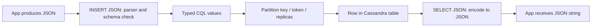

# SELECT JSON/INSERT JSON and Distinguishing Exchange Formats from Storage Types

## 1. Goal: What Is JSON in CQL?

Apache Cassandra is a distributed database built on the **wide-column** model, where **CQL schemas, partition keys, and clustering columns** determine how data is stored and queried. Since Cassandra 2.2, CQL has supported **`SELECT JSON`** to output rows as JSON and **`INSERT JSON`** to ingest rows from a JSON object. These two syntaxes change **how data is represented at the CQL interface**, rather than turning Cassandra into a schemaless document database.

This lesson belongs to the **Advanced CQL** chapter of the `DATABASE_ENGINE_WIDE_COLUMN_CASSANDRA` module. It connects directly to query-driven table design, partitioning, replication, consistency, write/compaction performance, and Java application integration.

After this lesson, you will be able to:

1. Write `SELECT JSON` and `INSERT JSON` against tables with real schemas, and interpret outputs and errors accurately.
2. Distinguish **JSON used for interchange** from **CQL data types stored** on rows and across replicas.
3. Properly handle **omitted** columns, **`null`** values, `DEFAULT NULL`, and `DEFAULT UNSET` to avoid accidental data deletion/tombstones.
4. Choose mappings for numbers, timestamps, UUIDs, collections, and case-sensitive field names.
5. Know when to use JSON at the Java application boundary and when to use prepared statements with strongly typed columns.

## 2. Execution Model: JSON Is Not a Special Column Type



| Component | What Actually Happens? |
| --- | --- |
| `INSERT JSON` | Cassandra parses a **JSON object** representing **one row**, maps keys to **declared column names**, validates types, and writes via standard CQL mechanics. |
| `SELECT JSON` | Cassandra reads rows via a normal CQL query and serializes the selected columns into **one JSON string per result row**. |
| Schema | `CREATE TABLE` still defines columns, CQL types, partition keys, clustering keys, and related rules. |
| Partitioning and replication | Still based on the partition key encoded per its CQL type; sending data as JSON does not alter tokens or replicas. |
| Arbitrary JSON fields | Dynamic column creation is not allowed. A JSON key absent from the schema makes the statement invalid; flexible structures require `map`, UDT, or `text/blob` columns. |

**Key principle:** JSON is an **interchange/serialization format**; `text`, `uuid`, `decimal`, `timestamp`, `set<text>`, and `map<text,text>` are the actual **CQL column types**. Cassandra has no native JSON/JSONB column type equivalent to some other DBMSs.

## 3. Running Example Table

Assume keyspace `demo_ks` has already been created in the test cluster. Create a table querying orders by customer:

```sql
CREATE TABLE demo_ks.orders_by_customer (
    customer_id text,
    order_id uuid,
    status text,
    total decimal,
    created_at timestamp,
    paid boolean,
    tags set<text>,
    attributes map<text, text>,
    PRIMARY KEY ((customer_id), order_id)
);
```

This design illustrates two key tiers:

- **`customer_id` is the partition key**: data is partitioned and replicas are located based on this value.
- **`order_id` is a clustering column**: distinguishes orders within a customer's partition.

The remaining fields have fixed types. A JSON object used to write a row **must provide all primary key components** (`customer_id` and `order_id`). Even though the payload is JSON, you cannot pass `{"tracking_number":"X"}` to replace the primary key or make Cassandra auto-create a `tracking_number` column.

## 4. `SELECT JSON`: One JSON Object Per Row

After inserting data in section 5, run:

```sql
SELECT JSON customer_id, order_id, status, total, paid, tags
FROM demo_ks.orders_by_customer
WHERE customer_id = 'cust-42'
  AND order_id = 11111111-2222-3333-4444-555555555555;
```

Example **illustrating the structure** of a value in the `[json]` result column:

```json
{
  "customer_id": "cust-42",
  "order_id": "11111111-2222-3333-4444-555555555555",
  "status": "NEW",
  "total": 125.50,
  "paid": false,
  "tags": ["mobile", "new"]
}
```

This is **a single CQL result cell containing a JSON string**, formatted across lines here for readability. Key ordering, `set` element ordering, and numeric formatting can vary; applications must compare **semantic values**, not byte-for-byte JSON strings.

You can also use:

```sql
-- One JSON object PER returned row in the partition.
SELECT JSON *
FROM demo_ks.orders_by_customer
WHERE customer_id = 'cust-42'
LIMIT 10;

-- Serializes only the selected expressions.
SELECT JSON order_id, status, ttl(status)
FROM demo_ks.orders_by_customer
WHERE customer_id = 'cust-42';
```

**Common pitfall:** For 10 rows, `SELECT JSON` produces **10 separate JSON values**, not a single 10-element JSON array. `ttl(status)` is a query-computed expression that may appear under a key such as `"ttl(status)"`; it is not a new column in the table.

Normal query rules **still apply**: `WHERE` must align with keys/indexes and the data model, and `LIMIT`/`ORDER BY` retain their usual CQL restrictions. `SELECT JSON` **does not** support ad-hoc JSON path queries like `$.attributes.channel` and does not make a full-table scan any cheaper.

## 5. `INSERT JSON`: Mapping One Object to One Typed Row

A complete row write:

```sql
INSERT INTO demo_ks.orders_by_customer JSON
'{
  "customer_id": "cust-42",
  "order_id": "11111111-2222-3333-4444-555555555555",
  "status": "NEW",
  "total": "125.50",
  "created_at": "2026-11-21 09:30:00+0000",
  "paid": false,
  "tags": ["mobile", "new"],
  "attributes": {"channel": "app", "source": "promotion"}
}'
DEFAULT UNSET;
```

**Why are these JSON values valid?**

- `customer_id` and `status` are strings, stored as CQL `text`.
- `order_id` is a **JSON string representing a UUID**, validated and stored as CQL `uuid`.
- `total` is sent as a **decimal string**, which Cassandra parses into `decimal`. This prevents client-side JSON parsers from rounding large decimals **before sending**.
- `created_at` is a valid timestamp string converted to `timestamp`; maintain consistent timezone conventions across the application.
- `paid` is the JSON boolean `false`, stored as CQL `boolean`.
- `tags` is a **JSON array** that becomes **`set<text>` in Cassandra**: a unique collection without the logical ordering of a JSON array.
- `attributes` is a **JSON object** mapped to **`map<text,text>`**, not an arbitrary JSON document column.

If the row does not exist yet, `INSERT JSON` creates it. If a row with the same primary key already exists, the statement **can update/overwrite** columns according to Cassandra's timestamp rules; `INSERT` is not "insert-only" by default.

To insert only when the row does not yet exist:

```sql
INSERT INTO demo_ks.orders_by_customer
JSON '{"customer_id":"cust-42",
       "order_id":"aaaaaaaa-bbbb-cccc-dddd-eeeeeeeeeeee",
       "status":"NEW"}'
IF NOT EXISTS;
```

`IF NOT EXISTS` uses **LWT/Paxos**: it incurs consensus overhead and returns an `[applied]` result. It **does not** change how JSON maps onto the schema. Under high contention, evaluate LWT against business requirements rather than enabling it by default on every write.

## 6. Distinguishing `DEFAULT NULL`, `DEFAULT UNSET`, and Explicit `null` in JSON

This area frequently causes data loss when using `INSERT JSON` as a partial update.

Suppose row `('cust-42', 11111111-2222-3333-4444-555555555555)` currently has `status='NEW'`, `total=125.50`, `paid=false`, and `tags={'mobile','new'}`.

### 6.1. Omitted Columns and `DEFAULT NULL`

```sql
-- DEFAULT NULL is the DEFAULT behavior if no directive is specified.
INSERT INTO demo_ks.orders_by_customer
JSON '{"customer_id":"cust-42",
       "order_id":"11111111-2222-3333-4444-555555555555",
       "status":"PAID"}'
DEFAULT NULL;
```

Columns absent from the object—such as `total`, `paid`, `tags`, and `attributes`—are treated as **`NULL`**. For columns currently holding values, Cassandra generates deletions/tombstones; they are not automatically preserved. **Sending only three keys does not mean "update only `status`"** under the default setting.

### 6.2. Omitted Columns and `DEFAULT UNSET`

To change `status` while **preserving omitted columns**:

```sql
INSERT INTO demo_ks.orders_by_customer
JSON '{"customer_id":"cust-42",
       "order_id":"11111111-2222-3333-4444-555555555555",
       "status":"PAID"}'
DEFAULT UNSET;
```

In this mode, columns without matching keys are **ignored**, leaving the existing values of `total`, `paid`, and `tags` intact. This is typically the right choice for partial JSON payloads when it matches business semantics.

### 6.3. Key Present with Value `null`

```sql
INSERT INTO demo_ks.orders_by_customer
JSON '{"customer_id":"cust-42",
       "order_id":"11111111-2222-3333-4444-555555555555",
       "status":null}'
DEFAULT UNSET;
```

`DEFAULT UNSET` **does not save** the `status` column here. The key `status` **is present** with a `null` value, which means **delete the column value**. Never send `null` for required primary key components.

| Payload / Option | `status` | `total` (omitted from JSON) | Effect |
| --- | --- | --- | --- |
| `{"status":"PAID"} DEFAULT NULL` (with full primary key) | Writes `PAID` | Set to `NULL` / tombstone | Risk of unintended deletion. |
| `{"status":"PAID"} DEFAULT UNSET` (with full primary key) | Writes `PAID` | **Preserved** | Suitable for partial updates. |
| `{"status":null} DEFAULT UNSET` (with full primary key) | **Deletes** `status` | **Preserved** | Clearly distinguishes `null` from an omitted key. |

**Operational impact:** Every column deletion can create a **tombstone**. If an API ingests many small JSON payloads using `INSERT JSON` with the default setting, tombstones can accumulate and degrade read and compaction performance. Using `DEFAULT UNSET` is a write-semantics choice; it **does not** replace performance testing, tombstone monitoring, or proper TTL/repair design.

## 7. JSON ↔ CQL Type Mapping Table

Cassandra converts through the schema at write time and emits corresponding JSON on read. You cannot infer the storage type purely from JSON syntax:

| CQL Column Type | Typical JSON Form | Things to Verify |
| --- | --- | --- |
| `text`, `varchar`, `ascii` | `"hello"` | Must be a string, JSON-escaped as required. |
| `int`, `bigint`, `varint` | `42` | Numeric range is validated against the CQL type; `bigint/varint` can exceed JavaScript's safe integer range. |
| `decimal`, `float`, `double` | `125.50` or accepted numeric strings | Watch for precision loss if a client decodes JSON numbers as IEEE-754 floats. |
| `boolean` | `true` or `false` | Not identical to the text string `"true"`, even though some simple formats permit strings per CQL syntax. |
| `uuid`, `timeuuid` | `"11111111-..."` | Still validated as a proper UUID. |
| `date`, `time`, `timestamp` | Time-formatted string | Pay attention to format, precision, and timezone; `timestamp` serializes as a string. |
| `inet` | `"192.0.2.10"` | Must be a valid IP address. |
| `blob` | `"0x0123abcd"` | Hex string with `0x` prefix, not a JSON object. |
| `list<T>` and `set<T>` | `[v1, v2]` | Share the JSON array syntax, but CQL `set` does not preserve order and deduplicates items. |
| `map<K,V>` | `{"key":"value"}` | JSON object with string keys; CQL still validates key/value types of the map. |
| `tuple<...>` | `[v1, v2]` | Order and arity are dictated by the tuple definition. |
| User-defined type (UDT) | `{"field_a":v1}` | Only fields declared in the UDT are accepted; not schemaless. |

An easy point of confusion: `tags` is declared as `set<text>` and `attributes` as `map<text,text>`. Even though on the wire they look like a JSON array and object respectively, Cassandra stores and handles them as **CQL collection types**. Collection queries remain bound by CQL limits and indexing rules, with no automatic JSON path syntax.

**Numeric note:** `SELECT JSON` can output `decimal` as a JSON number; many client JSON parsers decode JSON numbers into `double`, risking rounding. For monetary amounts or large integer IDs, configure your JSON library for `BigDecimal`/`BigInteger` or read structured types directly via the Java Driver; never assume a JSON round-trip preserves arbitrary formatting.

## 8. Column Names and Escaping: Two Separate Quoting Layers

Unquoted CQL column names are normalized to lowercase. If you created a case-sensitive column using a quoted identifier, the JSON key must contain **the CQL identifier's double quotes** properly escaped.

```sql
CREATE TABLE demo_ks.quoted_names (
    id int PRIMARY KEY,
    "DisplayName" text
);

INSERT INTO demo_ks.quoted_names
JSON '{"id":1, "\"DisplayName\"":"Lan"}'
DEFAULT UNSET;

SELECT JSON * FROM demo_ks.quoted_names WHERE id = 1;
```

In the output JSON, the corresponding key is encoded like `"\"DisplayName\""`. If you write `"DisplayName"` without the CQL identifier quotes, the statement may fail to match the quoted column. Because multiple layers of escaping (JSON, CQL string literals, Java strings) are error-prone, prefer `lower_snake_case` column names in new schemas.

For values containing single quotes, you must also escape **CQL string literals** (doubled single quotes) on top of standard JSON escaping. In Java applications, prefer **binding a parameter** for the entire JSON string rather than concatenating raw input into CQL text.

## 9. `to_json()` and `from_json()`: Converting a Single Column

Two companion functions that are **not** the same as full-row `SELECT JSON`/`INSERT JSON`:

```sql
-- Convert a single CQL value to a JSON string.
SELECT order_id, to_json(tags) AS tags_json
FROM demo_ks.orders_by_customer
WHERE customer_id = 'cust-42';

-- Convert a JSON array to a set<text> value for the tags column.
UPDATE demo_ks.orders_by_customer
SET tags = from_json('["mobile", "vip"]')
WHERE customer_id = 'cust-42'
  AND order_id = 11111111-2222-3333-4444-555555555555;
```

`to_json()` is used in the **SELECT list** to serialize **one value**. `from_json()` converts **one JSON value** into a CQL type in supported contexts such as `VALUES` in `INSERT` or assignment values in `UPDATE`. It does not mean Cassandra added a JSON column type. Do not use `from_json()` as a top-level selector in a `SELECT` list.

## 10. Choosing Between Typed CQL Modeling and a `text` JSON Payload

Suppose an API receives an order with `customerId`, `orderId`, `total`, and `status`. There are two design paths serving different purposes:

| Approach | Example | Choose When |
| --- | --- | --- |
| **Typed CQL columns** + JSON at the boundary | `total decimal`, `status text`, `created_at timestamp`; use `INSERT JSON`/`SELECT JSON` or Driver typed API | The app needs key-based queries, type validation, collections/UDTs, and per-column updates. |
| **A JSON string stored in `text`** | `raw_payload text` holding `{"foo":42}` | You only need to preserve the verbatim payload for re-export or audit; no CQL querying into nested fields is needed. |

If you store JSON in `raw_payload text`, Cassandra treats it as an **opaque string**—it neither promotes `foo` to a column nor offers JSON path queries. To query "orders by status and time," you need **query-driven table design** (such as partitioning by status/bucket and clustering by time), potentially adding denormalized tables, keeping updates synchronized, and choosing appropriate consistency levels. `SELECT JSON` cannot fix a poor partition key choice or overly broad filter.

This matters in distributed Cassandra: using JSON payloads at the API layer does not change partitioning, replication, memtables/SSTables, compaction, or repair. Those subsystems operate on the typed data stored in the table.

## 11. Using with the Java Driver

Java Driver 4.x can bind **a JSON string** to `INSERT JSON ?`, avoiding direct payload string concatenation:

```java
// jsonPayload is produced by a JSON library (e.g., Jackson),
// containing customer_id and order_id with schema-matching values.
String jsonPayload = objectMapper.writeValueAsString(requestBody);

PreparedStatement insert = session.prepare(
    "INSERT INTO demo_ks.orders_by_customer JSON ? DEFAULT UNSET"
);
session.execute(insert.bind(jsonPayload));

PreparedStatement query = session.prepare(
    "SELECT JSON customer_id, order_id, status, total " +
    "FROM demo_ks.orders_by_customer " +
    "WHERE customer_id = ? AND order_id = ?"
);

Row row = session.execute(query.bind(
    "cust-42",
    UUID.fromString("11111111-2222-3333-4444-555555555555")
)).one();

if (row != null) {
    String json = row.getString(0); // JSON representation of one row.
    // Convert to DTO or return over HTTP as needed.
}
```

This is an illustrative snippet assuming `session` is connected and `objectMapper`/`requestBody` are already declared. Note that **Java DTO property names** like `customerId` usually **do not automatically match** `customer_id` in the table: configure serialization mapping appropriately. Every supplied value must still conform to its CQL type and include all primary key components.

For workloads performing many operations against the same schema, **prepared statements binding typed columns** are often cleaner for managing UUIDs, decimals, and timestamps, while also letting the Driver know the exact routing key:

```java
PreparedStatement update = session.prepare(
    "UPDATE demo_ks.orders_by_customer SET status = ? " +
    "WHERE customer_id = ? AND order_id = ?"
);
session.execute(update.bind(
    "PAID", "cust-42",
    UUID.fromString("11111111-2222-3333-4444-555555555555")
));
```

Specifying `DEFAULT UNSET` only handles columns **omitted from the JSON**; it does not replace safe retries, idempotency, or LWT concurrency checks when needed. Read/write consistency still depends on consistency levels and cluster replica state.

## 12. Common Errors and How to Diagnose Them

| Symptom | Common Cause | Remediation |
| --- | --- | --- |
| `INSERT JSON` reports missing primary key | Object lacks `customer_id` or `order_id` | Provide **all** partition/clustering key columns and verify exact column names. |
| Reports unknown column | Misspelled JSON key, schema mismatch, or quoted identifier | Run `DESCRIBE TABLE`, verify exact column names and escaping. |
| Reports invalid value | Malformed UUID, out-of-range number, unparseable timestamp, invalid JSON | Verify JSON input types against CQL column types; parse/validate at the API boundary. |
| Existing columns vanish after a short JSON write | `INSERT JSON` defaulted to `DEFAULT NULL` | For partial updates, use `DEFAULT UNSET` and distinguish omitted keys from `null`. |
| `SELECT JSON` returns strings instead of an array | CQL emits one JSON object **per row** | Collect multiple rows into an array in the application if the API needs one. |
| Monetary figures drift by a few digits through JSON | Client JSON parser decoded numbers as `double` | Prefer `BigDecimal` and keep numeric precision from input. |
| JSON output has different field order / set array order | JSON objects are unordered, and CQL sets are unordered | Compare structurally/by value rather than byte strings or set order. |
| JSON queries still cannot filter arbitrary fields | `SELECT JSON` does not create indexes or a document query engine | Design query-driven schemas and create appropriate indexes only when justified. |
| Latency and tombstones rise after API integration | Frequent `DEFAULT NULL`/`null` writes or wide payloads | Review write semantics, monitor metrics, compaction, and column update patterns. |

## 13. Reproducible Hands-On Lab

Run these steps in a **test keyspace** using a dedicated `customer_id`; the `INSERT` statements modify data:

1. Create `orders_by_customer` as in section 3. Write a full row using `INSERT JSON ... DEFAULT UNSET`; inspect it with regular `SELECT` and `SELECT JSON`. Confirm `order_id` reads as `UUID` and `total` as `BigDecimal` via the driver.
2. Write to the same key with JSON **containing only** `status` and both primary key columns, using `DEFAULT UNSET`. Verify `total`/`tags` remain intact.
3. Restore the full row, repeat the short JSON write with `DEFAULT NULL`. Observe the deleted columns. Discuss tombstone impact if this pattern runs thousands of times.
4. Restore the row and test `"status":null` with `DEFAULT UNSET`. Explain why `status` is deleted even though omitted columns stay intact.
5. Try sending `"unknown_field":"x"` or omitting `order_id`; note the schema/primary key validation errors.
6. Insert `tags` with duplicate elements in the JSON array, then run `SELECT JSON tags`; explain the difference between `set` and `list`.
7. Run `SELECT JSON ... LIMIT 2` across two orders for the same customer. Verify you receive **two independent JSON objects**, not one JSON array.

**Self-check:** Given input `{"customer_id":"cust-42","order_id":"...","status":"PAID"}`, answer before running: (a) which existing row columns are missing, (b) what happens to them under `DEFAULT NULL`, (c) what happens under `DEFAULT UNSET`, (d) whether JSON changes how Cassandra selects partitions/replicas, and (e) what is required if you need to query by status across all customers?

## 14. Authoritative References

- [Apache Cassandra — JSON Support](https://cassandra.apache.org/doc/stable/cassandra/developing/cql/json.html): `SELECT JSON`, `INSERT JSON`, `DEFAULT NULL`/`DEFAULT UNSET`, type mapping table, `to_json()`/`from_json()`.
- [Apache Cassandra — CQL Data Manipulation](https://cassandra.apache.org/doc/stable/cassandra/developing/cql/dml.html): `SELECT`, `INSERT`, `IF NOT EXISTS` syntax, and query limitations.
- [Apache Cassandra Java Driver 4.x — JSON INSERT Query Builder](https://apache.github.io/cassandra-java-driver/4.18.1/query_builder/insert/): JSON literals, `JSON ?`, `defaultUnset()`, and `defaultNull()`.

**Practical conclusion:** Use JSON where it simplifies **data interchange** across CQL and APIs, while always verifying schemas, primary key values, types, and omitted-column behavior. Use `DEFAULT UNSET` when you truly want to preserve omitted fields; use `null` or `DEFAULT NULL` when deletion is intentional. Efficient queries and consistency still depend on designing tables, partitions, and write workflows around Cassandra's distributed architecture.
