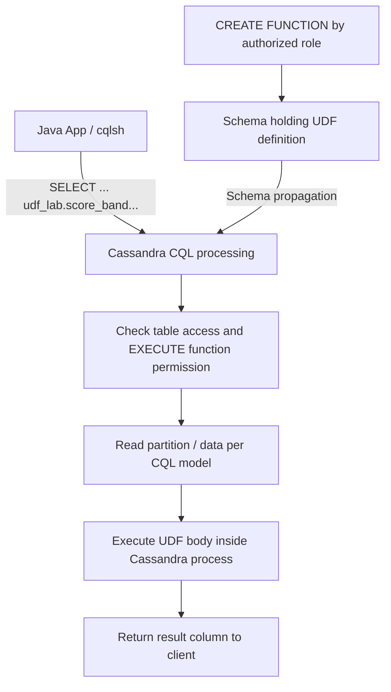

# User-Defined Functions (UDFs) in Cassandra: Enabling Configuration and Security Boundaries

## 1. What Is a UDF and When Should You Care?

In **Apache Cassandra**, CQL (*Cassandra Query Language*) provides built-in functions to transform or process data. A **User-Defined Function (UDF)** lets authorized users define custom functions with their own parameters, return type, and body. For example, a function can map a risk score from a `score` column to `'low'`, `'medium'`, or `'high'` directly inside a `SELECT` statement.

This topic belongs to the **Advanced CQL** chapter of the `DATABASE_ENGINE_WIDE_COLUMN_CASSANDRA` module, building on distributed architecture, partition keys, the wide-column model, read/write consistency, and Java application integration. UDFs extend query semantics; **they do not replace query-driven table design, partition keys, replication, compaction, or repair**.

UDFs are also a critical security decision: the function body executes inside the **Cassandra server environment**, alongside live query traffic. Enabling UDFs allows user-supplied code inside the database execution path. Consequently, Apache Cassandra keeps UDFs **disabled by default**; even with sandboxing, the official documentation emphasizes that the sandbox is not watertight.

By the end of this lesson, you will be able to:

1. Write, invoke, replace, and drop a scalar UDF in CQL.
2. Distinguish the configuration property names enabling UDFs across Cassandra versions.
3. Grant `CREATE`, `ALTER`, `DROP`, and `EXECUTE` permissions with least privilege.
4. Identify the security boundaries between the CQL client, Cassandra server, sandbox, and JVM resources.
5. Evaluate execution cost, error handling, and alternatives in Java/the application layer.

## 2. Where Do UDFs Fit in Cassandra's Architecture?

`CREATE FUNCTION` creates a **schema object** belonging to a keyspace. The function definition propagates across nodes just like other schema changes; the application does not ship the UDF's Java code with each request. When CQL invokes the function, its code is evaluated inside the Cassandra server process as the query runs.



This diagram is a conceptual model. Exact execution placement along the query pipeline can vary; the essential point is that **UDFs execute server-side, not inside the Java client process**.

| Concept | Purpose | Can It Replace a UDF? |
| --- | --- | --- |
| **Native CQL function** | Built-in Cassandra functions, e.g., `CAST`, `toTimestamp` in supported contexts | Prefer whenever it satisfies the requirement |
| **Scalar UDF** | Takes arguments and returns one value, e.g., `score_band(score)` | Use when server-side evaluation is needed and risks are reviewed |
| **User-defined aggregate (UDA)** | Aggregates multiple rows via state/final functions | Not identical to scalar UDFs; usually relies on UDFs |
| **Logic in the Java application** | Transform, validate, and run business rules after reading | Usually safer, easier to test, deploy, and observe |
| **Precomputed/materialized query data** | Store the label or state directly for fast filtering/retrieval | Usually better when filtering efficiently by that label is required |

UDFs **do not** create indexes, distribute a hot partition across nodes, or make queries lacking a proper partition key suddenly efficient. In Cassandra, **query-driven key modeling** still dominates scalability.

## 3. CQL Example: Creating and Calling a Java UDF

### 3.1. Preparing a Keyspace and Test Table

Assume you are working in a **lab** cluster with UDFs enabled. The `dc1` data center name below is illustrative and must be replaced with the real DC name reported by `nodetool status`. RF = 1 is only for a single-node lab; real deployments require topology/RF matching fault-tolerance needs.

```sql
CREATE KEYSPACE IF NOT EXISTS udf_lab
WITH replication = {
    'class': 'NetworkTopologyStrategy',
    'dc1': 1
};

CREATE TABLE IF NOT EXISTS udf_lab.customer_score_by_id (
    customer_id uuid PRIMARY KEY,
    score int,
    updated_at timestamp
);

INSERT INTO udf_lab.customer_score_by_id (customer_id, score, updated_at)
VALUES (
    11111111-1111-1111-1111-111111111111,
    86,
    '2026-11-21T00:00:00Z'
);
```

The table uses `customer_id` as the **partition key**, so reading one customer by primary key avoids a full-table scan. Do not turn this example into an unfiltered `SELECT` on production tables.

### 3.2. Defining a Scalar UDF

```sql
CREATE FUNCTION IF NOT EXISTS udf_lab.score_band(score int)
RETURNS NULL ON NULL INPUT
RETURNS text
LANGUAGE java
AS $$
    if (score >= 80) {
        return "high";
    }
    if (score >= 50) {
        return "medium";
    }
    return "low";
$$;
```

Explanation of clauses:

| Syntax | Meaning |
| --- | --- |
| `udf_lab.score_band` | Function belongs to keyspace `udf_lab` |
| `score int` | Name and type of a single argument |
| `RETURNS NULL ON NULL INPUT` | If any argument is `null`, Cassandra returns `null` without invoking the function body |
| `RETURNS text` | CQL return type |
| `LANGUAGE java` | Body written in Cassandra-supported Java |
| `AS $$ ... $$` | Function body delimited by `$$` markers in CQL |
| `IF NOT EXISTS` | Creates only if the function signature does not exist; **does not update** existing code |

The body must return a value compatible with `RETURNS text`. This is a **function body**, not a standalone Java class with `main`. UDFs should be pure: output depends solely on arguments, holding no state, performing no randomness, making no external service calls, and attempting no side effects.

Calling the UDF:

```sql
SELECT
    customer_id,
    score,
    udf_lab.score_band(score) AS risk_band
FROM udf_lab.customer_score_by_id
WHERE customer_id = 11111111-1111-1111-1111-111111111111;
```

With the sample data, `risk_band` returns `high`. This example transforms **a single record already located by partition key**; the UDF does not alter how Cassandra finds replicas for the partition.

### 3.3. Nulls, Data Types, and Overloading

The two null-handling modes are **distinct**:

- `RETURNS NULL ON NULL INPUT`: Cassandra skips invoking the function if any argument is null; ideal for transformations undefined on null.
- `CALLED ON NULL INPUT`: Cassandra invokes the function even when arguments are null. The author must handle nulls explicitly inside the body using boxed/nullable Java types; otherwise, exceptions can fail the entire statement.

`score_band(int)` and `score_band(double)` can exist as **two overloads** with different signatures. A signature consists of **keyspace, function name, and parameter types**; parameter names do not distinguish overloads. To change the code of an **existing signature**, use `CREATE OR REPLACE FUNCTION` after reviewing permissions and impact; `OR REPLACE` and `IF NOT EXISTS` **cannot be combined in the same statement**.

To drop a specific overload:

```sql
-- Execute only after verifying no queries still depend on it.
DROP FUNCTION IF EXISTS udf_lab.score_band(int);
```

Functions in system keyspaces are not supported. With UDTs, tuples, or collections, syntax and Java type mappings are more complex; verify against your **Cassandra version** rather than assuming every Java type maps directly.

## 4. Enabling UDFs in Configuration: Match Your Version

You cannot simply run `CREATE FUNCTION` from `cqlsh` and expect UDFs to enable themselves. **This is a server-side configuration feature**, disabled by default due to code execution risks inside the database process. Operators must verify the Cassandra version and roll out consistent settings across all nodes handling UDF queries.

| Apache Cassandra Version | Java UDF Config Key | Notes |
| --- | --- | --- |
| **3.11 / 4.0** | `enable_user_defined_functions` | Defaults to `false` in the corresponding configuration files |
| **4.1 / 5.0** | `user_defined_functions_enabled` | New standardized property name; defaults to `false` |
| Other / vendor distributions | Check `cassandra.yaml` and **version-specific** docs | Do not mix old and new property names |

Example configuration for **Cassandra 4.1/5.0** in `cassandra.yaml`, **strictly for an administrator-controlled lab environment**:

```yaml
# Lab/trusted environment; do not apply blindly to production.
user_defined_functions_enabled: true
```

For Cassandra **4.0**, the corresponding key is:

```yaml
enable_user_defined_functions: true
```

Changing configuration requires a version-appropriate deployment/restart procedure per operational policy; do not assume editing one file or one node enables UDFs cluster-wide immediately. During a rolling restart, nodes having inconsistent UDF settings can cause uneven query failures. Only test UDF statements after verifying all target nodes and schema agreement.

### 4.1. Scripted UDFs Differ from Java UDFs

Older versions have a **separate** key for scripted UDFs:

```yaml
# Cassandra 4.1: keep disabled in lab if only Java UDFs are needed.
scripted_user_defined_functions_enabled: false
```

In Cassandra 4.0, the old key was `enable_scripted_user_defined_functions`. Scripted UDFs such as JavaScript were marked **deprecated in Cassandra 4.1** and removed along the Cassandra 5.0 roadmap. Do not build new systems depending on `LANGUAGE javascript` or assume scripted UDF options exist in newer Cassandra releases.

Enabling Java UDFs **does not** require enabling scripted UDFs. Do not enable both broadly just to run a `LANGUAGE java` example.

### 4.2. Timeout and Dedicated Thread Configuration

Some versions expose related settings such as:

- `user_defined_functions_threads_enabled`: controls whether UDFs execute on dedicated threads per version capabilities.
- `user_defined_functions_warn_timeout` and `user_defined_functions_fail_timeout`: warning/failure thresholds for UDFs; exact names and units changed across versions.

These settings are **operational limits/monitoring guardrails**, not guarantees of airtight isolation for arbitrary code. A request-level timeout cannot necessarily abort all JVM work immediately. Do not raise timeouts to mask CPU-heavy UDFs; measure the code, rows processed, and thread/GC behavior first.

### 4.3. Controlled Lab Enablement Procedure

1. Identify the Cassandra version, compatible JDK, DC/rack layout, and active config; save a backup copy for rollback.
2. Enable the version-appropriate UDF key **on the required nodes**, keeping scripted UDFs disabled if unneeded.
3. Apply changes/restarts per cluster procedure; after each batch, verify `nodetool status`, startup logs, and schema state.
4. As an admin role, create **one** small, deterministic Java function like `score_band` and test against one partition in a lab keyspace.
5. Measure latency, exceptions, and resource usage; grant `EXECUTE` to a scoped test role.
6. When no longer needed, remove dependencies and revoke permissions; disable UDFs if policy requires via a planned configuration change.

Never modify production `cassandra.yaml` solely because a demo query asks for a UDF. Evaluate computing in the Java application or precomputing a result column first.

## 5. Function Permissions and Role Boundaries

From a security perspective, **enabling the feature** is only one layer. Cassandra supports function-level authorization resources: `ALL FUNCTIONS`, `ALL FUNCTIONS IN KEYSPACE <ks>`, and `FUNCTION <ks>.<name>(<types>)`. These are distinct from table read/write permissions.

| Permission | Applicable Function Resource | Capability |
| --- | --- | --- |
| `CREATE` | All functions or all functions in a keyspace | Create a UDF/UDA |
| `ALTER` | Specific function or broader scope | Replace an existing definition |
| `DROP` | Specific function or broader scope | Drop a definition |
| `EXECUTE` | Specific function or broader scope | Call the function in CQL |
| `AUTHORIZE` | Function or broader scope | Grant/revoke permissions on the function |
| `SELECT` | **Table**, not function | Read table data used by the query |

Note that `EXECUTE` on a UDF **does not implicitly grant `SELECT` on tables**; conversely, `SELECT` on a table does not grant permission to create/replace UDFs. When creating a new resource, the creator role is typically granted permissions on that resource automatically. **Never grant code creation/replacement permissions to an application account that only needs to query.**

Assume roles `udf_author` and `score_reader` have been created, authenticated, and reviewed by an administrator per policy. Least-privilege example:

```sql
-- DBA grants function creation within one keyspace,
-- avoiding cluster-wide GRANT CREATE ON ALL FUNCTIONS unless needed.
GRANT CREATE ON ALL FUNCTIONS IN KEYSPACE udf_lab TO udf_author;

-- Only the reader role may invoke the approved overload.
GRANT EXECUTE ON FUNCTION udf_lab.score_band(int) TO score_reader;

-- The example SELECT query also requires table read access.
GRANT SELECT ON TABLE udf_lab.customer_score_by_id TO score_reader;
```

In a controlled release pipeline, separate the account that **creates/replaces functions** from the account that **runs queries**, enforcing code review and changelogs for every source version. When permissions are no longer needed:

```sql
REVOKE CREATE ON ALL FUNCTIONS IN KEYSPACE udf_lab FROM udf_author;
REVOKE EXECUTE ON FUNCTION udf_lab.score_band(int) FROM score_reader;
```

**Prerequisite for these permission examples to enforce security:** the cluster must run proper authentication and authorization, configured per Cassandra and organizational policy. Under permissive settings (`AllowAllAuthenticator` / `AllowAllAuthorizer`), `GRANT` statements do not enforce real security boundaries. Test with **actual roles**: a role without `EXECUTE` must be denied when calling the function; a role with only `EXECUTE` must still be blocked from tables lacking `SELECT`.

### 5.1. Why CREATE/ALTER Permissions Are Especially Sensitive

UDF code can impact **CPU, heap, GC, request latency, and node availability**. Any role allowed to replace a UDF can inject expensive code into query paths used by other roles. Even though the sandbox tries to restrict dangerous APIs, **there is no reason to treat UDFs as fully isolated untrusted code**.

Boundaries to distinguish:

| Layer | What It Controls | What It Does Not Guarantee |
| --- | --- | --- |
| **CQL roles/permissions** | Who can create, alter, drop, or call UDFs; table read/write access | Does not prove the function body is safe code |
| **UDF sandbox** | Attempts to restrict execution APIs per version/JDK | Not a perfect security boundary; does not replace threat modeling |
| **Timeouts/execution threads** | Limits the blast radius of some long-running functions | Does not guarantee instant cancellation or complete heap/CPU isolation |
| **Testing and code review** | Catches nulls, exceptions, expensive algorithms, edge-case inputs | Cannot cover every production failure condition |
| **Monitoring, rollback, change management** | Detects regressions and reverts changes | Cannot prevent incidents if admin privileges are abused |

Therefore, **UDF author** must be a trusted role subject to code review. In mutually untrusted multi-tenant shared clusters, enabling UDFs and letting tenants author custom code is not an adequate isolation design. Separate clusters or moving logic to the application tier may be necessary.

## 6. Security and Operational Risks to Check

### 6.1. Code Executes Server-Side

A common mistake is thinking `LANGUAGE java` in `CREATE FUNCTION` executes inside the Java application's JVM. In reality, the Java Driver only sends CQL and receives results. The function body runs inside Cassandra infrastructure, consuming cluster resources. Therefore:

- Do not design UDFs to open files, read secrets, fetch URLs, or spawn OS commands. The sandbox may block them, but **the first line of defense is keeping such code out of UDFs altogether**.
- Do not call external services or perform network I/O from UDFs. Database queries can stall on remote networks/targets, causing cascading load and failures.
- Avoid unbounded loops over inputs, large allocations, deep recursion, or per-row object churn.
- Avoid throwing exceptions on bad inputs. An exception inside a UDF can **fail the entire statement**; blind retries can amplify load.

### 6.2. Invalid Input, Nulls, and Sensitive Data

In `score_band`, `score >= 80` assumes valid numeric inputs. If business rules only allow `score` between 0 and 100, explicitly decide and test what happens for `-5` or `1000`. Avoid letting corrupt data silently map to a misleading valid band. UDFs do not replace write-time validation.

Do not log sensitive values or UDF source containing secrets into application logs. On systems with audit logging, remember `CREATE FUNCTION` logs may capture the function body and embedded literals. UDF code should express pure logic only—never API keys, access tokens, or passwords.

### 6.3. Version Differences and JVM Compatibility

Cassandra runs on the Java runtime supported by each release. Code compiling in a Java 21 application is **not automatically** valid in the UDF compiler/runtime of a Cassandra node on another JDK. Avoid external library dependencies, unsupported APIs, or newer language features absent in the running Cassandra runtime.

JavaScript UDFs were deprecated in Cassandra 4.1 and affected in the 5.x line; do not plan new work around `LANGUAGE javascript`. During cluster upgrades, validate compatibility of **every function in the schema** beforehand, not just `CREATE TABLE` DDL and driver compatibility.

## 7. Benchmarking UDF Performance: Per-Row Cost

Suppose a statement returns 500 rows and evaluates a UDF on `score` for each row. CPU cost, allocations, and potential exceptions scale with **how many times the function is called**, on top of data reading and result serialization. A tiny UDF on one partition may be fine; the same function over wide scans easily drives up p99 latency and GC pressure.

```text
request_total_time
  ≈ query_plan + replica_read + coordination
    + sum(UDF_execution_cost per evaluated row)
    + serialization + network + client_processing
```

This is a qualitative model, **not** an exact latency prediction formula. Because stages can overlap, do not blindly add individual timings as if they were strictly sequential.

To decide whether to move transformations into the database:

| Option | Pros | Cons |
| --- | --- | --- |
| UDF inside `SELECT` | No extra client transform step; logic lives in schema | CPU and code risk sit inside Cassandra; requires enabling and permissions |
| Compute in Java after reading | Easy to unit test, version, timeout, and isolate securely | May transfer more raw data and duplicate logic across services |
| Pre-store `risk_band` at write time | Fast label retrieval; can key tables around query patterns | Must keep synchronized when banding rules change |
| Native CQL function | Built-in capability, less custom code to maintain | May not cover custom business logic |

Minimum benchmarking procedure:

1. Prepare a fixed dataset with consistent partition and row counts across runs; separate warm-up from measured runs.
2. Measure the `SELECT` with the same partition key predicate **without the UDF**, then with the UDF; keep consistency level and page size identical.
3. Record client p50/p95/p99 latency, rows/s, CPU, GC, heap, and error rates; scale returned rows and concurrency in controlled steps.
4. Compare against transforming in the Java application. Consider both **network transfer cost** and **effective throughput**, rather than judging by a single p99 number.
5. Repeat with edge-case inputs: nulls, out-of-range scores, large partitions, and concurrent clients. Check impact on **non-UDF queries** sharing cluster load.

UDFs **are not a substitute for indexes or key-based `WHERE` clauses**. If you need to filter all "high risk" customers, a query-driven table `customers_by_risk_band` or a justified index is usually far better than transforming results on a broad scan.

## 8. Calling a UDF from a Java Application

With Java Driver 4.x, the application does not load the UDF Java code. It simply executes CQL calling the function name, using a role with `EXECUTE` and `SELECT` permissions. Example:

```java
import com.datastax.oss.driver.api.core.CqlSession;
import com.datastax.oss.driver.api.core.cql.PreparedStatement;
import com.datastax.oss.driver.api.core.cql.BoundStatement;
import com.datastax.oss.driver.api.core.cql.Row;
import java.util.UUID;

// Assumes session is connected to the local data center with an authorized role.
PreparedStatement query = session.prepare(
    "SELECT score, udf_lab.score_band(score) AS risk_band " +
    "FROM udf_lab.customer_score_by_id WHERE customer_id = ?"
);

UUID customerId =
    UUID.fromString("11111111-1111-1111-1111-111111111111");
BoundStatement statement = query.bind(customerId);
Row row = session.execute(statement).one();

if (row != null) {
    Integer score = row.isNull("score") ? null : row.getInt("score");
    String riskBand = row.getString("risk_band");
    System.out.println("score=" + score + ", riskBand=" + riskBand);
}
```

This snippet assumes an existing `CqlSession session`, not a complete Java class with `main`. The Java client **does not** need to know the contents of `AS $$ ... $$`, yet integration tests should catch changes to function name, signature, or return behavior. If the application already holds the data and classification logic, consider reusing a pure Java method instead of enabling UDFs cluster-wide.

## 9. Diagnosing Common Errors

| Symptom | Causes to Check | How to Verify |
| --- | --- | --- |
| `CREATE FUNCTION` rejected because feature is disabled | UDF setting defaults to `false`; wrong config key name; node hasn't picked up config | Check Cassandra version, `cassandra.yaml`, and node logs |
| `Unauthorized` on create/call | Role lacks `CREATE`/`EXECUTE` or table permissions | Authenticate as the role and inspect active grants |
| Function created, but query reports missing function/signature | Keyspace, overload, or parameter types mismatch; schema not propagated | Check exact definition, `int` vs `bigint`, and schema agreement |
| `null` fails the statement | `CALLED ON NULL INPUT` without null checks; type mapping mismatch | Unit test null branches; consider `RETURNS NULL ON NULL INPUT` |
| Function throws exceptions on data | Out-of-range input, arithmetic errors, incompatible code | Reproduce with minimal input; review code and safe logs |
| Slow queries or timeouts calling UDF | CPU/GC/memory pressure, too many row invocations, heavy logic | Compare against non-UDF baseline; inspect latency and rows evaluated |
| Scripted UDF fails after upgrade | JavaScript deprecated/removed in newer release | Check release notes by version; migrate to Java UDF or app logic |

Operators can inspect schema definitions via CQL, provided the role has appropriate permissions:

```sql
SELECT
    keyspace_name,
    function_name,
    argument_types,
    language
FROM system_schema.functions
WHERE keyspace_name = 'udf_lab';
```

When investigating issues, collect the Cassandra/JDK versions, function/schema definition, sample request, consistency level, p99 latency, and server logs. Seeing every node `UN` in `nodetool status` **does not prove** UDF config is identical on every node.

## 10. Change Management and Rollback Procedure for a UDF

A reliable UDF release process keeps source code in application/DB migration version control, enforces independent review, and validates on a production-like lab cluster:

1. **Before deployment:** justify why a UDF is needed; evaluate whether native functions, Java app logic, or a precomputed column is better.
2. **Source review:** ensure purity, bounded complexity, no external I/O, and tests for nulls and bad inputs; verify version compatibility.
3. **Authorization:** deployment roles only hold `CREATE`/`ALTER` on needed keyspaces/functions; runtime roles only hold `EXECUTE` on approved signatures plus table grants.
4. **Canary:** test a few partition-keyed queries while monitoring p95/p99 latency, CPU, GC, exceptions, and background load.
5. **Rollout:** if changing existing function behavior, document return-value changes; clients may observe mixed results during transitional schema/deploy windows. For breaking changes, consider a **new versioned function** like `score_band_v2` and migrate clients incrementally.
6. **Rollback:** switch clients off the broken function, revoke unnecessary `EXECUTE`, restore the approved definition, or drop unreferenced overloads. Only disable the cluster-wide setting after confirming no queries still reference UDFs.

Do not confuse `DROP FUNCTION` with deleting table data; a function is a schema object, yet dropping it will **immediately fail application queries** that still reference it. Similarly, `CREATE OR REPLACE` affects every application sharing that signature.

## 11. Hands-On Lab Exercises and Self-Check Questions

### Lab Exercises

1. Create the keyspace, table, and `score_band(int)`. Query by `customer_id` to verify score 86 returns `high`; insert scores 50, 79, 80, and null to test boundaries.
2. Create two test roles: one with `SELECT` but no `EXECUTE`, and one with both. Verify the denial before and success after the DBA grants permission on the exact signature.
3. Run `CREATE FUNCTION IF NOT EXISTS` a second time with a different body; verify why results still use the original definition. In the lab, switch to `CREATE OR REPLACE FUNCTION` after granting `ALTER`.
4. Benchmark the same query with/without the UDF under light load, measuring p95/p99 and the effect of increasing row count and concurrency. Compare with calling an equivalent Java method client-side.
5. Revoke `EXECUTE` from the test role and confirm requests are rejected; restore permissions afterward if needed for further lab steps.

### Self-Check Questions

1. Why do `CREATE FUNCTION` and `EXECUTE FUNCTION` require separate permissions even within the same keyspace?
2. Is setting `user_defined_functions_enabled: true` on a single node enough for the entire cluster to support UDFs consistently?
3. How does `RETURNS NULL ON NULL INPUT` differ from `CALLED ON NULL INPUT`, and how does an exception in a UDF affect the statement?
4. Why do sandboxing and timeouts not justify granting `CREATE` to untrusted users?
5. When a query fetches 10,000 rows and evaluates a UDF on each row, which cluster resources take extra load and what metrics should you monitor?
6. Why does the Java Driver not need to download the UDF body, yet the application still needs integration tests for signature/output changes?
7. When upgrading Cassandra from 4.0 to 4.1 or 5.0, why must you review config key names and scripted UDFs?

## 12. Official References

- [Apache Cassandra — CQL Functions](https://cassandra.apache.org/doc/stable/cassandra/developing/cql/functions.html): `CREATE/DROP FUNCTION` syntax, null handling, overloading, and scripted UDF status.
- [Apache Cassandra — Database Roles and Permissions](https://cassandra.apache.org/doc/stable/cassandra/developing/cql/security.html): function resource hierarchy, `GRANT/REVOKE`, and `CREATE`/`EXECUTE` permissions.
- [Apache Cassandra — cassandra.yaml (stable)](https://cassandra.apache.org/doc/stable/cassandra/managing/configuration/cass_yaml_file.html): default UDF configuration settings.
- [Apache Cassandra — 4.0 Configuration](https://cassandra.apache.org/doc/4.0/cassandra/configuration/cass_yaml_file.html): legacy `enable_user_defined_functions` key.
- [Apache Cassandra — Renamed Configuration Properties](https://cassandra.apache.org/doc/stable/cassandra/managing/configuration/configuration.html): old/new property mapping and related settings.

**Takeaway:** A UDF is **user-defined code executed inside Cassandra**, stored in the schema and callable from CQL. Using it safely requires enabling the right **version-specific** configuration, granting **function-scoped** permissions, and testing/monitoring **both cost and risk**. For most business logic or large-scale filtering, evaluate application-layer processing or query-driven table design before enabling custom code execution on database servers.
