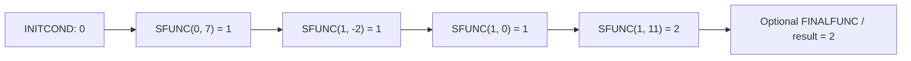
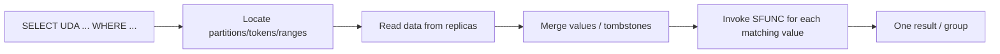

# User-Defined Aggregates and Execution Cost by Dataset Size

A **User-Defined Aggregate (UDA)** in Apache Cassandra lets you define a custom aggregation over rows read by a CQL query. For example, beyond built-ins like `COUNT`, `SUM`, `AVG`, `MIN`, and `MAX`, an application might want to count how many events have a positive score per day. A UDA can compute that inside Cassandra, yet returning **one row** does not mean Cassandra only reads **one row**: execution cost depends primarily on how many rows are queried, partition scope, intermediate aggregate state size, and the complexity of per-row code.

This lesson belongs to the **Advanced CQL** chapter of the **DATABASE_ENGINE_WIDE_COLUMN_CASSANDRA** module. It brings together Cassandra fundamentals—partition keys, query-driven table design, replication, consistency, compaction/repair, and the Java driver—so you know when to use a UDA, when to pre-aggregate data, and how to measure cost rather than guessing from output row count.

## 1. Learning Objectives

After this lesson, you will be able to:

1. Distinguish **UDFs** (functions processing a single value/row) from **UDAs** (functions accumulating across rows) and built-in aggregates.
2. Explain the exact roles of `SFUNC`, `STYPE`, `INITCOND`, and `FINALFUNC`.
3. Create UDFs/UDAs in CQL, run queries against a known partition, and verify results using sample data.
4. Estimate cost by the number of **rows read**, partitions, tombstones, and state complexity—not by output row count.
5. Analyze the impact of nulls, numeric types, overflow, large datasets, `GROUP BY`, consistency, and timeouts.
6. Benchmark UDAs in a controlled way, and propose pre-aggregated tables or external processing pipelines when queries become too costly.

## 2. UDFs, UDAs, and Built-In Aggregations

| Type | Example | Operates On | Characteristics |
| --- | --- | --- | --- |
| **Scalar UDF** | `normalize_score(score)` | Input values of a single row | Returns one value; callable in `SELECT` expressions or used as a building block for a UDA. |
| **Native aggregate** | `COUNT(*)`, `SUM(score)`, `AVG(score)` | Set of rows returned by `SELECT` | Built into Cassandra; prefer whenever it meets requirements. |
| **UDA** | `count_positive(score)` | Set of rows returned by `SELECT` | Uses a state-transition function per row; can optionally convert final state to output. |

Example with scores `[7, -2, 0, 11]`:

- `COUNT(score)` returns **4** because four rows have non-null scores.
- `SUM(score)` returns **16**.
- UDA `count_positive(score)` returns **2**, because only `7` and `11` are greater than 0.

A UDA is neither a "materialized view" nor a metric column automatically updated on every `INSERT`. Every time `SELECT` invokes it, Cassandra must compute the aggregation over **the rows within that query's scope**. For near-real-time counts across wide partitions, consider a dedicated summary table model.

## 3. State Machine of a UDA

A UDA folds a stream of values into a state:

```text
state_0 = INITCOND
state_1 = SFUNC(state_0, value_1)
state_2 = SFUNC(state_1, value_2)
...
state_n = SFUNC(state_(n-1), value_n)
result  = FINALFUNC(state_n)  // if defined; otherwise result = state_n
```



Clauses of `CREATE AGGREGATE`:

| Component | Role | Key Constraints |
| --- | --- | --- |
| **SFUNC** | UDF updating state from one input value. | Its **first** parameter must have type `STYPE`; subsequent parameters match the UDA signature; return type must be `STYPE`. |
| **STYPE** | Type of the intermediate state. | Required; should be small, bounded, and not retain all input rows. |
| **INITCOND** | Initial state value. | Syntactically optional, defaults to null. Usually best set to a neutral value such as `0` for counts. |
| **FINALFUNC** | UDF converting final state to the output type. | Optional; takes exactly one parameter of type `STYPE`; may return a different type. |

**Nulls** must be handled explicitly. With `CALLED ON NULL INPUT`, `SFUNC` can be invoked with null values and must check for them. With `RETURNS NULL ON NULL INPUT`, the function is skipped on null arguments and aggregate state is not updated for that row; in this configuration, a non-null `INITCOND` is needed to establish a valid state. For empty input sets, verify the expected semantics of `INITCOND` and `FINALFUNC` in your running version.

**Never use UDFs/UDAs for side effects** (HTTP calls, writing to other systems, issuing IDs, or updating external counters). A `SELECT` can be retried, time out, execute multiple times, or fail partway; aggregate functions should be pure, deterministic on inputs, and independent of global state.

## 4. Prerequisites and Risks of Enabling UDFs

UDAs are built on top of UDFs, so the **user-defined functions** feature must be enabled on the cluster. In Apache Cassandra, UDFs are typically **disabled by default** due to security and performance risks; depending on the version and deployment, an administrator must set `user_defined_functions_enabled` in `cassandra.yaml` consistently across nodes. Never modify production configuration for lab exercises; managed services may lock this feature completely. The examples use **LANGUAGE java**; do not assume JavaScript or other scripting languages remain supported across all releases.

Before practicing:

1. Have a **lab** cluster or test environment with UDFs/UDAs enabled and appropriate CQL permissions.
2. Verify the Cassandra version, UDF policy, runtime limits, and DC/rack topology.
3. Use a keyspace with **NetworkTopologyStrategy** matching lab node count; the examples below assume data center `dc1`, RF = 3, and sufficient replicas.
4. Only run full-table aggregate queries when the dataset is genuinely small and scan cost has been accounted for.

## 5. CQL Hands-On: Counting Events with Positive Scores

### Step 1 — Create Keyspace and Query-Driven Table

Scenario: each tenant produces many events per day. Business queries need to count events with positive scores for **one tenant on one day**, so the partition key is designed as `(tenant_id, event_day)`.

```sql
CREATE KEYSPACE IF NOT EXISTS agg_lab
WITH replication = {
  'class': 'NetworkTopologyStrategy',
  'dc1': 3
}
AND durable_writes = true;

CREATE TABLE IF NOT EXISTS agg_lab.events_by_tenant_day (
  tenant_id text,
  event_day date,
  event_id timeuuid,
  score int,
  PRIMARY KEY ((tenant_id, event_day), event_id)
) WITH CLUSTERING ORDER BY (event_id ASC);
```

**Key rationale:** CQL can read the `('tenant-a', '2026-11-21')` partition directly. All rows in that partition share replicas and are sorted by `event_id` within the partition. This avoids scanning every tenant's events when querying a single tenant/day. Still, a high-volume tenant/day can become a **large partition**; in that case, add hourly or synthetic buckets and combine results in the application/pipeline.

### Step 2 — Create the State-Transition UDF

```sql
CREATE FUNCTION IF NOT EXISTS agg_lab.positive_state(
  state bigint,
  v int
)
CALLED ON NULL INPUT
RETURNS bigint
LANGUAGE java
AS $$
  if (state == null) {
    state = 0L;
  }
  if (v == null) {
    return state;
  }
  return state + (v > 0 ? 1L : 0L);
$$;
```

In the Java UDF body, `state` represents `bigint` and `v` represents `int`; both can be null due to `CALLED ON NULL INPUT`. Each positive score increments the state by 1. Using `bigint` instead of `int` reduces overflow risk over large row counts, though `bigint` still has its own range limit.

### Step 3 — Bind the UDF into a UDA

```sql
CREATE AGGREGATE IF NOT EXISTS agg_lab.count_positive(int)
SFUNC agg_lab.positive_state
STYPE bigint
INITCOND 0;
```

Here:

- The aggregate signature is `count_positive(int)`; each input row passes one `score int`.
- `SFUNC` accepts `(bigint, int)` and returns `bigint`.
- `STYPE bigint` stores a single counter, virtually constant-sized whether there are 10 rows or 10 million rows.
- No `FINALFUNC` is declared, so the UDA returns the `bigint` count directly.

If `CREATE FUNCTION` reports the feature is disabled or unauthorized, check settings/permissions with an administrator; **do not** swap the example to an application-side helper and still call it a Cassandra UDA.

### Step 4 — Load Data and Query

```sql
CONSISTENCY LOCAL_QUORUM;

INSERT INTO agg_lab.events_by_tenant_day
  (tenant_id, event_day, event_id, score)
VALUES ('tenant-a', '2026-11-21', now(), 7);

INSERT INTO agg_lab.events_by_tenant_day
  (tenant_id, event_day, event_id, score)
VALUES ('tenant-a', '2026-11-21', now(), -2);

INSERT INTO agg_lab.events_by_tenant_day
  (tenant_id, event_day, event_id, score)
VALUES ('tenant-a', '2026-11-21', now(), 0);

INSERT INTO agg_lab.events_by_tenant_day
  (tenant_id, event_day, event_id, score)
VALUES ('tenant-a', '2026-11-21', now(), 11);

INSERT INTO agg_lab.events_by_tenant_day
  (tenant_id, event_day, event_id, score)
VALUES ('tenant-b', '2026-11-21', now(), 9);

SELECT agg_lab.count_positive(score) AS positive_count
FROM agg_lab.events_by_tenant_day
WHERE tenant_id = 'tenant-a'
  AND event_day = '2026-11-21';
```

The expected result for **tenant-a / 2026-11-21** is `positive_count = 2`; the `tenant-b` event is **not** counted. Because `now()` is used, every `INSERT` generates a new `event_id`; re-running all `INSERT`s adds more rows and increases the count. To reproduce exact counts, use fixed `event_id` values under a fresh test key or clean up lab data in a controlled manner.

Compare against native aggregates in **the same partition**:

```sql
SELECT COUNT(*) AS total_rows,
       COUNT(score) AS non_null_scores,
       SUM(score) AS score_sum,
       AVG(score) AS score_avg
FROM agg_lab.events_by_tenant_day
WHERE tenant_id = 'tenant-a'
  AND event_day = '2026-11-21';
```

For the four sample rows just inserted, expect `total_rows = 4`, `non_null_scores = 4`, and `score_sum = 16`. `AVG(score)` behaves per the native function's type/semantics in your running version; here the mathematical average is 4. Whenever a built-in calculation exists, **prefer the native function** instead of writing a new UDF.

### Step 5 — Optional FINALFUNC

If formatting the result as text is needed, add a UDF taking the **final state**:

```sql
CREATE FUNCTION IF NOT EXISTS agg_lab.render_positive_count(n bigint)
CALLED ON NULL INPUT
RETURNS text
LANGUAGE java
AS $$
  return "count=" + (n == null ? 0L : n.longValue());
$$;

CREATE AGGREGATE IF NOT EXISTS agg_lab.positive_count_text(int)
SFUNC agg_lab.positive_state
STYPE bigint
FINALFUNC agg_lab.render_positive_count
INITCOND 0;

SELECT agg_lab.positive_count_text(score) AS summary
FROM agg_lab.events_by_tenant_day
WHERE tenant_id = 'tenant-a'
  AND event_day = '2026-11-21';
```

Expected result is `summary = 'count=2'`. `FINALFUNC` is called only once after accumulation finishes, **not per row**. This example illustrates syntax; in production applications, returning the numeric count from Cassandra and formatting in Java/the API layer is usually preferable to adding an unnecessary UDF.

## 6. Why Does the Dataset Dictate the Cost?

A UDA does not come with a pre-maintained index or cached aggregate merely because `CREATE AGGREGATE` was executed. The query must locate matching partitions, read the required data, feed values into `SFUNC`, and return results. Replicas merging data from memtables/SSTables, skipping tombstones, and meeting consistency levels add further overhead.

Visualizing the flow:



**Estimation model**, not an exact real-time latency formula:

```text
P = number of partitions to access
R = number of rows actually read/fed into the aggregate
T = volume of tombstones/data versions processed during the read
M = intermediate state size per group
C = CPU cost of one SFUNC invocation

Cost ~ routing(P) + read/merge(R, T, SSTables, network)
       + R * C + finalization + consistency/paging overhead
State memory ~ O(M) per active aggregate state
```

This is a way to **reason about cost components**, with no fixed coefficients for predicting latency. Cache hit rates, token distribution, SSTable counts, tombstones, replica load, and consistency settings can give two runs with the same `R` very different latencies. For a near-constant-time `SFUNC`, invocations roughly equal the number of matching input values; if nulls are skipped per declaration or engine optimizations apply, actual calls may be lower.

| Case | Data Scope | `SFUNC` Scale to Consider | Assessment |
| --- | --- | --- | --- |
| **A. Small single partition** | 1 tenant/day, 100 rows | ~100 values | Reasonable to test, though still benchmark it. |
| **B. Large single partition** | 1 tenant/day, 100,000 rows | ~100,000 values | Long read; risk of hot/wide partition, timeouts, and coordinator CPU spike. |
| **C. Many partitions** | 100 tenants/day, 1,000 rows each | ~100,000 values **plus** multi-partition coordination | Network, fan-out, and tail latency climb; partition count matters too. |
| **D. Full-table scan** | 10 million rows, no key filter | Up to ~10 million values | Unsuitable as a regular synchronous API query; risks saturating cluster resources. |
| **E. Keyed query + narrow clustering range** | 100,000-row partition, reading 2,000 rows by key range | ~2,000 values | Can cut cost if predicates follow the primary key without broad filtering. |

**Important:** rows in the table, rows *scanned for filtering*, and rows *passed to `SFUNC`* are not necessarily identical. Using `ALLOW FILTERING` can force Cassandra to scan huge volumes even if few rows match. Output row count of an aggregate is typically just **one** (or one per group), making it completely useless as a proxy for data read.

### Example Bounded by Clustering Key

Because `event_id` is a `timeuuid` clustering key, you can bound the time window inside a **specific partition**:

```sql
SELECT agg_lab.count_positive(score) AS positive_count
FROM agg_lab.events_by_tenant_day
WHERE tenant_id = 'tenant-a'
  AND event_day = '2026-11-21'
  AND event_id >= minTimeuuid('2026-11-21 08:00:00+0000')
  AND event_id <  minTimeuuid('2026-11-21 09:00:00+0000');
```

This illustrates bounding by a **clustering range** supported by the key design. If hourly aggregation is the primary access pattern, you can partition by `(tenant_id, event_day, hour_bucket)` to target the exact bucket, trading off combining multiple buckets for daily reports.

## 7. CQL GROUP BY Is Not Arbitrary SQL Grouping

In Cassandra, `GROUP BY` only accepts **primary key columns in permitted order** (partition key plus clustering key prefix), subject to CQL restrictions. You cannot arbitrarily write `GROUP BY score` like in SQL to group all data by a regular column. On `events_by_tenant_day`, grouping by a non-key column or querying solely by `tenant_id` without `event_day` is not magically solved by a UDA.

If you need a report of "positive-score event counts for every tenant per day":

1. Query a **known** list of tenant/day pairs using explicit partition keys and combine outside Cassandra, capping fan-out.
2. Build a pre-aggregated summary table keyed along `(tenant_id, day)`.
3. For broad analytical needs, ship data to a suitable batch/stream analytics engine.

Never use `ALLOW FILTERING` as a universal patch for a mismatched schema: it may allow wide scans, but it creates neither an efficient access path nor arbitrary `GROUP BY`.

## 8. Cost of SFUNC and State Types

Cost is not driven by `R` alone. A poorly written `SFUNC` can inflate CPU, heap allocations, or garbage collection (GC) on Cassandra nodes:

| `SFUNC`/`STYPE` Design | Relative Cost | Risks |
| --- | --- | --- |
| `bigint` increment by 1 | Constant-time update, tiny state | 64-bit overflow on massive datasets; define handling. |
| `tuple<count,sum>` with two numbers | Small state, constant-time update | Overflow, nulls, division by zero in `FINALFUNC`. |
| `list<...>` appending every value to state | State grows linearly with row count | Allocations, serialization, GC/OOM, value size limits. |
| Allocating many strings/objects per row | CPU/allocations scale with `R` | High latency even on moderate partitions. |
| Re-iterating the entire state on every call | Can approach **O(R²)** | Severe slowdown as `R` grows; unpredictable timeouts. |

To compute an average more stably, the state can hold **sum and count** while `FINALFUNC` performs the division. Pick sufficiently wide numeric types, and define handling for nulls, zero counts, and floating-point rounding. For aggregations requiring financial precision, do not use `double` merely for convenience.

**Row and group ordering:** never write an `SFUNC` that depends on row processing order across partitions, or assume floating-point arithmetic yields bit-for-bit identical results across evaluation orders. Aggregations should have order-independent semantics; if business rules truly require order, design the query around a defined clustering key and verify exact rules.

## 9. COUNT/UDA Under Consistency, Replication, and Data Lifecycle

- **Consistency:** `LOCAL_QUORUM` coordinates reads across enough local-DC replicas per RF; a UDA still only reflects *the data view observable by that read request*, without creating a transactional snapshot across partitions undergoing concurrent writes.
- **Replication:** Cassandra does not multiply reported row counts by RF. Three replicas of a partition are three copies for availability/durability, **not three separate events** counted three times by `SFUNC`.
- **Compaction:** many SSTables and data versions increase read serving cost; compaction reorganizes data on disk but consumes I/O and does not turn aggregates into precomputed metrics.
- **TTL and tombstones:** when data expires or is deleted, query results shift with visible state; scanning tombstones can be expensive even when few live rows remain. Never judge read cost solely by `COUNT(*)` of live rows.
- **Repair:** replica reconciliation maintains read accuracy after failures. UDAs do not replace repair and cannot fix inconsistencies caused by missed writes or operational errors.
- **Concurrent writes:** aggregate output computed while multiple partitions are actively being updated should not be treated as an instantaneously consistent cluster-wide report.

For APIs requiring **point-in-time exactness** across many partitions, explicitly define snapshot/synchronization semantics and choose a system or workflow built for it, rather than attaching a UDA to a wide query and assuming transactional guarantees.

## 10. Benchmark Properly Instead of Guessing from Syntax

### Lab Benchmarking Procedure

1. Prepare datasets of known scales—for example, **100 / 1,000 / 10,000 / 100,000 rows** in dedicated test partitions. Never generate heavy benchmark load on production clusters.
2. Run queries with the **full partition key** at the same consistency level; compare the UDA against a native aggregate or equivalent baseline where applicable.
3. Record **p50, p95, p99** across multiple iterations (never conclude from a single run), timeouts, UDF errors, throughput, coordinator/replica CPU/GC, and network/disk I/O.
4. Separate cold-cache from warm-cache runs; keep cluster state and background traffic relatively steady across runs.
5. Enable tracing for **a few representative queries**, never broadly under heavy load:

```sql
TRACING ON;

SELECT agg_lab.count_positive(score) AS positive_count
FROM agg_lab.events_by_tenant_day
WHERE tenant_id = 'tenant-a'
  AND event_day = '2026-11-21';

TRACING OFF;
```

6. Test high tombstone density, large partitions, replica unavailability, and UDF exceptions **in the lab** to observe timeout/error thresholds. Record exact injected data volumes for fair comparison.

| Metric to Report | Question It Answers |
| --- | --- |
| Partitions and matching row count | What scope did the query actually have to traverse? |
| p50/p95/p99 latency | How do typical and tail latency scale as `R` grows? |
| Executing node CPU/GC | Does `SFUNC` shift heavy load onto Cassandra servers? |
| Disk I/O, SSTables/tombstones | How much do data reads and tombstone skips add to cost? |
| Timeouts/exceptions | Where does the UDA hit operational limits; must input scope be capped? |
| Native aggregate vs. UDA | How much extra overhead does custom UDF code add over built-ins? |

**Interpreting results:** if latency grows linearly with rows read, optimizing the UDF expression only helps marginally; changing **the access path and input scale** usually has far greater impact. If CPU spikes disproportionately while row counts stay flat, inspect `SFUNC` implementation (object allocations, algorithmic complexity, nulls/exceptions).

## 11. Consuming UDA Results in a Java Application

Java Driver 4.x example querying a single partition; `CqlSession` is assumed configured with contact points, local DC, authentication, and timeouts for the environment:

```java
import java.time.LocalDate;
import com.datastax.oss.driver.api.core.ConsistencyLevel;
import com.datastax.oss.driver.api.core.cql.PreparedStatement;
import com.datastax.oss.driver.api.core.cql.BoundStatement;
import com.datastax.oss.driver.api.core.cql.Row;

PreparedStatement stmt = session.prepare(
    "SELECT agg_lab.count_positive(score) AS positive_count " +
    "FROM agg_lab.events_by_tenant_day " +
    "WHERE tenant_id = ? AND event_day = ?");

BoundStatement query = stmt.bind(
        "tenant-a", LocalDate.of(2026, 11, 21))
    .setConsistencyLevel(ConsistencyLevel.LOCAL_QUORUM);

Row row = session.execute(query).one();
long count = row == null || row.isNull("positive_count")
    ? 0L
    : row.getLong("positive_count");
```

This pattern uses a **prepared statement** to avoid string concatenation and supplies the full partition key to bound cost. Calling `setPageSize` on an aggregate query does not make a one-row result cheap: the server still processes all rows in the query scope. Applications should enforce sensible timeouts, log partition/time-window counts, limit fan-out, and monitor p95/p99 as `R` grows.

**Empty-data note:** mapping null to `0` in the snippet above only makes sense for count semantics; for UDAs returning averages or ratios, null can mean "no data" and should not be coerced to `0`.

## 12. When Should You Avoid UDAs?

| Requirement | Recommended Alternative | Why |
| --- | --- | --- |
| Simple count/sum in a small partition | Native `COUNT` / `SUM` | Less custom code to maintain and usually avoids UDF overhead. |
| Custom computation over a bounded partition | UDA with small, benchmarked `SFUNC` | Bounded read scope and predictable `SFUNC` invocations. |
| High-frequency dashboard over millions of events | Summary table keyed by tenant/day/hour, updated via stream/batch | Single-row lookup instead of rescanning all events. |
| Analytics across many partitions or the entire cluster | Dedicated analytics engine / external batch job | Built for scans, arbitrary grouping, parallelism, and analytical workloads. |
| Updating a counter atomically with an event `INSERT` across partitions | Idempotent workflow, reconciliation, or event pipeline | Cassandra counters and separate tables do not provide cross-partition atomic transactions. |
| UDFs forbidden by security/managed service policy | Aggregate in Java over small sets or process outside cluster | No need to enable custom server-side code execution on Cassandra. |

### Pre-Aggregated Table Pattern

When the core requirement is "positive score count per tenant and day," a read-optimized table could look like:

```sql
CREATE TABLE IF NOT EXISTS agg_lab.positive_count_by_tenant_day (
  tenant_id text,
  event_day date,
  positive_count bigint,
  updated_at timestamp,
  PRIMARY KEY ((tenant_id, event_day))
);

SELECT positive_count, updated_at
FROM agg_lab.positive_count_by_tenant_day
WHERE tenant_id = 'tenant-a'
  AND event_day = '2026-11-21';
```

This is a **read schema**, not an update mechanism by itself. Maintaining the table must be designed explicitly: duplicate/retried events, score edits, deletions, TTLs, and partial failures between event writes and aggregate updates must all be handled. An idempotent pipeline can periodically recompute/reconcile each bucket. If updating via Cassandra counters, remember counters do not guarantee atomic synchronization with an event table and uncontrolled retries can double-count.

## 13. Common Mistakes and Self-Checks

| Reasoning Mistake | Why It Is Wrong / Fix |
| --- | --- |
| "A UDA only returns one row, so reads are always fast." | A single output row may require scanning millions of input rows. Always check key scope and `R`. |
| "`CREATE AGGREGATE` pre-stores the total." | A UDA **defines how to compute** at `SELECT` time; pre-storing requires a summary table/pipeline. |
| "`GROUP BY` in Cassandra works like PostgreSQL." | CQL restricts grouping to primary keys in supported order. |
| "If `ALLOW FILTERING` lets the UDA run, it's optimized." | It can trigger wide scans and unpredictable tail latencies. |
| "`LIMIT 1` guarantees `SFUNC` runs only once." | Never infer processed rows from output rows. Check exact `LIMIT` semantics and test on your running version. |
| "A UDF can accumulate all values in a list to compute later." | State grows with `R`, risking GC/OOM; keep state tiny/bounded or move the workload to another engine. |
| "An aggregate function can call an API to log business events." | `SELECT` can time out or retry; UDFs should be side-effect-free and are subject to sandboxing. |
| "RF = 3 means every row gets counted three times." | Replicas are copies of a partition, not three distinct business records. |
| "Few live rows means the query is cheap." | Tombstones, SSTables, and access paths still drive read cost. |
| "Rollup tables and event tables stay atomically consistent automatically." | Two partitions/tables require explicit update and reconciliation workflows. |

## 14. Practice Exercises

**Exercise A — Exploring Semantics.** Create the `count_positive(int)` UDA and insert four sample rows (`7, -2, 0, 11`) into one partition. Confirm the result is `2`, then insert `score = 5` and confirm it becomes `3`. Compare with `COUNT(score)` and `SUM(score)`. Try adding a row with a null score to observe how the UDF handles nulls.

**Exercise B — Exploring Cost.** Prepare at least three lab partitions with 100, 1,000, and 10,000 rows respectively. Run the same UDA across multiple iterations, observe tracing/CPU, and plot `latency` against `R`. Do not report numbers from illustrative estimates as "real benchmarks"; measurements must come from your own cluster.

**Exercise C — Alternative Design.** If a large tenant generates one million events/day and a dashboard refreshes every 5 seconds, design `positive_count_by_tenant_day` or hourly buckets. Explain how the pipeline tolerates retries/duplicates, supports correction/reconciliation, and meets the dashboard's acceptable staleness budget.

**Completion criteria:** you can clearly explain **(a)** which input set `SFUNC` is invoked over, **(b)** which partition/clustering scope changes `R`, **(c)** what size and complexity the intermediate state has, and **(d)** when to switch from a direct-query UDA to a pre-aggregated table.

## 15. Self-Assessment Questions

1. Why does `count_positive` not become cheaper simply by renaming the function or changing the output column alias?
2. Over 10,000 rows, how does complexity differ between an `SFUNC` that increments a counter and an `SFUNC` that iterates a 10,000-element list?
3. What edge case does `INITCOND 0` solve? Why must `STYPE` match the first parameter type of `SFUNC`?
4. When is `FINALFUNC` invoked? Does it reduce the number of rows read?
5. Why should you not use `GROUP BY score` on a regular Cassandra column to mimic SQL?
6. Why is `COUNT(*)` or a full-table UDA dangerous as data and partition counts scale up?
7. If an application needs second-by-second counts, would you choose a UDA or a rollup table? What is needed to keep counts accurate under retries and deletions?

## 16. References

- [Apache Cassandra — Functions (UDF, native aggregates, UDA)](https://cassandra.apache.org/doc/latest/cassandra/developing/cql/functions.html): `CREATE FUNCTION`/`CREATE AGGREGATE` syntax, `SFUNC`, `STYPE`, `FINALFUNC`, `INITCOND`, UDA examples, and UDF enablement settings.
- [Apache Cassandra — Data Manipulation (SELECT, GROUP BY, LIMIT, ALLOW FILTERING)](https://cassandra.apache.org/doc/latest/cassandra/developing/cql/dml.html): query constraints, grouping rules, and wide-scan warnings.
- [Apache Cassandra — cassandra.yaml Configuration](https://cassandra.apache.org/doc/stable/cassandra/managing/configuration/cass_yaml_file.html): `user_defined_functions_enabled` and operational parameters.

**Takeaway:** A UDA is **a computation executed over queried data**, not a pre-updated aggregate result. Choose partition keys and clustering keys to bound input row counts, keep `SFUNC` state small and safe, benchmark CPU/latency on realistic data, and move heavy analytical workloads to pre-aggregated models or specialized engines when scan costs clash with Cassandra's fast-read design goals.
