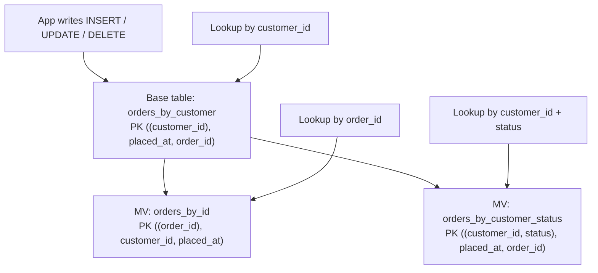

# Materialized Views, Base Tables, and Key Relationships

**Chapter:** Advanced CQL  
**Module:** `DATABASE_ENGINE_WIDE_COLUMN_CASSANDRA` — Apache Cassandra

Within this module, we explore Cassandra's distributed architecture and wide-column model: query-driven table design, partition keys, consistency levels, replication, CQL, operations, and Java application integration. This lesson focuses on a practical question: **when the same data must be queried by different keys, how is the relationship between a base table and a materialized view (MV) formed and maintained?**

A materialized view in Cassandra is **a physical storage structure** maintained by Cassandra from the data of **one base table**. It lets you query the same logical row by a **different primary key**; unlike a pure relational SQL view, it does not merely store a `SELECT` definition. However, a view is not a cross-table transaction, not a `JOIN`, and does not replace query-driven data modeling principles.

## 1. Learning Objectives

After this lesson, you will be able to:

1. Distinguish base tables, materialized views, manually denormalized tables, and secondary indexes.
2. Specify how the **view's primary key** must relate to the **base table's primary key**.
3. Write a valid `CREATE MATERIALIZED VIEW` with `IS NOT NULL` predicates, and diagnose why invalid definitions are rejected.
4. Trace `INSERT`, `UPDATE`, and `DELETE` operations on the base table and their corresponding updates in the view.
5. Explain **eventual consistency**, read-before-write overhead, view builds, partial failures, repair, and operational risks.
6. Choose between an MV and an application-maintained table when adding a new access pattern.
7. Query both the base table and the view with the Java Driver without treating a base write ACK as a guarantee of immediate view visibility.

**Example scope:** syntax targets Apache Cassandra 4.1/5.x with materialized views enabled and supported in the cluster. Some distributions or configurations disable/lock MVs or impose additional restrictions. Check your running version, configuration, and MV policy before deploying to production; do not assume a syntactically valid example is the best operational choice.

## 2. Base Table, View, and Why Keys Need Changing

Suppose an e-commerce application normally reads orders by customer, newest first:

```sql
CREATE TABLE lab_mv.orders_by_customer (
    customer_id uuid,
    placed_at timestamp,
    order_id uuid,
    status text,
    total_cents bigint,
    PRIMARY KEY ((customer_id), placed_at, order_id)
) WITH CLUSTERING ORDER BY (placed_at DESC, order_id ASC);
```

In this table:

- `customer_id` is the **partition key**. A customer's rows reside in the same logical partition.
- `placed_at` and `order_id` are **clustering columns**. They uniquely identify rows within the partition and define storage order.
- `status` and `total_cents` are regular columns. They do not automatically become efficient `WHERE` access paths.
- The base table's primary key is the set `{customer_id, placed_at, order_id}`. Updating `status` or `total_cents` does not alter the base row's identity.

The designed query:

```sql
SELECT placed_at, order_id, status, total_cents
FROM lab_mv.orders_by_customer
WHERE customer_id = 10000000-0000-4000-8000-000000000001
LIMIT 20;
```

However, other services need to:

- Look up an order by **`order_id`** when a customer provides an order ID without knowing `customer_id`.
- List a customer's **`PAID`** orders, sorted by `placed_at`.

The base table has no natural key path for `WHERE order_id = ?` without `customer_id`, nor does it efficiently support `WHERE customer_id = ? AND status = ?` at scale. Materialized views allow reorganizing the keys to serve those queries.

### Relationship Diagram



Arrows from the base table to MVs represent Cassandra's internal derived-data maintenance; **there is no atomic simultaneous replication across all observers**.

## 3. The Most Important Rule: The View's Primary Key

### 3.1. Never Lose Base Row Identity

For the base table:

```text
Base PRIMARY KEY = ((customer_id), placed_at, order_id)
Base PK columns = {customer_id, placed_at, order_id}
```

Valid views can have:

```text
View A PRIMARY KEY = ((order_id), customer_id, placed_at)
View B PRIMARY KEY = ((customer_id, status), placed_at, order_id)
```

**Every column in the base table's primary key must appear in the view's primary key.** That way, if two base rows share the same value in the new lookup column, they never overwrite one another into a single view row.

For example, different customers can have the same `placed_at` or `status`. If a view declared only `PRIMARY KEY (status)`, thousands of `PAID` orders would collide on the same key and cease to map one-to-one with base rows.

Core Cassandra MV rules:

| Element | Rule |
| --- | --- |
| Base PK columns | **All must appear in the view PK**, though ordering and partition/clustering split may change. |
| Non-base-PK columns | At most **one** such column may be added to the view PK. |
| Columns forming the view PK | Must have appropriate `IS NOT NULL` conditions in the view's `WHERE` clause. |
| Data source | A view pulls from **one** base table, not a multi-table join. |
| Querying the view | Follows the partition key/clustering key rules of **the view itself**. |
| Writing data | Insert, update, and delete on the base table; the view is system-maintained and cannot be modified directly via normal DML. |

The limit of one non-base-PK column can surprise developers. For example, if both `status` and `channel` are regular columns, trying to use both as **new components** of the view PK is invalid. When keying on multiple additional attributes is required, an **application-maintained query-driven table** is usually more suitable.

### 3.2. Why Is `IS NOT NULL` Required?

A regular column may be unwritten or deleted (resolving to null). Meanwhile, **primary key columns cannot be null**. When you promote `status` from a regular column into part of an MV's PK, Cassandra needs to know which rows have values valid enough to appear in the view.

```sql
-- Base row with status = null:
-- Still exists in orders_by_customer under customer_id + placed_at + order_id.
-- Cannot create a corresponding row in an MV where status is part of the PK.
```

Therefore, a view keyed by `status` requires `status IS NOT NULL` alongside null checks on base PK columns. This is a **validity condition for the view key**; do not mistake it for supporting arbitrary SQL `WHERE` filters (such as arbitrary `OR`, `JOIN`, grouping, or aggregates).

### 3.3. Selected Columns vs. Key Columns

Definition:

```sql
SELECT customer_id, placed_at, order_id, status, total_cents
...
PRIMARY KEY ((customer_id, status), placed_at, order_id)
```

This means:

- `customer_id`, `status`, `placed_at`, `order_id`: form the **identity and read path** of the view row.
- `total_cents`: a column **projected** into the view to return to clients, not participating in distribution or sorting.
- Adding `total_cents` to the `SELECT` list **does not** allow `WHERE total_cents > ?` on the view without another access path.

If you omit a display column from `SELECT`, the view will not store it. Meanwhile, all base PK columns are mandatory in the view key per the rule above.

## 4. Setting Up the Lab Environment

Use a three-node test cluster in a single datacenter, e.g., `datacenter1`. In the lab, check node status before creating schemas:

```bash
nodetool status
cqlsh
```

In `cqlsh`:

```sql
SELECT data_center, release_version FROM system.local;
```

Below we set RF=3 in datacenter `datacenter1`. If your cluster uses a different datacenter name or fewer than three replicas, adjust the configuration **to match your actual environment** first; three nodes are chosen here to test `LOCAL_QUORUM`. Never run directly against production data.

```sql
CREATE KEYSPACE IF NOT EXISTS lab_mv
WITH replication = {
  'class': 'NetworkTopologyStrategy',
  'datacenter1': 3
}
AND durable_writes = true;

CREATE TABLE IF NOT EXISTS lab_mv.orders_by_customer (
    customer_id uuid,
    placed_at timestamp,
    order_id uuid,
    status text,
    total_cents bigint,
    PRIMARY KEY ((customer_id), placed_at, order_id)
) WITH CLUSTERING ORDER BY (placed_at DESC, order_id ASC);
```

Try the `CREATE MATERIALIZED VIEW` statements in the next section. If rejected because the feature is disabled, disallowed by config, or unsupported by your version, **stop the MV lab**, record the exact error message, and check your running version's documentation and policy. Never alter production configuration just to run a lab.

## 5. First View: Looking Up Orders by `order_id`

First, create a view shifting the partition key from `customer_id` to `order_id`:

```sql
CREATE MATERIALIZED VIEW IF NOT EXISTS lab_mv.orders_by_id AS
    SELECT customer_id, placed_at, order_id, status, total_cents
    FROM lab_mv.orders_by_customer
    WHERE customer_id IS NOT NULL
      AND placed_at IS NOT NULL
      AND order_id IS NOT NULL
    PRIMARY KEY ((order_id), customer_id, placed_at);
```

Component comparison:

| Table | Partition Key | Clustering Columns | Primary Query Pattern |
| --- | --- | --- | --- |
| `orders_by_customer` (base) | `customer_id` | `placed_at, order_id` | All orders of one customer over time. |
| `orders_by_id` (MV) | `order_id` | `customer_id, placed_at` | Find an order row by order ID from any customer. |

The view retains **all three base PK columns** in the new key without adding any regular column to the key. Thus the `WHERE` clause only checks `IS NOT NULL` on the three base columns.

### 5.1. Loading Data and Observing the Mapping

```sql
CONSISTENCY LOCAL_QUORUM

INSERT INTO lab_mv.orders_by_customer
    (customer_id, placed_at, order_id, status, total_cents)
VALUES (
    10000000-0000-4000-8000-000000000001,
    '2026-11-20T09:00:00Z',
    20000000-0000-4000-8000-000000000101,
    'NEW',
    150000
);

INSERT INTO lab_mv.orders_by_customer
    (customer_id, placed_at, order_id, status, total_cents)
VALUES (
    10000000-0000-4000-8000-000000000001,
    '2026-11-20T10:00:00Z',
    20000000-0000-4000-8000-000000000102,
    'PAID',
    250000
);

INSERT INTO lab_mv.orders_by_customer
    (customer_id, placed_at, order_id, status, total_cents)
VALUES (
    10000000-0000-4000-8000-000000000002,
    '2026-11-20T11:00:00Z',
    20000000-0000-4000-8000-000000000103,
    'PAID',
    300000
);

SELECT placed_at, order_id, status
FROM lab_mv.orders_by_customer
WHERE customer_id = 10000000-0000-4000-8000-000000000001;

SELECT customer_id, placed_at, order_id, status
FROM lab_mv.orders_by_id
WHERE order_id = 20000000-0000-4000-8000-000000000102;
```

Expected output once the MV is built and converged:

- Querying the base table for customer `...0001` returns two orders: `...0102` and `...0101` (descending time order).
- Querying the view by `order_id = ...0102` returns one row for customer `...0001`, status `PAID`.
- Querying a nonexistent `order_id` returns empty, **after** verifying the view is active and no writes are awaiting propagation.

Do not conclude a view is broken from a single `SELECT` immediately after `INSERT` if a row is not visible yet: check view build status, replicas, consistency level, and update propagation lag.

### 5.2. If `order_id` Is Already Unique, Why Keep the Base PK?

Business logic may guarantee `order_id` is a unique UUID. Even so, the MV must still include **all base PK columns** in the view key. This rule stems from Cassandra's internal data mapping, not application-level uniqueness promises.

Moreover, `order_id` alone serves as the view's partition key for lookups, while `customer_id` and `placed_at` preserve the ability to distinguish base rows. Never omit them from `PRIMARY KEY` on the assumption that UUIDs "can never collide."

## 6. Second View: Adding One Regular Column to the View Key

To fetch orders by **customer + status**, create a view:

```sql
CREATE MATERIALIZED VIEW IF NOT EXISTS lab_mv.orders_by_customer_status AS
    SELECT customer_id, placed_at, order_id, status, total_cents
    FROM lab_mv.orders_by_customer
    WHERE customer_id IS NOT NULL
      AND placed_at IS NOT NULL
      AND order_id IS NOT NULL
      AND status IS NOT NULL
    PRIMARY KEY ((customer_id, status), placed_at, order_id)
    WITH CLUSTERING ORDER BY (placed_at DESC, order_id ASC);
```

Here the view key has four columns: the three base PK columns plus **one additional column**, `status`. `status` moves from a regular base column into part of the view's **composite partition key**.

Two queries:

```sql
SELECT placed_at, order_id, status, total_cents
FROM lab_mv.orders_by_customer_status
WHERE customer_id = 10000000-0000-4000-8000-000000000001
  AND status = 'PAID'
LIMIT 20;

SELECT placed_at, order_id, status, total_cents
FROM lab_mv.orders_by_customer_status
WHERE customer_id = 10000000-0000-4000-8000-000000000001
  AND status = 'NEW';
```

With the three sample rows once the MV is synchronized:

- `customer_id = ...0001 AND status = 'PAID'` returns order `...0102`.
- `customer_id = ...0001 AND status = 'NEW'` returns order `...0101`.

**Why does the composite partition key matter?** Rows sharing `(customer_id, status)` are grouped in the same logical partition and sorted by `placed_at`. The query "20 most recent PAID orders for customer A" hits this exact access path. If a customer's partition grows too large, evaluate time bucketing or an alternative design; do not force extra columns into an MV PK beyond MV limits.

## 7. Writing to Base and Observing View Updates

### 7.1. Updating a Projected Column That Is Not in the View Key

Change the total amount of order `...0102`:

```sql
UPDATE lab_mv.orders_by_customer
SET total_cents = 270000
WHERE customer_id = 10000000-0000-4000-8000-000000000001
  AND placed_at = '2026-11-20T10:00:00Z'
  AND order_id = 20000000-0000-4000-8000-000000000102;
```

Once the views finish updating, `total_cents` in both `orders_by_id` and `orders_by_customer_status` will be `270000`. No new row is created in the status view because the view PK values did not change.

### 7.2. Updating a Regular Column Used in a View Key

Transition order `...0101` from `NEW` to `PAID`:

```sql
UPDATE lab_mv.orders_by_customer
SET status = 'PAID'
WHERE customer_id = 10000000-0000-4000-8000-000000000001
  AND placed_at = '2026-11-20T09:00:00Z'
  AND order_id = 20000000-0000-4000-8000-000000000101;
```

Once settled:

| Location | Before Change | After View Updates Complete |
| --- | --- | --- |
| Base `orders_by_customer` | One row `...0101` with `status='NEW'` | Same base key; `status='PAID'`. |
| MV `orders_by_id` | Row under `order_id=...0101` with `NEW` | Same view key; `status='PAID'`. |
| MV `orders_by_customer_status` | Row in partition `(...0001, 'NEW')` | Old entry must leave the `NEW` partition and appear in partition `(...0001, 'PAID')`. |

In the second view, changing `status` **changes the view row's primary key** even though the base table's primary key stayed the same. Cassandra must reconcile the old and new states, which can involve read-before-write and higher view mutation costs than updating an ordinary column.

During update propagation, clients reading views may see old data, new data, or out-of-sync observations across views. **Never build transactions assuming the base table and all views transition atomically at the same instant.**

After waiting for builds/updates to finish, compare:

```sql
SELECT order_id, status
FROM lab_mv.orders_by_customer
WHERE customer_id = 10000000-0000-4000-8000-000000000001;

SELECT order_id, status
FROM lab_mv.orders_by_customer_status
WHERE customer_id = 10000000-0000-4000-8000-000000000001
  AND status = 'NEW';

SELECT order_id, status
FROM lab_mv.orders_by_customer_status
WHERE customer_id = 10000000-0000-4000-8000-000000000001
  AND status = 'PAID';
```

Expected: the `NEW` partition for customer `...0001` no longer contains `...0101`; the `PAID` partition contains both `...0101` and `...0102`.

### 7.3. DELETE Operations on the Base Table

```sql
DELETE FROM lab_mv.orders_by_customer
WHERE customer_id = 10000000-0000-4000-8000-000000000002
  AND placed_at = '2026-11-20T11:00:00Z'
  AND order_id = 20000000-0000-4000-8000-000000000103;
```

Once views converge, row `...0103` will also disappear from `orders_by_id` and `orders_by_customer_status`. `DELETE` creates tombstones per Cassandra's storage model; the record can remain physically in SSTables for some time until eligible compaction runs. **Do not** treat an empty read as proof that data was instantaneously wiped physically on every replica.

With a TTL on a view-key column (such as `status`), when that column expires, the base row may retain its other columns while no longer having the required key value to belong to the status MV. Avoid testing ultra-short TTLs in uncoordinated timing tests, since observations depend on clock timing and replica convergence.

### 7.4. Never Write Directly to an MV

A statement like the following **is not a valid way to update data**:

```sql
-- Illustrates an operation that is not allowed:
-- UPDATE lab_mv.orders_by_customer_status
-- SET total_cents = 999
-- WHERE customer_id = ... AND status = 'PAID' ...;
```

A view is system-maintained. Every business mutation must target the **base table**. If you need to manage records, compensating writes, and multi-table synchronization yourself, use application-coordinated denormalized tables instead of trying to treat an MV as an independent writable table.

## 8. Common Invalid Definitions and Fixes

### Case A — Missing Base PK Columns

```sql
-- INVALID: drops placed_at and order_id from the base PK
-- CREATE MATERIALIZED VIEW lab_mv.bad_status AS
-- SELECT customer_id, placed_at, order_id, status
-- FROM lab_mv.orders_by_customer
-- WHERE customer_id IS NOT NULL AND status IS NOT NULL
-- PRIMARY KEY ((customer_id, status));
```

Reason: a customer can have many orders with the same `status`. Rows would collide on the view PK, so the view must retain all base PK columns.

**Fix:** `PRIMARY KEY ((customer_id, status), placed_at, order_id)` with `IS NOT NULL` in `WHERE` for all four columns.

### Case B — Adding Two Non-Base-PK Columns

Suppose the base table adds `channel text` where `channel` is not in the base PK:

```sql
-- INVALID under the rule allowing at most one new non-base-PK column
-- PRIMARY KEY ((customer_id, status, channel), placed_at, order_id)
```

**Fix:** pick the single additional column suited to the query, or design a new application-maintained table with `(customer_id, status, channel)` as its partition key. Modifying the base table's primary key just to "work around" MV limits is a major data-model change; do not do it without reviewing all access patterns and partition sizes.

### Case C — Missing `IS NOT NULL` for the New View PK Column

```sql
-- MISSING: status IS NOT NULL
-- CREATE MATERIALIZED VIEW ...
-- WHERE customer_id IS NOT NULL
--   AND placed_at IS NOT NULL
--   AND order_id IS NOT NULL
-- PRIMARY KEY ((customer_id, status), placed_at, order_id);
```

**Fix:** add `AND status IS NOT NULL`. If a base record has no status, it **does not** belong in the status-keyed view, even though it still lives in the base table.

### Case D — Mistaking MV `WHERE` for an Arbitrary SQL Filter

```sql
-- DO NOT USE MV as an arbitrary business-logic filter view:
-- WHERE status = 'PAID' AND total_cents > 100000
```

Within Apache Cassandra's MV scope, view definitions are strictly constrained to key rules and `IS NOT NULL` predicates; they do not provide free-form SQL views with `JOIN`, `GROUP BY`, arbitrary `ORDER BY`, or general regular-column filtering. To store **only PAID orders** under complex business criteria, design a dedicated table populated by code/event pipelines, or evaluate an SAI index for suitable query patterns.

### Case E — Querying with the Wrong View Key

```sql
-- orders_by_customer_status has partition key (customer_id, status).
-- This query fails to specify the full composite partition key:
-- SELECT * FROM lab_mv.orders_by_customer_status
-- WHERE status = 'PAID';
```

Although `status` was placed in the partition key, it is **not** a standalone partition key. To read all customers with `PAID` orders, you need another model, such as a view keyed by `status` (which risks huge partitions) or a table bucketed by tenant/time. Always reason from **the specific view's keys** on every read.

## 9. Consistency, Replication, and Failure Consequences

### 9.1. Distinguishing Base Write ACK from View Read Visibility

Cassandra applies consistency levels per request. For instance, with RF=3 in one datacenter, `LOCAL_QUORUM` requires two replicas in that replica group for the operation. However, **a base write succeeding at `LOCAL_QUORUM` is not a transaction spanning every replica of every MV**.

For unconverged data, you may observe:

```text
t0: App writes base: status NEW -> PAID
t1: Client receives ACK for base mutation at chosen write CL
t2: Reading base returns PAID
t3: Reading MV for NEW still sees old row, or MV PAID lacks the row yet
t4: View updates / recovery finish, results converge
```

This timeline is **one possible scenario**, not a mandatory sequence for every write. MV processing involves coordination between base replicas and view replicas; network drops, slow nodes, timestamps, tombstones, and cluster settings all affect when changes become visible.

Therefore:

- Never read a view immediately after a write expecting linearizable visibility across base and view.
- Never treat `CONSISTENCY ALL` on a view `SELECT` as proof that base and MV updated atomically.
- When returning results in critical workflows, identify the **source of truth**—typically the base table—and define acceptable lag or re-check behavior.
- After timeouts, log the request ID, key columns, consistency level, and timestamp; compare **both base and view**. An empty view result does not prove the base write failed.

### 9.2. Building Views Over Existing Data

Creating an MV after the base table already holds many rows requires a **backfill/view build**. Never assume the view holds complete historical data the instant `CREATE MATERIALIZED VIEW` returns. On versions supporting the command, you can inspect progress:

```bash
nodetool viewbuildstatus lab_mv orders_by_customer_status
```

Run `nodetool help viewbuildstatus` on your cluster to verify syntax/availability, and check operational logs and node states. Only compare historical completeness after the build finishes, while continuing to account for ongoing update propagation lag.

### 9.3. Node Loss, Tombstones, and Repair

A materialized view has **its own physical storage and replicas determined by the view's partition key**. Even though base and view share logical content, a row can live on **different replica nodes** once the view changes the partition key. During node outages, network partitions, or incomplete anti-entropy repair, base/view divergence is hard to diagnose from a single `SELECT`.

To diagnose:

1. Verify node health via `nodetool status`, schema agreement, and actual topology/replication.
2. Check build status of each view, mutation/view logs, errors, and relevant metrics.
3. Read the base row using the **full base primary key**, then read each view using its **full view partition key**.
4. Compare `status`, `total_cents`, expected timestamps, and deletion/TTL state; distinguish unbuilt rows, in-flight updates, and legitimately deleted rows.
5. Follow verified repair/recovery procedures for your cluster's **Cassandra version and MV setup**. Never assume an arbitrary repair command instantly fixes all logical divergence.

**Never disable `gc_grace_seconds` or manually delete tombstones** as a "quick fix" for views in a distributed cluster. Tombstone, compaction, and repair settings protect against deleted-data resurrection when replicas have not yet converged.

## 10. What Does Changing Keys Cost?

For example, a single mutation on `orders_by_customer` may have to update both `orders_by_id` and `orders_by_customer_status`.

| Cost Dimension | Reason |
| --- | --- |
| Writes and network | Beyond writing base, the system generates corresponding mutations per MV and ships them to view replicas. |
| Read-before-write | When a regular column used in a view PK changes, Cassandra may need the old value to delete the old view entry and write the new one. |
| Storage | Views are physically stored; projected columns and extra metadata/indexes consume disk. |
| Compaction and tombstones | Updates/deletes generate historical versions, tombstones, and cleanup overhead across multiple tables/structures. |
| View initialization | Existing data must be built and build status monitored. |
| Operations/troubleshooting | Extra replicas, temporary divergence windows, metrics, and reconciliation procedures. |
| Schema evolution | Views depend on base, so column/key changes and lifecycle require coordinated schema management. |

**MVs are not free caches.** While they reduce application code for maintaining multiple copies manually, they shift cost onto Cassandra's write path and operations. For write-heavy workloads, multiple MVs, or frequently changing view-key columns, benchmark realistically to evaluate throughput and tail latency.

## 11. Comparing MVs, Query-Driven Tables, and Indexes

| Criterion | Materialized View | App-Maintained Denormalized Table | Secondary Index / SAI |
| --- | --- | --- | --- |
| Write source | Write to base; Cassandra maintains views | App/event pipeline explicitly writes multiple tables | Write to indexed table; Cassandra maintains index |
| Query key | View's own PK, constrained by base PK | PK tailored freely to query needs | Queries along operators/columns supported by the index |
| Transformation flexibility | Limited: one base, strict PK rules | High flexibility: buckets, aggregates, filtering, layout | Good for flexible filtering on indexed attributes |
| Synchronization | May lag temporarily behind base | App manages consistency, retries, idempotency | Index synchronization/availability depends on implementation |
| Cost | View writes, view builds, repair/monitoring | Extra writes, compensating logic, duplicated data | Index storage/write overhead and query scatter cost |
| Best fit | Extra access pattern fitting MV constraints with acceptable consistency lag | Workflows needing dedicated query schemas and state control | Multi-dimensional, selective filters supported by version/index |

**Decision examples:**

- Need lookup by `order_id`, no strict cross-base-and-view read-after-write required, stable schema: the `orders_by_id` MV **may** fit after validating operational viability.
- Need "top 20 PAID orders per tenant per month" across tens of millions of records requiring bucketing: a query-driven table with a composite key and time bucket controls partition size much better.
- Need flexible multi-field lookup (supported operators, no arbitrary sorting needed): evaluate SAI and selectivity before adding multiple MVs.
- Need strict business-level synchronization between a mutation and a read model: establish proper transaction/event-sourcing/reconciliation mechanisms; MVs do not provide cross-table transactions by default.

Avoid creating an MV for every UI filter when filters keep changing.

## 12. Java: Writing Base, Querying View, and Handling Unconverged Results

Example using Java Driver 4.x (`com.datastax.oss.driver.api` package). The application writes to the **base table** and can look up via a view in another query. This snippet assumes a test cluster with RF=3 in one datacenter, and that views have already been created and built.

```java
import com.datastax.oss.driver.api.core.CqlSession;
import com.datastax.oss.driver.api.core.DefaultConsistencyLevel;
import com.datastax.oss.driver.api.core.cql.PreparedStatement;
import com.datastax.oss.driver.api.core.cql.Row;

import java.time.Instant;
import java.util.UUID;

public final class MaterializedViewDemo {
    public static void run(CqlSession session) {
        UUID customerId = UUID.fromString(
            "10000000-0000-4000-8000-000000000003");
        UUID orderId = UUID.fromString(
            "20000000-0000-4000-8000-000000000104");
        Instant placedAt = Instant.parse("2026-11-20T12:00:00Z");

        PreparedStatement insertBase = session.prepare(
            "INSERT INTO lab_mv.orders_by_customer " +
            "(customer_id, placed_at, order_id, status, total_cents) " +
            "VALUES (?, ?, ?, ?, ?)");

        session.execute(
            insertBase.bind(customerId, placedAt, orderId, "NEW", 190000L)
                      .setConsistencyLevel(
                          DefaultConsistencyLevel.LOCAL_QUORUM));

        PreparedStatement byId = session.prepare(
            "SELECT customer_id, placed_at, status, total_cents " +
            "FROM lab_mv.orders_by_id WHERE order_id = ?");

        // A read right after base ACK may not reflect the view entry yet.
        Row viewRow = session.execute(
            byId.bind(orderId)
                .setConsistencyLevel(
                    DefaultConsistencyLevel.LOCAL_QUORUM)).one();

        if (viewRow == null) {
            System.out.println(
                "Row not yet visible in view on this read; recheck " +
                "per sync/reconciliation policy.");
        } else {
            System.out.println(
                viewRow.getUuid("customer_id") + " " +
                viewRow.getInstant("placed_at") + " " +
                viewRow.getString("status") + " " +
                viewRow.getLong("total_cents"));
        }
    }
}
```

Never turn `Row == null` into "the order does not exist" if you are verifying **immediately after a base write**. For APIs requiring strong read-after-write, return confirmed data from the write context, re-read the base table by full key, or reconcile with bounded deadlines and backoff per design. Never retry infinitely or hammer views in a tight polling loop. When a query fails with timeout/unavailable, catch and handle the exception separately: **a failed query is not an empty result set**.

When an MV serves user-facing primary reads, the API must explicitly define its consistency model, potential staleness, "processing" states, and recovery strategy.

## 13. Lab Exercise: Reconciling Base and Views

Test in a lab environment with step-by-step logging. Create an observation log table:

| Step | Base Mutation | Query Base | Query `orders_by_id` | Query `orders_by_customer_status` | Conclusion |
| --- | --- | --- | --- | --- | --- |
| T0 | `INSERT` `...0101` status NEW | Not read yet | Not read yet | Not read yet | Record timestamp/CL |
| T1 | None | Read by `customer_id` | Read by `order_id` | Read by customer + NEW | Observe after insert |
| T2 | `UPDATE` status NEW → PAID | Re-read base | Re-read same `order_id` | Read NEW then PAID | Distinguish old vs. new state |
| T3 | None | Re-read | Re-read | Re-read | Confirm convergence |
| T4 | `DELETE` base row | Re-read | Re-read | Re-read | Observe tombstones and deletion |

**Suggested workflow:**

1. Write down the primary keys for each query beforehand; reuse the exact UUIDs and timestamps specified in the lesson.
2. Ensure MV builds are finished; execute each step with the chosen consistency level.
3. Read **base first**, then read each view by its own key. Log empty results and request errors alike.
4. When divergence appears, inspect topology/replicas/logs and perform bounded re-reads; record timestamps to measure the lag window.
5. Never attempt to edit an MV directly. If divergence persists, follow version-appropriate recovery procedures backed by operational evidence.

Distinguish **three concepts** in the outputs:

- *Logical row*: an order identified by `(customer_id, placed_at, order_id)` in the base table.
- *Query key*: a view locates that same order by `order_id` or `(customer_id, status)`.
- *Replica*: each table/view stores multiple copies across nodes; CL dictates how many replicas participate in reads/writes.

An observation of "missing from view" can stem from an incomplete view build, unconverged updates, querying with the wrong view key, a null view-key column, or replica failures. There is no single universal cause.

## 14. Deep-Understanding Check Questions

1. The base table uses `PRIMARY KEY ((customer_id), placed_at, order_id)`. Why does a view with just `PRIMARY KEY (order_id)` violate Cassandra MV rules even if the application guarantees `order_id` is unique?
2. Why is `status IS NOT NULL` required when `status` becomes part of a view key? Where does a base record with `status = null` reside?
3. When updating `total_cents`, does the primary key of `orders_by_customer_status` change? What about when updating `status`?
4. Can you define an MV with `PRIMARY KEY ((customer_id, status, channel), placed_at, order_id)` if both `status` and `channel` are regular columns? Propose an alternative.
5. A base `INSERT` succeeds at `LOCAL_QUORUM`, and immediately afterward a `SELECT` on the MV returns empty. Is concluding "the write failed" correct? What should you check?
6. What is the difference between "an MV is a table with a different PK" and "an MV is an SQL JOIN/aggregate"?
7. If a customer's order count is unbounded, does a view keyed by `(customer_id, status)` risk oversized partitions? How would you evolve the data model?
8. Why does `CREATE MATERIALIZED VIEW` on a base table with years of data require verifying view build completion before running full comparisons?
9. When an application must read the exact order status immediately after payment, would you make the MV or the base table the source of truth? Explain consistency requirements and coordination.
10. How can a mutation's timestamp, TTL, and tombstones affect base/view observations before repair and compaction finish?

### Checklist Before Using MVs in Production

- [ ] Confirm the cluster/version allows and supports materialized views per operational policy.
- [ ] Verify **every base PK column** is included in the view PK, with at most one additional non-base-PK column.
- [ ] Include `IS NOT NULL` for all view PK columns and understand that null rows are excluded.
- [ ] Ensure real queries specify the view's exact partition key rather than relying on arbitrary filtering.
- [ ] Ensure the application always writes to the base table and handles transient MV lag/failures gracefully.
- [ ] Monitor view builds, replica health, repair strategy, and divergence metrics.
- [ ] Benchmark write cost, storage overhead, compaction, and partition sizing when adding views.
- [ ] If complex filtering, aggregation, or re-ordering is needed, compare against query-driven tables or SAI.
- [ ] Verify against the base table before concluding a record is "lost" in a view.

**Takeaway:** A materialized view provides **an alternative key organization** for a base table's data. The mandatory key relationship ensures every base row stays distinguishable in the view, yet it does not guarantee simultaneous visibility across base and view. Designing the right primary keys, understanding `IS NOT NULL`, and measuring synchronization cost are essential for using MVs safely.
