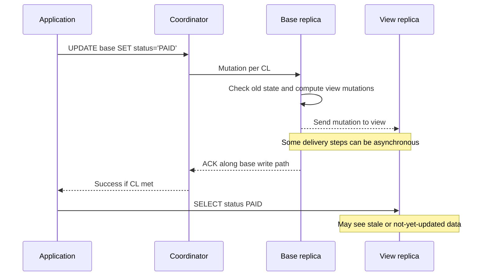
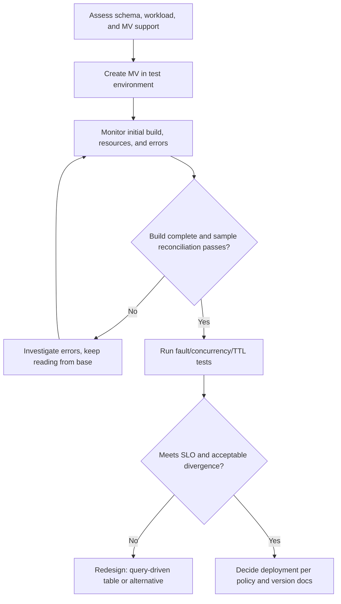

# Consistency, Operations, and Testing When Using Derived Views

> **Chapter:** Advanced CQL  
> **Module:** `DATABASE_ENGINE_WIDE_COLUMN_CASSANDRA` — Apache Cassandra, distributed wide-column database.  
> **Scope:** Cassandra Materialized Views and application-maintained derived read tables; how to evaluate consistency, operations, and testing before deploying to production.

Cassandra models data around **queries**: a table is typically optimized for a set of reads sharing the same partition key and clustering columns. When a new requirement needs to look up the same record by a different key, you can create a **derived view**: a secondary data organization serving the new read path.

However, fast reads via a new key raise a hard question: **once the base table acknowledges a write, is the view guaranteed to reflect the record accurately?** In Cassandra—especially under unstable networks, node failures, concurrent writes, tombstones, or backfills—you cannot answer this simply by looking at a `CREATE MATERIALIZED VIEW` statement.

This lesson explains practical guarantees, how to build an operational lifecycle, and a testing suite for derived views. It connects partition keys, replication, consistency levels (CL), CQL, repair/compaction, and Java Driver access.

> **Version note:** Apache Cassandra 5.0 configuration docs mark materialized views (MVs) as an **experimental feature, not recommended for production**, with `materialized_views_enabled: false` by default. CQL MV examples in this lesson are intended for **labs configured to enable them**. Distributions and versions differ in build and rebuild operations; consult version-specific documentation before operating them.

## 1. Distinguishing Two Types of Derived Views

In practice, "derived view" can refer to two distinct models:

| Attribute | Cassandra Materialized View (MV) | Application-Maintained Derived Read Table |
|---|---|---|
| How it is created | `CREATE MATERIALIZED VIEW` in CQL | `CREATE TABLE` with a query-driven partition key |
| Who updates it | Cassandra's internal mechanics when the base table changes | Application, event consumer, CDC, or backfill |
| How writes occur | Write only to the **base table**; never `INSERT/UPDATE/DELETE` directly on the MV | Write to each table per application protocol |
| Design scope | Constrained by MV key rules and filter restrictions | Full freedom over keys, buckets, transformations, and filtering |
| Data freshness | View updates can arrive after the base write is ACKed | Depends on write ordering, queues, retries, and sync mechanics |
| Cost | View storage, read-before-write, write path, network, build/compaction | Multi-table writes, extra storage, reconciliation, retries, consumer ops |
| Prominent risks | Base-view divergence on failure; version-specific repair/rebuild limits | Non-atomic dual writes; delayed, duplicate, or out-of-order events |

In the first half we examine **Cassandra-managed MVs**. Later sections highlight similarities and differences when the application actively maintains derived read tables.

### 1.1. Concepts That Must Be Kept Separate

- **Schema correctness:** the view receives the right columns and keys suited to the query pattern.
- **Replica consistency:** replicas of **the same table** can temporarily hold differing records during outages or propagation.
- **Base–view consistency:** the view must reflect the intended state of the base table per transformation rules.
- **Read-after-write freshness:** whether a client reading the view right after writing to the base table observes the write immediately.
- **Eventual convergence:** once network and replicas stabilize, both sides align after some time. Never equate this with a guarantee of converging within **a fixed number of milliseconds**.
- **Divergence recovery:** if the view is missing or holding extra records, can you detect and repair it using a verified procedure?

Two queries both using `LOCAL_QUORUM` still **do not automatically create a cross-table transaction** between base and view.

## 2. Illustrative Problem: Looking Up Orders by Customer and Status

Suppose a system needs two read paths:

1. View a customer's order list ordered by recent creation time.
2. View orders for a customer in a specific status, such as `PENDING`.

The base table partitions by customer:

```sql
-- Create a lab keyspace in a test environment with DC named dc1.
-- Do not copy this RF blindly to production without checking real topology.
CREATE KEYSPACE IF NOT EXISTS lab_mv
WITH replication = {
    'class': 'NetworkTopologyStrategy',
    'dc1': 3
};

CREATE TABLE IF NOT EXISTS lab_mv.orders_by_customer (
    customer_id uuid,
    order_id timeuuid,
    status text,
    placed_at timestamp,
    amount decimal,
    PRIMARY KEY ((customer_id), order_id)
) WITH CLUSTERING ORDER BY (order_id DESC);
```

Read path fitting the base table:

```sql
SELECT order_id, status, placed_at, amount
FROM lab_mv.orders_by_customer
WHERE customer_id = 11111111-1111-1111-1111-111111111111
LIMIT 20;
```

To read directly by `customer_id + status`, conceptually we want a view partitioned by `(customer_id, status)`, keeping `order_id` to distinguish individual orders.

### 2.1. Valid Materialized View Definition in the Lab

**Prerequisite:** your Cassandra version/distribution supports MVs and the feature is enabled in lab config. Otherwise, the statement below is rejected; never enable MVs on a production cluster just to run an exercise.

```sql
CREATE MATERIALIZED VIEW IF NOT EXISTS lab_mv.orders_by_customer_status AS
    SELECT customer_id, order_id, status, placed_at, amount
    FROM lab_mv.orders_by_customer
    WHERE customer_id IS NOT NULL
      AND order_id IS NOT NULL
      AND status IS NOT NULL
    PRIMARY KEY ((customer_id, status), order_id)
    WITH CLUSTERING ORDER BY (order_id DESC);
```

Querying the view:

```sql
SELECT order_id, placed_at, amount
FROM lab_mv.orders_by_customer_status
WHERE customer_id = 11111111-1111-1111-1111-111111111111
  AND status = 'PENDING'
LIMIT 20;
```

**Why does this definition satisfy MV rules?**

- The view key **retains every base primary key component**: `customer_id` and `order_id`.
- The view promotes **one** non-base-PK column into its primary key: `status`.
- All view key components are constrained with `IS NOT NULL`. A row with `status = null` has no entry in this view.
- The view does not perform `GROUP BY`, aggregates, arithmetic, `JOIN`, or `ORDER BY` inside its defining `SELECT`. `WITH CLUSTERING ORDER BY` is a view storage option, distinct from `SELECT ... ORDER BY`.
- Only existing base columns are referenced; no static columns are used.

Per Apache Cassandra's published MV restrictions, a view cannot arbitrarily include two new regular columns in its primary key, cannot drop base primary-key columns, and cannot embed business predicates like `status = 'PENDING'` in the view definition's `WHERE`.

### 2.2. Common Flawed Designs

| Design | Problem |
|---|---|
| `PRIMARY KEY ((status), order_id)` | Missing `customer_id` from the base key |
| `PRIMARY KEY ((status, amount), customer_id, order_id)` | Adds **two** regular base columns to the view key (`status` and `amount`) |
| `WHERE status = 'PENDING'` in `CREATE MATERIALIZED VIEW` | MV predicates are restricted; cannot put arbitrary business filters like regular queries |
| `PRIMARY KEY ((status), customer_id, order_id)` with very few statuses | Can create massive/hot partitions for `PENDING` |
| `INSERT INTO lab_mv.orders_by_customer_status ...` | MVs cannot be written to directly |

If business logic requires complex transformations, grouping, or multiple new keys, an **application-managed derived table** generally offers a much broader design space.

## 3. MV Update Flow and Consistency Boundaries

A change in the base table can require changing the view key. For example, transitioning `status` from `PENDING` to `PAID`:

- The entry in view partition `(customer_id, 'PENDING')` is no longer valid.
- A corresponding entry must appear in view partition `(customer_id, 'PAID')`.
- The two view partitions may map to **different tokens**, so updates do not always stay on a single node.

Conceptual sequence:



This is an explanatory model, **not a strict packet-by-packet sequence** for every Cassandra release. MV mechanics involve processing at base replicas, read-before-write/state comparison, view mutations, and delivery to view replicas; some paths use a local batchlog and asynchronous mutation delivery for durability.

### 3.1. Base Write Success Does Not Mean Immediate View Visibility

Suppose the keyspace has RF = 3 in a single datacenter:

| Action | CL | What Can Be Concluded | What **Cannot** Be Concluded |
|---|---|---|---|
| `UPDATE base` succeeds | `LOCAL_QUORUM` | The base write path obtained the required ACKs in the local DC | Every MV replica already reflects the new state |
| `SELECT base` after write | `LOCAL_QUORUM` | Reads the base table at the requested CL | The view updated atomically with the base table |
| `SELECT MV` immediately after write | `LOCAL_QUORUM` | Reads from view replicas at the requested CL | Linearizable read-after-write across **both tables** |
| `SELECT MV` after system settles | `LOCAL_QUORUM` | Can observe converged state | Not proof that all data cluster-wide is consistent |

With RF = 3 full replicas in one DC, quorum is 2. However, "2 base ACKs" does not equal "2 view ACKs," and **there is no single atomic write transaction across two tables** merely by using the same CL.

### 3.2. Intermediate States You Might Observe

A `PENDING -> PAID` transition can briefly expose clients to:

1. Reading base returns `PAID`, while reading the old view still sees `PENDING`.
2. Reading base returns `PAID`, while the `PAID` view partition does not yet contain the row.
3. During propagation, checking two different view partitions can show temporarily inconsistent state.

Do not immediately assume a bug if a read executed **instantaneously** after a write misses the new view entry. Conversely, never dismiss prolonged divergence as "normal eventual consistency": it could be a failed build, unrecovered replica, timestamp/tombstone conflict, or an out-of-sync view.

### 3.3. Timestamps, Concurrency, and Idempotency

Cassandra resolves conflicts by cell timestamp and reconciliation rules. If two clients nearly concurrently set `PAID` and `CANCELLED`:

- The final state on the base table depends on timestamp/reconciliation order, not necessarily "whichever request arrived later on the app's clock."
- The view must handle **removing the old status mapping** and **creating the new status mapping**.
- View replicas may apply mutations at different times.
- Retrying after a timeout can replay changes or overwrite data if the design fails to control timestamps and business guards.

For business workflows enforcing "allow `PENDING -> PAID` only once," implement guards/conditional updates on the base table (such as LWT when truly needed), and treat the view as a read projection. **Never use seeing a row in an MV as proof that a business state transition committed properly.**

## 4. Data Mutations and Their Effects on Views

| Operation on Base | Expected View State After Convergence | What to Test |
|---|---|---|
| Insert with `status = PENDING` | Row appears in partition `(customer_id, PENDING)` | Did view build finish? Were mutations delayed/dropped? |
| Insert with `status = null` | No row for view keys missing `status` | `IS NOT NULL` predicate |
| Update `PENDING -> PAID` | Row vanishes from old partition, appears in new partition | No "ghost row" left in old key after convergence |
| Update `amount`, `status` unchanged | Row stays at same view key, value updated | Non-key view column update behavior |
| Delete a base row | Corresponding row disappears from view | Tombstones, propagation, node down |
| TTL expires | Data expires per corresponding TTL/column semantics | Any stale record still exposed in view? |
| Reinsert same key, different timestamp | View matches whichever state won reconciliation | Timestamp races, tombstone shadowing |
| Concurrent writes from two coordinators | Final view matches base result per version rules | Lag, duplicates, missing records |

Exercise special caution with **deletes** or setting base columns to `null`. Cassandra documentation highlights a case that can shadow missed updates if you delete a column **omitted from the MV's `SELECT`**. This is a concrete limitation to avoid in design/testing on affected versions; a single spot `SELECT` cannot catch it.

## 5. Operational Lifecycle: From View Creation to Production Reads

### 5.1. Before Creation

1. Verify Cassandra version, whether MVs are supported/enabled, and organizational policy. Apache Cassandra 5.0 marks MVs experimental; prefer evaluating application-managed tables for strict production requirements.
2. Inspect the base table: partition key, clustering, static columns, TTL, compaction strategy, repair policy, and RF per datacenter.
3. Evaluate **view key distribution**. If `status` has only a few values, do not make `status` the sole partition key due to hot/wide partitions; our example combines it with `customer_id`.
4. Estimate write amplification and storage amplification. An update changing a view key can trigger delete/insert across multiple view partitions.
5. Define freshness requirements: can dashboards tolerate a few seconds of lag, or do transactions need immediate read-your-write?
6. Prepare rollback/fallback queries and reconciliation procedures.

### 5.2. Creating an MV on a Populated Table: Initial Build

`CREATE MATERIALIZED VIEW` creates the schema object and starts building MV data from the base table. **The schema appearing does not mean the initial build is complete.** Routing read traffic to the MV too early will miss historical data.

In a Cassandra lab with MVs enabled:

```bash
# Observe node status and load
nodetool status
nodetool compactionstats
nodetool tpstats

# Check MV build progress by keyspace and view name
nodetool viewbuildstatus lab_mv orders_by_customer_status
```

`nodetool viewbuildstatus` is documented in Apache Cassandra 5.0. Verify completion on every relevant node per version guidance and check build logs; a result from a single node or point in time does not certify cluster-wide correctness.

A cautious rollout sequence:



### 5.3. During Ongoing Operations

Monitor both **data quality** and **system health**:

| Signal | Why It Matters | Red Flags to Investigate |
|---|---|---|
| Base write latency p95/p99 | MVs add processing cost and potential read-before-write | Sharp p99 spike after adding a view |
| View read latency and errors | View data also traverses tokens/replicas/CL | Timeouts, unavailability, missing reads |
| Node/replica status | Down nodes delay propagation | A node owning base/view replicas is Down |
| View build status, logs | Initial build/backfill may be incomplete | Stalled builds, errors on specific nodes |
| Batchlog/hints and MV-specific metrics | Tracks undelivered/retried mutations | Sustained backlog or propagation errors |
| Compaction, disk, tombstones | MVs add SSTables and delete old mappings | Disk growth, compaction debt, high tombstones |
| Base–view drift | Direct measure of correctness | Persistent missing/extra rows after system stabilizes |

Specific metrics such as `ViewWriteMetrics` and JMX/Prometheus names vary by version/distribution; when building dashboards, **verify the exact exported metric names** instead of assuming every cluster emits the same names.

### 5.4. Do Not Conflate Repair, Rebuild, and Recovery

Three easily confused operations:

- **Base repair:** reconciles replicas of the base table via anti-entropy. It **does not guarantee automatically fixing every logical divergence between base and MV**.
- **View initial build:** populates view data from base when an MV is newly declared; only revisited if the build stalled/failed or under a rebuild procedure.
- **View rebuild:** regenerates/updates the view from source data via a **version-specific** command/mechanism. Not the same command as `nodetool rebuild`, which streams data across DCs/nodes.

Some distributions provide `nodetool rebuild_view` to rebuild an MV from its base table; Apache Cassandra or your running version may differ or lack that command. **Never copy a recovery command from one distribution onto another cluster.** Before acting:

1. Check `nodetool help` and the MV/recovery docs for your exact deployed version.
2. Take appropriate snapshots/backups, check free disk space, and avoid overlapping topology changes.
3. Determine whether the fault lies in **base replicas**, **view build**, or **logical base–view divergence**.
4. Run a supported recovery workflow and reconcile afterward; never claim "repair fixed every MV" without verification.

Some distribution docs also warn that **incremental repair on a base table with MVs** may have restrictions. Verify compatibility specifically; do not assume every repair mode behaves identically to standalone tables.

### 5.5. Schema Changes and Dropping an MV

- Exercise care when adding/dropping columns, altering TTL or compaction, or dropping the base table. Check version-specific MV rules before any DDL.
- Keep a fallback read path ready in case an MV must be dropped/rebuilt during maintenance.
- `DROP MATERIALIZED VIEW` drops the view and derived data; **it does not** replace deleting base records for business needs.
- After dropping a view, verify resources, disk, compaction, and ensure no client code still references the view.

Example DDL command **for lab use only**:

```sql
-- Execute only when certain the test view is no longer needed:
DROP MATERIALIZED VIEW IF EXISTS lab_mv.orders_by_customer_status;
```

## 6. Functional Testing Suite in CQL

The goal is to test the **relationship between both data models** across multiple steps, not merely that "the SELECT runs." Execute all steps below on a test cluster/keyspace where the MV has finished building.

### 6.1. Insert and Observe Convergence

Pick a fixed key pair to re-query reliably:

```sql
CONSISTENCY LOCAL_QUORUM;

INSERT INTO lab_mv.orders_by_customer (
    customer_id, order_id, status, placed_at, amount
) VALUES (
    11111111-1111-1111-1111-111111111111,
    7c627d5a-a6b0-11ef-8ae8-0242ac120002,
    'PENDING',
    '2026-11-21 08:00:00+0000',
    120.00
);

-- Base table
SELECT status, amount FROM lab_mv.orders_by_customer
WHERE customer_id = 11111111-1111-1111-1111-111111111111
  AND order_id = 7c627d5a-a6b0-11ef-8ae8-0242ac120002;

-- View, with partition key customer_id + status
SELECT order_id, amount FROM lab_mv.orders_by_customer_status
WHERE customer_id = 11111111-1111-1111-1111-111111111111
  AND status = 'PENDING';
```

If the row is not in the view immediately after insert, **measure the lag** and retry within a bounded deadline in the test suite. If still missing after the cluster settles, collect logs/metrics rather than blindly increasing `sleep` and ignoring it.

### 6.2. Changing the View Key: PENDING → PAID

```sql
UPDATE lab_mv.orders_by_customer
SET status = 'PAID'
WHERE customer_id = 11111111-1111-1111-1111-111111111111
  AND order_id = 7c627d5a-a6b0-11ef-8ae8-0242ac120002;

SELECT order_id FROM lab_mv.orders_by_customer_status
WHERE customer_id = 11111111-1111-1111-1111-111111111111
  AND status = 'PENDING';

SELECT order_id FROM lab_mv.orders_by_customer_status
WHERE customer_id = 11111111-1111-1111-1111-111111111111
  AND status = 'PAID';
```

Verify **both conditions together after convergence**:

- In the `PENDING` view: the old row is gone.
- In the `PAID` view: exactly one row appears with the expected `amount`.

Checking only "PAID appeared" is insufficient, because a stale copy left in the `PENDING` partition is also a business bug.

### 6.3. Updating a Non-Key Column

```sql
UPDATE lab_mv.orders_by_customer
SET amount = 125.00
WHERE customer_id = 11111111-1111-1111-1111-111111111111
  AND order_id = 7c627d5a-a6b0-11ef-8ae8-0242ac120002;

SELECT amount FROM lab_mv.orders_by_customer_status
WHERE customer_id = 11111111-1111-1111-1111-111111111111
  AND status = 'PAID'
  AND order_id = 7c627d5a-a6b0-11ef-8ae8-0242ac120002;
```

Once the view converges, `amount` must match the base table. If base updated yet the view retains the old value persistently, investigate propagation/replicas.

### 6.4. Deleting the Base Row and Verifying No "Ghost Row" Remains

```sql
DELETE FROM lab_mv.orders_by_customer
WHERE customer_id = 11111111-1111-1111-1111-111111111111
  AND order_id = 7c627d5a-a6b0-11ef-8ae8-0242ac120002;

SELECT order_id FROM lab_mv.orders_by_customer_status
WHERE customer_id = 11111111-1111-1111-1111-111111111111
  AND status = 'PAID'
  AND order_id = 7c627d5a-a6b0-11ef-8ae8-0242ac120002;
```

Never try deleting directly from the view to "clean up" since MVs only receive changes from base. If persistent divergence occurs, run a version-appropriate recovery procedure and re-check the affected view partitions.

### 6.5. Testing TTL and Nulls on an Isolated Dataset

Do not reuse data from prior tests, as tombstones/timestamps can cloud results. On an independent test dataset:

```sql
-- An order with a short TTL on regular columns.
INSERT INTO lab_mv.orders_by_customer (
    customer_id, order_id, status, placed_at, amount
) VALUES (
    33333333-3333-3333-3333-333333333333,
    8c627d5a-a6b0-11ef-8ae8-0242ac120002,
    'PENDING',
    '2026-11-21 09:00:00+0000',
    50.00
) USING TTL 30;
```

Observe across the TTL expiration point and after stabilization. **TTL applies to cells/columns** and does not immediately erase every byte on disk; tombstones are reclaimed later by compaction and `gc_grace_seconds`. Tests must compare **logical CQL outputs**, never confusing "data still in SSTables" with "row still live."

For `status = null`, verify the view holds no mapping for that `status` after convergence. When updating from non-null to null, also verify the old mapping is removed cleanly; test against your exact Cassandra version due to tombstone interactions and published MV limits.

## 7. Fault and Distributed Testing Suite

A functional test passing on one node **does not** verify correctness when replication fails. Build a multi-node test environment (e.g., RF = 3 in one DC) and define CL explicitly.

| Scenario | How to Trigger in Lab | Invariant to Verify After Stabilization |
|---|---|---|
| Base replica temporarily Down | Isolate one replica, continue writes at permitted CL | Base and view converge once node returns |
| View replica temporarily Down | Isolate node holding view replica, run status update | No lingering old mapping / persistently missing new mapping |
| Write timeout | Inject network delay to trigger timeout, retry per policy | Do not assume a single timeout means "write definitely failed"; final data is consistent |
| Two writers change status concurrently | Issue two mutations with differing statuses/timestamps | Base settles on one winning state, final view matches that state |
| Delete while replica is Down | Delete base row, recover replica | No ghost row in view after appropriate repair/recovery |
| TTL expires while node is disconnected | Write with TTL, stop a node across expiration | Final view does not expose the expired row |
| Build MV on populated table | Create view on large base while concurrent updates run | Historical + new updates complete after build and reconciliation |
| Bootstrap/replace/repair | Perform topology changes in lab, monitor streaming | View stays accurate after recovery, no growing drift |
| Disk/compaction saturation | Generate controlled write bursts | Latency, errors, and build backlog stay within bounds |

Destructive node-failure tests must only run in **disposable labs**. Document before every test: whether the isolated node holds base replicas, view replicas, or both, the CL, mutation timestamps, recovery steps, and retry policy.

### 7.1. Expressing the Invariant in Set Notation

For orders with `status != null` once converged, let:

- `B` = set of current base records.
- `V` = set of view records across all relevant partitions.
- `f(b)` = projection of base record `b` to the view key and selected columns.

Desired invariant:

\[
V = \{f(b) \mid b \in B,\ b.status \neq null\}
\]

Check **both directions**:

- **Missing:** `f(b)` exists in base but is absent from the view.
- **Extra/ghost:** a row exists in the view with no matching base record in that status.
- **Different:** keys match, yet `amount/placed_at` values differ.
- **Duplicate logical state:** the same order appears in multiple `status` partitions after convergence should have completed.

For very large datasets, reconcile partition-by-partition, bucket-by-bucket, or over a controlled sample snapshot. Avoid full-cluster `SELECT *` or `COUNT(*)` inside production requests. Use a dedicated reconciliation pipeline instead.

### 7.2. Do Not Turn Eventual Consistency into Flaky Tests

Any test calling `SELECT MV` **right after `UPDATE base`** and expecting instant visibility can fail intermittently even when everything is working normally.

Distinguish four test types:

1. **Freshness tests:** measure propagation delay as a distribution (p50/p95/p99); set internal targets if the business tolerates lag.
2. **Convergence tests:** poll up to a bounded deadline under stable cluster conditions; fail and gather diagnostics if exceeded.
3. **Durability/recovery tests:** induce replica faults, recover, run repair/rebuild when required by procedure, then reconcile thoroughly.
4. **Conflicting-mutation correctness tests:** apply controlled timestamps/ordering and compare final converged state.

A 5-second or 30-second wait in a test is solely **an engineering threshold**, not a latency SLA guaranteed by Cassandra MVs.

## 8. Testing with the Java Driver

Java applications should write to the base table via prepared statements, read base and view with **two separate queries**, and only declare "view converged" when verified directly.

Java Driver 4.x example for an **integration test** (omitting cluster setup, full exception handling, and test framework boilerplate):

```java
import com.datastax.oss.driver.api.core.CqlSession;
import com.datastax.oss.driver.api.core.DefaultConsistencyLevel;
import com.datastax.oss.driver.api.core.cql.*;
import java.net.InetSocketAddress;
import java.time.Duration;
import java.time.Instant;
import java.util.UUID;

public class MaterializedViewLabTest {
    private static final String BASE_UPDATE =
        "UPDATE lab_mv.orders_by_customer SET status = ? " +
        "WHERE customer_id = ? AND order_id = ?";

    private static final String VIEW_SELECT =
        "SELECT order_id FROM lab_mv.orders_by_customer_status " +
        "WHERE customer_id = ? AND status = ? AND order_id = ?";

    static boolean viewContains(
            CqlSession session,
            PreparedStatement select,
            UUID customerId,
            String status,
            UUID orderId) {
        BoundStatement stmt = select.bind(customerId, status, orderId)
            .setConsistencyLevel(DefaultConsistencyLevel.LOCAL_QUORUM);
        return session.execute(stmt).one() != null;
    }

    public static void main(String[] args) throws InterruptedException {
        UUID customerId =
            UUID.fromString("11111111-1111-1111-1111-111111111111");
        UUID orderId =
            UUID.fromString("7c627d5a-a6b0-11ef-8ae8-0242ac120002");

        try (CqlSession session = CqlSession.builder()
                .addContactPoint(new InetSocketAddress("127.0.0.1", 9042))
                .withLocalDatacenter("dc1")
                .build()) {
            PreparedStatement update = session.prepare(BASE_UPDATE);
            PreparedStatement select = session.prepare(VIEW_SELECT);

            session.execute(update.bind("PAID", customerId, orderId)
                .setConsistencyLevel(DefaultConsistencyLevel.LOCAL_QUORUM));

            Instant deadline = Instant.now().plus(Duration.ofSeconds(10));
            boolean converged = false;
            while (Instant.now().isBefore(deadline)) {
                boolean newPresent =
                    viewContains(session, select, customerId, "PAID", orderId);
                boolean oldAbsent =
                    !viewContains(session, select, customerId, "PENDING", orderId);
                if (newPresent && oldAbsent) {
                    converged = true;
                    break;
                }
                Thread.sleep(100);
            }

            if (!converged) {
                throw new AssertionError(
                    "MV did not converge within the test deadline");
            }
        }
    }
}
```

**Test prerequisites:** the record must already exist in status `PENDING`, the initial view build must be complete, and the cluster must match DC/CL. `order_id` is a `timeuuid`, represented as `UUID` in the Java Driver. This polling snippet is **for tests only**—never poll every 100 ms in production business requests.

For production code:

- If an API needs immediate confirmation of a state transition, re-read the base table or enforce business guarantees at the authoritative data source.
- If a view serves lag-tolerant search/reporting, publish an explicit freshness budget and measure propagation lag.
- Bound retries after timeouts; a timeout does not prove a mutation was not applied. Design idempotency, request IDs, or conditional state transitions appropriately.
- Use controlled paging, cap partition sizes, and watch p99/throttling; adding an MV does not guarantee a new query pattern is automatically cheap.

## 9. When the Application Manages Derived Tables Directly

Because MVs are experimental in Apache Cassandra 5.0 documentation, many systems choose to **create query-driven tables and maintain them via an application/event pipeline**.

Example on the same domain for a status-lookup table:

```sql
CREATE TABLE IF NOT EXISTS lab_mv.orders_by_customer_status_manual (
    customer_id uuid,
    status text,
    order_id timeuuid,
    placed_at timestamp,
    amount decimal,
    PRIMARY KEY ((customer_id, status), order_id)
) WITH CLUSTERING ORDER BY (order_id DESC);
```

Here, the new table is an **ordinary CQL table**. On a `PENDING -> PAID` transition, the application must:

1. Update the status in the source table per business rules.
2. Insert the row into the `PAID` partition of the derived table.
3. Delete the row from the `PENDING` partition.
4. Monitor and recover if only a subset of steps succeeds.

These steps **do not become atomic merely by grouping them in one CQL batch**. Cassandra logged batches ensure atomicity of delivery/replay across a group of mutations under Cassandra's own semantics, not relational multi-table transactions providing isolation or linearizability to readers.

### 9.1. Two Common Synchronization Patterns

| Approach | Strengths | Challenges |
|---|---|---|
| Synchronous multi-table writes in request | Simpler write path, lower lag to the view under normal conditions | Partial success, "unknown outcome" timeouts, races across concurrent writers |
| Source write + event/CDC + consumer | Replayable, supports backfills, lag tracking, and decoupled read scaling | Duplicate/out-of-order events; requires idempotency, dedupe, and recovery logic |

A safe consumer must define the **source of truth**, record versions, update ordering, handling of stale/late events, idempotency keys, and a reconciliation strategy.

When a view changes keys on `status`, an event carrying only the new status is typically **not enough** to delete the old-status row. Include the old status, read the source cleanly, or design projection rebuild workflows to purge stale mappings.

### 9.2. Ensuring Quality via Reconciliation

Track these metrics:

- Source mutations vs. processed view mutations over time.
- End-to-end lag from source change to view visibility.
- Duplicate events, retries, dead-letter counts, and gaps in event sequences.
- Counts of **missing/extra/different** records, broken down by tenant/day.
- Reconciliation repair success rate and time to recover.

With self-managed tables, **Cassandra repair** only reconciles replicas of each individual table; it has no awareness that "two tables must reflect the same business object." Business-level reconciliation must always be designed by the application or operations tooling.

## 10. Making Decisions Based on Consistency and Operational Needs

| Requirement | Option to Consider |
|---|---|
| Need transactions/immediate read-after-write across two key layouts | Do not rely on MVs for linearizability; favor a single source with suitable transactional protocols |
| Additional lookup by another key with tolerable update lag | Evaluate MVs in a lab if version permits; compare against self-managed tables and indexes |
| View needs aggregates, joins, or complex transforms | Application/pipeline-managed derived table or specialized processing engine |
| Heavy read workload where partition key is known | Design tables around query shape and appropriate bucketing |
| Audit/financial system of record | Define authoritative source, reconciliation, and recovery; never treat MV presence as sole proof |
| Frequent node faults needing automated drift repair | Prefer approaches with verified replay/rebuild/reconciliation; weigh version MV limits |

Choose a model by **business priority**: data correctness → fault recovery → latency/SLO compliance → write/storage cost. A fast `SELECT` alone is never enough to adopt a view if correctness under failure has not been verified.

## 11. Self-Check Questions

1. Why does a successful `LOCAL_QUORUM` write to the base table not guarantee an immediate subsequent read of the view sees the new record?
2. When changing `status` from `PENDING` to `PAID`, why must you inspect both the old and new view partitions?
3. State two primary key constraints of Cassandra MVs per CQL documentation.
4. What does `nodetool viewbuildstatus` report, and why is it insufficient to conclude a view is 100% accurate?
5. If a node loses MV data, why does running repair on the base table not necessarily fix all base–view divergence?
6. A consumer maintaining a derived table receives `PAID` before `PENDING` due to network reordering. What metadata/protocol is needed to avoid regressing state?
7. When testing TTL, why should you not inspect SSTable byte counts alone to conclude data has expired?
8. Why does `LOGGED BATCH` not replace relational multi-table transactions?

**Answer guide:** (1) View mutations can propagate asynchronously; per-table CLs do not form cross-table transactions. (2) To catch ghost rows as well as missing rows. (3) Include all base primary key columns and add at most one regular column to the view key. (4) Tracks initial build progress, not row-by-row reconciliation. (5) Replica repair does not automatically regenerate every logical view mutation. (6) Controlled versions/timestamps, idempotency, reconciliation, and stale-event rejection. (7) TTL governs read semantics and tombstones; SSTables await compaction. (8) Batches do not provide relational isolation or cross-table read-after-write guarantees.

## 12. Verification Checklist Before Adopting Derived Views

**Design**

- [ ] Clearly distinguished internal MVs from application-maintained derived tables.
- [ ] Verified Cassandra/distribution/version, supported features, and production caveats.
- [ ] View key obeys CQL rules, distributes partitions evenly, and avoids hot partitions.
- [ ] Defined the authoritative source of truth and business freshness requirements.
- [ ] Accounted for read-before-write, network, storage, tombstones, compaction, and repair overhead.

**Testing**

- [ ] Tested inserts, regular updates, view-key changes, deletes, nulls, and TTLs.
- [ ] Verified **both new and old mappings** after convergence.
- [ ] Tested concurrent updates, retries after timeouts, and timestamp conflicts.
- [ ] Tested node down/restore, repair/rebuild, and initial view build on pre-populated base tables.
- [ ] Built missing/extra/different reconciliation, and measured p99 latency and propagation lag.

**Operations**

- [ ] Dashboards, logs, and version-appropriate MV/build metrics are in place.
- [ ] Backups, recovery runbooks, and fallback read paths exist when the view is untrusted.
- [ ] Scheduled reconciliation and drift-remediation procedures are defined.
- [ ] Mechanisms exist to disable/recover views if resource usage or correctness breaches thresholds.
- [ ] Assessed impact of schema changes, RF, topology changes, and repair policies.

## 13. References

- [Apache Cassandra — Materialized Views (CQL syntax and limits; currently shows 5.0 docs)](https://cassandra.apache.org/doc/latest/cassandra/developing/cql/mvs.html).
- [Apache Cassandra — cassandra.yaml: materialized_views_enabled and MV settings](https://cassandra.apache.org/doc/stable/cassandra/managing/configuration/cass_yaml_file.html).
- [Apache Cassandra — nodetool viewbuildstatus](https://cassandra.apache.org/doc/latest/cassandra/managing/tools/nodetool/viewbuildstatus.html).
- [Apache Cassandra — Repair (anti-entropy principles across replicas)](https://cassandra.apache.org/doc/stable/cassandra/managing/operating/repair.html).
- [DataStax — Materialized views, propagation, and consistency](https://docs.datastax.com/en/cql/cassandra-5.0/develop/materialized-views-concepts.html) — distribution documentation; verify differences before applying to Apache Cassandra.

**Takeaway:** Derived views enable lookups by alternative keys, yet introduce another data state to maintain. **The base table's CL does not guarantee atomic updates or immediate visibility in an MV.** A view solution's quality is measured by its ability to preserve accuracy across inserts/updates/deletes, recover from faults, and reconcile drift—not merely its query speed.
