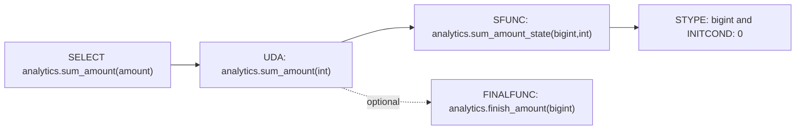
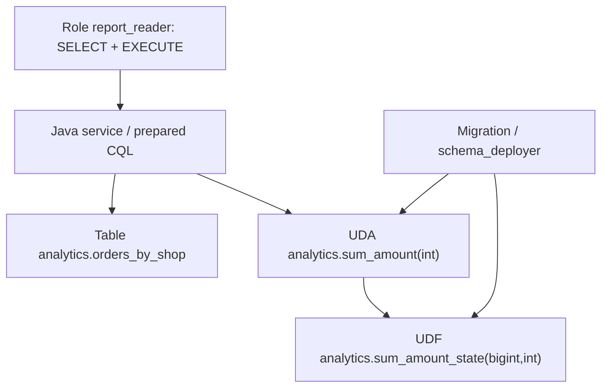

# Function/Aggregate Execution Permissions and Schema Dependencies

> **Chapter:** Advanced CQL  
> **Module:** `DATABASE_ENGINE_WIDE_COLUMN_CASSANDRA`

In Apache Cassandra, **functions** and **aggregates** can be schema objects with their own access permissions and mutual dependencies. Allowing a role to read a table does not mean that role may invoke every user-defined function (UDF) or user-defined aggregate (UDA). Likewise, having permission to create an aggregate does not automatically guarantee execution rights on the state/final functions the aggregate references.

This lesson addresses two practical questions: **Who is allowed to invoke or modify a function/aggregate?** And **in what order should they be deployed, replaced, revoked, or dropped so application queries do not break?** Examples use CQL and illustrate where Java applications interact with Cassandra; query-driven table design, partition keys, replication, consistency levels, compaction, and repair remain the operational backdrop, without replacing schema authorization.

**Learning objectives:**

- Distinguish UDFs, UDAs, built-in functions, and the signature identifying a function.
- Distinguish table `SELECT`/`MODIFY` permissions from `EXECUTE` on a function/aggregate.
- Grant, revoke, and audit role permissions with least privilege.
- Identify `UDA -> SFUNC -> FINALFUNC` dependencies and query/application-to-schema dependencies.
- Plan minimally disruptive migration ordering: create new -> grant permissions -> cut over clients -> clean up old dependencies.

## 1. Distinguishing Functions and Aggregates

A **scalar function** takes arguments and returns one value per invocation. Cassandra provides built-in functions like `cast`, `token`, and various data conversion helpers; a **UDF** is a user-defined function, typically written in Java running server-side.

An **aggregate** computes a result over the set of rows returned by a `SELECT` statement. Alongside built-in aggregates like `count`, `sum`, and `avg`, Cassandra supports **UDAs**. A UDA depends on other UDFs:

- `SFUNC` (*state function*): receives the current state (`STYPE`) as its first argument and the next row's values as remaining arguments; returns the updated state.
- `FINALFUNC` (*final function*, optional): receives the final state and returns the final output.
- `INITCOND` (*initial condition*, optional): initial state value; defaults to `null` if omitted.
- `STYPE`: type of the intermediate state; mandatory.



User-defined functions/aggregates belong to a **keyspace**, form part of the **Cassandra schema**, and synchronize across nodes. The cluster must enable UDF support per operational policy (`user_defined_functions_enabled`; typically disabled by default to limit server-side code execution risk). Having `CREATE FUNCTION` syntax does not mean every cluster allows executing UDFs.

### Signature Is a Function's Identity

A function resource is uniquely identified by **keyspace + function name + argument type list**, for example:

```text
analytics.normalize_score(int)
analytics.normalize_score(bigint)
analytics.sum_amount_state(bigint, int)
analytics.sum_amount(int)                  -- UDA
```

`normalize_score(int)` and `normalize_score(bigint)` are **two distinct overloads**. Grants on the first overload do not automatically cover the second. Parameter names (`value`, `state`, etc.) do not distinguish signatures; **parameter types and their order** do. Always specify the keyspace and parameter types explicitly in migrations to avoid targeting the wrong function.

## 2. Example Schema: UDF and Aggregate

Suppose a retail application queries total order amount by `shop_id`. The table is modeled around the partition key to bound read scope: aggregating across an entire keyspace is not good practice in distributed Cassandra.

```sql
-- Keyspace analytics already exists with appropriate replication configured.
CREATE TABLE analytics.orders_by_shop (
    shop_id text,
    order_id timeuuid,
    amount int,
    PRIMARY KEY ((shop_id), order_id)
);

INSERT INTO analytics.orders_by_shop (shop_id, order_id, amount)
VALUES ('shop-01', now(), 120);

INSERT INTO analytics.orders_by_shop (shop_id, order_id, amount)
VALUES ('shop-01', now(), 80);
```

Create a UDF doubling an `int` (simple enough for testing permissions):

```sql
CREATE FUNCTION analytics.double_amount(v int)
    RETURNS NULL ON NULL INPUT
    RETURNS int
    LANGUAGE java
    AS $$
        return v * 2;
    $$;
```

This UDF merely illustrates syntax. In production, trivial arithmetic belongs in the application to avoid adding compute load on Cassandra nodes. Additionally, `int` has finite bounds and multiplication can overflow.

To demonstrate dependencies, create a state function and a UDA summing `amount` into a `bigint` result:

```sql
CREATE FUNCTION analytics.sum_amount_state(s bigint, v int)
    CALLED ON NULL INPUT
    RETURNS bigint
    LANGUAGE java
    AS $$
        long current = (s == null) ? 0L : s.longValue();
        long delta = (v == null) ? 0L : v.longValue();
        return current + delta;
    $$;

CREATE AGGREGATE analytics.sum_amount(int)
    SFUNC sum_amount_state
    STYPE bigint
    INITCOND 0;
```

`sum_amount(int)` depends on UDF `sum_amount_state(bigint, int)`. This aggregate needs no `FINALFUNC`, so its return type is `bigint` matching the state; using `bigint` lowers overflow risk compared to summing in `int`, though `bigint` is still finite.

```sql
SELECT analytics.double_amount(amount)
FROM analytics.orders_by_shop
WHERE shop_id = 'shop-01';

SELECT analytics.sum_amount(amount)
FROM analytics.orders_by_shop
WHERE shop_id = 'shop-01';
-- With the two sample rows and no other updates, total is 200.
```

**Query design impact:** the aggregate still has to process every row matching `WHERE`. UDAs do not replace data modeling, indexes, or partitioning. When a partition holds very large row counts, running aggregates in queries raises CPU, I/O, and latency; consider a separately maintained summary table if frequent large-scale reads are needed.

## 3. Execution Permissions Differ from Data Read/Write Permissions

Cassandra uses roles and resources for authorization. Under an authorizer enforcing permissions (typically `CassandraAuthorizer`), `EXECUTE` on a function is distinct from `SELECT`/`MODIFY` on a table.

| Permission | Example Resource | Purpose |
| --- | --- | --- |
| `SELECT` | `TABLE analytics.orders_by_shop` | Read table data, including input rows fed to `SELECT` calling a UDF/UDA. |
| `MODIFY` | `TABLE analytics.orders_by_shop` | Write/update/delete data via corresponding CQL statements. |
| `EXECUTE` | `FUNCTION analytics.double_amount(int)` | Allows invoking the specified UDF in supported CQL clauses. |
| `EXECUTE` | `FUNCTION analytics.sum_amount(int)` | Allows invoking the specific aggregate. |
| `CREATE` | `ALL FUNCTIONS IN KEYSPACE analytics` | Create UDFs/UDAs within the chosen keyspace. |
| `ALTER` | `FUNCTION analytics.double_amount(int)` | Replace an existing function signature via `CREATE OR REPLACE`. |
| `DROP` | `FUNCTION analytics.double_amount(int)` | Drop a specific function. |
| `AUTHORIZE` | Function or broader function scope | Manage granting/revoking permissions on that resource. |

**Two separate permission checks:** `SELECT analytics.double_amount(amount) FROM analytics.orders_by_shop ...` requires read permission on the table **and** execute permission on the UDF. Having `EXECUTE` without `SELECT` still blocks reading table data. Having `SELECT` without `EXECUTE` still blocks calling the protected UDF.

Execute the statements below as an admin role with grant authority; the example assumes `report_reader` and `schema_deployer` have already been created by an administrator:

```sql
-- Read-only access to the reporting table.
GRANT SELECT ON TABLE analytics.orders_by_shop TO report_reader;

-- Grant execution on exactly 1 UDF overload and 1 aggregate.
GRANT EXECUTE ON FUNCTION analytics.double_amount(int) TO report_reader;
GRANT EXECUTE ON FUNCTION analytics.sum_amount(int) TO report_reader;

-- To deploy new UDFs/UDAs in keyspace analytics:
GRANT CREATE ON ALL FUNCTIONS IN KEYSPACE analytics TO schema_deployer;

-- The UDA creator needs EXECUTE on every UDF referenced by the aggregate.
GRANT EXECUTE ON FUNCTION
    analytics.sum_amount_state(bigint, int) TO schema_deployer;
```

Execute permission on dependent UDFs is **checked when creating the UDA**: the aggregate creator needs permission to use `SFUNC` and `FINALFUNC` if defined. For end-user roles, permission to call `sum_amount(int)` and read the table is the focus; avoid granting permissions on internal helper functions just to run an aggregate unless genuinely needed.

### Grant Scopes: Single Function, Keyspace, Cluster-Wide

`GRANT` syntax supports three levels of function resources:

```sql
-- Narrowest: one specific function/overload.
GRANT EXECUTE ON FUNCTION analytics.double_amount(int)
TO report_reader;

-- Broader: all functions in a keyspace.
GRANT EXECUTE ON ALL FUNCTIONS IN KEYSPACE analytics
TO report_reader;

-- Broadest: all user-defined functions/aggregates cluster-wide.
GRANT EXECUTE ON ALL FUNCTIONS
TO report_reader;
```

Grants on a parent resource cascade to child resources; granting `EXECUTE ON ALL FUNCTIONS IN KEYSPACE` allows the role to invoke future functions added to that keyspace as well. Granting the narrowest scope prevents unexpected privilege expansion as schemas evolve.

**Role-based access pattern:** create a non-login role as a permission group, then grant that group to login roles. This reduces repetitive `GRANT` statements across multiple service accounts.

```sql
CREATE ROLE analytics_readers WITH LOGIN = false;

GRANT SELECT ON TABLE analytics.orders_by_shop TO analytics_readers;
GRANT EXECUTE ON FUNCTION analytics.sum_amount(int)
TO analytics_readers;

-- Assumes role app_reporting already exists.
GRANT analytics_readers TO app_reporting;
```

The role creating a new resource normally receives matching permissions on that newly created resource automatically, yet that **does not** allow any other role to call it. Superusers, role inheritance, and authorizer configuration can yield surprising results; always verify using the exact identity the application uses.

## 4. Revoking and Auditing Permissions

To narrow privileges, use `REVOKE` on the **exact resource** previously granted:

```sql
REVOKE EXECUTE ON FUNCTION analytics.double_amount(int)
FROM report_reader;

-- Inspect permissions granted directly or via inheritance:
LIST ALL PERMISSIONS OF report_reader;

-- Inspect permissions relating to a specific function:
LIST ALL PERMISSIONS ON FUNCTION analytics.sum_amount(int)
OF report_reader;
```

Note: revoking a direct grant on a single function **does not eliminate** permissions still inherited from another role, or from `EXECUTE ON ALL FUNCTIONS IN KEYSPACE analytics` or `ALL FUNCTIONS`. To revoke access effectively, inspect inherited roles and parent-scope grants too. Always test both allowed and denied cases using a non-superuser role.

Also distinguish **schema modification permissions** from **execution permissions**:

- `CREATE ON ALL FUNCTIONS IN KEYSPACE`: add new functions/aggregates.
- `ALTER ON FUNCTION` or a function group: replace an existing definition with `CREATE OR REPLACE`.
- `DROP ON FUNCTION` or a function group: delete a definition.
- `AUTHORIZE` on the relevant resource: manage `GRANT`/`REVOKE` on that resource.

Never grant `CREATE`, `ALTER`, or `DROP` to a read-only reporting role. A user with `EXECUTE` should never implicitly hold permission to alter a UDF's Java source.

## 5. Schema Dependencies: Why Migration Order Matters

View dependencies across two layers: **Cassandra-managed schema dependencies** and **application dependencies**.



For `sum_amount(int)`:

1. **The UDA references UDFs by signature.** The state function must take `STYPE` as its first parameter and the aggregate argument types afterward; its return type must match `STYPE`.
2. **The final function (if any) is also a dependency.** It must accept one argument of type `STYPE`; its return type determines the aggregate's output type.
3. **Permissions are an operational dependency.** Even when the schema exists, queries fail if a new role lacks `EXECUTE`.
4. **Applications are external schema dependencies.** CQL queries and Java code may reference a specific function; changing a signature or dropping a function breaks their calls.
5. **Schemas propagate across the cluster.** After DDL, verify nodes reached schema agreement and client statement preparation/execution uses the new version; data read/write consistency levels do not replace checking schema agreement.

Example of a flawed plan:

```sql
-- Example of what NOT to do first while a UDA still uses the function:
DROP FUNCTION analytics.sum_amount_state(bigint, int);
```

In standard Cassandra releases, dropping a UDF still referenced by a UDA is rejected to prevent dangling aggregate dependencies. Even though it fails safely, a deployment pipeline will stall without the right sequence: update or drop dependent aggregates before dropping legacy state/final functions.

### Safer Migrations: Versioning Instead of In-Place Edits

Suppose you want to evolve `sum_amount` into `sum_amount_v2`; follow this sequence:

1. **Create the new UDF** `sum_amount_state_v2(bigint, int)` (and a new `FINALFUNC` if needed), keeping the old function intact.
2. **Grant `EXECUTE` to the deployer role** on the new dependent UDFs; create `UDA sum_amount_v2(int)`.
3. **Grant `EXECUTE` to application roles** for the new aggregate. Ensure table `SELECT` remains intact.
4. **Run comparison queries on a representative dataset** and verify cluster schema agreement, latency, execution cost, `null` edge cases, and large-input behavior.
5. **Cut over Java applications** to the new signature; refresh relevant prepared statements if needed; monitor for `Unauthorized`, `InvalidRequest`, missing-function errors, and latency.
6. **Confirm no legacy consumers remain**, then revoke execute on the old aggregate, `DROP AGGREGATE` the old one, and only then `DROP FUNCTION` the old state/final functions if no other UDA references them.

```sql
-- The statements below are CLEANUP after all consumers have migrated:
REVOKE EXECUTE ON FUNCTION analytics.sum_amount(int)
FROM report_reader;

DROP AGGREGATE IF EXISTS analytics.sum_amount(int);
DROP FUNCTION IF EXISTS analytics.sum_amount_state(bigint, int);
```

Split these changes into verifiable migration steps. Never treat CQL DDL as a single atomic schema transaction with automatic rollback across the entire sequence. Record existing UDF/UDA definitions prior to deployment so you have a clear rollback path.

### Changing Overloads and Return Types

`CREATE OR REPLACE FUNCTION analytics.normalize_score(v int) ...` targets the **existing signature**, whereas `CREATE FUNCTION ... (v bigint)` creates **a separate overload**. Never assume granting `EXECUTE` on `normalize_score(int)` authorizes calling `normalize_score(bigint)`. When changing parameter contracts or return types, introducing a newly versioned function name is usually safer for live clients.

If a function is an aggregate dependency, changing the state function's state type or return type must be coordinated with the `UDA`. Before altering or dropping any UDF, trace which aggregates reference it as `SFUNC`/`FINALFUNC` and verify signatures post-migration.

## 6. Error Handling in Java Applications

In a Java application using the Cassandra Java Driver, calling an unauthorized function fails the CQL request even when the same role can `SELECT` from the table normally.

```java
import com.datastax.oss.driver.api.core.CqlSession;
import com.datastax.oss.driver.api.core.cql.PreparedStatement;
import com.datastax.oss.driver.api.core.cql.Row;

public final class OrderReport {
    private final CqlSession session;
    private final PreparedStatement totalForShop;

    public OrderReport(CqlSession session) {
        this.session = session;
        this.totalForShop = session.prepare(
            "SELECT analytics.sum_amount(amount) AS total " +
            "FROM analytics.orders_by_shop WHERE shop_id = ?");
    }

    public long total(String shopId) {
        Row row = session.execute(totalForShop.bind(shopId)).one();
        if (row == null || row.isNull("total")) {
            return 0L; // Application convention for empty result sets.
        }
        return row.getLong("total");
    }
}
```

**This connection snippet assumes** `session` is initialized with a role holding `SELECT` on the table and `EXECUTE` on the aggregate; never hardcode credentials in source code. Depending on driver version and when checks occur, an authorization error can surface during `prepare` or `execute`. Treat authorization failures as deployment/config errors to fix—never retry them in an infinite loop, as retrying with the same identity cannot resolve a missing `EXECUTE` grant.

Before a new rollout, the application team should verify:

- Statements execute using **the exact role used in the target environment**.
- Functions/aggregates match the exact **keyspace and signature**; bound parameter types do not inadvertently select a different overload.
- Schema agreement is reached post-migration and prepared statements re-prepare when schemas change.
- Both `SELECT` on the source table and `EXECUTE` on the function are granted.
- Parent/child role inheritance and the impact of any `REVOKE` are accounted for.
- Aggregate execution time on realistic partition sizes is acceptable; Cassandra runs UDFs server-side, so expensive code impacts latency.

## 7. Self-Check Questions and Scenarios

**Scenario 1.** Role `app_reporting` has `SELECT ON TABLE analytics.orders_by_shop` but lacks `EXECUTE` on `analytics.sum_amount(int)`. `SELECT amount ...` succeeds, while `SELECT analytics.sum_amount(amount) ...` is rejected. What grant is missing?

**Scenario 2.** A role already holds `EXECUTE ON FUNCTION analytics.double_amount(int)`. After a developer creates overload `analytics.double_amount(bigint)`, queries passing `bigint` values fail with an authorization error. Why?

**Scenario 3.** You want to drop `sum_amount_state(bigint,int)`, yet `sum_amount(int)` still uses it. What is the right order of operations?

**Scenario 4.** An administrator runs `REVOKE EXECUTE ON FUNCTION analytics.sum_amount(int) FROM report_reader`, yet the application can still call it. What are two logical places to check?

<details>
<summary>Answer hints</summary>

1. Grant `GRANT EXECUTE ON FUNCTION analytics.sum_amount(int) TO app_reporting;` or grant via an appropriate group role; verify `SELECT` remains intact.
2. Permissions bind to **signatures**; `(int)` and `(bigint)` are two distinct resources. Verify which overload is called and grant explicitly.
3. Migrate consumers to a new UDA if needed; once no consumer uses the old UDA, `DROP AGGREGATE analytics.sum_amount(int)` first, then `DROP FUNCTION analytics.sum_amount_state(bigint,int)`. Confirm no other UDA references that UDF.
4. Run `LIST ALL PERMISSIONS OF report_reader` to spot grants from parent roles or `EXECUTE ON ALL FUNCTIONS [IN KEYSPACE ...]`; also verify which role the app actually connects as and whether it is a superuser.

</details>

## 8. Migration and Operations Checklist

| Item | Question to Verify | Risk If Skipped |
| --- | --- | --- |
| Signature | Are keyspace, name, and argument types fully specified? | Granting on the wrong overload or dropping the wrong function. |
| Permissions | Does the deployer hold `CREATE`/`ALTER` and `EXECUTE` on dependencies; does the app hold `SELECT` and `EXECUTE`? | DDL or queries fail despite the schema existing. |
| Dependencies | Which UDAs reference this state/final function? | Drop fails, or migration leaves broken dependencies. |
| Scope | Is `ALL FUNCTIONS` genuinely required? | Unintentionally grants execution on unrelated functions. |
| Distributed state | Have all nodes reached schema agreement and clients picked up the new version? | Intermittent query errors during rollout windows. |
| Performance | Does the aggregate scan many rows in a partition? | Higher CPU and read latency; consider query-driven summary tables. |
| Monitoring | Are `Unauthorized`, schema errors, and UDA latency tracked? | Hard to distinguish permission errors from data or query bugs. |

**Key takeaways:**

- `EXECUTE` is a dedicated permission on function resources; table `SELECT` does not imply it.
- The `keyspace.function(type1, type2, ...)` signature is the unit for permission grants and overload management.
- `CREATE AGGREGATE` depends on `SFUNC` and optionally `FINALFUNC`, so its creator needs `EXECUTE` on referenced functions.
- Schema changes impact roles, aggregates, and application queries. Prefer expanding first, migrating consumers, and only then revoking/dropping legacy resources.

### Official References

- [Apache Cassandra — Functions, UDF, UDA, signatures](https://cassandra.apache.org/doc/stable/cassandra/developing/cql/functions.html)
- [Apache Cassandra — Database Roles, GRANT/REVOKE, resource permissions](https://cassandra.apache.org/doc/stable/cassandra/developing/cql/security.html)
