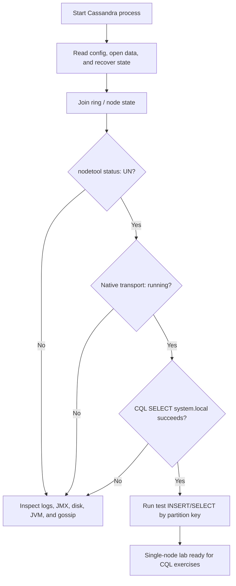

# Initializing a Node and Verifying Readiness

## 1. Objectives and Scope

Apache Cassandra is a **distributed wide-column** database management system. A Cassandra cluster consists of **nodes** that share data across a token ring. Before studying partition keys, query-driven table design, replication, consistency levels, compaction, repair, failure handling, and Java connectivity, you need to know how to initialize a node and determine exactly when it is ready to serve CQL.

After this lesson, you will be able to:

1. Distinguish between **process running**, **node joined ring**, **CQL native transport active**, and **queries actually succeeding**.
2. Stand up a Cassandra 5.0 node with Docker using datacenter/rack settings and persistent data, and apply equivalent verification steps to Linux/VM installs.
3. Read output from `nodetool status`, `nodetool statusbinary`, `nodetool info`, and `system.local`.
4. Run a CQL verification test creating a keyspace, creating a table, writing, and reading by partition key.
5. Write a simple timeout-bounded readiness check, inspect logs when a node fails to start, and distinguish network errors from CQL errors.
6. Identify the limitations of a **single-node** lab compared to a cluster with replication and multiple failure domains.

**Scope:** one fresh Cassandra node in an isolated lab network. This environment is for learning CQL and verifying startup states; it provides **no node redundancy** and is insufficient for evaluating consistency, repair, or distributed fault tolerance.

## 2. How "Running" Differs from "Ready"

Startup may involve loading configuration/JVM, opening on-disk data, replaying the commitlog, initializing internal services, exchanging gossip state, and opening the native transport port. Exact ordering, log lines, and duration depend on version and data state; never rely on a single log line as final proof.



| Check Level | Question to Answer | Tool | What Is **Not** Yet Proven |
|---|---|---|---|
| 1. **Process/liveness** | Is the container/service still running? | `docker ps`, `docker inspect`, or `systemctl status cassandra` | The node may still be bootstrapping or native transport may not be open |
| 2. **Ring membership** | Is the node in **Up/Normal** state? | `nodetool status` | CQL may not yet accept requests or may hit a local error |
| 3. **Native transport** | Is Cassandra serving the CQL protocol port? | `nodetool statusbinary`; inspect port 9042 listener | An open TCP socket does not guarantee queries succeed |
| 4. **CQL query** | Can metadata queries execute? | `cqlsh -e "SELECT ... FROM system.local;"` | App permissions, schema, and read/write paths are not yet verified |
| 5. **Functional smoke test** | Do schema creation, INSERT, and partition-key SELECT work? | `cqlsh` or Java driver | Does not prove HA, replication, tail latency, or healthy repair |

In a multi-node cluster, `nodetool status` reflects the perspective of the queried node. One node reporting `UN` only shows **that node's view of the ring/gossip**, not a guarantee that every node can communicate or all replicas are synchronized.

## 3. Preparing the Lab Environment

### 3.1. Tools and Resources

The primary example uses **Docker Engine/Docker Desktop running Linux containers** and the `cassandra:5.0.9` image. This version is **pinned for the example**, not a claim that it will always remain the newest release.

Recommended starting conditions:

- Host with sufficient resources for Cassandra and Docker: around **8 GiB total RAM or more**, ~**4 GiB** allocated to the Docker VM/container, and ~**20 GiB** free SSD space make the lab smooth; this is a lab guideline, not production sizing.
- Working Docker CLI; network access to pull the image or a pre-pulled image.
- **Host port 9042** unused by another Cassandra instance or application.
- Synchronized system clock; in VM/Docker Desktop setups, check both the VM's clock and memory.
- `docker` commands below run on the **host**; commands after `docker exec` run **inside the container**.

Check Docker:

```bash
docker version
docker info
docker ps
```

If `docker version` cannot connect to the daemon, start Docker Engine/Desktop and verify permissions before continuing. Another lab environment may already hold port 9042; stop that lab properly while preserving its data before running this example.

### 3.2. Configuration Variables to Know

| Concept | Lab Value | Effect |
|---|---|---|
| Cluster name | `ready-lab` | Cluster identifier; sharing a name does not automatically join nodes into one cluster |
| Datacenter | `datacenter1` | Logical replica grouping used by `NetworkTopologyStrategy` and the Java driver |
| Rack | `rack1` | Topology unit within a datacenter |
| Endpoint snitch | `GossipingPropertyFileSnitch` | Lets Cassandra read DC/rack metadata from its configuration |
| CQL port | `9042/TCP` | Native transport for `cqlsh` and the Java driver |
| JMX | Usually internal port `7199` by default | Used by `nodetool` for status/admin; do not publish to host for the lab |
| Data directory | `/var/lib/cassandra` in image | Holds persistent data, commitlog, and storage files |

Create **only one** node and let the Docker image manage default listen/broadcast/seed settings. Never use this lab configuration to join a node to a production cluster: joining a real cluster requires specific versions, seeds, networking, topology, replication, and bootstrap procedures.

## 4. Initializing a Node with Docker

### 4.1. Creating a Volume and Starting the Container

First pull the image and create a named volume so data persists if the container is removed:

```bash
docker pull cassandra:5.0.9
docker volume create cassandra_ready_data
```

Start the node (multi-line syntax for **Bash/Linux/macOS**):

```bash
docker run -d \
  --name cassandra-ready-lab \
  -p 127.0.0.1:9042:9042 \
  -e CASSANDRA_CLUSTER_NAME=ready-lab \
  -e CASSANDRA_ENDPOINT_SNITCH=GossipingPropertyFileSnitch \
  -e CASSANDRA_DC=datacenter1 \
  -e CASSANDRA_RACK=rack1 \
  -v cassandra_ready_data:/var/lib/cassandra \
  cassandra:5.0.9
```

In **PowerShell**, run the single-line equivalent because Bash's `\` is not PowerShell's line continuation character:

```powershell
docker run -d --name cassandra-ready-lab -p 127.0.0.1:9042:9042 -e CASSANDRA_CLUSTER_NAME=ready-lab -e CASSANDRA_ENDPOINT_SNITCH=GossipingPropertyFileSnitch -e CASSANDRA_DC=datacenter1 -e CASSANDRA_RACK=rack1 -v cassandra_ready_data:/var/lib/cassandra cassandra:5.0.9
```

Meaning of the options:

- `-d` runs detached, **only confirming Docker created/started the container**, not that Cassandra is ready.
- `-p 127.0.0.1:9042:9042` publishes CQL only on the host loopback, without exposing the port to external networks.
- `GossipingPropertyFileSnitch` plus `CASSANDRA_DC/RACK` establishes the logical topology for the lab.
- `cassandra_ready_data` stores `/var/lib/cassandra`; never mount this same volume concurrently into multiple Cassandra containers.
- JMX/gossip/streaming ports are not published for a simple single node.

**Do not use `--rm`** when you need to inspect logs after a failure. If Docker reports the port is already allocated, find the container/service using 9042 before changing ports. If you switch to `-p 127.0.0.1:9144:9042`, CQL clients **on the host** connect to 9144 while clients **inside the container** still use 9042.

### 4.2. Observing the Startup Phase

```bash
docker ps --filter name=cassandra-ready-lab
docker logs --tail 100 cassandra-ready-lab
docker stats --no-stream cassandra-ready-lab
```

Interpretation notes:

- A container state of `Up` means the main process is running, **not a health check**.
- Cassandra takes time to initialize system keyspaces, open commitlogs, load schemas, and accept connections; no fixed number of seconds applies to every laptop/VM.
- If the container is missing from `docker ps`, check `docker ps -a --filter name=cassandra-ready-lab` and read logs to see whether it exited.
- If `docker stats` shows memory hitting limits, high CPU, or low VM disk space, fix resource starvation before assuming a Cassandra bug.

### 4.3. Level 1: Checking the Running Process

```bash
docker inspect --format "{{.State.Running}}" cassandra-ready-lab
docker inspect --format "{{.State.ExitCode}}" cassandra-ready-lab
docker inspect --format "{{.State.OOMKilled}}" cassandra-ready-lab
```

Expect `State.Running=true` and no OOM indication. `ExitCode` is meaningful once a process has stopped; never treat `ExitCode=0` on a running container as proof that CQL is ready.

## 5. Checking Node Status with nodetool

### 5.1. Level 2: Ring Membership

Run `nodetool` **inside the container** so it contacts Cassandra's local JMX interface:

```bash
docker exec cassandra-ready-lab nodetool status
```

Example output format (IP, load, host ID, and tokens vary per machine):

```text
Datacenter: datacenter1
=======================
Status=Up/Down
|/ State=Normal/Leaving/Joining/Moving
--  Address      Load      Tokens  Owns (effective)  Host ID       Rack
UN  172.17.0.2   ...       ...     ...               <UUID>        rack1
```

**Reading the two-letter status code:**

| Code | Meaning | Action in Lab |
|---|---|---|
| `UN` | **Up / Normal**: node is up and in normal ring state | Proceed to check native transport and CQL |
| `UJ` | **Up / Joining**: node is joining the ring / bootstrapping | Not ready yet; monitor logs, network, and bootstrap |
| `UL` | **Up / Leaving**: node is leaving the ring | Do not use as a baseline for a new node |
| `UM` | **Up / Moving**: token ranges are moving | Not a normal steady state for the lab |
| `DN` | **Down / Normal**: node is viewed as down by the queried node | Investigate connection failures, process, gossip, and host |

In a **new single-node lab**, expect **one `UN` row** under `Datacenter: datacenter1` with rack `rack1`. The node may show an internal Docker network IP (such as `172.x.x.x`), different from `127.0.0.1` used from the host: this is normal due to port mapping/NAT.

If `nodetool status` immediately reports failing to connect to JMX at startup, do not assume the node is dead; JVM/JMX may still be initializing or Cassandra may have exited. Check `docker ps -a` and `docker logs`. A node **holding only one replica** cannot serve data if that node goes down completely.

### 5.2. Checking Version and Node Information

```bash
docker exec cassandra-ready-lab nodetool version
docker exec cassandra-ready-lab nodetool info
docker exec cassandra-ready-lab nodetool describecluster
docker exec cassandra-ready-lab java -version
```

| Command | Purpose |
|---|---|
| `nodetool version` | Records actual server version; do not infer from image tag |
| `nodetool info` | Shows host ID, tokens, heap, uptime, data load, and supported node states |
| `nodetool describecluster` | Shows cluster name, partitioner, snitch, and cluster schema versions |
| `java -version` in container | Confirms the server runtime JVM; separate from the host JDK used for Java apps |

For the same node and same data volume, `host_id` is typically preserved across restarts. If you delete the volume and bootstrap a brand-new node, host ID/tokens can change. Therefore, **never treat two containers with the same name as the same Cassandra node** if the underlying data was wiped.

### 5.3. Level 3: Is Native Transport Open?

```bash
docker exec cassandra-ready-lab nodetool statusbinary
docker exec cassandra-ready-lab nodetool statusgossip
```

`nodetool statusbinary` returns `running` when Cassandra's native transport is active and `not running` when it is not serving. `nodetool statusgossip` reports gossip state, useful for ring diagnostics. These commands use **JMX**, unlike direct CQL connections on port 9042.

Expected for the lab: `statusbinary = running` and `statusgossip = running`. If `statusbinary` is `not running`, inspect logs, native transport config, and startup state; **do not** run `nodetool enablebinary` to mask an error without understanding its root cause.

## 6. Verifying with CQL

### 6.1. Level 4: Reading Metadata from system.local

Use `cqlsh` bundled inside the image:

```bash
docker exec cassandra-ready-lab cqlsh -e "SELECT release_version, cluster_name, data_center, host_id FROM system.local;"
```

Expected output:

- `release_version` is `5.0.9` if running the selected image.
- `cluster_name` is `ready-lab`.
- `data_center` is `datacenter1`.
- `host_id` contains the UUID identifying the node.

This is **stronger evidence** than an open TCP port alone because Cassandra must accept the request and execute a CQL query. If `cqlsh` reports *Connection refused*, the service may still be booting; inspect in sequence: container/process → `nodetool status` → `statusbinary` → logs.

To open the interactive shell:

```bash
docker exec -it cassandra-ready-lab cqlsh
```

At the `cqlsh>` prompt:

```sql
SHOW VERSION;
SHOW HOST;
SELECT cluster_name, data_center, release_version FROM system.local;
```

`SHOW VERSION` prints cqlsh/server/CQL/native protocol versions; `SHOW HOST` shows the current connected endpoint. Both are **cqlsh-specific commands**, not CQL queries sent from a Java application.

### 6.2. Level 5: Creating Schema, Writing, and Reading by Partition Key

In `cqlsh`, create a dedicated lab keyspace:

```sql
CREATE KEYSPACE IF NOT EXISTS ready_lab
WITH replication = {
  'class': 'NetworkTopologyStrategy',
  'datacenter1': 1
};

CREATE TABLE IF NOT EXISTS ready_lab.events_by_device (
  device_id text,
  event_id timeuuid,
  event_type text,
  PRIMARY KEY ((device_id), event_id)
) WITH CLUSTERING ORDER BY (event_id DESC);

INSERT INTO ready_lab.events_by_device
  (device_id, event_id, event_type)
VALUES ('device-001', now(), 'node-ready');

SELECT device_id, event_id, event_type
FROM ready_lab.events_by_device
WHERE device_id = 'device-001'
LIMIT 10;
```

Expect the query to return **one row** with `device_id = 'device-001'` and `event_type = 'node-ready'`. If you ran this snippet multiple times, since each `now()` generates a new timeuuid, there may be **multiple rows**; verify at least one matching row exists and use `TRUNCATE ready_lab.events_by_device;` if you want to re-run with an empty table. `TRUNCATE` deletes all rows in the table, so run it only on the lab table created for this lesson.

Why does this model fit Cassandra?

- `device_id` is the **partition key**: events for one device share a partition, routed by the partition key's token.
- `event_id` is the **clustering column**, sorting events within the partition in descending order.
- The `SELECT` includes `WHERE device_id = ...`, reading the exact partition per query-driven table design without scanning the whole cluster.
- `NetworkTopologyStrategy` defines replica count per datacenter. With `'datacenter1': 1` and **one node**, there is only **one replica**; `LOCAL_QUORUM` here still hits just one replica and provides no fault tolerance.

Succeeding at table creation/write/read confirms the **basic data path** works on this node. It does not mean the cluster has been tested for compaction, repair, multi-node replication, or fault tolerance; those topics require dedicated environments and workloads.

### 6.3. Inspecting Data and Background Tasks After Smoke Testing

Exit `cqlsh` and run in the host terminal:

```bash
docker exec cassandra-ready-lab nodetool tablestats ready_lab
docker exec cassandra-ready-lab nodetool tpstats
docker exec cassandra-ready-lab nodetool compactionstats
docker exec cassandra-ready-lab sh -c "df -h /var/lib/cassandra"
```

`tablestats` reports table metrics, `tpstats` reports thread pool states, and `compactionstats` shows active/pending compaction tasks. **Having zero pending compactions** after a tiny write is completely normal. Likewise, `UN` status and one successful SELECT **do not replace** monitoring CPU, RAM, disk, GC pauses, read/write latencies, and timeouts under real load.

## 7. Automatically Waiting for Node Readiness in Lab Scripts

A common bug in Docker Compose or test scripts is launching a Java app immediately after `docker run -d`. Cassandra may not have opened CQL yet, causing initial connections to fail even though the node becomes healthy seconds later.

### 7.1. Single Check Command

On a host with the running container:

```bash
docker exec cassandra-ready-lab cqlsh -e "SELECT release_version FROM system.local;"
```

For a lab, **command success (exit code 0)** indicates CQL executed the query. Combine it with ring/statusbinary checks when marking a "node ready".

### 7.2. Bounded Wait Example in Bash

For a custom Bash lab script, the example below retries for up to ~150 seconds (illustrative only; slower machines may need longer):

```bash
#!/usr/bin/env bash

set -u
ready=0

for attempt in {1..30}; do
  # status runs inside the container: one UN row suffices for a single-node lab.
  status="$(docker exec cassandra-ready-lab nodetool status 2>/dev/null)" || status=""
  binary="$(docker exec cassandra-ready-lab nodetool statusbinary 2>/dev/null)" || binary=""

  if printf '%s\n' "$status" | grep -Eq '^UN[[:space:]]' \
     && [ "$binary" = "running" ] \
     && docker exec cassandra-ready-lab cqlsh \
         -e "SELECT release_version FROM system.local;" >/dev/null 2>&1; then
    ready=1
    break
  fi

  echo "Cassandra not ready yet (attempt $attempt/30)"
  sleep 5
done

if [ "$ready" -eq 1 ]; then
  echo "READY: UN, native transport running, SELECT system.local succeeded"
else
  echo "NOT READY: check Cassandra logs and resources" >&2
  docker logs --tail 80 cassandra-ready-lab >&2
  exit 1
fi
```

Save that code into a **separate lab script**, such as `check-ready.sh`, and run it with Bash. Do not paste raw `exit 1` into an interactive shell unless you want the shell session to close. The script matches a single `UN` line because the environment **has only one node**; in multi-node clusters you must match the **exact host ID/address of the target node** rather than inferring cluster-wide health from any arbitrary row.

The example intentionally checks three distinct layers:

1. The node is `UN` in the ring.
2. Cassandra's native transport reports `running`.
3. A CQL query succeeds.

Do not insist on "waiting exactly 30 times" across all environments; retry count, interval, and timeout should reflect real startup speed. For continuous health probes, avoid invoking `cqlsh` too frequently because each invocation spawns a Python process; consider a reused driver session or an appropriate operational probe.

### 7.3. Implications for Java Application Startup

In a Java application, build a `CqlSession` with contact point and local datacenter, then run a lightweight query to confirm the session can serve requests. Code example:

```java
import java.net.InetSocketAddress;
import com.datastax.oss.driver.api.core.CqlSession;
import com.datastax.oss.driver.api.core.cql.Row;

public class CassandraReadiness {
    public static void main(String[] args) {
        try (CqlSession session = CqlSession.builder()
                .addContactPoint(new InetSocketAddress("127.0.0.1", 9042))
                .withLocalDatacenter("datacenter1")
                .build()) {
            Row row = session.execute(
                    "SELECT release_version FROM system.local").one();
            if (row == null) {
                throw new IllegalStateException("system.local returned no rows");
            }
            System.out.println("Cassandra ready: " + row.getString("release_version"));
        }
    }
}
```

This example targets **Java 17 + Apache Cassandra Java Driver 4.x** (e.g., dependency `org.apache.cassandra:java-driver-core:4.19.4`). Contact point `127.0.0.1:9042` assumes the **application runs on the host** and Docker publishes port 9042. If Java runs in **another container**, `127.0.0.1` is that Java container itself; use Docker network DNS and ensure addresses **advertised by Cassandra via metadata** are reachable from the app. Whenever NAT, SSH tunnels, multiple nodes, or custom host ports are involved, test actual Java connectivity rather than inferring success from `docker exec ... cqlsh`.

In real applications, reuse **one `CqlSession` per cluster**, implement bounded startup retry/backoff, and expose proper metrics/health endpoints. Avoid opening a new session per HTTP request just to verify readiness.

## 8. When Cassandra Is Installed via Packages or Inside a VM

Readiness criteria **do not change**; only startup commands and execution locations differ.

| Install Method | Process Check | Node / CQL Check | Where to Find Logs |
|---|---|---|---|
| DEB/APT or RPM/DNF on Linux | `systemctl status cassandra --no-pager` | `nodetool status`; `nodetool statusbinary`; `cqlsh -e "SELECT ... FROM system.local;"` | `journalctl -u cassandra` and `/var/log/cassandra/system.log` per package |
| Linux VM with packages | `systemctl` commands **inside guest** | Run `nodetool`/`cqlsh` **inside guest**, then test from host | Logs in guest filesystem |
| Tarball on Linux/VM | Foreground `bin/cassandra -f` or custom service | `bin/nodetool status`; `bin/cqlsh` | `logs/system.log` under tarball dir or custom path |
| Docker | `docker ps -a`, `docker inspect` | `docker exec ... nodetool ...` and `docker exec ... cqlsh ...` | `docker logs` |

Example for a systemd-managed package:

```bash
sudo systemctl start cassandra
sudo systemctl status cassandra --no-pager
nodetool status
nodetool statusbinary
cqlsh -e "SELECT release_version, data_center FROM system.local;"
```

If `cqlsh` works **inside the VM** while `cqlsh` from the host fails, inspect **VM NAT/bridged/host-only mode, firewall, and listeners**. Cassandra may be binding CQL only to guest loopback. For the Java driver, `rpc_address` is the native transport bind address, while `broadcast_rpc_address` is the address advertised to clients: that address must be reachable from the application host.

For any new VM lab or package node, query the actual `data_center` rather than blindly assuming `datacenter1`. If the datacenter name differs, update `NetworkTopologyStrategy` and `withLocalDatacenter(...)` accordingly when creating keyspaces or apps.

## 9. Diagnosing a Node That Is Not Ready

| Symptom | Likely Cause | Commands and Investigation Path |
|---|---|---|
| `docker run` returns ID, `cqlsh` fails | Cassandra has not finished starting | Check `docker logs`, `nodetool status`, `statusbinary`; wait on real state |
| Container exited | JVM error, low RAM, volume/permissions, full disk, or bad config | Check `docker ps -a`, `docker inspect`, `docker logs`, RAM/disk |
| `nodetool` cannot connect to JMX | Cassandra/JMX not running yet or JMX config/port mismatch | Check process/logs and JMX bind settings; do not confuse JMX with CQL port |
| `status = UJ` persists | Bootstrap/join incomplete, gossip, topology, or I/O issue | Inspect logs, `nodetool netstats`, network/seeds; a fresh single-node lab shouldn't stream indefinitely |
| `status = UN` yet `statusbinary = not running` | Native transport not open yet or disabled | Check logs, native transport config, listeners; do not mark ready |
| `statusbinary = running` yet `cqlsh` fails | CQL listener/route/firewall, auth/TLS, startup, or wrong address | Verify port 9042 from client location, logs, and config |
| `cqlsh` works in container, fails on host | Forgot to publish port, wrong host port/address, firewall, Docker VM | Check `docker ps`, 9042 mapping, host connectivity; distinguish container IP vs localhost |
| Java driver fails while `cqlsh` in container OK | Local DC mismatch, wrong contact point/port, unroutable broadcast IP | Check `system.local.data_center`, `withLocalDatacenter`, metadata, Docker network/NAT |
| `CREATE KEYSPACE`/`INSERT` error | Wrong datacenter in replication, schema/query error, permissions, or unhealthy node | Check `system.local.data_center`, CQL error, and server logs |
| SELECT returns no rows | Wrong partition key queried, data expired via TTL/deleted, or write actually failed | Verify exact keys, INSERT statement, and consistency; never infer from `nodetool status` |
| Disk fills up over time | Commitlog, SSTables, compaction/snapshots/Docker volume | Check `df -h /var/lib/cassandra`, `nodetool compactionstats`, Docker VM disk |
| Large clock skew between node/client | Broken host/VM time sync or bad client-supplied timestamps | Check node/client UTC/NTP and mutation timestamp source; never assume data consistency just because writes succeed |

**Ordered troubleshooting workflow:**

1. **Container/service:** is it running or exited, was there an OOM?
2. **Logs:** does the JVM report config, Java version, permissions, disk, or startup errors?
3. **Ring:** does `nodetool status` show the **target node** as `UN`?
4. **Native transport:** does `nodetool statusbinary` report `running`?
5. **CQL from server environment:** does `SELECT ... FROM system.local` succeed?
6. **CQL from client location:** are network path, port, auth/TLS, local datacenter, and broadcast address all valid?
7. **Application tables:** do schema, partition key, INSERT/SELECT, and consistency level meet requirements?

Avoid "quick fixes" like wiping `/var/lib/cassandra` or a named volume when data must be kept. In real clusters, changing tokens, seeds, replication, replacing nodes, and running repair must follow formal operational procedures; never tweak settings haphazardly just to force `UN`.

## 10. Controlled Experiments

### 10.1. Stopping and Restarting the Same Node

After confirming lab data was written:

```bash
docker stop cassandra-ready-lab
docker start cassandra-ready-lab
docker exec cassandra-ready-lab nodetool status
docker exec cassandra-ready-lab cqlsh -e "SELECT device_id, event_type FROM ready_lab.events_by_device WHERE device_id = 'device-001';"
```

`docker start` may return before Cassandra opens CQL; **wait for readiness again** using the layers above. Because it still uses the **same named volume**, previously written data recovers cleanly across normal restarts. If a different volume was mounted or data was wiped, results will differ.

### 10.2. Observing Loss of Native Transport — Lab Only

In a **dedicated Cassandra environment with no active apps or teammates**, observe what happens when disabling native transport:

```bash
docker exec cassandra-ready-lab nodetool disablebinary
docker exec cassandra-ready-lab nodetool statusbinary
docker exec cassandra-ready-lab cqlsh -e "SELECT release_version FROM system.local;"

# Re-enable immediately in the lab:
docker exec cassandra-ready-lab nodetool enablebinary
docker exec cassandra-ready-lab nodetool statusbinary
docker exec cassandra-ready-lab cqlsh -e "SELECT release_version FROM system.local;"
```

After `disablebinary`, `statusbinary` reports `not running` and new `cqlsh` queries fail; that is the expected test outcome. These commands **actively disrupt CQL** on the running node, so run them only in an isolated lab and re-enable right after observing. If anything fails to recover, check logs and follow operational recovery procedures.

This experiment shows that a node can remain visible in the ring while CQL serving is down: **ring health and query readiness are two separate verification layers**.

## 11. Recording Evidence, Cleanup, and Review Questions

### 11.1. Readiness Evidence Table

Record actual observed values in your practice log:

| Check | Value to Record |
|---|---|
| Image/version | `cassandra:5.0.9`; `nodetool version` output |
| Container/process | `State.Running`, any OOM flags |
| Ring | `UN` node row, datacenter, rack, host ID |
| Native transport | `nodetool statusbinary` output |
| System metadata | `release_version`, `cluster_name`, `data_center`, `host_id` |
| CQL smoke test | Confirmed `device-001` record in `ready_lab.events_by_device` |
| Client endpoint | Host/port where `cqlsh` or Java actually connected |
| Disk space | `df -h /var/lib/cassandra` output and volume status |
| Lab date/time | UTC timestamp and host/VM NTP sync status |

### 11.2. Self-Assessment Questions

1. Why is `docker ps` showing `Up` insufficient to mark Cassandra ready for a Java application?
2. A node stays stuck at `UJ`. What does `J` mean, and what evidence should you collect before intervening?
3. `nodetool status` reports `UN`, while `nodetool statusbinary` reports `not running`. Can new CQL clients connect? Why or why not?
4. `cqlsh` succeeds inside the container, yet a Java program on the host throws `NoNodeAvailableException`. Which differences across host address, container IP, contact point, local DC, and broadcast address must be examined?
5. When creating a keyspace with `NetworkTopologyStrategy`, why must the datacenter name in the replication map reflect actual topology? Can RF=1 truly test replica failover?
6. A `SELECT` without `WHERE device_id = ...` fails. Is this a readiness failure or a sign of incorrect partition-key design/querying?
7. If you remove a container and recreate it with the same named volume, what can be preserved? What changes if you delete the volume too?
8. Why does a successful `SELECT system.local` still fail to prove that repair, compaction, and tail latency meet production requirements?

### 11.3. Stopping and Removing the Container After the Lab

```bash
docker stop cassandra-ready-lab
docker rm cassandra-ready-lab
docker volume ls --filter name=cassandra_ready_data
```

These commands preserve the named volume. **Do not delete the volume** if you need the data for the next lesson; only consider `docker volume rm cassandra_ready_data` once you are sure all lab data can be discarded. When recreating the node, keep the exact version and compatible configuration for the existing data directory; never try to downgrade Cassandra or share a volume between two concurrently running nodes.

**Completion criteria:** the new node reaches `UN`, native transport reports `running`, `cqlsh` reads `system.local`, and a record is written/read via partition key. Learners can explain each verification layer independently and resolve basic startup/connectivity issues before progressing to replication, consistency levels, compaction, repair, and Java application integration.

## 12. Official References

- [Apache Cassandra — nodetool status](https://cassandra.apache.org/doc/latest/cassandra/managing/tools/nodetool/status.html): ring states and codes `UN`, `UJ`, `DN`.
- [Apache Cassandra — nodetool statusbinary](https://cassandra.apache.org/doc/latest/cassandra/managing/tools/nodetool/statusbinary.html): checking native transport.
- [Apache Cassandra — nodetool statusgossip](https://cassandra.apache.org/doc/latest/cassandra/managing/tools/nodetool/statusgossip.html): checking gossip.
- [Apache Cassandra — Use Nodetool](https://cassandra.apache.org/doc/latest/cassandra/troubleshooting/use_nodetool.html): observing and isolating node failures.
- [Apache Cassandra — cqlsh](https://cassandra.apache.org/doc/latest/cassandra/managing/tools/cqlsh.html): CQL connection, `SHOW HOST`, and `SHOW VERSION`.
- [Apache Cassandra — Inserting and Querying](https://cassandra.apache.org/doc/latest/cassandra/getting-started/querying.html): basic CQL practice.
- [Apache Cassandra — Quickstart](https://cassandra.apache.org/doc/latest/cassandra/getting-started/cassandra-quickstart.html): node creation and CQL operations.
- [Docker Hub — Cassandra Official Image](https://hub.docker.com/_/cassandra): image, environment variables, and Docker volumes.
- [Apache Cassandra Java Driver](https://github.com/apache/cassandra-java-driver): `CqlSession`, contact points, and local datacenter.
