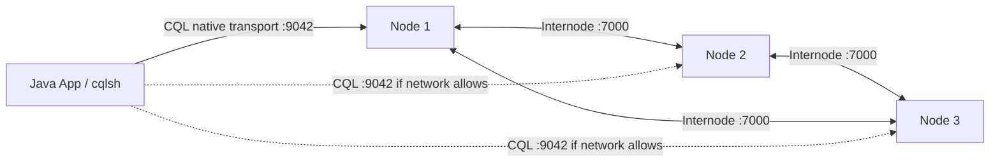

# Designing a Multi-Node Test Cluster, Cluster Name, and Contact Addresses

## 1. Objectives and Scope

Apache Cassandra is a **distributed wide-column** database management system: data is partitioned by the token of the **partition key**, replicated according to a **replication strategy**, and read/written across nodes over CQL. To practice replication, consistency levels, compaction, repair, node failure handling, and Java application connectivity, you need a **multi-node cluster where nodes communicate with one another**, rather than three isolated Cassandra processes.

After this lesson, you will be able to:

1. Design a **three-node, single-datacenter** lab cluster and distinguish cluster, datacenter, rack, node, seed, and replica.
2. Understand the purpose and requirements of `cluster_name`, `listen_address`, `broadcast_address`, `rpc_address`, `broadcast_rpc_address`, `seed_provider`, internode ports, and CQL ports.
3. Stand up three Cassandra 5.0.9 nodes with Docker using an isolated network and independent volumes, starting in a verifiable sequence.
4. Confirm all three nodes report `UN` in the ring and `system.peers_v2` lists peer node information.
5. Create a keyspace with `NetworkTopologyStrategy`, RF=3; run partition-key queries and explain quorum across three replicas.
6. Practice stopping one node in an **isolated lab**, observe node states, and recover it; understand why this test does not simulate failures across three independent physical hosts.

> **Scope:** a learning lab without real data. Never join the nodes in this lesson to a production cluster. IPs, names, RAM, and ports shown are examples; always verify actual resources and networking before applying.

## 2. Cluster Diagram and Core Concepts

### 2.1. Three-Node Test Cluster on the Same Docker Network

```text
                   Java App / cqlsh
                      CQL :9042
                           │
              Docker network: cassandra-lab3-net
             ┌─────────────┼─────────────┐
             │             │             │
       cassandra-n1   cassandra-n2   cassandra-n3
          rack1          rack2          rack3
          :7000          :7000          :7000
          :9042          :9042          :9042
             │             │             │
          volume1       volume2       volume3
             └─────────────┴─────────────┘
            cluster_name = cassandra-lab3
                   datacenter = dc1
```

All three containers share **one physical host** and one Docker Engine. Setting `rack1`, `rack2`, `rack3` only lets you observe **logical topology**; it **does not** create three physical racks or failure domains. If the laptop loses power, all three nodes go down together.

| Component | Meaning | Lab Configuration |
|---|---|---|
| Cluster | Set of Cassandra nodes coordinating in a single ring | `cassandra-lab3` |
| Node | A Cassandra server with its own host ID, tokens, and data | `cassandra-n1`, `cassandra-n2`, `cassandra-n3` |
| Datacenter | Node grouping for replica placement and local consistency levels | `dc1` |
| Rack | Logical location / failure domain provided by the snitch | `rack1`, `rack2`, `rack3` (simulated) |
| Seed | Node address helping new nodes discover cluster members via gossip | Initially `cassandra-n1` |
| Gossip | Exchange of membership, liveness, and topology state | Nodes communicate internally over Cassandra's network |
| Replica | Data copy chosen by keyspace replication strategy and token range | Example `RF=3` in `dc1` |
| Coordinator | Node receiving a read/write request and coordinating replicas for it | Can be any Cassandra node a client connects to |

**Seeds are not primaries, masters, or leaders.** After joining the ring, nodes discover each other via gossip; CQL requests do not have to pass through a seed. **Replication factor** is declared **in the keyspace**, not created automatically simply because three nodes exist in the cluster. With three nodes and RF=1, each partition still has only one replica.

### 2.2. Why Cluster Name and Network Must Align

Nodes joining the same cluster need compatible settings for **cluster identity**, partitioner, snitch/topology, Cassandra version, and internode reachability. `cluster_name` must match, yet **matching cluster names alone is not enough**: a node must also reach seeds and peers, join the ring properly, and not collide on host ID or data directory.

If you boot three nodes independently so each forms a single-node ring and later rename `cluster_name` to match, that is **not** a safe way to merge them into one cluster. Seeds, addresses, and networking must be designed **before initial bootstrap**.

## 3. Addresses and Ports to Distinguish

### 3.1. Two Separate Communication Paths: Internode and Client



| Default Port | Purpose | Connectivity Needed for Lab |
|---|---|---|
| `7000/TCP` | **Internode** communication, gossip/streaming, and node-to-node traffic | Nodes 1 ↔ 2 ↔ 3 must reach each other bidirectionally |
| `7001/TCP` | **Legacy** internode SSL port; unnecessary when Cassandra 5.0 uses a single port under modern TLS config | Only if specifically configured |
| `9042/TCP` | **CQL native protocol** for `cqlsh` and the Java Driver | Application must reach target nodes |
| `7199/TCP` | JMX for `nodetool` node administration | Invoked within the same container/VM; **never expose** JMX publicly |

In Cassandra 4.0 and newer, using `7001` as a separate SSL port has been deemphasized; when enabling internode encryption, consult the documentation **for your exact version** and verify actual port settings. Never assume "opening 7000 and 7001 makes it secure."

### 3.2. Address Configuration in cassandra.yaml

| Property | Meaning | Key Rules |
|---|---|---|
| `listen_address` | Interface/IP Cassandra **binds** for internode traffic | Must bind to a real interface and **must not be `0.0.0.0`** |
| `broadcast_address` | IP the node **advertises to other nodes** for internode communication | Every peer must be able to **route** to this IP; defaults to `listen_address` |
| `rpc_address` | **Bind** address for CQL native transport | Can be `0.0.0.0`, in which case a valid `broadcast_rpc_address` is required |
| `broadcast_rpc_address` | Address the node **advertises to drivers/clients** in topology metadata | Must not be `0.0.0.0`; must be reachable by the application |
| `seed_provider` / `seeds` | Initial node address list for new nodes to discover the cluster | One or more running seeds reachable over the internode network |
| `native_transport_port` | CQL client port | Usually `9042`; may be affected by NAT/port mapping |
| `storage_port` | Internode port | Usually `7000`; must be open between all nodes |

**Distinguishing bind vs. advertise:** bind is where the process listens; broadcast is **the address peers/clients will attempt to connect to**. A process can bind to all interfaces yet advertise an unreachable IP, causing failures even while `docker ps` and local `cqlsh` succeed.

Example across **three Linux VMs with separate, routable IPs** (illustrative addresses only):

```yaml
# Conceptual config for a VM node with real IP 10.80.10.11:
cluster_name: cassandra-lab3
listen_address: 10.80.10.11
broadcast_address: 10.80.10.11
rpc_address: 0.0.0.0
broadcast_rpc_address: 10.80.10.11
storage_port: 7000
native_transport_port: 9042
```

Other nodes substitute `10.80.10.12` and `10.80.10.13`. This is **not a complete cassandra.yaml**—only the excerpt relevant to addressing. Use your **actual guest IPs**, never paste placeholder IPs verbatim. All three VMs must permit port 7000 traffic between one another, apps must reach port 9042, and DNS/NTP must be operational.

### 3.3. Docker Networks, DNS, and NAT

Within a **user-defined Docker bridge network**, containers resolve each other by container name such as `cassandra-n1`. The official Cassandra image automatically derives `listen_address` from the container IP, and `CASSANDRA_BROADCAST_ADDRESS` defaults to match it. When all three nodes share **the same network**, advertised IPs are normally reachable from other containers on that network.

However, from a Windows/macOS **host**, internal container IPs are typically not directly routable. Publishing `9042` on the host only provides an initial **contact point**; the Java Driver reads metadata and may attempt to connect to **internal IPs of other nodes**. Therefore, this lab runs `cqlsh` and Java **inside the Docker network**. To connect from Java on the host to the full cluster, you would need dedicated endpoint/port and address translation design, or three VMs with host-routable IPs.

## 4. Seeds, Gossip, and Cluster Lifecycle

### 4.1. Seeds Are for Discovery, Not Leadership

When a new node boots, it needs at least one running seed to learn ring state. Once joined, gossip among nodes maintains membership. A seed node **does not automatically store more data**, is not a primary write node, and is not the only node that can serve requests.

**Lab design:** start `cassandra-n1` first and wait for `UN`; then start `cassandra-n2` and `cassandra-n3`, both pointing their seed to `cassandra-n1`. This demonstrates bootstrapping a **brand-new empty cluster**. For production, Apache documentation recommends **multiple reliable seeds** per datacenter spread across failure domains; avoid relying on a single seed when adding nodes later.

Note for the **Docker Official Image**: `CASSANDRA_SEEDS` is used by the entrypoint to rewrite `seed_provider`, and the image may also add the container's own `broadcast_address` to the seed list. Therefore, **inspect the running configuration** when studying seed vs. non-seed behavior; this lab illustrates discovery/bootstrap mechanics, not a production seed template. If you need exact control over the seed list, supply a custom `cassandra.yaml` maintained and tested per node.

### 4.2. Startup and Expansion Sequence

```text
1. Create network, volumes, matching cluster_name, matching datacenter.
2. Start n1 (initial seed).
3. Verify n1: nodetool status = UN; CQL works.
4. Start n2 with seed n1; wait for 2 UN nodes in ring.
5. Start n3 with seed n1; wait for 3 UN nodes in ring.
6. Only after all 3 are UN, create RF=3 keyspace and load test data.
7. Verify metadata, peer views, and apps on the same network.
```

Do not start all three nodes simultaneously and assume a failure just because `nodetool status` shows fewer than three rows in the first few seconds. Bootstrap, token ownership, and gossip are asynchronous; **readiness must be measured**, not inferred from Docker reporting `Up`.

## 5. Preparing Before Running the 3-Node Lab

### 5.1. Resources and Naming

- Docker Engine or Docker Desktop running Linux containers, with adequate CPU and SSD. To prevent three JVMs from severely contending for memory, a host/VM with around **24 GiB RAM or more** is comfortable when each node is capped at 4 GiB; this is a lab guideline, not an official requirement or production sizing.
- A 16 GiB host can work for small experiments if actual resources allow, but never arbitrarily slash heaps/limits and extrapolate results as production benchmarks.
- Ensure no existing containers named `cassandra-n1/n2/n3`, conflicting volumes with important data, or a `cassandra-lab3-net` network used by another project exist.
- No host ports need to be published for this lab because checks run via `docker exec` or clients inside the same Docker network. This avoids colliding with a single-node Cassandra using `localhost:9042`.
- Synchronize UTC/NTP on the host/VM; clock skew can cause mutation timestamps to order writes differently from wall-clock order.

Run on the host (shell with Docker CLI):

```bash
docker version
docker ps -a
docker network ls
docker volume ls
```

Subsequent commands are mostly written as **single lines** so they work in both Bash and Windows PowerShell. If using a Linux VM, run Docker commands on the host/VM where Docker Engine is installed. Every `docker exec` command runs inside the **specified container**.

### 5.2. Creating One Network and Three Separate Volumes

```bash
docker pull cassandra:5.0.9
docker network create cassandra-lab3-net
docker volume create cassandra_lab3_n1
docker volume create cassandra_lab3_n2
docker volume create cassandra_lab3_n3
```

Docker automatically picks an unused subnet managed by the Engine. This lab does not require static IPs, so after **deleting and recreating containers**, new IPs may differ from old ones. Volume data persists, though peer addresses recorded in metadata may require handling; never treat arbitrary container recreation as safe for a cluster with live data. For labs requiring repeated recreation, assign **static IPs** or follow proper node identity and node-replacement procedures.

## 6. Initializing the First Node and Joining Two More

### 6.1. Node 1: Initial Seed

```bash
docker run -d --name cassandra-n1 --network cassandra-lab3-net --memory=4g --memory-swap=4g -e MAX_HEAP_SIZE=2G -e CASSANDRA_CLUSTER_NAME=cassandra-lab3 -e CASSANDRA_ENDPOINT_SNITCH=GossipingPropertyFileSnitch -e CASSANDRA_DC=dc1 -e CASSANDRA_RACK=rack1 -v cassandra_lab3_n1:/var/lib/cassandra cassandra:5.0.9
```

For the first container, the image picks its internal IP for `listen_address` and uses itself as the initial seed when no other seeds are specified. Data writes to **n1's dedicated volume**; never share this volume with n2/n3.

Observe:

```bash
docker ps --filter name=cassandra-n1
docker logs --tail 100 cassandra-n1
docker exec cassandra-n1 nodetool status
docker exec cassandra-n1 nodetool statusbinary
docker exec cassandra-n1 cqlsh -e "SELECT cluster_name, data_center, rack, release_version FROM system.local;"
```

Wait until `nodetool status` shows **one `UN` row** and `statusbinary` is `running`; `cqlsh` should return cluster `cassandra-lab3`, DC `dc1`, rack `rack1`. If `nodetool` reports a JMX error right after startup, Cassandra may still be booting; check logs and available RAM before retrying.

### 6.2. Node 2: Joining via Seed n1

Once n1 is ready:

```bash
docker run -d --name cassandra-n2 --network cassandra-lab3-net --memory=4g --memory-swap=4g -e MAX_HEAP_SIZE=2G -e CASSANDRA_CLUSTER_NAME=cassandra-lab3 -e CASSANDRA_SEEDS=cassandra-n1 -e CASSANDRA_ENDPOINT_SNITCH=GossipingPropertyFileSnitch -e CASSANDRA_DC=dc1 -e CASSANDRA_RACK=rack2 -v cassandra_lab3_n2:/var/lib/cassandra cassandra:5.0.9
```

Check from **both nodes**:

```bash
docker exec cassandra-n1 nodetool status
docker exec cassandra-n2 nodetool status
docker exec cassandra-n2 cqlsh -e "SELECT cluster_name, data_center, rack FROM system.local;"
```

Expected once bootstrap finishes: both ring views show **two `UN` rows**. If `UJ` appears, the node is still joining; inspect `docker logs cassandra-n2` and `docker exec cassandra-n2 nodetool netstats` to monitor streaming/bootstrap rather than deleting volumes to "force" the node in.

### 6.3. Node 3: Joining the Same Cluster

Once two nodes are `UN`:

```bash
docker run -d --name cassandra-n3 --network cassandra-lab3-net --memory=4g --memory-swap=4g -e MAX_HEAP_SIZE=2G -e CASSANDRA_CLUSTER_NAME=cassandra-lab3 -e CASSANDRA_SEEDS=cassandra-n1 -e CASSANDRA_ENDPOINT_SNITCH=GossipingPropertyFileSnitch -e CASSANDRA_DC=dc1 -e CASSANDRA_RACK=rack3 -v cassandra_lab3_n3:/var/lib/cassandra cassandra:5.0.9
```

Check:

```bash
docker exec cassandra-n1 nodetool status
docker exec cassandra-n2 nodetool status
docker exec cassandra-n3 nodetool status
docker exec cassandra-n1 nodetool describecluster
```

Once all three finish bootstrapping, each node should see **three `UN` rows**, matching datacenter `dc1` and their respective racks. Output addresses are container bridge IPs rather than names `cassandra-n1/n2/n3`; inspect each IP with:

```bash
docker inspect --format "{{range .NetworkSettings.Networks}}{{.IPAddress}}{{end}}" cassandra-n1
docker inspect --format "{{range .NetworkSettings.Networks}}{{.IPAddress}}{{end}}" cassandra-n2
docker inspect --format "{{range .NetworkSettings.Networks}}{{.IPAddress}}{{end}}" cassandra-n3
```

**Success indicator:** all three nodes agree on cluster name/datacenter, all report `UN`, CQL returns metadata, and each node has a **unique host ID**. If one node shows `UN` while the other two do not see it, diagnose topology/gossip; do not conclude the cluster is formed.

## 7. Reading Metadata and Verifying Contact Addresses

### 7.1. Local View from Each Node

```bash
docker exec cassandra-n1 cqlsh -e "SELECT cluster_name, data_center, rack, host_id, release_version FROM system.local;"
docker exec cassandra-n2 cqlsh -e "SELECT cluster_name, data_center, rack, host_id, release_version FROM system.local;"
docker exec cassandra-n3 cqlsh -e "SELECT cluster_name, data_center, rack, host_id, release_version FROM system.local;"
```

`system.local` describes the queried node. Each row must have a **distinct `host_id`**, while `cluster_name` is `cassandra-lab3` and `data_center` is `dc1`.

### 7.2. Inspecting Known Peers

```bash
docker exec cassandra-n1 cqlsh -e "SELECT peer, peer_port, data_center, rack, host_id, native_address, native_port FROM system.peers_v2;"
docker exec cassandra-n2 cqlsh -e "SELECT peer, peer_port, data_center, rack, host_id, native_address, native_port FROM system.peers_v2;"
```

After gossip/schema stabilize, a healthy node lists the **other two peers** in `system.peers_v2`. On Cassandra 4.x/5.x, this table exposes each peer's endpoint and native address/port. `system.peers_v2` **does not replace** verifying actual TCP reachability; compare those addresses against the network your Java client uses.

### 7.3. Checking Gossip and Native Transport

```bash
docker exec cassandra-n1 nodetool statusgossip
docker exec cassandra-n1 nodetool statusbinary
docker exec cassandra-n2 nodetool statusgossip
docker exec cassandra-n3 nodetool statusbinary
```

Expect gossip and native transport to be running. `nodetool status` uses JMX to query ring state, whereas `cqlsh` uses **CQL over 9042**. Healthy JMX does not guarantee the Java driver can connect; conversely, one local client succeeding does not prove all internode paths are healthy.

## 8. Creating an RF=3 Keyspace to Observe Three Nodes in Action

### 8.1. Creating Schema Once All Three Nodes Are Up

In the host terminal, open `cqlsh` on n1:

```bash
docker exec -it cassandra-n1 cqlsh
```

Run:

```sql
CREATE KEYSPACE IF NOT EXISTS lab3
WITH replication = {
  'class': 'NetworkTopologyStrategy',
  'dc1': 3
}
AND durable_writes = true;

CREATE TABLE IF NOT EXISTS lab3.events_by_device (
    device_id text,
    event_time timestamp,
    event_type text,
    PRIMARY KEY ((device_id), event_time)
) WITH CLUSTERING ORDER BY (event_time DESC);

CONSISTENCY LOCAL_QUORUM;

INSERT INTO lab3.events_by_device (device_id, event_time, event_type)
VALUES ('device-001', '2026-11-21T09:00:00Z', 'cluster-started');

SELECT device_id, event_time, event_type
FROM lab3.events_by_device
WHERE device_id = 'device-001';
```

Expect one record with `cluster-started`. In this design:

- `device_id` is the **partition key**: its hash determines the token and replica placement.
- `event_time` is the **clustering column** ordering events for the same device.
- `NetworkTopologyStrategy` with `'dc1': 3` requires **three replicas** per partition in `dc1`.
- `LOCAL_QUORUM` requires responses from **2 out of 3 replicas** in the local datacenter (formula `floor(RF/2) + 1`). Unlike `ONE`, which needs just one replica.

Because there are **three nodes** and `RF=3`, in this lab every partition has three copies, one on each node owning a replica. In production, replicas are placed by token/rack/replication strategy rather than assuming all nodes hold everything. **Three nodes with RF=3 on a single laptop** still do not protect data if the laptop itself fails.

### 8.2. Reading from Another Node

On the host, run a CQL query via n2:

```bash
docker exec cassandra-n2 cqlsh -e "SELECT device_id, event_type FROM lab3.events_by_device WHERE device_id = 'device-001';"
```

To test a **specific consistency level**, enter interactive `cqlsh` and set `CONSISTENCY LOCAL_QUORUM;` before querying; the short `cqlsh -e` command uses the client's default consistency. A query returning data from n2 **does not prove** n2 is the only node storing the data: n2 acts as coordinator and contacts replicas.

Inspect replica endpoints for a partition key:

```bash
docker exec cassandra-n1 nodetool getendpoints lab3 events_by_device device-001
```

`getendpoints` returns the endpoints responsible for that partition key. In a three-node cluster with `RF=3` once the ring is stable, it typically lists all three nodes. Use this output to connect **partition key → token range → replica selection**, rather than imagining Cassandra round-robins rows across nodes by INSERT order.

## 9. Simulating a Node Failure and Consistency Levels — Isolated Lab Only

Run this only after creating the table, writing the test record, and seeing all three nodes `UN`. This observes the effect of **one stopped Cassandra process**, not a full disaster recovery drill.

### 9.1. Stopping the Third Node

On the host:

```bash
docker stop cassandra-n3
docker exec cassandra-n1 nodetool status
docker exec cassandra-n2 nodetool status
```

Once the failure detector/gossip updates, the third node may appear as `DN` (*Down/Normal*) from n1/n2's perspective. **Do not expect an instant transition to DN**: timing depends on failure detector intervals and lab conditions.

In `cqlsh` on n1:

```sql
CONSISTENCY LOCAL_QUORUM;

SELECT event_type FROM lab3.events_by_device
WHERE device_id = 'device-001';

INSERT INTO lab3.events_by_device (device_id, event_time, event_type)
VALUES ('device-001', '2026-11-21T09:05:00Z', 'node3-down');
```

With **RF=3** and two healthy/reachable replicas remaining, `LOCAL_QUORUM` (**2/3**) still serves reads and writes. If the remaining two nodes are unhealthy, out of disk, or hitting network timeouts, queries can still fail; replication and consistency do not replace operational checks.

Extended experiment (optional): if you also stop n2 leaving only one replica, `LOCAL_QUORUM` lacks enough live replicas and typically throws `UnavailableException`. Afterward, **bring both nodes back up** before continuing so the lab is not left without quorum.

### 9.2. Recovering the Node and Verifying

```bash
docker start cassandra-n3
docker exec cassandra-n3 nodetool status
docker exec cassandra-n1 nodetool status
docker exec cassandra-n1 nodetool netstats
```

Wait until all three report `UN` and `statusbinary = running`, then test CQL queries. **Never assume a restart automatically finishes all data healing**: hints can cover missed writes under certain conditions, while **repair** is a distinct anti-entropy mechanism that must be learned and scheduled intentionally. Never delete n3's volume or run `nodetool repair` blindly to handle every `DN` event.

If you stopped n2 in the optional extension, restart it with `docker start cassandra-n2` and wait for three `UN` rows. Restore the cluster before tearing down the lab.

## 10. Java Driver: Contact Points and Discovered Node Addresses

For a Java application, an initial connection address is a **contact point**. After handshaking, the driver reads metadata to discover nodes; it must be able to reach the **native transport address advertised by each node**.

Java 17 code snippet with Apache Cassandra Java Driver 4.x when the **Java program runs in a container on the same `cassandra-lab3-net`**:

```java
import java.net.InetSocketAddress;
import com.datastax.oss.driver.api.core.CqlSession;
import com.datastax.oss.driver.api.core.cql.Row;

public class ClusterContactPoints {
    public static void main(String[] args) {
        try (CqlSession session = CqlSession.builder()
                .addContactPoint(new InetSocketAddress("cassandra-n1", 9042))
                .addContactPoint(new InetSocketAddress("cassandra-n2", 9042))
                .withLocalDatacenter("dc1")
                .build()) {
            Row row = session.execute(
                "SELECT event_type FROM lab3.events_by_device " +
                "WHERE device_id='device-001' LIMIT 1").one();
            System.out.println(row == null ? "No data found" :
                row.getString("event_type"));
        }
    }
}
```

Example Maven dependency: `org.apache.cassandra:java-driver-core:4.19.4`. The driver tries contact points, discovers topology, and uses other nodes to serve requests. **Two contact points are not two Cassandra seeds**; seeds serve **gossip bootstrap**, whereas contact points serve **client discovery**. Supply multiple reachable contact points and keep `withLocalDatacenter("dc1")` aligned with actual topology.

| Where Java Runs | Contact Points | Required Conditions |
|---|---|---|
| An app container on `cassandra-lab3-net` | `cassandra-n1:9042`, `cassandra-n2:9042` | Container DNS and all Cassandra broadcast RPC endpoints are reachable |
| Linux host with VMs having own IPs | `10.80.10.11:9042`, `10.80.10.12:9042` (illustrative) | Host routes to VM IPs and Cassandra advertises routable IPs |
| Windows/macOS host with containers only on bridge network | No direct contact point in this lab's Docker setup | Requires custom network/NAT/address translation or running the app inside the network |

To test **CQL access from a fresh client container on the same network**:

```bash
docker run --rm --network cassandra-lab3-net cassandra:5.0.9 cqlsh cassandra-n2 -e "SELECT cluster_name, data_center FROM system.local;"
```

If this succeeds, at least the client-to-node path across the Docker network works. Still run a real Java program to verify driver metadata/routing; `cqlsh` does not substitute for testing the Java driver path.

## 11. Designing Multi-VM or Multi-Host Setups

When moving from three containers on one host to three separate VMs/machines, keep the same logic while updating **routable addresses**:

| Node | Hostname (example) | Private IP (example) | DC/Rack | Initial Seed |
|---|---|---|---|---|
| n1 | `cass-lab-1` | `10.80.10.11` | `dc1/rack1` | `10.80.10.11` |
| n2 | `cass-lab-2` | `10.80.10.12` | `dc1/rack2` | `10.80.10.11` |
| n3 | `cass-lab-3` | `10.80.10.13` | `dc1/rack3` | `10.80.10.11` |

These IPs are **illustrative examples**, not guaranteed host addresses. Key design decisions:

1. **Use stable IPs or DNS.** Each node needs a `listen_address`/`broadcast_address` reachable by **every other node**.
2. **Align cluster name, version, partitioner, and snitch.** With `GossipingPropertyFileSnitch`, configure `dc/rack` to reflect intended topology with consistent naming.
3. **Seed configuration:** bootstrap the first node before joining subsequent nodes; production should configure at least two appropriate seeds per datacenter rather than only n1.
4. **Firewalls:** allow required internode traffic (typically `7000/TCP`) between nodes; allow CQL `9042/TCP` from trusted clients; never expose JMX 7199.
5. **Client reachability:** `broadcast_rpc_address` must be reachable from the app; if `rpc_address=0.0.0.0`, broadcast RPC **must** be an explicit address.
6. **Storage identity:** each node owns its own disk/data directory and host ID; **never clone one node's Cassandra data directory** to spin up another live node.
7. **Time:** synchronize UTC/NTP across hosts and any clients supplying CQL timestamps, since last-write-wins relies on mutation timestamps.

In production, racks and datacenters should reflect real failure domains, backed by backup/restore, monitoring, repair schedules, and node replacement/upgrade procedures. If three VMs sit on the same laptop, separating VMs still **cannot** survive physical host loss.

## 12. Common Cluster Formation Errors

| Symptom | Possible Cause | Checks / Remediation |
|---|---|---|
| n1 is `UN`, n2 sees only itself or hangs joining | Seed fails to resolve, port `7000` blocked, n2 on wrong network | `docker network inspect cassandra-lab3-net`, container DNS, `docker logs cassandra-n2`, broadcast IP, `nodetool status` on both |
| Logs report cluster name mismatch | Wrong `CASSANDRA_CLUSTER_NAME` on a node or stale volume metadata | Compare node configs and `system.local.cluster_name`; avoid reusing mismatched volumes |
| `nodetool status` shows `UJ` for a long time | Incomplete bootstrap/streaming, slow I/O, or topology/network error | `nodetool netstats`, `docker logs`, CPU/RAM/disk, and seed reachability |
| Nodes see peers, yet Java cannot reach all nodes | `broadcast_rpc_address` advertises container IP unroutable from host, incomplete NAT mapping | Inspect `system.peers_v2.native_address/native_port`; run app inside Docker network or use routable addresses |
| CQL from same-network container fails DNS | Wrong service/container name, wrong network, client using its own `127.0.0.1` | Check `docker network inspect`; use `cassandra-n1:9042` instead of client localhost |
| Matching cluster name yet rings do not merge | Nodes previously bootstrapped independent clusters with distinct tokens/system tables | Check logs, seeds, and data ownership; never try to merge old data merely by renaming cluster |
| Nodes report unexpected different datacenters | `CASSANDRA_DC` ignored due to snitch mismatch or inconsistent casing | `SELECT data_center,rack FROM system.local;`, `nodetool describecluster`, snitch config |
| RF=3 table INSERT at `LOCAL_QUORUM` fails | Too few nodes/unstable ring, more than one replica down, or timeout | `nodetool status` across nodes, `system.peers_v2`, `CONSISTENCY`, check clocks/I/O |
| Three containers share one data directory | Accidentally mounted same volume, duplicate host ID, unsafe SSTable access | Stop affected processes; ensure **three independent volumes**; never restore from improper live clones |
| After recreate, node gets new IP and cluster misidentifies peer | Docker assigned a new IP while old IP stays in metadata and volume retains identity | Use stable network/IPs and Cassandra's node-replacement/IP-change procedure; never edit system tables manually |
| One node is `DN` yet CQL still succeeds | With RF=3 and a tolerant CL, remaining replicas still meet quorum | Compare RF and consistency level; this does not prove all nodes are healthy |
| CQL works while repair/compaction stalls | Disk/CPU bottleneck or background task error | `nodetool compactionstats`, `tpstats`, logs, disk usage; verify maintenance health separately |

**Diagnostic order:** process/resources → internode IP/DNS/network → seed/cluster name/version → gossip/ring → native CQL → keyspace replication/consistency → driver from the client's actual location. Always start from logs and real config; never wipe volumes or hand-edit system tables just to force `UN`.

## 13. Verification Record and Lab Cleanup

### 13.1. Evidence to Record Before Completion

| Item | Required Evidence |
|---|---|
| Version | `cassandra:5.0.9` and `nodetool version` on every node |
| Cluster/topology | `cluster_name=cassandra-lab3`, `dc1`, three logical racks |
| Ring | `nodetool status` from all three nodes, each showing three `UN` rows |
| Identity | Three distinct `system.local.host_id` values |
| Discovery | `system.peers_v2` on each node listing the other two peers |
| Internode network | Peer/broadcast addresses reachable over port 7000 |
| Client | `cqlsh` inside the Docker network querying another node |
| Schema | `NetworkTopologyStrategy` with `dc1:3`, partition-key table |
| Quorum | `LOCAL_QUORUM` reads/writes working with 3 healthy nodes and during the single-node stop test |
| Data and operations | Three independent volumes, observable logs and node status |

**Passing criteria:** all three nodes agree on the ring, have consistent internode and CQL addresses, succeed at CQL reads/writes via n1/n2, and learners can explain seeds, broadcast addresses, and the relationship between RF=3 and `LOCAL_QUORUM=2`. Learners clearly understand the limits of running three nodes on one host.

### 13.2. Stopping Containers While Preserving Volumes

Before cleaning up, ensure n2/n3 are recovered if you just ran the node-stop exercise:

```bash
docker stop cassandra-n3
docker stop cassandra-n2
docker stop cassandra-n1
docker rm cassandra-n3
docker rm cassandra-n2
docker rm cassandra-n1
docker network rm cassandra-lab3-net
docker volume ls
```

These commands **do not delete volumes** `cassandra_lab3_n1`, `cassandra_lab3_n2`, `cassandra_lab3_n3`. Keep named volumes when preserving data. If recreating the **same cluster with existing data**, pay attention to stable IPs/identity and Cassandra's endpoint-change rules; if spinning up a **brand-new cluster**, create a new set of volumes so old cluster system data is never mixed in accidentally.

## 14. Self-Check Questions

1. Why might three nodes sharing the same `cluster_name` still fail to belong to the same cluster? What roles do seeds and port 7000 play?
2. How do `listen_address` and `broadcast_address` differ? Why is `0.0.0.0` invalid for `listen_address`?
3. A Java app on the host reaches a contact point published by Docker yet still throws `NoNodeAvailableException`. How might peer metadata addresses and `broadcast_rpc_address` be involved?
4. If `cassandra-n1` is the initial seed and stops **after** n2/n3 have joined the ring, must n2 and n3 stop serving CQL? What happens if you try to **add a new node** while the sole seed is down?
5. How do a three-node cluster with `RF=1` and a three-node cluster with `RF=3` differ in replicas, disk usage, and `LOCAL_QUORUM` behavior?
6. Why are three logical racks on one Docker host not equivalent to three physical racks?
7. What are the risks to host ID, SSTables/commitlog, and the ring if you reuse the same volume across two Cassandra containers?
8. Why is `UN` on one node insufficient to guarantee a remote driver and all peers can connect cleanly?

## 15. References

- [Apache Cassandra — Configuration reference](https://cassandra.apache.org/doc/latest/cassandra/managing/configuration/cass_yaml_file.html): `cluster_name`, `seed_provider`, `listen_address`, `broadcast_address`, `rpc_address`, `broadcast_rpc_address`, and ports.
- [Apache Cassandra — Dynamo architecture](https://cassandra.apache.org/doc/latest/cassandra/architecture/dynamo.html): gossip, seeds, ring, and replication.
- [Apache Cassandra — FAQ: seeds](https://cassandra.apache.org/doc/stable/cassandra/overview/faq/index.html): seed purpose, choosing multiple seeds per datacenter, and bootstrap.
- [Apache Cassandra — nodetool status](https://cassandra.apache.org/doc/latest/cassandra/managing/tools/nodetool/status.html): `UN`/`DN`/`UJ` status codes.
- [Apache Cassandra — nodetool getendpoints](https://cassandra.apache.org/doc/latest/cassandra/managing/tools/nodetool/getendpoints.html): viewing replica endpoints for a partition key.
- [Docker Official Image — cassandra](https://hub.docker.com/_/cassandra): multi-node example, `CASSANDRA_SEEDS`, `CASSANDRA_BROADCAST_ADDRESS`, `CASSANDRA_DC/RACK`.
- [Docker Docs — Bridge networking](https://docs.docker.com/engine/network/drivers/bridge/): internal DNS, container networks, and reachability.
- [Apache Cassandra Java Driver](https://github.com/apache/cassandra-java-driver): contact points, discovery, metadata, and local datacenter.
