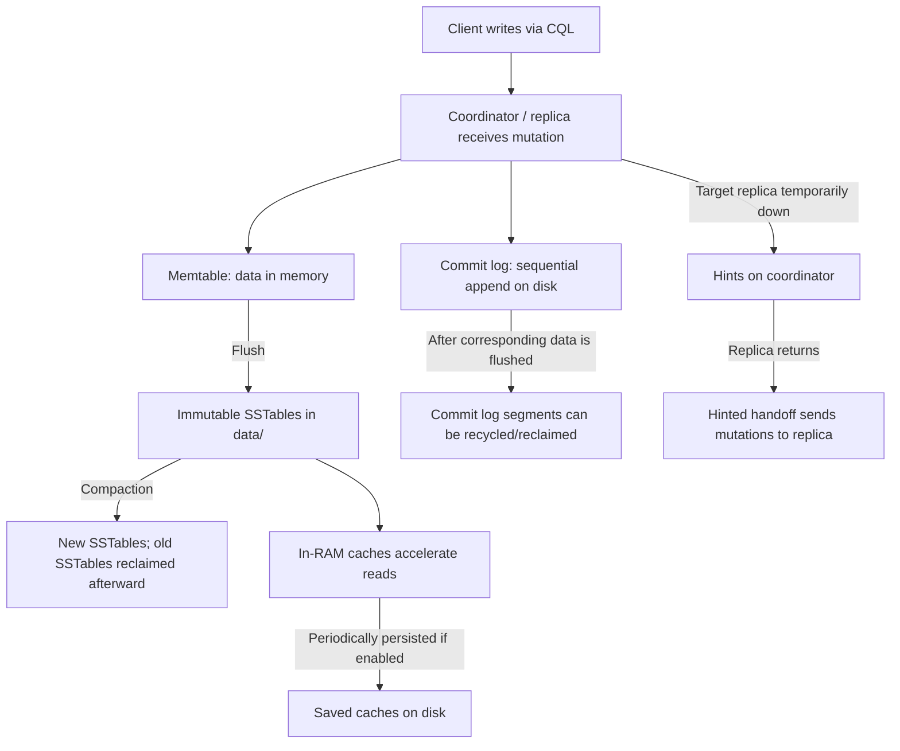

# Persistent Volumes, Data Directories, Commit Log, Hints, and Saved Caches

## 1. Why Understand the Storage Directories?

Apache Cassandra is a **distributed wide-column** database optimized for writes via **commit log + memtable + SSTables**. When a node restarts, Cassandra must locate its stored data and node identity metadata. When a replica is unavailable, other nodes can hold **hints** to replay mutations later. On startup, Cassandra can read **saved caches** to avoid warming caches from scratch.

These are **distinct** mechanisms, even though their directories typically reside under the same base path. In Docker labs, mounting a volume incorrectly can wipe data upon container recreation; sharing a data directory between two nodes risks corrupting data and cluster identity.

After this lesson, you will be able to:

1. Distinguish **SSTable data**, **commit log**, **hints**, and **saved caches** by purpose, lifecycle, and impact of loss.
2. Read `data_file_directories`, `commitlog_directory`, `hints_directory`, and `saved_caches_directory` in `cassandra.yaml`.
3. Create a **Docker named volume** for Cassandra 5.0, write CQL, observe SSTables after `flush`, and remove/recreate the container while still reading the data.
4. Explain when commit logs are replayed or reclaimed, why hints **do not replace repair**, and when saved caches may be empty.
5. Optionally observe hinted handoff on a **three-node cluster** if your machine has enough resources.
6. Distinguish **persistent volumes, replicas, snapshots, and backups**, and identify signs of full disks or bad permissions along with safe remediation.

> **Scope:** a learning environment without critical data. The main example uses one Cassandra node in Docker; the hints section includes a separate multi-node lab. Never apply cleanup, volume recovery, or fault-injection steps to a system serving live users.

## 2. How the Write Path Maps to Storage Directories



All of these components relate to storage, but only **SSTables along with Cassandra's required components/metadata** represent flushed data storage. The commit log protects unflushed mutations. Hints exist because **another replica** missed a mutation. Saved caches are **performance-acceleration data** that can be rebuilt from authoritative storage.

| Typical Directory in Cassandra Image | Setting in `cassandra.yaml` | What It Stores | Meaning on Startup or Failure |
|---|---|---|---|
| `/var/lib/cassandra/data` | `data_file_directories` | SSTables, keyspace/table data, SSTable components; may contain `snapshots/` and `backups/` inside table dirs | Flushed data and metadata needed by the node; **must keep** |
| `/var/lib/cassandra/commitlog` | `commitlog_directory` | Commit log segments for mutations on the **current node** | Replayed on recovery after a crash; **never delete manually** |
| `/var/lib/cassandra/hints` | `hints_directory` | Buffered mutations awaiting delivery to **another replica** that was absent | Supports hinted handoff when replica returns; **best effort** only |
| `/var/lib/cassandra/saved_caches` | `saved_caches_directory` | Saved cache state reloadable at startup | Enables warm startup; **not an authoritative data source** |

**These paths reflect the standard layout in the Cassandra Official Docker Image.** With tarballs or Linux OS packages, actual paths may differ. Configuration docs also reference defaults under `$CASSANDRA_HOME/data/...`; in images/packages, `/var/lib/cassandra/...` is typical. Always inspect the **live configuration and actual filesystem**, never assume from directory names in a guide.

Beyond these four main directories, a node may have `cdc_raw` when Change Data Capture is enabled, snapshots/backups inside table directories, system logs, and config files. These have separate lifecycles; a volume covering `/var/lib/cassandra` **does not mean** logs or configuration stored outside that path are preserved.

## 3. Why Does Cassandra Need Persistent Volumes?

### 3.1. Container Writable Layer vs. Named Volumes

A container has a writable filesystem layer. Once a container is deleted, that writable layer is no longer a reliable place for application state. A Docker **named volume** is storage managed by Docker and mounted at a path inside the container; its lifecycle is **independent of the container**.

```text
Linux host / Docker Desktop Linux VM
  └── Docker named volume: cassandra_pe006_data
       └── Mounted into container at /var/lib/cassandra
             ├── data/
             ├── commitlog/
             ├── hints/
             └── saved_caches/

docker rm CONTAINER     → container deleted; named volume remains
docker volume rm VOLUME → deletes volume and data inside it (if removable)
```

| Storage Option | Survives Container Restart? | Survives `docker rm`? | Notes |
|---|---|---|---|
| Container writable layer | Yes, while same container exists | **No** | Never rely on this layer to persist Cassandra data |
| **Docker named volume** mounted at `/var/lib/cassandra` | Yes | **Yes**, unless the volume itself is deleted | Suitable for labs that recreate containers |
| Bind mount to host directory | Yes | Yes, as long as host data stays intact | Must verify permissions and filesystem semantics, especially on Windows/macOS |
| Volume on the same Docker host | Yes, while host/disk remain healthy | Yes | **Does not protect** against physical disk failure, host loss, or volume deletion |

If you mount only `/var/lib/cassandra/data`, then `commitlog`, `hints`, and `saved_caches` default to residing **outside the mount** and can be lost when recreating the container. That is not a complete layout for a stateful node. For labs, **mounting the entire `/var/lib/cassandra`** is the simplest way to cover all four areas.

For multi-node clusters, **every node must have its own volume**. Two Cassandra containers writing to the same volume is invalid: they can collide on system tables, commitlog, SSTables, and node identity. Replication happens via **Cassandra over the network**, not by having multiple nodes read/write a shared directory.

### 3.2. A Named Volume Is Not a Backup

A volume only keeps data on its current storage device. If you delete the volume, the host loses its disk, or data is deleted via CQL, the volume may not save you. **Replicas** improve node fault tolerance, yet also replicate accidental deletes/updates. Cassandra **snapshots** rely on SSTables and normally live inside the data directory; a snapshot on the same disk can still be lost with that disk.

For important data, you need **consistent backups stored independently of the source, tested for restore**, and a restore procedure matched to actual version and topology. Never raw-copy a data directory while Cassandra is actively writing and treat it as a consistent backup.

## 4. Reading and Managing Paths in cassandra.yaml

An example **illustrating configuration keys**, not a complete `cassandra.yaml`:

```yaml
data_file_directories:
  - /var/lib/cassandra/data

commitlog_directory: /var/lib/cassandra/commitlog
hints_directory: /var/lib/cassandra/hints
saved_caches_directory: /var/lib/cassandra/saved_caches
```

Explanation:

- `data_file_directories` takes a **list** of paths. Cassandra places SSTables according to token range layout and manages data/tombstones inside those paths. Never split SSTables of **one table** manually by moving files to another directory.
- `commitlog_directory` is a **single path** storing commit logs, requiring steady sequential write throughput and predictable latency. On systems with multiple physical disks, consider separating commitlog from SSTables to reduce I/O contention.
- `hints_directory` stores hints held by **this node for other nodes**. When no replica is down, this directory may be empty.
- `saved_caches_directory` holds persisted caches if cache saving is configured and has run. Seeing no files here **does not automatically mean** Cassandra is broken.

**Be careful when editing configuration:** distinguish default paths, effective paths, and commented-out options. Moving `data_file_directories` or the commit log to another drive on a node that already holds data requires a controlled data-migration, filesystem-permission, snapshot/backup, and restart procedure. Merely pointing YAML at an empty folder can cause Cassandra to miss existing data.

On package-based Linux installs, the config file is typically `/etc/cassandra/cassandra.yaml`; on tarballs, `conf/cassandra.yaml` under the install folder. This lesson uses the Docker Official Image and its image configuration layout. In production, verify the exact paths and options for your **specific Cassandra version** before making changes.

## 5. Main Lab: Single Docker Node and Persistent Volume

### 5.1. Preparation

This example pins `cassandra:5.0.9` so every command shares the same version baseline. You need Docker Engine/Desktop running Linux containers, host port `9246` free, sufficient CPU/SSD, and enough RAM; for labs, **~8 GiB total RAM or more** with ~4 GiB allocated to the container is recommended. This is a reference guideline, not a production minimum.

Run **on the host with Docker CLI**; commands are single-line so they work in both Bash and PowerShell:

```bash
docker version
docker pull cassandra:5.0.9
docker volume create cassandra_pe006_data
docker volume inspect cassandra_pe006_data
```

If Docker reports the volume already exists, **verify its origin and contents** before reusing it. This lesson assumes a brand-new lab volume with no data from another cluster.

### 5.2. Starting the Node with One Mount Covering All Data

```bash
docker run -d --name cassandra-pe006 --memory=4g --memory-swap=4g -e MAX_HEAP_SIZE=2G -e CASSANDRA_CLUSTER_NAME=pe006-lab -e CASSANDRA_ENDPOINT_SNITCH=GossipingPropertyFileSnitch -e CASSANDRA_DC=dc1 -e CASSANDRA_RACK=rack1 -p 127.0.0.1:9246:9042 -v cassandra_pe006_data:/var/lib/cassandra cassandra:5.0.9
```

In this example:

| Option | Effect |
|---|---|
| `--name cassandra-pe006` | Container name used in subsequent commands |
| `--memory=4g`, `MAX_HEAP_SIZE=2G` | Caps RAM and heap for personal-machine testing; leaves room for off-heap/page cache |
| `--memory-swap=4g` | Prevents the container from using extra swap beyond the set memory limit |
| `CASSANDRA_CLUSTER_NAME=pe006-lab` | Single-node lab cluster name |
| `CASSANDRA_DC=dc1`, `CASSANDRA_RACK=rack1` | Topology used with the configured snitch |
| `-p 127.0.0.1:9246:9042` | Container CQL on 9042; clients **on the host** connect to 9246 |
| `-v cassandra_pe006_data:/var/lib/cassandra` | Mounts persistent named volume for **data, commitlog, hints, and saved caches** |

There is no need to publish port 7199/JMX or gossip ports to the host in a single-node lab. If a Java app runs on the host, its contact point is `127.0.0.1:9246` and local datacenter is `dc1`. If the Java app runs **in another container**, localhost inside the app container is not Cassandra; configure a Docker network and reachable broadcast endpoints instead.

### 5.3. Waiting for Cassandra Readiness

```bash
docker ps -a --filter name=cassandra-pe006
docker logs --tail 100 cassandra-pe006
docker exec cassandra-pe006 nodetool status
docker exec cassandra-pe006 nodetool statusbinary
docker exec cassandra-pe006 cqlsh -e "SELECT release_version, cluster_name, data_center FROM system.local;"
```

Wait until `nodetool status` shows one **`UN`** (*Up/Normal*) row, `statusbinary` returns `running`, and `cqlsh` executes queries cleanly. `docker run -d` or `docker ps` showing `Up` **does not prove** Cassandra has opened native transport.

If `nodetool` says JMX is unreachable or `cqlsh` reports connection refused right after startup, inspect logs, process state, and resources, then retry once the service is ready.

### 5.4. Inspecting the Mount and the Four Actual Directories

```bash
docker inspect --format "{{range .Mounts}}{{.Name}}:{{.Destination}}{{end}}" cassandra-pe006
docker volume inspect cassandra_pe006_data

docker exec cassandra-pe006 ls -la /var/lib/cassandra
docker exec cassandra-pe006 sh -c "df -h /var/lib/cassandra"
docker exec cassandra-pe006 sh -c "du -sh /var/lib/cassandra/data /var/lib/cassandra/commitlog"
```

Expected mount output includes `cassandra_pe006_data:/var/lib/cassandra`. `ls -la` reveals the directories Cassandra actually created. Depending on version and workload, `hints` or `saved_caches` may have no files yet; never create dummy files manually to "populate" those directories.

The host path reported by `docker volume inspect` typically resides in Docker Engine-managed storage. On Windows/macOS, Docker Desktop may store volumes **inside the Linux VM**, not as a directly accessible Windows/macOS path. Never hunt for and hand-edit SSTable files inside Docker storage.

### 5.5. Writing via CQL and Forcing a Flush to Observe SSTables

Run these commands from the host terminal:

```bash
docker exec cassandra-pe006 cqlsh -e "CREATE KEYSPACE IF NOT EXISTS pe006_lab WITH replication = {'class':'NetworkTopologyStrategy','dc1':1};"
docker exec cassandra-pe006 cqlsh -e "CREATE TABLE IF NOT EXISTS pe006_lab.events_by_device (device_id text, event_time timestamp, event_type text, PRIMARY KEY ((device_id), event_time)) WITH CLUSTERING ORDER BY (event_time DESC);"
docker exec cassandra-pe006 cqlsh -e "INSERT INTO pe006_lab.events_by_device (device_id, event_time, event_type) VALUES ('d-001', '2026-11-21T10:00:00Z', 'volume-created');"
docker exec cassandra-pe006 cqlsh -e "SELECT device_id, event_time, event_type FROM pe006_lab.events_by_device WHERE device_id='d-001';"
```

In this table, `device_id` is the **partition key** and `event_time` is the **clustering key**. Querying with `WHERE device_id=...` matches Cassandra's query-driven access pattern. RF=1 in `dc1` is suited for testing **one node**; it provides no replica redundancy or basis for interpreting `LOCAL_QUORUM` behavior under node loss.

Before flushing, part of the mutation may still sit in a memtable protected by the commit log. Run:

```bash
docker exec cassandra-pe006 nodetool flush pe006_lab events_by_device
docker exec cassandra-pe006 nodetool tablestats pe006_lab
docker exec cassandra-pe006 ls -la /var/lib/cassandra/data/pe006_lab
docker exec cassandra-pe006 sh -c "du -sh /var/lib/cassandra/data /var/lib/cassandra/commitlog"
```

Inside `data/pe006_lab` will be a table directory, typically named `events_by_device-<table-id>`, containing **SSTable components** such as `*-Data.db` and metadata/format-specific files. Cassandra 5.0 can use newer SSTable index formats, so **do not expect** every index file to share identical names across all versions.

**Flush is not equivalent to backup.** It writes memtable data to SSTables on this node. Commit log segments can be recycled or deleted **only when they no longer contain unflushed data for any table**; therefore, running `nodetool flush` on a single table does not guarantee an empty `commitlog` directory or an immediate drop in disk usage.

### 5.6. Deleting and Recreating the Container While Keeping the Volume

This is the core test for a **persistent volume**. Run only after confirming the SELECT in the previous step succeeded:

```bash
docker stop cassandra-pe006
docker rm cassandra-pe006
docker volume inspect cassandra_pe006_data
```

The volume still exists. Recreate the container using the **exact same image, cluster identity, and mount**:

```bash
docker run -d --name cassandra-pe006 --memory=4g --memory-swap=4g -e MAX_HEAP_SIZE=2G -e CASSANDRA_CLUSTER_NAME=pe006-lab -e CASSANDRA_ENDPOINT_SNITCH=GossipingPropertyFileSnitch -e CASSANDRA_DC=dc1 -e CASSANDRA_RACK=rack1 -p 127.0.0.1:9246:9042 -v cassandra_pe006_data:/var/lib/cassandra cassandra:5.0.9
```

Wait for the node to reach `UN` and serve CQL, then verify:

```bash
docker exec cassandra-pe006 nodetool status
docker exec cassandra-pe006 cqlsh -e "SELECT cluster_name, host_id FROM system.local;"
docker exec cassandra-pe006 cqlsh -e "SELECT device_id, event_type FROM pe006_lab.events_by_device WHERE device_id='d-001';"
```

Expect the `volume-created` record to still be present. Because the volume also holds system keyspaces, node identity such as `host_id` is typically preserved across clean restarts on the same node data. Docker container IDs/IPs may change; **never treat a container ID as the Cassandra host ID**. Never mount the same volume into a second running Cassandra container.

The experiment above performs a **graceful shutdown**; it primarily proves **the volume survives `docker rm`**, not power-loss resilience or strict per-mutation durability. Crash simulation and commit log evaluation require dedicated tests with an appropriate fsync policy.

## 6. Commit Log: Protecting Writes Before SSTables Exist

### 6.1. Role of the Commit Log

When a replica accepts a mutation, Cassandra writes it to the commit log and updates the memtable along the storage engine's write path. The commit log is a **per-node write-ahead log**, stored as sequentially written segments, used to recover **unflushed** changes if the process terminates abruptly.

```text
Write arrives at replica
    ├── Commit log (WAL): mutations not yet in SSTables are appended
    └── Memtable (RAM): active in-memory representation updated
           ↓ Upon flush
        SSTable (disk)
           ↓ Once all referenced mutations are flushed
        Commit log segments can be recycled/deleted

Crash before flush → on startup, Cassandra replays eligible commit log segments
```

**Do not confuse the commit log with:**

- **Application log / system.log**: records operational events, stack traces, and warnings; not a mutation log for data recovery.
- **Hints**: mutations held by a coordinator **for another replica** that was temporarily down; the commit log protects writes **for this node itself**.
- **CDC**: Change Data Capture exports changes per CDC design using its own directory/limits when enabled; do not assume the commit log is a general application event queue.
- **Backups**: the active commit log is an internal Cassandra crash-recovery mechanism; it does not replace snapshots, backup/restore, or independent storage.

### 6.2. Durability and fsync Policies

Relevant settings in Cassandra 5.0:

| Option | Effect |
|---|---|
| `commitlog_directory` | Disk/directory storing commit log segments |
| `commitlog_sync` | Policy for syncing logs to storage, e.g., `periodic` or `batch` |
| `commitlog_sync_period` | Sync interval when using `periodic`; verify actual defaults for your running version |
| `commitlog_segment_size` | Size limit per segment and constraints on mutation size |
| `commitlog_total_space` | Space limit/pressure triggering memtable flushes to reclaim segments |

With `commitlog_sync: periodic`, Cassandra may acknowledge a write before the segment is fsynced; sudden power loss can lose writes still in the unsynced window, depending on config and hardware. With `batch`, acknowledgments wait for commit log sync per batch policy at the cost of potential latency impact. **Never assume write success = immediate fsync** without verifying durability settings. In a multi-replica cluster, consistency level also determines **how many replicas acknowledge**, an orthogonal axis to each replica's fsync timing.

The commit log may retain many segments due to other unflushed tables, heavy write load, or slow compaction/I/O. Looking at `du -sh /var/lib/cassandra/commitlog` alone **is not enough** to diagnose a fault. Correlate logs, filesystem free space, `nodetool tpstats`, `nodetool tablestats`, and flush throughput.

### 6.3. Controlled Restart vs. Crash Recovery

- **Normal restart**: Cassandra gets a chance to flush/close resources cleanly. The volume must remain mounted so data and system metadata stay intact.
- **Abrupt stop**: on startup, Cassandra replays unflushed commit log segments based on data actually written/synced and intact on disk.
- **Loss of commitlog while unflushed mutations exist**: risks losing node writes. Never manually delete commitlog files to free space.
- **Loss of entire data directory**: the commitlog alone is not a complete backup of SSTables, schemas/metadata, and historical data.

For planned maintenance shutdowns, Cassandra documentation describes `nodetool drain` to flush memtables and stop accepting writes before process shutdown, though `drain` **is not a routine disk-cleanup command** and should not be run on live systems without a plan.

## 7. Hints: Temporary Data Queued for Absent Replicas

### 7.1. RF=3 Example with LOCAL_QUORUM

Suppose three replicas A, B, and C belong to one datacenter, the keyspace has **RF=3**, and writes use **LOCAL_QUORUM**. Replica C is temporarily down while A and B acknowledge. Quorum for three replicas is **2/3**, so the write succeeds. The coordinator may store a **hint for C** to deliver once C returns.

```text
Client -- LOCAL_QUORUM write --> Coordinator A
                                   ├── Replica A: accepts write
                                   ├── Replica B: accepts write → 2 acks met
                                   └── Replica C: temporarily down
                                           ↓
                             A stores hint for C in hints/
                                           ↓ C returns
                             Hinted handoff sends mutation to C
```

Key points:

- Hints **reside on the coordinator storing the hint**, **not necessarily on the down node**. To inspect pending hints, check nodes that may have acted as coordinator.
- Hints preserve the original mutation timestamp so delayed handoff does not overwrite a newer mutation.
- Hints are normally enabled by default, yet have **window limits** and creation/replay conditions; Cassandra 5.0 docs describe `max_hint_window` defaulting to roughly **3 hours**. Never treat hints as an unconditional guarantee to retain all writes.
- Hints are a **best-effort** mechanism that reduces replica divergence duration, yet **do not guarantee** eventual consistency if a node stays down too long, hints are lost, or handoff fails. **Anti-entropy repair** remains mandatory.
- In a **single-node, RF=1 lab**, when that sole node stops, no other coordinator/replica exists to accept writes and store hints. Having an empty `hints/` directory is normal.

### 7.2. Observing Hints in a Multi-Node Cluster — Extended Exercise

This section is **optional** and intended only for labs with sufficient resources. You need **three nodes in one cluster** (e.g., datacenter `dc1`), with independent volumes. Below is a compact Docker setup using **names/volumes separate from the single-node lab** in section 5.

Ensure the host has enough RAM/CPU/disk for three JVMs and the Docker VM (~**24 GiB RAM** is typically comfortable):

```bash
docker network create pe006-hints-net
docker volume create pe006_hint_n1
docker volume create pe006_hint_n2
docker volume create pe006_hint_n3

# Start node n1 first; wait for n1 to reach UN and cqlsh to respond.
docker run -d --name pe006-n1 --network pe006-hints-net --memory=4g --memory-swap=4g -e MAX_HEAP_SIZE=2G -e CASSANDRA_CLUSTER_NAME=pe006-hints -e CASSANDRA_ENDPOINT_SNITCH=GossipingPropertyFileSnitch -e CASSANDRA_DC=dc1 -e CASSANDRA_RACK=rack1 -v pe006_hint_n1:/var/lib/cassandra cassandra:5.0.9
docker exec pe006-n1 nodetool status

# Once n1 is UN, start n2; wait for both n1 and n2 to reach UN.
docker run -d --name pe006-n2 --network pe006-hints-net --memory=4g --memory-swap=4g -e MAX_HEAP_SIZE=2G -e CASSANDRA_CLUSTER_NAME=pe006-hints -e CASSANDRA_SEEDS=pe006-n1 -e CASSANDRA_ENDPOINT_SNITCH=GossipingPropertyFileSnitch -e CASSANDRA_DC=dc1 -e CASSANDRA_RACK=rack2 -v pe006_hint_n2:/var/lib/cassandra cassandra:5.0.9
docker exec pe006-n1 nodetool status

# Once n1 and n2 are UN, start n3; wait for all three to reach UN.
docker run -d --name pe006-n3 --network pe006-hints-net --memory=4g --memory-swap=4g -e MAX_HEAP_SIZE=2G -e CASSANDRA_CLUSTER_NAME=pe006-hints -e CASSANDRA_SEEDS=pe006-n1 -e CASSANDRA_ENDPOINT_SNITCH=GossipingPropertyFileSnitch -e CASSANDRA_DC=dc1 -e CASSANDRA_RACK=rack3 -v pe006_hint_n3:/var/lib/cassandra cassandra:5.0.9
docker exec pe006-n1 nodetool status
```

**Do not run all three `docker run` commands back-to-back before n1/n2 finish bootstrapping.** The comments above require pausing to verify readiness between steps. Once all three are `UN`, create the keyspace and table from n1:

```bash
docker exec pe006-n1 cqlsh -e "CREATE KEYSPACE IF NOT EXISTS pe006_hints WITH replication = {'class':'NetworkTopologyStrategy','dc1':3};"
docker exec pe006-n1 cqlsh -e "CREATE TABLE IF NOT EXISTS pe006_hints.device_state (device_id text PRIMARY KEY, state text);"
```

Now stop **n3 in the isolated lab**:

```bash
docker stop pe006-n3
docker exec pe006-n1 nodetool status
```

Wait for n1's failure detector to mark n3 as `DN` (*Down/Normal*). Open interactive `cqlsh` on n1:

```bash
docker exec -it pe006-n1 cqlsh
```

In `cqlsh`:

```sql
CONSISTENCY LOCAL_QUORUM;

INSERT INTO pe006_hints.device_state (device_id, state)
VALUES ('d-002', 'updated-while-n3-down');

SELECT device_id, state
FROM pe006_hints.device_state
WHERE device_id = 'd-002';
```

With A/B up and RF=3, quorum **2/3** succeeds. Exit `cqlsh` and inspect n1:

```bash
docker exec pe006-n1 nodetool listpendinghints
docker exec pe006-n1 nodetool statushandoff
docker exec pe006-n1 ls -la /var/lib/cassandra/hints
```

Note: a tiny write **may not immediately flush a visible hint file** because hints are buffered and flushed periodically; hints might also be stored on another coordinator if the request routed through a different node. Use `listpendinghints` and metrics/logs on the relevant node as evidence—**never treat a temporarily empty directory** as proof that hinted handoff does not work.

Restart n3 and wait for the cluster to recover:

```bash
docker start pe006-n3
docker exec pe006-n1 nodetool status
docker exec pe006-n1 nodetool listpendinghints
docker exec pe006-n3 cqlsh -e "SELECT device_id, state FROM pe006_hints.device_state WHERE device_id='d-002';"
```

Hint delivery happens **asynchronously**, so `listpendinghints` and n3's local data may not update immediately after `docker start`. Furthermore, a `SELECT` sent to n3 can have n3 act as **coordinator reading from other replicas**, so it **does not by itself prove n3's local SSTables received the hint**. For definitive verification, correlate metrics, hint delivery logs, and node-level diagnostics covered in dedicated repair/hinted-handoff lessons.

Finish this lab by stopping the three containers and removing **only the containers and network**, keeping volumes:

```bash
docker stop pe006-n3
docker stop pe006-n2
docker stop pe006-n1
docker rm pe006-n3 pe006-n2 pe006-n1
docker network rm pe006-hints-net
```

Do not run `nodetool truncatehints` to "clean up" while replicas still need recovery: that command discards queued mutations waiting to be delivered. In production, outages exceeding the hint window or involving data loss require proper **repair**.

## 8. Saved Caches: Accelerator Data, Not Authoritative Storage

### 8.1. Why Are Caches Saved?

Reading an SSTable can involve consulting metadata, indexes, and caches. Cassandra uses cache structures (such as **key cache**, **row cache** if enabled, and **counter cache** where applicable) to reduce disk seeks and speed up reads. Some caches can be persisted to `saved_caches_directory` per configuration and reloaded on startup.

Common misconception: saved caches are **not a complete business dataset**. The system must be able to query authoritative data from SSTables/memtables normally even when caches are cold. Clearing saved caches under a proper administrative procedure may slow initial startup/reads, yet is not a way to delete CQL rows.

| Concept | Role | Where to Observe |
|---|---|---|
| In-memory caches | Speed up Cassandra reads at runtime | `nodetool info`, cache metrics/stats |
| Saved caches | Periodically persisted caches reloaded at startup | `saved_caches_directory` |
| SSTables | Authoritative flushed data with format and metadata | `data_file_directories` |
| Commit log | Protects unflushed mutations on the node | `commitlog_directory` |

### 8.2. Observing in the Single-Node Lab

After reading data in section 5, run:

```bash
docker exec cassandra-pe006 nodetool info
docker exec cassandra-pe006 ls -la /var/lib/cassandra/saved_caches
```

`saved_caches` may be empty because the save interval hasn't elapsed, caches saw little use, or a specific cache is disabled. **Do not create fake cache files** or rely on cache presence to judge data recoverability. To measure cache effectiveness, run repeated read workloads with metrics under consistent benchmark conditions; never draw conclusions from a single SELECT.

## 9. Snapshots, Backups, and Disk Space

### 9.1. How Snapshots Differ from Persistent Volumes

Cassandra supports `nodetool snapshot` to take an SSTable snapshot, typically using **hard links** inside `snapshots/` beneath the table directory. This preserves references to a specific set of SSTables, yet a snapshot **initially still lives on the node's storage** and does not automatically copy data to an independent device.

In the single-node lab from section 5:

```bash
docker exec cassandra-pe006 nodetool snapshot -t pe006-baseline pe006_lab
docker exec cassandra-pe006 nodetool listsnapshots
docker exec cassandra-pe006 ls -la /var/lib/cassandra/data/pe006_lab
```

Once created, the table directory may contain `snapshots/pe006-baseline`. **Never manually delete or alter hard links inside snapshots** to reclaim space. Because multiple files can share inodes, `du` totals and summed snapshot sizes do not always equal actual incremental disk usage; use `df` to check remaining space and backup docs to understand semantics.

| Mechanism | Survives Container Removal? | Protects Against Whole-Disk Loss? | Purpose |
|---|---|---|---|
| Local named volume | Yes, if volume is not deleted | **No** | Preserves node state across container lifecycles |
| SSTable snapshot **on same volume** | Yes, while volume exists | **No** | Creates a point-in-time SSTable reference for backup/restore |
| Off-host backup with tested restore | Yes | **Potentially**, depending on location, policy, and backup integrity | Recovery from data loss or host failure |
| Replication across nodes on independent hosts/failure domains | Can keep serving when a node dies | Tolerates some node failures per RF/CL | Availability, fault tolerance, data distribution; **not a backup replacement** |
| Active commit log | Yes, while volume exists | No if same disk fails | Recovers unflushed mutations on the node |
| Hints | Yes, while coordinator volume exists | Not guaranteed | Replays some mutations temporarily missed by a replica |

### 9.2. Why Free Disk Space Must Be Reserved

- **Flushes** write new SSTables from memtables.
- **Compaction** writes new SSTables before reclaiming old ones; during rewrites, temporary space usage can exceed "live" data size.
- **Repair/streaming** can create or receive data and requires extra I/O and disk headroom.
- **Snapshots/backups** retain older SSTables that cannot be reclaimed immediately while new writes accumulate.
- **Commit log/hints** are separate regions that can grow under high write rates, downed replicas, or slow flushes.

To observe:

```bash
docker exec cassandra-pe006 sh -c "df -h /var/lib/cassandra"
docker exec cassandra-pe006 sh -c "du -sh /var/lib/cassandra/data /var/lib/cassandra/commitlog"
docker exec cassandra-pe006 nodetool compactionstats
docker exec cassandra-pe006 nodetool tablestats pe006_lab
docker system df
```

`df` inside the container reports the mounted filesystem; `du` totals directory usage; `docker system df` shows Docker Engine's storage breakdown. On Docker Desktop, the Docker VM/disk image also has its own ceiling; if the host shows gigabytes free while Cassandra hits `No space left on device`, inspect the **actual volume filesystem**, not just the host drive.

Never advise randomly deleting `*.db` files, commitlog segments, hints, or snapshots when disk fills up. Identify what is holding space (compaction, snapshots, hint backlog...), gather logs/metrics, then expand capacity or clean up via **approved Cassandra tools and procedures**.

## 10. Multi-Node or Production Storage Design

| Principle | Rationale |
|---|---|
| Each node has its own **data directory and commitlog** | Prevents duplicate host IDs and concurrent process corruption of SSTables/commitlog |
| Separate physical devices for data/SSTables and commitlog when feasible | Reduces I/O contention; merely splitting folders on one volume **does not** create two physical devices |
| Size capacity for RF and growth | RF=3 multiplies logical data across nodes, plus headroom for compaction/snapshots/repair |
| Monitor disk usage, latency, and pending compactions | Full disks or high I/O can stall flushes/compaction, causing timeouts or write failures |
| Monitor hints on coordinators and repair schedules | Hints are best effort; prolonged outages miss mutations unless repaired |
| Separate logs and backups from data paths where appropriate | Container logs, configs, snapshots, and named volumes have distinct lifecycles |
| Sync clocks across nodes and timestamp-supplying clients | Mutation timestamps drive last-write-wins, which persistent volumes do not fix |
| Record Cassandra/JDK versions, config, and network for restore/recreate | On-disk format, system metadata, cluster identity, and node addresses determine recoverability |

**Cassandra does not use a shared filesystem for concurrent multi-node reads/writes.** Adding nodes, replacing nodes, moving disks, or changing IPs must follow Cassandra's replication/streaming/node-replacement procedures. Never attempt replication by mounting the same NFS share or Docker volume into multiple Cassandra processes.

When configuring non-default paths, verify filesystem capabilities and user permissions for the Cassandra process. In containers, host bind mounts can face UID/GID/permission mismatches against directory owners; a volume with plenty of free space that is **unwritable** still fails startup/flushes. On Linux, `ls -ld` and logs may reveal `Permission denied`; never use `chmod -R 777` as a default fix for production data.

## 11. Common Errors and Troubleshooting

| Symptom | Possible Cause | Inspection and Remediation |
|---|---|---|
| Data disappears after container removal | No volume mounted, wrong mount path, or recreated with a new volume | Check `docker inspect ... .Mounts`, `docker volume inspect`; mount exact `/var/lib/cassandra` and reuse old volume |
| `cqlsh` fails to connect after recreate | Node still starting, wrong host port, JVM error, or data volume issue | Check `docker ps -a`, `docker logs`, `nodetool status`, `statusbinary`; wait for readiness |
| Node refuses to start after attaching old volume | Data dir belongs to another node/cluster, version mismatch, permissions, or config mismatch | Check `cluster_name`, version, logs, config, and ownership; never delete `system` tables manually |
| Two nodes read/write the same volume | Misconfigured storage sharing metadata/commitlog/SSTables | Stop affected containers, give each node an **independent volume**, and recover from valid data |
| `Permission denied` or `Read-only file system` | Bind mount ownership/permissions mismatch or read-only mount | Check `ls -ld`, container user permissions, and mount/host FS; fix using least-privilege permissions |
| Many commitlog files remain after `nodetool flush` | Segments still hold mutations for other tables, awaiting recycle, or flush incomplete | Check `nodetool tablestats` and flush queue/logs; never delete logs manually |
| Empty `hints/` in an RF=1 lab | No other replica was down for this node to hold hints for | Expected **normal** result; use a multi-node cluster to study hinted handoff |
| Hints persist long or grow rapidly | Target replica unavailable, throttled/slow handoff, network/IO errors | Check `nodetool listpendinghints`, `statushandoff`, logs, target status; schedule repair when needed |
| Replica returns yet data mismatches | Hints missing/expired past window, delivery incomplete, or replication errors | Check RF/CL, logs/metrics, repair schedule; never treat hints as a sync guarantee |
| `saved_caches/` is empty | Save interval not reached, caches disabled/lightly used | Check cache config and metrics; do not mistake for missing SSTables |
| Disk full despite modest table data | Snapshots/backups, uncompacted SSTables, commitlog, hints, or full VM disk | Check `df`/`du`, `listsnapshots`, `compactionstats`, Docker storage; address the actual consumer |
| Java Driver sees cluster but reads/writes behave unexpectedly | RF/CL, partition key, peer addresses, or client timestamps differ from expectations | Inspect schema/CQL and topology; persistent volumes **do not fix** query logic |
| Mounting a 5.0 data volume on an older image fails | Invalid downgrade or incompatible on-disk format | Follow official upgrade/rollback guides and tested backups; never change tags arbitrarily |

**Diagnostic sequence:** identify exact node/volume → container and logs → permissions/disk → `nodetool status` and CQL → inspect data/commitlog/hints/caches → verify RF/CL/repair if clustered. `UN` alone does not prove volumes, write paths, hint delivery, and compaction are all healthy.

## 12. Verification Record and Review Questions

### 12.1. Lab Evidence Record

| Item to Record | Evidence |
|---|---|
| Docker image | `cassandra:5.0.9` and `nodetool version` output |
| Container | `cassandra-pe006`, startup time, `UN` status |
| Volume / mount | `cassandra_pe006_data` mounted at `/var/lib/cassandra` |
| Directories | Presence/contents of `data`, `commitlog`, `hints`, `saved_caches` |
| CQL | Row `device_id='d-001'` with event `volume-created` |
| Flush | `nodetool flush` succeeded, table directory/SSTables appeared |
| Recreate | Removed container, preserved volume, recreated with identical config, and read row back |
| Hints (if extended lab run) | RF/CL state, DN/UN node states, `listpendinghints`, handoff logs |
| Backup | Presence/absence of snapshots and off-host storage policy |
| Disk space | `df -h /var/lib/cassandra` and compaction metrics |

### 12.2. Self-Check

1. Why is mounting only `/var/lib/cassandra/data` insufficient to preserve the commit log and hints across container recreation?
2. A mutation is in a memtable but not yet flushed when the process crashes. Which structure does Cassandra use to recover it? How does `commitlog_sync` affect write loss risk during power loss?
3. After `nodetool flush pe006_lab events_by_device`, why is the `commitlog` directory not necessarily empty?
4. An RF=1 node is stopped. Does any other node store hints to replay to it? Why or why not?
5. With RF=3 and `LOCAL_QUORUM`, one replica is down and two remain healthy. Why can writes succeed? How do hints differ from repair?
6. Data in `saved_caches/` is lost after recreating a container, while SSTables remain intact. Does that automatically mean rows are lost?
7. Why does `docker volume inspect` confirming a volume exists still fail to prove you have a backup resilient to host failure?
8. A table is dropped via CQL and the drop replicates to all nodes. Can replication and persistent volumes replace an independent backup to restore the table?
9. What consequences can mounting one shared volume across three cluster nodes have on host IDs and commit logs? How must it be redesigned?
10. A node is nearly out of disk space, with just enough room for one more INSERT. Why might compaction or repair still fail later?

### 12.3. Ending the Single-Node Lab While Preserving Data

After capturing evidence, stop and remove the **container**:

```bash
docker stop cassandra-pe006
docker rm cassandra-pe006
docker volume inspect cassandra_pe006_data
```

These commands preserve the `cassandra_pe006_data` volume. To resume studying, re-run the `docker run` command in section 5.6 with the **same volume, version, and configuration**. Only delete the volume once you decide to discard all lab data and have confirmed nothing inside needs to be kept. Never run `docker volume prune` casually if detached lab volumes you want to keep still exist.

**Completion criteria:** learners accurately explain the role of all four directories, mount a volume covering `/var/lib/cassandra`, run CQL/flush, read records back after deleting and recreating the container, and distinguish commit log, hints, and saved caches from snapshots/backups. This provides the foundation for studying compaction, replication, consistency, repair, and storage fault handling in Apache Cassandra.

## 13. Official References

- [Apache Cassandra — Configuring Cassandra](https://cassandra.apache.org/doc/stable/cassandra/getting-started/configuring.html): options `data_file_directories`, `commitlog_directory`, `hints_directory`, `saved_caches_directory`.
- [Apache Cassandra — cassandra.yaml reference](https://cassandra.apache.org/doc/stable/cassandra/managing/configuration/cass_yaml_file.html): meanings, defaults, and storage/cache/commitlog options.
- [Apache Cassandra — Storage Engine](https://cassandra.apache.org/doc/stable/cassandra/architecture/storage-engine.html): commit log, memtables, SSTables, flush, and replay.
- [Apache Cassandra — Hints](https://cassandra.apache.org/doc/stable/cassandra/managing/operating/hints.html): hinted handoff, time windows, configuration, and metrics.
- [Apache Cassandra — nodetool listpendinghints](https://cassandra.apache.org/doc/stable/cassandra/managing/tools/nodetool/listpendinghints.html): viewing pending hints on a node.
- [Apache Cassandra — Compaction overview](https://cassandra.apache.org/doc/stable/cassandra/managing/operating/compaction/overview.html): immutable SSTables and I/O/disk headroom requirements.
- [Apache Cassandra — Backups](https://cassandra.apache.org/doc/stable/cassandra/managing/operating/backups.html): snapshots, incremental backups, and table directory layout.
- [Docker Docs — Volumes](https://docs.docker.com/engine/storage/volumes/): named volume lifecycle and mounts.
- [Docker Hub — Official Cassandra image](https://hub.docker.com/_/cassandra): image, environment settings, and volumes for Cassandra.
