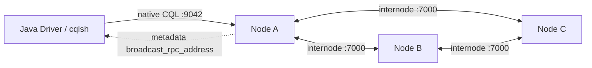

# Basic Configuration in cassandra.yaml and Related Files

## 1. Objectives and Context

Apache Cassandra is a **distributed wide-column** database. Every node needs to know which **cluster** it belongs to, how to find other nodes, which addresses to use for internode communication and CQL queries, how to determine datacenter/rack, where to store SSTables/commit logs, and how to run the JVM and emit logs. Most **server** settings reside in `cassandra.yaml`; other critical settings live in `.properties` files, JVM options files, or `logback.xml`.

Configuring these files properly is the foundation for learning **partition keys, query-driven table design, replication, consistency levels, compaction, repair, failure handling, and Java connectivity**. If misconfigured, a node may still run yet fail to communicate with peers or clients; modifying identity properties after storing data can have consequences worse than failing to boot.

After this lesson, you will be able to:

1. Identify the locations and responsibilities of `cassandra.yaml`, `cassandra-rackdc.properties`, `cassandra-env.sh`, `jvm-*.options` files, `logback.xml`, and related helper files.
2. Explain configuration groups: cluster/seed/token identity; addresses and ports; topology; storage/durability; security; and performance.
3. Recognize how **server configuration** differs from keyspace/table schema design and **CQL request consistency levels**.
4. Stand up a Cassandra 5.0 node with the Docker Official Image, inspect configuration applied by the entrypoint, and verify using `nodetool` and `cqlsh`.
5. Follow a safe Linux/VM configuration workflow: back up originals, edit the right file, perform a controlled restart, check readiness, and roll back when needed.
6. Troubleshoot common errors involving YAML, seeds, networking, datacenter, JDK, directory permissions, and inactive configuration changes.

> **Lab scope:** a fresh Cassandra node with no real data. The reference server image is `cassandra:5.0.9` to pin an exact version in the lab. Multi-node examples below illustrate configuration design only; they do not automatically turn a single-machine node into a production cluster.

## 2. Map of Configuration Files

### 2.1. Where Are the Files Located?

| Install Method | Typical Config Directory | Typical Data / Log Location |
|---|---|---|
| **Docker Official Image** | `/etc/cassandra` inside container | `/var/lib/cassandra` for data; logs also stream to `docker logs` |
| **DEB/RPM on Linux** | `/etc/cassandra` | `/var/lib/cassandra` and typically `/var/log/cassandra` |
| **Tarball** | `conf/` inside extracted Cassandra directory | `data/`, `logs/`, or configured paths |
| **Linux VM** | Follows the install method **inside the guest** (package/tarball) | On the **guest** filesystem, not default host folders |

Paths may differ if an image/package was customized or startup environment variables override locations. Therefore, table paths are **typical locations**—always verify against your actual installation.

### 2.2. What Is Each File Responsible For?

| File | Responsibility | Do Not Confuse With |
|---|---|---|
| **`cassandra.yaml`** | Primary node config: cluster, seeds, tokens, network, storage, security, limits, and operational tuning | CQL keyspace/table DDL or Java driver parameters |
| **`cassandra-rackdc.properties`** | Datacenter and rack of the **current node** when using `GossipingPropertyFileSnitch` | A list of all nodes in the cluster |
| **`cassandra-env.sh`** | Dynamically computed environment/JVM settings and startup flags as needed | Where replication factor is defined |
| **`jvm-server.options` and JDK-specific `jvm*-server.options`** | Static JVM arguments, heap/GC, and Java parameters for the **server** | JDK or JVM flags of the Java client application |
| **`jvm-clients.options` and JDK-specific variants** | JVM options for JVM-based client tools like `nodetool` | Server JVM settings |
| **`logback.xml`** | Cassandra log levels, appenders, and rotation | Mutation contents of the commit log |
| **`commitlog_archiving.properties`** | Commit log archiving/replay options for advanced archiving/restore workflows | Complete automated backups |
| **`cassandra-topology.properties`** | Topology mapping when using `PropertyFileSnitch` and certain compatibility cases | Default config for all snitch types |
| **`~/.cassandra/cqlshrc`** (on cqlsh client host, if present) | **cqlsh client** options such as connection and display settings | Cassandra server configuration file |

Not every installation includes all `jvm*-server.options` variants or uses all of these files. The right approach is to **list the files in your running installation and consult docs for that exact Cassandra/JDK branch**.

```text
                        Cassandra server
   cassandra.yaml ──── cluster, seeds, tokens, network, storage, security
          │
          ├── endpoint_snitch ──► cassandra-rackdc.properties (dc/rack)
          │
          ├── Java process ─────► jvm-*.options, cassandra-env.sh
          │
          ├── logging ──────────► logback.xml
          │
          └── data directories ─► data/, commitlog/, hints/, saved_caches/

   CQL keyspace/table ──────────► schema stored in cluster (not in YAML)
   Java Driver ────────────────► application config (contact points, local DC, CL)
```

## 3. Reading cassandra.yaml Properly

### 3.1. YAML Is Not a Shell Script

`cassandra.yaml` uses YAML syntax: top-level keys, scalar values, lists, and nested structures. Example:

```yaml
cluster_name: 'training-cassandra'

data_file_directories:
  - /var/lib/cassandra/data

seed_provider:
  - class_name: org.apache.cassandra.locator.SimpleSeedProvider
    parameters:
      - seeds: "10.70.1.11:7000,10.70.1.12:7000"
```

Common pitfalls:

- **Wrong indentation:** list items `- ...` must sit at the exact indentation under their parent key; use spaces, avoid tabs.
- **Duplicate keys:** parsers may handle duplicates differently; never define `cluster_name` twice assuming the last one always wins.
- **Improperly uncommenting `#`:** commented lines **have no configuration effect**. An example shown in comments does not mean the server uses it.
- **Values and units:** Cassandra 5.0 options for durations/sizes require explicit units such as `ms`, `MiB`, or `h`; check docs for **that exact option**, never guess from 4.x files.
- **Copying a file across versions:** config files across 4.1, 5.0, and newer releases may rename options or change units/semantics; never overwrite a 5.0 config with an unverified older file.
- **Sensitive parameters:** keystore paths, passwords/keys, and auth settings must be protected. Never commit plaintext real-environment secrets into repositories.

Cassandra 5.0 documentation ships two sample configs: **`cassandra.yaml`** (prioritizes backward-compatible behavior) and **`cassandra_latest.yaml`** (configured to leverage newer features). Never swap templates during a production upgrade without evaluating cluster-wide impact.

### 3.2. Server YAML Does Not Hold All Data Policies

| Concern | Correct Configuration Place | Why? |
|---|---|---|
| Cluster name, seeds, listen/rpc address | `cassandra.yaml` | Belongs to **node/cluster networking** |
| Datacenter and rack with GossipingPropertyFileSnitch | `cassandra-rackdc.properties` | **Node** topology used for replica placement |
| Replica count `RF` for a keyspace | CQL `CREATE/ALTER KEYSPACE ... WITH replication` | **Keyspace schema policy**, which can vary per keyspace |
| Table partition key, clustering key, compaction strategy | CQL `CREATE/ALTER TABLE` | Per-table data model and query design |
| Per-request consistency level | `CONSISTENCY` in cqlsh, or options in Java Driver / statement | Per-**request** response condition, not fixed server-wide in YAML |
| Java client contact points, local datacenter, timeouts | Java Driver configuration | **Application-side** settings |
| JVM heap/GC | `jvm-*.options`, `cassandra-env.sh`, or supported image env vars | Server JVM layer, separate from CQL data management |

For example, if a three-node cluster has a keyspace set to `RF=1`, every partition in that keyspace still has only one replica. There is no server-level `replication_factor: 3` key in `cassandra.yaml` that changes this.

## 4. Cluster Identity, Token, and Seed Configuration Group

| Key | Role | Rules in Lab / Cluster |
|---|---|---|
| `cluster_name` | Cluster identifier; prevents nodes from other clusters joining accidentally | All nodes in a cluster must match; choose before bootstrap |
| `partitioner` | Maps partition key to token for data distribution | Cassandra 5.0 defaults to `org.apache.cassandra.dht.Murmur3Partitioner`; **never change** on a cluster with existing data |
| `num_tokens` | Number of virtual tokens (vnodes) per node | Chosen during initial cluster design; do not change mid-flight to "rebalance" |
| `seed_provider` | Supplies **seed** addresses for peer discovery via gossip | Joining nodes must reach suitable seeds over the internode network |
| `endpoint_snitch` | Tells Cassandra datacenter/rack topology for routing and replica placement | Must match the environment and existing data |

Example **excerpt** for the first node in a new VM cluster (illustrative IPs only):

```yaml
cluster_name: 'training-cassandra'
num_tokens: 16
partitioner: org.apache.cassandra.dht.Murmur3Partitioner
endpoint_snitch: GossipingPropertyFileSnitch

seed_provider:
  - class_name: org.apache.cassandra.locator.SimpleSeedProvider
    parameters:
      - seeds: "10.70.1.11:7000,10.70.1.12:7000"
```

This is a **partial snippet**, not a complete `cassandra.yaml` to save verbatim, as many other options matter. The `10.70.1.x` addresses only apply if they actually belong to your VMs.

**Seeds are not leaders/masters:** seeds only help new nodes discover the cluster via gossip. Once joined, CQL requests can hit any node; the coordinator routes to replicas based on tokens and replication strategy. In multi-datacenter clusters, distribute seeds across appropriate failure domains. Sharing the same `cluster_name` without seed/peer connectivity will not automatically merge two independently bootstrapped rings.

**Tokens/partition keys:** Murmur3Partitioner hashes the **partition key** to determine owning nodes/replicas. Increasing `num_tokens` will not fix a table whose partition key funnels all traffic into one huge partition; that is a **data modeling** issue requiring redesign of partition keys, clustering, and query patterns.

## 5. Networking Group: Bind, Broadcast, Ports, and Topology

### 5.1. Distinguishing Server Listen Addresses from Advertised Addresses



| Key | Function | What to Avoid |
|---|---|---|
| `listen_address` | IP/interface **bound** for internode communication | **Never set `0.0.0.0`**; do not use localhost when nodes are on different machines |
| `broadcast_address` | IP **advertised to peers** for internode communication | Peers must route to it; if omitted, defaults to `listen_address` |
| `rpc_address` | IP/interface **bound for CQL native transport** | Can bind `0.0.0.0`, but must control firewall and `broadcast_rpc_address` |
| `broadcast_rpc_address` | Address advertised to drivers/clients via metadata | **Must not be `0.0.0.0`**; app must be able to connect |
| `storage_port` | Standard internode/gossip/streaming port | Default `7000/TCP`; nodes must communicate bidirectionally |
| `ssl_storage_port` | Legacy internode TLS port | Default `7001`, deprecated since 4.0; never expose to the public internet |
| `native_transport_port` | CQL native transport port | Default `9042/TCP`; open **only** to trusted applications |

**Bind** is the address where the Cassandra process listens. **Broadcast** is the address peers or drivers receive and attempt to connect to. Setting `rpc_address: 0.0.0.0` lets CQL listen on all interfaces, while requiring an explicit `broadcast_rpc_address`. An app may connect to an initial contact point yet still fail to use other nodes if metadata advertises an unroutable internal IP.

Example **specifically for a new VM** whose real IP is `10.70.1.11`:

```yaml
listen_address: 10.70.1.11
broadcast_address: 10.70.1.11
rpc_address: 0.0.0.0
broadcast_rpc_address: 10.70.1.11
storage_port: 7000
native_transport_port: 9042
```

Set `listen_address` and `rpc_address` to valid interfaces/IPs **of that VM**, and configure firewalls to permit only trusted clients. Never copy this example IP onto a VM lacking that interface. Communication properties must be designed before bootstrap; changing listen/broadcast addresses on a node with existing data requires a formal address/topology change procedure.

### 5.2. Datacenter and Rack Live in Related Files

In `cassandra.yaml`:

```yaml
endpoint_snitch: GossipingPropertyFileSnitch
```

In **`cassandra-rackdc.properties` on the node**:

```properties
dc=dc1
rack=rack1
prefer_local=true
```

With `GossipingPropertyFileSnitch`, `dc` and `rack` are gossiped by the node to guide replica placement and routing. Names are **case-sensitive**: `dc1` differs from `DC1`. In a single-node lab, `dc1/rack1` suffices; in real clusters, racks/DCs must mirror actual failure domains rather than arbitrary labels.

A second node can set `dc=dc1` and `rack=rack2` in **its own file**. Never copy the same data/node ID and volume to a new node. If using `PropertyFileSnitch`, topology uses a different mechanism via `cassandra-topology.properties`. Changing snitch or DC/rack after a cluster holds data affects replica placement and safety; plan a proper migration instead of editing and restarting nodes en masse.

### 5.3. Why Docker Can Make Networking Look Different

Inside a user-defined Docker network, containers reach each other via internal DNS. However, on Windows/macOS with Docker Desktop, IPs inside the Linux VM/bridge are usually not routable from the host. Publishing `127.0.0.1:9247:9042` lets a host app reach the 9247 contact point, yet **does not guarantee** the driver can reach all internal IPs Cassandra advertises via topology metadata.

Therefore, for multi-node study, place the Java app on the **same Docker network** or use VMs with routable IPs, and inspect `system.peers_v2`/broadcast addresses from where the app actually runs. Never use `listen_address: 0.0.0.0` to try to "fix" internode paths. Port **7199** is JMX for `nodetool` and should not be published for CQL apps.

## 6. Storage, Durability, and Operations Group

| Key | Purpose | Relevance to Practice |
|---|---|---|
| `data_file_directories` | List of SSTable / table data directories | Partition data and SSTables; needs persistent disk/volume |
| `commitlog_directory` | Stores commit log for the **current node** | Protects unflushed mutations and enables crash replay |
| `hints_directory` | Stores hints to replay to temporarily downed replicas | Hinted handoff; **does not replace repair** |
| `saved_caches_directory` | Persisted caches reloadable at startup | Not authoritative business data |
| `commitlog_sync` | Commit log sync mode such as `periodic` or `batch` | Affects latency and write durability window |
| `hinted_handoff_enabled`, `max_hint_window` | Enables/bounds hint retention | Multi-node replica failure labs; does not guarantee delivery of all writes |
| `concurrent_reads`, `concurrent_writes` | Concurrency limits for certain read/write pools | Tune only after measuring load and understanding CPU/I/O |
| Timeout and cache options | Control timeouts, memory, and caches | Avoid altering defaults merely to mask a bad data model or overload |

Excerpt of **typical paths in Docker/packages**:

```yaml
data_file_directories:
  - /var/lib/cassandra/data
commitlog_directory: /var/lib/cassandra/commitlog
hints_directory: /var/lib/cassandra/hints
saved_caches_directory: /var/lib/cassandra/saved_caches
```

This is an illustrative excerpt only. Do not assume these exact lines appear uncommented in every image's file; several options may be **commented out** while Cassandra applies equivalent defaults. In Docker, mounting a named volume to `/var/lib/cassandra` preserves data, commitlog, hints, and saved caches across container recreations.

Simplified write path:

```text
CQL write arrives at replica
    ├── commit log (write-ahead log) ──► replayed during recovery if needed
    └── memtable in RAM
             └── flush ──► SSTable in data/
                               └── compaction produces new SSTables
```

**Per-table compaction settings** belong in CQL `CREATE/ALTER TABLE ... WITH compaction = {...}`, not as a single global key in `cassandra.yaml`. YAML still contains resource/throttling parameters affecting background tasks. Similarly, **repair** is an operational anti-entropy task that does not happen automatically simply because hinted handoff is enabled.

Never change `data_file_directories` on a node with existing data expecting Cassandra to relocate SSTables automatically. Changing data directories, commitlog, storage backends, or mount layouts requires backups, proper file relocation/permission checks, and controlled restarts. **Never manually delete** SSTable or commitlog files to solve a full disk.

## 7. Security, JVM, and Logging

### 7.1. Basic Security Keys in cassandra.yaml

| Key / Group | Role | Required Outside the Lab |
|---|---|---|
| `authenticator` | Client authentication mechanism, e.g., `PasswordAuthenticator` | Manage accounts/roles/passwords and login setup in drivers/`cqlsh` |
| `authorizer` | Schema/data access control, e.g., `CassandraAuthorizer` | Enforce least-privilege permissions for applications |
| `role_manager` | Manages roles per configured auth mechanism | Safely maintain and back up roles |
| `client_encryption_options` | TLS for app ↔ Cassandra connections | Issue certificates/truststores, verify endpoints, configure Java Driver TLS |
| `server_encryption_options` | TLS for node ↔ node traffic | Deploy certificates systematically across all nodes |
| Firewalls / bind addresses | Restrict network exposure | Permit port 9042 only from trusted clients, 7000 between nodes, and internal JMX |

The CQL and Java examples below are strictly for a **single-node loopback lab**. Labs may leave auth/TLS disabled by default; that is **unsafe if ports are exposed on broader networks**. Never disable auth, bypass TLS, or hardcode production passwords in `cassandra.yaml` just to make a test connection succeed.

Enabling auth/TLS on a cluster already holding data requires a staged rollout covering admin roles, driver settings, and rollback plans, because missteps can lock out all clients. That is a dedicated security administration topic, not a prerequisite for a YAML inspection lab.

### 7.2. JVM: Using the Right Files for the Server

`jvm-server.options` and Java-version-specific variants hold **static** JVM flags. `cassandra-env.sh` computes and passes **dynamic** JVM options alongside startup environment variables. Cassandra 5.0 runs on JDKs supported by the 5.0 branch; always check the node's actual runtime rather than inferring from `java -version` on your laptop when Cassandra runs inside Docker.

For example, on the **host running the Java application**:

```bash
java -version
```

Whereas on the **Cassandra Docker node**:

```bash
docker exec cassandra-cfg007 java -version
```

Those are **two separate Java environments**. `MAX_HEAP_SIZE=2G` in the Docker lab is an image-supported startup mechanism for heap sizing; it is **not** a YAML property named `MAX_HEAP_SIZE`. Raising `-Xmx` does not increase the container's RAM cap and can starve off-heap memory and page cache.

### 7.3. logback.xml and Runtime Logging

`logback.xml` defines log levels and appenders, such as `system.log`, `debug.log`, stdout, and rotation. The Docker Official Image streams Cassandra output to `docker logs`; Linux package installs normally write `/var/log/cassandra/system.log`.

You can run `nodetool getlogginglevels` to inspect active log levels and `nodetool setlogginglevel` for a component/class to temporarily increase verbosity during an investigation. Runtime adjustments like this **do not permanently edit `logback.xml`** and typically reset upon restart.

Avoid leaving cluster-wide `TRACE` enabled for extended periods: logs can grow rapidly, consume disk/CPU, and obscure root errors. The commit log is a mutation WAL—**completely different** from `system.log`.

## 8. Hands-On: Creating a Node and Inspecting Effective Config Files

### 8.1. Preparation and Startup

Run on a host with Docker Engine or Docker Desktop using Linux containers. Ensure adequate hardware; labs run smoothly with ~**8 GiB total RAM or more**, sufficient RAM allocated to Docker, and free SSD space. Host port **9247** must be unused.

Pull the image and create a named volume (commands work in both Bash and PowerShell):

```bash
docker version
docker pull cassandra:5.0.9
docker volume create cassandra_cfg007_data
```

Start Cassandra:

```bash
docker run -d --name cassandra-cfg007 --memory=4g --memory-swap=4g -e MAX_HEAP_SIZE=2G -e CASSANDRA_CLUSTER_NAME=cfg007-lab -e CASSANDRA_ENDPOINT_SNITCH=GossipingPropertyFileSnitch -e CASSANDRA_DC=dc1 -e CASSANDRA_RACK=rack1 -p 127.0.0.1:9247:9042 -v cassandra_cfg007_data:/var/lib/cassandra cassandra:5.0.9
```

These `CASSANDRA_...` variables are the **Docker Official Image configuration interface**, not a feature where Cassandra automatically reads arbitrary environment variables named after YAML keys. The image entrypoint translates supported variables into the corresponding config files.

| Variable / Option in Command | Effect |
|---|---|
| `CASSANDRA_CLUSTER_NAME=cfg007-lab` | Sets `cluster_name` |
| `CASSANDRA_ENDPOINT_SNITCH=GossipingPropertyFileSnitch` | Selects topology resolution strategy |
| `CASSANDRA_DC=dc1`, `CASSANDRA_RACK=rack1` | Sets node datacenter/rack matching the snitch |
| `--memory=4g`, `MAX_HEAP_SIZE=2G` | Caps container memory and JVM heap while preserving room for off-heap/page cache |
| `-p 127.0.0.1:9247:9042` | Host clients use 9247; inside the container port remains 9042 |
| `-v cassandra_cfg007_data:/var/lib/cassandra` | Persists Cassandra data in a named volume |

In this lab there is no need to publish ports `7000` or `7199`; the node serves CQL only via host loopback. Never change `CASSANDRA_CLUSTER_NAME` when recreating a container against the **same data volume** previously initialized under another cluster name.

### 8.2. Waiting Until the Node Is Ready

```bash
docker ps -a --filter name=cassandra-cfg007
docker logs --tail 100 cassandra-cfg007
docker exec cassandra-cfg007 nodetool status
docker exec cassandra-cfg007 nodetool statusbinary
docker exec cassandra-cfg007 cqlsh -e "SELECT cluster_name, data_center, rack, release_version FROM system.local;"
```

Success criteria:

- `nodetool status` shows one `UN` (*Up/Normal*) node.
- `nodetool statusbinary` returns `running`.
- `system.local.cluster_name` is `cfg007-lab`; `data_center=dc1`, `rack=rack1`.
- `release_version` reflects the pinned 5.0.9 image.

**Container `Up` is not enough to conclude CQL is ready.** If early commands report JMX/CQL errors, read logs and retry once Cassandra finishes booting.

### 8.3. Reading Config After the Entrypoint Applies It

Run:

```bash
docker exec cassandra-cfg007 ls -la /etc/cassandra
docker exec cassandra-cfg007 cat /etc/cassandra/cassandra-rackdc.properties
docker exec cassandra-cfg007 sh -c "grep -E '^(cluster_name|endpoint_snitch|listen_address|broadcast_address|rpc_address|broadcast_rpc_address|native_transport_port|storage_port|commitlog_sync|commitlog_directory|hints_directory|saved_caches_directory):' /etc/cassandra/cassandra.yaml"
docker exec cassandra-cfg007 sh -c "grep -A 5 '^seed_provider:' /etc/cassandra/cassandra.yaml"
```

Compare output against this table:

| Item | Expected for Lab | How to Confirm |
|---|---|---|
| Cluster name | `cfg007-lab` | `cluster_name` line and `system.local.cluster_name` |
| Datacenter/rack | `dc1/rack1` | `cassandra-rackdc.properties` and `system.local` |
| Snitch | `GossipingPropertyFileSnitch` | `endpoint_snitch`, `nodetool describecluster` |
| Internode address | Container IP | `listen_address`/`broadcast_address` and `nodetool status` |
| CQL | `9042` inside container, `9247` on host | `native_transport_port`, `docker ps`, host connectivity test |
| Data | `/var/lib/cassandra` mounted | `docker volume inspect`, `docker exec ... df -h` |

**Note:** the `grep` above only prints **uncommented keys starting at column 1**. If an option does not appear, it likely means Cassandra is using the **running release's default**, not that the option does not exist. For nested blocks like `seed_provider`, read the surrounding YAML indentation rather than grepping a single line out of context.

Read live effective state from Cassandra tools:

```bash
docker exec cassandra-cfg007 nodetool describecluster
docker exec cassandra-cfg007 nodetool info
docker exec cassandra-cfg007 nodetool getlogginglevels
docker exec cassandra-cfg007 sh -c "df -h /var/lib/cassandra"
```

Key distinction: reading files **checks declarations**, while `system.local`/`nodetool` **observes live behavior**. Use both so you never assume a setting took effect merely because a file was edited.

### 8.4. CQL Experiment: Distinguishing YAML from Schema

Run in the host shell:

```bash
docker exec -it cassandra-cfg007 cqlsh
```

In `cqlsh`:

```sql
SELECT cluster_name, data_center, rack FROM system.local;

CREATE KEYSPACE IF NOT EXISTS cfg007_lab
WITH replication = {'class': 'NetworkTopologyStrategy', 'dc1': 1};

CREATE TABLE IF NOT EXISTS cfg007_lab.events_by_device (
    device_id text,
    event_time timestamp,
    event_type text,
    PRIMARY KEY ((device_id), event_time)
) WITH CLUSTERING ORDER BY (event_time DESC);

CONSISTENCY LOCAL_ONE;

INSERT INTO cfg007_lab.events_by_device
    (device_id, event_time, event_type)
VALUES ('device-007', '2026-11-21T12:00:00Z', 'configured');

SELECT device_id, event_time, event_type
FROM cfg007_lab.events_by_device
WHERE device_id = 'device-007';
```

Notice here:

- `NetworkTopologyStrategy` and `'dc1': 1` are **keyspace replication** settings, not stored in `cassandra.yaml`.
- `PRIMARY KEY ((device_id), event_time)` defines the table's **partition key** and clustering key for device-scoped queries.
- `CONSISTENCY LOCAL_ONE` is a **cqlsh client** command setting the consistency level for subsequent queries; the Java Driver has its own CL API.
- The lab has only one node and RF=1, so it provides **no node fault tolerance** and cannot verify `LOCAL_QUORUM` under replica loss.

Reading the `configured` row confirms the basic CQL path works. It does not prove compaction, repair, multi-node replication, or production availability meet requirements.

### 8.5. Checking Logs and Cleaning Up the Lab

```bash
docker logs --tail 100 cassandra-cfg007
docker exec cassandra-cfg007 nodetool getlogginglevels
docker exec cassandra-cfg007 sh -c "ls -la /var/lib/cassandra"
```

Finish while **keeping the volume**:

```bash
docker stop cassandra-cfg007
docker rm cassandra-cfg007
docker volume inspect cassandra_cfg007_data
```

`docker rm` deletes the container while preserving the named volume. When recreating the **same node and data**, use the **same image, cluster name, topology, and volume**; never attach a live volume to two Cassandra processes. Do not run `docker volume rm cassandra_cfg007_data` or `docker volume prune` while you still need lab data.

## 9. Configuration Editing Workflow on Linux/VM

In package-based environments, you normally edit `/etc/cassandra/cassandra.yaml` and related files directly on Linux. Safe workflow for a **new lab node**:

1. **Define the goal:** e.g., changing listener addresses before bootstrap, or adjusting log levels. Avoid editing unrelated option groups at once.
2. **Inspect active configuration:** verify exact path/package/version, cluster name, DC/rack, ports, Java runtime, disk space, and directory permissions.
3. **Back up current config files** for comparison and rollback; never overwrite or delete data.
4. **Edit one group of values**, preserving YAML structure/indentation; update `cassandra-rackdc.properties` if altering DC/rack for the active snitch.
5. **Plan the restart:** many options take effect only after restarting Cassandra. In production clusters, changes require a rolling plan and RF/CL verification—never restart the entire cluster simultaneously.
6. **Verify logs and readiness:** service running, node `UN`, native transport `running`, CQL metadata and app queries succeeding.
7. **Roll back cleanly** if broken. For identity or data-layout keys, restoring a YAML file alone **may not** undo changes that already altered data or topology.

Example commands on package-installed Debian/Ubuntu (run **inside Linux/VM**, not Windows PowerShell):

```bash
# Apply only if these are the active files used by the package.
sudo cp /etc/cassandra/cassandra.yaml /etc/cassandra/cassandra.yaml.before-lab
sudo cp /etc/cassandra/cassandra-rackdc.properties /etc/cassandra/cassandra-rackdc.properties.before-lab

# Edit using the OS editor; e.g., in a fresh lab:
sudoedit /etc/cassandra/cassandra.yaml
sudoedit /etc/cassandra/cassandra-rackdc.properties

# Restart within an appropriate maintenance window:
sudo systemctl restart cassandra
sudo systemctl status cassandra --no-pager
sudo journalctl -u cassandra -n 100 --no-pager

nodetool status
nodetool statusbinary
cqlsh -e "SELECT cluster_name, data_center, rack FROM system.local;"
```

If the node fails to start, inspect the **first parser/validation error in the logs**, cross-check the file and version, fix it, and retry. Never delete system keyspaces or data directories just to make a bad config "stop erroring." When rolling back a file, account for cluster/data state changed since the edit; on live nodes, never arbitrarily revert `cluster_name`, `partitioner`, tokens, or DC/rack.

**Docker Official Image:** editing `/etc/cassandra/cassandra.yaml` inside a running container does not persist once the container is deleted. Prefer versioned configuration via Compose/image-supported env vars or controlled images/configs; if mounting a custom config file, supply a **complete valid file matching the version**, proper write permissions for the entrypoint, and a controlled restart process.

## 10. Verifying Connectivity from Java

When Java Driver 4.x connects to Cassandra, the app must specify a matching **contact point** and **local datacenter**. For the Docker lab in section 8, the host contact point is `127.0.0.1:9247` and datacenter is `dc1`.

Java 17 example with `org.apache.cassandra:java-driver-core:4.19.4`:

```java
import java.net.InetSocketAddress;

import com.datastax.oss.driver.api.core.CqlSession;
import com.datastax.oss.driver.api.core.cql.Row;
import com.datastax.oss.driver.api.core.DefaultConsistencyLevel;
import com.datastax.oss.driver.api.core.cql.SimpleStatement;

public class CassandraConfigCheck {
    public static void main(String[] args) {
        try (CqlSession session = CqlSession.builder()
                .addContactPoint(new InetSocketAddress("127.0.0.1", 9247))
                .withLocalDatacenter("dc1")
                .build()) {

            Row local = session.execute(
                    "SELECT cluster_name, data_center FROM system.local").one();
            if (local == null) {
                throw new IllegalStateException("Unable to read system.local");
            }
            System.out.println(local.getString("cluster_name")
                    + " / " + local.getString("data_center"));

            SimpleStatement query = SimpleStatement.builder(
                    "SELECT event_type FROM cfg007_lab.events_by_device " +
                    "WHERE device_id = 'device-007'")
                    .setConsistencyLevel(DefaultConsistencyLevel.LOCAL_ONE)
                    .build();
            for (Row row : session.execute(query)) {
                System.out.println(row.getString("event_type"));
            }
        }
    }
}
```

This program illustrates the **client side**. CQL and per-statement consistency levels cannot be replaced by a setting in `cassandra.yaml`. When Java runs **in another container**, `127.0.0.1` refers to that Java container itself and will not reach Cassandra. If Java connects to one contact point yet discovers peers with unroutable internal IPs, fix cluster networking/broadcast RPC metadata and topology rather than raising timeouts indefinitely.

## 11. Troubleshooting Misconfigurations

| Symptom | Possible Cause | Verification and Remediation |
|---|---|---|
| Cassandra fails to start after YAML edit | Bad indentation, duplicate key, invalid option, wrong unit | Read `system.log`/`docker logs`, check version-specific syntax, roll back recent edit |
| Edited file yet server still uses old settings | Edited wrong path, option commented out, forgot restart, Docker entrypoint overwrote | Locate **active** file, run `docker exec cat/grep`, verify logs and CQL state |
| Node with different cluster name refuses to join | Mismatched `cluster_name`, wrong seed, or data from another ring | Compare configs, `system.local.cluster_name`, gossip logs; never rename a populated node to merge rings |
| `nodetool status` shows only one node in multi-node lab | Wrong seed, port 7000 blocked, unroutable broadcast IP, failed bootstrap | Check seed list, DNS/IP/ports, `nodetool netstats`, `docker logs` on every node |
| `cqlsh` works locally on node, external client fails | `rpc_address` bound to loopback, NAT/firewall, wrong port mapping | Check listeners, network path from **client host**, `broadcast_rpc_address` |
| Java Driver reports local DC mismatch | `cassandra-rackdc.properties` differs from `withLocalDatacenter` | Run `SELECT data_center FROM system.local;` and align app or topology properly |
| DC/rack differs from expectations | Wrong snitch, wrong file, case-sensitive typo | Check `endpoint_snitch`, `cassandra-rackdc.properties`, and `system.local` |
| `Permission denied` on data/commitlog | Volume/bind mount unwritable by Cassandra user | Check ownership/permissions, mounts, filesystem; never default to `chmod -R 777` |
| Heap/JVM differs from expectation | Configured JVM on host instead of inside Docker, wrong option/JDK, container limit | Check `docker exec java -version`, `nodetool info`, JVM flags, and memory limit |
| Enabling auth/TLS locks out clients | `cqlsh`/Java missing credentials/truststore or mismatched port/TLS settings | Check security logs, configure both sides, follow a staged security rollout |
| `nodetool status=UN` yet CQL fails | Native transport not running, auth/TLS or client routing error | Check `nodetool statusbinary`, `cqlsh` on node, then from app host |
| Query returns nothing or `ALLOW FILTERING` | Table/partition key does not fit the query | Review CQL schema; never tweak seeds or tokens to fix a bad data model |
| Slow writes/repair/compaction | CPU, I/O, disk, pending compactions, RF/CL, workload | Check `nodetool tpstats`, `compactionstats`, `df -h`, and metrics; tune only after measuring |
| Excessive logs filling disk | Overly broad `logback.xml`/runtime DEBUG/TRACE or missing rotation | Check logging levels and retention, reduce verbosity while preserving needed error evidence |

A configuration is considered **sufficiently verified for the lab** when all three layers match: **declared files → active process configuration → expected CQL behavior**. `UN` alone does not verify security, replication, durability, or repair settings.

## 12. Checklist and Self-Check Exercises

### 12.1. Configuration Record

| Category | Evidence to Record |
|---|---|
| Cassandra/JVM version | Image/package version, `nodetool version`, server `java -version` |
| Config source | Actual `cassandra.yaml` path, Docker env/package config mechanism |
| Cluster | `cluster_name`, `partitioner`, `num_tokens`, seed list |
| Network | `listen_address`, `broadcast_address`, `rpc_address`, `broadcast_rpc_address`, 7000/9042 |
| Topology | `endpoint_snitch`, `dc`, `rack`; `system.local.data_center` |
| Storage | `data_file_directories`, `commitlog_directory`, `hints_directory`, `saved_caches_directory` |
| JVM/logs | JVM options files, `cassandra-env.sh`, log paths and log levels |
| Security | Lab auth, authorization, TLS state; any changes documented |
| Readiness | `nodetool status=UN`, `statusbinary=running`, and `system.local` query |
| CQL/Java | Lab RF=1 keyspace, partition-key query, Java driver reading cluster/DC |
| Persistence | Properly mounted named volume, CQL data intact across normal restart |

### 12.2. Practice Questions

1. Why does editing `cluster_name` to match another cluster fail to merge two separate rings?
2. A VM has IP `10.70.1.11`. Why is `listen_address: 0.0.0.0` invalid, while `rpc_address: 0.0.0.0` is usable under what condition?
3. `cqlsh` inside the container reads `system.local`, yet Java on the host fails to reach peers after hitting the contact point. Which property explains the address the driver receives in metadata?
4. With `GossipingPropertyFileSnitch`, which file defines `dc`/`rack`? What happens if the Java app specifies the local datacenter with mismatched casing?
5. Why are keyspace RF and per-query CL **not** configured solely in `cassandra.yaml`? Give valid CQL/cqlsh examples.
6. A developer sets `MAX_HEAP_SIZE` to 6 GiB while the Docker container is capped at 4 GiB. What can happen, and which resources should be inspected?
7. Why is changing `data_file_directories` to point to an empty folder not a Cassandra data-migration procedure?
8. After changing a log level via `nodetool`, what must you do if you want that setting to survive a restart? Which file is involved?
9. A YAML config has no uncommented `commitlog_directory` line. Can you conclude Cassandra disables the commit log? Show how to verify the default for that version.
10. In a single-node lab, `status=UN` and `LOCAL_ONE` succeed. Does that verify repair and two-node fault tolerance?

**Completion criteria:** learners distinguish each configuration file, launch a new Cassandra node with explicit cluster name/DC/rack, inspect live metadata and configuration, run CQL and Java connectivity checks, and follow a verifiable/recoverable config-editing workflow. This builds the foundation for replication, consistency levels, compaction, repair, and cluster operations.

## 13. Official References

- [Apache Cassandra — Configuring Cassandra](https://cassandra.apache.org/doc/stable/cassandra/getting-started/configuring.html): file locations by install method, logging, directories.
- [Apache Cassandra 5.0 — cassandra.yaml reference](https://cassandra.apache.org/doc/latest/cassandra/managing/configuration/cass_yaml_file.html): cluster, seed, token, network, storage, and security keys.
- [Apache Cassandra — cassandra-rackdc.properties](https://cassandra.apache.org/doc/latest/cassandra/managing/configuration/cass_rackdc_file.html): `dc`, `rack`, `prefer_local`, and snitches.
- [Apache Cassandra — cassandra-env.sh](https://cassandra.apache.org/doc/latest/cassandra/managing/configuration/cass_env_sh_file.html): dynamic JVM flags and system properties.
- [Apache Cassandra — jvm-* files](https://cassandra.apache.org/doc/latest/cassandra/managing/configuration/cass_jvm_options_file.html): static server/client JVM options.
- [Apache Cassandra — logback.xml](https://cassandra.apache.org/doc/latest/cassandra/managing/configuration/cass_logback_xml_file.html): log levels and appenders.
- [Apache Cassandra — setlogginglevel](https://cassandra.apache.org/doc/latest/cassandra/managing/tools/nodetool/setlogginglevel.html): adjusting logging during investigations.
- [Apache Cassandra — Security](https://cassandra.apache.org/doc/stable/cassandra/managing/operating/security.html): authentication, authorization, and TLS.
- [Docker Hub — Cassandra Official Image](https://hub.docker.com/_/cassandra): image-supported configuration environment variables.
- [Apache Cassandra Java Driver](https://github.com/apache/cassandra-java-driver): contact points, local datacenter, and client-side consistency levels.
