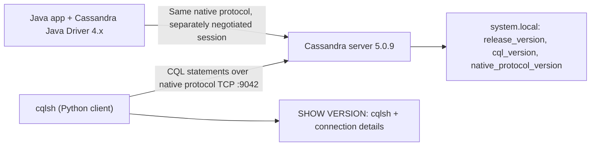

# Connecting with cqlsh and Identifying Server/CQL/Protocol Versions

## 1. Objectives and Role of cqlsh

Apache Cassandra is a **distributed wide-column** database management system. To practice **partition keys, query-driven table design, replication, consistency levels, compaction, repair, failure handling, and Java connectivity**, you first need a direct, inspectable way to communicate with the Cassandra server. The **`cqlsh`** (*CQL shell*) CLI exists for this purpose.

`cqlsh` ships alongside Cassandra; it uses a **Python driver and the native CQL protocol** to connect to a target node. Inside the shell, learners can execute CQL statements, query metadata, change session consistency levels, and inspect results. It also provides **shell-specific commands** such as `SHOW VERSION`, `SHOW HOST`, and `DESCRIBE`, which are not standard CQL statements understood by every driver.

After this lesson, you will be able to:

1. Connect `cqlsh` to Cassandra running in Docker, on Linux/VMs, or over permitted network endpoints.
2. Distinguish four values: **cqlsh version**, **Cassandra server version**, **CQL spec version**, and **native protocol version**.
3. Use `SHOW VERSION`, `SHOW HOST`, `system.local`, and `nodetool` to verify server versions and connection details.
4. Run a smoke test creating a keyspace/table, writing and reading by **partition key**, and tell environment errors apart from CQL errors.
5. Use connection flags, timeouts, auth/TLS options, and controlled one-shot or script-file execution.
6. Explain how `cqlsh` differs from the **Apache Cassandra Java Driver**, especially when an application discovers multiple nodes.

> **Environment:** the primary example uses `cassandra:5.0.9` with a single node for learning purposes. This version is pinned for consistent commands, not a claim that it is always the latest release. A single node with RF=1 **cannot** test replica fault tolerance, multi-node cluster quorum, or cross-node repair.

## 2. Distinguishing Four Version Axes

When launching `cqlsh`, you see a banner line containing four values. **They represent four distinct version axes**.

| Displayed Field | Target | How to Verify | Common Confusion |
|---|---|---|---|
| **`cqlsh x.y`** | Shell/CLI client binary version | `cqlsh --version`; `SHOW VERSION` once connected | Cassandra server version; can differ if `cqlsh` is installed separately |
| **`Cassandra a.b.c`** | Server version of the **queried node** | `SHOW VERSION`; `SELECT release_version FROM system.local`; `nodetool version` | Driver version or version of the entire cluster |
| **`CQL spec x.y.z`** | CQL language/specification version reported in connection context | `SHOW VERSION`; compare with `system.local.cql_version` | Cassandra patch number or native protocol version |
| **`Native protocol vN`** | Binary wire protocol version used for client/server frames or advertised by server | `SHOW VERSION`; `system.local.native_protocol_version`; check driver negotiation when needed | Java Driver 4.x library version or TCP port 9042 |

**Format illustration** (`x.y.z` and `N` are placeholders; capture actual numbers from your machine):

```text
Connected to cfg008-lab at 127.0.0.1:9042.
[cqlsh x.y | Cassandra 5.0.9 | CQL spec x.y.z | Native protocol vN]
Use HELP for help.
cqlsh>
```

**Note on protocol:** `native_protocol_version` in `system.local` reflects the version advertised by the server. When connecting a client and server of different generations, the **actually negotiated** protocol version depends on client capabilities/negotiation. Never assume from one metadata column that **every Java Driver** uses that exact protocol version; for deep diagnostics, consult driver documentation, logs/metrics, and handshake behavior.

### 2.1. Four-Layer Diagram



- **CQL** is the query language understood by Cassandra; partition and clustering key choices directly determine whether a `SELECT` is valid and efficient.
- **Native protocol** defines how requests, responses, errors, metadata, and frames travel over TCP. It is not SQL/JDBC.
- **Java Driver 4.x** is the **Java API library version**, not "native protocol v4". A single driver release can support multiple protocol versions as documented by the driver.
- **9042** is the **default port** for native transport, not "protocol version 9042". Port **7000** normally handles internode traffic; **7199** normally handles JMX/`nodetool`.

### 2.2. Compatibility Limits of cqlsh

Apache documentation notes that `cqlsh` is **guaranteed compatible with the Cassandra release it ships with**; mismatched versions may work in some cases but are not guaranteed. Therefore, when investigating an unhealthy cluster:

1. Prefer the `cqlsh` **bundled with the exact server version** or one verified against the target server.
2. Compare `cqlsh --version` with `SHOW VERSION` and `system.local.release_version`.
3. If connections fail after a server upgrade, consult compatibility/release notes before forcing `--protocol-version`.
4. A basic `SELECT` succeeding does not prove all new data types, CQL features, or driver APIs are compatible.

## 3. Preparing a Cassandra Node as the Connection Target

### 3.1. Prerequisites

You need Docker Engine or Docker Desktop running **Linux containers**, sufficient CPU/RAM/disk to start Cassandra, and an unused host port. For a small lab, ~**8 GiB total RAM or more** with ~**4 GiB** allocated to the container is a comfortable starting point, not a minimum production spec.

This example maps **host port 9258** to **container port 9042** to clearly separate inside-Docker vs. outside-Docker addresses. Pick another host port if `9258` is busy. Bind only to `127.0.0.1` since the lab disables authentication/TLS by default.

Run on the host with Docker CLI (single-line commands usable in Bash/PowerShell):

```bash
docker version
docker pull cassandra:5.0.9
docker volume create cassandra_cql008_data

docker run -d --name cassandra-cql008 --memory=4g --memory-swap=4g -e MAX_HEAP_SIZE=2G -e CASSANDRA_CLUSTER_NAME=cfg008-lab -e CASSANDRA_ENDPOINT_SNITCH=GossipingPropertyFileSnitch -e CASSANDRA_DC=dc1 -e CASSANDRA_RACK=rack1 -p 127.0.0.1:9258:9042 -v cassandra_cql008_data:/var/lib/cassandra cassandra:5.0.9
```

Parameter roles:

| Parameter | Meaning |
|---|---|
| `--name cassandra-cql008` | Dedicated container name for `docker exec` commands |
| `cassandra:5.0.9` | Pins the server release for this lab |
| `CASSANDRA_CLUSTER_NAME=cfg008-lab` | Sets the lab cluster name |
| `CASSANDRA_DC=dc1`, `CASSANDRA_RACK=rack1`, and snitch | Defines logical topology for the node |
| `-p 127.0.0.1:9258:9042` | Clients on the **host** use 9258; **inside the container** it remains 9042 |
| `--memory=4g`, `MAX_HEAP_SIZE=2G` | Caps container RAM and JVM heap; leaves room for off-heap/page cache |
| `-v cassandra_cql008_data:/var/lib/cassandra` | Preserves node data and metadata across container removals/recreations |

This assumes a brand-new node. If a volume of that name already exists with data, **verify its origin** before starting; never reuse data from another node/cluster. Never attach one volume to two concurrently running Cassandra processes.

### 3.2. Waiting for Readiness Instead of Relying on `docker run -d`

```bash
docker ps -a --filter name=cassandra-cql008
docker logs --tail 100 cassandra-cql008
docker exec cassandra-cql008 nodetool status
docker exec cassandra-cql008 nodetool statusbinary
```

Expected output:

- Container remains `Up`.
- `nodetool status` shows **one `UN` row** (*Up/Normal*) under datacenter `dc1`.
- `nodetool statusbinary` returns `running`, meaning native transport is open.

A running container does not mean Cassandra is ready for CQL. If `nodetool` or `cqlsh` fails right after startup, inspect logs, monitor status, and retry once initialization finishes. Never delete the volume merely because startup is slow.

## 4. Three Ways to Connect cqlsh

### 4.1. Easiest Method: cqlsh Inside the Cassandra Container

Run **on the host** to open a shell **inside the container**:

```bash
docker exec -it cassandra-cql008 cqlsh 127.0.0.1 9042
```

Here `127.0.0.1` is loopback **inside the Cassandra container**, and `9042` is the server's native port. If host/port are omitted when running `cqlsh` inside the container, it defaults to localhost and 9042 as well.

At the `cqlsh>` prompt, try:

```sql
SHOW VERSION
SHOW HOST
HELP
```

When finished, type `EXIT` or press Ctrl+D to leave the shell. Exiting `cqlsh` **does not stop** the Cassandra server.

### 4.2. Running a One-Shot Command with -e / --execute

For scripts, readiness checks, or capturing output:

```bash
docker exec cassandra-cql008 cqlsh 127.0.0.1 9042 -e "SELECT release_version, cluster_name, data_center FROM system.local;"
```

`-e` runs the statement and exits. Its advantages are brevity, reproducibility, and an exit code. Combine with `--request-timeout` when investigating slow queries:

```bash
docker exec cassandra-cql008 cqlsh 127.0.0.1 9042 --connect-timeout=10 --request-timeout=20 -e "SELECT release_version FROM system.local;"
```

**Two distinct timeouts:** `--connect-timeout` bounds initial connection setup; `--request-timeout` bounds waiting for a CQL response after connecting. Increasing timeouts will not fix wrong hosts/ports, auth errors, missing replicas, or unroutable networks.

### 4.3. cqlsh Installed on the Host or Inside a VM

If `cqlsh` is installed standalone on the **host**, connect via the published host port:

```bash
cqlsh 127.0.0.1 9258
```

However, **host `cqlsh` must actually be installed and compatible** with the Cassandra release, and depends on its Python environment. If on Windows/macOS you only have Docker Desktop without a separate `cqlsh` install, **use method 4.1** rather than assuming `cqlsh` exists on the host.

If Cassandra is installed via **APT/RPM on Linux** and listens on localhost:9042, run on that machine:

```bash
cqlsh 127.0.0.1 9042
```

If installed via **tarball**, run from inside the extracted Cassandra directory:

```bash
bin/cqlsh 127.0.0.1 9042
```

If Cassandra runs inside a **Linux VM** and you are inside the guest, use the **guest's** localhost. If apps/`cqlsh` run on the **host outside the VM**, configure NAT/bridged/host-only networking, listeners, firewalls, and routable addresses; host `127.0.0.1` does not automatically route to the guest. In multi-node setups, the Java driver must also reach peer addresses advertised by Cassandra in metadata.

### 4.4. Target Address Lookup Table

| Where cqlsh Runs | Where Cassandra Runs | Sample Connection Target |
|---|---|---|
| `docker exec` **inside Cassandra container** | Same container | `127.0.0.1:9042` |
| Host with compatible `cqlsh` | Container with `9258:9042` mapping | `127.0.0.1:9258` |
| Linux host with package install | Same Linux host, native transport bound to loopback | `127.0.0.1:9042` |
| Linux guest VM | Cassandra running in same guest | `127.0.0.1:9042` |
| Client container on **same Docker network** | Cassandra running in another container | Service/container name and `:9042` if network/DNS match |
| Host outside VM or on another machine | Cassandra on another VM/host | Actual IP/DNS and port allowed by network/firewall; check auth/TLS |

With Docker on Windows/macOS, host and container **do not** share a network namespace. Thus a localhost connection succeeding inside the container does not guarantee the same endpoint works from an external Java app.

## 5. Procedure to Identify Exact Server/CQL/Native Protocol Versions

### 5.1. Step 1 — Record the cqlsh Binary Version

Run **where `cqlsh` is actually installed**:

```bash
docker exec cassandra-cql008 cqlsh --version
```

`--version` only prints the **cqlsh client version** and exits; it is not proof of the server version. Do not see `cqlsh 6.x` and conclude you started Cassandra server 6.x.

### 5.2. Step 2 — SHOW VERSION and SHOW HOST in an Active Session

Enter the shell:

```bash
docker exec -it cassandra-cql008 cqlsh 127.0.0.1 9042
```

Inside `cqlsh`, run:

```sql
SHOW VERSION
SHOW HOST
```

`SHOW VERSION` prints **cqlsh version, Cassandra server version, CQL spec version, and native protocol version** on one line. `SHOW HOST` shows the cluster name and endpoint the current `cqlsh` session is connected to. Both are **cqlsh commands**, **not** standard CQL for every Java Driver.

**Reading the output:** here, if the shell runs **inside the container**, `SHOW HOST` may print `127.0.0.1:9042`. When connecting via `cqlsh` from the host over port mapping, it may print `127.0.0.1:9258`; that is the **contact point from the client's viewpoint**, not proof Cassandra is bound to port 9258 inside the container.

### 5.3. Step 3 — Cross-Check with system.local Metadata

In `cqlsh`:

```sql
SELECT key, release_version, cql_version, native_protocol_version,
       cluster_name, data_center, rack, host_id
FROM system.local
WHERE key = 'local';
```

Or run once directly from the host:

```bash
docker exec cassandra-cql008 cqlsh -e "SELECT release_version, cql_version, native_protocol_version, cluster_name, data_center, host_id FROM system.local WHERE key='local';"
```

Column meanings:

| Column in `system.local` | What to Record |
|---|---|
| `release_version` | **Server version** of the queried node (e.g., 5.0.9) |
| `cql_version` | CQL version advertised by server; compare against CQL spec shown by shell |
| `native_protocol_version` | Native protocol version **recorded in server metadata**; does not replace per-client negotiation checks |
| `cluster_name` | Cluster name; e.g., `cfg008-lab` |
| `data_center`, `rack` | Node topology, e.g., `dc1/rack1` |
| `host_id` | UUID identifying the **Cassandra node**, not the Docker container ID |
| `key` | Value `local` identifying the local node row |

A cluster may have nodes on **multiple server versions** during a valid rolling upgrade. Querying `system.local` on one node **does not represent** every peer. To inventory all nodes, combine `nodetool status` with peer metadata queries per node or dedicated monitoring; never assume cluster-wide version uniformity from a single row.

### 5.4. Step 4 — Independent Verification via nodetool

In the host terminal:

```bash
docker exec cassandra-cql008 nodetool version
docker exec cassandra-cql008 nodetool status
docker exec cassandra-cql008 nodetool statusbinary
```

`nodetool version` confirms the server version. `status` confirms the node is `UN` (*Up/Normal*) in the ring. `statusbinary` reports whether native transport is `running`. **`nodetool`'s JMX** is a separate mechanism from **`cqlsh`'s CQL native protocol**; JMX can work even when the CQL port is closed.

### 5.5. Recording Output Like a Verification Log Instead of Guessing

| Evidence | Source | Expected in This Example |
|---|---|---|
| Cqlsh executable version | `cqlsh --version` | Record exact output, do not copy the image version |
| Server version | `nodetool version`, `system.local.release_version` | `5.0.9` |
| CQL spec | `SHOW VERSION` and `system.local.cql_version` | Record exact displayed version |
| Native protocol | `SHOW VERSION` and `system.local.native_protocol_version` | Record exact displayed version as reported by tool/server |
| Contact point | `SHOW HOST` | `127.0.0.1:9042` when invoked inside container |
| Cluster/datacenter | `system.local` | `cfg008-lab` / `dc1` |
| Readiness | `status=UN`, `statusbinary=running`, CQL SELECT succeeds | All three checks pass |

Collecting all of these values separates environment issues from client/server mismatches when moving to the Java API.

## 6. Minimal CQL Practice from cqlsh

A successful CQL connection only verifies the basic client ↔ server path. Test schema creation, writes, and reads by partition key to confirm the node executes CQL properly.

### 6.1. Creating a Keyspace and Query-Driven Table

Open the shell:

```bash
docker exec -it cassandra-cql008 cqlsh
```

At the `cqlsh>` prompt, run:

```sql
CREATE KEYSPACE IF NOT EXISTS cql008_lab
WITH replication = {'class': 'NetworkTopologyStrategy', 'dc1': 1};

CREATE TABLE IF NOT EXISTS cql008_lab.events_by_device (
    device_id text,
    event_time timestamp,
    event_type text,
    PRIMARY KEY ((device_id), event_time)
) WITH CLUSTERING ORDER BY (event_time DESC);

CONSISTENCY LOCAL_ONE;

INSERT INTO cql008_lab.events_by_device
    (device_id, event_time, event_type)
VALUES ('device-008', '2026-11-21T08:00:00Z', 'cqlsh-connected');

SELECT device_id, event_time, event_type
FROM cql008_lab.events_by_device
WHERE device_id = 'device-008';
```

Expect one record for `device-008` with `event_type = 'cqlsh-connected'`. Re-running `INSERT` with the exact same primary key and timestamp updates the same row/cell; `SELECT` still returns one row for that key.

Explanation:

- `device_id` is the **partition key**: its token determines where data is stored in the cluster.
- `event_time` is the **clustering column**: orders rows within the partition in descending time order.
- The `SELECT` filters with `WHERE device_id = ...`, aligning with Cassandra's **query-driven** table design.
- `NetworkTopologyStrategy` with `'dc1': 1` means **RF=1** in datacenter `dc1`, suitable for a single-node lab without replica redundancy.
- `CONSISTENCY LOCAL_ONE` is a **cqlsh client-side command** setting session consistency; it does not live in `cassandra.yaml`. In the Java Driver, consistency is configured on the driver/statement.

### 6.2. Inspecting Schema Structure

In `cqlsh`:

```sql
DESCRIBE KEYSPACES
DESCRIBE KEYSPACE cql008_lab
DESCRIBE TABLE cql008_lab.events_by_device
```

`DESCRIBE` is a **cqlsh-only command** to print schema definitions, not a CQL statement sent verbatim from a Java API. Use it to verify actual keyspace replication and primary keys before debugging queries.

### 6.3. Reading Metadata and Adjusting Display

```sql
CONSISTENCY
PAGING 20
EXPAND ON
SELECT release_version, cql_version, native_protocol_version
FROM system.local WHERE key = 'local';
EXPAND OFF
```

- `CONSISTENCY` with no argument displays the current consistency level.
- `PAGING 20` controls rows per page displayed in `cqlsh`; it does not alter partition keys or cap total rows returned by the server.
- `EXPAND ON` prints columns vertically for easier reading on wide rows.
- `TRACING ON/OFF` traces query execution paths, but use it selectively as tracing records extra data and adds overhead.

This still tests only basic CQL. Never run an unbounded `SELECT *` on a large production table just to "test connectivity": Cassandra may scan massive amounts of data and waste resources. Querying metadata or a small partition key is far safer.

## 7. Common cqlsh Flags and Their Limits

| Syntax | Purpose | When to Use |
|---|---|---|
| `cqlsh [host [port]]` | Connects to a node; defaults to localhost/9042 | Labs, manual connections |
| `cqlsh --version` | Prints `cqlsh` binary version only, **no server connection needed** | Checking installed `cqlsh` |
| `cqlsh -e "SELECT ...;"` | Executes a statement and exits | Readiness/smoke tests |
| `cqlsh -f commands.cql` | Runs statements from a file on the **filesystem where cqlsh runs** | Reproducible CQL scripts |
| `cqlsh -k keyspace` | Opens shell with default keyspace selected | Working across tables in one keyspace |
| `cqlsh --connect-timeout=10` | Connection establishment timeout (seconds) | Diagnosing slow network/startup |
| `cqlsh --request-timeout=20` | CQL request timeout after connecting (seconds) | Separating post-connect request timeouts |
| `cqlsh --protocol-version=N` | Forces a specific protocol version | **Controlled compatibility diagnostics**, not default usage |
| `cqlsh --cqlversion=X.Y.Z` | Requests a specific CQL version | Only when confirmed supported by both server and client |
| `cqlsh -u username` | Connects as user, prompting for password if required | Servers with authentication enabled |
| `cqlsh --ssl` | Enables TLS for client connection if configured on server | Encrypted CQL networks |

Avoid passing passwords via `-p plaintext` on the command line: values can leak into shell history or process listings. Use protected credential mechanisms or let `cqlsh` prompt for the password. When TLS is enabled, `cqlsh` also needs proper CA/certificate settings; `--ssl` alone does not prove server identity verification is configured.

### 7.1. Executing a CQL File

Suppose in a **learner-created lab directory** you have `commands.cql`:

```sql
SELECT release_version, cluster_name FROM system.local WHERE key = 'local';
SELECT device_id, event_type
FROM cql008_lab.events_by_device
WHERE device_id = 'device-008';
```

If `cqlsh` is installed directly on the host connecting to host port 9258:

```bash
cqlsh 127.0.0.1 9258 -f commands.cql
```

If `cqlsh` exists **only inside the container**, `commands.cql` must exist or be mounted **inside the container** at a path readable by `docker exec ... cqlsh -f ...`. `-f` does not automatically fetch files from a Windows/macOS host filesystem. Creating a file is optional for completing this lesson; `-e` and interactive shell commands suffice.

### 7.2. Command History and Sensitive Data

By default, `cqlsh` may save command history to `~/.cassandra/cql_history` in the **environment running cqlsh**. Avoid typing passwords, tokens, or secrets into CQL statements that might be logged or stored in history. Depending on version, `cqlshrc` settings or `--disable-history` can limit history logging; never confuse `cqlsh` history with **Cassandra server's commit log**.

## 8. Connecting to One Node vs. Viewing the Whole Cluster

`cqlsh` is designed to connect to **one specified node**. It does not perform cluster-wide load balancing or full topology discovery like a configured Java Driver. When a query reaches that node, the node acts as **coordinator** and contacts appropriate replicas based on partition key, replication factor, and consistency level.

Therefore:

- `SHOW HOST` displays **the node `cqlsh` is currently connected to**, not a cluster "master".
- `SELECT release_version FROM system.local` returns only the version of the **connected node**.
- In multi-node clusters, `nodetool status` shows the ring view; `system.peers_v2` on one node lists known peers, yet does not prove each client's network can route to every peer.
- A `SELECT` succeeding at `LOCAL_ONE` does not prove `LOCAL_QUORUM` survives a node failure; testing that requires a multi-node cluster with an appropriate replication factor.

**Optional query only when running a multi-node cluster**:

```sql
SELECT peer, peer_port, data_center, rack, host_id, release_version,
       native_address, native_port
FROM system.peers_v2;
```

In this lesson's **single-node** lab, an empty `system.peers_v2` is completely normal. Each node maintains its own `system.local`; inventorying multiple nodes requires querying each node or using dedicated monitoring/automation.

## 9. Protocol Negotiation, Version Mismatches, and the Java Driver

### 9.1. When Is --protocol-version Actually Needed?

Normally, `cqlsh`/drivers connect using a protocol version supported by both sides, negotiating or downgrading as needed. Forcing a version with `--protocol-version` is a **diagnostic tool**, not a permanent workaround for an incompatible client:

```bash
# Example invocation only; substitute N once protocol support is confirmed for both server and client.
cqlsh 127.0.0.1 9258 --protocol-version=N
```

**Do not execute literal `N`**, as it is not a version number. Forcing an unsupported version causes the server to reject the connection. If you encounter `UnsupportedProtocolVersion` or handshake failures, record server version, `cqlsh` version, server-advertised native protocol, client/server logs, and compatibility guides rather than randomly swapping versions.

The native protocol version governs wire encoding of requests and responses over the network. It is **not identical** to CQL spec version or the Java driver major version. A cluster undergoing a valid rolling upgrade may also require attention to common protocol/feature levels across nodes.

### 9.2. How the Java Driver Inspects Metadata

With Java 17 and Apache Cassandra Java Driver 4.x (e.g., `org.apache.cassandra:java-driver-core:4.19.4`), a minimal program reading server version looks like:

```java
import java.net.InetSocketAddress;

import com.datastax.oss.driver.api.core.CqlSession;
import com.datastax.oss.driver.api.core.cql.Row;

public class CassandraVersionCheck {
    public static void main(String[] args) {
        try (CqlSession session = CqlSession.builder()
                .addContactPoint(new InetSocketAddress("127.0.0.1", 9258))
                .withLocalDatacenter("dc1")
                .build()) {

            Row row = session.execute(
                    "SELECT release_version, cql_version, native_protocol_version " +
                    "FROM system.local WHERE key = 'local'").one();
            if (row == null) {
                throw new IllegalStateException("Missing system.local metadata");
            }
            System.out.println("Server: " + row.getString("release_version"));
            System.out.println("CQL: " + row.getString("cql_version"));
            System.out.println("Server native protocol: " +
                    row.getString("native_protocol_version"));
        }
    }
}
```

This Java snippet runs **on the host** where port 9258 is published. If Java runs inside another Docker container, `127.0.0.1` refers to that Java container itself; it needs the proper Docker network/contact point, and the driver must be able to reach peer addresses **advertised by Cassandra**. `withLocalDatacenter("dc1")` must match `system.local.data_center` case-sensitively.

Reading `native_protocol_version` from `system.local` reads **server metadata**; to confirm the exact negotiated protocol of a **Java Driver session**, inspect library capabilities/negotiation, driver logs, or metrics per driver documentation. Java Driver 4.x does not default to native protocol v4 just because its major version is 4.

### 9.3. Handling Detected Version Mismatches

| Observation | Meaning | Action |
|---|---|---|
| `cqlsh --version` differs from Cassandra `release_version` | Shell and server are independently versioned releases | Prefer `cqlsh` matching the server or a verified compatible pair |
| Server native protocol differs from number guessed from driver version | Both products use independent versioning schemes | Check compatibility matrices and driver negotiation; never force N to match driver major version |
| Client connects yet queries with new data types fail | Partial CQL/API feature incompatibility | Test exact target queries/codecs and verify docs for both server and driver |
| One node reports a different server version than peers | Cluster may be mid-rolling-upgrade or mis-patched | Inventory every node and verify supported upgrade paths |
| `SHOW VERSION` differs from image tag expectation | Connected to wrong node/port or image differs from assumption | Run `SHOW HOST`, `system.local`, `nodetool version`, `docker ps`; record actual data |

## 10. Layered cqlsh Connection Troubleshooting

| Symptom | Possible Cause | Inspection and Resolution |
|---|---|---|
| `cqlsh: command not found` on host | `cqlsh` not installed on host; having Docker Cassandra doesn't install host CLI | Run `docker exec ... cqlsh` or install a compatible `cqlsh` |
| `docker exec` says container is not running | Cassandra container exited, OOM, filesystem/JVM error | Check `docker ps -a`, `docker logs`, `docker inspect`, RAM/disk |
| `Connection refused` right after `docker run -d` | Native transport not open yet, wrong port, service not running | Check `nodetool status`, `statusbinary`, logs; verify port 9042 in container |
| `cqlsh` works in container, fails from host | Confused `9042` with host port `9258`, mapping/firewall/NAT | Check `docker ps`, `docker port cassandra-cql008`; on host use `127.0.0.1:9258` |
| Host/VM cannot route to node | Wrong IP, firewall, Cassandra bound only to loopback, missing NAT forward | Verify where `cqlsh` runs, `rpc_address`, host/VM network, port 9042 |
| `AuthenticationFailed` or login rejected | Server enabled auth and credentials are missing/wrong | Use valid account, safe prompt/credential handling, verify server auth |
| SSL/TLS handshake error | Plaintext client hitting TLS port or invalid trust/certificate | Align TLS settings on both sides, CA/cert, and `--ssl`; never disable production TLS to pass tests |
| Unsupported protocol error | Client/server incompatibility or invalid `--protocol-version` | Record all versions, remove forced flag if unneeded, use supported client |
| `Timeout` after connecting | Slow node, CPU/disk overload, bad query, or lost replicas | Check request timeout, schema/partition key, `nodetool tpstats`, `compactionstats`, server logs |
| `Unconfigured table/keyspace` | Schema not created, connected to wrong cluster, wrong keyspace/casing | Run `SHOW HOST`, `DESCRIBE KEYSPACES`, inspect CQL schema and setup scripts |
| `InvalidRequest` on `SELECT` | Missing partition key, query mismatches table design | Check `DESCRIBE TABLE`, `WHERE` clause, redesign data model if needed |
| `system.peers_v2` empty in single-node lab | No other peers exist | Normal expected result, not a connection error |
| `nodetool status=UN` yet CQL fails | Node is in ring while native transport/auth/network fails | Check `nodetool statusbinary`, `cqlsh` inside node, then from host/client |

**Systematic isolation order:** (1) confirm where `cqlsh` runs; (2) process/container; (3) ring `UN`; (4) native transport `running`; (5) actual host/port; (6) auth/TLS/protocol; (7) CQL and schema; (8) replica/consistency state if multi-node. Never alter a partition key or raise timeouts to fix a wrong contact point.

### 10.1. Separating Steps During Slow Startup

```bash
docker ps -a --filter name=cassandra-cql008
docker logs --tail 100 cassandra-cql008
docker exec cassandra-cql008 nodetool status
docker exec cassandra-cql008 nodetool statusbinary
docker exec cassandra-cql008 cqlsh -e "SELECT release_version FROM system.local WHERE key='local';"
```

When debugging, check the exit code **of each command** alongside error output. With `cqlsh -e`, connection or query errors return non-zero exit codes; automation scripts should check return codes rather than only grepping strings. Do not hammer a booting node with unbounded retries; use bounded waits and capture trailing logs.

## 11. Practice Log, Review Exercises, and Cleanup

### 11.1. Recording Actual Results

| Field | Value or Evidence to Record |
|---|---|
| Where `cqlsh` ran | Linux/Windows/macOS host, guest VM, or inside container |
| Connection command | `docker exec -it cassandra-cql008 cqlsh 127.0.0.1 9042` or actual endpoint |
| `cqlsh` version | Output of `cqlsh --version` |
| Server version | `SHOW VERSION`, `release_version`, `nodetool version` |
| CQL spec version | `SHOW VERSION`, `system.local.cql_version` |
| Native protocol | `SHOW VERSION` and `system.local.native_protocol_version`; add client logs if debugging negotiation |
| Cluster/node identity | `cluster_name`, `host_id`, `data_center`, `rack` |
| Contact point/port | `SHOW HOST` from where client runs |
| Readiness | `status=UN`, `statusbinary=running`, metadata query succeeded |
| CQL data | `SELECT` returned `device-008 / cqlsh-connected` |
| Java test | JDK/driver versions, contact point, local DC, query success if run |

### 11.2. Review Questions and Scenarios

1. Why is `cqlsh --version` **insufficient** to determine the Cassandra server version? Name at least two additional commands needed.
2. A banner shows `Cassandra 5.x`, `CQL spec 3.x`, and `Native protocol v5`. At which layers do these three version numbers differ?
3. Must Cassandra Java Driver 4.x strictly use native protocol v4? How do you determine the actual protocol used by a Java session?
4. You run `cqlsh` inside the container on `127.0.0.1:9042`, while from the host you must use `127.0.0.1:9258`. Explain the two network namespaces and port mapping.
5. Why is `SHOW HOST` a `cqlsh` command while `SELECT ... FROM system.local` is valid CQL to send from the Java Driver?
6. A node reports `UN`, yet `cqlsh` gets connection refused. Which command separates ring state from CQL native transport state?
7. Does `system.local.release_version` on one node prove every node in the cluster runs the same patch version? What must you check during a rolling upgrade?
8. `SELECT * FROM cql008_lab.events_by_device;` fails or performs poorly. Why does Cassandra's model typically require `WHERE device_id = ...`?
9. When the server enables auth/TLS, which flags should you use and why should plaintext passwords be kept off the command line?
10. A Java CQL query succeeds via one contact point, yet subsequent queries fail after the driver discovers peers. Which metadata addresses and network conditions must be checked?

**Completion criteria:** learners connect successfully with `cqlsh`, accurately record **all four version axes**, correlate `SHOW HOST` with network endpoints, verify `system.local` and `nodetool`, create schema/INSERT/SELECT by partition key, and explain how `cqlsh` differs from the Java Driver. These checks establish the baseline for deeper labs on replication, consistency, compaction, repair, and cluster failure handling.

### 11.3. Stopping While Preserving Data

After saving results to your own log:

```bash
docker stop cassandra-cql008
docker rm cassandra-cql008
docker volume inspect cassandra_cql008_data
```

These commands stop/remove only the **container**, **not the named volume**. To continue, recreate with the **same version, cluster name, datacenter, and volume**; never share one volume across multiple nodes. Only delete the volume once you are certain all lab data can be discarded.

## 12. Official References

- [Apache Cassandra — cqlsh: the CQL shell](https://cassandra.apache.org/doc/latest/cassandra/managing/tools/cqlsh.html): connection syntax, flags, `SHOW VERSION`, `SHOW HOST`, `DESCRIBE`, `CONSISTENCY`, and compatibility.
- [Apache Cassandra — Inserting and querying](https://cassandra.apache.org/doc/latest/cassandra/getting-started/querying.html): connecting via `cqlsh`/drivers and basic CQL.
- [Apache Cassandra — Native protocol](https://cassandra.apache.org/doc/latest/cassandra/reference/native-protocol.html): binary protocol structure, versioning rules, and distinguishing CQL version from protocol.
- [Apache Cassandra — nodetool version](https://cassandra.apache.org/doc/latest/cassandra/managing/tools/nodetool/version.html): verifying server version.
- [Apache Cassandra — nodetool statusbinary](https://cassandra.apache.org/doc/latest/cassandra/managing/tools/nodetool/statusbinary.html): checking active native transport.
- [Apache Cassandra — CQL reference](https://cassandra.apache.org/doc/latest/cassandra/developing/cql/index.html): CQL language, schema, and queries.
- [Apache Cassandra Java Driver](https://github.com/apache/cassandra-java-driver): Java API, contact points, local datacenter, and protocol compatibility.
- [Docker Hub — Cassandra Official Image](https://hub.docker.com/_/cassandra): image and running Cassandra/`cqlsh` in containers.
