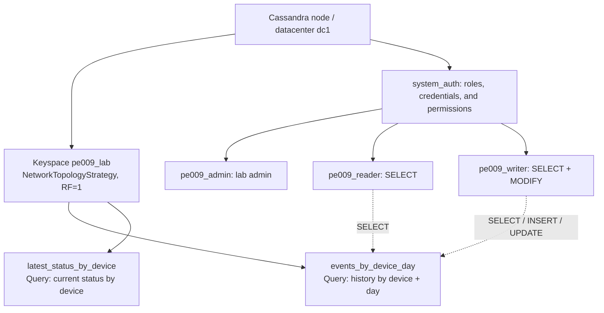

# Creating a Keyspace, Accounts, and Sample Data for Experiments

## 1. Objectives and Key Distinctions

Apache Cassandra is a **distributed wide-column** database. To study **partition keys, query-driven table design, replication, read/write consistency levels, compaction, repair, failure handling, and Java connectivity**, you need a reproducible practice dataset and controlled access accounts.

After this lesson, you will be able to:

1. Create a **keyspace** using `NetworkTopologyStrategy` and a replication factor matching your node/datacenter count.
2. Create two tables tailored to two query patterns and understand the roles of **partition keys** and **clustering keys**.
3. Load sample data with deterministic keys so re-running scripts does not accidentally create endless duplicate rows.
4. Query data by partition, inspect schemas, and record results before and after restarts.
5. Distinguish **roles**, **login**, **authentication**, and **authorization**; create read-only and read-write accounts after enabling security.
6. Use `GRANT`/`REVOKE`, test both an allowed operation and a denied operation, and test connections via `cqlsh` and the Java Driver.
7. Explain why user accounts alone do not make data "safe" if internode ports, JMX, TLS, or `system_auth` replication are misconfigured.

**Scope:** one Cassandra 5.0.9 node in Docker with the CQL port published only on host loopback. The lesson has **two phases**: (A) data/schema while the server uses its default **unauthenticated** mode; (B) enabling authentication/authorization **in an isolated lab** to create and verify real accounts. Never copy RF=1 settings, sample passwords, or temporary in-container config edits straight into production.

## 2. Map of Objects to Be Created



| Concept | Belongs To | Purpose |
|---|---|---|
| **Keyspace** | Cassandra schema | Holds tables, defines replication strategy/RF and durable writes option |
| **Table** | Inside a keyspace | Defines primary key, columns, and storage options tailored to query patterns |
| **Partition key** | Table primary key | Hashed into a token to route partitions and replicas |
| **Clustering key** | Remainder of primary key | Determines row sort order **within the same partition** |
| **Role / account** | Cassandra security, typically stored in `system_auth` | May permit login, hold permissions, or serve as a permission group |
| **Authenticator** | Server config `cassandra.yaml` | Verifies client identity |
| **Authorizer** | Server config `cassandra.yaml` | Checks which operations a client is permitted to run |
| **Consistency level (CL)** | Per request / client | Governs replica response count; **does not** create additional replicas |

These are distinct layers. For example, `CREATE ROLE` does not replace `CREATE KEYSPACE`; `GRANT SELECT` does not set replication factor; and `LOCAL_QUORUM` cannot fix a poorly designed partition key.

## 3. Preparing a Cassandra Node for Loading Data

### 3.1. Environment Requirements

This example uses the Docker Official Image `cassandra:5.0.9`, persisting data in a **named volume**. Ensure the host has adequate CPU, SSD, and roughly **8 GiB total RAM or more** for comfortable lab use; allocating 4 GiB to the container and 2 GiB to Java heap is an experimental baseline, not a production minimum.

Before running, verify the name `cassandra-pe009` and host port `9269` are unused by other programs or containers. **Never reuse a volume holding data you need to keep or belonging to another cluster.**

Run from a host terminal with Docker CLI (single-line commands usable in Bash/PowerShell):

```bash
docker version
docker pull cassandra:5.0.9
docker network create pe009-net
docker volume create pe009_node_data

docker run -d --name cassandra-pe009 --network pe009-net --memory=4g --memory-swap=4g -e MAX_HEAP_SIZE=2G -e CASSANDRA_CLUSTER_NAME=pe009-training -e CASSANDRA_ENDPOINT_SNITCH=GossipingPropertyFileSnitch -e CASSANDRA_DC=dc1 -e CASSANDRA_RACK=rack1 -p 127.0.0.1:9269:9042 -v pe009_node_data:/var/lib/cassandra cassandra:5.0.9
```

Parameter explanation:

- `CASSANDRA_CLUSTER_NAME=pe009-training`: lab cluster name.
- `CASSANDRA_DC=dc1` with `GossipingPropertyFileSnitch`: sets the actual datacenter CQL will reference in its replication map.
- `-p 127.0.0.1:9269:9042`: clients **on the host** use 9269; `cqlsh` **inside the container** uses 9042.
- `--network pe009-net`: allows other client containers (if any) to resolve Cassandra by name.
- `-v pe009_node_data:/var/lib/cassandra`: preserves data/schema/`system_auth` across **restarts and container removals**, provided the volume is not deleted. **Configuration files in `/etc/cassandra` live outside this volume**.

### 3.2. Waiting for the Server to Be Ready

```bash
docker ps -a --filter name=cassandra-pe009
docker logs --tail 100 cassandra-pe009
docker exec cassandra-pe009 nodetool status
docker exec cassandra-pe009 nodetool statusbinary
docker exec cassandra-pe009 cqlsh -e "SELECT release_version, cluster_name, data_center FROM system.local;"
```

Wait until:

1. `nodetool status` shows one **`UN`** (*Up/Normal*) node.
2. `nodetool statusbinary` returns `running`.
3. CQL returns `cluster_name=pe009-training`, `data_center=dc1`, and the expected server version.

A container showing `Up` only means the process is running, not that the node is ready for CQL. If `cqlsh` refuses connections during startup, inspect logs and retry. Never raise timeouts indefinitely or delete the volume to "fix" slow startup.

Open an interactive `cqlsh` session for **Phase A**:

```bash
docker exec -it cassandra-pe009 cqlsh
```

## 4. Creating a Topology-Aligned Keyspace

### 4.1. Why Choose NetworkTopologyStrategy?

The replication strategy decides **which nodes** store replicas for each partition. `NetworkTopologyStrategy` specifies **RF per datacenter**, making it right for production clusters and labs meant to scale to multiple nodes. `SimpleStrategy` is simpler but unaware of failure domains/datacenters, so it should not be used in production designs.

| Case | Replication Map | What Happens |
|---|---|---|
| **1-node lab** in `dc1` | `{'class':'NetworkTopologyStrategy','dc1':1}` | Each partition has one replica; if the sole node goes down, no replica is available |
| **3-node lab** in `dc1` | `{'class':'NetworkTopologyStrategy','dc1':3}` | Each partition has three replicas; quorum is 2/3 |
| Multi-DC cluster, e.g., 3 nodes/DC | `{'class':'NetworkTopologyStrategy','dc1':3,'dc2':3}` | Each DC has its own RF; requires **real matching DCs** and valid topology |

Setting RF=3 on a **single-node cluster** does not magically create three physical copies; Cassandra cannot replicate onto nonexistent nodes. An RF higher than the node count can also trigger availability/consistency failures. Never use `LOCAL_QUORUM` results from an RF=1 lab as proof of RF=3 fault tolerance.

### 4.2. Creating and Verifying the Keyspace

In `cqlsh`:

```sql
SELECT cluster_name, data_center, rack FROM system.local WHERE key = 'local';

CREATE KEYSPACE IF NOT EXISTS pe009_lab
WITH replication = {
    'class': 'NetworkTopologyStrategy',
    'dc1': 1
}
AND durable_writes = true;

DESCRIBE KEYSPACE pe009_lab;

SELECT keyspace_name, replication, durable_writes
FROM system_schema.keyspaces
WHERE keyspace_name = 'pe009_lab';
```

**Notes:**

- The DC name in the replication map **must match** actual `system.local.data_center`, case-sensitively. If your setup uses a DC name other than `dc1`, adjust the map accordingly.
- `durable_writes=true` uses the commit log normally; **never disable it for speed** in data durability tests.
- `CREATE KEYSPACE IF NOT EXISTS` is a **no-op** if the keyspace already exists and does not alter previously declared RF, DCs, or durable writes. Always run `DESCRIBE` or query `system_schema.keyspaces`.
- Changing RF on a keyspace already holding data is an operational task that **does not automatically sync new replicas**; follow proper streaming/repair procedures.

### 4.3. system_auth Is a Separate Keyspace

`system_auth` stores internal roles/credentials/permissions for Cassandra's built-in security mechanism. It is **separate** from the application keyspace `pe009_lab`.

In this single-node lab, before enabling authentication, we will inspect and optionally set `system_auth` replication to `NetworkTopologyStrategy` with `dc1:1`. In production, Apache docs recommend **RF 3–5 per datacenter** when enough nodes exist so logins stay available during node outages. If the auth keyspace lacks replicas, logins can fail even when business data is well replicated.

## 5. Designing Tables Around Queries

### 5.1. Two Sample Business Questions

Suppose you ingest device sensor readings. Users need:

1. **Event history for a device on a given day**, newest first.
2. **Latest known status of a device** when opening an overview dashboard.

With only a single "raw data" table, query (2) might have to scan or filter across many partitions. Cassandra generally favors **query-driven table modeling**, accepting controlled data duplication at the application layer.

### 5.2. History Table by Device and Day

```sql
CREATE TABLE IF NOT EXISTS pe009_lab.events_by_device_day (
    device_id text,
    event_day date,
    event_time timestamp,
    event_id uuid,
    event_type text,
    temperature_c double,
    note text,
    PRIMARY KEY ((device_id, event_day), event_time, event_id)
) WITH CLUSTERING ORDER BY (event_time DESC, event_id ASC);

DESCRIBE TABLE pe009_lab.events_by_device_day;
```

Key breakdown:

| Component | Role |
|---|---|
| `(device_id, event_day)` | **Composite partition key**: all events for one device on one day reside in the same partition |
| `event_time` | Primary clustering key, sorted **descending** within the partition |
| `event_id` | Secondary clustering key, disambiguates events sharing the same timestamp |
| `event_type`, `temperature_c`, `note` | Regular data columns, not involved in partition distribution |

**Daily bucketing** avoids piling unbounded history for a device into a single ever-growing partition, though it does not guarantee small partitions if a device emits millions of events per day. Measure partition sizes and write rates to pick a bucket size suited to real workloads. Never use `ALLOW FILTERING` as a substitute for a proper partition key.

### 5.3. Current Status Table

```sql
CREATE TABLE IF NOT EXISTS pe009_lab.latest_status_by_device (
    device_id text PRIMARY KEY,
    last_seen_at timestamp,
    status text,
    temperature_c double
);
```

The second table uses `device_id` as its sole partition key, enabling direct `SELECT ... WHERE device_id=?` lookups. One incoming event can update both the history table and status table. However, **two independent writes are not an ACID multi-table transaction**; if one fails, handle retries/idempotency appropriately. Moreover, Cassandra resolves conflicts by **mutation timestamp**, not by comparing the `last_seen_at` column to keep the highest business timestamp. When multiple producers write out of order, design latest-state handling carefully.

## 6. Loading a Re-Runnable Sample Dataset

### 6.1. INSERT Statements for the History Table

In your connected `cqlsh`:

```sql
CONSISTENCY LOCAL_ONE;

INSERT INTO pe009_lab.events_by_device_day
    (device_id, event_day, event_time, event_id, event_type, temperature_c, note)
VALUES
    ('device-001', '2026-11-21', '2026-11-21T08:00:00Z',
     00000000-0000-4000-8000-000000000001, 'boot', 26.1, 'Boot');

INSERT INTO pe009_lab.events_by_device_day
    (device_id, event_day, event_time, event_id, event_type, temperature_c, note)
VALUES
    ('device-001', '2026-11-21', '2026-11-21T08:05:00Z',
     00000000-0000-4000-8000-000000000002, 'measurement', 26.5, 'Stable');

INSERT INTO pe009_lab.events_by_device_day
    (device_id, event_day, event_time, event_id, event_type, temperature_c, note)
VALUES
    ('device-001', '2026-11-21', '2026-11-21T09:15:00Z',
     00000000-0000-4000-8000-000000000003, 'alert', 31.2, 'High temperature');

INSERT INTO pe009_lab.events_by_device_day
    (device_id, event_day, event_time, event_id, event_type, temperature_c, note)
VALUES
    ('device-001', '2026-11-22', '2026-11-22T07:00:00Z',
     00000000-0000-4000-8000-000000000004, 'measurement', 25.7, 'Next day');

INSERT INTO pe009_lab.events_by_device_day
    (device_id, event_day, event_time, event_id, event_type, temperature_c, note)
VALUES
    ('device-002', '2026-11-21', '2026-11-21T08:03:00Z',
     00000000-0000-4000-8000-000000000005, 'boot', 23.4, 'Boot');

INSERT INTO pe009_lab.events_by_device_day
    (device_id, event_day, event_time, event_id, event_type, temperature_c, note)
VALUES
    ('device-002', '2026-11-21', '2026-11-21T09:10:00Z',
     00000000-0000-4000-8000-000000000006, 'measurement', 24.0, 'Stable');
```

These fixed `event_id` values are **strictly for learning and deterministic script re-runs**. In real applications, UUIDs must be uniquely generated per the application's ID strategy. Because primary keys stay identical across runs, re-running the script **does not create extra rows**. However, Cassandra writes a new mutation with a new timestamp, updating `WRITETIME`; re-running is not "zero-impact" on storage and compaction.

### 6.2. Loading the Status Table

```sql
INSERT INTO pe009_lab.latest_status_by_device
    (device_id, last_seen_at, status, temperature_c)
VALUES ('device-001', '2026-11-21T09:15:00Z', 'alert', 31.2);

INSERT INTO pe009_lab.latest_status_by_device
    (device_id, last_seen_at, status, temperature_c)
VALUES ('device-002', '2026-11-21T09:10:00Z', 'normal', 24.0);
```

Here `latest_status_by_device` models state derived from a batch of events. It is not a materialized view automatically maintained by Cassandra. The application must update both tables and handle partial failures. If using `LOGGED BATCH`, never mistake batches for full-isolation SQL multi-row transactions or use batches to speed up writes across unrelated partitions.

## 7. Verification Queries and Observing Storage

### 7.1. The Two Designed Query Patterns

```sql
-- History for one device on one day; targets a single partition.
SELECT event_time, event_type, temperature_c
FROM pe009_lab.events_by_device_day
WHERE device_id = 'device-001'
  AND event_day = '2026-11-21'
LIMIT 10;

-- Another day maps to another partition.
SELECT event_time, event_type
FROM pe009_lab.events_by_device_day
WHERE device_id = 'device-001'
  AND event_day = '2026-11-22';

-- Current status queried directly by partition key.
SELECT device_id, last_seen_at, status, temperature_c
FROM pe009_lab.latest_status_by_device
WHERE device_id = 'device-002';
```

With this sample dataset, the first query returns **3 rows** ordered by `event_time DESC`: 09:15, 08:05, 08:00. The Nov 22 query returns **1 row**. Device 002's status is `normal` at `24.0`.

### 7.2. Inspecting Full Schema and Write Timestamps

```sql
DESCRIBE KEYSPACE pe009_lab;
DESCRIBE TABLE pe009_lab.events_by_device_day;

SELECT event_time, event_type, WRITETIME(temperature_c)
FROM pe009_lab.events_by_device_day
WHERE device_id = 'device-001'
  AND event_day = '2026-11-21';
```

`WRITETIME(temperature_c)` returns the cell's mutation timestamp (microseconds since Unix epoch), **distinct from the business column `event_time`**. Cassandra uses mutation timestamps for last-write-wins conflict resolution; clocks on nodes and timestamp-supplying clients must stay synchronized.

Queries such as `SELECT * FROM pe009_lab.events_by_device_day;` should not be your default production check: they can scan many partitions and return huge datasets. In learning labs, rely on **keyspace/table schemas + WHERE partition key** and inspect logs/metrics if a query fails.

### 7.3. Flushing and Inspecting the Node's Write Path

Exit `cqlsh` and run:

```bash
docker exec cassandra-pe009 nodetool tablestats pe009_lab
docker exec cassandra-pe009 nodetool flush pe009_lab
docker exec cassandra-pe009 sh -c "du -sh /var/lib/cassandra/data /var/lib/cassandra/commitlog"
docker exec cassandra-pe009 sh -c "df -h /var/lib/cassandra"
```

`flush` writes memtables out to SSTables; it is **not a backup**. The commit log may still hold segments due to unflushed data in other tables or segment recycling rules. When practicing compaction/repair, ensure free disk headroom and monitor `nodetool compactionstats`/`tpstats` rather than guessing from a single `SELECT`.

### 7.4. How This Differs from Multi-Node Labs

Once you have a **3-node cluster in the same datacenter**, you can create a **new lab keyspace** with `RF=3` (avoid altering live serving keyspaces haphazardly) and use `CONSISTENCY LOCAL_QUORUM`:

```sql
-- Illustration for a cluster that actually has 3 nodes in dc1:
CREATE KEYSPACE lab_rf3
WITH replication = {'class':'NetworkTopologyStrategy', 'dc1':3};

-- After creating tables and data in lab_rf3:
CONSISTENCY LOCAL_QUORUM;
```

Quorum for RF=3 is **2 responding replicas**; with RF=1, quorum is **1**. Creating an RF=3 keyspace on a single node does not conjure two missing nodes. Practicing node loss, hinted handoff, and repair requires a proper multi-node cluster and dedicated measurements.

## 8. Cassandra Accounts: Roles, Authentication, and Authorization

### 8.1. Default Settings Do Not Enforce Access Control

Under default configuration:

- `authenticator: AllowAllAuthenticator`: Cassandra **does not require identity verification**.
- `authorizer: AllowAllAuthorizer`: Cassandra **does not enforce access permissions**.
- `role_manager: CassandraRoleManager`: manages roles in system tables (under default role management).

This means running:

```sql
-- Syntax demonstration only; DO NOT use as an access control test on a default server.
CREATE ROLE demo_user WITH LOGIN = true;
```

**does not mean** unauthenticated connections are blocked or roles are restricted by `GRANT`. To genuinely practice permissions, enable **PasswordAuthenticator + CassandraAuthorizer** methodically. Official docs clearly distinguish enabling authentication from authorization; perform both carefully with validation to avoid locking out apps or admins.

### 8.2. Safe Transition Plan in the Lab

| Step | State | Mandatory Check |
|---|---|---|
| A | Default server, no auth | CQL connects without password; schema and sample data exist |
| B | Prepare `system_auth` with suitable RF | Verify datacenter/RF; production clusters must replicate auth data |
| C | Enable `PasswordAuthenticator` and restart | Unauthenticated CQL fails; default admin logs in |
| D | Create new admin and verify login | Never disable old admin role before new admin works |
| E | Enable `CassandraAuthorizer` and restart | Admin logs in; DDL/schema permissions behave properly |
| F | Create `reader`/`writer` with least privilege | Reader `SELECT` succeeds while `INSERT`/`UPDATE` fail; writer reads/writes |
| G | Maintain auth/TLS config and safe passwords | Never lose auth by recreating the container with an unconfigured default image |

**Lab security note:** the port is published only on `127.0.0.1:9269` with TLS still disabled. Never expose this port on public networks; plaintext CQL passwords can leak over untrusted networks. Real systems require client-to-node TLS, internode TLS, restricted firewalls/JMX, secret/vault management, and staged node-by-node rollouts.

## 9. Hands-On: Enabling Authentication on the Lab Container

### 9.1. Preparing system_auth

At this point `cassandra-pe009` is still running **without auth**. Open `cqlsh` as in section 3:

```bash
docker exec -it cassandra-pe009 cqlsh
```

In `cqlsh`:

```sql
SELECT keyspace_name, replication
FROM system_schema.keyspaces WHERE keyspace_name = 'system_auth';

ALTER KEYSPACE system_auth
WITH replication = {'class':'NetworkTopologyStrategy','dc1':1};

DESCRIBE KEYSPACE system_auth;
```

This command is strictly for a **single-node lab in `dc1`**. In multi-node production clusters, never use `dc1:1`; Apache docs recommend **RF 3–5 per DC** for `system_auth`, configured prior to enabling auth with data distribution verified operationally. Changing RF on a populated keyspace does not automatically move or repair all replicas; follow proper repair/streaming plans.

### 9.2. Enabling PasswordAuthenticator

With the **Docker Official Image**, `CASSANDRA_...` env vars support only **a fixed subset of keys**; **never assume `-e CASSANDRA_AUTHENTICATOR=PasswordAuthenticator` configures the server**. This lesson edits the config file **inside the running lab container** to demonstrate the mechanism. Changes inside the **container filesystem** **survive `docker restart`** yet **are lost on `docker rm` and recreate**, because our mount only covers `/var/lib/cassandra`. In production, manage `cassandra.yaml` via versioned configuration, bind mounts, or controlled images.

On the host terminal, open a shell with privileges to edit config:

```bash
docker exec -it --user 0 cassandra-pe009 bash
```

In the shell **inside the container**:

```bash
grep -E '^(authenticator|authorizer|role_manager):' /etc/cassandra/cassandra.yaml

# Apply only if the actual file has the exact line "authenticator: AllowAllAuthenticator".
sed -i 's/^authenticator: AllowAllAuthenticator$/authenticator: PasswordAuthenticator/' /etc/cassandra/cassandra.yaml

grep -E '^(authenticator|authorizer|role_manager):' /etc/cassandra/cassandra.yaml
exit
```

Expect `authenticator: PasswordAuthenticator`. If `grep` shows anything else—a commented line or a fully qualified class name—**do not assume `sed` succeeded**; inspect the actual file and edit the exact option per documentation for your running version. Keep `authorizer: AllowAllAuthorizer` at this step to transition one layer at a time.

Restart the process:

```bash
docker restart cassandra-pe009
docker logs --tail 100 cassandra-pe009
docker exec cassandra-pe009 nodetool status
docker exec cassandra-pe009 nodetool statusbinary
```

Wait for `UN` and binary transport `running`. Then run the test:

```bash
docker exec cassandra-pe009 cqlsh -e "SELECT release_version FROM system.local;"
```

Once authentication is active, connecting **without credentials** must be rejected. If it still succeeds, pause account creation and inspect the active config file, logs, and restart state; **never assume the system is secured**.

### 9.3. Logging In as Default Admin and Creating a New Admin

Under Cassandra's default `PasswordAuthenticator`, the bootstrap superuser is `cassandra` with initial password `cassandra`. Use this bootstrap credential **only in an isolated lab** and replace it immediately; it is well-known public default data, **not a safe secret**.

Open an interactive session so `cqlsh` prompts for the password instead of putting it on the command line:

```bash
docker exec -it cassandra-pe009 cqlsh -u cassandra
```

In the shell, enter the default password when prompted; once logged in:

```sql
CREATE ROLE IF NOT EXISTS pe009_admin
WITH LOGIN = true
AND SUPERUSER = true
AND PASSWORD = 'REPLACE_WITH_PRIVATE_LAB_ADMIN_SECRET';

LIST ROLES;
```

**Replace `REPLACE_WITH_PRIVATE_LAB_ADMIN_SECRET` with your own private password before running.** The `PASSWORD` string in CQL may still appear in `cqlsh` history or audit/server logs depending on config; never use work passwords or commit scripts containing plaintext secrets into repositories. In real environments, use proper secret-management channels and password policies.

Exit `cqlsh` and **log back in as `pe009_admin`**:

```bash
docker exec -it cassandra-pe009 cqlsh -u pe009_admin
```

Only after confirming the new role can log in and run administrative statements should you consider disabling the default admin (executed from the `pe009_admin` session):

```sql
ALTER ROLE cassandra WITH LOGIN = false AND SUPERUSER = false;
```

This is an official security best practice, but **never do it before verifying the new admin login**. Losing superuser access/credentials is very hard to recover from. In production, also verify role/permission propagation and rollback procedures.

### 9.4. Enabling CassandraAuthorizer

From the host terminal, open a root shell inside the container:

```bash
docker exec -it --user 0 cassandra-pe009 bash
```

Inside the container:

```bash
grep -E '^(authenticator|authorizer|role_manager):' /etc/cassandra/cassandra.yaml

# Apply only when "authorizer: AllowAllAuthorizer" is currently present.
sed -i 's/^authorizer: AllowAllAuthorizer$/authorizer: CassandraAuthorizer/' /etc/cassandra/cassandra.yaml

grep -E '^(authenticator|authorizer|role_manager):' /etc/cassandra/cassandra.yaml
exit
```

Expected active config:

```yaml
authenticator: PasswordAuthenticator
authorizer: CassandraAuthorizer
role_manager: CassandraRoleManager
```

If the file uses fully qualified class names or different comments, match the actual lines and docs before restarting. `CassandraRoleManager` pairs with `PasswordAuthenticator`; do not switch to an unverified custom role manager.

Restart, wait for readiness, and log in as `pe009_admin`:

```bash
docker restart cassandra-pe009
docker logs --tail 100 cassandra-pe009
docker exec cassandra-pe009 nodetool status
docker exec -it cassandra-pe009 cqlsh -u pe009_admin
```

Once logged into `cqlsh`, run `LIST ROLES;` to confirm the admin is recognized. `authorizer` enforces request-level permissions, **distinct** from merely requiring a password. If any check fails, inspect logs and auth status before granting permissions.

## 10. Creating Application Accounts and Least-Privilege Permissions

### 10.1. Creating Login Roles

In your `cqlsh` session logged in as `pe009_admin`:

```sql
CREATE ROLE IF NOT EXISTS pe009_reader
WITH LOGIN = true
AND SUPERUSER = false
AND PASSWORD = 'REPLACE_WITH_PRIVATE_READER_SECRET';

CREATE ROLE IF NOT EXISTS pe009_writer
WITH LOGIN = true
AND SUPERUSER = false
AND PASSWORD = 'REPLACE_WITH_PRIVATE_WRITER_SECRET';

LIST ROLES;
```

Substitute all `REPLACE_...` placeholders before running. If a role already exists, `IF NOT EXISTS` is a no-op and **does not change existing passwords or permissions**. To change an existing role's password, use `ALTER ROLE ... WITH PASSWORD = ...` from an authorized account following security procedures.

**Distinctions:**

- `LOGIN=true` means the role can authenticate as a connection identity; it does not grant `SELECT`/`INSERT` automatically.
- `SUPERUSER=false` means the app lacks cluster-wide administrative privileges.
- Roles can have `LOGIN=false` to serve as **permission groups**, assigned via `GRANT role_group TO role_user`. This lesson uses direct login roles for simpler verification.

### 10.2. Granting Table-Level Permissions

```sql
GRANT SELECT ON TABLE pe009_lab.events_by_device_day TO pe009_reader;
GRANT SELECT ON TABLE pe009_lab.latest_status_by_device TO pe009_reader;

GRANT SELECT ON TABLE pe009_lab.events_by_device_day TO pe009_writer;
GRANT MODIFY ON TABLE pe009_lab.events_by_device_day TO pe009_writer;

GRANT SELECT ON TABLE pe009_lab.latest_status_by_device TO pe009_writer;
GRANT MODIFY ON TABLE pe009_lab.latest_status_by_device TO pe009_writer;

LIST ALL PERMISSIONS OF pe009_reader;
LIST ALL PERMISSIONS OF pe009_writer;
```

| Role | Lab Permissions | Not Granted |
|---|---|---|
| `pe009_reader` | `SELECT` on the two sample tables only | No `MODIFY`, `CREATE`, `ALTER`, `DROP`, or `SUPERUSER` |
| `pe009_writer` | `SELECT` and `MODIFY` on the two sample tables only | No `CREATE`, `ALTER`, `DROP` schema, or `SUPERUSER` |
| `pe009_admin` | Administrative superuser **lab only** | Never embed these credentials in regular Java apps |

**Note on `MODIFY`:** this permission covers `INSERT`, `UPDATE`, `DELETE`, and **`TRUNCATE`** on the granted table/keyspace scope. Cassandra has no separate `INSERT_ONLY` permission within this model to allow inserts while forbidding deletes. If an application must strictly prevent deletions, enforce it through an intermediate service layer or additional application controls; `MODIFY` is not "append-only".

In CQL, `GRANT` is an administrative **permission assignment** command, not table creation or replication policy. Granting at the **KEYSPACE** level cascades to every table in that keyspace, so the example uses **TABLE** scope for tighter boundaries. If a new table is added later, roles granted only per-table `SELECT`/`MODIFY` above will not automatically gain access to it.

### 10.3. Logging In as the Read-Only Role and Testing Denied Operations

Exit the admin session, then on the host:

```bash
docker exec -it cassandra-pe009 cqlsh -u pe009_reader
```

Log in with `pe009_reader`'s private password and test:

```sql
-- Should succeed.
SELECT event_time, event_type, temperature_c
FROM pe009_lab.events_by_device_day
WHERE device_id = 'device-001'
  AND event_day = '2026-11-21';

-- Should be denied when CassandraAuthorizer is active:
INSERT INTO pe009_lab.latest_status_by_device
    (device_id, last_seen_at, status, temperature_c)
VALUES ('permission-probe', '2026-11-21T12:00:00Z', 'should-be-denied', 0.0);
```

**Security pass criteria:** `SELECT` succeeds, and `INSERT` raises **Unauthorized / permission denied**. If `INSERT` succeeds, **stop testing and investigate `authorizer` configuration**; do not claim the lab enforces authorization. If `permission-probe` was accidentally inserted, it exists only in the lab keyspace and should be cleaned up by an authorized role once the root cause is fixed.

### 10.4. Logging In as the Writer Role

```bash
docker exec -it cassandra-pe009 cqlsh -u pe009_writer
```

In `cqlsh`:

```sql
INSERT INTO pe009_lab.latest_status_by_device
    (device_id, last_seen_at, status, temperature_c)
VALUES ('device-003', '2026-11-21T12:30:00Z', 'normal', 22.8);

SELECT device_id, status, temperature_c
FROM pe009_lab.latest_status_by_device
WHERE device_id = 'device-003';
```

Expect the writer to read back the newly written row. The writer **must not** be permitted to `DROP TABLE` or `CREATE TABLE`. If you test a denied DDL statement, do so only inside the **lab keyspace** and never grant admin rights just to "make the test pass." Permission caching may delay immediate visibility of permission changes; check auth cache settings, logs, and session state when investigating.

### 10.5. REVOKE and Updating Permissions

From the `pe009_admin` session:

```sql
-- Example: revoking SELECT on one table from the reader:
REVOKE SELECT ON TABLE pe009_lab.latest_status_by_device FROM pe009_reader;

LIST ALL PERMISSIONS OF pe009_reader;

-- Restore read permission to return to the baseline lab state:
GRANT SELECT ON TABLE pe009_lab.latest_status_by_device TO pe009_reader;
```

Permission changes propagate through Cassandra's auth/permission cache; for long-lived client sessions, request authorization checks current server state/cache. Do not assume merely closing/reopening a session alters permissions; inspect cache/reload settings using the proper tools and docs.

## 11. Connecting from Java with a Non-Superuser Account

Java applications should use an account with **only the required permissions**, never `cassandra` or `pe009_admin`. With Java 17 + Apache Cassandra Java Driver 4.x (e.g., Maven dependency `org.apache.cassandra:java-driver-core:4.19.4`), a read example looks like:

```java
import java.net.InetSocketAddress;

import com.datastax.oss.driver.api.core.CqlSession;
import com.datastax.oss.driver.api.core.cql.Row;

public class ReadCassandraLabData {
    public static void main(String[] args) {
        String password = System.getenv("PE009_READER_PASSWORD");
        if (password == null || password.isBlank()) {
            throw new IllegalStateException("PE009_READER_PASSWORD not provided");
        }

        try (CqlSession session = CqlSession.builder()
                .addContactPoint(new InetSocketAddress("cassandra-pe009", 9042))
                .withLocalDatacenter("dc1")
                .withAuthCredentials("pe009_reader", password)
                .build()) {

            for (Row row : session.execute(
                    "SELECT event_time, event_type, temperature_c " +
                    "FROM pe009_lab.events_by_device_day " +
                    "WHERE device_id = 'device-001' AND event_day = '2026-11-21'")) {
                System.out.println(
                    row.getInstant("event_time") + " / " +
                    row.getString("event_type") + " / " +
                    row.getDouble("temperature_c"));
            }
        }
    }
}
```

This example assumes the **Java app runs in a container on Docker network `pe009-net`**, so the contact point is `cassandra-pe009:9042` and advertised node addresses are reachable. If Java runs on the **host**, the initial contact point is `127.0.0.1:9269`; under Docker Desktop/NAT, the driver may discover unroutable container internal IPs, so test actual connectivity or run Java on the same Docker network. Never blindly replace everything with `127.0.0.1`: inside an app container, that resolves to the app container itself.

**Reading passwords from environment variables is a lab illustration only.** In production, use a secret manager and keep passwords out of source code, logs, crash reports, and shell command history. This localhost lab lacks TLS; across machines, enforce TLS/mTLS or driver-compatible transport encryption. Plaintext credentials on a network are a security risk.

**Module connection:** account roles govern **who may run `SELECT`/`MODIFY`**, not **which partition stores data** or **how many replicas respond**. Those behaviors are governed by partition keys, replication strategy, and consistency levels.

## 12. Verification Record and Reproducible Lab Execution

### 12.1. Verification Checklist

| Item | Evidence |
|---|---|
| Server | `nodetool status=UN`, `statusbinary=running`, `system.local.data_center=dc1` |
| Schema | `DESCRIBE KEYSPACE pe009_lab`, replication `NetworkTopologyStrategy/dc1:1` |
| Table 1 | Composite partition key `(device_id,event_day)`, clustered by `event_time DESC` |
| Table 2 | Primary key `device_id`, reads current status |
| Data | Device 001 has **3 events** on Nov 21 and **1 event** on Nov 22; device 002 has **2 events** on Nov 21 |
| Volume | `pe009_node_data` mounted at `/var/lib/cassandra` |
| Auth | Unauthenticated requests blocked after enabling `PasswordAuthenticator` |
| Admin | `pe009_admin` login verified before disabling default admin |
| Authorization | `CassandraAuthorizer` active, `LIST ALL PERMISSIONS` accurate |
| Reader | `SELECT` succeeded; `INSERT` confirmed **Unauthorized** |
| Writer | `INSERT`/`SELECT` succeeded on granted tables |
| Java | Connected as reader and read rows using proper network/DC |

**Passing requires more than just running CQL:** you must distinguish **role declaration**, **session authentication**, and **resource authorization**. A role having a password while the server still runs `AllowAllAuthenticator/AllowAllAuthorizer` does not prove access is protected.

### 12.2. Reproducibility and Idempotency

- `CREATE KEYSPACE/TABLE IF NOT EXISTS` can be re-run safely yet **does not update an existing differing schema**. Run `DESCRIBE` afterward to compare.
- Sample `INSERT` statements use fixed primary keys: re-running updates existing cells rather than adding rows, though it refreshes mutation timestamps.
- `CREATE ROLE IF NOT EXISTS` does not update an existing role's password or permissions; inspect `LIST ROLES`/`LIST PERMISSIONS` and use `ALTER ROLE`/`GRANT` for intentional changes.
- The Docker **named volume** preserves schema and `system_auth`, not `/etc/cassandra/cassandra.yaml` changes stored outside the volume. **Removing an auth-enabled container and recreating it with the default image can disable auth even though roles/passwords remain in data.** Never recreate production/sensitive environments that way.
- Never run `TRUNCATE` or `DROP KEYSPACE` unless certain the data belongs strictly to your lab. Never copy admin accounts or secrets into public guides or repositories.

### 12.3. Stopping the Lab and Preserving Data

At the end, if you want to keep **the current container's auth configuration state** for further study, **stop without removing the container**:

```bash
docker stop cassandra-pe009
docker start cassandra-pe009
```

After `docker start`, wait for the node to reach `UN` before connecting. If you are certain you do not need to keep the **auth configuration edited inside the container filesystem**, you can stop and remove the container while keeping the named volume:

```bash
docker stop cassandra-pe009
docker rm cassandra-pe009
docker volume inspect pe009_node_data
```

**Important:** never recreate a container with unauthenticated config against lab data containing real credentials to serve external clients. For durable setups, store and mount a **valid, version-controlled `cassandra.yaml` with `PasswordAuthenticator` and `CassandraAuthorizer` enabled**, configure TLS, and standardize secret management. Remove the network only when no containers remain attached: `docker network rm pe009-net`.

## 13. Common Errors

| Symptom | Possible Cause | Where to Check |
|---|---|---|
| `CREATE KEYSPACE` replication error | Wrong DC name, RF incompatible with topology, invalid map syntax | `SELECT data_center FROM system.local;`, `DESCRIBE KEYSPACE`, read CQL error |
| Keyspace created yet quorum CL fails | Single-node lab or unavailable replicas | Check RF, node count, `nodetool status`; distinguish CL from RF |
| History query returns empty | Wrong device/day, failed insert, or `event_day` mismatches `event_time` | Verify keys and `INSERT`s; `WHERE` must match **entire composite partition key** |
| Query filtering on `event_type` rejected | Query does not match primary key / data model | Design another query-driven table; avoid slapping on `ALLOW FILTERING` |
| `CREATE ROLE` doesn't enforce security | Server still on default `AllowAllAuthenticator/AllowAllAuthorizer` | Inspect `cassandra.yaml`, test unauthenticated connect and denied action |
| After enabling auth, all clients fail login | Auth subsystem still booting, misconfiguration, no valid admin, `system_auth` missing replicas | Server logs, bootstrap role, `system_auth` RF, readiness; never strip auth in production |
| Reader `INSERT` succeeds | `CassandraAuthorizer` disabled/inactive or overly broad permissions | `grep authorizer`, restart, `LIST ALL PERMISSIONS`, check active role/session |
| Reader `SELECT` denied | Missing table `GRANT SELECT`, role/permission cache, wrong login account | `LIST ALL PERMISSIONS OF pe009_reader`, keyspace/table names, auth logs |
| Writer `CREATE TABLE` gets Unauthorized | Missing schema `CREATE` permission | Expected when the app holds only `SELECT`/`MODIFY` |
| `cqlsh -u ...` fails | Wrong password, `LOGIN=false`, auth disabled/misconfigured | Inspect roles as admin, server logs; use password prompt |
| Java Driver fails to connect | Wrong credentials/local DC, app not on same Docker network, unroutable metadata IP, TLS mismatch | Contact points, `system.local.data_center`, Docker network, driver logs |
| Re-running sample creates extra rows | Newly generated ID/timestamp in primary key | Use deterministic PKs for idempotency tests; check `DESCRIBE TABLE` |
| Recreated container stops asking for password | In-container `/etc/cassandra/cassandra.yaml` edit was lost; volume holds data only | Persist auth configuration outside the container writable layer |
| `system_auth` RF=1 in multi-node cluster | Roles/credentials insufficiently replicated | Re-configure `system_auth` replication per DC and run proper repair/validation |

**Diagnostic order:** container/service → ring/native transport → DC/RF/schema → role/login/authenticator → permissions/authorizer → network/TLS/Java → partition-key queries → logs/metrics and compaction/repair. Misconfiguration at one layer should never be "fixed" by granting superuser privileges to applications.

## 14. Self-Check Questions

1. How do keyspaces and tables differ? Where is `NetworkTopologyStrategy` declared, and why must `dc1` match the actual datacenter?
2. Given `PRIMARY KEY ((device_id,event_day), event_time,event_id)`, what is the partition key and what is the clustering key? Why does the history query need both `device_id` and `event_day`?
3. If you run the six sample `INSERT`s with identical primary keys twice, does the row count double? Can mutation timestamps change?
4. Why doesn't Cassandra automatically sync `latest_status_by_device` from `events_by_device_day`? What risk arises if two producers write out of order?
5. Can RF=1 with CL=`LOCAL_ONE` in the lab survive losing the single node? If you set RF=3 with only one node, does the system spawn extra replicas?
6. Is `CREATE ROLE pe009_reader WITH LOGIN=true` on default Cassandra enough to block an unauthenticated `cqlsh` connection? Which security layers are missing?
7. How do `PasswordAuthenticator` and `CassandraAuthorizer` differ? Why test both login and a denied `INSERT`?
8. Why is `GRANT MODIFY ON TABLE ...` not strictly equivalent to "INSERT only"? What is its effect on `DELETE` and `TRUNCATE`?
9. If a Java app runs inside another container, why isn't `127.0.0.1:9269` always the right contact point? How must networking be designed?
10. Why shouldn't you disable the default superuser before testing the new superuser login? How should `system_auth` be protected in a multi-node cluster?
11. A named volume preserved roles and schemas, yet recreating the container disabled authentication. Which configuration layer was lost?
12. When debugging distributed reads/writes, do `SELECT`/`MODIFY` permissions explain quorum, tombstones, and repair? Which separate tools/concepts are required?

**Completion criteria:** both tables and sample data are queryable by partition key; learners can verify keyspace/RF, distinguish users/roles/authenticators/authorizers, create admin/reader/writer roles in an auth-enabled lab, verify allowed and denied actions, and connect from Java using a non-superuser account. This sets the foundation for studying replication/consistency, compaction, repair, and real-world cluster operations.

## 15. Official References

- [Apache Cassandra — CQL Data Definition](https://cassandra.apache.org/doc/latest/cassandra/developing/cql/ddl.html): `CREATE KEYSPACE`, `NetworkTopologyStrategy`, tables, and schemas.
- [Apache Cassandra — CQL Data Manipulation](https://cassandra.apache.org/doc/latest/cassandra/developing/cql/dml.html): `INSERT`, `UPDATE`, `SELECT`, keys, and timestamps.
- [Apache Cassandra — Database Roles](https://cassandra.apache.org/doc/latest/cassandra/developing/cql/security.html): `CREATE ROLE`, `ALTER ROLE`, `GRANT`, `REVOKE`, and resource permissions.
- [Apache Cassandra — Security](https://cassandra.apache.org/doc/latest/cassandra/managing/operating/security.html): `PasswordAuthenticator`, `CassandraAuthorizer`, `system_auth` replication, and TLS.
- [Apache Cassandra — Production recommendations](https://cassandra.apache.org/doc/stable/cassandra/getting-started/production.html): topology, `NetworkTopologyStrategy`, and security.
- [Docker Hub — Official Cassandra image](https://hub.docker.com/_/cassandra): Docker environment variables, volumes, configuration files, and container lifecycle.
- [Apache Cassandra Java Driver](https://github.com/apache/cassandra-java-driver): `CqlSession`, credentials, local datacenter, and Java queries.
