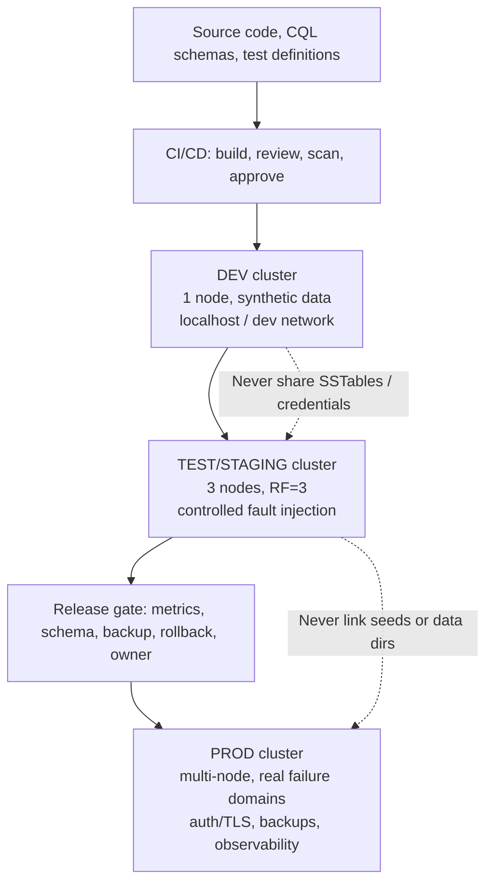

# Separating Development, Testing, and Production Environments

## 1. Why Does Cassandra Require Independent Environments?

Apache Cassandra is a **distributed wide-column** database. Data is placed on nodes owning the tokens of each **partition key** and replicated per **keyspace** policy. Even a minor change to replication factor, seeds, snitch, broadcast address, compaction strategy, or repair scheduling can affect multiple nodes and multiple applications. Consequently, **development, testing/staging, and production** environments must have clear boundaries.

This lesson goes beyond prefixing table names with `dev_` and `prod_`. The goal is to design **independent Cassandra clusters** with dedicated networks, volumes, data, accounts, and deployment lifecycles. Learners will use CQL to verify which cluster is actually targeted, model tables around queries, configure local datacenters for the Java Driver, and perform checks before running risky operations.

After this lesson, you will be able to:

1. Explain why **three keyspaces inside one cluster** are not equivalent to **three independent environments**.
2. Design a dev/test/prod matrix covering cluster identity, RF/CL, networking, datacenters, security, resources, data, backups, and operational permissions.
3. Stand up a **single-node dev** cluster and a **three-node test** cluster in Docker with separate names, networks, and volumes so test nodes never accidentally join dev.
4. Write a shared CQL schema while choosing replication according to each environment's **actual datacenter**, and generate synthetic sample data instead of using customer data.
5. Connect from Java applications using the contact points, local datacenter, and credentials **for the target environment**.
6. Build a promotion workflow for schemas/apps from dev → test → production with release gates, especially when changing partition keys, replication, and compaction.
7. Distinguish node failure, repair, and backup testing in a lab from production operations governed by approvals, monitoring, and recovery plans.

> **Safety principle:** executable commands in this lesson only create/stop **new lab clusters** and perform no actions on production. Distinct cluster names alone do not establish isolation; endpoints, volumes, secrets, and tooling privileges must also be independent.

## 2. Three Environments Should Not Share a Cassandra Cluster

### 2.1. Recommended Architecture



**Source code and schemas** can be promoted from dev to test to prod after passing checks; **node data, commitlogs, system keyspaces, credentials, and Docker volumes must never be promoted by copying or mounting them onto another node**.

### 2.2. Why "One Cluster, Three Keyspaces" Is Insufficient

Suppose one cluster hosts `app_dev`, `app_test`, and `app_prod`. Those keyspaces may have different RFs, yet they still share:

- **Nodes/JVMs, heap, CPU, disks, commitlogs, caches, compaction queues**, and internode bandwidth.
- **Gossip ring, seeds, listen/broadcast addresses**, token ownership, and node replacement schedules.
- Node-level operations such as restarts, upgrades, disk full conditions, TLS config, and certain `nodetool` commands.
- Permission surfaces: anyone with broad cluster admin rights can affect multiple keyspaces.
- Blast radius: heavy load tests, massive tombstones, compaction/repair, or misconfigurations impacting other apps.

Thus, **keyspace separation only isolates schemas/permissions at the resource level**, not failure domains or server resources. To test safely while protecting production, use **separate clusters** and **separate access credentials**.

| Scenario | Shared Single Cluster | Separate Dev / Test / Prod Clusters |
|---|---|---|
| Developer runs `TRUNCATE` on the wrong table | Can wipe data in a mistakenly targeted keyspace | Production access is blocked from dev; blast radius stays in the lab |
| Test generates huge tombstones or partitions | Contends for production CPU/disk/compaction | Tests run with isolated resources, cleanup, and alerts |
| Simulating node loss or `nodetool repair` | Can violate prod SLAs on the shared node/ring | Executed on independent nodes and volumes |
| Testing Cassandra or driver upgrades | Hard to test safely without risking live clients | Verifies compatibility prior to promotion |
| Seed or broadcast misconfiguration | Risks disrupting a live serving cluster | Contained within an environment with separate network and secrets |

## 3. Dev, Test/Staging, and Production Design Matrix

| Criterion | Development (DEV) | Integration / Test / Staging (TEST) | Production (PROD) |
|---|---|---|---|
| Purpose | CQL and wide-column modeling, fast unit/integration runs | Java integration, RF/CL, node recovery, load, and regression | SLOs, continuity, and live business data |
| Nodes | 1 Docker/VM node usually suffices for CQL | At least 3 nodes for RF=3 / `LOCAL_QUORUM` tests | Multiple nodes across **real failure domains**, sized for load and HA |
| Example cluster name | `pe011-dev` | `pe011-test` | `company-prod-cassandra` (illustrative name, not live config) |
| Example datacenter | `dc_dev` | `dc_test` | `dc_prod_a`, possibly multi-DC |
| Demo keyspace | `telemetry_lab`, RF=1 | `telemetry_lab`, RF=3 | Business keyspaces with RF matching real topology |
| Network | Host loopback / private dev network | Private test network, no casual port publishing | Private segments, firewalls, controlled VPN/bastion |
| Volumes | Dedicated named volume, intentionally resettable | One volume/node, preserved across restart tests | Storage sized for I/O, backups, capacity, and DR |
| Data | Synthetic, free of personal data | Approved synthetic/anonymized data with representative size/skew | Real data under protection and retention/deletion policies |
| Auth/TLS | Minimal isolated lab; never exposed on shared networks | Should mirror prod auth/TLS for integration/security tests | Mandatory auth, authorization, TLS, least-privilege roles |
| Accounts | Dedicated dev roles | Dedicated test roles | Separate app, ops, backup, and break-glass roles with auditing |
| CL | `LOCAL_ONE` with RF=1 | Test `LOCAL_ONE`, `LOCAL_QUORUM`, `ALL` per case | Per-request SLA/semantics with measured trade-offs |
| Node stop / repair | Allowed in personal lab | Scripted chaos/failover with rollback | Only per approved change/incident runbooks |
| Data reset | Can delete **clearly identified lab volumes** | Fixture reset workflow without breaking other teams' data | No arbitrary "wipe everything" operation |

**Staging** can be a fourth environment separate from integration tests when near-production scale, data shape, and controls are required. Even then, staging must be its own **separate cluster**, never "granting devs access to prod to test." Small test clusters can verify **failure semantics**, but matching RF alone does not measure production performance.

## 4. Boundaries That Must Be Strictly Separated

### 4.1. Cluster Identity, Seeds, and Topology

Each environment needs its own cluster name and seed list. `cluster_name` is just one control layer; combine it with **network segregation**, peer connectivity, and ordered bootstrapping.

| Item | DEV | TEST | PROD |
|---|---|---|---|
| `cluster_name` | `pe011-dev` | `pe011-test` | Production value managed by operations |
| `seed_provider/seeds` | Dev node within that same cluster | Test seeds only | Production seeds only |
| `listen_address`/`broadcast_address` | Dev node address on dev network | Test node IPs routable across test nodes | Dedicated, stable production node IPs/DNS |
| `rpc_address`/`broadcast_rpc_address` | Bind/advertise suited for dev clients | Test apps reach test nodes | Prod apps reach advertised prod nodes |
| `data_file_directories` | Dedicated dev volume | Three separate volumes, one/node | Dedicated storage on prod hosts/nodes |

**Seeds are not masters/leaders.** A new node finds its cluster via seeds, yet must never point to another environment's seed as a "shared rendezvous." Two differently named clusters should have no internode network path between them. Above all, **never share data directories/commitlogs** to "quickly clone an environment": Cassandra binds node identity, system metadata, and SSTables to a specific cluster.

### 4.2. Ports and Networking

- **`7000/TCP`**: internode/gossip/streaming required between nodes **of the same cluster**.
- **`9042/TCP`**: CQL native protocol for `cqlsh` and the Java Driver of the **matching environment**.
- **`7199/TCP`**: JMX for `nodetool`; keep internal, never expose to the internet.
- `rpc_address` is the **CQL bind address**, while `broadcast_rpc_address` is the **advertised address** for clients/drivers. An initial contact point may succeed while the Java Driver still fails if peers advertise unroutable IPs.

Docker **user-defined bridge networks** provide internal DNS and isolate container groups not sharing a bridge, yet are **not an absolute security boundary** against anyone with Docker host admin privileges. Containers on the same network can hit each other's internal ports, and port publishing opens host-side paths. Production requires proper infrastructure-level network, host, and identity controls.

### 4.3. Secrets, IAM, and Data

- Each environment uses **separate credentials, certificates, keystores/truststores, and RBAC rules**. Developers have no reason to log into production as superusers.
- Never keep default `cassandra/cassandra` credentials for operational use. Production requires `PasswordAuthenticator` (or equivalent), `CassandraAuthorizer`, client and internode TLS, firewalls, and protected JMX.
- `system_auth` holds roles/permissions and requires sufficient datacenter replication so logins survive node outages; Apache docs generally recommend RF **3–5** where enough nodes exist.
- **Never copy raw production tables into dev/test**: data can contain PII or secrets. If statistical samples from production are unavoidable, enforce formal approval, minimization, and **verified anonymization**, including free text, partition keys, and metadata.
- A lab node/volume cannot serve as a production backup or replica. **Backup/restore and retention** must be engineered independently.

## 5. Versions, Configuration, and Reproducibility Principles

### 5.1. Using a Verifiable Baseline

In the commands below, the demo pins **`cassandra:5.0.9`**. This is a **lab baseline**, not a claim it is always the latest release. Document explicitly:

- Cassandra server patch version and image digest or package checksum.
- Selected/tested server JDK, application JDK 17, and Apache Cassandra Java Driver 4.x.
- Schema revisions, migration IDs, `cassandra.yaml`/`cassandra-rackdc.properties` settings, JVM options, logging, and TLS/auth.
- Cluster/datacenter names, seed/listen/broadcast addresses, volumes, and retention per environment.

**Never assume compatibility simply because versions share a "4" or "5".** CQL spec version, native protocol version, Cassandra server version, and Java Driver library version are four separate concepts. Before upgrading, check release notes and rolling upgrade support for your **actual server branch**.

### 5.2. Splitting Configuration into Two Parts

| What Should Stay Identical (Logic / Contract) | What Must Be Configured Per Environment |
|---|---|
| Table names, primary keys, data types, reviewed query patterns | Cluster name, host/seed/broadcast IPs, ports, and client contact points |
| Repeatable data validation rules and migrations | Actual datacenter/rack, topology-matched replication RF |
| Required app permissions: table-level `SELECT`/`MODIFY` | Roles, passwords, certificates, secret stores, and actual grants |
| Java `CqlSession` usage, metrics, bounded retries | Timeouts/CL, connection pools, infrastructure, and SLOs |
| Synthetic test fixtures and assertions | Disk capacity, backup retention, repair schedules, compaction tuning |

Never copy `CREATE KEYSPACE ... 'dc_dev':1` from dev to production and only swap the cluster name. **Table schemas** can remain identical; **keyspace replication maps must match the real DC/RF** of each target environment.

Example repository layout **managed by the learner** (this lesson creates no extra files):

```text
config/
  common/       # CQL schema and query contracts
  dev/          # endpoint, dc, RF1; dev secret references
  test/         # endpoint, dc, RF3; test gates
  production/   # references to secret manager; no plaintext secrets
migrations/
  001_create_tables.cql
  002_add_new_column.cql
tests/
  synthetic-fixtures.cql
  cassandra-integration-tests/
```

## 6. DEV Lab: One Isolated Single-Node Cluster

### 6.1. Preparation

Run commands **on a host with Docker Engine/Desktop running Linux containers**. Ensure adequate host RAM/CPU/SSD; a single-node lab runs comfortably with ~**8 GiB total host RAM or more** and ~4 GiB allocated to the container (2 GiB JVM heap). This is a learning baseline, not production sizing.

This example uses host port **9271** to avoid colliding with other labs. Commands are single-line so they work in Bash or Windows PowerShell:

```bash
docker version
docker pull cassandra:5.0.9
docker network create pe011-dev-net
docker volume create pe011_dev_data
```

If a network, container, or volume with the same name **already exists**, inspect it first. This lesson assumes **brand-new empty resources**. Never delete an existing volume without knowing its owner.

### 6.2. Starting the DEV Node

```bash
docker run -d --name pe011-dev-n1 --network pe011-dev-net --memory=4g --memory-swap=4g -e MAX_HEAP_SIZE=2G -e CASSANDRA_CLUSTER_NAME=pe011-dev -e CASSANDRA_ENDPOINT_SNITCH=GossipingPropertyFileSnitch -e CASSANDRA_DC=dc_dev -e CASSANDRA_RACK=rack1 -p 127.0.0.1:9271:9042 -v pe011_dev_data:/var/lib/cassandra cassandra:5.0.9
```

DEV uses cluster name `pe011-dev`, DC `dc_dev`, named volume `pe011_dev_data`, and bridge `pe011-dev-net`. Host CQL port publishing stays **strictly on loopback** for lab use; never expose this unauthenticated/non-TLS setup on a LAN or the internet.

Verify readiness:

```bash
docker ps -a --filter name=pe011-dev-n1
docker logs --tail 100 pe011-dev-n1
docker exec pe011-dev-n1 nodetool status
docker exec pe011-dev-n1 nodetool statusbinary
docker exec pe011-dev-n1 cqlsh -e "SELECT cluster_name, data_center, rack, host_id, release_version FROM system.local;"
```

Wait until the node shows **`UN`**, native transport is **`running`**, and CQL returns `cluster_name=pe011-dev`, `data_center=dc_dev`. `docker run -d` returning a container ID **does not mean** CQL is ready.

### 6.3. Dedicated Keyspace in the DEV Cluster

Open `cqlsh`:

```bash
docker exec -it pe011-dev-n1 cqlsh
```

Run:

```sql
CREATE KEYSPACE IF NOT EXISTS telemetry_lab
WITH replication = {
  'class': 'NetworkTopologyStrategy',
  'dc_dev': 1
};

CREATE TABLE IF NOT EXISTS telemetry_lab.events_by_device_day (
  device_id text,
  event_day date,
  event_time timestamp,
  event_id uuid,
  event_type text,
  PRIMARY KEY ((device_id, event_day), event_time, event_id)
) WITH CLUSTERING ORDER BY (event_time DESC, event_id ASC);

INSERT INTO telemetry_lab.events_by_device_day
  (device_id, event_day, event_time, event_id, event_type)
VALUES (
  'synthetic-dev-001', '2026-11-21', '2026-11-21T08:00:00Z',
  10000000-0000-4000-8000-000000000001, 'dev-created'
);

SELECT event_time, event_id, event_type
FROM telemetry_lab.events_by_device_day
WHERE device_id = 'synthetic-dev-001'
  AND event_day = '2026-11-21';
```

In this table, **`(device_id,event_day)` is the composite partition key**, and `event_time` and `event_id` are clustering keys. Filtering by the exact partition key allows Cassandra to route queries efficiently. Data uses the `synthetic-` prefix so learners never mistake it for production data.

**RF=1** in `dc_dev` is only for learning CQL. Never use it to evaluate replica failover or `LOCAL_QUORUM` behavior under node loss: if the single node dies, zero replicas remain available.

## 7. TEST Lab: A Three-Node Cluster Completely Separate from DEV

### 7.1. Why Does TEST Need Three Nodes?

To test replication and consistency meaningfully, you need three separate nodes in a datacenter with an RF=3 keyspace. Then `LOCAL_QUORUM` requires **2 responses** and `ALL` requires **3 responses**. Losing one node leaves two healthy nodes able to serve `LOCAL_QUORUM`, whereas `ALL` lacks sufficient replicas.

Resources: around **24 GiB host RAM** is comfortable for running three 4 GiB containers concurrently alongside Docker/OS/apps. This is a reference guide; spin up TEST only when your host has sufficient resources. **Three containers on one host are not three physical failure domains**, and lab data lacks production security/durability guarantees.

### 7.2. TEST Network and Three Volumes

Run on the host (DEV can stay up if resources allow, accounting for total RAM/CPU):

```bash
docker network create pe011-test-net
docker volume create pe011_test_n1
docker volume create pe011_test_n2
docker volume create pe011_test_n3
```

**Never reference `pe011-dev-net` or `pe011_dev_data` in TEST commands.** Each test node needs its own volume for its system metadata, host ID, tokens, SSTables, and commitlog.

### 7.3. Starting Each Node and Waiting for Bootstrap

Start **n1 first**:

```bash
docker run -d --name pe011-test-n1 --network pe011-test-net --memory=4g --memory-swap=4g -e MAX_HEAP_SIZE=2G -e CASSANDRA_CLUSTER_NAME=pe011-test -e CASSANDRA_ENDPOINT_SNITCH=GossipingPropertyFileSnitch -e CASSANDRA_DC=dc_test -e CASSANDRA_RACK=rack1 -v pe011_test_n1:/var/lib/cassandra cassandra:5.0.9
```

Wait for n1 to reach `UN` and serve CQL:

```bash
docker exec pe011-test-n1 nodetool status
docker exec pe011-test-n1 nodetool statusbinary
docker exec pe011-test-n1 cqlsh -e "SELECT cluster_name, data_center FROM system.local;"
```

Only then start **n2** pointing to a **TEST** seed:

```bash
docker run -d --name pe011-test-n2 --network pe011-test-net --memory=4g --memory-swap=4g -e MAX_HEAP_SIZE=2G -e CASSANDRA_CLUSTER_NAME=pe011-test -e CASSANDRA_SEEDS=pe011-test-n1 -e CASSANDRA_ENDPOINT_SNITCH=GossipingPropertyFileSnitch -e CASSANDRA_DC=dc_test -e CASSANDRA_RACK=rack2 -v pe011_test_n2:/var/lib/cassandra cassandra:5.0.9
docker exec pe011-test-n1 nodetool status
docker exec pe011-test-n2 nodetool status
```

Wait until both n1 and n2 see **two `UN` rows**. Once ready, add **n3**:

```bash
docker run -d --name pe011-test-n3 --network pe011-test-net --memory=4g --memory-swap=4g -e MAX_HEAP_SIZE=2G -e CASSANDRA_CLUSTER_NAME=pe011-test -e CASSANDRA_SEEDS=pe011-test-n1 -e CASSANDRA_ENDPOINT_SNITCH=GossipingPropertyFileSnitch -e CASSANDRA_DC=dc_test -e CASSANDRA_RACK=rack3 -v pe011_test_n3:/var/lib/cassandra cassandra:5.0.9

docker exec pe011-test-n1 nodetool status
docker exec pe011-test-n2 nodetool status
docker exec pe011-test-n3 nodetool status
```

Before running CQL, all three nodes must report **three `UN` rows** under datacenter `dc_test`. If any node remains `UJ` (*Joining*) or `DN` (*Down*), inspect logs and internode networking; never alter data/config haphazardly to force it into the ring.

**Seed note:** `CASSANDRA_SEEDS` is solely for discovery and does not make n1 a leader/master. Some Docker Official Image versions append the current node's own address to the seed list on startup; in practice, inspect the live configuration when comparing seed behavior precisely. Production uses controlled config with multiple appropriate seeds.

### 7.4. Confirming TEST Is Not DEV

```bash
docker exec pe011-test-n1 cqlsh -e "SELECT cluster_name, data_center, host_id FROM system.local;"
docker exec pe011-test-n2 cqlsh -e "SELECT cluster_name, data_center, host_id FROM system.local;"
docker exec pe011-test-n3 cqlsh -e "SELECT cluster_name, data_center, host_id FROM system.local;"
docker exec pe011-test-n1 cqlsh -e "SELECT peer, data_center, host_id FROM system.peers_v2;"
docker network inspect pe011-test-net
docker network inspect pe011-dev-net
```

Expect TEST to report `cluster_name=pe011-test`, DC `dc_test`, **three unique host IDs**, and each node knowing two same-cluster peers. DEV retains `cluster_name=pe011-dev`, DC `dc_dev`, completely outside the test ring.

`docker network inspect` lists containers attached to each network. Confirm dev container names **do not appear in `pe011-test-net`** and vice versa. Still, Docker host admins can attach containers to arbitrary networks, so networking is only **one layer** of isolation.

### 7.5. TEST Keyspace with Identical Schema but Different RF

Open `cqlsh` on TEST n1:

```bash
docker exec -it pe011-test-n1 cqlsh
```

Run **on TEST**:

```sql
CREATE KEYSPACE IF NOT EXISTS telemetry_lab
WITH replication = {
  'class': 'NetworkTopologyStrategy',
  'dc_test': 3
};

CREATE TABLE IF NOT EXISTS telemetry_lab.events_by_device_day (
  device_id text,
  event_day date,
  event_time timestamp,
  event_id uuid,
  event_type text,
  PRIMARY KEY ((device_id, event_day), event_time, event_id)
) WITH CLUSTERING ORDER BY (event_time DESC, event_id ASC);

CONSISTENCY LOCAL_QUORUM;

INSERT INTO telemetry_lab.events_by_device_day
  (device_id, event_day, event_time, event_id, event_type)
VALUES (
  'synthetic-test-001', '2026-11-21', '2026-11-21T09:00:00Z',
  20000000-0000-4000-8000-000000000001, 'test-created'
);

SELECT event_time, event_type
FROM telemetry_lab.events_by_device_day
WHERE device_id = 'synthetic-test-001'
  AND event_day = '2026-11-21';
```

Notes:

- **Keyspace/table names intentionally match DEV** to demonstrate a reusable schema contract; existing **on two distinct clusters** is what keeps their data independent.
- `dc_test:3` differs from `dc_dev:1`. These replication maps are not interchangeable arbitrarily.
- `CREATE KEYSPACE IF NOT EXISTS` does not modify replication if the keyspace already exists; run `DESCRIBE KEYSPACE telemetry_lab` or query `system_schema.keyspaces` afterward.
- `LOCAL_QUORUM` in TEST requires 2/3 replicas to respond; in RF=1 DEV, it cannot test failover across two surviving replicas.
- Re-running `INSERT` with the same primary key does not grow rows unboundedly, yet **mutation timestamps still update**. Never confuse key-level idempotency with zero storage impact.

### 7.6. Bounded Node-Loss Test

Run only on **TEST** after all three nodes are `UN` and baseline data is written:

```bash
docker stop --time 120 pe011-test-n3
docker exec pe011-test-n1 nodetool status
docker exec pe011-test-n2 nodetool status
```

Once gossip/failure detector updates, n3 may appear as `DN`. On n1:

```bash
docker exec -it pe011-test-n1 cqlsh
```

In `cqlsh`:

```sql
CONSISTENCY LOCAL_QUORUM;

SELECT event_type
FROM telemetry_lab.events_by_device_day
WHERE device_id = 'synthetic-test-001'
  AND event_day = '2026-11-21';

CONSISTENCY ALL;

SELECT event_type
FROM telemetry_lab.events_by_device_day
WHERE device_id = 'synthetic-test-001'
  AND event_day = '2026-11-21';
```

While n1/n2 are healthy, `SELECT` at `LOCAL_QUORUM` **can** succeed; `ALL` while n3 is down **lacks three replicas** and typically returns unavailable/timeout. Do not blame every CQL failure on CL: inspect topology, RF, network, disk, and logs.

Recover n3:

```bash
docker start pe011-test-n3
docker exec pe011-test-n3 nodetool status
docker exec pe011-test-n1 nodetool status
```

Wait until all nodes are `UN` and re-verify. This lesson **never** runs repair or chaos tests against production. To study hints/repair deeply, follow a dedicated lab runbook with clear scope and CPU/disk/network impact tracking.

## 8. Protecting Authorization Across Environments

### 8.1. Never Share Administrative Accounts

| Role | DEV | TEST | PROD |
|---|---|---|---|
| App reader | Dev role with `SELECT` on dev data only | Test role with `SELECT` on test fixtures only | Production role with `SELECT` on permitted tables only |
| App writer | Dev role with `MODIFY` on dev tables | Test role with `MODIFY` on test tables | Production role scoped per resource/app |
| Schema migrator | Allowed to test DDL locally | CI role permitted DDL on test | Dedicated deployment role requiring approval and audit |
| Operator | Allowed to stop owned lab nodes | Fault-injection rights per test plan | Operational rights under on-call/change control |
| Backup/restore | Uses lab data to practice procedures | Restore drills in isolated cluster | Production backup permissions and keys separated from dev/test |

On default Cassandra, `AllowAllAuthenticator` and `AllowAllAuthorizer` **neither require login nor check permissions**. Thus merely naming a role `dev_app` or `prod_app` **creates no boundary**. To test least privilege, enable authentication and authorization properly and verify **denied** operations. Any production security review must inspect TLS, internode networking, and JMX—not just `cqlsh` passwords.

### 8.2. Least-Privilege Example Once Auth/Authorizer Are Enabled

Below is an **illustrative** CQL snippet that a **TEST environment superuser** can execute after `CassandraAuthorizer` and `PasswordAuthenticator` are configured with TEST-specific credentials:

```sql
-- Do not run directly if the server still uses AllowAllAuthenticator/AllowAllAuthorizer.
CREATE ROLE IF NOT EXISTS test_telemetry_reader
WITH LOGIN = true AND SUPERUSER = false
AND PASSWORD = 'REPLACE_WITH_PRIVATE_TEST_SECRET';

GRANT SELECT ON TABLE telemetry_lab.events_by_device_day
TO test_telemetry_reader;

LIST ALL PERMISSIONS OF test_telemetry_reader;
```

**Replace** the placeholder secret before executing; in practice, placing plaintext passwords in CQL/`cqlsh` history/audits carries risk too. This example explains role/permission structure and is **not** a complete script to enable auth/TLS. Never store production passwords in shared source or config.

Once `CassandraAuthorizer` is active, verify:

1. Reader role `SELECT` on the granted table **succeeds**.
2. Reader role `INSERT` or `DROP` on the table **is denied**.
3. TEST apps log into TEST using TEST secrets; production secrets and default admin accounts are rejected.

`GRANT MODIFY` covers data mutations like `INSERT`/`UPDATE`/`DELETE` on the resource, not an "INSERT-only" permission. If an app needs strict append-only guarantees, enforce controls at the application/architecture layer beyond Cassandra table permissions.

## 9. Java Applications: Endpoints and DCs Must Be Selected Per Environment

### 9.1. Why Never Hard-Code Production Clusters?

Java Driver 4.x uses initial **contact points**, reads topology metadata, and then connects to other nodes in the cluster. Hard-coding a production IP can cause **tests to write accidentally into real data**, especially if credentials are reused.

| Example App Config Var | DEV | TEST | PROD |
|---|---|---|---|
| `CASSANDRA_CONTACT_POINT` | `127.0.0.1` from host using port 9271 | `pe011-test-n1` from same-network container, port 9042 | Infrastructure-managed private production hostname |
| `CASSANDRA_PORT` | `9271` on host, `9042` inside dev container | `9042` | Actual production native transport port |
| `CASSANDRA_LOCAL_DC` | `dc_dev` | `dc_test` | Local datacenter where the app runs |
| `CASSANDRA_USERNAME/PASSWORD` | Dev role if auth enabled | Least-privilege test role | Retrieved from production secret manager |
| CL | Per RF=1 dev test cases | `LOCAL_QUORUM` for RF=3 cases | Per business policy and SLO |

Addresses **from the Java application's perspective** are what matter. On Docker Desktop, host port mapping lets a host app reach one contact point, yet **broadcast RPC** node addresses in a multi-node Docker cluster may be unroutable from the host. For TEST, run the Java app **inside `pe011-test-net`** or design networking so the driver reaches all required peers. `localhost` inside a Java container is **not** the Cassandra container.

### 9.2. Java Driver 4.x Example Validating the Expected Cluster

Java 17 example (illustrative dependency `org.apache.cassandra:java-driver-core:4.19.4`); configuration comes **from the application runtime environment**, never defaulting to production:

```java
import java.net.InetSocketAddress;
import java.util.Objects;

import com.datastax.oss.driver.api.core.CqlSession;
import com.datastax.oss.driver.api.core.cql.Row;

public class CheckCassandraEnvironment {
    private static String required(String name) {
        String value = System.getenv(name);
        if (value == null || value.isBlank()) {
            throw new IllegalArgumentException("Missing environment variable: " + name);
        }
        return value;
    }

    public static void main(String[] args) {
        String host = required("CASSANDRA_CONTACT_POINT");
        int port = Integer.parseInt(required("CASSANDRA_PORT"));
        String dc = required("CASSANDRA_LOCAL_DC");
        String expectedCluster = required("EXPECTED_CASSANDRA_CLUSTER");

        try (CqlSession session = CqlSession.builder()
                .addContactPoint(new InetSocketAddress(host, port))
                .withLocalDatacenter(dc)
                .build()) {

            Row row = session.execute(
                "SELECT cluster_name, data_center, release_version " +
                "FROM system.local WHERE key='local'").one();
            if (row == null) {
                throw new IllegalStateException("No system.local metadata");
            }
            String actualCluster = row.getString("cluster_name");
            String actualDc = row.getString("data_center");
            if (!Objects.equals(expectedCluster, actualCluster)
                    || !Objects.equals(dc, actualDc)) {
                throw new IllegalStateException(
                    "Wrong Cassandra environment: " + actualCluster +
                    " / " + actualDc);
            }
            System.out.println("Validated cluster " + actualCluster +
                    ", DC " + actualDc + ", server " +
                    row.getString("release_version"));
        }
    }
}
```

This is a **basic defensive check**, not a standalone security boundary. A spoofed cluster with matching name/DC or leaked credentials could still pass it; production needs TLS endpoint verification, network ACLs, and least-privilege roles. Furthermore, querying `system.local` validates the **queried node**, not that every peer has matching versions or routing.

Example per-environment variables **with no passwords**:

```text
DEV application running on host:
  CASSANDRA_CONTACT_POINT=127.0.0.1
  CASSANDRA_PORT=9271
  CASSANDRA_LOCAL_DC=dc_dev
  EXPECTED_CASSANDRA_CLUSTER=pe011-dev

TEST application container attached to pe011-test-net:
  CASSANDRA_CONTACT_POINT=pe011-test-n1
  CASSANDRA_PORT=9042
  CASSANDRA_LOCAL_DC=dc_test
  EXPECTED_CASSANDRA_CLUSTER=pe011-test
```

When authentication is enabled, add `withAuthCredentials(...)` or an appropriate auth provider sourcing secrets **for the target environment**, keeping plaintext secrets out of code. Java Drivers should **reuse a single `CqlSession`** rather than creating a new session per CQL/HTTP request.

## 10. Schemas and Data Must Be Promoted Differently

### 10.1. Query-Driven Table Change Workflow

Suppose an app needs to add a `source` column to events. Safer than changing the primary key:

```sql
-- Illustrative schema change; test on DEV then TEST first.
ALTER TABLE telemetry_lab.events_by_device_day
ADD source text;
```

A sound workflow:

1. **Design:** review query patterns, partition sizes, event volumes, and token distribution impact. Changing a primary key generally requires a **new table and data migration**—it cannot be altered in place like an RDBMS.
2. **DEV:** apply the migration on `pe011-dev` and run unit/integration tests with synthetic data.
3. **TEST:** run the exact migration code on `pe011-test`, checking schema agreement, driver compatibility, application rollback, and RF=3/CL behavior.
4. **Review:** verify performance, read/write paths, auth/TLS, backward/forward compatibility across old and new app builds, and repair/compaction impact.
5. **PROD:** only authorized migrator/ops accounts apply it after approval, backups, and a monitored rollout plan.
6. **Post-deploy:** verify CQL reads/writes, client errors, schema agreement, resources/latency/compaction; update incident docs and audit logs.

**Schema migrations should be idempotent, yet never rely on `IF NOT EXISTS` to mask schema drift.** If a table already exists with a different primary key, compaction strategy, or column type, `CREATE TABLE IF NOT EXISTS` silently does nothing. Deployment tooling must **compare actual live schemas** against migration versions rather than merely checking exit codes.

### 10.2. Synthetic Data and Reconciliation

| Data Type | Allowed in DEV/TEST? | Rationale |
|---|---|---|
| Deterministic synthetic fixtures with fixed IDs | **Yes** | Reproducible; easy to compare row counts, timestamps, and keys |
| Synthetic datasets modeling hot keys, large partitions, tombstones | **Yes, in resource-bounded TEST** | Exercises realistic data model and compaction behavior |
| Raw copied production data | **No** | Privacy, confidentiality, and compliance risks |
| Approved, minimized/anonymized production extracts | Only under controlled approval | Must re-verify re-identification risk and secrets inside free text |
| Production SSTables/commitlogs/`system_auth` | **Never copy to spin up ad-hoc test nodes** | Identity, schemas, credentials, tokens, and formats are cluster-bound |

To test restores, provision a **dedicated restore cluster**, use approved backups, and follow restore steps matched to Cassandra version and topology; never attach backups to a live node and claim environments are "isolated."

## 11. Release Gates from DEV → TEST → PROD

### 11.1. Pre-Promotion Checklist

| Gate | Minimum Evidence | Decision |
|---|---|---|
| **Source/version** | Server image/package patch, Java Driver version, migration revision, recorded image digest | Block deploy if artifacts are unpinned |
| **Target identity** | Matching `system.local.cluster_name` and `data_center`; hostnames/secret refs belong to target env | Block wrong-environment deploys |
| **Schema** | CQL DDL, real-DC replication map, primary/clustering keys, and query tests | Block schema drift and bad data models |
| **Security** | Auth/TLS, non-superuser account, `SELECT` allowed and unauthorized actions denied | Block exposure or privilege escalation |
| **Functional** | Reads/writes/deletes/TTLs per design, timeout/CL test results | Block data contract regressions |
| **Availability** | TEST RF=3 with n1/n2/n3 healthy; `LOCAL_QUORUM` succeeds with one replica down | Block configs that only work when all nodes are up |
| **Load** | Latency/throughput, GC, CPU, disk, compaction, hot partitions with representative data | Block predictable overload |
| **Recovery** | Backup with restore verified on separate cluster, repair schedule, node-failure runbook | Block unrecoverable production deployments |
| **Approval** | Reviewer, change window, app rollback plan, post-deploy monitoring | Block unapproved automated risky actions |

For schema changes readable by both old and new application builds, apply **expand → planned migrate/backfill → switch traffic → contract**. Altering partition keys or dropping columns/tables mid-rolling-deployment risks breaking older code; verify both old and new clients during the transition window.

### 11.2. Avoiding Dangerous Commands in Shared Automation

Never share one admin-privileged script that **auto-selects** dev/test/prod via an ambiguous default variable. High-risk operations require explicit targeting and approvals:

- `TRUNCATE`/`DROP KEYSPACE`/`DROP TABLE` on production.
- `nodetool repair`, `cleanup`, `decommission`, `removenode`, or `drain` on live clusters.
- Changing `num_tokens`, snitches, `listen_address`/`broadcast_address`, seeds, or replication of populated keyspaces.
- Upgrading/downgrading Cassandra, touching SSTable/commitlog files, or moving data directories.

In CI, run CQL **with TEST accounts and endpoints** instead of reusing a production admin token across jobs. Never automate "data sync" by copying raw volumes across environments.

## 12. Production Operations: Non-Negotiable Requirements

This section is a **design checklist**, not commands to execute on production.

### 12.1. Real Topology, RF, and CL

- Spread nodes across real **failure domains** such as physical servers, availability zones, and racks; rack labels must match actual topology. Three nodes on one host cannot survive host loss.
- Use `NetworkTopologyStrategy` with per-datacenter RF, commonly starting evaluation at RF=3 where enough nodes exist; there is no single universal "optimal RF" for all workloads.
- Place reliable seeds across appropriate failure domains; keep `cluster_name`/partitioner/snitch consistent and peer addresses routable.
- Specify CL per operation: `LOCAL_ONE`, `LOCAL_QUORUM`, and `ALL` carry latency/availability trade-offs. With RF=3, quorum needs 2; this is not a linearizable multi-row transaction guarantee for every workflow.
- Design partition keys to avoid hot/large partitions, avoid queries needing `ALLOW FILTERING` on large datasets, and evaluate TTLs/tombstones/compaction.

### 12.2. Security, Data Protection, and Operational Privileges

Production must never retain default `AllowAllAuthenticator`/`AllowAllAuthorizer` or expose CQL/JMX/internode ports publicly. Design from day one:

- Authentication and authorization; separate app roles with resource-scoped `SELECT`/`MODIFY`, separate migrators, separate admin accounts; protect `system_auth`.
- Client/server TLS and internode encryption, certificate/truststore management, and secret rotation; test drivers before rollout.
- Firewalls/VPCs/security groups restricting port 7000 to peers, 9042 to authorized apps, and JMX to trusted admin hosts.
- Audit logging, key management, and data retention policies matching organizational compliance.
- Never store plaintext secrets in source code, Docker command history, logs, or broadly readable docs.

**Authentication cannot protect a cluster if internode and JMX ports are left open.** Inspect the entire network and operational surface, not just CQL roles.

### 12.3. Capacity, Compaction, Repair, and Backups

| Concern | Simplifiable in DEV/TEST | Requires Planning in PROD |
|---|---|---|
| Storage | Small Docker named volumes | SSD/I/O, OS tuning, capacity headroom, disk alerts, data/commitlog layout |
| Compaction | Test with synthetic data | Workload-matched strategy, pending task monitoring, disk amplification, tombstones |
| Repair | Test commands in test cluster | Monitored anti-entropy repair schedule aligned with RF, `gc_grace`, and node count |
| Hints | Observe `listpendinghints` on node stop | Monitor pending hints, understand window and best-effort limits; never replace repair |
| Backups | Lab snapshots, short-lived | Independent, versioned, encrypted backups, retention, and **restore drills** |
| Time sync | Check host UTC/clock | Cluster-wide NTP/chrony, accounting for mutation timestamp last-write-wins behavior |
| Monitoring | Docker logs and `nodetool status` | Time-series metrics, SLOs, alerts on latency/errors/heap/GC/disk/repair/hints |

**A snapshot on the same volume is not an offsite backup.** Cassandra snapshots typically rely on SSTable hard links; to survive host or volume loss, copy and maintain backups independently and practice verified restores. Replicas do not replace backups when accidental deletes or logic bugs replicate everywhere.

### 12.4. Change and Rollback Plans

Before any production change, document **owner, scope, command list, entry criteria, abort thresholds, rollback steps, monitoring dashboards, and on-call contacts**. In Cassandra, some data/topology changes **cannot be rolled back merely by reverting YAML**: dropped schemas, altered partition keys, token/rack/DC changes, RF changes, or format upgrades may require migrations or restores.

Never treat `docker stop` on one lab container as proof that a production rolling upgrade is safe. Network conditions, data size, compaction/repair backlogs, outage windows, and live load can behave very differently.

## 13. Verifying Isolation with Simple Checks

### 13.1. Checking Across Both Clusters

From the host terminal, while both DEV and TEST are running:

```bash
docker exec pe011-dev-n1 cqlsh -e "SELECT cluster_name, data_center FROM system.local WHERE key='local';"
docker exec pe011-test-n1 cqlsh -e "SELECT cluster_name, data_center FROM system.local WHERE key='local';"

docker exec pe011-dev-n1 cqlsh -e "SELECT keyspace_name, replication FROM system_schema.keyspaces WHERE keyspace_name='telemetry_lab';"
docker exec pe011-test-n1 cqlsh -e "SELECT keyspace_name, replication FROM system_schema.keyspaces WHERE keyspace_name='telemetry_lab';"

docker exec pe011-test-n1 nodetool status
docker inspect --format "{{range .Mounts}}{{.Name}} -> {{.Destination}}{{end}}" pe011-dev-n1
docker inspect --format "{{range .Mounts}}{{.Name}} -> {{.Destination}}{{end}}" pe011-test-n1
```

Expected:

| Check Item | DEV | TEST |
|---|---|---|
| `cluster_name` | `pe011-dev` | `pe011-test` |
| `data_center` | `dc_dev` | `dc_test` |
| `telemetry_lab` replication | `dc_dev:1` | `dc_test:3` |
| Ring | 1 `UN` node | 3 `UN` nodes |
| n1 volume | `pe011_dev_data` | `pe011_test_n1` |
| Sample data | `synthetic-dev-001` | `synthetic-test-001` |

The keyspace name is identical yet lives on **two distinct clusters**. To inspect each dataset, query the matching cluster:

```bash
docker exec pe011-dev-n1 cqlsh -e "SELECT event_type FROM telemetry_lab.events_by_device_day WHERE device_id='synthetic-dev-001' AND event_day='2026-11-21';"
docker exec pe011-test-n1 cqlsh -e "SELECT event_type FROM telemetry_lab.events_by_device_day WHERE device_id='synthetic-test-001' AND event_day='2026-11-21';"
```

An app pointed at the wrong environment may still see an identical schema and raise no immediate error. Therefore, beyond running `SELECT` checks, validate **identity + endpoint + secret + permissions** at deploy time.

### 13.2. Checking Application Configuration from Java's Perspective

The goal is not merely "`cqlsh` inside the container works," but that the **Java Driver from where the app actually runs** reaches the right nodes. For TEST, a Java app inside `pe011-test-net` uses DNS `pe011-test-n1:9042` and same-network peers. On Windows/macOS hosts, container IPs advertised by Cassandra may be unroutable; never mark production connectivity verified based solely on one NAT-published localhost contact point.

`EXPECTED_CASSANDRA_CLUSTER` provides fast failure on environment mismatch, yet does not replace firewalls, TLS, RBAC, or deployment approvals.

## 14. Common Errors and How to Spot Them

| Symptom | Possible Cause | Resolution |
|---|---|---|
| Dev app reads production data | Wrong contact point/secret/default config; shared credentials across envs | Halt writes, inspect config/`system.local`, revoke wrong access, audit affected data |
| Dev/prod keyspaces on the same cluster | Confused **logical namespaces** with **independent environments** | Separate clusters, networks, credentials, and volumes; plan an approved data migration |
| TEST node joins DEV or fails to join ring | Misconfigured seeds, network, or cluster identity | Check `CASSANDRA_SEEDS`, `cluster_name`, `docker network inspect`, logs; never rename to merge system data |
| DEV is `UN` while TEST `LOCAL_QUORUM` fails | TEST lacks 3 `UN` nodes, wrong RF/DC, or two replicas unhealthy | Run `nodetool status` on test nodes, `DESCRIBE KEYSPACE`, inspect logs |
| Java reaches contact point yet fails on peers | `broadcast_rpc_address`/DNS unroutable from app host | Run app on proper network; check metadata endpoints, firewalls, driver logs |
| `CREATE KEYSPACE IF NOT EXISTS` didn't update RF | Keyspace already existed with old replication | Query `system_schema.keyspaces` and run reviewed migrations instead of guessing |
| Shared volume across dev and test | Colliding data directories, host IDs, and system tables | Never share one volume across two Cassandra nodes; keep each node independent from bootstrap |
| Auth enabled only in prod, TEST left allow-all | Integration tests miss credential, permission, and TLS bugs | Mirror prod security in test/staging and test denial cases |
| Production data used for load testing | Unapproved/un-anonymized dump or secrets in payloads | Use synthetic generators, enforce data governance, never copy raw SSTables |
| Automated script runs `TRUNCATE` on wrong cluster | No target/identity validation before destructive steps | Separate credentials, fail closed on unknown targets, require approval for risky ops |
| TEST meets latency while PROD is slow | Differences in data size, hot keys, racks, RF, disks, or compaction | Test with representative workloads, measure metrics, tune capacity |
| Backups exist yet restores fail | Only took same-volume snapshots, missing schema/topology/keys, or untested restore | Run restore drills on an isolated cluster, verifying timing, scope, and integrity |
| Production `UN` yet queries fail | Native transport, auth/TLS, CL, hot partitions, disk/GC, repair backlog | Check app and server: `statusbinary`, query errors, metrics, logs, schema |

**Diagnostic order:** verify **exact target cluster** → network/contact points → topology/RF/CL → auth/TLS/permissions → queries/partition keys → resources/compaction/repair → data/backups. Never "fix" a wrong-environment error by raising timeouts or granting superuser rights to apps.

## 15. Cleaning Up the Lab Without Touching Production

**Run only when `pe011-*` containers are strictly the lab you created**, no other apps use them, evidence is recorded, and test node n3 is recovered if you ran the failover test.

To **preserve data**, stop containers only:

```bash
docker stop pe011-test-n3
docker stop pe011-test-n2
docker stop pe011-test-n1
docker stop pe011-dev-n1

docker volume ls
```

If you no longer need the **containers** while keeping **volumes**:

```bash
docker rm pe011-test-n3 pe011-test-n2 pe011-test-n1 pe011-dev-n1
docker network rm pe011-test-net
docker network rm pe011-dev-net
docker volume ls
```

These commands do not delete named volumes. **Never** run `docker volume prune` or `docker volume rm` while you still need lab data. If recreating a multi-node TEST cluster with old data, never assume Docker assigns the **same IP/broadcast address**; manage stable network identities and follow Cassandra's node-replacement procedures. For a completely fresh cluster, create **new volumes** rather than mixing old cluster metadata.

### 15.1. Lesson Completion Criteria

Learners can demonstrate and prove:

1. DEV and TEST have **independent cluster names, datacenters, networks, volumes, and host IDs**.
2. Identical CQL schemas use different actual RFs: **DEV=1**, **TEST=3**.
3. `synthetic-dev-001` does not come from TEST, and vice versa.
4. In TEST, while one replica is temporarily down, `LOCAL_QUORUM` continues serving if two replicas are healthy, whereas `ALL` fails.
5. The Java Driver is configured with endpoint/DC/secrets of the **target environment** and fails fast on cluster identity mismatch.
6. Data volumes, system metadata, credentials, and test actions are never promoted raw into production; production requires dedicated security, backup/restore, monitoring, and change approvals.

## 16. Self-Check Questions

1. Why do three keyspaces (`dev`, `test`, `prod`) inside the same Cassandra cluster **not** create three independent failure domains?
2. When every environment has a table named `telemetry_lab.events_by_device_day`, what prevents applications from reading/writing the wrong dataset?
3. What isolation goals do `cluster_name`, seed lists, `listen_address`, and `broadcast_rpc_address` serve? Are they **enough** to replace firewalls, auth, and TLS?
4. A dev lab uses RF=1 and CL=`LOCAL_ONE`. Can those results promise production survives single-node failure at RF=3? Why or why not?
5. Does a 3-node TEST lab on one laptop simulate losing **one container** and losing **the whole host** as two independent failure domains?
6. Why must schema migrations evaluate primary keys, partition sizes, schema agreement, and old/new app compatibility rather than just running `CREATE TABLE IF NOT EXISTS`?
7. If the Java Driver uses a TEST contact point yet peer metadata advertises container IPs unroutable from a Windows/macOS host, what symptoms occur?
8. Why is copying raw SSTables/commitlogs/`system_auth` from production to test an invalid way to "separate environments"?
9. If test auth/TLS does not mirror production, what classes of integration bugs will the team miss?
10. When a pipeline includes `TRUNCATE`, why must production require distinct credentials, endpoints, and approvals?
11. After an accidental data deletion, are replicas, volumes, and snapshots on the same host enough to recover? Which backup/restore conditions must be verified?
12. Production shows all nodes `UN`, yet tail latency rises. What additional checks on resources, compaction, repair, hints, and partition-key distribution are needed?

## 17. Official References

- [Apache Cassandra — Production recommendations](https://cassandra.apache.org/doc/stable/cassandra/getting-started/production.html): topology, vnodes, encryption, `NetworkTopologyStrategy`, racks, and capacity.
- [Apache Cassandra — Configuring Cassandra](https://cassandra.apache.org/doc/stable/cassandra/getting-started/configuring.html): `cassandra.yaml`, node settings, and related files.
- [Apache Cassandra — Security](https://cassandra.apache.org/doc/stable/cassandra/managing/operating/security.html): authentication, authorization, TLS, and `system_auth` RF.
- [Apache Cassandra — CQL DDL](https://cassandra.apache.org/doc/stable/cassandra/developing/cql/ddl.html): keyspaces, tables, replication strategies, primary/clustering keys.
- [Apache Cassandra — Hints](https://cassandra.apache.org/doc/stable/cassandra/managing/operating/hints.html): hinted handoff and best-effort bounds.
- [Apache Cassandra — Repair](https://cassandra.apache.org/doc/stable/cassandra/managing/operating/repair.html): anti-entropy repair and read repair limits.
- [Apache Cassandra — Backups](https://cassandra.apache.org/doc/stable/cassandra/managing/operating/backups.html): snapshots, incremental backups, and restore planning.
- [Apache Cassandra — nodetool status](https://cassandra.apache.org/doc/stable/cassandra/managing/tools/nodetool/status.html): `UN`, `DN`, and ring status.
- [Docker Docs — Bridge networking](https://docs.docker.com/engine/network/drivers/bridge/): user-defined bridge scope, container DNS, and port publishing.
- [Docker Docs — Volumes](https://docs.docker.com/engine/storage/volumes/): named volumes and persistence across container lifecycles.
- [Docker Hub — Official Cassandra image](https://hub.docker.com/_/cassandra): cluster/seed environment variables and running nodes.
- [Apache Cassandra Java Driver](https://github.com/apache/cassandra-java-driver): `CqlSession`, contact points, local datacenter, and CQL protocol.
