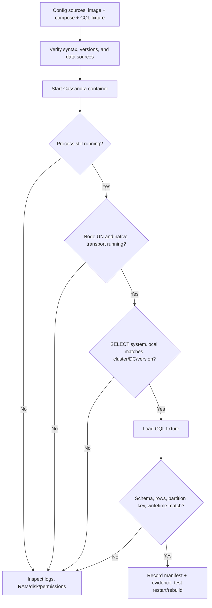

# Reproducing Environments and Managing Verifiable Practice Configurations

## 1. Goal: From "Works on My Machine" to a Reproducible Environment

Apache Cassandra is a **distributed wide-column** database management system. Lab outcomes depend not only on CQL statements, but also on **server/JDK versions, node config, datacenter, replication, networking, data state, consistency levels, and client code**. Without recording these inputs, two learners running the exact same `INSERT` can see different results even though both report "Cassandra is running."

Within the **Practice Environment** chapter of module `DATABASE_ENGINE_WIDE_COLUMN_CASSANDRA`, this lesson builds a workflow to **reproduce and verify** environments reliably before advancing to **partition keys, query-driven table design, replication, read/write consistency, compaction, repair, failure handling, and Java connectivity**.

After this lesson, you will be able to:

1. Distinguish **configuration reproduction**, **restarting with existing data**, **clean rebuild**, and **data restore**—rather than calling all four "recreate" vaguely.
2. Identify the **authoritative configuration source** for image/version, `cassandra.yaml`, DC/rack, Docker Compose, keyspaces/tables, Java Driver, and secrets.
3. Author sample `compose.yaml` and `fixture.cql` files in a **dedicated lab directory**, stand up a Cassandra 5.0.9 node, and verify with repeatable commands.
4. Capture a diagnostic **manifest/fingerprint**: server version, image digest/ID, cluster/DC, schema, node status, and CQL outputs.
5. Create **deterministic CQL data** using fixed keys and mutation timestamps, and explain why `host_id`, container IP, and startup times **do not need to match** across two clean builds.
6. Detect **configuration drift**, distinguish config errors from data or network errors, and place verification gates before risky operations.
7. Use a Java snippet to **verify the exact target environment** instead of accidentally connecting to another cluster sharing an identical schema.

> **Scope and safety:** the primary lab is **one isolated Docker node using synthetic data, with auth/TLS disabled by default and the CQL port published only on host loopback**. A single node is suited for learning CQL and storage, **not for proving HA or multi-replica consistency**. Volume-deletion commands in this lesson apply strictly to explicitly confirmed lab projects.

## 2. "Reproducibility" Must Be Defined Precisely

### 2.1. Four Distinct Scenarios

| Scenario | Inputs | Expected Outcome | What Not to Expect |
|---|---|---|---|
| **Restart same node** | Same container, same volume, and configuration | Server resumes; data and node identity are preserved | Does not mean requests sent while the node was down succeeded |
| **Recreate container, keep volume** | New container, existing data volume, and compatible configuration | Attempts to resume **that same populated node** after verifying address/identity | Container ID/IP may change; in multi-node clusters never recreate endpoints arbitrarily |
| **Clean rebuild** | Pinned image/config, **new empty volume**, and sample data script | Schema, sample data, and logical checks **reproduce deterministically** | `host_id`, tokens/IP, container ID, and startup timestamps do not need to match |
| **Backup restore** | Valid backup, schemas/metadata/keys/topology, and restore runbook | Data recovers per verified RPO/RTO targets | You cannot simply attach an arbitrary volume/SSTable to another node and call it a restore |

**This lesson focuses on restarting the same node and clean rebuilds.** Never auto-upgrade or replace production nodes here, and never hand-edit system tables. Real backup restores require their own dedicated lesson and runbook.

### 2.2. Multi-Layer Reproducibility Verification



A **readiness check** only tells you a node can serve one request type right now; it does not prove compaction, repair, backups, or performance. A **reproducibility check** must also document **which exact inputs ran and which outputs were compared**.

## 3. Inputs That Must Be Pinned or Recorded

### 3.1. Configuration Source Matrix

| Layer | Configuration Source | What to Pin / Record | How to Verify at Runtime |
|---|---|---|---|
| Host | OS, CPU architecture, Docker Engine/Desktop, Docker Compose | OS/arch, Docker versions, and RAM/disk limits | `docker version`, `docker info`, `docker compose version` |
| Cassandra binary | Docker image or package | Server version **and image digest/ID**, not just tag name | `docker image inspect`, `nodetool version`, `system.local.release_version` |
| JVM server | JDK and JVM options inside image/container | Java runtime, heap/GC, and memory limits | `docker compose exec ... java -version`, `nodetool info` |
| Docker service | `compose.yaml`, project name, mounts/network/ports | Port mappings, volumes, image env vars, healthcheck | `docker compose config`, `docker compose ps`, `docker inspect` |
| Cassandra node | `cassandra.yaml`, `cassandra-rackdc.properties` | Cluster name, endpoint snitch, listen/rpc, DC/rack, data dirs | Read active files inside container and `system.local` |
| CQL schema | Keyspace/table creation scripts | RF/DC, partition keys, clustering order, compaction/TTL if used | `DESCRIBE KEYSPACE/TABLE`, `system_schema` |
| Sample data | Versioned CQL fixture | Primary keys, payloads, and fixed mutation timestamps when needed | `SELECT` by partition key, scoped `COUNT(*)`, `WRITETIME` |
| Client | `cqlsh` or Java Driver version | Contact points, local DC, CL, timeouts, auth/TLS | `SHOW VERSION`, verify `CqlSession` and queries |
| Secrets | Secret manager or protected private config | **Never** commit passwords/keystores; record secret reference names only | Test auth/permissions without exposing secret values |

**An image tag is not immutable proof.** A tag like `cassandra:5.0.9` is handy for learning, yet a registry can update a tag's manifest, and `amd64/arm64` platforms yield different image IDs. For **stricter** reproducibility, record the **digest** after pulling, review the image source, and pin `image@sha256:...` per platform. **Never fabricate a placeholder digest** in your notes; always capture the real verified digest.

### 3.2. "Source of Truth" for Each Setting Group

- **Compose** is the source for image, network, volumes, host ports, container limits, and env vars **supported by the official image**.
- **`cassandra.yaml`** is the final source of server configuration. Some `CASSANDRA_...` variables are translated by the **Docker Official Image entrypoint**; **do not assume every key in `cassandra.yaml` has a matching env var**.
- **`cassandra-rackdc.properties`** is the source for DC/rack when using `GossipingPropertyFileSnitch`.
- **CQL** defines `CREATE KEYSPACE ... WITH replication`, `CREATE TABLE ... PRIMARY KEY`, and per-table options. Never try to set RF or primary keys via a node YAML property.
- **Java Driver** configures contact points, local datacenter, consistency levels, and client security **on the client side**; do not infer them merely from port 9042 being open.
- **Data volumes** hold data state, **not copies of config files** in `/etc/cassandra`. Keeping a volume does not preserve config edits made directly inside the container filesystem.

For multi-node clusters, remember **seeds are not masters/leaders**; each node has its own volume and host ID. Never copy an entire data directory or volume from a live node to a second node to "clone an environment."

## 4. Reproducibility Contract: What Must Match vs. What Can Differ?

### 4.1. Invariants (Mandatory Conditions)

For this lab, these values must match after **every clean rebuild**:

| Component | Designed Value / Condition | How to Prove |
|---|---|---|
| Cassandra version | Server is 5.0.9 from pinned image | `nodetool version`, `system.local.release_version` |
| Cluster name | `pe012-repro` | `system.local.cluster_name` |
| Datacenter/rack | `dc1` / `rack1` | `system.local.data_center/rack` |
| Topology | **One node** at `UN`, native CQL `running` | `nodetool status`, `statusbinary` |
| Keyspace | `pe012_lab`, `NetworkTopologyStrategy`, `dc1:1` | `system_schema.keyspaces`, `DESCRIBE KEYSPACE` |
| Query shape | Composite partition key `(device_id,event_day)` | `DESCRIBE TABLE` and `SELECT` with full key |
| Fixture | **Two rows** under the chosen device/day | `SELECT` by partition key; `COUNT(*)` allowed on this tiny partition |
| Payload | `created` and `verified` | Compare content by `event_id` |
| Mutation timestamp | `1700000000000000` microseconds on `payload` cell | `WRITETIME(payload)` |
| Data path | Named volume mounted at `/var/lib/cassandra` | `docker inspect` or `docker compose config` |

### 4.2. Values That May Differ Without Failing the Test

| Value | Why Variation Is Valid | Should You Record It? |
|---|---|---|
| `host_id` | Bootstrapping a **new node on a fresh volume** generates a new Cassandra UUID | Yes, to correlate each build |
| Container ID, container IP | Docker may allocate different IDs/IPs on recreation | Yes, helpful when debugging networking |
| Startup duration, uptime | CPU/disk load and start times vary | Yes, without asserting exact equality |
| Tokens / vnodes | Each fresh node may receive a different token set | Yes, if later lessons analyze tokens |
| Output order of queries lacking appropriate `ORDER BY` | Cassandra does not promise global ordering across partitions without clustering design | Compare intra-partition order only where schema guarantees it |
| Docker image ID across two architectures | Multi-arch images have platform-specific builds | Must record platform/digest when binary parity matters |

**Distinguish two concepts:** "identical business results" and "byte-for-byte identical" are not equivalent. Cassandra maintains commit logs, SSTables, compaction state, caches, and internal metadata that evolve over time; **never hash `/var/lib/cassandra` directly** to test whether a fixture reproduced cleanly.

## 5. Preparing the Lab Directory and Two Sample Files

### 5.1. Pre-Run Conditions

This example uses Docker Engine or Docker Desktop in **Linux containers** mode, the `docker compose` plugin, and image `cassandra:5.0.9`. For one node, the lab runs smoothly with ~**8 GiB total host RAM or more**, **4 GiB** available to Docker for the node, and free SSD space; this is a lab suggestion, **not production sizing**.

Pick an unused host port `9282`. Publish it strictly on `127.0.0.1` because default Cassandra in this example requires no username/password or TLS. Never run such a lab with `0.0.0.0:9282:9042` on public/LAN machines.

In **your own dedicated lab directory**, create two files side by side:

```text
pe012-lab/
  compose.yaml
  fixture.cql
```

The code blocks below are **templates for learners to save into their own lab folder**; this lesson does not ask you to edit production config files. Never reuse folder or volume names belonging to another project's data.

### 5.2. Contents of compose.yaml

Save the following into `compose.yaml` in your lab directory:

```yaml
services:
  cassandra:
    image: cassandra:5.0.9
    restart: "no"
    mem_limit: 4g
    cpus: 2.0
    environment:
      MAX_HEAP_SIZE: 2G
      CASSANDRA_CLUSTER_NAME: pe012-repro
      CASSANDRA_ENDPOINT_SNITCH: GossipingPropertyFileSnitch
      CASSANDRA_DC: dc1
      CASSANDRA_RACK: rack1
    ports:
      - "127.0.0.1:9282:9042"
    volumes:
      - pe012_data:/var/lib/cassandra
      - ./fixture.cql:/lab/fixture.cql:ro
    healthcheck:
      test:
        - CMD
        - cqlsh
        - 127.0.0.1
        - "9042"
        - -e
        - "SELECT release_version FROM system.local;"
      interval: 30s
      timeout: 15s
      retries: 10
      start_period: 120s

volumes:
  pe012_data:
```

**Design explanation:**

- `image: cassandra:5.0.9` pins by tag; record the actual image ID/digest in the manifest step. For stricter artifact pinning, use a verified digest in pipelines.
- `mem_limit` and `cpus` cap container resources; `MAX_HEAP_SIZE` sets JVM heap via the **Official Image** mechanism. Cassandra still needs RAM for off-heap and filesystem page cache.
- `CASSANDRA_CLUSTER_NAME` and `CASSANDRA_DC/RACK` set identity/topology. `GossipingPropertyFileSnitch` activates DC/rack config.
- `ports` exposes native CQL only to **host localhost** on 9282; **inside the container** `cqlsh` uses 9042.
- `pe012_data:/var/lib/cassandra` preserves data, commitlog, hints, and saved caches across container lifecycles.
- `./fixture.cql:/lab/fixture.cql:ro` mounts a **read-only CQL file** into the container for repeatable execution. The host file must exist before `up`.
- `healthcheck` runs a real query over native protocol, stronger than checking container `Up`. It **does not** prove `UN`, correct schema, permissions, or multi-replica consistency. Each healthcheck spawns a `cqlsh` Python process: a 30s interval fits a lab, not an optimal production probe.
- `restart: "no"` gives the learner explicit control over stops/starts. In production, restart policies follow operational runbooks—do not copy this blindly.

The **Compose project name** will be passed via `-p pe012lab` in all commands. Thus the actual Docker-managed volume name is typically `pe012lab_pe012_data`. Do not assume the volume is named simply `pe012_data` when inspecting Docker Engine.

### 5.3. Contents of fixture.cql

Save the following into `fixture.cql` as UTF-8 (no secrets required):

```sql
CREATE KEYSPACE IF NOT EXISTS pe012_lab
WITH replication = {
    'class': 'NetworkTopologyStrategy',
    'dc1': 1
}
AND durable_writes = true;

CREATE TABLE IF NOT EXISTS pe012_lab.events_by_device_day (
    device_id text,
    event_day date,
    event_time timestamp,
    event_id uuid,
    event_type text,
    payload text,
    PRIMARY KEY ((device_id, event_day), event_time, event_id)
) WITH CLUSTERING ORDER BY (event_time DESC, event_id ASC);

INSERT INTO pe012_lab.events_by_device_day
  (device_id, event_day, event_time, event_id, event_type, payload)
VALUES (
  'repro-device-012', '2026-11-21', '2026-11-21T08:00:00Z',
  12000000-0000-4000-8000-000000000001, 'boot', 'created'
)
USING TIMESTAMP 1700000000000000;

INSERT INTO pe012_lab.events_by_device_day
  (device_id, event_day, event_time, event_id, event_type, payload)
VALUES (
  'repro-device-012', '2026-11-21', '2026-11-21T08:05:00Z',
  12000000-0000-4000-8000-000000000002, 'measurement', 'verified'
)
USING TIMESTAMP 1700000000000000;

SELECT event_id, event_time, event_type, payload,
       WRITETIME(payload)
FROM pe012_lab.events_by_device_day
WHERE device_id = 'repro-device-012'
  AND event_day = '2026-11-21';
```

**Why is this fixture reproducible?**

1. Both rows have **fixed primary keys**. Re-running the script with identical keys/data will not generate extra rows with random IDs.
2. `USING TIMESTAMP 1700000000000000` sets the **Cassandra mutation timestamp** in microseconds. It is **not** the 2026 business `event_time`. This keeps `WRITETIME(payload)` identical across clean rebuilds.
3. Both rows share `(device_id, event_day)` with distinct `(event_time, event_id)`. `event_time DESC` returns 08:05 before 08:00 within **the same partition**.
4. `NetworkTopologyStrategy{'dc1':1}` matches this lesson's **single node**; never test three-replica quorum against this keyspace.
5. `CREATE ... IF NOT EXISTS` only avoids errors if the schema exists. It **does not verify** an older schema matches expectations; subsequent checks must inspect structure and replication.

**Never copy hardcoded `USING TIMESTAMP` values into real applications without a proper timestamp design.** Writing the same cell with a smaller timestamp than an existing mutation will fail to "win" under last-write-wins. Running this fixture on a **fresh/empty lab volume** is an important test precondition.

## 6. Preflight: Checking Inputs Before Launch

From a terminal **inside the directory containing `compose.yaml` and `fixture.cql`**, run:

```bash
docker version
docker compose version
docker compose -p pe012lab config --quiet
docker pull cassandra:5.0.9
docker image inspect cassandra:5.0.9 --format "{{.Id}}"
docker image inspect cassandra:5.0.9 --format "{{json .RepoDigests}}"
```

Here, Bash line continuations are omitted so every command runs in either **Bash** or **Windows PowerShell** wherever the Docker CLI works.

**PASS criteria:**

- Docker daemon is running and Compose CLI validates `compose.yaml`; `config --quiet` exits cleanly.
- Image pulled successfully; record **image ID**, **RepoDigests** if present, and OS/CPU architecture. `RepoDigests` may be empty for locally built/loaded images; never invent a digest.
- No existing `pe012lab` containers, projects, or volumes belong to other work; if present, verify ownership before proceeding.
- Host port 9282 is free, Docker has adequate RAM/disk, and host/VM clocks are synchronized.
- `fixture.cql` sits **next to `compose.yaml`**. Relative file mounts resolve against the Compose file context; avoid accidentally mounting a different file with the same name.

To inspect the **interpolated** Compose configuration:

```bash
docker compose -p pe012lab config
```

Because this lab has **no secrets**, you can inspect the output freely. **In real systems, `docker compose config` can print env vars holding passwords/tokens**; never dump its output straight into public CI logs or tickets. Use `config --quiet` for syntax validation without printing values.

### 6.1. Recording Input Checksums

Once your lab files are settled, record SHA-256 hashes to catch unintended edits:

**Bash/Linux/macOS:**

```bash
sha256sum compose.yaml fixture.cql
```

**Windows PowerShell:**

```powershell
Get-FileHash -LiteralPath .\compose.yaml -Algorithm SHA256
Get-FileHash -LiteralPath .\fixture.cql -Algorithm SHA256
```

Hashes prove **file contents match what was recorded**, not that the server runs properly, who authored the files, or that the image is secure. Combine checksums with source review, image digests, Docker versions, and **runtime readback**.

## 7. Launching and Verifying the Cassandra Node

### 7.1. Starting the Exact Lab Project

```bash
docker compose -p pe012lab up -d
docker compose -p pe012lab ps -a
docker compose -p pe012lab logs --tail 100 cassandra
```

`up -d` only asks Compose to create/start the container. Cassandra needs time to open commitlogs, system keyspaces, gossip, and native transport. A healthcheck `start_period` does not make bootstrap finish instantaneously.

Check sequentially **without skipping steps**:

```bash
docker compose -p pe012lab exec -T cassandra nodetool status
docker compose -p pe012lab exec -T cassandra nodetool statusbinary
docker compose -p pe012lab exec -T cassandra cqlsh -e "SELECT release_version, cluster_name, data_center, rack, host_id FROM system.local WHERE key='local';"
```

Expected:

- `nodetool status` shows exactly **one `UN` node** (*Up/Normal*) in datacenter `dc1`.
- `nodetool statusbinary` returns `running`.
- `system.local.cluster_name=pe012-repro`, `data_center=dc1`, `rack=rack1`, and `release_version=5.0.9`.

If a command fails right after `up`, check `docker compose ps -a` and `logs`, wait until the node is ready, then retry. **Never** conclude the node is broken just because JMX or CQL isn't open immediately; likewise, never treat `healthy` as proof that all CQL/schema checks passed.

### 7.2. Inspecting the Filesystem and Applied Config

```bash
docker compose -p pe012lab exec -T cassandra cat /etc/cassandra/cassandra-rackdc.properties
docker compose -p pe012lab exec -T cassandra sh -c "grep -E '^(cluster_name|endpoint_snitch|listen_address|rpc_address|native_transport_port):' /etc/cassandra/cassandra.yaml"
docker compose -p pe012lab exec -T cassandra sh -c "df -h /var/lib/cassandra"
docker compose -p pe012lab exec -T cassandra java -version
```

Some settings use **defaults or commented-out lines**, so `grep` will not list every option. Cross-check config files, startup logs, and runtime output via CQL/`nodetool`. **Editing a file inside the container** neither updates `compose.yaml` nor persists across container deletion if the file lies outside the data volume.

For instance, `MAX_HEAP_SIZE` is an env var handled by the Official Image when launching the JVM, **not** a YAML key named `MAX_HEAP_SIZE`. `java -version` on the host and inside the container can also differ.

## 8. Loading Sample Data and Verifying Output

### 8.1. Executing the Mounted Fixture

Once the node reaches readiness:

```bash
docker compose -p pe012lab exec -T cassandra cqlsh -f /lab/fixture.cql
```

`-f` reads the file **inside the container** at `/lab/fixture.cql`. The `:ro` mount ensures the Cassandra container cannot modify the host fixture file. If you see "No such file", verify Compose relative paths, active mounts, and host file presence; do not manually create a separate copy inside the container bypassing the source of truth.

**Do not rely solely on exit codes.** If a CQL statement fails, inspect stdout/stderr, verify schema creation, and run the explicit `SELECT` assertions below. Error-halting and return-code behavior under `-f` depend on how `cqlsh` processes scripts; therefore **runtime readback** is a mandatory gate.

### 8.2. Verifying Keyspace and Table

```bash
docker compose -p pe012lab exec -T cassandra cqlsh -e "SELECT keyspace_name, replication, durable_writes FROM system_schema.keyspaces WHERE keyspace_name='pe012_lab';"
docker compose -p pe012lab exec -T cassandra cqlsh -e "DESCRIBE TABLE pe012_lab.events_by_device_day"
```

In interactive `cqlsh`, you can also run `DESCRIBE KEYSPACE pe012_lab`. Confirm:

- `replication` uses `NetworkTopologyStrategy` and contains `dc1:1`.
- `durable_writes=true`.
- Table has primary key `((device_id,event_day),event_time,event_id)` and clustering order `event_time DESC, event_id ASC`.

`DESCRIBE` is a **`cqlsh` command**, not a raw CQL statement sent by the Java Driver. Schema verification here cross-checks the **data contract** against live configuration rather than merely logging that `CREATE ... IF NOT EXISTS` ran.

### 8.3. Querying Both Rows and WRITETIME

```bash
docker compose -p pe012lab exec -T cassandra cqlsh -e "SELECT event_id, event_time, event_type, payload, WRITETIME(payload) FROM pe012_lab.events_by_device_day WHERE device_id='repro-device-012' AND event_day='2026-11-21';"
docker compose -p pe012lab exec -T cassandra cqlsh -e "SELECT COUNT(*) FROM pe012_lab.events_by_device_day WHERE device_id='repro-device-012' AND event_day='2026-11-21';"
```

**Expected on a fresh volume:**

| `event_id` (suffix) | `event_time` UTC | `event_type` | `payload` | `WRITETIME(payload)` |
|---|---|---|---|---:|
| `...0002` | 2026-11-21 08:05 | `measurement` | `verified` | 1700000000000000 |
| `...0001` | 2026-11-21 08:00 | `boot` | `created` | 1700000000000000 |

`COUNT(*)` on this **tiny single fixture partition** must equal **2**. **Never** turn `SELECT COUNT(*)` into a default smoke test on large production keyspaces/tables: Cassandra may scan huge numbers of rows/partitions at high cost.

If row ordering is reversed, check clustering order and `WHERE`; do not attempt arbitrary `ORDER BY` clauses unsupported by Cassandra. If extra rows appear, you are likely using an **old volume** or a different fixture; verify the source before deleting anything.

### 8.4. Inspecting Storage After Writing

```bash
docker compose -p pe012lab exec -T cassandra nodetool tablestats pe012_lab
docker compose -p pe012lab exec -T cassandra nodetool flush pe012_lab events_by_device_day
docker compose -p pe012lab exec -T cassandra sh -c "ls -la /var/lib/cassandra/data/pe012_lab"
docker compose -p pe012lab exec -T cassandra sh -c "df -h /var/lib/cassandra"
```

After `flush`, you can observe SSTables in the table directory. **Flush is not a backup** and does not guarantee an empty `commitlog/`: segments may retain mutations from other tables. SSTable filenames/formats vary by version and compaction timing, so **never hash SSTable files as fixture assertions**.

## 9. Recording an Actual Results Manifest

### 9.1. Learner-Filled Manifest Template

A manifest is an **evidence record**, not a file parsed by Cassandra. Save it in internal lab notes or as a pipeline artifact:

```yaml
lesson: practice-environment-012
purpose: clean-rebuild-verification

inputs:
  compose_sha256: "enter_actual_sha256"
  fixture_sha256: "enter_actual_sha256"
  image_tag: "cassandra:5.0.9"
  image_digest_or_id: "enter_docker_image_inspect_value"
  docker_engine_version: "enter_docker_version"
  compose_version: "enter_docker_compose_version"
  host_os_arch: "enter_os_arch"

expected:
  cluster_name: pe012-repro
  datacenter: dc1
  rack: rack1
  server_version: "5.0.9"
  keyspace_replication: "NetworkTopologyStrategy / dc1:1"
  fixture_device: repro-device-012
  fixture_day: "2026-11-21"
  row_count: 2
  payload_writetime_us: 1700000000000000

observed:
  startup_status: "enter_UN_or_error"
  native_transport: "enter_running_or_error"
  actual_cluster_name: "enter_from_system_local"
  actual_host_id: "enter_actual_uuid"
  row_count: "enter_actual_value"
  test_result: "PASS_or_FAIL"
```

The `enter_...` strings are **placeholders for learners to fill in**, **not pre-verified results**. Never include credentials, passwords, private keys, real business data, or secret-bearing logs in shared manifests.

### 9.2. Evidence-Collection Command Set

```bash
docker compose version
docker image inspect cassandra:5.0.9 --format "{{.Id}}"
docker compose -p pe012lab ps -a
docker compose -p pe012lab images
docker compose -p pe012lab exec -T cassandra nodetool version
docker compose -p pe012lab exec -T cassandra nodetool status
docker compose -p pe012lab exec -T cassandra nodetool statusbinary
docker compose -p pe012lab exec -T cassandra cqlsh -e "SELECT cluster_name, data_center, rack, host_id, release_version FROM system.local WHERE key='local';"
```

To gather more image/host details, use `docker info` and `docker image inspect`; for interpolated config, save `docker compose config` output only after confirming it **contains no secrets**.

**Do not assert exact equality on every field.** On a second clean rebuild, differing `host_id` and uptime are normal. When **restarting with the same volume**, `host_id` should stay preserved if using the exact existing data and compatible config; unexpected changes signal a volume/identity issue to investigate.

## 10. Test A: Restarting the Same Node and Preserving Data

The goal is testing **named volume persistence**, not creating a new node. Before stopping, record `host_id` and both rows. From the lab directory on the host:

```bash
docker compose -p pe012lab stop cassandra
docker compose -p pe012lab ps -a
docker compose -p pe012lab start cassandra
docker compose -p pe012lab ps -a
```

After `start`, **wait for readiness again**:

```bash
docker compose -p pe012lab exec -T cassandra nodetool status
docker compose -p pe012lab exec -T cassandra nodetool statusbinary
docker compose -p pe012lab exec -T cassandra cqlsh -e "SELECT host_id, cluster_name FROM system.local WHERE key='local';"
docker compose -p pe012lab exec -T cassandra cqlsh -e "SELECT event_id, payload, WRITETIME(payload) FROM pe012_lab.events_by_device_day WHERE device_id='repro-device-012' AND event_day='2026-11-21';"
```

Expected:

- Same container/volume restores existing data and preserves the same `host_id`.
- Both rows, payloads, and recorded mutation timestamps remain intact.
- CQL becomes ready after restart, not merely process `Up`.

This is a **graceful restart**, not a power-loss or disk-failure simulation. Studying commitlog recovery after a crash requires an isolated `kill` test evaluating fsync/consistency policies separately. A passing restart test does not guarantee every write during a real outage is unconditionally durable.

## 11. Test B: Clean Rebuild and Re-Running the Fixture

### 11.1. Freezing Evidence Before Resetting

Before a clean rebuild test, save **input/output manifests, logs, and CQL comparison outputs** outside the lab volume. Confirm:

1. The project name is genuinely `pe012lab`, not someone else's project.
2. Named volume `pe012lab_pe012_data` holds only **disposable lab data**.
3. `compose.yaml` and `fixture.cql` are saved and hashed in their own directory.
4. No Java client or external container depends on the running Cassandra instance.

Check with:

```bash
docker compose -p pe012lab ps -a
docker compose -p pe012lab config --quiet
docker volume ls
```

### 11.2. Intentional Reset — Destructive to Lab Data

**Warning:** the following command **deletes Compose-managed volumes in this project**, including Cassandra data. Run only on a **newly created and verified lab project**. Never paste into production or Compose directories holding data you must keep.

```bash
docker compose -p pe012lab down -v
```

Here `-v` removes **declared named volumes** (and associated anonymous volumes) of the project when eligible. If Docker reports a volume is in use, never run `docker volume prune` blindly—locate and stop the active consumer first.

Rebuild the environment:

```bash
docker compose -p pe012lab config --quiet
docker compose -p pe012lab up -d
docker compose -p pe012lab ps -a
docker compose -p pe012lab exec -T cassandra nodetool status
docker compose -p pe012lab exec -T cassandra nodetool statusbinary
```

Wait until Cassandra reaches `UN` and answers CQL. Then reload the **exact hashed file**:

```bash
docker compose -p pe012lab exec -T cassandra cqlsh -f /lab/fixture.cql
docker compose -p pe012lab exec -T cassandra cqlsh -e "SELECT COUNT(*) FROM pe012_lab.events_by_device_day WHERE device_id='repro-device-012' AND event_day='2026-11-21';"
docker compose -p pe012lab exec -T cassandra cqlsh -e "SELECT event_id, payload, WRITETIME(payload) FROM pe012_lab.events_by_device_day WHERE device_id='repro-device-012' AND event_day='2026-11-21';"
```

**PASS when:** server version/cluster/DC/schema match; both rows show exact keys, payloads, and `WRITETIME`; a fresh volume was created under the right project; and all commands succeeded without errors. **`host_id` may differ** and is **not** a FAIL condition for a clean rebuild.

### 11.3. When NOT to Use `down -v`

- When resuming yesterday's session with existing data or `host_id`.
- When practicing **restart, failover, or repair** on a populated multi-node cluster.
- When snapshots/backups **only exist inside that same volume** and must be kept.
- When the exact Docker project/volume is unconfirmed or shared with other services.
- In **production**: wiping volumes destroys data and is never equivalent to decommissioning/replacing a node.

To stop containers while **keeping volumes**:

```bash
docker compose -p pe012lab down
```

Note that `down` recreates containers/networks on the next `up`; in **populated multi-node clusters**, IPs may change and break broadcast/peer metadata. For controlled restarts of a stateful node, prefer `stop/start` on the **same container** rather than tearing down the whole cluster. Even in this single-node lab, re-verify identity and CQL after `up`.

## 12. Detecting Drift: Files May Match While the Environment Differs

### 12.1. Common Types of Drift

| Drift Type | Example | How to Detect |
|---|---|---|
| **Source drift** | Someone edited `compose.yaml` or `fixture.cql` without review | Git diff, changed SHA-256 |
| **Artifact drift** | Same `cassandra:5.0.9` tag yet different image ID/digest | Record digest/platform, compare `docker image inspect` |
| **Runtime drift** | Edited `/etc/cassandra/cassandra.yaml` inside container without updating Compose/source | Inspect live config in container against declarative source |
| **State drift** | Reused an old volume containing leftover tables/rows/roles | `system_schema`, fixture `SELECT`, `host_id`, volume inspect |
| **Network drift** | Changed host port, bridge network, or `broadcast_rpc_address` so Java cannot reach peers | `docker compose config`, `SHOW HOST`, peer metadata, app-side network test |
| **Topology drift** | Altered DC/rack or RF in one place while app still uses old local DC | `system.local`, `DESCRIBE KEYSPACE`, Java config |
| **Security drift** | Dev leaves auth/TLS off while test/prod enable it; wrong role/secret reused | Unauthenticated connects **must fail** in auth-enabled envs; check RBAC/TLS |
| **Clock drift** | Host/VM/app supplies skewed mutation timestamps | NTP/UTC, `WRITETIME`, logs/tracing |
| **Resource drift** | Docker Desktop RAM lowered or SSD nearly full | `docker info`, `docker stats`, `df -h`, and latency |

**Never treat `docker compose config --quiet` passing as proof Cassandra applied the configuration.** It only proves Compose parsed the file; it knows nothing about whether Cassandra loaded server YAML or joined the ring.

### 12.2. A Non-Disruptive "Simulated Drift" Exercise

You can **copy your config into a draft outside the project** and change `CASSANDRA_DC: dc1` to `dc_test`. Run config validation on the **draft** to observe diff/hash changes—**never run `up` with drifted DC config against a populated volume**.

Why avoid applying it directly? Datacenter drives `NetworkTopologyStrategy` placement and the Java Driver's local DC. Flipping one env var causes an existing keyspace with `dc1:1` to mismatch the new topology, breaking queries, auth, or replication. On a populated node, changing DC/rack/cluster identity is a risky topology change, not a harmless display rename.

A safer change to review **without applying** is changing the published host port in your draft from `9282` to another free port and inspecting the diff. If ever deployed, you would also update the Java host contact point. Avoid editing a single `compose.yaml` back and forth across real environments while important data is running.

## 13. Using the Java Driver to Validate the Right Cluster and Schema

### 13.1. Java Configuration Must Have a Clear Source

With **Java 17 + Apache Cassandra Java Driver 4.x** (e.g., Maven dependency `org.apache.cassandra:java-driver-core:4.19.4`), never hard-code production hosts or silently fall back when environment variables are missing. A lab configuration might look like:

```text
CASSANDRA_HOST=127.0.0.1
CASSANDRA_PORT=9282
CASSANDRA_LOCAL_DC=dc1
EXPECTED_CASSANDRA_CLUSTER=pe012-repro
```

This configures an app running **on the host reaching the published port**. If Java runs in **another container**, `127.0.0.1` refers to that Java container itself; attach it to the same Docker network or use an advertised endpoint reachable by the app. On Docker Desktop/Windows/macOS, NAT can let the Java Driver connect to the contact point yet fail to route to internal IPs published in Cassandra metadata; **test from the exact environment where the Java program executes**.

### 13.2. Fail-Fast Code Example on Wrong Environment

```java
import java.net.InetSocketAddress;
import java.util.Objects;

import com.datastax.oss.driver.api.core.CqlSession;
import com.datastax.oss.driver.api.core.cql.Row;

public class CassandraReproCheck {
    private static String required(String name) {
        String value = System.getenv(name);
        if (value == null || value.isBlank()) {
            throw new IllegalArgumentException("Missing environment variable: " + name);
        }
        return value;
    }

    public static void main(String[] args) {
        String host = required("CASSANDRA_HOST");
        int port = Integer.parseInt(required("CASSANDRA_PORT"));
        String localDc = required("CASSANDRA_LOCAL_DC");
        String expectedCluster = required("EXPECTED_CASSANDRA_CLUSTER");

        try (CqlSession session = CqlSession.builder()
                .addContactPoint(new InetSocketAddress(host, port))
                .withLocalDatacenter(localDc)
                .build()) {

            Row local = session.execute(
                    "SELECT cluster_name, data_center, release_version " +
                    "FROM system.local WHERE key = 'local'").one();
            if (local == null) {
                throw new IllegalStateException("No system.local row");
            }

            String actualCluster = local.getString("cluster_name");
            String actualDc = local.getString("data_center");
            if (!Objects.equals(actualCluster, expectedCluster)
                    || !Objects.equals(actualDc, localDc)) {
                throw new IllegalStateException(
                    "Unexpected Cassandra target: " + actualCluster +
                    " / " + actualDc);
            }

            Row result = session.execute(
                "SELECT COUNT(*) AS n FROM pe012_lab.events_by_device_day " +
                "WHERE device_id='repro-device-012' " +
                "AND event_day='2026-11-21'").one();
            if (result == null || result.getLong("n") != 2L) {
                throw new IllegalStateException("Fixture mismatch");
            }

            System.out.println("PASS: cluster=" + actualCluster +
                    ", dc=" + actualDc +
                    ", version=" + local.getString("release_version") +
                    ", rows=2");
        }
    }
}
```

Checking **cluster name, local DC, and fixture count** is a helpful defensive guardrail, **not a security boundary**: another cluster sharing that name/DC can pass it; production needs TLS endpoint verification, firewalls, and RBAC. The `COUNT(*)` query is appropriate here only because the fixture table has **one tiny partition**; real applications should verify deterministic keys instead of counting production data.

If the lab Cassandra runs default `AllowAllAuthenticator/AllowAllAuthorizer`, the snippet above **adds no authentication**. In test/prod, integrate auth providers/credentials/TLS from secret stores matched to your driver version. Never place passwords directly in source code or broadly readable exercises.

## 14. From Reproducible Single-Node Labs to Multi-Node Testing and Repair

### 14.1. What Changes When Moving to a Three-Node Cluster?

When preparing to practice replication, consistency, compaction, repair, or failover, extend your reproducible workflow with a **separate configuration and test fixture**—never merge three nodes onto the single-node lab's volume.

| Component | Single-Node Lab | Three-Node Lab |
|---|---|---|
| Cluster | `pe012-repro` | A **new cluster name**, e.g., `pe012-repro3` |
| Node identity | 1 node, 1 volume | **3 nodes, 3 independent volumes** |
| Seeds | First node bootstraps standalone | Nodes 2/3 point to a same-cluster seed; seeds are not leaders |
| DC/rack | `dc1/rack1` | `dc1` with distinct logical racks (no physical failure domains) |
| Replication | `NetworkTopologyStrategy, dc1:1` | `NetworkTopologyStrategy, dc1:3` once all three reach `UN` |
| Meaningful CL | `LOCAL_ONE`, no fault tolerance test | `LOCAL_QUORUM` needs 2/3; `ALL` needs 3/3 |
| Readiness test | Node `UN`, binary running, CQL fixture | Ring/peers/host IDs from multiple views, reads/writes via multiple coordinators |
| Recovery | Stop/start and clean rebuild of one node | Hints, repair, logs, bootstrap/replace-node per dedicated runbooks |

Multi-node clusters add **port 7000 internode traffic**, routable broadcast endpoints, `system.peers_v2`, and per-node healthchecks. Also verify the **Java Driver discovers every peer** from the target network. Three containers on one laptop simulate losing **one process**, yet do not prove survival against **host/rack/datacenter** failures.

### 14.2. Why Row Counts Alone Are Not Enough

In an RF=3 cluster, a `SELECT` via a healthy coordinator can read data from **other replicas**. Returning a row **does not prove** every local replica holds identical SSTables. `LOCAL_ONE` may return stale copies; `LOCAL_QUORUM` requires two replicas to respond per Cassandra semantics. When a replica goes down, hints help replay mutations, yet **hints are best effort** and do not replace **anti-entropy repair**.

A thorough test plan adds: `nodetool getendpoints` for partition keys; verifying actual RF/CL; measuring timeouts/latencies; checking hints/repair/backlogs; checking timestamps and tombstones; and practicing backup/restore workflows. Never put `nodetool repair` or `TRUNCATE` inside routine healthchecks.

## 15. Suggested Automated Controls in CI/CD

For isolated test environments, pipelines can be structured into **gates** with explicit outputs:

| Gate | Input | PASS Result | On FAIL |
|---|---|---|---|
| 1. Source review | `compose.yaml`, `fixture.cql`, driver version | Diff reviewed, contains no secrets | Block pipeline |
| 2. Parse/config | `docker compose config --quiet` | Valid Compose syntax | Fix config before running |
| 3. Artifact lock | Image digest/ID, platform, version | Matches pinned baseline | Check registry/build; never swap tags silently |
| 4. Resource/network | Docker daemon, RAM/SSD, ports/network | Lab resources and endpoints ready | Block run or pick suitable runner |
| 5. Startup | Compose logs, process | Container running, no OOM | Archive logs for debugging |
| 6. Cassandra readiness | `nodetool status`, `statusbinary`, `system.local` | Node `UN`, native running, expected cluster/DC/version | Do not load fixture before ready |
| 7. CQL schema/data | DDL + deterministic fixture | Valid RF/DC/PK, two exact rows, exact writetime | Fail fast; never ignore errors |
| 8. Restart | Stop/start lab node | Data and `host_id` preserved | Collect logs and volume mappings |
| 9. Clean rebuild | Delete **exact temporary test volume**, rebuild | Logical invariants match | Record diff and artifacts |
| 10. Teardown | Isolated test Docker project | Other volumes/clusters untouched | Alert operator; never prune whole host |

**Never run** destructive reset steps on a Docker runner shared with production. Use isolated project IDs/runners, least-privilege Docker access, timeouts, and secret-free artifacts. A pipeline that merely runs `docker compose up -d` and checks exit code 0 **is insufficient** because Cassandra is rarely ready the instant the container starts.

### 15.1. Example Lab Evaluation Criteria

A lab is considered "reproducible" when a peer receives the **exact source files**, specified image/platform, and startup instructions, and can:

1. Stand up a new node where `system.local` returns the expected cluster/DC/version.
2. Inspect keyspace/table schemas and partition keys matching the contract.
3. Load the fixture file and verify both rows, payloads, and `WRITETIME`.
4. Restart the same container/volume and confirm data and `host_id` persist.
5. Reset **only the lab volume** and cleanly rebuild identical schema and rows.
6. Produce manifests/hashes/logs sufficient to explain why another run differed, instead of blaming "flaky Cassandra."

## 16. Common Errors and How to Isolate Them

| Symptom | Possible Cause | Inspection and Remediation |
|---|---|---|
| `docker compose` command unrecognized | Missing Compose plugin or Docker daemon stopped | `docker compose version`, `docker version`; start/configure Docker properly |
| `config --quiet` fails | Bad YAML indentation, invalid field, or missing file | Read parser/path error, fix source before `up` |
| Volume mounts wrong directory | Different project name, Compose path, or missing bind mount | `docker compose -p pe012lab config`, `docker inspect`, `docker volume ls` |
| Port 9282 already in use | Another Cassandra lab/service published that host port | Check `docker ps` and active configs; never kill someone else's service |
| Container `Up` yet unhealthy | Cassandra still booting, JMX/CQL not open yet, aggressive healthcheck, low resources | `docker compose logs`, `nodetool status`, `statusbinary`, CPU/RAM/disk |
| `status=UN` yet client gets connection refused | Native transport inactive or wrong bind/port mapping | `statusbinary`, `docker compose ps`, test from inside container first |
| Wrong `system.local.cluster_name` | Reused volume from another cluster or Compose/env ignored | Check project/volume, entrypoint files, and data; never rename populated clusters lightly |
| DC/rack differs from `dc1/rack1` | Wrong snitch, env vars ignored, or stale config | `cassandra-rackdc.properties`, `system.local`, `CASSANDRA_ENDPOINT_SNITCH` |
| `cqlsh -f` cannot find fixture | File not created, wrong directory, wrong bind-mount path | `docker compose config`, `ls /lab/fixture.cql` inside container, fix source/mount |
| Fixture runs yet `SELECT` doesn't show exact two rows | Reused old volume, altered PK/timestamp, queried wrong partition | `DESCRIBE TABLE`, `system_schema`, `SELECT` using exact `(device_id,event_day)` |
| `WRITETIME` differs from fixture | Newer mutation on same cell, wrong script, or dirty volume | Check `USING TIMESTAMP`, row keys, fixture history; never wipe unverified data |
| Data vanishes after restart | Volume actually deleted, wrong mount, or new container created with fresh volume | `docker volume ls`, mount mappings, `host_id`, before/after manifests |
| Clean rebuild gets a different `host_id` | **Normal behavior**: new node initialized on a fresh volume | Record UUID as observed metadata; **do not mark FAIL** |
| Results differ between Linux and ARM/macOS | Different architecture/image digest, JVM, VM/disk limits, or defaults | Record platform/image ID/JDK and compare invariants, not raw SSTable bytes |
| Java in container cannot hit `localhost:9282` | `127.0.0.1` resolves to the Java container itself | Use Docker network/DNS and native port endpoints |
| Java Driver hits contact point then fails on peers | Broadcast RPC metadata advertises IP unroutable from client | Verify network from app's location, peer addresses, logs/driver config |
| Compose config prints passwords into logs | Printed interpolated secret env vars | Never publish output; rotate exposed credentials and use a secret manager |
| Test passes yet production still fails | Single-node RF=1 differs from RF=3, unsimulated load/tombstones/repair/security | Build multi-node TEST cluster, representative fixtures/load, and release gates |

**Debugging sequence:** verify **project/source files** → image/Compose versions → container/volume/ports → Cassandra ring/native CQL → `system.local` and schema → partition-key data → Java/networking → resources/GC/compaction/hints/repair. Never delete system keyspaces or alter tokens, seeds, `cluster_name`, or volumes to mask an undiagnosed error.

## 17. Lab Cleanup and Preserving Reproducibility

### 17.1. Stopping While Keeping Data

To return to your next study session with **the same data and `host_id`**, keep both container and volume:

```bash
docker compose -p pe012lab stop cassandra
docker compose -p pe012lab ps -a
```

Next time, run `docker compose -p pe012lab start cassandra`, then **wait for `UN`/native transport/CQL** before continuing.

### 17.2. Removing the Container While Keeping the Volume

When you no longer need the existing container:

```bash
docker compose -p pe012lab down
docker volume ls
```

Normal `down` preserves **named volumes**. When recreating a container against existing data, verify config/version compatibility, node addresses, and stored metadata; in multi-node clusters, this may require a node-replacement/IP-change runbook.

### 17.3. Deleting Data Only After an Explicit Decision

When starting over from scratch and **certain you are allowed to wipe all lab fixtures**:

```bash
# Run only inside the verified pe012-lab directory and pe012lab project:
docker compose -p pe012lab down -v
```

**Never run** this on a project holding data you need to keep. After wiping the volume, "restoring the lab" means running `up` with a **fresh volume** and re-executing `fixture.cql`. That is **sample data recreation**, not a production backup restore.

Keep **secret-free inputs** so you can continue learning:

- `compose.yaml` and `fixture.cql` (or their versioned copies in your lab repo).
- Manifests/hashes/image digests and PASS/FAIL logs.
- Notes on platform, Java Driver version, CL choices, and any deviations from defaults.

Never store plaintext secrets, private keys, or sensitive data copies in uncontrolled locations.

## 18. Self-Check Questions

1. Why is a pinned Docker tag alone insufficient to prove two machines run the **exact same binary**, and how should image digests/architectures be added?
2. Which values must match across two **clean rebuilds**, and why can `host_id` or container IPs differ?
3. Does `docker compose config --quiet` succeeding prove Cassandra booted, CQL is open, and sample data exists?
4. Does running `CREATE KEYSPACE IF NOT EXISTS` on an existing volume guarantee the replication map updated to `dc1:1`? Which system table/DDL must be checked?
5. Why does this lesson require `WHERE device_id=... AND event_day=...` and avoid whole-table `SELECT COUNT(*)` as a production healthcheck?
6. Do `event_time` in 2026 and `WRITETIME(payload)=1700000000000000` conflict? What does each timestamp represent?
7. If you re-run the fixture against an old volume containing rows with identical primary keys but **larger** mutation timestamps, why might CQL values differ from expectations even though the script throws no errors?
8. How do `docker compose stop/start` and `down -v/up` differ in terms of data volumes and node identity?
9. A Java app on a Windows/macOS host uses contact point `127.0.0.1:9282` yet cannot route to peer metadata. Why won't running `cqlsh` inside the container reliably catch this bug?
10. Why is managing `compose.yaml` without managing CQL schemas, driver config, TLS/secrets, and fixture data insufficient to reproduce a lab?
11. When migrating this exercise to an RF=3 cluster, what changes for node count, volumes, seeds, DC/RF, CL, and replica verification?
12. Distinguish **snapshots, backup restores, clean rebuilds**, and keeping a named volume on one Docker host.

**Completion criteria:** learners can hand a teammate two lab files, image/platform metadata, a command sequence, and a **verifiable invariants table**; the teammate can stand up a fresh Cassandra 5.0.9 node, load the exact two rows, explain valid differences (`host_id`/IP), detect drift, restart, and cleanly rebuild safely. This forms a reliable base for deep-dive lessons on replication, consistency, compaction, repair, failure handling, and the Java Driver.

## 19. Official References

- [Apache Cassandra — Documentation 5.0](https://cassandra.apache.org/doc/stable/): official documentation for architecture, CQL, administration, configuration, and tools.
- [Apache Cassandra — Configuring Cassandra](https://cassandra.apache.org/doc/stable/cassandra/getting-started/configuring.html): locations of `cassandra.yaml`, `cassandra-rackdc.properties`, JVM, and logging.
- [Apache Cassandra — cassandra.yaml reference](https://cassandra.apache.org/doc/stable/cassandra/managing/configuration/cass_yaml_file.html): cluster name, seeds, storage, networking, and server options.
- [Apache Cassandra — cqlsh](https://cassandra.apache.org/doc/stable/cassandra/managing/tools/cqlsh.html): `-f`, `-e`, `SHOW VERSION`, `DESCRIBE`, and compatibility.
- [Apache Cassandra — CQL schema/data types](https://cassandra.apache.org/doc/stable/cassandra/developing/cql/index.html): `CREATE KEYSPACE`, `PRIMARY KEY`, `USING TIMESTAMP`, and data modeling.
- [Apache Cassandra — nodetool status](https://cassandra.apache.org/doc/stable/cassandra/managing/tools/nodetool/status.html): `UN`, `UJ`, `DN`, and token rings.
- [Apache Cassandra — Use Nodetool](https://cassandra.apache.org/doc/stable/cassandra/troubleshooting/use_nodetool.html): inspecting node health and interpreting logs/metrics.
- [Docker Official Image — Cassandra](https://hub.docker.com/_/cassandra): image env vars, `CASSANDRA_CLUSTER_NAME`, `CASSANDRA_DC/RACK`, and volumes.
- [Docker Compose — Quickstart](https://docs.docker.com/compose/gettingstarted/): configuration, service startup, and healthchecks.
- [Docker Compose CLI — config](https://docs.docker.com/reference/cli/docker/compose/config/): validating/interpolating configuration and `--quiet`.
- [Docker Docs — Volumes](https://docs.docker.com/engine/storage/volumes/): named volumes, data lifecycle, and limits compared to backups.
- [Docker Docs — Bridge networking](https://docs.docker.com/engine/network/drivers/bridge/): container communication, internal DNS, and port publishing.
- [Apache Cassandra Java Driver](https://github.com/apache/cassandra-java-driver): `CqlSession`, contact points, local datacenter, and app connectivity.
