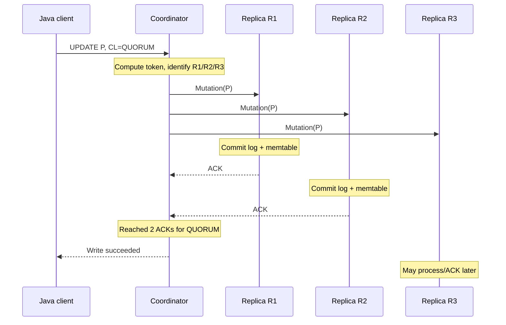
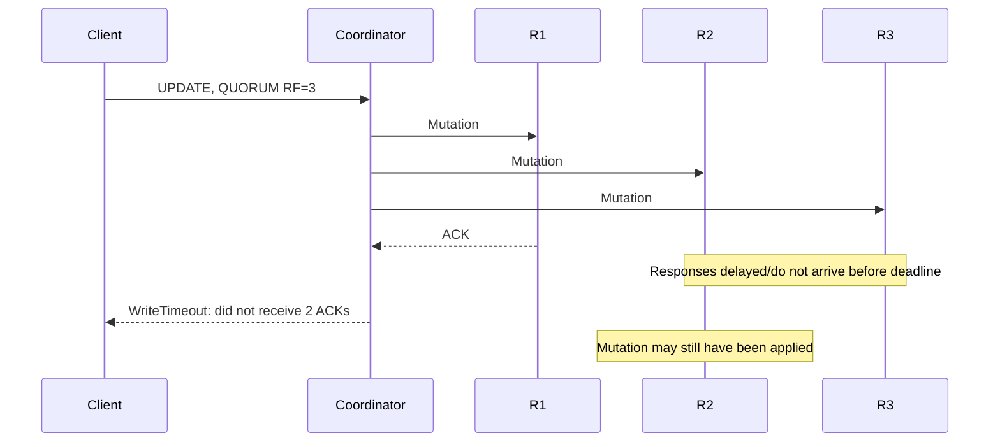

# Mutations from the Coordinator to Responsible Replicas

In Apache Cassandra, an `INSERT` or `UPDATE` statement is not simply sent to "a database server" to be stored and finished. The client sends a **mutation** to a node acting as the **coordinator**; the coordinator determines **which replicas are responsible for storing the partition**, forwards the mutation over the network to them, collects responses according to the **consistency level (CL)**, and returns the result to the client. On each replica, the write path involves the **commit log**, **memtable**, and subsequent **SSTable** creation.

The most common point of confusion lies in three distinct concepts: **the replica has applied the mutation**, **the coordinator has received enough ACKs for the CL**, and **all replicas are durable and fully synchronized**. These are not a single event. A successful `LOCAL_QUORUM` write may still leave replicas in another DC without the data. Conversely, a `WriteTimeout` may have already been applied by some replicas, merely lacking timely responses.

This lesson belongs to the **Write Path and Durability** (`menuLevel1`) chapter of the `DATABASE_ENGINE_WIDE_COLUMN_CASSANDRA` module. The overall module focuses on understanding Cassandra's distributed and wide-column architecture: partition keys, query-driven table design, CQL, replication, compaction, repair, error handling, and Java application integration. This content focuses specifically on **the path of a mutation from the coordinator to the target replica set and the meaning of write acknowledgments**, laying the foundation for later lessons on commit logs, memtables, SSTables, and durability in greater detail.

## 1. Learning Objectives

After this lesson, you will be able to:

1. Distinguish between **CQL statement**, **mutation**, **partition**, **replica**, and **coordinator**.
2. Explain why the coordinator might not be a replica owning the data and how the **target replica set** is determined based on the partition key, token, and replication strategy.
3. Diagram the path of a normal write: client → coordinator → replica → ACK → client.
4. Describe the roles of the **commit log**, **memtable**, and **SSTable**, as well as the boundary between CL ACKs and disk fsync.
5. Calculate the required ACK counts for `ONE`, `QUORUM`, `LOCAL_QUORUM`, `EACH_QUORUM`, and `ALL` in single- and multi-DC topologies.
6. Explain mutation delivery when a replica is slow or down, hinted handoff, and unknown write outcomes after a timeout.
7. Practice CQL, tracing, observing replica placement, and writing Java Driver 4.x code that sets the CL per statement.
8. Identify issues related to timestamps, idempotent retries, conditional writes, and the limitations of relying solely on a single successful response.

## 2. From CQL Statement to Mutation

In CQL, learners see statements like:

```sql
INSERT INTO shop.order_by_id (order_id, state)
VALUES (11111111-1111-4111-8111-111111111111, 'CREATED');

UPDATE shop.order_by_id
SET state = 'PAID'
WHERE order_id = 11111111-1111-4111-8111-111111111111;

DELETE state FROM shop.order_by_id
WHERE order_id = 11111111-1111-4111-8111-111111111111;
```

At the distributed storage layer, those operations are converted into a **mutation**: information about the changes to be applied to one or more cells/rows within a **partition**. A mutation is not necessarily "an entire new row"; it may only contain the value of an updated cell, a tombstone for deleted data, or TTL-related metadata.

### 2.1. Terms to Keep Distinct

| Term | Role on the write path |
| --- | --- |
| **CQL statement** | The statement sent by the client, e.g., `UPDATE ... WHERE order_id = ?`. |
| **Mutation** | Internal representation of a data change to be sent to replicas. |
| **Partition key** | The key component used to compute the token that determines the partition's logical location. |
| **Token** | The value derived by the partitioner from the partition key; used for routing around the ring. |
| **Coordinator** | The node that receives the request, identifies target replicas, coordinates, and aggregates responses. |
| **Replica** | A node designated by the replication strategy to store a copy of the partition. |
| **Replication factor (RF)** | The number of copies of a partition within a configured scope, usually per DC. |
| **Consistency level (CL)** | The threshold/scope of responses the coordinator must wait for before reporting success. |
| **ACK** | A response from a replica indicating mutation processing; not proof that all other nodes have updated. |
| **Hint** | Temporary mutation information stored for redelivery to a missed replica via hinted handoff. |

**Mental exercise:** When you see `UPDATE` with `WHERE order_id = ?`, first identify the **partition key**, rather than inferring from the name of the node the client is connected to. Data placement resides on the **replicas chosen from token/ring metadata**, not fixed to the coordinator.

### 2.2. A Mutation Is a Logical Change, Not a Row Snapshot

Consider the table:

```sql
CREATE TABLE shop.order_by_id (
  order_id uuid PRIMARY KEY,
  state text,
  updated_by text,
  updated_at timestamp
);
```

Writing `UPDATE ... SET state='PAID'` does not mean the coordinator must send **all three remaining columns** to every replica. Cassandra supports cell/row-level writes with appropriate timestamps, and each replica reconciles old and new versions during subsequent reads and compaction.

**Wide-column stores by partition:** A partition can have many clustering rows; how data is grouped by partition key directly affects **which replica set bears the load**. Choosing a poor partition key makes a single replica set overly hot, even if the cluster has many nodes.

## 3. Who Acts as the Coordinator?

The client uses the Cassandra native protocol to connect to a node capable of handling the request. The node receiving the request acts as the **coordinator for that operation**. It does not have to belong to the target replica set for the partition.

```text
       Java application / cqlsh
                 |
                 |  CQL UPDATE, CL=QUORUM
                 v
          +---------------+
          | Coordinator C |    (may not store partition P)
          +---------------+
             /    |     \
            v     v      v
           R1     R2     R3
            \     |     /
        Replicas of partition P
```

### 3.1. Coordinator Responsibilities

For a normal write, the coordinator handles these conceptual tasks:

1. Receives the request and coordinates with the query layer to validate/prepare the appropriate statement.
2. Identifies the mutation's **partition key** and the **natural replicas** responsible for the partition.
3. Sends the mutation to the appropriate replicas via internode messaging, potentially with cross-DC forwarding/optimizations depending on version and topology.
4. Tracks replica status, ACKs, errors, and deadlines according to the **request's CL**.
5. Once enough valid responses arrive, returns success to the client; otherwise, returns an error such as `Unavailable`, `WriteTimeout`, or `WriteFailure` depending on the situation.
6. Where permitted and configured, assists in storing hints so replicas that temporarily missed the mutation have a chance to receive it later.

**What the coordinator does NOT automatically do just by receiving a request:** become an extra replica for every partition, lock all concurrent writes across the cluster, or force every DC to have the same version before returning a local ACK.

### 3.2. The Connection Does Not Determine Where Data Is Stored

Suppose the Java Driver contacts `node-7` for an `UPDATE`. `node-7` may act as the coordinator, while the three replicas actually owning the partition are `node-2`, `node-4`, and `node-9`. When sending the next request to `node-8`, the same partition key and stable replication strategy still resolve to **the same target replica set**, rather than moving data onto `node-8`.

Drivers typically attempt efficient routing, preferring the local DC as configured; however, **driver routing and replica placement are two separate concepts**. When investigating latency, you need to know both the coordinator and the target replicas.

## 4. How Does the Coordinator Determine Target Replicas?

### 4.1. From Partition Key to Token

Suppose we have this table:

```sql
CREATE TABLE shop.order_by_customer (
  customer_id uuid,
  order_id uuid,
  state text,
  PRIMARY KEY ((customer_id), order_id)
);
```

Here:

- `customer_id` is the **partition key**.
- `order_id` is the **clustering key**; it selects a row within the partition and **does not change the replica set** of the partition.
- All orders for the same `customer_id` share the same partition token and are generally stored by the same target replica set.

In the common configuration using `Murmur3Partitioner`, Cassandra computes the token from the binary representation of the partition key. If the partition key consists of multiple columns, the values are encoded as a **composite partition key**; you must not arbitrarily hash a string and treat it as a Cassandra token.

```text
customer_id
    |
    v
Partition key encoding
    |
    v
Partitioner -> token T
    |
    v
Token ring / cluster metadata
    |
    v
Replication strategy + RF per DC
    |
    v
Natural replicas for partition P
```

### 4.2. Replication Strategy and DC Scope

Two common strategies are:

- **`SimpleStrategy`:** distributes replicas simply around the ring; primarily suited for single-DC test environments.
- **`NetworkTopologyStrategy`:** specifies RF per datacenter, suitable when distributing data and fault-tolerance rules across DCs/racks.

Example:

```sql
CREATE KEYSPACE shop
WITH replication = {
  'class': 'NetworkTopologyStrategy',
  'dc1': 3,
  'dc2': 2
};
```

Assuming sufficient nodes exist, a partition has **3 replicas in dc1 and 2 replicas in dc2**. Total RF is 5. The target set is chosen based on **token placement within each DC** and the replication policy, not "any five idle nodes."

### 4.3. The Replica List Is Not the Mandatory ACK List

RF is the number of **copies that must be maintained** per the topology. CL is the threshold of **responses to wait for**. With RF=3 and a `ONE` write, Cassandra still aims to send the mutation to **the entire replica set owning the partition**, even though it can return a response after just **one** replica ACKs. This is a fundamental distinction:

| Question | Governing configuration/mechanism |
| --- | --- |
| Which nodes is the mutation intended for? | Partition key, token, replication strategy, and RF. |
| Which responses must the coordinator wait for before reporting success? | CL and request status. |
| How does a replica that missed a write catch up? | Mutation delivery, hinted handoff, repair, and convergence mechanisms. |

**Do not misinterpret `CL=ONE` as "Cassandra only sends the mutation to one replica."** CL controls **acknowledgment**, not RF.

## 5. Standard Write Path: Message Flow from Client to ACK

Consider a single DC with RF=3, where partition `P` has replicas `R1`, `R2`, and `R3`. The client requests a `QUORUM` write, where the threshold is `floor(3/2)+1=2`.



This is a **logical model**. On an actual network, Cassandra may apply message forwarding, batching, speculative behavior, and cross-DC routing optimizations depending on the version. You should not infer from the diagram that the coordinator always creates a single direct TCP packet per replica or that steps across the three nodes occur in the exact same order.

### 5.1. Independent Steps to Observe

| Time | Event | Sufficient for the client to declare a successful QUORUM write? |
| --- | --- | --- |
| `t0` | Client sends CQL to coordinator. | **Not yet**. |
| `t1` | Coordinator identifies the replica set. | **Not yet**. |
| `t2` | Mutation is sent/scheduled for delivery. | **Not yet**. |
| `t3` | `R1` applies mutation and sends ACK. | **Not yet**, only one response. |
| `t4` | `R2` applies mutation and sends ACK. | **Possibly**, enough for two ACKs if no other error occurred. |
| `t5` | Client receives success response. | **Provides evidence the request was acknowledged at CL**. |
| `t6` | `R3` receives/applies mutation or catches up later. | Additional convergence, **not a prerequisite for the QUORUM response**. |

An important separation: **the coordinator receiving enough ACKs** and **the client receiving the response** are also two different events. If `t4` occurred but the response is lost on the way back to the client, the driver can still time out; the application must not assume the data was definitely not written.

### 5.2. What If the Coordinator Is Also a Replica?

When the coordinator is also in the target replica set, it can apply the mutation **locally** using the same replica storage path while coordinating the other replicas. The local ACK counts toward the threshold like any single replica ACK; **the coordinator must not be counted as two replicas**.

Conversely, if the coordinator is **not** a target replica, it does not automatically become a data replica for the partition merely because it received the request.

## 6. What Happens on Each Replica?

When a mutation arrives at a replica able to process the request, Cassandra executes a node-local write path. For normal writes, the key components are:

```text
                 Mutation from coordinator
                             |
                             v
                       Replica node
                             |
                +------------+------------+
                |                         |
                v                         v
             Commit log                 Memtable
       (sequential/append log)      (in-RAM structure)
                |                         |
       Recovery after restart    Flush by threshold/condition
                                          |
                                          v
                                       SSTable
                                 (immutable, on disk)
                                          |
                                          v
                              Background compaction later
```

### 6.1. Commit Log — The Recovery Write

The commit log stores mutation information in append-only fashion, enabling **replay** if the node restarts or crashes before memtable data is flushed to an SSTable. It is not a business-history file queryable via CQL.

The commit log is typically organized into segments. Only when the data in the corresponding memtables has been flushed and checkpointed as eligible can old segments be recycled or deleted by commit log management.

**Note on durability:** when a mutation is ACKed and when commit log bytes are **fsynced to the storage device** depend on the `commitlog_sync` setting and Cassandra version. For example, **periodic** sync may allow an ACK before the periodic fsync runs; stricter sync configurations such as **batch** have different sync-waiting behavior. Therefore, an ACK from a replica does not always mean "bytes are physically stable on disk in every mode."

### 6.2. Memtable — The In-Memory Write Structure

The memtable receives data for reads and internal management. Mutations are written to an in-RAM data structure for fast access; **normal writes do not have to wait for an SSTable flush before returning an ACK**.

When a memtable reaches a threshold or due to operational triggers, Cassandra **flushes** the data to immutable SSTables. That is a background storage step separate from waiting for replica ACKs at CL.

### 6.3. SSTables and Compaction

SSTables are the on-disk storage format; data versions and tombstones may span multiple SSTables. **Compaction** merges them to optimize storage and reads according to configured strategies. It is **not** a prerequisite for a `QUORUM` write to succeed and does **not** reconcile contents across replicas.

**Anti-entropy repair** is a separate mechanism used to compare and repair data between replicas. Local compaction must be distinguished from inter-node repair.

### 6.4. Summary: Three Levels of "Written"

| State | What has happened | What cannot be inferred yet |
| --- | --- | --- |
| **Replica processed and ACKed mutation** | The replica completed the processing needed to respond. | All other replicas have ACKed; every mode fsyncs before ACK. |
| **Coordinator has enough ACKs for CL** | The request's acknowledgment threshold/scope is satisfied. | All target replicas have caught up; multi-partition transactions exist. |
| **Data flushed/compacted/repaired** | Respective storage and convergence mechanisms have progressed. | That these events had to complete before every normal write response. |

In durability design, you must consider **RF**, **CL**, **commit log sync**, disk quality, correlated failures across replicas, and backup/repair operations. There is no "absolute durability switch" achieved simply by choosing `ALL`.

## 7. ACKs by CL: Thresholds on the Same Replica Set

### 7.1. Single DC with RF=3

Suppose all three replicas of the partition reside in `dc1`:

| Consistency level | Minimum responses for write success | If one replica is down |
| --- | ---: | --- |
| `ONE` | 1 | Can succeed. |
| `TWO` | 2 | Can succeed if the remaining two replicas ACK. |
| `THREE` | 3 | Not enough live replicas to meet threshold. |
| `QUORUM` | `floor(3/2)+1=2` | Can succeed. |
| `ALL` | 3 | Not enough live replicas. |
| `LOCAL_ONE` | 1 local | Same as `ONE` in a single-DC lab. |
| `LOCAL_QUORUM` | 2 local | Same as `QUORUM` in a single-DC lab. |
| `ANY` (writes only) | One replica ACK **or** a hint may satisfy per supported semantics | Can succeed even if replicas are down; does not guarantee a target replica ACKed if satisfied only by a hint. |

"Can succeed" means **enough replicas meet the threshold** provided they reply in time; a node that is UP but overloaded or on a slow network can still cause a request timeout.

### 7.2. RF=5 and the Meaning of QUORUM

With RF=5, `QUORUM=floor(5/2)+1=3`. The coordinator requires three ACKs for a `QUORUM` write, not two as with RF=3.

Quorum only has meaning relative to **the replica set of the specific partition and scope**. If the cluster has dozens of nodes overall but a partition has RF=3, you must not use the total cluster node count as `N` in the formula.

### 7.3. Distinguishing RF and CL in Fault-Tolerance Planning

For a write to succeed:

\[
\text{valid replica responses within CL scope} \geq \text{CL threshold}
\]

However, to protect an **acknowledged write** across subsequent failures, you must also check **which fault domains it reached**, the local durability of those replicas, and whether failures can occur simultaneously. Two ACKs in the same rack do not provide the same physical fault isolation as two ACKs across different racks, even though the count is two in both cases.

## 8. Multiple Datacenters: Where Does the Coordinator Send and Wait?

Suppose a partition uses `NetworkTopologyStrategy`:

```text
                     Coordinator C in dc1
                            |
             +--------------+--------------+
             |                             |
      dc1: RF=3                       dc2: RF=3
    A1    A2    A3                  B1    B2    B3

             Total RF = 3 + 3 = 6 replicas.
```

Upon receiving a mutation, Cassandra aims to deliver the data to **both replica sets of the partition** per the topology. However, the coordinator **only waits for ACKs satisfying the chosen CL** before reporting success.

| Write CL | Required responses | What is not guaranteed after response |
| --- | --- | --- |
| `LOCAL_ONE` from dc1 | 1 ACK from dc1 | That the other two dc1 replicas and all dc2 replicas have applied it. |
| `LOCAL_QUORUM` from dc1 | 2 ACKs in dc1 | That a dc2 quorum has applied it. |
| Cluster-wide `QUORUM` | Any 4 ACKs across the 6 total replicas | That **both** DCs have a local quorum of ACKs. |
| `EACH_QUORUM` (writes) | 2 dc1 ACKs **and** 2 dc2 ACKs | That every replica has ACKed. |
| `ALL` | 6 ACKs | Can work when a target replica is down; `ALL` requires all of them. |

**Key takeaway:** in a balanced `3+3` topology, `QUORUM` requires four ACKs so it must include ACKs from more than one DC, yet it does not enforce **two from each DC**. For instance, `A1+A2+A3+B1` satisfies `QUORUM`; an `EACH_QUORUM` write still requires **one more ACK in dc2**.

### 8.1. A LOCAL_QUORUM Write Is Not "Replicate Only in the Local DC"

If the coordinator is in `dc1` and `LOCAL_QUORUM` is requested, two `dc1` ACKs suffice to return a response. This **does not mean Cassandra skips dc2 replicas**: remote replication remains part of the cluster's write/mutation distribution path. However, **dc2 ACKs are not a prerequisite for the local response**, so a dc2 client reading immediately afterward may observe an older version if the mutation has not yet arrived.

You must distinguish:

1. **The replica set that needs updating eventually**: governed by replication strategy/RF.
2. **The response set to wait on for returning success**: governed by CL.
3. **The replica set that actually received data before a client reads**: governed by latency, liveness, and system state.

### 8.2. When Two DCs Have Unequal RFs

Suppose `dc1 RF=3` and `dc2 RF=2`:

| CL | Threshold for a write |
| --- | --- |
| `QUORUM` | `floor(5/2)+1=3` ACKs cluster-wide. |
| `LOCAL_QUORUM` from dc1 | `floor(3/2)+1=2` dc1 ACKs. |
| `LOCAL_QUORUM` from dc2 | `floor(2/2)+1=2` dc2 ACKs, i.e., both dc2 replicas. |
| `EACH_QUORUM` | 2 dc1 ACKs and 2 dc2 ACKs. |
| `ALL` | 5 ACKs. |

A `QUORUM` write from dc1 **can achieve all three ACKs solely within dc1** when all three local replicas are healthy. Do not claim "global quorum must always wait for the remote DC" when RFs are skewed.

### 8.3. LOCAL Scope Depends on the Coordinator

`LOCAL_QUORUM` means quorum within the **coordinator's DC**, not "the DC the business calls primary" or the client's physical location. In Java applications, `local datacenter` configuration and routing must align; if write and read requests are coordinated across different DCs, local ACK sets might not intersect.

### 8.4. WAN Risks on the Write Path

A slow or partitioned WAN can:

- Fail to block `LOCAL_QUORUM` writes in a healthy DC if local ACKs are met.
- Cause `QUORUM` writes in a `3+3` topology to fail to reach four ACKs.
- Cause `EACH_QUORUM` to fail due to lacking quorum in one DC.
- Cause `ALL` to fail because one or more target replicas are unreachable.

Liveness state at the coordinator determines whether an error is reported immediately as `Unavailable` or whether the request is sent and times out. **Missing a remote ACK** is a fact about the response, not automatic proof that the mutation was permanently lost in the remote DC.

## 9. Slow Replicas, Down Replicas, and Hinted Handoff

### 9.1. Replica Down While Coordinator Sends Mutation

Suppose RF=3, writing at `QUORUM`:

```text
R1: UP, applies mutation and ACKs.
R2: UP, applies mutation and ACKs.
R3: DOWN, has not received mutation.

W = 2; two ACKs from R1/R2 -> can report success.
```

Where configuration and conditions permit, Cassandra may store a **hint** for `R3`. Once R3 recovers, **hinted handoff** attempts to replay the missed mutations.

**Hinted handoff is best effort:** hints are bounded by retention window, capacity, and configuration; they do not replace **anti-entropy repair** for replicas that stay down long-term or miss many mutations.

### 9.2. ONE vs. ANY Writes

This is a critical distinction:

- A `ONE` write requires at least **one target replica** to respond validly.
- An `ANY` write can be acknowledged when **either one replica ACKs or a hint is stored** per supported semantics, even if no target replica has ACKed yet.
- `ANY` is **invalid for normal `SELECT` queries**.

If `ANY` succeeds solely via a hint, **do not infer that an immediate `ONE` read will see the mutation**. A hint is held for **redelivery**; it is not a replica ready to serve `SELECT` statements.

### 9.3. When a Node Is UP but the Network Is Slow

A replica considered alive by the failure detector can still suffer from CPU saturation, disk bottlenecks, GC pauses, queuing, or packet loss. If the coordinator waits for two ACKs at `QUORUM` but receives only one before the deadline, the client may see `WriteTimeout` even though the slow replica eventually processed the mutation.

Thus **"replica UP" does not equate to "replica will ACK in time."** Investigation requires checking live replica counts, response latencies, and load on the nodes owning the partition.

### 9.4. Why Read Repair and Compaction Do Not Replace Hints

| Mechanism | Purpose |
| --- | --- |
| **Hinted handoff** | Holds/replays mutations for replicas that temporarily missed a write. |
| **Read reconciliation** | Reconciles versions returned by replicas along the read path. |
| **Read repair** | Can fix discrepancies detected by the read path, depending on version/configuration. |
| **Anti-entropy repair** | Proactively/periodically reconciles replica data without requiring an application read request. |
| **Compaction** | Merges and cleans up SSTables/tombstones **on each node** per storage rules. |

These relate to data convergence at different points in time. None of them implies "all mutations are permanently synchronized the moment the coordinator reports `ONE` success."

## 10. Coordinator Errors Seen from the Client Side

### 10.1. `UnavailableException`

The coordinator determines that the number of replicas **considered alive** is insufficient to satisfy the CL. For example, RF=3, `QUORUM` requires two, but only one replica of the partition is considered UP. The request may be rejected because there is no path to achieving quorum acknowledgment.

### 10.2. `WriteTimeoutException`

The coordinator did not receive enough responses or could not complete the write path within the request timeout. Example:



**Important point:** The number of ACKs the coordinator **received** differs from the number of replicas that **may have applied** the mutation. An ACK can arrive late or be dropped on the network.

### 10.3. `WriteFailureException`

A replica may report an error while processing a mutation; the coordinator can no longer meet the required threshold. Other replicas might still have written the data. Simply increasing timeouts usually does not resolve root causes such as disk errors or resource exhaustion.

### 10.4. Driver Timeout and Lost Coordinator Response

The coordinator may have achieved quorum and sent success, only for the client-coordinator connection to drop. The Java Driver reports a timeout or connection error. **The server may have completed the operation**, even though the client did not receive the ACK. Therefore, any write failure with a lost outcome must be designed for an **unknown outcome**.

| Outcome seen by client | Valid inference | Must NOT be inferred |
| --- | --- | --- |
| Write succeeded at `ONE` | At least the `ONE` condition was acknowledged. | All replicas are synced or fsynced in every mode. |
| Write succeeded at `QUORUM` | Enough quorum ACKs in the corresponding scope. | Every DC achieved local quorum. |
| `Unavailable` | Request was not acknowledged at CL due to insufficient replicas considered alive. | Old data was lost; all prior requests were not applied. |
| `WriteTimeout` | Not enough CL acknowledgments arrived in time. | No replica wrote the mutation. |
| `WriteFailure` | At least one replica reported an error; CL was not acknowledged. | All replicas rejected the mutation. |
| Driver timeout/connection loss | Client did not receive a result within the deadline. | The server definitely did not execute the write. |

### Retry and Idempotency

Resending an `UPDATE ... SET state='PAID'` with the same primary key, payload, and timestamp can be designed to be nearly idempotent; a **counter increment** or an `INSERT` generating a new UUID on every retry is not. If a retry uses a newer timestamp, a business-wise older mutation could even overwrite a concurrent update via last-write-wins.

**Do not silently downgrade CL on retry**: a `QUORUM` write that times out and is retried with `ONE` succeeding only proves the retry met `ONE`—you must not claim the request was ACKed at quorum.

## 11. Synthesis Example: Two Client Sessions, One Partition, Three Replicas

Suppose `R1,R2,R3` all store the partition with `order_id=O`; A connects to coordinator `C1`, and B connects to coordinator `C2`. In a single DC with RF=3:

```text
                Client A                       Client B
                   |                              |
                C1 coordinator                 C2 coordinator
                   \                             /
                    +------------+--------------+
                                 |
                       Replicas: R1,R2,R3

A's write: W=2 (QUORUM)
B's read:  R=2 (QUORUM)
```

If A writes successfully to `R1,R2`, and B reads afterward from `R2,R3`:

\[
W + R = 2+2=4>3=N
\]

The response sets overlap at `R2`. Cassandra's read path can use the data response and digests to detect differing versions, fetch additional data, and **reconcile**. Absent concurrent mutations or anomalous timestamps, this forms the basis for B observing the newly written mutation.

Conversely, if B reads at `ONE` from `R3` before it catches up, the value can be stale. Only when both **write CL** and **read CL** are known can we reason about read-after-write; the write path alone does not force every subsequent read to hit an ACKed replica.

**One final distinction:** A normal `QUORUM` write is not a conditional consensus protocol. If A and B update the same cell concurrently, both requests can succeed; Cassandra resolves the logical winning value by timestamp. To protect state invariants with `IF NOT EXISTS`/`IF version=?`, you need LWT/Paxos with serial consistency.

## 12. CQL Practice: Observing the Write Path in a Lab Cluster

Run only on a **test cluster**. Examples assume a datacenter named `dc1` with **at least three eligible nodes** and RF=3; adjust the DC name based on `nodetool status` in your environment.

### 12.1. Create Keyspace and Table

```sql
CREATE KEYSPACE IF NOT EXISTS write_path_lab
WITH replication = {
  'class': 'NetworkTopologyStrategy',
  'dc1': 3
};

CREATE TABLE IF NOT EXISTS write_path_lab.order_by_id (
  order_id uuid PRIMARY KEY,
  state text,
  operation_id uuid,
  updated_at timestamp
);
```

Query only by `order_id` to demonstrate the exact replica set of a single partition. Do not run full-table scans or `ALLOW FILTERING` and infer that all results belong to the same replica set.

### 12.2. Writing and Reading at QUORUM

In `cqlsh`:

```sql
CONSISTENCY QUORUM;

INSERT INTO write_path_lab.order_by_id (
  order_id, state, operation_id, updated_at
) VALUES (
  11111111-1111-4111-8111-111111111111,
  'CREATED',
  22222222-2222-4222-8222-222222222222,
  '2026-11-21 10:00:00+0000'
);

UPDATE write_path_lab.order_by_id
SET state = 'PAID',
    operation_id = 33333333-3333-4333-8333-333333333333,
    updated_at = '2026-11-21 10:05:00+0000'
WHERE order_id = 11111111-1111-4111-8111-111111111111;

SELECT state, operation_id, WRITETIME(state)
FROM write_path_lab.order_by_id
WHERE order_id = 11111111-1111-4111-8111-111111111111;
```

`CONSISTENCY` is a **cqlsh** command controlling the CL for **subsequent statements within that shell session**. `WRITETIME(state)` is the write timestamp of the winning logical cell, not the time every replica received an ACK or when the commit log fsynced.

### 12.3. Observing Coordinator/Tracing

```sql
TRACING ON;

CONSISTENCY QUORUM;

UPDATE write_path_lab.order_by_id
SET state = 'PACKED'
WHERE order_id = 11111111-1111-4111-8111-111111111111;

TRACING OFF;
```

The trace can reveal the coordinator, some replicas receiving the mutation, message events, and latencies. **Do not assume** the trace contains exactly one message per replica or captures every ACK detail after CL is satisfied; output varies by version, internode optimizations, and collection timing.

**Do not enable broad tracing in production**: it adds overhead and generates trace data.

### 12.4. Identifying Topology and Replica Placement

From a shell with administrative access to a Cassandra node:

```bash
# View nodes and DCs at the cluster level.
nodetool status

# Syntax illustration: view endpoints holding the row's partition key.
# Run on a nodetool version that supports getendpoints.
nodetool getendpoints write_path_lab order_by_id 11111111-1111-4111-8111-111111111111
```

In a **three-node lab with RF=3 in one DC**, theoretically all three are replicas of the partition. In a cluster with **more nodes than RF**, inspecting replica placement prevents false conclusions such as "a random node just went down so my partition lost a replica."

If `getendpoints`, UUID key parsing, or permissions on your distribution differ from the example, consult the corresponding `nodetool` help. **Do not treat `nodetool status` alone as proof that a specific mutation has been applied.**

### 12.5. Single-Node Down Test Matrix

In a **lab cluster where stopping a node is permitted**, single DC RF=3, with one partition replica unresponsive:

| Test write | Required ACKs | Prediction if remaining two replicas are healthy |
| --- | ---: | --- |
| `CONSISTENCY ONE` + `UPDATE` | 1 | Can succeed. |
| `CONSISTENCY QUORUM` + `UPDATE` | 2 | Can succeed. |
| `CONSISTENCY ALL` + `UPDATE` | 3 | Insufficient; may return `Unavailable` or timeout depending on liveness. |

When testing `ALL`, do not reuse the same partition/row as a baseline and treat failure as a rollback. Some mutations may have reached replicas even when the response fails. Use only **dedicated test keys** and keep an operation ID for reconciliation.

## 13. Java Driver 4.x: Sending Mutations with Explicit CL

The snippet below uses a `CqlSession` created with appropriate contact points, local datacenter, authentication, and TLS. `PreparedStatement` is prepared once; each request sets its own CL.

```java
import com.datastax.oss.driver.api.core.CqlSession;
import com.datastax.oss.driver.api.core.DefaultConsistencyLevel;
import com.datastax.oss.driver.api.core.DriverTimeoutException;
import com.datastax.oss.driver.api.core.cql.BoundStatement;
import com.datastax.oss.driver.api.core.cql.PreparedStatement;
import com.datastax.oss.driver.api.core.servererrors.UnavailableException;
import com.datastax.oss.driver.api.core.servererrors.WriteFailureException;
import com.datastax.oss.driver.api.core.servererrors.WriteTimeoutException;

import java.time.Instant;
import java.util.UUID;

public final class OrderMutationRepository {
    private final CqlSession session;
    private final PreparedStatement update;

    public OrderMutationRepository(CqlSession session) {
        this.session = session;
        this.update = session.prepare(
            "UPDATE write_path_lab.order_by_id " +
            "SET state = ?, operation_id = ?, updated_at = ? " +
            "WHERE order_id = ?");
    }

    public void updateState(
            UUID orderId, String state, UUID operationId, Instant at) {
        BoundStatement request = update
            .bind(state, operationId, at, orderId)
            .setConsistencyLevel(DefaultConsistencyLevel.LOCAL_QUORUM);

        try {
            session.execute(request);
            // Received success response according to the request's LOCAL_QUORUM.
        } catch (UnavailableException e) {
            // Coordinator saw insufficient local replicas considered UP.
            throw e;
        } catch (WriteTimeoutException
                 | WriteFailureException
                 | DriverTimeoutException e) {
            // Mutation may have already been applied by some replicas.
            // Business layer needs to handle the unknown outcome.
            throw e;
        }
    }
}
```

### 13.1. Implementation Reminders

- **`DefaultConsistencyLevel.LOCAL_QUORUM`** chooses the ACK threshold in the coordinator's DC; it does not change the keyspace RF.
- `session.execute(...)` succeeding proves the request was acknowledged at the chosen CL, **not** that every replica or DC is updated.
- A `WriteTimeout` may have already applied the mutation on a replica; **do not arbitrarily generate a new operation ID to retry**.
- Do not mark every statement `setIdempotent(true)` merely to let the driver auto-retry: idempotency must be designed across primary key, payload, timestamp, and side effects.
- Driver `local datacenter` configuration is part of request routing and defines the scope of `LOCAL_*` levels.
- If the application runs outside the container network, ensure Cassandra's broadcast addresses are reachable by the driver; contact points alone do not fix every routing issue.

### 13.2. Timestamp Assignment and Retries

If a mutation times out and is retried with a **newer timestamp**, it can overwrite a change from another client under **last-write-wins**. For repeatable operations, consider keeping a stable `operationId`, payload, and CQL timestamp when business rules allow. A fixed timestamp does not replace **LWT** when conditional state transitions are required.

For example, two normal `UPDATE` writes to `state` can both be ACKed at `QUORUM`; the final outcome is reconciled by Cassandra using timestamps. To "update only if `state='CREATED'`," use `UPDATE ... IF state='CREATED'` and check `[applied]`.

## 14. Real-World Scenarios: Mismatched Expectations from Confusing ACK with Durability

### Scenario A — ONE Write and Remaining Nodes Not Yet Updated

RF=3, client sends `UPDATE state='PAID'` at `ONE`, `R1` ACKs, and `R2/R3` have not received the mutation yet. The coordinator can return success. A client reading `ONE` from `R3` can observe `CREATED`.

**Lesson:** a `ONE` response proves at least one target replica ACKed; it does not guarantee read-after-write across all replicas.

### Scenario B — QUORUM Write Succeeds When One Node Is Down

RF=3, `R3` is down; `R1,R2` ACK. A `QUORUM` write can still succeed. When R3 recovers, hinted handoff or repair can help it catch up; R3's absence does not invalidate the earlier quorum response.

**Lesson:** RF defines three copies; `QUORUM` CL requires only two ACKs, though managing missed data remains important.

### Scenario C — LOCAL_QUORUM Write in DC1, Read in DC2

RF=3+3, a `LOCAL_QUORUM` write in dc1 gets two local ACKs; DC2 is lagging. A client reading `LOCAL_QUORUM` in dc2 can see the old state.

**Lesson:** the two quorums reside in **replica sets in different DCs** and do not automatically intersect. If business logic requires immediate cross-DC reads, design CL/routing accordingly.

### Scenario D — Periodic Commit Log and Power Loss

A replica may have ACKed along the write path while a periodic commit log configuration had not yet run the latest fsync. If a sudden power loss occurs before the sync window, mutation recovery on **that node** differs from when the commit log was fsynced. Other replicas may still protect the copy.

**Lesson:** "Enough CL ACKs" and "every byte is safe on disk in every mode and every failure type" are two different statements. You must evaluate commit log sync mode, replication, storage infrastructure, and failure assumptions.

### Scenario E — Timeout After Some Replicas Wrote

A `QUORUM` write receives only one ACK before the deadline, and the coordinator returns `WriteTimeout`. Another replica may have applied the mutation while its ACK arrived late.

**Lesson:** the client outcome is **unknown**, not rolled back. Retries must align with idempotency and business state.

## 15. Checklist for Observing the Write Path in Production

When a Cassandra write API is slow or timing out, gather:

| Information group | Questions to answer |
| --- | --- |
| **Data** | Which statement? Which partition key? Is there a hot partition or oversized mutation? |
| **Replica placement** | What are RF, DC/rack, token, and which nodes are actually the target replicas? |
| **Coordinator** | Which node/DC did the request go through? Is the driver preferring the local DC properly? |
| **CL** | How many ACKs are required, and from what scope? Does retry alter CL? |
| **Network** | Are there RTT spikes, packet loss, cross-DC disconnects, or internode congestion? |
| **Liveness** | Are replicas down or simply UP yet overloaded? |
| **Storage** | Are disk latency, commit log, memtable/flush, compaction, or GC abnormal? |
| **Retry** | Is this causing a retry storm, repeated counter increments, or newly generated operation IDs? |
| **Convergence** | What is the hints backlog, repair status, or were nodes recently recovered? |
| **Application** | Are correlation IDs/operation IDs attached to reconcile unknown timeout outcomes? |

Do not simply raise timeouts before identifying whether the bottleneck is at the coordinator, inter-node network, commit log, or a replica hotspot. Tracing/metrics can help isolate it, but must be used within operational limits without logging sensitive data.

## 16. Exercises and Solutions

### Exercise 1 — Is the Coordinator a Replica?

An application sends an `UPDATE` to node `C`; the partition's token designates `R1,R2,R3` as replicas. If C is not in that set, does C automatically become a fourth replica?

**Answer:** No. C only coordinates the request; the target replica set remains governed by the partition key and replication strategy.

### Exercise 2 — Does ONE Make Cassandra Send to Only One Replica?

RF=3, client writes at `ONE`. A student says "Cassandra sends the mutation to just one node; the other two will never receive it." Is that true?

**Answer:** False. RF specifies the target of three replicas; `ONE` only sets the acknowledgment threshold for reporting success. The mutation is still distributed to the target replicas via the write path.

### Exercise 3 — RF=3, QUORUM

One replica is down; the remaining two replicas process and ACK in time. Can a `QUORUM` write succeed?

**Answer:** Yes. `QUORUM=floor(3/2)+1=2`, so two ACKs meet the threshold.

### Exercise 4 — RF=5, QUORUM

For an RF=5 partition, how many ACKs does a `QUORUM` write need?

**Answer:** `floor(5/2)+1=3` ACKs.

### Exercise 5 — RF=3+2, LOCAL_QUORUM

The coordinator is in dc2 with RF=2. How many ACKs does a `LOCAL_QUORUM` write need and from where?

**Answer:** `floor(2/2)+1=2` ACKs, **both from dc2**. Both local replicas must respond.

### Exercise 6 — RF=3+3, QUORUM vs. EACH_QUORUM

The coordinator receives three ACKs from dc1 and one ACK from dc2. Are `QUORUM` and an `EACH_QUORUM` write satisfied?

**Answer:** `QUORUM` requires 4/6, so it is **satisfied**. `EACH_QUORUM` requires at least two ACKs **in each DC**, so it is **not satisfied** in dc2.

### Exercise 7 — LOCAL_QUORUM Write, Cross-DC Read

A local quorum write in dc1 returns success. Another client immediately performs a local quorum read in dc2. Is it guaranteed to see the mutation?

**Answer:** No. The two response sets in different DCs are not guaranteed to intersect; remote replicas might not have received the mutation yet.

### Exercise 8 — Replica ACK and SSTables

A replica ACKs a normal write mutation. Is the mutation guaranteed to have just been flushed to an SSTable before the ACK?

**Answer:** No. The normal write path writes to the commit log and updates the memtable; SSTable flushing is a background step. Commit log fsync timing also depends on `commitlog_sync`.

### Exercise 9 — Does a Hint Count as a Replica?

No target replica ACKs, the coordinator stores a hint for a mutation, and the `ANY` write reports success. Can a `ONE` read immediately read it from a replica?

**Answer:** Not guaranteed. A hint is not a target replica ACK; before replay, the data may not be ready for reads.

### Exercise 10 — Timeout

RF=3, a `QUORUM` write hits `WriteTimeout` after one ACK. Can you conclude that R2/R3 definitely have not applied the mutation?

**Answer:** No. Responses may arrive late or be lost; the client only knows the request was not acknowledged by a quorum within the deadline.

### Exercise 11 — Partition Key and Clustering Key

A table has `PRIMARY KEY ((customer_id), order_id)`. Do two different orders for the same `customer_id` automatically land on two different replica sets?

**Answer:** No. Same `customer_id` means the same partition key, hence the same token and target replica set (under a stable topology); `order_id` is only a clustering key.

### Exercise 12 — Consensus When Two Clients Update

Two clients concurrently `UPDATE` the same `state` at `QUORUM` and both receive success. Can you infer that the coordinator only allowed one client to win like `IF NOT EXISTS`?

**Answer:** No. Normal writes do not use Paxos for conditions. Cassandra reconciles cells by timestamp; compare-and-set semantics require LWT with `IF` and checking `[applied]`.

### Exercise 13 — Newly Recovered Node

R3 just came UP after downtime. `nodetool status` shows `UN`. Does that prove R3 has received all missed mutations and needs no repair?

**Answer:** No. A node being UP only describes ring/liveness state; hinted handoff and repair may not have completed yet.

### Exercise 14 — Hotspot Pattern

One partition key is written thousands of times per second and always lands on the same three replicas. Does adding three new nodes to the cluster automatically spread that partition's write load across all six nodes?

**Answer:** Not automatically. Each partition still has a target replica set determined by RF/placement. You must examine partition key design, data distribution, and query-driven load sharing.

## 17. Summary

**Mutations from the coordinator to responsible replicas** form the core distributed write path in Cassandra. The client sends CQL to a coordinator; the partition key is turned into a token; the replication strategy determines the target replica set; the coordinator sends the mutation, tracks ACKs, and returns success upon meeting the **consistency level**. On each replica, the commit log and memtable process the write, while SSTable flushing and compaction run on separate cycles.

Three key takeaways to remember:

1. **RF determines which replicas must store the partition; CL determines how many ACKs the coordinator must wait for and from what scope.** `ONE` does not turn RF=3 into RF=1.
2. **An ACK at CL does not prove every replica is synchronized or every byte was fsynced before the ACK.** You must consider commit log configuration, convergence mechanisms, fault domains, and durability requirements.
3. **A timeout does not mean the mutation was rolled back.** Some replicas may have written while the application failed to receive enough acknowledgments; retries need appropriate keys/operation IDs and idempotent semantics.

Understanding these three points lays the groundwork for diving deeper into commit log durability, memtables/SSTables, hinted handoff, repair, read-after-write, and connecting Java applications to Cassandra in a controlled manner.

### References

- [Apache Cassandra — Dynamo / Architecture](https://cassandra.apache.org/doc/stable/cassandra/architecture/dynamo.html): coordinator, replica placement, tunable consistency, and distributed mechanisms.
- [Apache Cassandra — Storage Engine](https://cassandra.apache.org/doc/stable/cassandra/architecture/storage-engine.html): internal write path, memtable, commit log, SSTable, and compaction.
- [Apache Cassandra — CQL Data Manipulation](https://cassandra.apache.org/doc/stable/cassandra/developing/cql/dml.html): `INSERT`, `UPDATE`, `DELETE`, timestamps, and mutations.
- [Apache Cassandra — Hints](https://cassandra.apache.org/doc/stable/cassandra/managing/operating/hints.html): hinted handoff mechanism and limits when replicas miss mutations.
- [Apache Cassandra — Repair](https://cassandra.apache.org/doc/stable/cassandra/managing/operating/repair.html): anti-entropy repair across replicas.
- [Apache Cassandra — cqlsh](https://cassandra.apache.org/doc/stable/cassandra/managing/tools/cqlsh.html): `CONSISTENCY` and `TRACING` in lab exercises.
