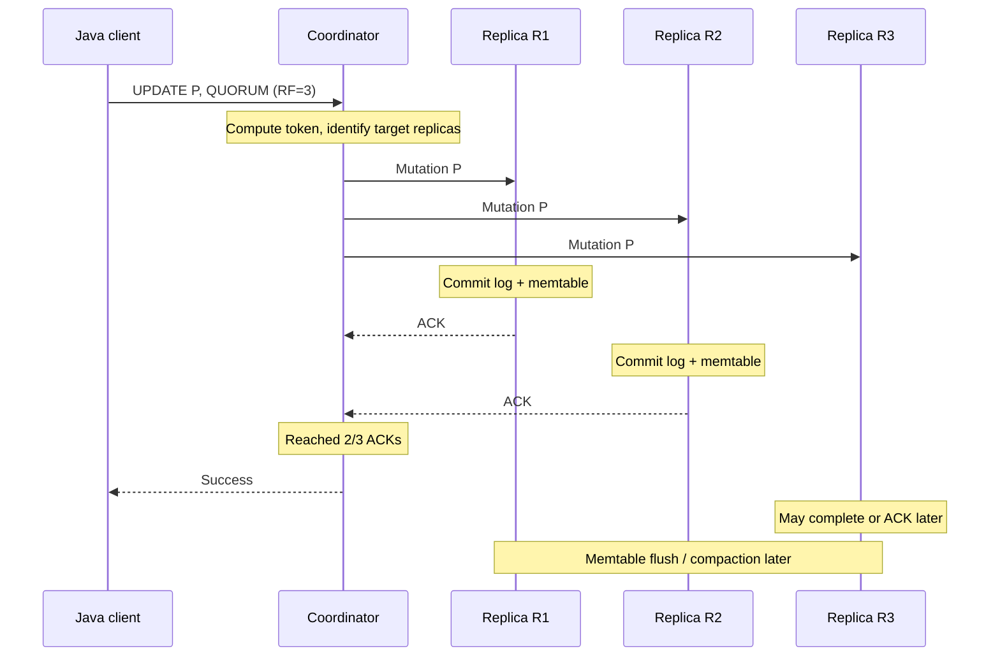

# Commit Log, Memtable, and Write Response Timing

When a Java application executes an `UPDATE` against Apache Cassandra and receives a success response, **where has the data been saved?** Is it in RAM, written to the commit log, `fsync`ed to the storage device, or already turned into an SSTable? The answer cannot be deduced merely from the client seeing "success," because Cassandra separates the **per-replica write path**, the **commit log sync policy**, and the **consistency level (CL) ACK threshold**.

On a normal write path, the coordinator forwards the mutation to the responsible replicas. Each replica processes the mutation through its **commit log** and **memtable**. Once enough responses arrive to satisfy the CL, the coordinator can report success to the client **without waiting for the memtable to flush into an SSTable**. When the commit log is synced to disk depends on the `commitlog_sync` mode, so even the phrase "written to the commit log" must be interpreted accurately.

This lesson belongs to the **Write Path and Durability** chapter of the `DATABASE_ENGINE_WIDE_COLUMN_CASSANDRA` module. The module focuses on Cassandra's distributed and wide-column architecture, partition keys, query-driven table design, consistency levels, replication, compaction, repair, error handling, and Java application integration. This lesson centers on **the commit log, memtable, and the timing of the write response**, laying the groundwork for analyzing node failures and durability.

> **Key message:** A successful write response means the request **met the CL acknowledgment requirement**. It does not mean every replica has ACKed, every memtable has flushed, every SSTable has compacted, or every replica has `fsync`ed its commit log under all configurations.

## 1. Learning Objectives

After this lesson, you will be able to:

1. Diagram the path of a mutation from the Java client to the coordinator, replica, commit log, memtable, and ACK response.
2. Distinguish between **commit log append**, **commit log sync (`fsync`)**, **memtable update**, **SSTable flush**, and **compaction**.
3. Explain how the commit log enables **replay** on node restart and the conditions for recycling commit log segments.
4. Analyze the impact of `commitlog_sync: periodic` versus `batch` on write latency and the data-loss window during node failures.
5. Separate durability on a **single replica** from the request-level acknowledgment thresholds of **ONE/QUORUM/LOCAL_QUORUM/ALL**.
6. Identify the differences among `Unavailable`, `WriteTimeout`, `WriteFailure`, and Java Driver timeouts.
7. Practice CQL, `TRACING`, `WRITETIME`, inspecting memtables/SSTables, and explaining what those tools **cannot prove**.
8. Design retries around idempotency, partition keys, timestamps, operation IDs, and business durability requirements.

## 2. Four Milestones That Must Not Be Conflated

Suppose a keyspace has three replicas for partition `P`: `R1`, `R2`, and `R3`. The client issues a `QUORUM` write, requiring two ACKs:

```text
 Java client
     |
     | UPDATE ... WHERE partition_key=P;   CL=QUORUM
     v
 Coordinator
     |
     +--------------+--------------+
     |              |              |
     v              v              v
 Replica R1     Replica R2     Replica R3
     |              |              |
 Commit log      Commit log      Commit log
     +              +              +
 Memtable        Memtable        Memtable
     |              |              |
    ACK            ACK         (not yet ACKed)
     \              /
      \            /
        Coordinator
             |
       2 ACKs >= QUORUM
             |
             v
       Client: success

   SSTable flush/compaction: a later background process,
   not a condition for each QUORUM write to return success.
```

There are **four distinct events**:

| Milestone | Event | What can be inferred |
| --- | --- | --- |
| **A** | Replica appends the mutation to the commit log and updates the memtable per the write path. | The replica has completed the local write work required; sync details depend on configuration. |
| **B** | Replicas send ACKs and the coordinator **receives enough ACKs for the CL**. | The request has met the CL acknowledgment threshold at the coordinator. |
| **C** | Client receives a success response. | The application knows the request was acknowledged per CL; this response can still be lost on the network. |
| **D** | Memtable flushes to an SSTable; commit log segment becomes eligible for reuse; compaction occurs later. | These are storage lifecycle milestones, **not default prerequisites for sending the response at C**. |

Beyond those four milestones, there is also **commit log `fsync`**. Depending on the sync mode, the `fsync` milestone may occur **before or after the ACK**. Never assume a single fixed ordering applies to every Cassandra cluster.

## 3. From CQL to Replica Write

Consider a table queried by order ID (this DDL is illustrative; create the `durability_lab` keyspace per **Section 12** before running):

```sql
CREATE TABLE IF NOT EXISTS durability_lab.order_by_id (
  order_id uuid PRIMARY KEY,
  state text,
  operation_id uuid,
  updated_at timestamp
);

UPDATE durability_lab.order_by_id
SET state = 'PAID'
WHERE order_id = 11111111-1111-4111-8111-111111111111;
```

Conceptual flow:

1. **Client** sends a CQL or prepared/bound statement to a Cassandra node.
2. The receiving node acts as the **coordinator** and determines the **partition key**, token, and **natural replicas** per the replication strategy/RF.
3. The coordinator distributes the **mutation** to the relevant replicas; across multiple DCs, Cassandra may optimize internode exchanges depending on version/topology.
4. Each replica executes the **local** write path: the mutation is recorded in the commit log when durability is enabled and inserted into the corresponding table's memtable.
5. The replica returns a response to the coordinator after completing what the write path/configuration requires.
6. The coordinator tracks ACKs/errors, checks the CL threshold, and returns success to the client once enough ACKs arrive, or returns an error if the threshold is not met.
7. On an internal schedule, the memtable is flushed to an SSTable, commit log segments are reclaimed when eligible, and compaction runs afterward.



This is a **logical diagram**; it does not guarantee exact packet ordering, CPU thread scheduling, or that the coordinator sends exactly one direct message to each replica. Internode forwarding and optimizations depend on the Cassandra version.

### 3.1. The Coordinator Is Not Automatically a Replica

The coordinator may not belong to the partition's replica set. If the coordinator is also a replica, it processes the write **locally** as a replica and its ACK counts **once** toward the threshold. Never count the coordinator as a fourth copy merely because it received the client request.

### 3.2. CL Does Not Change RF

RF governs **which copies must store the partition**; CL governs **how many responses** the coordinator waits for. With RF=3, writing at `ONE` does not mean Cassandra sends the mutation to only one replica or that the keyspace becomes RF=1.

### 3.3. Partition Keys Affect the Write Path

With `PRIMARY KEY ((customer_id), order_id)`, all `order_id` values sharing the same `customer_id` live in the **same partition**, and thus on the same replica set. An oversized or hot partition can bottleneck those specific replicas even when the cluster has many other nodes. Query-driven table design and choosing an appropriate partition key are essential to durability and latency.

## 4. What Is the Commit Log and How Does It Protect Data?

The **commit log** is an append-only sequential log on **each replica** that records mutations so they can be **replayed** when a node restarts after a crash or unclean shutdown before all memtables could flush. The commit log is not a table queryable via CQL, nor is it a cluster-wide transaction log used to commit across multiple partitions atomically.

### 4.1. Why Do We Need a Commit Log If We Already Have Memtables?

A memtable is an in-memory data structure for fast writes and reads. If writes went only to the memtable and the node suddenly lost power **before flushing**, the RAM state would vanish. The commit log provides the source needed for the node to reconstruct mutations not yet persisted in SSTables.

```text
                 Mutation arrives at replica
                         |
                         v
               +-------------------+
               | Write commit log  |  (when durable_writes is enabled)
               +-------------------+
                         |
                         v
               +-------------------+
               | Update memtable   |
               +-------------------+
                         |
                         v
               Replica sends ACK

          Background paths:
             memtable --flush--> SSTable
             commit log --replay when needed--> recover memtable
```

This sequence shows **logical recovery dependencies**, not necessarily that every thread/IO write completes in a simple serial order. In periodic sync mode, appending to the commit log and calling `fsync` are two **separate** events.

### 4.2. Append Differs from fsync

In operating systems and the JVM, writing bytes to a file/OS page cache does not automatically mean those bytes are safely persisted on power-loss-resilient storage. **`fsync`** asks the OS to synchronize relevant data/metadata to storage according to filesystem and device semantics.

At least three levels must be distinguished:

- **Mutation is appended** to the commit log write mechanism.
- **Mutation is acknowledged on the replica write path**; whether it must wait for disk sync depends on the commit log mode.
- **Commit log is synced to disk** up to a given position, providing a different level of local protection upon node crash/power loss.

**Durability is never absolute:** even after `fsync`, hardware failure risks, storage configurations that do not honor real flushes, loss of an entire fault domain, accidental deletes, or data corruption still require backups, replication, repair, and sound operational policies.

### 4.3. The Commit Log Is Divided into Segments

Rather than one unbounded file, Cassandra manages the commit log as **segments**. Mutations from multiple tables/keyspaces can be written into the same segment; each table maintains its associated memtables and replay positions.

```text
Commit log:

  segment 001       segment 002        segment 003 (active)
  +-----------+     +-----------+      +-----------+
  | T1 m1     |     | T2 m4     |      | T1 m7     |
  | T2 m2     |     | T1 m5     |      | T2 m8     |
  | T1 m3     |     | T2 m6     |      | ...       |
  +-----------+     +-----------+      +-----------+
       |                  |                  |
  Only reusable      Must track         Currently holds
  once related       flush state of     new mutations
  data is safe       related tables
  in SSTables
```

**Note:** This diagram illustrates multiple tables sharing the log; Cassandra's segment and replay-position management details vary by version. Do not rely on segment numbers in the illustration to infer a global total ordering across all requests.

### 4.4. When Can a Commit Log Segment Be Reused?

Once the memtables holding the relevant mutations have been **flushed** to eligible SSTables, the node no longer needs those commit log records to replay the memtables. A commit log segment becomes eligible for reclamation/reuse when **no unflushed data depends on it**, according to Cassandra's replay-position tracking.

If a segment contains mutations for two tables and only table A has flushed, the node **must not discard** table B's unflushed mutations. This is why **commit log space**, flush activity, and pending tasks are closely coupled.

### 4.5. Replay on Node Restart

After an unclean shutdown or process crash, Cassandra can:

1. Reinitialize the storage engine and load existing metadata/SSTables.
2. Identify the commit log segments/mutation ranges that require **replay**.
3. Reapply mutations not yet fully persisted to SSTables to restore memtable state.
4. Resume serving requests once the node reaches readiness per the startup sequence.

Replay does not mean "every request the client ever sent is recovered": only mutations with **available commit log records** can be recovered locally. If the configuration does not sync before ACK and power fails, unsynced log data may not exist after the outage.

## 5. fsync Timing: Periodic vs. Batch

A key configuration distinction in Cassandra is **how the commit log is synced to disk**. Two modes to know:

### 5.1. `commitlog_sync: periodic`

In **periodic** mode, Cassandra runs commit log `fsync` on a configured interval. The write path can return an ACK **before the next periodic sync**.

```text
Time ------------------------------------>

append mutation M
  |   update memtable
  |        |
  |        +-- replica ACK
  |                    |
  |                    +-- client may receive success
  |                                |
  +--------------------------------+-- periodic fsync

If the node/machine loses power before the fsync and bytes are not durable,
that replica may fail to replay mutation M.
```

This mode generally targets **high throughput and low latency** because it does not make every write wait on an individual storage sync. The trade-off is a **window of un-fsynced data on each replica**. The actual window depends on sync period, scheduling, hardware, and failure mode; do not deduce a strict absolute data-loss bound from the config number alone.

### 5.2. `commitlog_sync: batch`

In **batch** mode, writes are grouped/batched over a configured window; the write path waits for the commit log to be **synced according to the batch policy** before completing the replica ACK.

```text
Time ------------------------------------------>

M1 append --+
M2 append --+-- mutation batch -- fsync -- ACK M1/M2
M3 append --+

Client has no replica ACK prior to the sync milestone
(per batch sync semantics).
```

**Trade-off:** better protection against failure modes that lose unsynced commit log portions on a **single node**, but may increase write latency or cap throughput depending on batch window, storage, and workload.

### 5.3. Two Illustrative Configuration Examples

These settings belong in **Cassandra node configuration** such as `cassandra.yaml`, **not CQL statements**; do not modify them in production merely to complete an exercise:

**Periodic-oriented example:**

```yaml
commitlog_sync: periodic
commitlog_sync_period_in_ms: 10000
```

**Batch-oriented example (an alternative, not used simultaneously with periodic):**

```yaml
commitlog_sync: batch
commitlog_sync_batch_window_in_ms: 2
```

These numbers only illustrate syntax on supported versions; they are **not optimal tuning recommendations** or guaranteed Cassandra defaults. Parameter names and additional modes can vary across versions; check your distribution's official documentation before editing. Configuration changes must follow operational procedures and latency/durability evaluations.

### 5.4. Core Comparison Table

| Criterion | Periodic | Batch |
| --- | --- | --- |
| Primary goal | Reduce per-write sync wait overhead and raise throughput. | Tighter control over log sync before ACK. |
| When does fsync occur? | On a configured periodic interval. | Per write batch / batch window. |
| Can replica ACK arrive before fsync of the just-written mutation? | **Yes.** | Under batch sync semantics, the replica **waits for sync** of the mutation before ACK. |
| If power is lost before that log segment is synced | Risk of losing the mutation on that node. | ACKed writes are better protected against this failure mode. |
| Latency | Often more favorable for write latency/throughput. | May wait on IO sync and batch window. |
| What does not change | RF, CL, partition placement, and the need for repair/backups. | RF, CL, partition placement, and the need for repair/backups. |

**Do not assume periodic = "no commit log."** Mutations are still appended to the commit log; the difference lies in **when syncing to storage happens relative to the ACK**.

## 6. Memtable: In-Memory Writes and Flush Lifecycle

A **memtable** is a **mutable** in-memory data structure on a replica storing mutations not yet flushed to an SSTable. Cassandra may use heap or off-heap memory depending on version/configuration and manages multiple memtables across tables and flush states.

### 6.1. Why Write to a Memtable?

Directly modifying an on-disk SSTable synchronously on every mutation would contradict **LSM-tree** design: random in-place updates would create small IOs, costly seeks, and lower throughput. Cassandra uses append-log + memtable writes, then **flushes sequentially** into immutable SSTables.

```text
Sequential writes:

  UPDATE state='CREATED'
  UPDATE state='PAID'
  DELETE operation_id
           |
           v
    Memtable (in-RAM structure)
           |
           | threshold reached / flush trigger
           v
    New SSTable on disk
           |
           +----> background compaction merges SSTables later
```

A partition may hold values/tombstones with different timestamps; a memtable is not simply a Java object that blindly keeps only "the last row" by request arrival order.

### 6.2. Reading Unflushed Data

Once a mutation has been applied to the memtable, Cassandra can serve it through the **in-memory read path**, merging with SSTables as needed. **Data does not need to wait for a new SSTable to become readable.**

However, **a `ONE` write ACKed on replica R1** does not guarantee that a `ONE` read from R3 will see that mutation. You must consider which replicas received the mutation, read CL, reconciliation, and timestamps.

### 6.3. When Does a Memtable Flush?

Flushing can be triggered by:

- Memtable reaching size or memory utilization thresholds.
- Commit log space pressure or the need to recycle segments.
- Administrative actions such as `nodetool flush` in a lab.
- Restart/shutdown lifecycles per supported version behavior.
- Other internal flush-scheduling conditions.

During a flush, the current memtable transitions into SSTable writing while incoming mutations are accepted by a new memtable. The flush path and commit log tracking must ensure mutations needed for recovery are not dropped from the log prematurely.

### 6.4. Flush Does Not Mean Compaction

| Activity | Input | Output | Required before every write ACK? |
| --- | --- | --- | --- |
| **Commit log append** | Mutation | Replayable log record. | Part of the write path when durability is enabled; sync depends on mode. |
| **Memtable apply** | Mutation | Data in memory structure. | Part of the normal write path. |
| **Memtable flush** | Memtable | New immutable SSTable. | **No.** |
| **Compaction** | SSTables/tombstones | Merged/rewritten SSTables. | **No.** |
| **Anti-entropy repair** | Data across multiple replicas | Reconciled/synced replica discrepancies. | **No.** |

Flushing helps protect **local storage state**, whereas repair handles **consistency across replicas**. Do not run compaction as a substitute for repair, or expect compaction to finish before an API confirms write success.

## 7. Commit Log – Memtable – SSTable Across a Lifecycle

Consider table `order_by_id`. Initially no SSTable holds order `O`. The client writes two mutations over time:

```text
t0  M1: state='CREATED'
t1  commit log append M1
t2  memtable receives M1
t3  replica ACKs M1 (per commitlog_sync)

t4  M2: state='PAID'
t5  commit log append M2
t6  memtable receives M2
t7  replica ACKs M2

t8  memtable flushes to SSTable-001
t9  associated commit log segment becomes eligible for recycling if
    no unflushed data remains from any other table

t10 compaction may produce SSTable-002 later
```

### 7.1. Crashing at Different Points in Time

| When the node crashes | Data recoverable via | Remaining risk |
| --- | --- | --- |
| After mutation entered memtable but before flush | Commit log replay **if log records still exist / are durable**. | Loss of un-fsynced log tail on power loss under periodic; storage failure. |
| After memtable flushed to a valid SSTable | Successfully written SSTables and associated metadata. | Device corruption/loss; replication/backups still required. |
| After ACK under periodic but before log fsync | Depends on data in OS cache/storage and other replicas. | If power loss/OS crash wipes cache, this replica may fail to replay the mutation. |
| After ACK under batch with log sync complete | Commit log synced per batch mode. | Does not eliminate all storage corruption or correlated failures. |

**Do not confuse failure types:** A **process crash** where the OS and page cache survive differs from a **full machine power loss** that wipes unflushed memory/cache. When stating "data can be lost," always specify the failure scenario being analyzed.

### 7.2. Why Doesn't Cassandra Keep Commit Logs Forever?

After a flush, the relevant mutations are represented in SSTables. Cassandra tracks replay positions to recycle segments no longer needed to recover unflushed memtables. If the commit log grows continuously, inspect **memtable flushes, disk IO, commit log space, and pending tasks**, rather than manually deleting segments managed by Cassandra.

**Never manually delete commit log files to clear a full disk** on a production node: you risk losing the ability to replay unflushed mutations.

## 8. Replica ACK, Coordinator ACK, and Consistency Level

### 8.1. Single Datacenter, RF=3

Suppose the partition's replicas are `R1,R2,R3`:

| Write CL | ACK threshold | When only R1,R2 respond on time |
| --- | ---: | --- |
| `ONE` | 1 | Can succeed. |
| `TWO` | 2 | Can succeed. |
| `THREE` | 3 | Insufficient. |
| `QUORUM` | `floor(3/2)+1=2` | Can succeed. |
| `ALL` | 3 | Insufficient. |
| `LOCAL_ONE` | 1 local | Can succeed in a single-DC lab. |
| `LOCAL_QUORUM` | 2 local | Can succeed in a single-DC lab. |

A successful `QUORUM` write proves the coordinator received **two replica ACKs**, but **does not indicate the exact fsync status of all three replicas** without knowing `commitlog_sync` and the failure model.

### 8.2. Quorum Enables Read-After-Write on the Same Replica Set

With RF=3, if a `QUORUM` write **succeeded** with `W=2` ACKs and a subsequent `QUORUM` read succeeds with `R=2` responses on **the same replica set `N=3`**, then:

\[
R + W = 2 + 2 = 4 > 3
\]

The write ACK set and read response set **must intersect**. Absent concurrent mutations winning by timestamp and once reconciliation finishes, this underpins the expectation of reading the newly written data.

Quorum intersection **says nothing about whether the memtable has flushed**; a replica can serve data from its memtable before flushing. Those are two distinct guarantees.

### 8.3. CL Success Is Not Success Across All Fault Domains

Even an `ALL` write does not mean "data loss is impossible": if replicas share a physical fault domain, experience correlated storage failure, or use log sync settings misaligned with requirements, CL alone does not eliminate every risk. True durability requires evaluating **RF, CL, rack/DC placement, `commitlog_sync`, backups, and operations**.

## 9. Multiple Datacenters: Where Do ACKs Come From?

With `NetworkTopologyStrategy` across two DCs:

```text
              Partition P

dc1, RF=3               dc2, RF=3
 A1  A2  A3              B1  B2  B3

Cluster-wide N = 6
Coordinator may be in dc1 or dc2.
```

| CL | Required ACKs | ACK scope |
| --- | ---: | --- |
| `ONE` | 1 | Any eligible replica from the global set. |
| `LOCAL_ONE` | 1 | One replica in the **coordinator's DC**. |
| `QUORUM` | 4 | Majority of all six replicas. |
| `LOCAL_QUORUM` | 2 | Majority of three replicas in the coordinator's DC. |
| `EACH_QUORUM` (normal writes) | 2 dc1 **and** 2 dc2 | Separate quorum in **each DC**. |
| `ALL` | 6 | All replicas of the partition. |

### 9.1. LOCAL_QUORUM Does Not Mean Write Only in the Local DC

A `LOCAL_QUORUM` write in dc1 can return success once `A1,A2` ACK. Yet dc2 replicas remain part of **the replica set that must receive the mutation** per RF over the replication path. It is simply that **dc2 ACKs are not required for the write response to succeed**.

If a client in dc2 reads at `LOCAL_QUORUM` immediately after dc1 reports write success, dc2 replicas may not have caught up yet. Two local quorums in two DCs do not have to intersect.

### 9.2. QUORUM and EACH_QUORUM Differ

RF=3+3, receiving 3 dc1 ACKs and 1 dc2 ACK:

- Cluster-wide `QUORUM` requires 4 ACKs, so it **can succeed**.
- An `EACH_QUORUM` write requires 2 ACKs in **each DC**, so it **fails** because dc2 has only one ACK.

`EACH_QUORUM` is a CL for **normal writes**, not supported for normal `SELECT` queries in Cassandra OSS. It is also **not** LWT's serial consistency.

### 9.3. Asymmetric RF

Suppose `dc1 RF=3` and `dc2 RF=2`:

| CL | Threshold |
| --- | --- |
| `QUORUM` | `floor((3+2)/2)+1=3` ACKs cluster-wide. |
| `LOCAL_QUORUM` coordinator dc1 | `floor(3/2)+1=2` dc1 ACKs. |
| `LOCAL_QUORUM` coordinator dc2 | `floor(2/2)+1=2` dc2 ACKs. |
| `EACH_QUORUM` write | 2 dc1 ACKs and 2 dc2 ACKs. |

A global `QUORUM` write can obtain **three ACKs solely in dc1**, so never say global quorum **always** waits on the WAN across all RF distributions. ACK scope also depends on whether the coordinator reaches enough eligible replicas and processes them in time.

### 9.4. `ANY`: May Acknowledge via a Hint

`ANY` is a **write-only** level. When supported, the coordinator may return `ANY` success merely because it **stored a hint** for the mutation, even with **no target replica having ACKed**. This differs from `ONE`. Hinted handoff does not turn a hint into data ready to serve `SELECT` queries.

**Do not count a hint toward `QUORUM`/`ALL` ACKs** as if a normal replica had applied the mutation.

## 10. When a Write Fails: Where Might Data Already Exist?

### 10.1. `UnavailableException`

The coordinator judges that **insufficient live replicas** exist to satisfy CL—for example, RF=3 where `QUORUM` needs two and only one replica is considered UP. This is an availability check against the threshold; it does not imply **prior** mutations or concurrent writes from other clients do not exist.

### 10.2. `WriteTimeoutException`

The coordinator sent the mutation and waited, but **did not receive enough responses within the deadline**. Example:

```text
RF = 3, QUORUM write needs 2 ACKs

R1: append commit log + apply memtable -> ACK
R2: may have written, ACK arrives late
R3: slow or unresponsive

Coordinator receives 1 ACK before deadline -> WriteTimeout
```

**The number of ACKs the coordinator received does not necessarily equal the number of replicas that applied the mutation.** The client must treat the outcome as **unknown**, never assuming the mutation rolled back.

### 10.3. `WriteFailureException`

One or more replicas reported an error processing the mutation, preventing the coordinator from satisfying CL. Causes may involve IO, disk, queues, storage subsystems, or execution errors. Other replicas **may still have applied the mutation**.

### 10.4. Driver Timeout or Connection Loss

The coordinator may have collected enough ACKs and sent success, only for the response back to the Java client to be lost. A driver timeout **does not cancel mutations already sent to replicas**. This is a critical case of an **unknown outcome**.

| Client-side signal | Safe conclusion |
| --- | --- |
| `QUORUM` success | Coordinator confirmed enough quorum ACKs. |
| `Unavailable` | CL not acknowledged because coordinator saw insufficient live replicas. |
| `WriteTimeout` | Insufficient CL acknowledgments arrived in time; mutation may exist on some replicas. |
| `WriteFailure` | Replica error(s) occurred; other replicas may still have written. |
| Driver timeout/connection loss | Client does not know how far the server processed the request. |

**Retry rules:** keep **primary key, operation ID, payload, and timestamp** stable when operation semantics allow; do not blindly retry counter increments, list appends, or external side effects. Never silently downgrade `QUORUM` to `ONE` and report the response as a quorum write.

## 11. The `durable_writes` Setting and the Limits of "Durability"

A Cassandra keyspace has the **`durable_writes`** property. When enabled (`true`), the write path for data in that keyspace uses the commit log as usual. Disabling it for a keyspace has a major durability impact: mutations may reside only in memtables prior to flushing and have **no corresponding commit log record for replay** if a node crashes.

Explicit lab declaration example:

```sql
CREATE KEYSPACE IF NOT EXISTS durability_lab
WITH replication = {
  'class': 'NetworkTopologyStrategy',
  'dc1': 3
}
AND durable_writes = true;
```

Do not set `durable_writes = false` for critical business data just to boost benchmark throughput. If used in special workloads, evaluate whether the data is reconstructible, RAM-loss risk, and recovery procedures.

### 11.1. Two Independent Questions to Answer

1. **Is the commit log written?** Depends on `durable_writes` and the relevant keyspace/mechanism.
2. **Is the commit log synced before ACK?** Depends on `commitlog_sync` and the node's sync path.

`durable_writes=true` **does not automatically mean** every mutation is fsynced before ACK if the node uses periodic mode.

### 11.2. Replication Does Not Replace Understanding Local Durability

If RF=3 and a `QUORUM` write succeeds, two replicas responded. However, under periodic mode, both may still have un-fsynced log portions at ACK time. A single process crash, single-machine power loss, or simultaneous fault-domain power loss carry **different risk profiles**.

Therefore, when business requirements demand high durability, evaluate **fault-domain placement**, commit log sync, backups, monitoring, and acceptable failure modes—not merely raising CL.

## 12. CQL Practice: Observing What Can Be Seen

Assume an **isolated lab cluster** with an actual DC named `dc1` and enough nodes for RF=3. Substitute the real DC name for your topology if different, and never run risky administrative commands in production.

### 12.1. Create Keyspace and Table

```sql
CREATE KEYSPACE IF NOT EXISTS durability_lab
WITH replication = {
  'class': 'NetworkTopologyStrategy',
  'dc1': 3
}
AND durable_writes = true;

CREATE TABLE IF NOT EXISTS durability_lab.order_by_id (
  order_id uuid PRIMARY KEY,
  state text,
  operation_id uuid,
  updated_at timestamp
);
```

`order_id` is the partition key. Lab reads and writes use the same `order_id` to target the same replica set; do not scan the entire table and reason about results as if they belonged to a single partition.

### 12.2. Write, ACK, and Read Back

In `cqlsh`:

```sql
-- cqlsh command, not an SQL clause inside UPDATE.
CONSISTENCY QUORUM;

INSERT INTO durability_lab.order_by_id
  (order_id, state, operation_id, updated_at)
VALUES (
  11111111-1111-4111-8111-111111111111,
  'CREATED',
  22222222-2222-4222-8222-222222222222,
  '2026-11-21 09:00:00+0000'
);

UPDATE durability_lab.order_by_id
SET state = 'PAID',
    operation_id = 33333333-3333-4333-8333-333333333333,
    updated_at = '2026-11-21 09:05:00+0000'
WHERE order_id = 11111111-1111-4111-8111-111111111111;

SELECT state, operation_id, updated_at, WRITETIME(state)
FROM durability_lab.order_by_id
WHERE order_id = 11111111-1111-4111-8111-111111111111;
```

**What can be observed:** write and read requests succeeded at the chosen CL, the logical cell value, and the write timestamp `WRITETIME(state)`.

**What cannot be observed from these commands alone:** which replicas have fsynced the mutation, whether memtables have flushed, or whether all commit log segments for the table have been recycled. `WRITETIME` is the **cell's write timestamp**, not the timestamp of `fsync`, ACK, or SSTable creation.

### 12.3. Using Tracing

```sql
TRACING ON;

CONSISTENCY QUORUM;

UPDATE durability_lab.order_by_id
SET state = 'PACKED'
WHERE order_id = 11111111-1111-4111-8111-111111111111;

TRACING OFF;
```

Tracing can show the coordinator, contacted replicas, and some internode events. However:

- Do not assume tracing always captures every internal event down to syscall/`fsync` level.
- Do not infer that a `QUORUM` request was sent to only two replicas.
- Do not use a single trace as proof that all replicas are synchronized.
- Do not enable tracing broadly on a production cluster.

### 12.4. Observing Memtables and Triggering a Flush in the Lab

Run from an administrative shell on the Cassandra node serving the lab (`nodetool` syntax varies by version):

```bash
# Memtable and SSTable size/flush info for the keyspace.
nodetool tablestats durability_lab

# View ongoing compaction status/tasks.
nodetool compactionstats

# LAB ONLY: request flushing a table to SSTables.
nodetool flush durability_lab order_by_id

# Re-check stats (output may vary by distribution).
nodetool tablestats durability_lab
```

**How to interpret:** After `nodetool flush`, the memtable is pushed through the flush path to an SSTable by the node, and commit log tracking can release segments once **all associated data** qualifies. However, differences between two `tablestats` snapshots are not proof that "before flush, data lacked durability," since the commit log plays its own role.

Never manually delete commit log or SSTable files to "test replay." For deep crash/recovery testing, use only an isolated lab with snapshots/backups and teardown procedures.

### 12.5. Experiment Sheet

| Experiment | Hypothesis | Observations to record |
| --- | --- | --- |
| `QUORUM` write at RF=3 on a healthy cluster | Coordinator receives at least two ACKs. | Response, latency, CL, and trace. |
| Read immediately after write, before manual flush | Memtable can serve the data. | `SELECT`, `WRITETIME`; do **not** infer fsync. |
| Run `nodetool flush` in lab | Memtable transitions state to SSTable. | Before/after `tablestats` metrics; flush timing. |
| One replica down, `QUORUM` write | Remaining two replicas suffice if ACKs arrive on time. | Success or timeout/liveness-driven error. |
| One replica down, `ALL` write | Not enough for three ACKs. | `Unavailable` or timeout; keep a dedicated ID for reconciliation. |
| Recover the replica | It can catch up via hints/repair. | Liveness, hint/repair backlog, and controlled read results. |

You do not need to corrupt real data or pull power plugs to demonstrate commit log principles. Crash/failure verification should be performed in a **managed lab** when specifically required.

## 13. Java Driver 4.x: CL ACKs and Unknown Timeout Outcomes

The Java example assumes a `CqlSession` already configured with contact points, local datacenter `dc1`, and appropriate security. Statements are prepared once, CL is set per request, and the application manages operation IDs to avoid generating duplicate business effects on retry.

```java
import com.datastax.oss.driver.api.core.CqlSession;
import com.datastax.oss.driver.api.core.DefaultConsistencyLevel;
import com.datastax.oss.driver.api.core.DriverTimeoutException;
import com.datastax.oss.driver.api.core.cql.BoundStatement;
import com.datastax.oss.driver.api.core.cql.PreparedStatement;
import com.datastax.oss.driver.api.core.servererrors.UnavailableException;
import com.datastax.oss.driver.api.core.servererrors.WriteFailureException;
import com.datastax.oss.driver.api.core.servererrors.WriteTimeoutException;

import java.time.Instant;
import java.util.UUID;

public final class OrderWriter {
    public enum Outcome {
        ACKNOWLEDGED, UNAVAILABLE, UNKNOWN
    }

    private final CqlSession session;
    private final PreparedStatement update;

    public OrderWriter(CqlSession session) {
        this.session = session;
        this.update = session.prepare(
            "UPDATE durability_lab.order_by_id USING TIMESTAMP ? " +
            "SET state = ?, operation_id = ?, updated_at = ? " +
            "WHERE order_id = ?");
    }

    public Outcome writeState(
            UUID orderId, String state, UUID operationId,
            Instant at, long timestampMicros) {
        // Keep key, operationId, payload, and timestamp stable across
        // retries when business semantics permit.
        BoundStatement statement = update.bind(
                timestampMicros, state, operationId, at, orderId)
            .setConsistencyLevel(DefaultConsistencyLevel.LOCAL_QUORUM)
            .setIdempotent(true);
        // setIdempotent(true) is valid only if the mutation is truly safe
        // when repeated, even under concurrent updates from other clients.

        try {
            session.execute(statement);
            return Outcome.ACKNOWLEDGED;
        } catch (UnavailableException e) {
            // Coordinator reported insufficient live replicas for CL.
            return Outcome.UNAVAILABLE;
        } catch (WriteTimeoutException
                 | WriteFailureException
                 | DriverTimeoutException e) {
            // Some replicas may have applied the mutation or the response was lost.
            // Do not conclude not-written, and do not silently lower CL.
            return Outcome.UNKNOWN;
        }
    }
}
```

### 13.1. Meaning of `ACKNOWLEDGED`

Here `ACKNOWLEDGED` means the application **received a successful write response under `LOCAL_QUORUM`**, not that every replica flushed to SSTables or fsynced before ACK. To reason about sync, you need to know `commitlog_sync` and the state of each replica.

### 13.2. Meaning of `UNAVAILABLE` and `UNKNOWN`

- `UNAVAILABLE`: the coordinator saw insufficient live replicas for CL on that attempt. Check RF, DC, replica placement, and infrastructure. It **does not** prove prior mutations do not exist.
- `UNKNOWN`: the client cannot know the final outcome with certainty; do not generate a new `orderId` or `operationId` just to retry an older operation.

The example intentionally does not catch every exception: schema, authentication, configuration, and host errors belong in a separate layer. Never turn invalid CQL errors into blind retries.

### 13.3. Timestamps and Last-Write-Wins

When retrying a mutation with a **new timestamp**, a business-wise older request can overwrite a more recent valid mutation under last-write-wins.

```text
Client A: state='IN_TRANSIT', timestamp=100 -> timeout
Client B: state='DELIVERED',  timestamp=200 -> success
Client A: retry IN_TRANSIT,   timestamp=300 -> success

Value IN_TRANSIT@300 can beat DELIVERED@200.
```

Thus a stable primary key is **not enough**; examine timestamps, TTLs, counters, list mutations, and side effects. If business logic requires "transition state only if it is still CREATED," use LWT (`IF`) with an appropriate serial consistency instead of just raising normal CL.

## 14. Practical Diagnostic Scenarios

### Scenario A — Very Fast ACK Without Any New SSTable

An application writes at `LOCAL_QUORUM` and immediately reads back the new value. Metrics show the table has created no new SSTables since the write. This is **not a contradiction**: replicas updated their **memtable**; the commit log provides recovery replay, and flushing occurs later.

### Scenario B — RF=3, QUORUM Success, One Replica Powered Off

Two healthy replicas ACKed while the third is down. The coordinator can still return `QUORUM` success. When the third replica recovers, hinted handoff or repair can catch up missed data; the quorum response **does not wait for it**.

### Scenario C — Power Loss Before Periodic fsync

A replica running `commitlog_sync: periodic` ACKs a mutation, then loses power before the log sync cycle and before an SSTable flush. On restart, the mutation might not replay on **that node** if bytes were not durable. Other replicas and copies in separate fault domains may still hold the data, but concurrent failures and CL must be evaluated.

### Scenario D — Batch Sync Increases p99 Latency

A node using `commitlog_sync: batch` must wait for batch sync before sending a replica ACK. If the commit log device has high `fsync` latency, write latency rises even while memtables have plenty of RAM. Investigate disk latency and commit log metrics rather than merely tuning memtable size.

### Scenario E — Full Commit Log / Flush Backpressure

If memtable flushing slows down due to disk bottlenecks or pending tasks, segments still holding unflushed mutations cannot be reclaimed easily, putting pressure on commit log space and causing write slowdowns/backpressure. Never delete commit logs manually; investigate flush/IO, compaction, capacity, and storage metrics.

### Scenario F — Write Timeout Yet Subsequent Read Sees the Data

The coordinator did not receive enough ACKs before the deadline and returned `WriteTimeout`. One replica still received the mutation; later replication or reconciliation makes it visible to a client read. This **does not prove the original request returned success at the initial CL**. Retries still require idempotency and operation ID reconciliation.

## 15. Monitoring and Operating the Write Path

High write latency can originate from multiple layers:

| Layer | Signals to inspect | Mistakes to avoid |
| --- | --- | --- |
| **Driver/client** | Request deadline, connection pool, chosen coordinator, retry count. | Treating a driver timeout as proof the server did not write. |
| **Coordinator** | CL, replica placement, ACK count, pending requests, host errors. | Computing quorum from total cluster nodes instead of the partition's RF. |
| **Internode/WAN** | RTT, packet loss, cross-DC traffic, message backlog. | Requiring `EACH_QUORUM` while designing as if only local ACKs matter. |
| **Commit log** | Disk latency, sync time, log space, segment pressure. | Manually deleting segments or claiming append always equals fsync. |
| **Memtable** | Memory occupancy, flush pending, flush latency. | Thinking memtables survive power loss on their own. |
| **SSTable/compaction** | SSTable count, compaction backlog, IO saturation. | Thinking compaction must finish before every write succeeds. |
| **Replication/recovery** | Hint backlog, repair status, node liveness. | Thinking node UP means every mutation is synchronized. |
| **Application** | Operation ID, timestamp, duplicate requests, side effects. | Retrying counters/list appends or generating new keys after a timeout. |

### Checklist Before Claiming a Write Is "Durable"

1. **What `durable_writes` setting does the keyspace use?** Is the commit log written for this workload?
2. **Is `commitlog_sync` periodic or batch?** Where is the fsync point relative to the ACK?
3. **What are the partition's RF and natural replicas?** Which nodes are replicas, and in which DCs/racks?
4. **What is the request's CL?** How many replicas ACK, and from what scope?
5. **What failure types must be survived?** Process crash, single-node power loss, full rack/DC loss, or correlated storage failures?
6. **Has the memtable flushed?** If not, the commit log remains the local replay source.
7. **Are repair and backups in place?** Replication/CL alone do not meet all disaster-recovery needs.
8. **Are there concurrent mutations or TTLs?** Data recency also depends on timestamps.
9. **Do write timeouts have a reconciliation path?** Unknown outcomes must be managed.
10. **Have SLO/RPO/RTO been tested?** Never turn a CL name into a zero-data-loss guarantee.

## 16. Exercises and Solutions

### Exercise 1 — Commit Log or Memtable?

A student says: "Because memtables live in RAM, Cassandra cannot report a write success before flushing an SSTable." Is this true?

**Answer:** False. Mutations are processed through the commit log and memtable; replicas can ACK before the memtable flushes. The commit log supports replay on node crash within the limits of durable log records.

### Exercise 2 — Does Append Equal fsync?

In `commitlog_sync: periodic` mode, a mutation was appended and the replica ACKed. Is it certain the corresponding log bytes were `fsync`ed before the ACK?

**Answer:** No. Syncing runs periodically and the ACK can occur before the next sync cycle.

### Exercise 3 — What Is the Impact of Batch Sync?

Why can `batch` mode increase write latency when disk sync is slow?

**Answer:** The replica must wait for the commit log to be synced as part of the batch before completing the ACK. If `fsync` takes a long time, write wait time increases.

### Exercise 4 — Commit Log Segment Still Holds Another Table's Data

A segment contains mutations for tables A and B; A has flushed, but B still has unflushed mutations. Can the segment be deleted immediately?

**Answer:** No. The segment still holds data needed to replay B; it can only be reclaimed when no unflushed mutations depend on it per Cassandra's tracking.

### Exercise 5 — RF=3, QUORUM Write

Replicas R1,R2 have ACKed; R3 has not ACKed yet. Can the coordinator return success at `QUORUM`?

**Answer:** Yes. With RF=3, `QUORUM=floor(3/2)+1=2`, so two ACKs meet the threshold.

### Exercise 6 — QUORUM and fsync

Both R1 and R2 ACK `QUORUM` under `commitlog_sync: periodic`, with no evidence of fsync yet. Can you claim data can never be lost under any failure?

**Answer:** No. CL determines ACKs, while per-replica durability depends on sync mode and the failure model. Correlated power loss across multiple replicas poses different risks than a single process crash.

### Exercise 7 — LOCAL_QUORUM Write, Remote Read

RF=3+3. A coordinator in dc1 receives two local ACKs and returns success. Is a client in dc2 reading at `LOCAL_QUORUM` immediately afterward guaranteed to see the mutation?

**Answer:** No. The write does not wait for remote ACKs, and the two local quorum sets in different DCs are not guaranteed to intersect.

### Exercise 8 — EACH_QUORUM vs. QUORUM

RF=3+3, the coordinator receives three dc1 ACKs and one dc2 ACK. Is that enough for `QUORUM`? For an `EACH_QUORUM` write?

**Answer:** Enough for `QUORUM=4/6`; not enough for `EACH_QUORUM` because dc2 needs at least two ACKs.

### Exercise 9 — Asymmetric RF 3+2

With the coordinator in dc2 (RF=2), how many ACKs must a `LOCAL_QUORUM` write wait for?

**Answer:** `floor(2/2)+1=2` ACKs, both from dc2; that means both local replicas.

### Exercise 10 — Hint Only

An `ANY` write succeeds via a hint, with no target replica having ACKed yet. Can you say the mutation is already in a target memtable so `SELECT ONE` sees it immediately?

**Answer:** No. A hint is not a target replica holding read-serving data.

### Exercise 11 — WriteTimeout

RF=3, a `QUORUM` write receives one ACK on time; R2 may have applied the mutation but responded late. Should you generate a new `operation_id` and retry by default?

**Answer:** No. The write outcome is unknown; generating a new operation ID can cause duplicate business effects. Keep identifiers stable and reconcile.

### Exercise 12 — What Does WRITETIME Tell Us?

`SELECT WRITETIME(state)` returns a microsecond number. Is that the commit log fsync time or the replica ACK time?

**Answer:** No. It is the timestamp of the winning **logical cell** under Cassandra write semantics; it provides no actual fsync/ACK timing info.

### Exercise 13 — durable_writes=false

A keyspace disables `durable_writes`, writes enter an unflushed memtable, and then the node loses power. What risk do mutations without an SSTable or commit log replay face?

**Answer:** They can be **lost** on that node because RAM state is gone and no corresponding log exists to replay. RF and other copies can reduce overall risk, but do not replace local durability mechanisms.

### Exercise 14 — Normal Writes Are Not CAS

Two clients concurrently run `UPDATE state=...` at `QUORUM` and both receive success. Does that violate the commit log protocol?

**Answer:** No. Normal writes have no atomic condition; Cassandra reconciles cell versions by timestamp. If you need "update only when state=CREATED," use LWT with `IF` and check `[applied]`.

### Exercise 15 — Can Repair Be Skipped After Flush?

All three replicas created SSTables and have no large memtables left. Does that prove data across them is identical and repair is unnecessary?

**Answer:** No. Flush and compaction are **local** operations; anti-entropy repair reconciles data **across replicas**.

## 17. Summary

Cassandra's write path combines three components with distinct responsibilities:

1. **The commit log** stores mutation records to recover unflushed writes upon node restart; durability against power loss depends on **sync timing**.
2. **The memtable** holds mutable in-memory data for a fast write path, then **flushes** to immutable SSTables; normal writes do not wait for a flush before being ACKed.
3. **The coordinator** aggregates ACKs per the **consistency level** and responds to the client once enough replicas in the appropriate scope acknowledge.

The core takeaway is **never conflate ACK, append, fsync, and flush**. A successful `QUORUM` write does not mean all replicas received or fsynced the data under every configuration. `WriteTimeout` does not mean the mutation never occurred. Designing for durability requires combining RF/CL, commit log sync, fault domains, idempotency, repair, backups, and business requirements—not relying on a single successful CQL statement.

### References

- [Apache Cassandra — Storage Engine](https://cassandra.apache.org/doc/stable/cassandra/architecture/storage-engine.html): commit log, memtable, SSTables, and write path.
- [Apache Cassandra — Dynamo / Tunable Consistency](https://cassandra.apache.org/doc/stable/cassandra/architecture/dynamo.html): coordinator, replicas, replication, and ACK thresholds.
- [Apache Cassandra — CQL DDL](https://cassandra.apache.org/doc/stable/cassandra/developing/cql/ddl.html): keyspaces, replication, and `durable_writes`.
- [Apache Cassandra — CQL DML](https://cassandra.apache.org/doc/stable/cassandra/developing/cql/dml.html): mutations, `UPDATE`, timestamps, and CQL reads/writes.
- [Apache Cassandra — cqlsh](https://cassandra.apache.org/doc/stable/cassandra/managing/tools/cqlsh.html): `CONSISTENCY` and `TRACING` for practice.
- [Apache Cassandra — Hints](https://cassandra.apache.org/doc/stable/cassandra/managing/operating/hints.html): hinted handoff for replicas that missed mutations.
- [Apache Cassandra — Repair](https://cassandra.apache.org/doc/stable/cassandra/managing/operating/repair.html): anti-entropy repair, distinct from flush and compaction.
