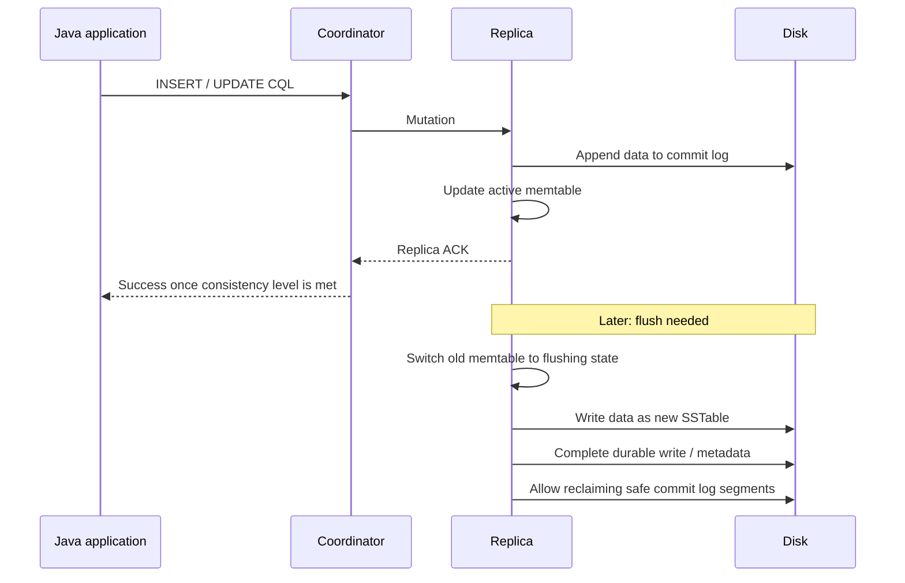

# Flushing from Memtable to SSTable in Apache Cassandra

## 1. Where Does Flush Fit on the Write Path?

Apache Cassandra is a **distributed wide-column** database. Each row is located by its **partition key**, ordered by **clustering columns** within the partition, and replicated across replicas according to the replication configuration. When a Java application writes a row via CQL, the data is not immediately copied into a finalized table file on disk.

On each replica, the normal write path includes two key components:

- **Commit log:** a sequential on-disk journal (*write-ahead log*) used to recover changes not yet in SSTables if the process crashes. Its durability guarantees depend on the commit log sync configuration.
- **Memtable:** an in-memory data structure holding recent changes, organized for fast writes and serving reads before data is written down to SSTables.

**Flush** is the process of turning a memtable's contents into **one or more immutable SSTables** (*immutable Sorted String Tables*) on disk. Flushing occurs **asynchronously** relative to most application write statements.

One way to visualize it:

```text
                 Each Cassandra replica

  CQL INSERT/UPDATE/DELETE
              |
              v
       +--------------+          +--------------------+
       |  Commit log  |          |  Active memtable   |
       |  (write log) |          |     (in memory)    |
       +--------------+          +--------------------+
              |                          |
              | used for recovery        | when memtable needs flush
              | before flush             v
              |                   +--------------------+
              |                   | Flushing memtable  |
              |                   | (state switched)   |
              |                   +--------------------+
              |                          |
              |                          v
              |                   +--------------------+
              +---- once data ----| Immutable SSTable  |
                   is safely on   |       (disk)       |
                                  +--------------------+
                                            |
                                            v
                                     Compaction later
```

This diagram shows the lifecycle on **a single replica**. Each replica maintains its own memtables, commit log, and SSTables; replicas **do not flush simultaneously** at the exact same moment.

## 2. Why Does Cassandra Write to a Memtable First?

Updating an already-sorted table file directly in place would require many random disk writes. Cassandra uses an architecture closely aligned with a **Log-Structured Merge Tree (LSM-tree)**:

1. Append changes sequentially to the commit log to support recovery.
2. Update the active memtable.
3. Return a replica acknowledgment per the write path and appropriate sync configuration.
4. Later, when flush conditions are met, write a structured version of the data out as an SSTable.
5. Over time, **compaction** merges SSTables, reducing the number of structures read paths must inspect and handling old versions/tombstones under safety conditions.

The advantage is low initial write latency with minimal random I/O. The trade-off is that the system must manage memory, the commit log, flushing, multiple SSTables, and background compaction.

### Two Independent Timelines



This diagram is simplified. Ordering between acknowledgment and commit log durability also depends on `commitlog_sync` mode, and the coordinator must collect responses from **enough replicas to satisfy the consistency level (CL)**. The key takeaway is that **the application can receive success before a flush occurs**.

## 3. Memtable Lifecycle During a Flush

### Phase A: Active Memtable

The current memtable receives incoming mutations for the table. It can contain:

- New values for a row or a column.
- Multiple updates to the same partition, reconciled by timestamp and Cassandra rules.
- TTL metadata and **tombstones** from deletes or expirations.

A memtable is not a simple copy of the entire table: it stores **recent changes** not yet written to the corresponding SSTables.

### Phase B: Memtable Switch

When a memtable needs to flush, Cassandra stops appending new mutations to the **old memtable** and creates/switches to a new active memtable. While the old instance is processed by a flush thread, new writes continue flowing into the new memtable (within resource and node health limits).

```text
Before switch:          After switch:

[Memtable A: active]    [Memtable A: flushing] -> SSTable
                        [Memtable B: active  ] <- new writes
```

This explains why a flush must not be misunderstood as "locking the entire table until all writes finish." Even so, if memory or disk is saturated and flush queues fall behind, Cassandra can exert **backpressure** or increase write latency.

### Phase C: Writing Immutable SSTables

The flush task iterates over memtable data, serializes partitions organized in storage order, and writes out a set of SSTable files. Within each partition, rows are stored in clustering order according to the table schema.

A created SSTable can consist of multiple component files depending on version and format:

| Common component | Role |
| --- | --- |
| `Data.db` | Serialized data: partitions, rows, cells, and deletion info |
| `Index.db` | Index for locating partition positions inside the SSTable |
| `Summary.db` | Index summary enabling faster lookups |
| `Filter.db` | Bloom filter for ruling out SSTables guaranteed not to hold a target partition |
| `Statistics.db` | SSTable metadata and statistics |
| `CompressionInfo.db` | Metadata supporting data access when compression is enabled |

Filenames and the presence of individual components depend on the Cassandra version and SSTable format; do not rely on this list to build an SSTable path parser across all Cassandra versions.

Once the files and related metadata finish writing per Cassandra's mechanisms, the new SSTable enters the active SSTable set serving queries. Cassandra never performs in-place `UPDATE`s on this immutable SSTable. Subsequent mutations enter a memtable and later produce another SSTable.

### Phase D: Releasing Memory and Reclaiming Commit Log Segments

Once the flush finishes safely, the old memtable can be freed. Cassandra simultaneously tracks which portions of the commit log are now durably reflected in SSTables.

**Never treat "one table finished flushing" as "all commit-log segments can immediately be deleted."** A single segment can still hold changes for **multiple memtables/tables**; it can only be reclaimed or recycled once all required data protected by that segment is safe. Reclamation is managed by Cassandra.

## 4. What Conditions Trigger a Flush?

Flushing occurs when Cassandra needs to bound resource usage or upon administrative actions. Exact triggers vary by version and configuration.

| Trigger | Why flush? | Notes |
| --- | --- | --- |
| High memtable memory usage | Free space for new writes | Limits/policies may apply node-wide or per-memtable |
| Commit log pressure | Flush "dirty" data to free/recycle older segments | A commit log can hold mutations from multiple tables |
| Periodic flush policy (if configured/supported) | Persist memtable data to SSTables periodically | Do not assume every table flushes on a timer by default |
| `nodetool flush` command | Administrator explicitly requests flushing a keyspace/table | Runs on the connected node, does not flush the entire cluster |
| Maintenance actions such as `drain` | Write memtable data to disk prior to certain node shutdown procedures | Do not use `drain` as a routine flush command |

There is no rule that "every `INSERT` creates one SSTable." An SSTable normally holds accumulated data from many mutations. How many SSTables a flush produces depends on memtable layout and Cassandra version/format; the goal is immutable read-optimized data files, not a 1:1 mapping per CQL statement.

## 5. Does Flushing Change the Meaning of a Write Acknowledgment?

**No.** Flushing is a background replica storage maintenance step; how many replicas must acknowledge a write is decided by the **consistency level**.

Suppose a keyspace has **RF = 3** in one datacenter:

- A write at `ONE` can complete at the coordinator after receiving acknowledgment from **one** replica.
- A write at `LOCAL_QUORUM` requires acknowledgments from **two** replicas in that datacenter.
- There is no requirement that those replicas **finish flushing** before responding to normal CQL writes.

Durability of unflushed data is protected primarily by the **commit log**, provided commit log writes are enabled and sync settings match requirements.

### Commit Log and `fsync`

Separate three concepts:

1. **Commit log append:** writing the mutation record to the log.
2. **Syncing the commit log to storage:** depending on mode and `fsync` behavior, acknowledgments do not always wait for each individual record to be synced.
3. **Memtable flush:** creating SSTables; a separate operation that typically runs after many writes.

For example, common `commitlog_sync` policies:

| Mode | Operational interpretation | Consequence |
| --- | --- | --- |
| `periodic` | Commit log is synced on a configured interval; writes can be acknowledged before the next sync | Risk window of losing some acknowledged writes upon sudden power loss / severe OS crash, depending on environment |
| `batch` | Writes wait on commit log sync per batch policy before acknowledgment | Shrinks window of losing acknowledged writes, at higher cost/latency |

These settings govern **local durability on a replica**. Regardless of mode, write outcomes also depend on disk responsiveness, filesystem, hardware, and peer replicas. A keyspace's `durable_writes = false` (if configured) bypasses normal commit log protection and increases the risk of losing unflushed mutations on node crashes; never use it for business data requiring durability without evaluating the consequences.

### Crash Scenario Matrix

| Point of failure | Where is the data? | Recoverability |
| --- | --- | --- |
| After memtable update, before flush, commit log durable | Memtable (RAM) + commit log (disk) | Restart can **replay the commit log** to reconstruct changes |
| After memtable update, before durable commit log sync | Memtable + log possibly only in I/O buffers | Power loss can lose the unsynced portion of writes |
| Flush completed safely | Immutable SSTables on disk | SSTables can be read on startup; corresponding log becomes reclaimable per rules |
| Failure while writing an SSTable | Incomplete SSTable and unreclaimed log may exist | Cassandra handles incomplete files and replays needed log entries; check node logs for details |

**A single replica outage differs from a cluster outage.** Replication and CL determine whether other replicas still hold the record. Flushing on one node alone does not replace replication, repair, or backup policies.

## 6. Flush Is Not Compaction, Repair, or Backup

These concepts are frequently confused:

| Operation | Input → Output | Primary purpose |
| --- | --- | --- |
| **Flush** | Memtable → new SSTable | Moves recent data from RAM to SSTables; frees memtable |
| **Compaction** | Set of SSTables → new SSTable | Merges multi-version data, reduces read fragmentation/cost, processes tombstones under safety rules |
| **Repair** | Data across replicas | Detects and fixes discrepancies among data copies |
| **Backup/snapshot** | Copies data/metadata files via appropriate mechanisms | Point-in-time recovery or recovery beyond normal fault tolerance |

An illustrative sequence:

```text
Writes 1, 2, 3
      |
  Memtable A --flush--> SSTable 1

Writes 4, 5
      |
  Memtable B --flush--> SSTable 2

SSTable 1 + SSTable 2 --compaction--> SSTable 3
```

Old SSTables are not modified in place. During compaction, Cassandra can merge values by timestamp and purge expired/deleted data **when safety conditions are met**. Tombstones or TTL-expired cells **do not necessarily vanish at flush time**; deletion and garbage collection follow separate rules involving `gc_grace_seconds` and inter-replica consistency.

Similarly, if two replicas hold divergent data, forcing both to flush **does not synchronize them**: each node simply writes to disk whatever data it currently holds. That problem belongs to repair and replication design.

## 7. CQL Practice and Observing Flush with `nodetool`

The following example simulates a Java system recording sensor readings. The partition key is `device_id` for single-device queries; rows within a partition are ordered by descending `measured_at`, suited for querying latest readings.

### Step 1 — Create Keyspace and Table

```sql
-- Example cluster with datacenter dc1 and enough nodes for RF = 3.
CREATE KEYSPACE IF NOT EXISTS telemetry_lab
WITH replication = {
    'class': 'NetworkTopologyStrategy',
    'dc1': 3
};

CREATE TABLE IF NOT EXISTS telemetry_lab.readings_by_device (
    device_id text,
    measured_at timestamp,
    reading_id uuid,
    temperature_c double,
    PRIMARY KEY ((device_id), measured_at, reading_id)
) WITH CLUSTERING ORDER BY (measured_at DESC, reading_id ASC);
```

Replace `dc1` and RF with your actual topology. On a single-node dev cluster, RF = 3 with high quorum CL can cause queries to fail for lack of replicas; choose consistent lab topology/CL rather than copying production settings blindly.

### Step 2 — Write Data

```sql
INSERT INTO telemetry_lab.readings_by_device
    (device_id, measured_at, reading_id, temperature_c)
VALUES ('sensor-a', '2026-11-20 10:00:00+0000',
        11111111-1111-4111-8111-111111111111, 23.7);

INSERT INTO telemetry_lab.readings_by_device
    (device_id, measured_at, reading_id, temperature_c)
VALUES ('sensor-a', '2026-11-20 10:01:00+0000',
        22222222-2222-4222-8222-222222222222, 23.9);

-- TTL is also stored with the data; expiration does not mean
-- immediate removal from all SSTables.
INSERT INTO telemetry_lab.readings_by_device
    (device_id, measured_at, reading_id, temperature_c)
VALUES ('sensor-b', '2026-11-20 10:02:00+0000',
        33333333-3333-4333-8333-333333333333, 25.1)
USING TTL 3600;
```

Verify with a query aligned to the partition key:

```sql
SELECT device_id, measured_at, reading_id, temperature_c
FROM telemetry_lab.readings_by_device
WHERE device_id = 'sensor-a'
LIMIT 10;
```

**Even without a flush**, written rows can be read at the appropriate CL because Cassandra's read path merges data from memtables and SSTables (alongside supporting structures).

### Step 3 — Inspect Statistics on One Node

Run from an environment with `nodetool` and access to a Cassandra node:

```powershell
nodetool tablestats telemetry_lab.readings_by_device
```

Depending on version, output includes metrics such as memtable size, memtable switch count, active SSTable count, SSTable disk space, and write latency. Record the **pre-flush** values for comparison.

### Step 4 — Explicitly Flush on That Node

```powershell
nodetool flush telemetry_lab readings_by_device
nodetool tablestats telemetry_lab.readings_by_device
```

Conceptual expectation: relevant memtable data is written to a new SSTable, showing changes in SSTable count and memtable usage. Observed values can differ if the table already had SSTables, the memtable was small, automatic flush/compaction ran concurrently, or your version formats stats differently.

**Scope of observation:** running `nodetool` on this node only flushes memtables on **that node**—it does not synchronize flushes across other replicas. Never call this after every `INSERT` from an application; Cassandra coordinates flushes automatically.

### Step 5 — Read Again After Flush

Re-run the `SELECT` from Step 2. Logical results must follow timestamps, TTLs, and current data; flushing **must never alter query values into a different business result**. At the storage layer, the data source may have shifted from memtable to SSTable.

## 8. Java Integration: Applications Write Normally, Cassandra Manages Flushes

Java Driver 4.x example; `CqlSession` is already initialized with contact points, local datacenter, and environment authentication:

```java
import java.time.Instant;
import java.util.UUID;

import com.datastax.oss.driver.api.core.CqlSession;
import com.datastax.oss.driver.api.core.DefaultConsistencyLevel;
import com.datastax.oss.driver.api.core.cql.BoundStatement;
import com.datastax.oss.driver.api.core.cql.PreparedStatement;

public final class SensorReadingRepository {
    private final CqlSession session;
    private final PreparedStatement insertReading;

    public SensorReadingRepository(CqlSession session) {
        this.session = session;
        this.insertReading = session.prepare(
            "INSERT INTO telemetry_lab.readings_by_device " +
            "(device_id, measured_at, reading_id, temperature_c) " +
            "VALUES (?, ?, ?, ?)"
        );
    }

    public void save(
            String deviceId, Instant measuredAt,
            UUID readingId, double temperatureC) {
        BoundStatement statement = insertReading.bind(
                deviceId, measuredAt, readingId, temperatureC)
            .setConsistencyLevel(DefaultConsistencyLevel.LOCAL_QUORUM);
        session.execute(statement);
    }
}
```

In this example, `LOCAL_QUORUM` specifies how many replicas must acknowledge in the local datacenter. The Java call **does not trigger a flush**, wait for SSTable creation, or by itself prove data was `fsync`ed on every replica. Durability requirements must be designed across **CL, replication, commit-log sync, and storage infrastructure**.

If an application needs stronger write guarantees, analyze durability settings and data-loss failure modes—never issue a `nodetool flush` after every transaction as a workaround.

## 9. Performance Impact and Failure Scenarios

Flushing is background I/O, yet it consumes node CPU, memory, disk, and storage bandwidth. When sustained write rates exceed flush/compaction capacity, backlogs can grow.

| Symptom | Possible interpretation | Investigation/remediation direction |
| --- | --- | --- |
| Memtables consume heavy memory | Heavy writes or flushes falling behind | Inspect memtable stats, write throughput, memory, and disk |
| Commit log grows near limit | Old segments not yet eligible for reclamation | Check unflushed memtable data, flush status, and node logs |
| Many small SSTables | Flushes happening too often or compaction lagging | Investigate SSTable sizes, compaction strategy, write load |
| Write latency spikes during flush | Saturated disk, I/O contention, memtable pressure | Monitor IOPS, disk latency, CPU/GC, and backlog |
| Flush fails due to full disk or I/O error | Unable to finish writing new SSTables | Resolve disk capacity/health, preserve commit log for recovery |
| Slow reads despite successful flushes | Many SSTables, tombstones, large partitions, or poor queries | Inspect partition key model, compaction, and read path |

Useful inspection tools include `nodetool tablestats`, Cassandra logs, version-appropriate metrics/JMX, and `nodetool compactionstats` for related compaction tasks. Do not treat `compactionstats` as a complete standalone measure of flush activity.

**Never manually delete commit log or SSTable files** merely because you assume a flush finished. Doing so can destroy recovery capability or corrupt data consistency. On I/O or disk-full errors, prioritize protecting data, inspecting node logs, checking capacity, and following operationally approved recovery procedures.

### Is Flushing Too Frequently Good?

Not necessarily. Constant flushing can create many tiny SSTables, increasing file-open/lookup overhead, consuming disk bandwidth, and forcing compaction to work harder. Conversely, letting memtables grow too large creates RAM pressure and sudden heavy flush bursts. Cassandra automatically determines flush timing; tuning should be driven strictly by workload, metrics, and deployment version.

## 10. Three Self-Check Scenarios

**Scenario 1 — Write succeeded without any new SSTable.** An `INSERT` at `LOCAL_QUORUM` returns success. Immediately afterward the SSTable count has not risen. Did Cassandra lose the data?

**Hint:** You cannot conclude that. The write may reside in the memtable and commit log of the acknowledging replicas. Distinguish CL ACKs, commit log sync policy, and flush timing.

**Scenario 2 — Node crashes before flush.** A node received a mutation and durably synced its commit log, yet the memtable had not flushed. After restart, how does the node reconstruct the data?

**Hint:** Cassandra replays necessary changes from the commit log to recover contents not yet present in SSTables. If the log was not durably synced before power loss, guarantees differ.

**Scenario 3 — Two replicas flushed yet data still differs.** One replica missed a mutation during a network partition. Both nodes later flush. Will their results automatically become identical?

**Hint:** No. Flushing only writes data currently present **on each replica** to SSTables. You need replica synchronization, consistency-aware reads, and proper repair; flushing does not replace repair.

## 11. Key Takeaways and Operational Checklist

- [ ] Distinguish **commit log**, **memtable**, **SSTable**, and **compaction**.
- [ ] Understand that flushes occur **per node**, not necessarily simultaneously across replicas.
- [ ] Know why **write ACKs** can return **before a flush**.
- [ ] Evaluate `commitlog_sync`, `durable_writes`, replication, and CL when reasoning about durability.
- [ ] Use `nodetool flush` intentionally in maintenance/practice; use `tablestats` and metrics to observe.
- [ ] Monitor SSTable count, disk health, memory pressure, and compaction activity when investigating performance.
- [ ] Never confuse **flush** with **repair**, **backup**, or immediate tombstone deletion.

**Conclusion:** Flushing from memtable to SSTable bridges Cassandra's fast memory-backed write path and immutable SSTable storage. The commit log protects unflushed mutations according to durability settings, while replication and consistency levels govern acknowledgments across replicas. Understanding these boundaries helps you design query-driven tables, operate CQL effectively, and build Java applications with reliable write behavior.
