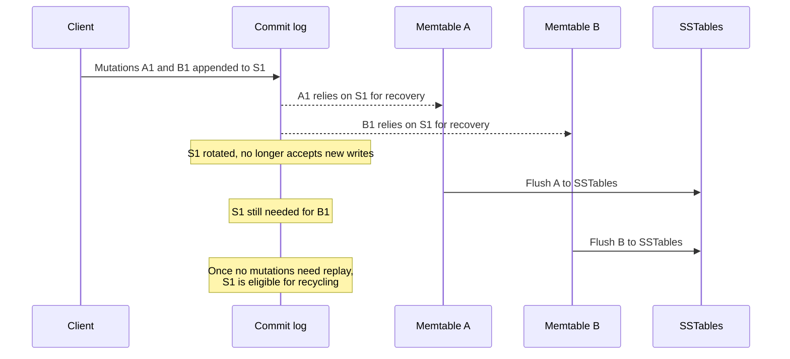

# Commit Log Segments, Recycling, and Unflushed Memtables

> **Chapter:** Write Path and Durability  
> **Scope:** Apache Cassandra, a distributed *wide-column* database management system. This lesson focuses on the **per-node** commit log lifecycle, conditions for releasing segments, and the impact of unflushed memtables.  
> **Learning outcomes:** Distinguish commit log writes, disk syncing, and memtable flushes; explain why a segment is still retained even after one table has flushed; identify why commit logs consume disk space and how to diagnose safely.

## 1. Problem Statement: Why Flush If Data Is Already Written to Disk?

In Cassandra, a mutation (inserting, updating, or deleting data) is written to the **commit log** and updates the **memtable** on the receiving replica. The memtable is an active mutable data structure in memory; on flush, the memtable's contents are written out as immutable **SSTable** files on disk.

Conceptual diagram:

```text
          WRITE from client
                 |
                 v
       Coordinator distributes to
       replicas by partition key
                 |
                 v (on each replica)
         +--------------------+
         |     MUTATION       |
         +--------------------+
           |                |
           v                v
    Commit log (disk)   Memtable (RAM)
    append-only write   updated per table
           |                |
           |                | flush
           |                v
           |          SSTable (disk)
           |                |
           +-- no longer    |
               need replay -+
               for flushed
               portion
```

The two write paths serve two distinct purposes:

- **The commit log** is a crash-recovery journal. If a node stops abruptly before memtables flush, Cassandra can *replay* the necessary mutations from the commit log on startup.
- **Memtables + SSTables** serve ongoing storage and querying. Once a memtable's contents have flushed successfully to SSTables, the corresponding mutations no longer rely on the commit log for recovery.

The key distinction is that **"written to the commit log" does not mean "already an SSTable,"** and **"one memtable flushed" does not mean "all old commit log segments are immediately deleted."**

## 2. What Is a Commit Log Segment?

The commit log on each node is partitioned into **segments**: log files with a finite target size that receive mutation records in *append-only* fashion. When the current segment fills up or must rotate, Cassandra switches to a new segment to continue writing.

Remember five properties:

1. **The commit log is a node-level resource.** One segment can hold mutations from **multiple tables, multiple keyspaces, and multiple partitions** passing through that node. It is not "one log file per table."
2. **Segments have write positions.** Cassandra tracks mutation boundaries/positions to know which log portions are still required for recovery.
3. **Segments have lifecycle states.** A segment may be actively accepting writes, closed to new writes while still needed for replay, or eligible to be recycled/removed.
4. **A segment is not an SSTable copy.** Logs store mutations for recovery; SSTables store immutable data organized for reads, compression, and compaction.
5. **Replication does not share a commit log.** Each replica maintains its own commit log on its own node. There is no cluster-wide shared commit log.

Settings such as `commitlog_segment_size_in_mb` and `commitlog_total_space_in_mb` typically relate to segment size and commit log space budgets. Default values, space consumption mechanics, and sync options vary by Cassandra version/distribution; verify against your running configuration rather than copying numbers blindly from an example.

### What Does "Segment Recycling" Mean?

When an old segment is no longer required for recovery, Cassandra can **recycle** the file/resource to write new log entries or discard it according to space management rules. Recycling does **not** mean overwriting a segment that still holds unflushed mutations. The system may release only log entries whose data already has durable backing elsewhere.

Mentally, view each segment as a "box holding recovery evidence." You must not discard the box as long as any mutation inside it is still needed to rebuild state after a crash.

## 3. Core Relationship: Shared Segments, Per-Table Memtables

Each table has its own memtable (and possibly an older memtable generation currently flushing alongside a new memtable accepting writes). Meanwhile, the commit log writes mutations from all tables into the same node-wide timeline.

Suppose node N1 writes to two tables:

- `app.orders_by_id` — receives orders continuously.
- `app.customer_preferences` — changes only a few times per hour.

Two hypothetical segments have received records:

```text
Node-level commit log on N1
────────────────────────────────────────────────────────
Segment S101 (closed):
  position 01: orders_by_id         / order-01
  position 02: customer_preferences / customer-7
  position 03: orders_by_id         / order-02

Segment S102 (active):
  position 01: orders_by_id         / order-03
  position 02: orders_by_id         / order-04
────────────────────────────────────────────────────────

Memtables:
  orders_by_id          -> may already be large enough to flush
  customer_preferences  -> still very small, not flushed yet
```

Suppose `orders_by_id` flushes successfully and its SSTables hold every mutation for that table in S101, while `customer_preferences` **has not yet flushed** the mutation at position 02.

**Result:** S101 must still be retained, because if the node crashes, the `customer-7` record in the memtable will be lost from RAM and must be replayed from S101.

Once `customer_preferences` also flushes successfully, S101 **becomes eligible** for release, provided the segment is no longer accepting writes and no records unprotected by SSTables (or other retention conditions of related mechanisms) remain.

| Event | `orders_by_id` in S101 | `customer_preferences` in S101 | Can S101 be released? |
| --- | --- | --- | --- |
| Just wrote to both tables | Unflushed | Unflushed | **No** |
| Flush only `orders_by_id` | Already in SSTables | Unflushed | **No** |
| Both tables flushed successfully | Already in SSTables | Already in SSTables | **Possibly**, if no other retention reason exists |
| `customer_preferences` flush failed | Already in SSTables | Still needs log for replay | **No** |

This is why a small, rarely updated table can **keep an old segment alive for a long time**, even while a write-heavy table flushes frequently.

Conversely, an unflushed memtable **does not pin every segment on the node**: it only prevents releasing segments containing mutations still required to recover that memtable.

## 4. How Does Cassandra Decide When a Segment Can Be Discarded?

Conceptually, Cassandra coordinates **commit log positions** and per-table flush progress. A memtable is associated with the mutation span needed to recover it; once a memtable generation flushes successfully to SSTables, the persisted mutation range can be marked as no longer needing commit log replay.

The condition for releasing an old segment can be safely stated as:

> **Every mutation needed for recovery in the segment is already protected by a successful flush, and the segment is no longer in use/pinned by related mechanisms.**

This differs from asking "which memtable name is empty?" Distinguish:

- **Memtable switched:** the old memtable stops accepting writes and is queued/running flush; data is **not yet guaranteed** to be in SSTables.
- **Flush completed successfully:** SSTables have been written and accepted by the storage engine; Cassandra can advance the replay-free mark for that memtable generation.
- **Segment full / switched to a new segment:** merely a file rotation event; does **not** prove every mutation in the old segment has flushed.
- **Segment recycled/deleted:** occurs only once the release conditions are satisfied.

### One Segment Can Span Multiple Memtable Generations

Even **a single table** can have mutations spanning multiple segments or multiple memtable generations. While memtable A is flushing, Cassandra can create memtable B to accept new writes. To determine whether a segment S can be released, the system tracks how far **mutations within S** are protected, rather than merely checking a table name or current memtable count.

### Commit Log Release Does Not Wait for Compaction

Flushing creates new SSTables. **Compaction** later merges/rewrites SSTables to optimize storage and reads. The commit log lifecycle is tied to **memtable data having safely flushed**, not waiting for compaction to finish.

Similarly, **repair** reconciles data across replicas; repair is not a normal prerequisite for recycling commit logs on a node.

## 5. Complete Timeline from Write to Release

Consider two tables A and B sharing segment S1:



This diagram illustrates **logical** dependencies. It does not assert exact thread ordering or internal call sequences across every Cassandra version; updating the commit log and memtable are parts of the same replica mutation path.

### Node Crash Case

Suppose:

1. A1 and B1 were written to the commit log per the node's sync policy.
2. Memtable A flushed successfully to SSTables; memtable B had not flushed.
3. The node stops unexpectedly.
4. On startup, Cassandra reads SSTables and replays the commit log mutations still required—including B1—then resumes operation.

The system does not need to keep records permanently once a flush makes them redundant. Yet **as long as B1 lacks a durable SSTable copy, S1 remains vital recovery material**.

Note: having a record in the log does not mean it had been **fsynced to storage** when the client received a response; durability against power/machine outages depends on the commit log sync configuration, explained next.

## 6. Three Frequently Confused Milestones: Append, Sync, and Flush

These three operations have distinct meanings:

| Operation | Where does it happen? | Which risk does it protect against? | Does it release commit log segments by itself? |
| --- | --- | --- | --- |
| **Append mutation** | Commit log file on the replica, via OS/disk write path | Stages evidence for replay; sync state determines power-loss durability | No |
| **Sync/fsync commit log** | Forces written log data down to durable storage per system mechanisms | Shrinks log-loss window against cache/buffer-losing failures | No; memtables may still be unflushed |
| **Flush memtable to SSTable** | From memtable to immutable data files | Memtable generation's data now resides in SSTables | Can allow releasing **related segments** once all needed records are protected |

Cassandra typically offers commit log sync policies such as:

- **`periodic`:** periodic sync. Depending on version/configuration, write responses can return before the corresponding log record is synced; severe outages can lose a window of mutations on a replica.
- **`batch` / `group` (where version-supported):** coordinates multiple mutations and waits on sync per the corresponding policy; trades added latency to narrow the unsynced data window.

Never infer "`CONSISTENCY QUORUM` means the commit log has fsynced on every replica." **Consistency level** governs how many replica responses are required for the request; **commit log sync mode** governs sync behavior on each replica. The two parameters address two different layers.

### Write Acknowledged Before Flush

Once a mutation has been acknowledged under the write protocol and active sync policy, the client **does not wait for an SSTable to be created**. Flushing the memtable on every single request would forfeit Cassandra's advantage of appending sequentially to a log and batching data in memory before writing SSTables.

That also answers "why does the commit log still retain mutations already reported successful to the client?"—because **ACK does not equal flush**.

## 7. Why Can Old Segments Persist and Create Disk Space Pressure?

Common scenarios:

| Symptom | Possible cause | Consequence |
| --- | --- | --- |
| Some old segments persist even though hot tables flush often | Segments contain mutations from another unflushed table | Old segments cannot be recycled |
| Commit log grows steadily while memtable flushes lag | Slow disk, compaction I/O contention, flush errors, heavy write load | Log retains many mutations awaiting SSTable protection |
| Node hosts tables with uneven update rates | Infrequent small-table mutations interleave with hot tables in the same segment | Segments outlive the hot table's flush cycle |
| Commit log approaches space budget threshold | Many segments not yet eligible for release | Cassandra may force flushes to reclaim log space; if unable to keep up, writes suffer |
| Active segment not yet rotated | System is still appending to it | Cannot be recycled like closed segments |
| CDC/archiving or related policies enabled | Change-streaming/archiving rules retain or copy segments separately | Must distinguish active commit log files from archiving copies |

**Key point:** when commit log space pressure rises, Cassandra can **trigger memtable flushes** to free eligible segments. This creates durable storage first and then reclaims log files, rather than deleting segments still required for recovery.

If log space stays high for long periods, do not blindly treat raising segment size or log space budget as a fix. Those changes only reshape or delay the pressure; the underlying cause may be stalled flushes or a quiet table pinning old log positions.

### Segment Size and Total Space Are Not the Same Limit

- `commitlog_segment_size_in_mb`: target size of an individual segment; affects segment count, rotation frequency, and mutation packing.
- `commitlog_total_space_in_mb`: commit log space budget (depending on version/config); reaching the threshold prompts the system to reclaim eligible segments, typically by triggering flushes.

**Illustrative (not guaranteed default)** example: 32 MiB target segment size and 4 GiB space budget. With many unflushed tables, you can accumulate many closed-but-unreclaimed segments; setting a smaller segment size does not automatically turn those mutations into SSTables.

## 8. CQL Practice and Inspection Tools

This section uses an **existing** test keyspace `lab_cassandra`. Never run directly in production without controlled resource limits and an operational plan.

### Step 1 — Create Two Tables with Different Write Cadences

```cql
CREATE TABLE IF NOT EXISTS lab_cassandra.events_by_device (
    device_id text,
    event_time timestamp,
    event_id uuid,
    value double,
    PRIMARY KEY ((device_id), event_time, event_id)
) WITH CLUSTERING ORDER BY (event_time DESC, event_id ASC);

CREATE TABLE IF NOT EXISTS lab_cassandra.device_settings (
    device_id text PRIMARY KEY,
    sample_interval_seconds int,
    updated_at timestamp
);
```

`events_by_device` receives frequent writes; `device_settings` changes only occasionally.

```cql
INSERT INTO lab_cassandra.device_settings
    (device_id, sample_interval_seconds, updated_at)
VALUES ('sensor-01', 30, '2026-11-21T03:00:00Z');

INSERT INTO lab_cassandra.events_by_device
    (device_id, event_time, event_id, value)
VALUES ('sensor-01', '2026-11-21T03:00:01Z', uuid(), 31.5);

INSERT INTO lab_cassandra.events_by_device
    (device_id, event_time, event_id, value)
VALUES ('sensor-01', '2026-11-21T03:00:02Z', uuid(), 31.7);
```

Mechanically, both tables can have mutations in the same commit log segment **if routed to the same node within the same segment window**. Due to replication and delivery timing, never assert solely from these CQL statements that every node groups segments identically.

### Step 2 — Observe Flushes and Logs

On a test node, use tools shipped with your Cassandra version, such as:

```bash
nodetool tablestats lab_cassandra.events_by_device
nodetool tablestats lab_cassandra.device_settings
nodetool tpstats
```

Look for memtable stats, SSTable counts, flush counts, pending/active flush tasks, and I/O info. You can combine metrics/JMX and node logs to track total commit log space, segment allocation, and recycling events, depending on the metrics exposed in your Cassandra release.

**What helps is observing before-and-after trends, not a single snapshot of the commit log directory.** Seeing multiple log files at one instant does not prove a space leak or broken flushes.

### Step 3 — Controlled Flush

In a lab environment, flush the write-heavy table on its own:

```bash
nodetool flush lab_cassandra events_by_device
```

After flushing, inspect SSTable/memtable metrics and commit log space. **Do not expect every old segment to disappear**, because `device_settings` may still have unflushed mutations in those segments, or a segment may still be active or held by another condition.

After recording the observations, try flushing the second table:

```bash
nodetool flush lab_cassandra device_settings
```

If all replay-needed mutations for both tables in a segment have flushed successfully, that old segment may become eligible for reclamation. However, other tables on the same node might also have written into that segment, so you cannot conclude from just two flush commands that a specific file must vanish.

**Do not run `nodetool flush` continuously as a production "fix."** Overly frequent flushes create many small SSTables, raising compaction and I/O overhead. Identify why segments are pinned or flushes are stalled before intervening operationally.

### Step 4 — Verify Recovery (Isolated Cluster Only)

If you have a lab environment and a safe restart procedure, you can simulate stopping a node before memtables flush and verify data after startup. The goal is observing replay messages in node logs and verifying written rows. Never induce crashes or node stops on a production cluster merely to demonstrate a mechanism Cassandra already manages.

## 9. Java Driver Perspective and ACK Conditions

Java applications rarely interact directly with commit log segments: the driver sends CQL, Cassandra picks replicas by partition key, and each replica runs its write path. However, the application must understand **when a write call returns** and **what cannot be inferred from an ACK**.

Java Driver 4.x example:

```java
import java.util.UUID;
import java.time.Instant;
import com.datastax.oss.driver.api.core.CqlSession;
import com.datastax.oss.driver.api.core.DefaultConsistencyLevel;
import com.datastax.oss.driver.api.core.cql.BoundStatement;
import com.datastax.oss.driver.api.core.cql.PreparedStatement;

public final class DeviceWriter {
    private final CqlSession session;
    private final PreparedStatement insert;

    public DeviceWriter(CqlSession session) {
        this.session = session;
        this.insert = session.prepare(
            "INSERT INTO lab_cassandra.events_by_device " +
            "(device_id, event_time, event_id, value) VALUES (?, ?, ?, ?)"
        );
    }

    public void record(String deviceId, double value) {
        BoundStatement statement = insert.bind(
                deviceId, Instant.now(), UUID.randomUUID(), value)
            .setConsistencyLevel(DefaultConsistencyLevel.LOCAL_QUORUM);

        session.execute(statement);
        // Success at LOCAL_QUORUM does not mean replica
        // memtables have flushed to SSTables.
    }
}
```

This example requires replica responses matching `LOCAL_QUORUM`. Actual consistency selection must match RF, topology, availability targets, and risk tolerance.

Separate two questions in application design:

- **"How many replicas acknowledged the request?"** Governed by consistency level and the distributed write path.
- **"Is the log record on each replica durably synced?"** Governed by commit log sync policy and node state.

A timed-out request **does not prove the mutation failed completely**: some replicas may have logged it and updated their memtables. Applications need idempotency, stable keys, and reconciliation on retry rather than assuming failure simply because the client missed the ACK.

## 10. Failure Scenarios and Root-Cause Diagnosis

### Scenario A — Node Restarts While Memtables Are Unflushed

**Symptom:** Recent writes succeeded, no new SSTable appeared, and the node had to restart.

**Explanation:** This is precisely what the commit log is built for. Required mutations durably stored in the log per sync policy will be replayed during recovery. Never delete logs manually for a "faster startup."

**What to check:** replay log entries in node logs, commit log status, I/O errors, and post-recovery data consistency.

### Scenario B — Commit Log Space Grows, Many Files Not Recycled

**Symptom:** Hot tables flushed repeatedly, yet old commit log files remain.

**Hypotheses to test:** unflushed mutations from another table sit in old segments; flushes are failing or lagging; the node has I/O pressure; a segment is still active; or a retention policy is active.

**Diagnostic steps:** correlate log growth timestamps with flush activity, per-table memtable stats, error logs, and commit log metrics. Do not manually delete segments or blindly raise thresholds before identifying the cause.

### Scenario C — Commit Log Partition Disk Full

**Symptom:** Node reports commit log allocation/write errors or writes degrade.

**Consequence:** Direct risk to accepting mutations and recovering safely. Resolve disk capacity and flush issues on the node per incident procedures; never remove commit log files managed by Cassandra.

**Prevention:** maintain disk headroom, monitor log growth and flush rates, and alert on growth trends/time-to-full rather than waiting for 100%.

### Scenario D — Flush Fails While Old Commit Logs Remain

**Symptom:** SSTable write errors, disk full, or permission issues; logs are not reclaimed.

**Explanation:** Flushes have not ensured data exists in SSTables. Retaining logs is **correct safety behavior**, because deleting logs now could destroy the recovery path.

**Action:** fix the underlying fault and restore flushing per operational runbooks; never "fix" it by deleting logs.

## 11. Design and Operational Decisions to Remember

| Decision | Impact on commit log and memtables |
| --- | --- |
| Creating query-specific tables (denormalization) | Increases mutations/tables flowing through the node's commit log; extra read models can complicate flush and space management. |
| Partition key design | Shapes where mutations land, replica load balance, and partition sizes; does not turn the commit log into a per-partition log. |
| Changing consistency level | Changes how many replicas must acknowledge; does not directly alter segment release conditions on each node. |
| Tuning commit log sync | Trades ACK latency against unsynced risk window; does not replace memtable flushing. |
| Changing segment size / space budget | Alters log management granularity and pressure thresholds; does not remove the obligation to retain unflushed mutations. |
| Tuning memtables / flushing | Controls how fast mutations move into SSTables, determining when old logs can be released. |
| Running compaction / repair | Serves SSTable layout and replica consistency; not direct triggers to recycle the commit log. |
| Snapshots / backups | Requires a separate strategy; commit logs are recycled after flushes and are not an infinite history archive. |

### Is the Commit Log a Backup?

**No.** The commit log serves **node-local crash recovery** between flushes. Once segments are no longer needed, Cassandra is free to recycle them. For long-term retention, recovery from accidental deletes, or rebuilding another cluster, use snapshots/backups, SSTable copies, and/or archiving aligned with RPO/RTO goals.

## 12. Review Questions and Analytical Exercises

1. A segment S holds mutations for tables A and B. A has flushed while B has not. Why must Cassandra still retain S, even if A is the busiest table?
2. If table B still has an unflushed memtable, yet its mutation sits **only in a newer segment**, will an older segment S containing no mutations from B be pinned by B? Explain in terms of log position ranges.
3. Distinguish "append to log," "sync log to storage," and "flush memtable to SSTable." Which operation directly removes recovery dependency on old segments?
4. Why does an `INSERT` returning success at `LOCAL_QUORUM` not guarantee all memtables have flushed?
5. A node's commit log usage grows rapidly despite ample RAM. List three metric/log groups to inspect before concluding `commitlog_total_space_in_mb` must be raised.
6. Why can forcing continuous flushes make compaction more expensive, even if some segments are reclaimed earlier?
7. If a node loses power right after ACKing under periodic commit log sync, what factors determine the risk window for losing unsynced mutations?
8. After a flush failure, an operator plans to delete old commit log files to free disk space. Explain the risk and propose safer investigation steps.

## 13. One-Line Rules Summary

- **Write:** mutations enter both the commit log and memtable on each participating replica.
- **Sync:** establishes log durability on storage according to node policy.
- **Flush:** persists a memtable generation's contents into SSTables.
- **Segment retention:** kept as long as at least one mutation in the segment needs the log for recovery, regardless of table.
- **Segment recycling:** allowed only after replay-needed mutations are protected by SSTables and related retention conditions clear.
- **Operations:** inspect flushes + log positions + space + I/O and errors before adjusting thresholds.

**Core message:** A commit log segment is a **node-level** management unit, whereas memtables and flushes are scoped to **tables and memtable generations**. A segment is released only when **all** required mutations inside it are safe; even a single unflushed memtable can pin an old segment, even if all other tables flushed cleanly.
