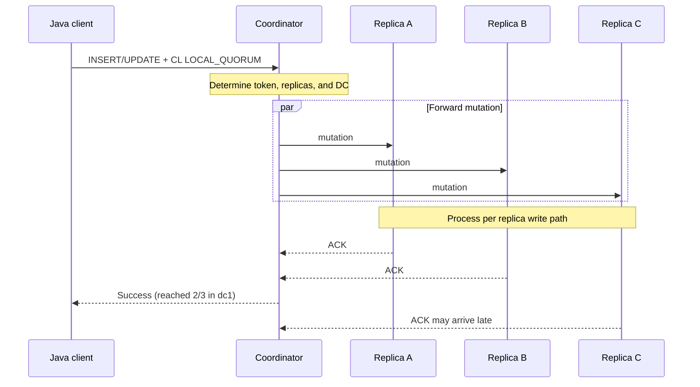

# Replication Factor, Consistency Level, and Acknowledgment Conditions

## 1. Why Does a Successful Write Not Mean Every Replica Received the Data?

Apache Cassandra is a **distributed wide-column** database. A partition is identified by its partition key, mapped to a token, and distributed to multiple **natural replicas** per the keyspace's replication strategy. When a Java application issues an `INSERT` or `UPDATE`, a node acting as **coordinator** sends the write request to those replicas. The application receives a success result once the coordinator gathers enough responses matching the operation's **consistency level (CL)**—not necessarily when every replica has finished.

The **Write Path and Durability** chapter explains two settings that directly control this outcome:

- **Replication factor (RF):** the logical number of copies assigned to each partition, configurable per datacenter (DC).
- **Write consistency level:** the minimum acknowledgment condition the coordinator must meet before returning success.

This lesson belongs to the `DATABASE_ENGINE_WIDE_COLUMN_CASSANDRA` module and connects with query-driven table design, partition keys, CQL, replication, compaction, repair, error handling, and Java Driver integration. There is no additional `SPECIAL_NOTE` for this lesson.

After this lesson, you will be able to calculate ACK thresholds from RF/CL, explain what happens when a replica is slow or disconnected, distinguish logical success from physical durability, and investigate `Unavailable`/`WriteTimeout` without mistaking a failed request for proof that no data was written.

## 2. Three Concepts That Must Stay Separate

| Concept | Question it answers | Not equivalent to |
| --- | --- | --- |
| **RF / natural replicas** | On **how many and which nodes** is this partition assigned to live? | Live replica count, or replicas that received a write. |
| **Write CL / ACK threshold** | How many **responses** does the coordinator need to declare success? | All replicas synchronized, or data persisted in SSTables. |
| **Durability** | Across which layers is data protected against crashes, power loss, and node failures? | Merely counting ACKs or nominal replica counts. |

Example keyspace RF = 3, CL = `QUORUM`:

- Cassandra **assigns three replicas** for a partition.
- The coordinator needs **two valid ACKs** to return success.
- The third replica may be slow or temporarily unresponsive; that does not necessarily prevent a `QUORUM` request from succeeding.
- Two ACKs indicate the operation was acknowledged by those replicas under **Cassandra's write mechanics**; durability against power loss still depends on commit log sync settings and actual node state.

Think of RF as the **intended data redundancy**, and CL as the **response threshold required on a specific operation**. They are related, yet they are two distinct decisions.

## 3. Path of a Write Command

Suppose a keyspace uses `NetworkTopologyStrategy` with RF = 3 in `dc1`, and the application sends a write at CL = `LOCAL_QUORUM`.



Typical path:

1. **Client sends mutation** to a node capable of acting as coordinator. The coordinator does not have to be a natural replica of the partition.
2. **Coordinator identifies replicas** from partition key/token, topology, and the keyspace replication strategy.
3. **Requests reach replicas:** each replica processes the mutation through its write path—typically appending to the **commit log** and updating the **memtable**—and sends an ACK once configured write steps finish.
4. **Coordinator counts ACKs** against CL. Once the threshold is met, it can return success even before the remaining replica responds.
5. **Later:** memtables flush to SSTables; compaction merges SSTables per policy. Flush/compaction is **not a default blocking prerequisite** for every `INSERT`.

This diagram simplifies delivery and ACKs; real clusters also involve connection pools, timeouts, hinted handoff, topology changes, and messaging optimizations. **An ACK is a response from a replica or a special CL-allowed mechanism**, not a copy of the data sent back to the application.

### What Roles Do the Commit Log and Memtable Play?

- **Memtable** is an in-memory write structure serving reads and upcoming flushes.
- **Commit log** is an append-only on-disk log used to **replay unflushed mutations** when a node restarts after a crash.
- **SSTable** is immutable on-disk data created on flush; compaction merges multiple SSTables later.

You cannot conclude `ACK = SSTable exists`. Nor can you automatically conclude `ACK = entire commit log fsynced`, since commit log sync policies vary by configuration (see Section 7).

## 4. ACK Thresholds in a Single Datacenter

Within **one DC** having RF = \(N\) and excluding special cases, quorum is calculated as:

\[
W_{\text{quorum}} = \left\lfloor \frac{N}{2} \right\rfloor + 1
\]

With RF = 3, quorum is `floor(3 / 2) + 1 = 2`. With RF = 5, quorum is `3`.

| Write CL | ACK threshold for RF = 3, single DC | Meaning |
| --- | --- | --- |
| `ANY` | One qualifying acknowledgment; **may be a hint**, even when no replica received the data yet | Prioritizes accepting writes, with major caveats on immediate readability and durability. |
| `ONE` | 1 replica | Waits for one copy to respond; does not wait for quorum. |
| `TWO` | 2 replicas | Waits for two copies to respond. |
| `THREE` | 3 replicas | Waits for three copies to respond. |
| `QUORUM` | 2 replicas | Waits for a majority of replicas across total RF. |
| `LOCAL_ONE` | 1 replica **in local DC** | Forces the ACK to come from the coordinator's local DC. |
| `LOCAL_QUORUM` | 2 replicas **in local DC** | Quorum based on the local DC's RF. |
| `ALL` | 3 replicas | Waits for all assigned replicas; sensitive to a single unavailable node. |

**`ONE` differs from `ANY`:** `ONE` requires at least **one replica** to acknowledge. On an `ANY` write, **a stored hint** can satisfy the threshold when all natural replicas are temporarily unreachable. Thus `ANY` can return success while the data does not yet exist on any natural replica and cannot be read immediately via normal reads.

**`THREE` does not mean "RF = 3":** it is a choice demanding three responses; if actual RF is below three, requests cannot satisfy the threshold. **RF = 1, CL = `QUORUM`** needs only one ACK and **provides no node redundancy**.

Exceptions: `ANY` is a consistency level for **normal writes**, not valid as a read consistency level; special operations such as counters, LWT, or batches have their own rules depending on CQL version.

## 5. Multiple Datacenters: `QUORUM`, `LOCAL_QUORUM`, and `EACH_QUORUM`

Suppose:

```sql
CREATE KEYSPACE shop_ks
WITH replication = {
    'class': 'NetworkTopologyStrategy',
    'dc1': 3,
    'dc2': 2
}
AND durable_writes = true;
```

This example has **five natural replicas** per partition in a topology with enough nodes: three in `dc1` and two in `dc2`.

| Write CL | Acknowledgment condition | Example ACK combinations meeting threshold |
| --- | --- | --- |
| `QUORUM` | Quorum across **total RF = 5** → 3 valid ACKs | 3 in `dc1`, or 2 in `dc1` + 1 in `dc2`, or any combination totaling 3. |
| `LOCAL_QUORUM` (coordinator in `dc1`) | Quorum of `dc1` RF = 3 → 2 ACKs in `dc1` | 2 ACKs in `dc1`; `dc2` ACKs do not substitute for local ACKs. |
| `LOCAL_QUORUM` (coordinator in `dc2`) | Quorum of `dc2` RF = 2 → 2 ACKs in `dc2` | Both `dc2` replicas must acknowledge. |
| `EACH_QUORUM` | Quorum **in each DC**: 2 in `dc1` **and** 2 in `dc2` | Needs at least 4 ACKs distributed to satisfy both DCs. |
| `ALL` | All 5 replicas | Needs 5 ACKs; every replica must respond. |
| `LOCAL_ONE` (coordinator in `dc1`) | 1 ACK in `dc1` | An ACK only in `dc2` cannot substitute. |

`EACH_QUORUM` applies to **writes**, not as a normal read CL option. `LOCAL_*` relies on the **local DC to which the coordinator/driver routes**; misconfiguring the application's local DC can lead to unexpected thresholds and network costs.

**Consequence:** When another DC loses connectivity, `LOCAL_QUORUM` in `dc1` can continue accepting writes if two `dc1` replicas are available, whereas `EACH_QUORUM` and `ALL` will fail without the required `dc2` ACKs. Requiring cross-DC quorum is a trade-off among **availability, WAN latency, and guarantee scope**, not an optimal default for every system.

## 6. How the Coordinator Decides Success or Failure

Suppose RF = 3 in `dc1`, write CL = `LOCAL_QUORUM`. Consider these states:

| Replica state at write time | Valid ACKs before deadline | Possible outcome |
| --- | --- | --- |
| A, B, C ready, all ACK | 3/3 | Succeeds after 2 ACKs arrive, without necessarily waiting for the third. |
| A and B ACK, C slow/down | 2/3 | **Can succeed** because local quorum is met. |
| Only A ACKs, B and C fail to reply before timeout | 1/3 | **Fails CL**; typically `WriteTimeout` or related error. Do not assume A's mutation rolled back. |
| Coordinator sees only one live replica before sending | Cannot reach 2 | May return `Unavailable` immediately, depending on observed state/error. |
| 2 replicas ACK, client drops network before receiving reply | May already have 2/3 | **Client-side outcome unknown**; data may have been written even though client sees an error. |

Distinguish clearly:

- **`Unavailable`:** coordinator determines too few replicas are available to meet the threshold prior to executing part of the operation (typical behavior; clusters can have state races).
- **`WriteTimeout`:** coordinator did not gather enough acknowledgments within the timeout window. Some replicas may have written; there is no automatic transaction rollback.
- **`WriteFailure` or connection error:** one or more replicas reported an error or the transport failed; inspect error types, logs, and operation state.
- **Success:** CL was met at decision time; **does not** prove every replica is updated or every storage layer has fsynced.

A node showing `UN` in `nodetool status` does not guarantee its ACK will arrive in time: I/O saturation, flush stalls, queues, network congestion, and GC pauses can cause timeouts. Conversely, a `DN` replica remains in the partition's **natural replicas** set, yet contributes no ACKs until it can serve again.

## 7. Practical Durability: ACKs, Commit Log Sync, SSTables, and Hints

RF and CL govern **copies and responses**. Assessing resilience against crashes or power loss requires knowing which storage layers the data has reached.

### 7.1. ACK Does Not Necessarily Mean fsync

On a normal replica write, Cassandra records the mutation in the commit log and memtable. The commit log recovers data not yet flushed to SSTables. However, **when the commit log syncs to the storage device** depends on configuration:

- Under **`commitlog_sync: batch`** (exact names/options vary by version), replicas sync the commit log per batch policy before ACKing mutations in that batch. This can raise latency while strengthening ACK semantics against certain failures.
- Under **`commitlog_sync: periodic`**, the commit log is synced periodically. A replica can ACK before that record is fsynced; a power loss or OS crash before the next sync can lose recently acknowledged writes on that replica.

Never treat the replica ACK count as an absolute guarantee against **simultaneous multi-machine outages**, shared power loss, device failures, or misconfigured `durable_writes`. Regardless of setup, check your **Cassandra version and actual YAML options** before asserting flush/fsync timing.

### 7.2. Hinted Handoff Helps Recover Missed Copies, Not Replace Repair

When a replica is temporarily unreachable, the coordinator **may store a hint** to deliver the mutation once that node recovers, subject to configuration, conditions, and hint retention limits. Hints are a **best-effort** mechanism aiding convergence after brief outages, not proof that every replica holds the data.

At CL `ANY`, a hint can justify returning success **even when no natural replica ACKed**. If only a hint exists and the hint-storing node is lost before delivery, that data risks loss; normal reads may also fail to see the data yet. Thus `ANY` does not automatically offer **higher durability than `ONE`**, even though it may raise write acceptance during outages.

Hints have retention windows/delivery limits and may not cover prolonged outages. **Anti-entropy repair** remains operationally necessary to reconcile divergence across replicas; hinted handoff does not replace repair.

### 7.3. Writes Do Not Wait for Compaction or Repair

Memtable → SSTable flushes, compaction, and repair run **asynchronously** from a normal write's ACK path. Cassandra can return success long before compaction or repair runs. Never infer from a successful `INSERT` that SSTables are merged or all replicas are synchronized.

## 8. Combining RF and CL Across Reads and Writes

Within a single DC with RF = \(N\), a useful intuitive rule for expecting **overlap between the read replica set and write replica set** is:

\[
R + W > N
\]

With RF = 3, a `QUORUM` write requires `W = 2` and a `QUORUM` read requires `R = 2`; `2 + 2 = 4 > 3`, so the two replica sets share at least one overlapping node. With `ONE`/`ONE`, `1 + 1 = 2 ≤ 3`, offering no such overlap guarantee.

**Limitations of this rule:**

- Applies only when replica sets and thresholds operate within the same replication scope; for `LOCAL_QUORUM`, evaluate **within the same DC**. Never add thresholds across two different DCs.
- Replica-set intersection **does not** equal a *linearizable transaction* in all scenarios. Cassandra resolves conflicts via timestamps/tombstones and its read/write paths; concurrent writes still require careful design.
- `ANY` can acknowledge **purely via a hint**, so never apply this formula as if `ANY` wrote to a natural replica.
- TTL expirations, prematurely purged tombstones, prolonged outages, or unrepaired replicas can introduce consistency hazards outside a simple ACK model.

If you need **compare-and-set** (e.g., decrementing inventory only if the version still matches), CL = `QUORUM` **does not replace LWT `IF ...`**. LWT/Paxos has its own **serial consistency** (`SERIAL`/`LOCAL_SERIAL`) and cannot be reasoned about solely using the normal-write ACK table in Section 4.

## 9. CQL Practice: Varying RF and CL, Observing Acknowledgment Conditions

> Practice on a test cluster with enough nodes; replace `dc1`/`dc2` with the exact DC names shown in your cluster. Changing RF on a production keyspace can trigger extra operational work and should not be done merely to test an example.

### 9.1. Inspect Replication Configuration

```sql
SELECT keyspace_name, replication, durable_writes
FROM system_schema.keyspaces
WHERE keyspace_name = 'shop_ks';
```

For a single-DC lab, create a dedicated keyspace—for example (requires **three nodes** in `dc1` for true RF=3):

```sql
CREATE KEYSPACE write_lab_ks
WITH replication = {'class': 'NetworkTopologyStrategy', 'dc1': '3'}
AND durable_writes = true;

CREATE TABLE write_lab_ks.orders_by_id (
    order_id uuid PRIMARY KEY,
    status text,
    amount decimal,
    updated_at timestamp
);
```

Run in `cqlsh`:

```sql
CONSISTENCY LOCAL_QUORUM;

INSERT INTO write_lab_ks.orders_by_id
    (order_id, status, amount, updated_at)
VALUES
    (11111111-2222-3333-4444-555555555555,
     'CREATED', 125.50, toTimestamp(now()));

SELECT * FROM write_lab_ks.orders_by_id
WHERE order_id = 11111111-2222-3333-4444-555555555555;
```

In `cqlsh`, the `CONSISTENCY` command sets the consistency level for requests in that shell session, whereas `CREATE KEYSPACE ... replication` defines RF in keyspace metadata. **Changing CL neither modifies RF nor automatically creates/removes replicas.**

### 9.2. Cross-Checking with Operational Tools

```bash
nodetool status
nodetool getendpoints write_lab_ks orders_by_id 11111111-2222-3333-4444-555555555555
```

`nodetool getendpoints` shows the **natural replicas** according to the queried node's metadata. `nodetool status` shows node states; neither command displays **how many ACKs the just-executed INSERT received**. Logs, metrics, and traces (when enabled in a test environment) are needed to inspect execution paths.

### 9.3. Testing Failures in a Safe Environment

Suppose RF = 3, and only two replicas in `dc1` are available:

1. Keep `CONSISTENCY LOCAL_QUORUM`. Operations can succeed because **2/3** replicas suffice to respond.
2. Switch to `CONSISTENCY ALL` and try writing a **different key**. If the third replica genuinely cannot ACK before the deadline, the request will fail under `ALL`. The remaining replicas may still have stored the mutation.
3. Once replicas recover and become reachable, inspect data, logs, and run appropriate repair procedures; **never** conclude the operation rolled back simply because the client saw an error.

Never intentionally take down production nodes to test CL. In a lab, you can reason through ACK thresholds from the RF/CL tables without inducing live outages.

## 10. Java Driver: Setting CL per Operation and Handling Uncertain Outcomes

In Java Driver 4.x, use prepared statements and explicitly set consistency levels on the statement or execution profile:

```java
PreparedStatement ps = session.prepare(
    "INSERT INTO write_lab_ks.orders_by_id " +
    "(order_id, status, amount, updated_at) VALUES (?, ?, ?, ?)"
);

UUID orderId = UUID.fromString("11111111-2222-3333-4444-555555555555");

BoundStatement write = ps.bind(
    orderId, "CREATED", new BigDecimal("125.50"), Instant.now()
).setConsistencyLevel(DefaultConsistencyLevel.LOCAL_QUORUM);

try {
    session.execute(write);
    // Coordinator received enough acknowledgments for LOCAL_QUORUM.
} catch (UnavailableException e) {
    // Insufficient available replicas per coordinator's view.
} catch (WriteTimeoutException e) {
    // May have been written on some replicas; final outcome unknown.
} catch (WriteFailureException e) {
    // One or more replicas encountered an error during execution.
}
```

The snippet assumes `session` is initialized and `UUID`, `BigDecimal`, `Instant`, and Java Driver 4.x exceptions are imported. Configure the driver/session's **local datacenter** accurately so `LOCAL_*` CLs map to the expected DC. If a request times out client-side, you must also handle driver and network timeouts, not just those three server exceptions.

**Safe retries:** Writing `SET status = 'CREATED'` on the same key can have idempotent semantics if data/timestamps and business logic are designed properly; however, `UPDATE counter`, generating new IDs, triggering external side effects, or repeating payment actions may **not be idempotent**. After a timeout, verify using a stable identifier key and appropriate read CL, use request/idempotency keys where business rules require, and only then decide whether to retry. Never treat exceptions as a signal that every operation can safely be replayed blindly.

Meeting a CL replica count also does not prove updates occurred in the application's desired order. Multiple clients writing concurrently to the same column need timestamp control, retry discipline, or LWT when state constraints apply. Centralizing concurrency rules in an appropriate service layer prevents writers across codepaths from mixing conflicting CL and retry policies.

## 11. Common Misconceptions

| Claim | Accurate assessment |
| --- | --- |
| "RF = 3 means every write waits for all three nodes." | **False.** How many ACKs are awaited depends on write CL: `ONE` waits for one, `QUORUM` for two, `ALL` for three. |
| "CL = `QUORUM` gives data three copies." | **False.** Keyspace RF defines placement and copy count; CL does not increase RF. |
| "CL = `ANY` means at least one replica holds the data." | **False.** A hint can suffice to return success before any natural replica succeeds. |
| "Client timed out, so the write never executed." | **False.** Some or enough replicas may have written before the timeout or lost response. |
| "ACK means SSTables flushed and fsynced." | **False.** ACKs typically occur before flush/compaction; commit log fsync depends on sync mode. |
| "`ALL` is completely safe." | **False.** `ALL` lowers availability during faults and does not guard against simultaneous outages or operator errors. |
| "Write `LOCAL_QUORUM` in DC A, read `LOCAL_QUORUM` in DC B always sees the latest data." | **Not guaranteed by counting alone**: the two quorums live in different DCs with no forced overlap. |
| "Quorum is enough to enforce 'deduct stock only if sufficient remains'." | **False.** Requires conditional updates/LWT or proper application-level coordination. |

## 12. Calculation and Troubleshooting Exercises

**Scenario A — single DC:** RF = 5, write CL = `QUORUM`.

- Requires **3 ACKs**. If 2 replicas are down, the remaining 3 can satisfy acknowledgment; if only 2 replicas remain available, quorum cannot be reached.
- Raising CL from `ONE` to `QUORUM` can increase wait requirements and reduce success probability under faults; it **does not** raise RF.

**Scenario B — two DCs:** `NetworkTopologyStrategy {dc1: 3, dc2: 2}`, coordinator in `dc1`.

- `QUORUM` requires **3 ACKs** total.
- `LOCAL_QUORUM` requires **2 ACKs in dc1**.
- `EACH_QUORUM` requires **2 ACKs in dc1 and 2 ACKs in dc2**.
- If all of `dc2` loses connectivity while `dc1` retains three healthy nodes, `LOCAL_QUORUM` can still succeed; `EACH_QUORUM` cannot.

**Scenario C — `ANY`:** All three natural replicas of a partition temporarily fail to receive a mutation, yet the coordinator accepts and stores a qualifying hint. An `ANY` write **can return success**; an immediate read may miss the row; if the hint is lost before delivery, the data can be lost.

**Scenario D — client timeout:** A Java app sends an `INSERT` at `LOCAL_QUORUM`; the coordinator already received one ACK, and the second replica may reply after the client times out. You must not spawn a second order with a new UUID as if the prior write definitely failed. Reconcile using a stable `order_id`, logs, and appropriate read queries.

**Self-check questions:**

1. Why does `RF = 1, QUORUM` provide no single-node fault tolerance?
2. Why cannot `CL = ANY` be passed as an argument for `SELECT` queries?
3. After two ACKs with RF = 3, is the data guaranteed to sit in SSTables on two machines? What determines whether the commit log has fsynced?
4. Across two DCs, what differs between `QUORUM` and `LOCAL_QUORUM` when the remote DC loses connectivity?
5. What can a `WriteTimeout` leave behind on replicas? How do you design safe retries?

## 13. References

- [Apache Cassandra — Documentation](https://cassandra.apache.org/doc/stable/): distributed architecture, replication strategies, consistency, and version-specific write path.
- [Apache Cassandra — Storage Engine](https://cassandra.apache.org/doc/stable/cassandra/architecture/storage-engine.html): commit log, memtables, SSTables, and compaction.
- [Apache Cassandra — CQL](https://cassandra.apache.org/doc/stable/cassandra/developing/cql/): CQL statements, consistency, and data manipulation syntax.
- [Apache Cassandra Java Driver](https://apache.github.io/cassandra-java-driver/): APIs for configuring CL, retry handling, and exceptions.

**Core takeaway:** **RF** defines how many replicas Cassandra plans to store the data on; **CL** defines how many **in-scope ACKs** the coordinator needs to return success; **actual durability** also depends on commit logs, fsync, hints, node health, and recovery procedures. Whenever a write fails or times out, investigate **where the acknowledgment condition fell short** before retrying or concluding data was lost.
