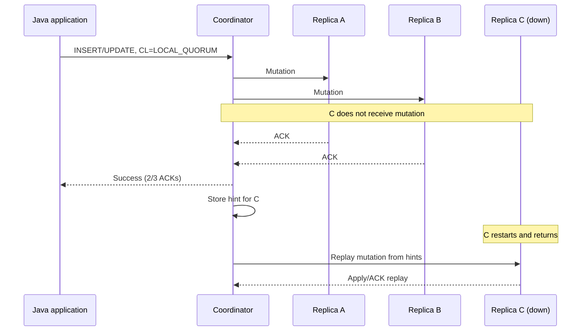

# Hints When a Replica Misses a Write and Their Limits in Apache Cassandra

## 1. The Problem: One Replica Misses a Mutation While the Cluster Keeps Writing

In Apache Cassandra's **distributed wide-column** model, each partition maps to a replica set based on token, replication strategy, and replication factor (RF). When an application writes a CQL row, a node acting as **coordinator** receives the request, resolves the replicas responsible for the partition key, and forwards the mutation to them. One replica might be restarting, disconnected, or responding too slowly while the other replicas serve normally.

**Hinted handoff** is Cassandra's mechanism for temporarily storing a **hint** on a coordinator when a mutation cannot be delivered to a target replica, then attempting to replay the mutation once that replica returns. Hints shorten the window during which replicas diverge after brief outages. It is a **best-effort** mechanism, not a guarantee that every missed write will definitely be applied. To reconcile remaining discrepancies across replicas, the system still requires scheduled **anti-entropy repair**.

This lesson belongs to the **Write Path and Durability** chapter of the `DATABASE_ENGINE_WIDE_COLUMN_CASSANDRA` module, connecting three areas: write path/durability, replication and consistency levels, and fault detection/remediation using CQL, `nodetool`, and Java applications.

By the end of this lesson, you will be able to:

1. Explain when Cassandra creates a hint and distinguish hints from successful replica writes.
2. Analyze responses at `ONE`, `LOCAL_QUORUM`, `ALL`, and `ANY` when one or more replicas are unavailable.
3. Understand hinted handoff limits: hint creation window, disk space, replay throughput, coordinator loss, TTL/tombstones, and topology changes.
4. Monitor backlogs, recover replicas, determine when repair is needed, and handle timeouts from the Java Driver.

## 2. Where Do Hints Fit on the Write Path?

Suppose a keyspace has three replicas **A, B, C** in the same datacenter (`RF = 3`). The application sends a mutation to a coordinator using `LOCAL_QUORUM`. Node C is restarting, while A and B receive the write and send ACKs. The coordinator can return success to the client **as soon as two ACKs arrive** per the consistency level; it stores a hint for the mutation C missed.



**Event ordering in this diagram is illustrative only.** A coordinator may create a hint upon detecting a down replica or upon write timeout; writing the hint and replying to the client do not necessarily happen in the exact same order across every version or execution path.

### 2.1. Distinguishing On-Disk Artifacts

| Component | Where does it live? | Purpose |
| --- | --- | --- |
| **Commit log** | On the node **receiving the mutation** | Recovery log for unflushed writes if the node crashes; disk sync behavior depends on commitlog config |
| **Memtable** | Memory of the node receiving the mutation | Holds recent updates before flushing to SSTables |
| **SSTable** | Disk of a node owning the replica | Durable LSM storage; merged over time via compaction |
| **Hint** | Typically on a **coordinator** node holding it for a temporarily unreachable replica | Records a mutation to be forwarded to **a target replica** |
| **Repair** | Process comparing and syncing replicas across token ranges | Resolves discrepancies, including mutations hints did not cover |

A hint typically carries the target replica identifier, the serialized mutation, and the mutation's **original timestamp**. During replay, Cassandra preserves the mutation's timestamp semantics; an older hint will not arbitrarily overwrite a newer value with a higher timestamp under Cassandra's conflict resolution rules. Still, mis-issued application timestamps, TTLs, and tombstones can still cause side effects; hints do not fix flawed time-management design.

A hint **does not mean** replica C wrote to its commit log or holds the row in an SSTable. Prior to replay, the data may exist only on A/B and on one or more coordinators holding hints for C. The hints directory on a coordinator can grow even while C is absent.

### 2.2. Why Is This Tied to the Partition Key?

```text
partition key -> token -> replica set {A, B, C} -> mutation sent to replicas
                                       |
                                       +-- C missed -> hint(C, mutation)
```

Changing a clustering key **does not** move data to a different replica set if the partition key stays the same. A hint is recorded for a **mutation missed by a specific replica**, not as a way to "rehash" data, create a fourth copy, or balance load long-term. Hinted handoff and vnode counts solve two different problems.

## 3. When Are Hints Created?

For normal writes, common situations include:

- A replica is marked **down/unreachable** by the coordinator before or during mutation delivery.
- A replica fails to acknowledge a mutation **before the write timeout**, even though its actual state may be uncertain.
- A brief maintenance restart takes one node temporarily out of the ring while peer replicas continue accepting writes.

Whether a hint is successfully stored also depends on whether hints are enabled, whether the target DC is permitted, the hint window, hints directory writability, local quotas/limits, and coordinator health. **Never assume "if a replica is down, a hint definitely exists."** A timed-out request also does not prove the mutation was not applied: a replica may have written successfully while its ACK arrived late or never reached the client.

When the replica returns, Cassandra learns node status via membership/gossip and attempts to **deliver/replay** stored hints for that node. Replay is throttled to avoid overwhelming the recovering replica with I/O and network traffic. Replay takes time and can last longer than the node's downtime.

### 3.1. Hinted Handoff Is Not Read Repair or Anti-Entropy Repair

| Mechanism | Trigger | What it can fix | Key limitations |
| --- | --- | --- | --- |
| **Hinted handoff** | Write occurs while replica is unreachable; replica later recovers | Mutations for which the coordinator **recorded a hint** | Best effort; subject to time/disk/target limits; unaware of other discrepancies |
| **Read repair** | Certain read paths detect divergent replicas per version-supported rules | Discrepancies encountered **in queried data** | Does not scan all partitions; does not replace periodic repair |
| **Anti-entropy repair** | Operator or management system explicitly runs repair | Compares token-range data across replicas and syncs differences | Consumes network/disk/CPU; requires scheduling and monitoring |

**Missed tombstones** are especially critical: a replica might retain an old record while a tombstone on peer replicas gets garbage-collected after the grace period. Skipping repair for too long lets deleted data "resurrect" (*zombie data*). Therefore, you cannot replace a repair policy with expecting "Cassandra always has hints."

## 4. Consistency Levels: Does a Success Response Require Hints?

With `RF=3` in **one DC**, consider the scenarios below. The quorum rule is `floor(RF/2) + 1 = 2`. The coordinator still attempts to send the mutation to all replicas; consistency level determines **how many acknowledgments to wait for** before returning success. Specifically for the scenario where A/B/C are all down, **assume coordinator Q is running on another node outside that replica set**; if the entire cluster is down, no coordinator can accept the request to store hints.

| Scenario | CL | Client success condition | Role of hints |
| --- | --- | --- | --- |
| A, B up; C down | `ONE` | One replica ACK suffices | May store mutation for C; hint is not a required ACK |
| A, B up; C down | `LOCAL_QUORUM` | A and B ACK → success | May store hint for C to sync later |
| A, B up; C down | `ALL` | Missing C's ACK → cannot meet CL | Having a hint **does not turn** the command into `ALL` success |
| A down; B and C down | `ANY` (normal write) | Can succeed when coordinator **stores a hint** even with zero replica ACKs | Hint counts toward satisfying `ANY`; data may not be readable before replay |
| A down; B and C down | `QUORUM` | Insufficient ACKs → fails/unavailable | Hints do not substitute for quorum ACKs |

**Important exception:** `ANY` is a write-only consistency level (subject to operation type and version constraints); it cannot be used for `SELECT`, and do not generalize this example to LWTs or write types with special restrictions. With `ANY`, an ACK may reflect **a stored hint** while no replica owns the actual data yet. That is a major difference between "coordinator returned success" and "immediately ready to read back." If the coordinator/hint fails before replay, data-loss risk rises.

In multi-DC clusters, `LOCAL_QUORUM` only requires quorum in the **local DC**; `QUORUM` and `EACH_QUORUM` have different scopes. Replica sets, per-DC RF, and coordinator local DC must be stated clearly before analyzing. A hint targeting a remote-DC replica does not automatically add to local-DC ACKs.

### 4.1. The Durability Problem: Two Layers to Understand

**Layer 1 – Durability of ACKing replicas.** Upon receiving a mutation, a replica writes to its commit log and memtable per the write path; post-crash durability depends on commit log sync policy, disk health, and how many copies accepted the write. Not every ACK means every byte was `fsync`ed on every replica when the client received a response.

**Layer 2 – Recoverability of missed replicas.** A hint is temporary storage for a mutation targeting a destination; it has its own storage path, flush/throttle behavior, and loss risks. Hints do not replace the target replica's commit log, nor do they replace repair after extended outages.

Consequently, even though Cassandra lets you tune consistency levels to trade off latency and availability, **increasing the hint window or enabling `ANY` does not give the system absolute durability guarantees**.

## 5. Practical Limits of Hinted Handoff

### 5.1. The Hint Window Is Not a Guaranteed Sync Time

The `max_hint_window` (Cassandra 4.1+/5.x) or `max_hint_window_in_ms` (3.11/4.0) setting caps how long a coordinator continues creating new hints for a node considered down. The documented default across many versions is **3 hours**. Its primary meaning is **to stop creating new hints once a target has been down too long per version rules**, preventing unbounded accumulation; do not misread it as "all hints will finish delivering in three hours" or "at hour three all hint files are deleted."

Newer releases also include options related to a **persistent hint window**, which can affect how consecutive downtime is tracked across flapping nodes. Check `cassandra.yaml` for your **running version** before relying on strict time assumptions.

If a node returns **after the hint window closes**, many mutations written during the long downtime **have no hints**. Even if older hints remain, replaying them successfully does not guarantee the replica holds complete data; you must run **repair** for the affected token ranges.

### 5.2. Disk Space, Write Capacity, and Hint Quotas

Hints typically live in the coordinator's `hints_directory`. During high write rates or prolonged target downtime, directory size can grow substantially, competing for disk space and I/O with other Cassandra components.

Contributing factors:

- Hints directory fills up or becomes unwritable, coordinator crashes/loses a disk, or hinted handoff is disabled.
- Per-hint-file size caps; some versions offer `max_hints_size_per_host` to bound hint storage per destination. Once reached, the system may **stop creating new hints**.
- Hint write rate exceeds delivery rate to the returning node. Prolonged replay grows backlogs and disk demand.
- Multiple nodes down simultaneously require hints for several targets; with multiple coordinators, measure across **every node that may hold hints**, not just the failed node.

**Rough capacity estimate:** if a replica misses an average of 6 MiB/sec of mutations for 30 minutes, the mutation volume to hold is roughly `6 × 1,800 = 10,800 MiB ≈ 10.5 GiB`, excluding metadata, compression, overwrites, or coordinator distribution effects. This figure is only for capacity planning; you cannot predict exact hint size from cluster-wide QPS alone.

### 5.3. Replay Can Be Very Slow

`hinted_handoff_throttle`, `max_hints_delivery_threads`, network bandwidth, and the target replica's disk/CPU capacity all govern replay speed. Never crank the throttle sky-high reflexively: a returning replica also serves normal reads/writes, flushes, compaction, or streaming. Forcing aggressive replay can spike p99 latency, timeouts, and application backlogs.

Conversely, setting the throttle too low can leave tens of GiB of hints waiting for hours. Tuning must respect operational guardrails and monitor **backlog drain rate**, replay throughput, application latency, I/O, and error logs.

### 5.4. Hints Cannot Mask Every Failure Type

- **Loss of coordinator or hints disk:** buffered hints can be lost. Hints are best effort; never treat the hints directory as a backup.
- **Prolonged data loss on a node:** hints do not rebuild an entire replica after disk loss or node replacement. Follow topology-appropriate replace/bootstrap, streaming, and repair procedures.
- **RF, token, or host-identity changes:** hints target the original destination replica; do not assume old hints automatically reroute to a replacement node. Follow topology-change procedures to verify/repair data.
- **Writes lacking consistent timestamps/business logic:** Cassandra reconciles most data by timestamp, not client request arrival order. Hints do not solve clock skew, unintended last-write-wins overwrites, concurrent updates, or exactly-once requirements.
- **TTL expiration / tombstone grace:** late replay does not extend the original mutation's TTL; expired mutations or tombstones past GC grace may not recover as expected.
- **LWT, counters, batches:** these have distinct semantics/write paths. Do not blindly apply normal-write and `CL ANY` conclusions to Paxos/LWT, counters, or logged batches; verify their specific support and guarantees.

## 6. Cassandra Configuration Related to Hints

Never copy property names across versions blindly. Cassandra 4.1 renamed many parameters to drop unit suffixes; the illustrative syntax below targets **4.1/5.0** and should not be applied to a live cluster unchanged:

```yaml
# cassandra.yaml (illustrative sample, not a universal production recommendation)
hinted_handoff_enabled: true
max_hint_window: 3h
hinted_handoff_throttle: 1024KiB
max_hints_delivery_threads: 2
hints_flush_period: 10000ms
max_hints_file_size: 128MiB

# Optional, set only with a dedicated storage layout:
# hints_directory: /var/lib/cassandra/hints

# Only when restricting/excluding DCs from receiving hints:
# hinted_handoff_disabled_datacenters:
#   - dc_remote
```

| Config goal | Cassandra 3.11/4.0 | Cassandra 4.1/5.0 | Meaning |
| --- | --- | --- | --- |
| Enable/disable hints | `hinted_handoff_enabled` | `hinted_handoff_enabled` | Defaults to `true` in official configs |
| Window limit | `max_hint_window_in_ms` | `max_hint_window` | Downtime duration considered for creating new hints |
| Delivery rate limit | `hinted_handoff_throttle_in_kb` | `hinted_handoff_throttle` | Bandwidth per delivery thread, scaled by cluster size |
| Delivery threads | `max_hints_delivery_threads` | `max_hints_delivery_threads` | Number of hint-delivery threads |
| Buffer flush period | `hints_flush_period_in_ms` | `hints_flush_period` | Interval for flushing buffered hints to disk files |
| File size cap | `max_hints_file_size_in_mb` | `max_hints_file_size` | Maximum size per hint file |
| Storage path | `hints_directory` | `hints_directory` | Directory path storing hints |

For Cassandra 4.0, equivalent **key names** look like:

```yaml
hinted_handoff_enabled: true
max_hint_window_in_ms: 10800000
hinted_handoff_throttle_in_kb: 1024
max_hints_delivery_threads: 2
hints_flush_period_in_ms: 10000
max_hints_file_size_in_mb: 128
```

Note that `hints_flush_period` **does not mean an fsync guaranteeing durability for every individual hint**. Never change settings from memory; read the docs for your exact release/JDK/vendor and verify after a rolling restart. Disabling hinted handoff can significantly alter how long replica divergence persists during brief outages.

## 7. Observing and Diagnosing Backlogs

### 7.1. Read-Only Checks First

Run on coordinators that may hold hints and on the recovering target node:

```bash
# View topology, DCs, Up/Down states, and replica groups.
nodetool status

# Hinted handoff status on the executing node.
nodetool statushandoff

# Hint window (Cassandra 4.0+ where supported).
nodetool getmaxhintwindow

# Background thread-pool status, helping spot resource contention.
nodetool tpstats
```

Also inspect the configured hints directory (total bytes, file count, growth/drain rate) and **Cassandra metrics for hints generated, delivered, dropped, pending, and delivery latency**. JMX metric names and Prometheus exports vary by version/exporter, so consult the official metrics docs for your running release. Correlate node down/up timestamps, write timeout rates, coordinator disks, and the hint-receiving replica's disks.

Seeing the target node as `UN` is **not** enough to conclude all hints have been delivered. Seeing a near-zero hints queue also does not prove the replica holds complete data if there was an earlier period with no hints created or dropped hints.

### 7.2. State-Changing Commands

These commands are **strictly** for operators who have verified their impact—never run them automatically as diagnostic checks:

```bash
# Pause/resume hint delivery on the target node.
nodetool pausehandoff
nodetool resumehandoff

# Adjust live throttle: 2048 is purely an example;
# verify units and valid range for your version.
nodetool sethintedhandoffthrottlekb 2048

# Re-enable hint creation if previously disabled on the node.
nodetool enablehandoff
```

`nodetool disablehandoff` stops creating and delivering hints; `nodetool truncatehints` deletes hints (optionally per endpoint where supported), causing **loss of the chance to replay unrepaired mutations**. Never run `truncatehints` to "quickly free disk space" without a data-recovery plan and risk assessment. If you need to extend the window via `nodetool setmaxhintwindow` (available in Cassandra 4.0+), evaluate disk pressure and apply it to all relevant hint-holding nodes; never treat it as a substitute for repair.

### 7.3. Quick Diagnostic Table

| Symptom | Possible interpretation | What to check first |
| --- | --- | --- |
| C down, `LOCAL_QUORUM` writes succeed, hints grow on A/B | Coordinators buffer mutations missed by C | Confirm C is down, RF/CL, hint space, and write rate |
| C is `UN` yet hints keep growing/not draining | Slow delivery, network errors, throttling, or coordinator timeouts | Check server logs, delivery metrics, I/O, throttle, C's health |
| Hints directory fills rapidly | Prolonged replica downtime, high write rate, or multiple targets down | Estimate capacity, shed/reduce load if needed, plan node recovery |
| Requests time out despite hints | Insufficient CL ACKs, overloaded coordinator, or slow replica replies | Check CL ACKs and server errors; client timeout is an unknown outcome |
| Node returned, backlog drained, yet rows missing | Earlier dropped/lost hints, expired window, or metadata/node replacement | Run repair per runbook and verify data; do not rely solely on backlog |
| Node disconnected longer than max window | Many new mutations received no hints | Schedule repair once node recovers; evaluate tombstone grace |
| After replay, p99 latency spikes | Replay competes for network/disk/CPU with reads/writes and compaction | Tune delivery schedule/throttle; monitor queues and SLAs |

## 8. CQL Experiment in a Three-Node Lab Cluster

**Prerequisites:** a **lab** Cassandra cluster with A/B/C in an actual DC named `dc1`, RF = 3, where the administrator can cleanly pause and restore node C. Never intentionally shut down nodes in production. Replace `dc1` if your environment differs.

```sql
CREATE KEYSPACE IF NOT EXISTS hint_lab
WITH replication = {
  'class': 'NetworkTopologyStrategy',
  'dc1': 3
};

CREATE TABLE IF NOT EXISTS hint_lab.events_by_id (
  event_id uuid PRIMARY KEY,
  source text,
  payload text,
  created_at timestamp
);
```

**Test scenario:**

1. On the healthy cluster, verify `nodetool status` shows A, B, C as `UN` and hints enabled on coordinators. Record the current hints directory and count.
2. In the **lab**, cleanly take C out of service in a reversible way. Wait for coordinators to detect C as unavailable. Never perform risky actions on nodes holding real data.
3. Use `cqlsh` to write at consistency `LOCAL_QUORUM`. Within the same DC, A and B can ACK so the client sees success:

   ```sql
   CONSISTENCY LOCAL_QUORUM;

   INSERT INTO hint_lab.events_by_id (event_id, source, payload, created_at)
   VALUES (
     22222222-2222-2222-2222-222222222222,
     'demo',
     'replica-c-missed-this',
     '2026-11-21T00:00:00Z'
   );
   ```

4. Inspect coordinator metrics/logs/hints directories for evidence of a stored hint destined for C. **Do not infer** from `INSERT` success alone that a hint definitely exists.
5. Restore C and confirm `UN`. Monitor backlog drain rate and delivery errors. Wait for replay and/or repair to finish per procedure before concluding all three replicas match.
6. Finally, verify with reads at an appropriate CL and repair/verification stats. A single successful `SELECT` **does not** prove every partition on C has caught up. Document stop time, recovery time, hint volume, and replay lag.

In a follow-up exercise, increase the write rate in a controlled way and observe hint growth over 1–2 lab minutes. From byte growth/drain rates, estimate backlog drain time as `pending_bytes / net_delivery_bytes_per_second`. Treat this as an estimate; account for metadata overhead, compression, replay work, and ongoing incoming writes.

## 9. Java Driver 4.x: Never Mistake Write Timeout for "Not Written"

A Java application only sees the **coordinator's response**, not every commit log, SSTable, or hint directly. Especially when the driver reports a write timeout, some replicas may have received the mutation while ACKs fell short; the client **must never** conclude the data was definitely not written. Below is a core snippet using Java Driver 4.x, assuming an initialized `CqlSession session` with the right local DC:

```java
import com.datastax.oss.driver.api.core.DefaultConsistencyLevel;
import com.datastax.oss.driver.api.core.cql.BoundStatement;
import com.datastax.oss.driver.api.core.cql.PreparedStatement;
import com.datastax.oss.driver.api.core.servererrors.WriteTimeoutException;
import com.datastax.oss.driver.api.core.servererrors.UnavailableException;
import java.util.UUID;

PreparedStatement statement = session.prepare("""
    INSERT INTO hint_lab.events_by_id (event_id, source, payload, created_at)
    VALUES (?, ?, ?, ?)
    """);

UUID eventId = UUID.fromString("22222222-2222-2222-2222-222222222222");
BoundStatement bound = statement.boundStatementBuilder()
    .setUuid(0, eventId)
    .setString(1, "demo")
    .setString(2, "replica-c-missed-this")
    .setInstant(3, java.time.Instant.parse("2026-11-21T00:00:00Z"))
    .setConsistencyLevel(DefaultConsistencyLevel.LOCAL_QUORUM)
    .build();

try {
    session.execute(bound);
    // Received success response per LOCAL_QUORUM.
} catch (WriteTimeoutException ex) {
    // Write outcome UNKNOWN: some replicas may have applied it.
    // Log trace/attempt ID and handle per idempotency policy.
} catch (UnavailableException ex) {
    // Insufficient live replicas available to satisfy CL at check time.
    // Classify separately from write timeouts and network errors.
}
```

This snippet uses text blocks requiring Java 15+; use standard concatenated strings on older Java versions. In production services, also handle other driver/network errors (such as failing to reach any coordinator) and log `eventId`, consistency level, timestamp, exception, and retry attempt. An attempt whose response was lost must still be labeled **unknown** until verified.

### 9.1. Retry Rules to Avoid Duplicates or Overwrites

- For an event with a fixed `event_id`, choose primary keys and immutable business payloads so re-sending **does not create an extra row**. If writing the same key and values with a fresh server timestamp each time, consider how it interacts with concurrent updates; "same key" does not automatically make every retry safe.
- Do not blindly retry **counter increments**, state-dependent mutations, or workflows requiring "exactly-once" semantics. Hinted handoff does not turn them into exactly-once.
- When business logic must distinguish whether a previous attempt succeeded, design an **idempotency key**, a status check at an appropriate consistency level, or independent reconciliation; a timeout does not mean `[applied]=false` or rollback.
- Never automatically switch from `LOCAL_QUORUM` to `ANY` on timeout just to make ACK rates look better. `ANY` can succeed when **only a hint exists** and an immediate read finds no row.

## 10. When Is Repair Required After Hinted Handoff?

View hints as a **bridge for brief downtime**, whereas repair is the synchronization tool whenever a replica might have missed mutations uncovered by hints. Signs that call for scheduling repair:

- A replica stayed down past `max_hint_window` or underwent disk/node replacement.
- Hints were previously disabled, dropped, disk-full, per-host capped, coordinator-crashed, or truncated.
- Backlog drained to zero, yet verification reveals missing mutations or inconsistent data on a replica.
- Time since last repair approaches `gc_grace_seconds` on tables with tombstones, raising zombie-data risk.
- Topology or replication factor changes requiring resynchronization per your Cassandra version's guide.

Track this via `nodetool status`, repair/streaming metrics, and scheduled repair calendars. **Running `nodetool repair` consumes significant resources**; do not reflexively trigger repair on every node simultaneously right after restarting one replica. Select full/incremental mode and ranges per operational schedule, version, and cluster load; confirm the replica is healthy and stable first.

If you postpone repair too long, remember: hints only capture mutations **that were detected and stored**. Missing writes without hints will not regenerate spontaneously when a replica returns.

## 11. Checklist for Handling a Disconnected Node

| Stage | What to check | Decision criteria |
| --- | --- | --- |
| **When downtime starts** | Identify affected replica, DC/rack, RF, and active CLs | Are enough replicas up to sustain workload? |
| **During downtime** | Record disconnect time; monitor hint bytes/rate, disk, and write timeouts | Still inside hint window? Hint storage headroom safe? |
| **Before recovery** | Check node health, disks, commitlog, network, restart viability | Can the old node rejoin the ring, or is node replacement needed? |
| **After returning `UN`** | Check hint replay/backlog, CPU, disk I/O, p99 latency, timeouts | Is the replica catching up or choked by replay/compaction? |
| **After backlog drains** | Verify consistency, repair prerequisites, and data/tombstone state | Was there any hint gap or window expiry needing repair? |
| **Post-incident** | Archive timeline, metrics, config, root cause, and alert tuning | Has recovery been verified against SLA/durability targets? |

## 12. Self-Check Questions

1. With RF = 3, C down, and A/B ACKing, why can `LOCAL_QUORUM` return success while `ALL` cannot? Does a hint count toward quorum?
2. When all target replicas are down, why can `ANY` succeed and why might an immediate `SELECT` still return no data?
3. Why does raising `max_hint_window` from 3h to 24h not create a 100% guarantee of replica synchronization?
4. Why does the hints directory reside on coordinators rather than necessarily on the target replica?
5. Hints dropped to 0 and node C is `UN`. Can you conclude every partition matches? What additional evidence is needed?
6. Why is preserving the original mutation timestamp during replay important? How do TTLs and tombstones interact with it?
7. When the Java Driver throws `WriteTimeoutException`, why can't the client infer "write definitely failed"? How should retries behave?
8. When should you schedule anti-entropy repair instead of relying on hinted handoff?

## 13. Official References

- [Apache Cassandra — Hints](https://cassandra.apache.org/doc/stable/cassandra/managing/operating/hints.html): role, storage/replay lifecycle, limits, and `nodetool` commands.
- [Apache Cassandra — cassandra.yaml 5.0 (stable)](https://cassandra.apache.org/doc/stable/cassandra/managing/configuration/cass_yaml_file.html): hint configuration keys and values in 5.x.
- [Apache Cassandra — cassandra.yaml 4.0](https://cassandra.apache.org/doc/4.0/cassandra/configuration/cass_yaml_file.html): legacy parameter names with unit suffixes.
- [Apache Cassandra — Dynamo Architecture](https://cassandra.apache.org/doc/stable/cassandra/architecture/dynamo): replicas, coordinator, and how consistency level defines responses.
- [Apache Cassandra — Repair](https://cassandra.apache.org/doc/stable/cassandra/managing/operating/repair.html): why hints are best effort, repair methods, and risks of missed tombstones.
- [Apache Cassandra — cassandra.yaml Parameter Renames](https://cassandra.apache.org/doc/stable/cassandra/managing/configuration/configuration.html): mapping between legacy and new configuration names.

**Academic conclusion:** Hinted handoff helps a briefly interrupted replica catch up on missed mutations, but it **is not a fourth replica, does not replace quorum ACKs (except under `ANY` semantics), does not guarantee zero data loss, and does not replace repair**. Reliable Cassandra design combines proper partition keys, RF/topology, appropriate consistency levels, coordinator hint monitoring, scheduled repair, and safe retries from the Java client.
