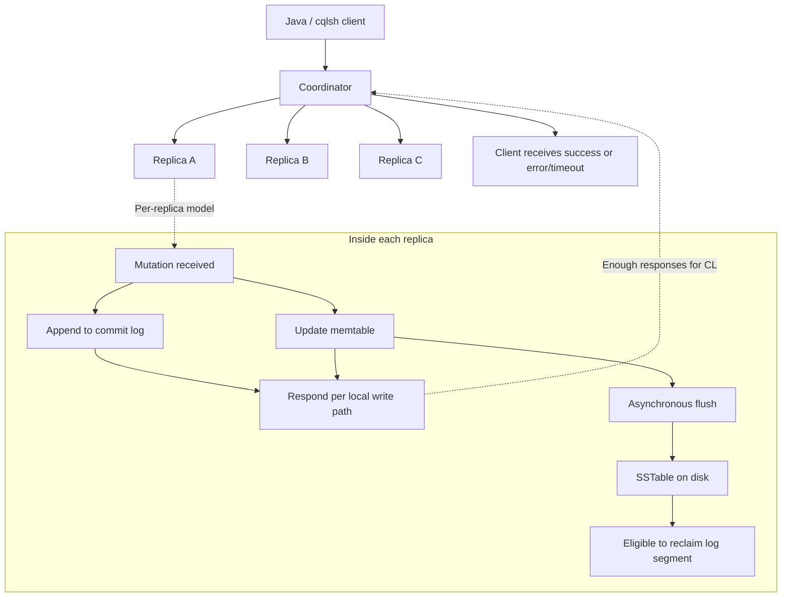
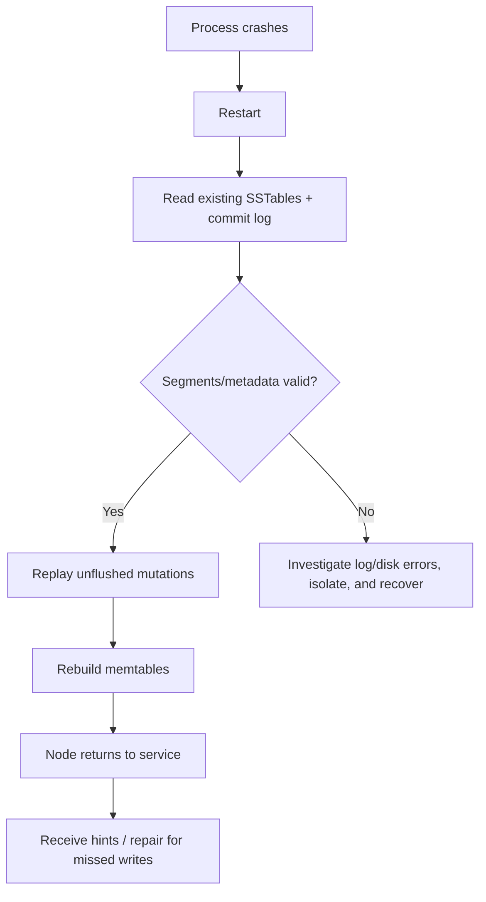

# Crash Recovery and Commit Log Replay

Apache Cassandra writes data very quickly because it does not build an on-disk SSTable for every write statement. Instead, on each replica receiving a mutation, Cassandra writes recovery information to the **commit log** and updates the in-memory **memtable**; memtables flush into **SSTables** in batches. If the process dies before a memtable flushes, data not yet in SSTables can be recovered via **commit log replay** when the node restarts.

However, "received a write success response" and "bytes have been fsynced to the storage device" are **not always synonymous**. Surviving failures depends on commit log sync settings, replica count, consistency level, failure type, and disk health. This lesson belongs to the **Write Path and Durability** chapter of the **DATABASE_ENGINE_WIDE_COLUMN_CASSANDRA** module, connecting distributed/wide-column architecture, partition key design, CQL practice, replication, compaction, repair, error handling, and Java integration.

## 1. Objectives

After this lesson, you will be able to:

1. Explain the write path from **client → coordinator → replica → commit log + memtable → SSTable**.
2. Distinguish **commit log append**, **sync/fsync**, **memtable flush**, **SSTable**, **acknowledgment**, and **replay**.
3. Describe how Cassandra restarts after a crash and how the commit log reconstructs unflushed data.
4. Explain what *can* be lost when a process is killed, a host loses power, a disk fails, or a commit log is corrupted.
5. Evaluate the effects of `durable_writes`, commit log sync policies, replication factor (RF), and write consistency level.
6. Design controlled experiments to observe recovery, verify data, and handle write timeouts when Java applications retry.
7. Identify when **hinted handoff/repair/rebuild** is needed instead of confusing those mechanisms with local commit log replay.

## 2. Component Map Along the Write Path

| Component | Where is it, and what does it do? | Meaning when an outage occurs |
| --- | --- | --- |
| **Coordinator** | Node receiving the client request, routing mutations to replicas per token and replication strategy. | The coordinator need not be a replica; losing the coordinator can lose the response even if replicas wrote. |
| **Replica** | Node storing a copy of the partition, executing the local write path. | Each replica has its **own** commit log/memtable/SSTables; recovery runs locally on that node. |
| **Commit log** | Sequential write journal, typically organized into on-disk segments for recovering unflushed data. | Replays data still present in **readable** logs needing replay. |
| **Memtable** | In-memory data structure holding recent mutations. | Lost when the process/machine stops; rebuilt from the commit log if entries survive. |
| **SSTable** | Immutable on-disk data files created when flushing memtables. | Long-term storage; not lost just because process memory disappears, provided storage survives and files are valid. |
| **Commit log segment** | Unit holding records from **multiple tables**. | Can only be safely reclaimed once no unflushed mutations still depend on that segment. |
| **Flush position / replay boundary** | Metadata identifying data safely persisted in SSTables. | Lets startup avoid unnecessarily replaying already-flushed mutations, per version mechanics. |
| **Hints and repair** | Mechanisms for updating/syncing across replicas. | Compensates for data a replica **missed**; not part of that node's local commit log. |

### Typical Write Path



The diagram depicts **two logical tasks** on each replica (logging and updating the memtable), without requiring them to run as strictly parallel branches or in an invariant call sequence across all versions. The essence is that the replica accepts the mutation and manages both memtable-resident state and commit log recoverability.

For example, in a keyspace using `NetworkTopologyStrategy` with RF = 3 in `dc1` and a client writing at `LOCAL_QUORUM`: the coordinator needs **2 replica responses** on time. It does **not** wait for all three replicas to finish flushing to SSTables. If one replica missed the write because it was down, upon returning it must catch up from peer replicas; local replay cannot replay a mutation that never reached the node.

## 3. Timeline: From Write Acknowledgment to Durable Data

Suppose a row `(tenant_id, event_id)` is written:

```text
t0  Client sends INSERT to coordinator.
t1  Coordinator forwards mutation to replicas.
t2  Replica writes to commit log and applies to memtable.
t3  Replica sends acknowledgment per node write/sync policy.
t4  Coordinator receives enough acknowledgments for consistency level and returns success.
t5  Later, memtable flushes to SSTable.
t6  Once related data is safely flushed, commit log segment can be reused.
```

Do not interpret these milestones as a single cluster-wide linear clock: replicas execute concurrently, and `t3` and `t5` happen on each node at different times. In particular, when **commit log fsync** occurs depends on configuration mode.

### Why Have Both Commit Log and Memtable?

- **Memtables** provide an in-memory structure for fast updates/reads, batching many writes before creating an SSTable.
- **Commit logs** provide sequential records to recover after memtable loss; they are not used as primary tables for arbitrary queries.
- **SSTables** store long-term data in immutable structures, holding flushed data.

With only a memtable and no commit log, a crash would wipe all recent unflushed writes. Syncing SSTables on every write would incur random file/write costs, forfeiting most advantages of an LSM write path.

## 4. How Are Commit Log Segments Retained and Reclaimed?

The commit log typically consists of multiple **segments**. Mutations from different tables can share the same segment. When a memtable flushes to an SSTable, Cassandra records flush progress and can release an old segment **only when no unflushed mutations still depend on that segment**.

Example:

| Segment | Table A writes | Table B writes | Can be reclaimed? |
| --- | --- | --- | --- |
| Segment-1 | Flushed | Unflushed | **Not yet**, because B still needs the log. |
| Segment-2 | Flushed | Flushed | **Possibly**, if other log retention conditions are met. |
| Segment-3 | Unflushed | Unflushed | **No**. |

This explains why **flushing one table does not mean all commit log segments are deleted**. It also explains why commit log usage can grow when one memtable fails to flush promptly, or when disk/resource bottlenecks occur.

Upon a crash, the system cannot blindly replay "every entry in every segment." It uses flush progress metadata and existing SSTables to determine which records need replay; metadata formats, segment handling, and recovery steps vary across Cassandra versions.

**Never manually delete commit log segments** to free disk space without a recovery procedure specific to your version. Deleting needed entries can lose unflushed mutations; backing up isolated segments also does not create a complete backup.

## 5. Crash Recovery When a Node Restarts

A typical scenario: the Cassandra process terminates abruptly, process memory is lost, yet commit log and SSTable files remain on disk.

1. **Node boots, reads config and required metadata:** locates data directories, commit log directory, keyspace/table metadata, and openable data files.
2. **Determines flushed boundaries:** separates mutations already reflected in valid SSTables from mutations still needing replay.
3. **Reads relevant commit log segments:** checks format/integrity and decodes mutations against matching table metadata.
4. **Replays necessary mutations into memtables:** reconstructs recently written state absent from SSTables.
5. **Completes node startup/recovery:** once eligible to serve requests, the node resumes reads/writes. Startup can take longer when log volume is large, disks are slow, or errors occur.
6. **Catches up on mutations missed while down:** uses hinted handoff if valid hints remain, plus repair/sync per operational procedures. This is an **inter-replica step**, separate from local replay.



Two important properties:

- **Commit log replay is local:** node A only replays mutations recorded in **A**'s own log. If A was down before receiving mutation X, A's replay cannot conjure X; it needs data from peer replicas.
- **Replay can restore a mutation the client thought failed:** if the client timed out or lost connection before receiving a reply, replicas may still have logged the mutation. Thus you cannot infer "timeout = not written"; the application needs idempotent retries.

### When Is Replay Not Needed?

A **clean shutdown** can drain/flush memtables per operational procedures, minimizing or eliminating replay work. Conversely, `kill -9` on the process wipes process memory, typically requiring log replay for unflushed mutations. Power loss or storage failure is another problem entirely: data not **synced to storage** may no longer exist for replay.

## 6. Commit Log Sync Defines a Replica's Durability Boundary

In Cassandra, common **commitlog_sync** modes are **periodic** and **batch**; some versions also provide group sync or different parameter names/options. Never copy configuration keys verbatim from one version to another; verify docs and your running config before editing.

| Policy | When is the log synced to storage? | Core trade-off |
| --- | --- | --- |
| **periodic** | Syncs asynchronously on a configured interval; writes can be acknowledged before the next sync. | Lower write latency; upon **power loss / OS crash** before sync, a window exists for losing locally ACKed mutations. |
| **batch** | Groups/syncs the log for write batches and waits for sync before acknowledging per mode policy. | Stronger local durability at the cost of fsync latency and disk-dependent throughput. |
| **group** (if supported by version) | Groups writes to sync together. | Balances fsync frequency and latency; verify exact version behavior. |

**Append** writes data into the commit log I/O path; **fsync** requests the OS to flush data and related metadata to the storage device per platform contracts. A device, controller, or virtualization layer that violates flush contracts can still lose data. When Cassandra runs in periodic mode, killing the **process** differs from cutting **machine power**: after `kill -9`, the OS page cache may survive and flush bytes to disk, so a process-kill test does not prove power-loss resilience.

Sync policy is a **per-replica property**, whereas consistency level is the **replica response count** required by the coordinator. Never conflate the two:

```text
Suppose RF = 3 in dc1:
LOCAL_ONE    -> requires 1 replica response.
LOCAL_QUORUM -> requires floor(3 / 2) + 1 = 2 replica responses.
ALL          -> requires 3 replica responses.

Replica response -> still depends on local commitlog_sync,
                    and does not mean writes are in SSTables.
```

For example, `LOCAL_QUORUM` can survive **one** replica outage if the other two replicas still respond. It is not an absolute guarantee against data loss if **all replicas** suffer a shared power/storage failure losing unsynced data. Evaluating true durability requires examining **fault domains** (rack/AZ/DC, power), RF, copy placement, sync policy, and consistency level.

### Role of durable_writes

A keyspace has the `durable_writes` property. With `durable_writes = true`, mutations for that keyspace use the commit log normally; with `false`, the write path may bypass the commit log for that keyspace's data, leaving unflushed memtables vulnerable to crash loss with **no corresponding log to replay**. Never set `durable_writes = false` on business data requiring durability merely to boost throughput.

```sql
-- Illustrative lab config for dc1 with three nodes.
CREATE KEYSPACE IF NOT EXISTS recovery_lab
WITH replication = {
  'class': 'NetworkTopologyStrategy',
  'dc1': 3
}
AND durable_writes = true;
```

If your lab has only one node, adjust RF appropriately **in the test environment**. Never modify RF or `durable_writes` on a production keyspace for testing.

## 7. Failure Models: What Can Be Recovered?

| Failure | SSTables intact? | Useful commit log intact? | Expectation and action |
| --- | --- | --- | --- |
| **Process dies, disk/OS intact** | Usually yes | Usually yes | Startup replays unflushed mutations if logs are intact; verify data once node returns. |
| **Graceful shutdown / drain** | Data flushed per procedure | Usually minimal replay needed | Use as comparison baseline, not as a substitute for crash tests. |
| **Power loss / OS crash before periodic fsync** | Flushed SSTables survive if durable | Recent log tail may not be durable | May lose unsynced mutations on the node; check peer replicas and write policies. |
| **Total loss of commit log disk, data disk intact** | May remain | No for lost log portion | Unflushed writes risk loss on the node; evaluate peer replicas, recovery/repair. |
| **Loss of both data disk and commit log on node** | No | No | Local replay is moot; follow replace/rebuild node procedure from healthy replicas or backups. |
| **Corrupted/truncated commit log** | May remain | Only valid readable portion | Startup may error, skip per policy/version, or fail to start; investigate, never delete blindly. |
| **Node down before receiving new writes** | Holds older data | Lacks missed writes | Hints or repair/catch-up from peer replicas; local replay cannot invent unreceived writes. |
| **Coordinator dies after replicas write** | Replicas may have updated | May exist | Client may time out despite existing mutation; retry with same request ID/payload. |

Durability is always a statement about a **specific failure set**, not just flipping one flag. In particular, "process loss" and "disk loss" never yield the same conclusion even when both are loosely called "node crash."

## 8. Hands-On Lab: Write, Crash One Replica, Restart, and Verify

> Execute **only in a lab** where you have node control and a recovery plan. Never intentionally kill production Cassandra processes. On a single-node cluster, reads/writes will interrupt while the node is down; with RF = 3, `LOCAL_QUORUM` can continue across one down node depending on the remaining two replicas.

### Prepare Table and Data with Stable Keys

```sql
CREATE TABLE IF NOT EXISTS recovery_lab.events_by_tenant (
  tenant_id text,
  event_id uuid,
  payload text,
  PRIMARY KEY ((tenant_id), event_id)
);

CONSISTENCY LOCAL_QUORUM;

-- Write A as a baseline prior to flush.
INSERT INTO recovery_lab.events_by_tenant (tenant_id, event_id, payload)
VALUES ('tenant-lab',
        11111111-1111-4111-8111-111111111111,
        'before-flush');

SELECT * FROM recovery_lab.events_by_tenant
WHERE tenant_id = 'tenant-lab';
```

Here the partition key is `tenant_id`; events are distinct rows keyed by `event_id`, and the partition is placed on replicas by token and RF. Fixed UUIDs allow accurate readback after restart; do not use `now()` to generate extra rows on every retry.

### Scenario A — Establish an SSTable Boundary, Then Write New Data

**Step 1.** Confirm all relevant nodes show **UN**:

```bash
nodetool status
```

**Step 2.** Flush the table to create an on-SSTable baseline (run on the nodes used as baselines; `nodetool` affects only the connected node by default):

```bash
nodetool flush recovery_lab events_by_tenant
```

**Step 3.** Write B after the flush. Verify `SELECT` returns both A and B:

```sql
INSERT INTO recovery_lab.events_by_tenant (tenant_id, event_id, payload)
VALUES ('tenant-lab',
        22222222-2222-4222-8222-222222222222,
        'after-flush-before-crash');

SELECT event_id, payload
FROM recovery_lab.events_by_tenant
WHERE tenant_id = 'tenant-lab';
```

**Step 4.** Abruptly stop **one replica holding the partition** in the lab using your environment's tooling. Unlike a graceful service stop, simulating a crash can use SIGKILL on the exact Cassandra PID, **only after confirming the PID belongs to a lab node**:

```bash
# Linux lab example; verify the Cassandra PID before running.
jps -l
kill -9 <PID_CASSANDRA_LAB>
```

Never run `kill -9` on a node without confirming ownership and experiment scope. In containers/Kubernetes, use the corresponding lab process-termination mechanism. `systemctl stop cassandra` may follow a clean shutdown path and therefore not produce true crash behavior.

**Step 5.** Restart the replica per lab procedure, watching startup logs and `nodetool status`. Wait for the node to return to **UN** and finish startup tasks before running read checks. Then `SELECT` at `LOCAL_QUORUM`:

```sql
CONSISTENCY LOCAL_QUORUM;
SELECT event_id, payload
FROM recovery_lab.events_by_tenant
WHERE tenant_id = 'tenant-lab';
```

Expect data A to remain present and data B to be recoverable from the crashed node's commit log if it received B before flushing. **Seeing B via `LOCAL_QUORUM` is not enough to prove the crashed node replayed B**: the query could be served by the two surviving replicas. To verify thoroughly, inspect replay logs **on that specific node** and its local replica/data state, plus version-appropriate verification or tracing to see which endpoints participated.

### Scenario B — Writing While One Replica Is Down

1. While one replica is down, write event C at `LOCAL_QUORUM` through a live coordinator. With RF = 3, if **the remaining two replicas** respond, the write can succeed.
2. Start the previously down replica. Event C **cannot be recovered from that replica's commit log** if it never received the mutation.
3. Inspect hint delivery (if enabled and valid) and cluster repair plans. The event remains readable at quorum via the two surviving replicas; verify convergence on the restarted copy.

```sql
INSERT INTO recovery_lab.events_by_tenant (tenant_id, event_id, payload)
VALUES ('tenant-lab',
        33333333-3333-4333-8333-333333333333,
        'written-while-one-replica-down');
```

### Scenario C — Comparing Graceful Stop vs. Crash

In a separate trial, perform **drain then clean shutdown** per lab procedure and watch startup:

```bash
nodetool drain
# After drain finishes, stop the service via the lab's management system.
```

Draining typically stops accepting new writes and flushes memtables to minimize unflushed data. It **does not** simulate the same conditions as a process kill. Do not send new writes to a draining node; repeat this scenario only after restoring a healthy cluster.

## 9. Observing Properly with Logs, nodetool, and Metrics

Distinguish **started**, **replayed**, **caught up with peers**, and **verified accurate data**. They are not a single state.

| Question | Possible observation | Limits of observation |
| --- | --- | --- |
| Is the node alive? | `nodetool status`, UN/DN state | UN does not guarantee all partitions have converged. |
| Did commit log replay run? | Startup logs of the **crashed node**, messages reading/replaying segments and completing recovery | Log formats/messages vary by version; one successful query does not prove replay. |
| Are commit log/flushes backed up? | Commit log metrics, pending memtable flushes, disk latency/space; `nodetool tpstats` and monitoring tools | Must combine multiple metrics rather than relying on one snapshot. |
| Did new SSTables appear? | `nodetool tablestats`, SSTable/table info, flush logs | SSTable counts also change from compaction; does not prove a specific mutation replayed. |
| Did recovery hit errors? | Segment/checksum read errors, disk full, schema mismatch, startup exceptions | Inspect root cause and impact rather than guessing "all logs are corrupt." |
| Have replicas converged? | Hint/repair plans & metrics; verify representative partitions/keys | Reading via a coordinator typically does not check every replica independently. |

Read-only observation commands:

```bash
nodetool status
nodetool info
nodetool tpstats
nodetool tablestats recovery_lab.events_by_tenant
nodetool compactionstats
```

On systemd hosts, check service logs with OS tools; Cassandra also typically writes dedicated application logs. Log paths, permissions, and replay keywords depend on your specific deployment. Never define a PASS check strictly on matching one hardcoded log string: formats change across versions.

### Sample Test Report Template

| Field | Example items to record |
| --- | --- |
| Topology | `dc1`, RF = 3, rack/AZ of each replica for `tenant-lab` |
| Configuration | `durable_writes`; `commitlog_sync` and period/batch policy; `LOCAL_QUORUM` |
| Data checkpoints | UUID A flushed, UUID B written post-flush, UUID C written while node down |
| Outage timing | PID/node, fault type (process kill/graceful/power/disk), recovery timestamp |
| Node observations | DN → startup → UN, replay messages, startup errors, commit log usage |
| Read/write outcomes | Success/timeout, presence of each UUID, coordinator/replicas used |
| Convergence and recovery | Hints/repair applied, assessment of returning node and per-replica data |

## 10. Handling Startup Replay Failures

If Cassandra fails to boot after a crash, first **preserve evidence**, pinpoint the cause, and avoid actions that could destroy unflushed entries:

1. Identify the **failure type** (process crash, OS reboot, full disk, lost data disk, lost commit log disk), Cassandra version, DC/rack, and healthy replica count.
2. Read the node's startup logs and disk space/permission stats. Classify the error: **unable to open directory**, **disk full**, **corrupt segment**, **CRC/truncated record**, **schema/table metadata**, or other.
3. Assess **quorum status and fault tolerance**: are enough replicas left to serve reads/writes? Avoid running repeated destructive restarts while the cluster sits on the edge of quorum.
4. Back up state/segments and logs per incident procedures if investigation is needed. **Never blindly wipe the `commitlog` directory**, disable log verification, or flip `durable_writes = false` to force a node up.
5. Per your version and official runbooks, recover logs/SSTables, skip damaged portions in a controlled way (if policy permits and data loss is accepted), or **replace/rebuild the node** from healthy replicas. Consider snapshots/backups if all replicas lack data.
6. Once the node is back up, verify data and run repair on an appropriate schedule; investigate the root cause (failing disk, controller, filesystem, full disk, flush/sync config, resources).

**Compaction is not a fix for losing unflushed commit logs.** Compaction merges/purges data within SSTables per tombstone and version rules; it cannot recreate a mutation the node never stored. **Repair** can restore data from surviving replicas, yet cannot recover data lost across *all replicas* and is no substitute for backups.

## 11. Java Applications: Timeout Does Not Mean Write Failed

Suppose the Java driver sends an INSERT and receives a timeout. Consider three possibilities:

1. No replica wrote the mutation.
2. Some replicas wrote, but too few replied before the deadline; coordinator returned timeout.
3. Enough replicas wrote, yet the response was lost or the coordinator/client connection dropped.

From the client side, a single exception usually cannot distinguish these cases. **Retries must be business-idempotent**: same primary key and same payload for an operation ID issued before the call, never using `now()` or generating a new UUID on each retry.

Java Driver 4.x example assuming `CqlSession session` is configured with contact points, local DC, and auth:

```java
import com.datastax.oss.driver.api.core.ConsistencyLevel;
import com.datastax.oss.driver.api.core.cql.BoundStatement;
import com.datastax.oss.driver.api.core.cql.PreparedStatement;
import java.util.UUID;

UUID operationId = UUID.fromString(
    "44444444-4444-4444-8444-444444444444"); // Keep identical across retries.

PreparedStatement insert = session.prepare(
    "INSERT INTO recovery_lab.events_by_tenant " +
    "(tenant_id, event_id, payload) VALUES (?, ?, ?)");

BoundStatement write = insert.bind(
        "tenant-lab", operationId, "same-logical-operation")
    .setConsistencyLevel(ConsistencyLevel.LOCAL_QUORUM)
    .setIdempotent(true);

// Execute with session.execute(write); on timeout, preserve operationId
// and payload when deciding whether to retry per application policy.
```

Important notes:

- `setIdempotent(true)` is a **declaration to the driver that retrying is safe**, not a magic switch making non-idempotent operations safe. This example applies only when using the same key/same content with no concurrent writers racing to edit the row and no TTL/timestamp shifts changing semantics.
- A normal `INSERT` on the same key is an **upsert**: a retry can assign a new timestamp, affecting conflict resolution with concurrent writers. For exactly-once or unique ownership, use an **idempotency ledger/LWT** and reconciliation workflow rather than merely marking statements idempotent.
- After a timeout, reading the row **does not prove** all replicas received it; not finding the row also **does not prove** no replica wrote it. Retry with the same operation ID, bound retry counts, log outcomes, and monitor errors.
- If using counters, increment/decrement operations, or events with external side effects, **never assume retries are automatically idempotent**.

Applications should log `operationId`, consistency, exception class, attempt count, latency, and final outcome. During node outages, the Java driver also needs connection/routing policies to fail over to healthy coordinators; driver availability and commit log durability are two separate layers.

## 12. RPO, RTO, and System Design Trade-offs

- **RPO (Recovery Point Objective):** maximum acceptable data loss under a given outage scenario. You cannot derive real RPO solely from RF while ignoring sync policies and correlated multi-replica failures.
- **RTO (Recovery Time Objective):** allowed time for a service/replica to return to serving. Commit log replay volume, disk speed, startup checks, and catch-up speed all impact RTO.
- **Consistency level:** determines how many replicas must respond **before returning success**. Higher levels raise the odds of multiple copies existing at ACK time at the cost of latency and availability.
- **Replication + fault domains:** replicating across independent racks/AZs/DCs curbs correlated failures; it does **not** replace per-replica local durability or backups.
- **Backups and disaster recovery:** snapshots/SSTable backups and commit log archival strategies (if configured) are distinct tools; local replay is neither an offline backup nor automatic point-in-time recovery (PITR).

| Requirement | Decision questions |
| --- | --- |
| Lower write latency under high load | Is the risk window on host power loss under periodic sync acceptable? |
| Keep freshly ACKed writes survivable across crashes | How must writes sync locally, what RF/CL are needed, and which fault domains hold replicas? |
| Fast node startup | Are memtables/commit logs, flushes, disk I/O, and recovery drills controlled? |
| Recover from single data-disk loss | Are healthy replicas, proper repair/rebuild runbooks, and off-node backups in place? |
| Zero data loss across multi-DC disasters | Have cross-DC ACK policies, routing, sync, backups, and failover runbooks been tested? |

## 13. Common Misconceptions

| Misconception | Accurate explanation |
| --- | --- |
| "The commit log is where SELECT queries read data." | SELECT primarily reads memtables/SSTables and supporting index/bloom filter structures; the log serves durability/recovery. |
| "An ACKed write has flushed to an SSTable." | Flushing is asynchronous; ACKs depend on the local write path and sync policy. |
| "Killing the process is identical to cutting power." | The OS page cache can survive a process kill; power loss can wipe un-fsynced cache. |
| "Replay recovers every ACKed write in every disk-loss scenario." | If both logs and SSTables are lost, local replay has nothing to work from. |
| "A node returning to UN means it caught up on every mutation." | Replay only restores the local log; mutations missed while down require hints/repair. |
| "RF = 3 always survives three failed replicas." | `LOCAL_QUORUM` (RF 3) needs 2 responses; it cannot survive two of the partition's replicas being down at write time. |
| "A write timeout error means no data was written." | The mutation may have been written on one or more replicas, or even met CL with a lost response. |
| "Deleting commitlog speeds up the node with no data impact." | It can wipe unflushed mutations, causing data loss. |
| "Compaction recreates data lost in a crash." | Compaction only processes existing SSTables; it does not replace repair/backups. |
| "A `LOCAL_QUORUM` read sees event B, so the crashed node replayed B." | The coordinator may have read from peer replicas; verify evidence directly on the inspected node. |
| "Disabling `durable_writes` only affects latency." | It can strip replay protection for unflushed mutations, directly impacting durability. |

## 14. Exercises and Completion Criteria

**Exercise A — Draw the timeline.** Sketch 8 milestones from client `INSERT` to SSTable and segment reclamation. Explicitly mark the difference between **append** and **fsync** under periodic vs. batch. Explain why a `LOCAL_QUORUM` ACK does not wait for all replicas to flush.

**Exercise B — Crash and replay.** In an RF = 3 lab, write A → flush the table on the test node → write B → kill the exact replica that received B → restart. Collect startup logs and verify A and B. Prove via logs/traces/appropriate node-level checks whether the tested node replayed B or didn't need to; never rely solely on a coordinator `SELECT`.

**Exercise C — Replica misses a write.** Stop one replica before writing C at `LOCAL_QUORUM`. Why can C never appear in the stopped node's commit log? Design a check for hints/repair once it returns.

**Exercise D — Application scenario.** A Java client sends an `INSERT` with a fixed operation ID and hits a timeout. List at least three possible replica states and build a bounded retry workflow that avoids duplicating business actions.

**Exercise E — Failure analysis.** Contrast process kill, host power loss, commit log disk loss, and simultaneous commit log/data disk loss. For each case, distinguish local replay capability from data requiring peer replicas or backups.

**Acceptance criteria—your report must answer four questions:**

1. **Where is the mutation:** memtable, synced/unsynced commit log, or SSTable?
2. **What did the outage destroy:** process, page cache, commit log disk, data disk, or coordinator link?
3. **Which mechanism recovers which piece:** local replay, hinted handoff, repair/rebuild, or backups?
4. **What evidence proves the outcome:** startup logs, node state, data keys, and retry results—not merely one successful `SELECT`?

## 15. Self-Check Questions

1. Why can an unflushed memtable still be reconstructed after a Cassandra process crash?
2. In periodic mode, why can an ACKed write be lost on a replica after a power outage yet survive a process kill?
3. After table A flushes, why might a commit log segment still containing unflushed mutations for table B remain retained?
4. Why can replay on node N not recover mutations that N never received during downtime?
5. When a client receives a timeout, why is retrying with a brand-new UUID dangerous for an event table?
6. When should you use hints/repair versus relying on backups or node replace/rebuild?
7. Why do RF = 3 and `LOCAL_QUORUM` tolerate one down replica yet remain insufficient to claim full-DC power-loss resilience?

## 16. Further Reading

- [Apache Cassandra Documentation — Storage engine](https://cassandra.apache.org/doc/latest/cassandra/architecture/storage_engine.html): memtables, commit logs, SSTables, flushing, and compaction.
- [Apache Cassandra Documentation — Configuration](https://cassandra.apache.org/doc/latest/cassandra/managing/configuration/): commit log sync options, log space, and version-specific failure policies.
- [Apache Cassandra Documentation — Repair](https://cassandra.apache.org/doc/latest/cassandra/managing/operating/repair.html): role and execution of anti-entropy repair after outages.
- [Apache Cassandra Documentation — CQL](https://cassandra.apache.org/doc/latest/cassandra/developing/cql/): keyspace `durable_writes`, table modeling, and consistency.

**Remember:** commit log replay solves **loss of a replica's own memtable when readable log records still exist**. It does not turn every acknowledgment into an fsync, recover lost logs, or replace synchronization across replicas. Sound fault-tolerant design pairs **write path + sync policy + RF/consistency + fault domains + idempotent retries + repair/backup procedures**, and validates assumptions through lab testing.
