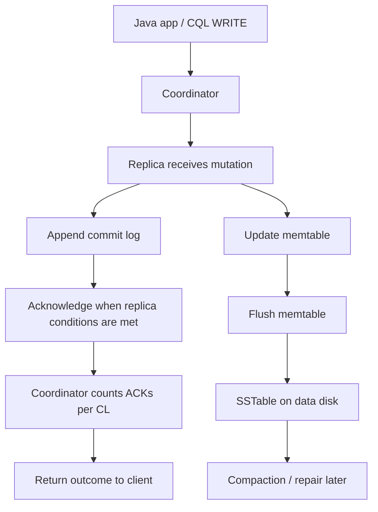
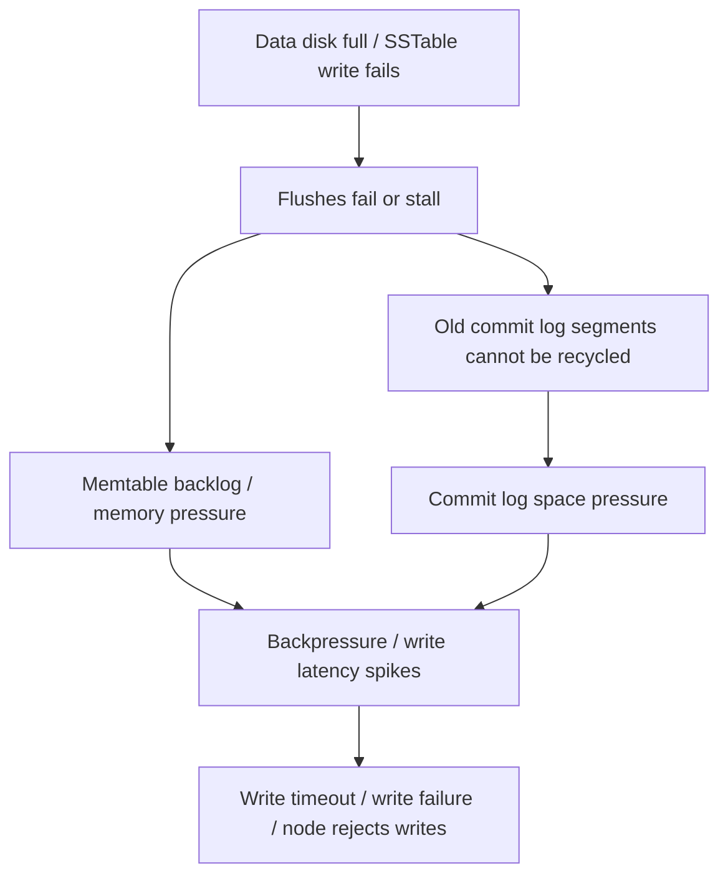

# Impact of Slow Disks, Full Disks, or Stalled Flushes

> **Chapter:** Write Path and Durability  
> **Module:** `DATABASE_ENGINE_WIDE_COLUMN_CASSANDRA` — Apache Cassandra

Apache Cassandra is a **distributed wide-column** database: data is partitioned by partition key and replicated across replicas per the keyspace's replication strategy. Each replica must process the writes it receives. Consequently, a storage problem on **one node** can raise latency across many queries; once enough replicas are impacted, applications can hit write timeouts or fail to meet the required consistency level.

This lesson examines three closely linked yet distinct phenomena:

1. **Slow disks:** commit log or SSTable writes take longer, and I/O queues grow.
2. **Full disks:** insufficient free space or inodes remain to create/extend files Cassandra needs.
3. **Stalled flushes:** memtables do not drain to SSTables fast enough, pushing pressure back onto memory, commit logs, and ultimately write acceptance.

The goal is to trace the write path, explain how faults propagate, spot monitoring signals, choose safe recovery actions, and react properly from Java applications when write outcomes are uncertain.

## 1. Reviewing the Write Path and Acknowledgment Conditions

An `INSERT`, `UPDATE`, or `DELETE` statement is normally sent by the application to a **coordinator**. The coordinator determines replicas from the partition key's token, forwards the mutation to replicas, and replies to the client once the request's **consistency level (CL)** is satisfied. On a replica, the normal write path includes:

- **Commit log:** appends the mutation to support crash recovery.
- **Memtable:** updates an in-memory data structure serving reads and upcoming writes.
- **Flush:** when triggered, writes memtable data out as **SSTables** on the data volume.
- **Compaction:** runs afterward to merge SSTables, manage tombstones, and reduce read cost; generates extra I/O and requires temporary disk headroom.



**Distinction to keep clear:** finishing a memtable write does **not** mean a new SSTable exists yet; data may still be protected by the commit log, depending on log sync state. SSTables are produced during flushes, whereas compaction is off the mandatory per-mutation write path.

Cassandra offers commit log sync modes, commonly:

| Mode | Before a replica can acknowledge a write | Impact when the device is slow |
| --- | --- | --- |
| `periodic` | Mutation enters the commit log and memtable; commit log sync to storage runs on a configured interval. Write acknowledgment can occur **before** an fsync. | Slowness on the log device can affect sync cycles, queues, and crash durability, even though individual writes do not wait for separate fsyncs. |
| `batch` | Writes wait for commit log sync to durable storage before acknowledging. | Write latency is directly sensitive to commit log device sync/fsync latency. |

Exact configuration option names and behavior vary by **Cassandra version**. Never infer "client received ACK" means "fsynced on every replica" when running `periodic`. Replication and CL reduce single-replica dependency risk, but do not replace power, storage, backup, and recovery design.

### Two Disk Paths to Distinguish

- **Commit log volume:** location of `commitlog_directory`; sequential appends, sensitive to append/sync latency, pressured when old segments cannot yet be recycled.
- **Data volume:** locations of `data_file_directories`; holds SSTables, serving I/O for flushes, reads, compaction, streaming, and repair.

Both paths may reside on **the same physical device** despite having separate directories. If they share the same I/O pool, heavy compaction can slow down commit logs and flushes; splitting directories without separating storage capacity does not eliminate resource contention.

## 2. Slow Disks: From Latency Spikes to Write Timeouts

A "slow disk" must be characterized by **I/O latency, throughput, queue depth, and device utilization**, not merely percentage of space used.

Suppose a node handles steady write traffic. When compaction or another storage task saturates I/O bandwidth:

1. Commit log write and sync times can climb.
2. Writing SSTables during flushes takes longer.
3. New memtables accumulate while older memtables await flush.
4. The flush queue grows; if prolonged, Cassandra exerts backpressure, delaying or rejecting some writes to avoid resource exhaustion.
5. Coordinators fail to collect enough replies before deadlines; clients observe `WriteTimeout`, high latency, or other errors.

On an **RF=3 cluster**, if only one replica is slow, `LOCAL_QUORUM` writes in a single datacenter can still succeed when the two healthy replicas respond in time. If two replicas saturate simultaneously or the coordinator is impacted, the same request can time out. A node fault does not necessarily fail **every** write: impact depends on which replicas own each partition, CL, topology, and per-node load.

| Symptom | Primary hypothesis | What to verify |
| --- | --- | --- |
| Rising write latency, slow commit log sync | Log device saturated, high fsync latency | Commit log metrics and actual I/O on that exact volume |
| Steadily growing pending flushes | Data disk bottlenecked, flush queue building | Flush logs, memtable/flush metrics, data disk I/O |
| Read latency also spikes | I/O contention with SSTable reads/compaction; possibly paired with GC | `iostat`, `nodetool compactionstats`, GC logs |
| Timeouts hit only specific partitions | Skewed load from hot partition keys or specific replicas | Token/replica placement, per-node latency, partition sizes |
| Plenty of free space yet writes are slow | Device hitting IOPS/throughput caps or storage-layer throttling | `await`, `aqu-sz`, volume IOPS/throughput limits |

A slow disk is **one possibility**; network slowness, long GC pauses, hot partitions, driver bugs, and coordinator overload can produce similar symptoms. Correlate error timestamps with telemetry before concluding.

## 3. Full Disks: Why Faults Cascade Across Components

Disk exhaustion takes at least three distinct forms:

- **Data disk out of space:** unable to write SSTables during flushes, unable to create compaction outputs or receive streaming/repair data.
- **Commit log disk out of space:** unable to write/allocate new log segments; the replica may stop accepting new mutations.
- **Inode exhaustion or quota limits:** gigabytes of free space remain yet files cannot be created. This is also a filesystem resource exhaustion issue.

For example, suppose the data volume reaches 100% while the commit log sits on a separate volume. The commit log may remain writable **temporarily**, yet memtables cannot flush into new SSTables. Over time, commit log segments holding unflushed mutations **cannot be reclaimed**; the log keeps growing and can fill the commit log volume as well. When both paths share one volume, this feedback loop closes even faster.



**Important:** a failed flush **does not automatically mean recently written data was lost**. Unflushed mutations may still sit in memtables and commit logs; however, if log writes also fail, if fsync had not completed before power loss, or if an operator deletes the wrong files, data-loss risk increases. You cannot deduce data survival state from a single "flush failed" message.

### Compaction and Repair Also Need Headroom

Compaction often writes **new output SSTables** before safely deleting input SSTables. Thus a data disk that is "not yet 100% full" may still lack space for large compactions. Repair and streaming also generate I/O and temporary/replicated data. Snapshots hold hard links to SSTables, preventing disk space from freeing until snapshots are properly pruned.

Never blindly free space by deleting files inside `data_file_directories` or `commitlog_directory`. Impulsively deleting SSTables, commit logs, snapshots, or system data can render data unrecoverable. Understand what consumes space, backup/retention rules, and node state before deleting anything.

### Disk Failure Policies

Depending on `disk_failure_policy`, `commit_failure_policy`, and Cassandra version, write errors may stop the node from serving writes, shut down the service, or trigger another protective behavior. Hence there is **no universal rule** like "full disk just makes Cassandra slower" or "just restart it." Inspect the logs and active policy on the affected node.

## 4. Stalled Flushes: Understanding the Memtable ↔ Commit Log Feedback Loop

Memtables live in memory to keep writes fast. Upon reaching thresholds or internal triggers, Cassandra schedules flushing a memtable to SSTables.

The commit log is organized into **segments**. An old segment can be recycled/removed only once its mutations are safely stored in SSTables and no "dirty" memtable still depends on that segment. When flushes fall behind write rates:

- The number of memtables flushing or queued to flush grows.
- Cassandra must throttle writes to protect memory and internal resources.
- The commit log cannot reclaim old segments fast enough; commit log space limits may repeatedly force flushes.
- Queues and latency climb; worst cases cause write timeouts or failures on replicas.

An illustrative timeline:

| Time | Progression |
| --- | --- |
| `t0` | Normal write path, flushes complete steadily. |
| `t1` | Data volume latency rises or nears capacity. |
| `t2` | Pending flushes climb; memtables and old commit log segments fail to clear in time. |
| `t3` | Backpressure appears; coordinators receive fewer timely ACKs. |
| `t4` | Clients hit timeouts/errors; unbounded retries worsen the outage. |

Brief flush delays may cause no obvious errors because Cassandra is designed to buffer writes in memory and the log first. It is **sustained** stalling and inability to reclaim resources that escalates the incident.

Never treat `nodetool flush` as a "fix button" when the data disk is full: it triggers additional flush I/O that will simply fail again. Resolve the underlying storage bottleneck or reduce write load first.

## 5. Observing Incidents: Where to Look and What to Correlate

A useful dashboard tracks **each node and each volume**, not just cluster averages. Exact metric names and dashboards vary by version, yet the core signal groups remain consistent:

| Metric group | When to pay attention | Interpretation |
| --- | --- | --- |
| Space and inodes on data/commit log volumes | Free space drops rapidly or nears reserve threshold | Signals risk of flushes, commit logs, or compaction running out of room. |
| I/O latency, queue, utilization, throttling | Latency and queues rise alongside timeouts | Points to physical bottlenecks or storage-tier throttling. |
| Commit log size/segment count, sync latency | Growing without shrinking or sustained slow syncs | Log bottleneck or segments pinned by stalled flushes. |
| Memtable size, flush count/pending, flush failures | Pending climbs steadily or flushes fail | Shows the memtable → SSTable path is blocked or too slow. |
| Pending/active compactions | Coincides with I/O spikes | Compaction may be competing for bandwidth or out of space. |
| Client write latency, timeouts, unavailable | Rising across multiple apps or replicas | Measures external impact; correlate with CL and topology. |
| JVM GC, heap/off-heap, pending tasks | Rising alongside memtable backlogs | Evaluates memory and service pressure. |

On a Linux node, **read-only** commands to start investigating:

```bash
# Replace paths with actual values from cassandra.yaml.
df -h /var/lib/cassandra/data /var/lib/cassandra/commitlog
df -i /var/lib/cassandra/data /var/lib/cassandra/commitlog

# Requires iostat (sysstat); observe across several intervals.
iostat -xz 1 5

# Depending on Cassandra version, inspect nodetool metrics.
nodetool status
nodetool tpstats
nodetool compactionstats
nodetool tablestats analytics.events_by_day
```

- `df -h` answers "which disk is filling up"; `df -i` answers "are inodes exhausted."
- `iostat -xz` exposes I/O wait/latency and device saturation; map each path to its exact block device. On network or virtualized storage, also inspect provider-side metrics.
- `nodetool tpstats` reveals execution queues, including memtable/flush work depending on version.
- `nodetool compactionstats` identifies active or queued compactions.
- `nodetool tablestats` provides per-table stats; substitute your real table name—do not assume `analytics.events_by_day` exists everywhere.

In parallel, filter Cassandra logs around error timestamps for signs such as `No space left on device`, `FSWriteError`, flush errors, commit log sync/write failures, SSTable errors, or node state changes. **Actual log entries are the evidence to correlate**—do not assume every version emits identical message strings.

### Example Identification via Time Correlation

Suppose at 14:05, applications report a sharp spike in write p99. On Node A, `iostat` shows rising write await, pending memtable flushes climbing continuously above baseline, and heavy compaction running on the same device. Nodes B and C stay healthy. This is far more likely **I/O contention on Node A** than a cluster-wide network partition. Verify how many replicas for active partitions sit on A and which CL applications use.

Conversely, if `df` shows Node A's data volume has only a few MB left and logs report SSTable creation failures, the priority is **restoring space/writability**, not merely tweaking Java retry loops.

## 6. Consistency Level, Replication, and Durability When One Replica Fails

Consider a keyspace using `NetworkTopologyStrategy` with **RF=3** in one datacenter, and writes using `LOCAL_QUORUM`:

```sql
-- Syntax illustration only; do not run ALTER on live environments
-- before reviewing topology, data, and replication-change procedures.
CREATE KEYSPACE IF NOT EXISTS telemetry
WITH replication = {
  'class': 'NetworkTopologyStrategy',
  'dc1': 3
};

CREATE TABLE IF NOT EXISTS telemetry.sensor_events_by_day (
    sensor_id text,
    event_day date,
    event_id uuid,
    reading double,
    PRIMARY KEY ((sensor_id, event_day), event_id)
);
```

With three replicas in `dc1`, `LOCAL_QUORUM` requires **two** replicas to acknowledge. This has several implications:

- When one replica suffers a commit log disk failure, the other two replicas **can still** satisfy CL if the coordinator and network operate normally.
- When two replicas cannot complete the write, the coordinator may fail to meet CL on time, causing timeouts or `Unavailable` depending on root cause and liveness state.
- CL neither guarantees all replicas synchronized everything at ACK time nor fixes a broken disk. Subsequent replica synchronization relies on appropriate mechanisms like hints/repair within their operating limits.
- `repair` helps restore replica consistency after an incident, yet **does not free disk space**, speed up a saturated disk, or replace backups.
- Compaction and repair add I/O load. Schedule resource-intensive operations only after nodes and disk headroom stabilize.

Note: `dc1` is an example name; configure the Java Driver's local datacenter and policies to match your actual topology.

## 7. Incident Response Procedure

### Phase A: Mitigate Impact, Preserve Recoverability

1. **Scope the incident:** identify affected nodes, racks, datacenters, commit log vs. data volumes, impacted keyspaces/partitions, and application CLs.
2. **Throttle ingestion where possible:** throttle producers, reduce concurrency, apply proper backoff; avoid unbounded retries that deepen queues.
3. **Capture evidence before modifying state:** start timestamps, disk space, inodes, I/O latency, logs, write latency, and pending flushes. Ensure metrics survive node recovery.
4. **Never manually delete SSTables or commit logs**; avoid rolling restarts to "clear backlogs."
5. **Preserve enough replicas to serve data:** if multiple nodes are endangered, follow a controlled plan rather than taking nodes down simultaneously.

### Phase B: Resolve Root Cause

| Verified root cause | Priority action | Avoid |
| --- | --- | --- |
| Data disk full | Expand available space or clean **non-Cassandra files** verified safe per retention; manage snapshots/backups via proper procedures. | Deleting live SSTables, needed snapshots, or commit logs. |
| Commit log volume full | Check if flushes are stalled; restore data disk writability or expand log space per runbooks; let Cassandra reclaim segments safely. | Manually deleting commit log segments with unflushed data. |
| I/O saturated by flush/compaction | Shed producer load, tune background task schedules/throttles **per version and plan** after confirming the bottleneck; consider isolating log/data devices. | Blindly raising worker concurrency or forcing heavy compaction. |
| Hardware fault or filesystem/quota anomaly | Follow safe volume/node replacement runbooks, check redundancy, and recover from replicas/backups as needed. | Simply restarting without fixing underlying hardware/filesystem faults. |

Once space and I/O stabilize, verify flushes complete, commit log segments recycle, write p99 drops, and nodes return to expected state. Only then schedule resource-heavy maintenance (such as scoped repair) to reconcile replicas.

### Phase C: Recovery and Application Verification

- Confirm new writes meet CL on time across representative tables/partitions.
- Reconcile requests that timed out during the outage window. **A write timeout does not prove the mutation failed**: some replicas may have written it.
- If the system tracks durable event IDs, use them to deduplicate and avoid double-processing an event. Counters, increments/decrements, and side-effecting operations are **not idempotent**.
- For operations safe to repeat, use conditional retries with bounded backoff; watch out for driver, HTTP client, and queue layers retrying independently.
- Validate data and sync replicas per RPO/RTO; where truly needed, restore from backups/replicas using tested procedures.

## 8. How Should Java Applications React?

The example below uses Java Driver 4.x with an **immutable event table** keyed by `event_id`. This illustrates a record that can be re-sent **when all values, keys, and timestamps stay identical**, provided business logic does not mutate the same key from another thread.

```java
import java.time.LocalDate;
import java.util.UUID;

import com.datastax.oss.driver.api.core.CqlSession;
import com.datastax.oss.driver.api.core.DefaultConsistencyLevel;
import com.datastax.oss.driver.api.core.DriverTimeoutException;
import com.datastax.oss.driver.api.core.cql.BoundStatement;
import com.datastax.oss.driver.api.core.cql.PreparedStatement;
import com.datastax.oss.driver.api.core.servererrors.WriteTimeoutException;

public final class SensorEventWriter {
    public enum Outcome { ACKNOWLEDGED, UNKNOWN }

    private final CqlSession session;
    private final PreparedStatement insert;

    public SensorEventWriter(CqlSession session) {
        this.session = session;
        this.insert = session.prepare(
            "INSERT INTO telemetry.sensor_events_by_day " +
            "(sensor_id, event_day, event_id, reading) " +
            "VALUES (?, ?, ?, ?) USING TIMESTAMP ?");
    }

    public Outcome write(String sensorId, LocalDate day,
                         UUID eventId, double reading,
                         long fixedTimestampMicros) {
        BoundStatement stmt = insert.bind(
                sensorId, day, eventId, reading, fixedTimestampMicros)
            .setConsistencyLevel(DefaultConsistencyLevel.LOCAL_QUORUM)
            .setIdempotent(true);

        try {
            session.execute(stmt);
            return Outcome.ACKNOWLEDGED;
        } catch (WriteTimeoutException | DriverTimeoutException e) {
            // Log/emit metrics and route event to a durable reconciliation flow.
            // Never conclude Cassandra did not receive the mutation.
            return Outcome.UNKNOWN;
        }
    }
}
```

- `setIdempotent(true)` is appropriate here solely because of **immutable data**, stable event keys, and a fixed `USING TIMESTAMP` per event. For counters or stateful mutations with side effects, set `false` and build dedicated recovery.
- `ACKNOWLEDGED` means the coordinator returned success at the chosen CL; it does **not** prove SSTables exist or that data survives all crash types.
- `UNKNOWN` means the caller lacks evidence to know whether the request was applied. In production applications, persisting unconfirmed work requires durable storage **outside the failing Cassandra operation**, such as an outbox/queue designed for that role.
- Do not catch all exceptions and retry them uniformly. Schema, permission, or config errors require fixing configuration; unavailable and timeout errors require checking cluster health, replay safety, and retry policies before resending.
- The partition key here is `(sensor_id, event_day)`. If one sensor emits excessive events, consider adding a bucket to the partition key to prevent hot/oversized partitions.

**Why not simply crank timeouts way up?** Raising timeouts does not make disks faster; it holds more requests in flight, increases resource pressure, and masks incidents. Tune timeouts only after examining latency distributions and establishing sensible bounds.

## 9. Prevention Through Design and Operations

Reliable design combines cluster configuration, data modeling, and application behavior:

1. **Disk headroom:** set separate alerts for data disks and commit log disks, accounting for compaction, repair, snapshots, streaming, and data growth.
2. **I/O capacity:** track latency and queues, and consider isolating the commit log from data disks on genuinely independent devices/pools.
3. **Sensible partition keys:** spread writes across replicas; avoid single hot partitions overloading a subset of nodes.
4. **Load bounding:** give producers backpressure and exponential backoff with jitter; prepare ingest throttling plans when flush backlogs rise.
5. **Version-aware configuration:** review commit log and memtable limits plus flush/compaction concurrency and throughput against your running version's docs. Blindly raising limits can lengthen backlogs or shift bottlenecks into memory.
6. **Tested recovery:** maintain backups, run node/volume failure drills, and keep volume-replacement and post-outage repair checklists ready.
7. **Multi-layer observability:** combine Cassandra, JVM, OS/storage, driver latency, CL, and retry metrics; alert on **rate of degradation**, not just static thresholds.

### Sample Alert Set to Calibrate for Your System

| Alert | Meaning | Expected response |
| --- | --- | --- |
| Free space falling steadily; projected exhaustion | Ingest/compaction/backups outpacing storage capacity | Inspect growth and expand capacity before filling up. |
| Pending flushes climbing over multiple intervals | Flushes unable to keep up with memtable writes | Inspect I/O, disk space, logs, and producer load. |
| Commit log size does not shrink after flushes | Dirty memtables remain or reclamation issue | Verify flush state across all tables and error logs. |
| Storage latency rises alongside write p99 | Physical I/O bottleneck impacting clients | Correlate exact node/volume, compaction tasks, and CL. |
| Write timeouts + backpressure rising | Approaching or exceeding current service capacity | Shed load and trigger incident runbook; track pending business work. |

No single disk percentage or millisecond threshold fits every cluster: local SSDs, network volumes, traffic patterns, RF, CL, SLO targets, and partition sizes all shift appropriate bounds.

## 10. Self-Check Exercises

**Question 1.** The data disk is full while the commit log sits on a separate volume with free space. Why might the system accept writes briefly and then still fail?

**Question 2.** A cluster has three replicas in one datacenter, and the application writes at `LOCAL_QUORUM`. Only one replica has a slow disk. Must every write time out? Why?

**Question 3.** A write timeout occurs while flushes are stalled. Can the application conclude the request was not applied and retry indefinitely?

**Question 4.** Seeing pending flushes spike on a full data disk, an admin prepares to run `nodetool flush` and then delete a few commit log files. What is wrong with those two actions?

**Question 5.** The cluster still has 30% free space, yet write p99 spikes while compaction runs heavily. Why is checking `df -h` alone insufficient?

<details>
<summary>Answer hints</summary>

1. Memtables and the commit log can temporarily absorb mutations, but SSTable flushes fail. Old log segments cannot be reclaimed, memory and log pressure climb, and writes eventually block/time out.
2. No. With RF=3, `LOCAL_QUORUM` can get two ACKs from the two healthy replicas. Impact depends on replica placement, deadlines, coordinator, and load balance.
3. No. A timeout does not prove no replica wrote the mutation; you need an idempotent/reconciliation model and bounded retries.
4. `nodetool flush` adds more I/O and will fail for lack of space; manually deleting commit logs can lose unflushed mutations. Restore storage and follow procedures first.
5. Free space reveals nothing about IOPS, throughput, queues, fsync latency, or I/O contention. Check `iostat`, Cassandra metrics, storage metrics, and compaction activity.

</details>

## Key Takeaways

- **Commit log + memtable** accept mutations; **flush → SSTables** is the next storage step, with compaction running asynchronously afterward.
- **Slow disks** raise latency, pending flushes, and write timeouts; **full disks** halt flushes or commit log writes.
- Stalled flushes cause **memtable backlogs and un-reclaimed commit log segments**, creating a pressure loop ending in backpressure or write failures.
- Replication and consistency levels define acknowledgment requirements; they do not fix broken disks or make a timeout mean a write definitely failed.
- During incidents, **measure the exact node and volume, shed load, restore resources, preserve critical data files**, and only then reconcile and repair replicas.

### References

- [Apache Cassandra — Architecture and Operations Docs](https://cassandra.apache.org/doc/stable/)
- [Apache Cassandra — Storage Engine](https://cassandra.apache.org/doc/stable/cassandra/architecture/storage-engine.html)
- [Apache Cassandra — Configuring Cassandra](https://cassandra.apache.org/doc/stable/cassandra/configuration/cass_yaml_file.html)
