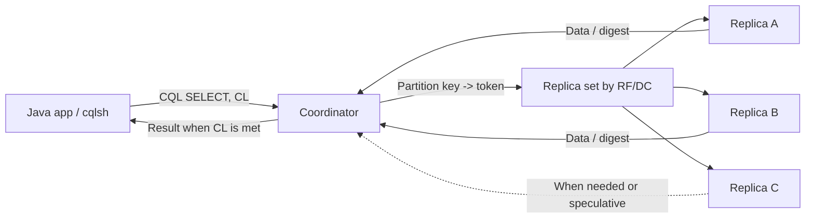
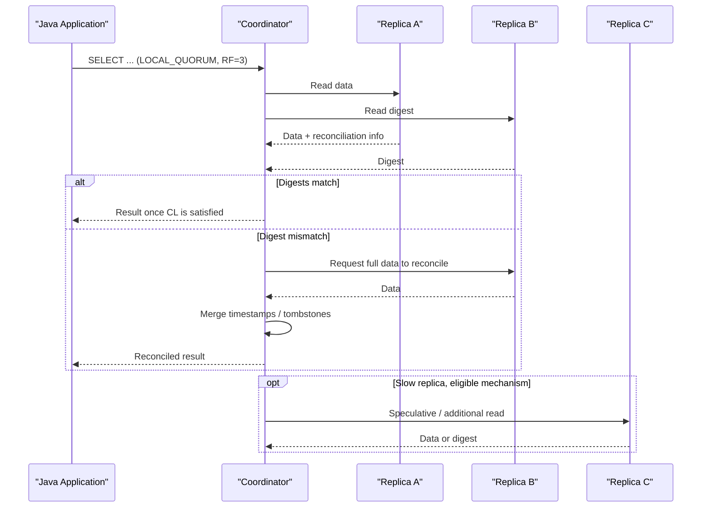
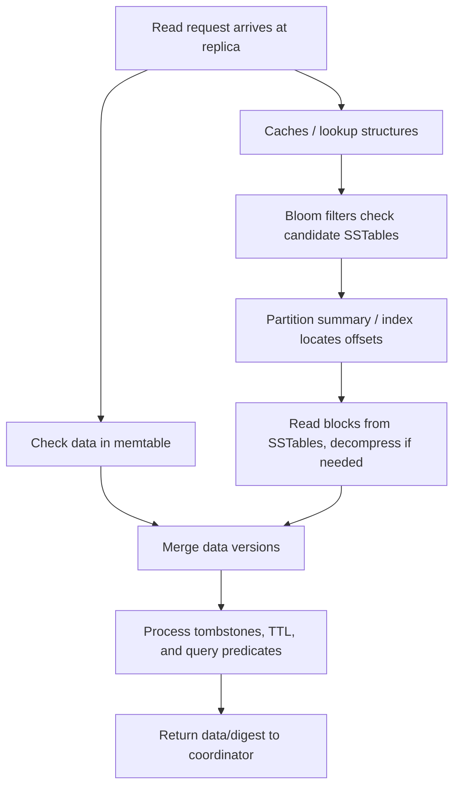

# Coordinator Selecting Replicas to Serve Reads by Consistency Level

## 1. The Problem: One SELECT Statement, Multiple Replicas Can Serve It

In Apache Cassandra, the same partition can be replicated across multiple nodes. When a Java application sends a `SELECT`, the critical questions are not only **where the data resides**, but also:

- Which node receives the client request and acts as the **coordinator**?
- For the query's partition key, which nodes are **valid replicas** according to the keyspace replication strategy?
- How many replicas must respond to the coordinator to satisfy the **consistency level (CL)**?
- If a replica is slow, down, or returns different data, how does the system handle it?
- After a replica receives a read request, how does it locate the data across memtables, caches, and SSTables?

That is the focus of the **Read Path and Caching** chapter in the `DATABASE_ENGINE_WIDE_COLUMN_CASSANDRA` module, connecting distributed Cassandra architecture, query-driven partition key design, replication, consistency levels, compaction/repair, and Java applications.

**Learning objectives:** after this lesson, you will be able to trace the path of a read query from client to coordinator and replicas; calculate the required responses at `ONE`, `LOCAL_ONE`, `QUORUM`, `LOCAL_QUORUM`, and `ALL`; understand the roles of data/digest requests, reconciliation, and speculative retry; and diagnose slow reads or errors using CQL, `nodetool`, tracing, and the Java Driver.

> **Distinguish from the start:** The *coordinator* is the node handling the client request. A *replica* is a node chosen to store the partition's data according to the replication policy. A node **can be both a coordinator and a replica**, but the two roles are not synonymous.

## 2. Two Layers of Node Selection: Client Picks Coordinator, Coordinator Picks Replicas

Logical sequence:

1. The **Java Driver** uses its load-balancing policy, token/topology metadata, and local datacenter configuration to pick a node to receive the request. That node is the coordinator for this request.
2. The coordinator parses the CQL and partition key, computes the token, and determines the partition's **natural replica set** according to the keyspace's replication strategy.
3. The coordinator uses the CL, node status, topology/snitch metadata, and observed latency to decide which replicas to contact first and which responses to wait for.
4. Each replica executes the read against local data (memtable, caches, SSTables) and returns either full data or a digest.
5. The coordinator reconciles the required results, potentially requesting additional data or performing repair depending on the situation and version, then returns the result to the client.



The diagram illustrates a cluster with RF = 3; it does **not** mean Cassandra always contacts all three replicas for every request. The number of requests, response types, and timing depend on the CL, latency, speculative retry, query type, and Cassandra version.

### If the Driver Knows Tokens, What Else Does the Coordinator Do?

A driver with token-aware routing can prefer a node holding a replica of the partition to save one network hop. However:

- Choosing the coordinator remains a **client driver** decision.
- Identifying and contacting replicas to serve the read request is the **coordinator's** responsibility.
- The coordinator does not have to be a replica node; if no suitable replica is available or preferred, the path may incur an extra hop.
- The driver may lack a routing key if the query does not supply sufficient partition key information, or the policy may deprioritize the expected node.

Therefore, "the driver picks a node" and "the coordinator picks replicas" describe **two distinct phases** of the same read path.

## 3. From Partition Key to Replica List

Consider a CQL table:

```sql
CREATE TABLE read_lab.orders_by_id (
    order_id uuid PRIMARY KEY,
    customer_id uuid,
    order_status text,
    total_amount decimal
);
```

`order_id` is the partition key. Cassandra uses a partitioner to turn the partition key into a **token**. From the token and cluster topology, the keyspace's replication strategy determines which nodes are replicas for that partition.

### RF Belongs to the Keyspace, Not Individual Queries

For example, a keyspace using `NetworkTopologyStrategy` with RF = 3 in datacenter `dc1`:

```sql
CREATE KEYSPACE read_lab
WITH replication = {
    'class': 'NetworkTopologyStrategy',
    'dc1': '3'
}
AND durable_writes = true;
```

The topology must match the configured RF. In a single-node lab, you **must not assume RF = 3** to simulate quorum with enough replicas. At least three appropriate nodes in `dc1` are required for an RF = 3 fault-tolerance test to be meaningful.

If `order_id` maps to replicas A, B, and C, every read for that partition must consider this valid replica set. **The coordinator does not arbitrarily pick any three nodes in the cluster**: it must rely on the token, keyspace replication policy, and actual topology.

### Do Not Confuse RF with the Number of Replicas Always Contacted

RF = 3 defines the desired number of copies of a partition in a DC. With `LOCAL_ONE`, the coordinator may only need one matching response; with `LOCAL_QUORUM`, it typically needs two responses in that DC. Configuring RF does not replace choosing the CL per request.

### Composite Partition Keys

With the table:

```sql
CREATE TABLE read_lab.events_by_device_day (
    device_id text,
    event_day date,
    event_time timestamp,
    event_id uuid,
    value double,
    PRIMARY KEY ((device_id, event_day), event_time, event_id)
);
```

The token is computed from the **pair `(device_id, event_day)`**, not `device_id` alone. A well-formed query typically provides both partition key components, for example:

```sql
SELECT event_time, event_id, value
FROM read_lab.events_by_device_day
WHERE device_id = 'sensor-01'
  AND event_day = '2026-11-21';
```

Fetching across multiple partitions or executing queries requiring scans can force the coordinator to deal with multiple replica sets and a more complex read path. Thus, **query-driven table design** is foundational for both read performance and observing CL behavior.

## 4. Consistency Level: How Many Replica Responses Are Needed?

The CL of a read request specifies **the number and scope of replica responses required for the coordinator to return success**; it does not alter the partition key, increase RF, or replicate data by itself.

For **a single DC with RF = 3**, the table below summarizes the baseline behavior:

| Read CL | Required Replica Responses | Meaning and Trade-offs |
| --- | ---: | --- |
| `ONE` | 1 | Better latency and availability when fewer replicas are up; may return stale data if a replica is out of sync |
| `LOCAL_ONE` | 1 in the local DC | Avoids waiting on responses from remote DCs in multi-DC topologies |
| `TWO` | 2 | Reads from two replicas; requires more nodes available than `ONE` |
| `QUORUM` | 2 when total RF = 3 | Quorum across total RF; requires a majority of replicas |
| `LOCAL_QUORUM` | 2 when local DC RF = 3 | Majority of replicas in the local DC; suitable for many multi-DC applications |
| `ALL` | 3 | Requires every corresponding replica; fails easily when a single replica is unavailable |

**Basic quorum** is calculated as:

\[
Q = \left\lfloor \frac{RF}{2} \right\rfloor + 1
\]

With RF = 3: `floor(3 / 2) + 1 = 2`. With RF = 5: quorum is 3. In the example table, `QUORUM` and `LOCAL_QUORUM` both require two responses because there is only one DC; in **multi-DC** deployments, their scope and response counts can differ.

### `QUORUM` vs. `LOCAL_QUORUM` with Two DCs

Suppose `NetworkTopologyStrategy` configures `dc1:3` and `dc2:2`:

- `LOCAL_QUORUM` for a coordinator/client bound to `dc1` requires **2 out of 3 replicas in `dc1`**.
- `LOCAL_QUORUM` in `dc2` requires **2 out of 2 replicas in `dc2`**.
- `QUORUM` considers the total RF = 5, requiring **3 responses** from replicas across the cluster-wide scope.
- `ONE` and `LOCAL_ONE` both require one response, but `LOCAL_ONE` restricts the replica to the local DC.

A common goal of `LOCAL_QUORUM` is to keep cross-DC WAN latency off the read path. However, it only reflects replicas **in the local DC**, so you must understand cross-DC read requirements and the application's write policy.

**Note:** CLs like `ANY` are intended for writes, not normal reads; `SERIAL`/`LOCAL_SERIAL` relate to the consensus phase of lightweight transactions (LWTs) and are not direct drop-in replacements for `LOCAL_QUORUM` on arbitrary `SELECT`s.

### Does a Higher CL Always Mean "More Correct" Data?

A higher CL increases the number of replicas participating in read verification and the likelihood of detecting divergent data, but it **does not automatically guarantee linearizability for all Cassandra operations**. Concurrent reads/writes, timestamps, tombstones, timeouts, multi-partition operations, and LWT semantics all require separate analysis.

For a given RF, designing read/write CLs so that read and write replica sets overlap (often illustrated as `R + W > RF`) helps observe the latest write under certain conditions; this inequality should not be treated as an absolute guarantee in the presence of concurrent writes or unhandled failures.

## 5. How Does the Coordinator Actually Select Replicas?

A practical mental model:

1. **Select the right set:** compute the token from the partition key and retrieve the natural replicas per the replication strategy.
2. **Filter by CL scope:** for `LOCAL_ONE`/`LOCAL_QUORUM`, prefer/restrict to replicas in the coordinator's local DC; `QUORUM` may require a broader scope.
3. **Check reachability:** down nodes or insufficient live replicas can prevent the request from satisfying the CL.
4. **Rank by proximity/latency:** the snitch and dynamic snitch supply topology and latency behavior so the coordinator prioritizes suitable replicas.
5. **Send read requests and wait for sufficient responses:** the coordinator may issue full-data reads, digest reads, and additional requests when necessary.
6. **Monitor timeouts/errors/latency:** speculative retry may be triggered if configuration and scope allow.

### Snitch and Dynamic Snitch

The snitch helps Cassandra understand DC/rack relationships and topological distance. The **dynamic snitch** uses observed latency metrics to adjust replica prioritization where appropriate.

However, the dynamic snitch **does not**:

- Move a partition to a non-natural replica node simply because that node is fast.
- Bypass `LOCAL_QUORUM` requirements or reduce two required responses down to one.
- Fix under-replication or a node that has lost data.
- Guarantee that the exact same replica is always used for the same partition.

Replica ordering can change based on node state, Cassandra version, and read-request coordination mechanics. Thus, a diagram showing "closest replica responds" is illustrative, not a hard contract for every request.

## 6. Data Requests, Digest Requests, and Result Reconciliation

For a read CL greater than one, Cassandra can optimize by requesting **full data** from one replica and **digests** (compact checksums/summaries for comparison) from the remaining replicas. The exact mechanism varies by version and query type; do not assume every read consists of strictly one data request plus `CL - 1` digest requests.



### Why Compare Digests?

Sending a digest smaller than full data avoids unnecessary network transfer when replicas agree. If digests do not match, the coordinator knows **a divergence exists**; it needs full data to determine which version is newest/valid via reconciliation.

### Reconciliation Is Not "Pick the Node with the Highest Row Timestamp"

In Cassandra, data can change **per cell**, each with its own timestamp and tombstone/TTL. When replicas differ, the system must resolve cell versions and deletion markers properly. You cannot simply pick "the row on replica A with the largest timestamp" and discard all cells on replica B.

Depending on the version and table options, when a mismatch is detected on the read path, Cassandra may trigger **read repair** and may wait for certain repair steps before returning the result. This is **not** a substitute for periodic anti-entropy repair or a guarantee that the entire cluster has no data drift.

### What If `ONE` Is Used?

A `ONE` read can complete using a single eligible replica without quorum verification like `QUORUM`. If that replica missed the latest write, the client can receive stale data. Therefore, a successful `SELECT` at `ONE` must never be interpreted as having verified data across **all** replicas.

## 7. Speculative Retry and Extra Coordinator Requests

A replica can slow down due to GC pauses, disk stalls, compaction, or overload. To reduce tail latency, Cassandra can use **speculative retry**: if a read request has not progressed within a configured threshold, the coordinator sends an extra request to another eligible replica.

The goal is to improve the odds of a fast response while still meeting the CL—**not** to lower the consistency level or arbitrarily alter the replica set.

Example with RF = 3, `LOCAL_ONE`:

1. The coordinator initially queries replica A.
2. A is slow past the speculative retry threshold.
3. The coordinator can query B, provided B is a valid replica and the feature is enabled.
4. Whichever valid response arrives first can complete the read, even though A remains slow.

With `LOCAL_QUORUM`, the system still requires **two** responses per the CL; sending an extra request does not turn `LOCAL_QUORUM` into `LOCAL_ONE`.

### Trade-offs of Speculative Retry

| Benefit | Cost / Risk |
| --- | --- |
| Improves tail latency when a single replica is slow | Increases read traffic and replica resource consumption |
| Mitigates impact of intermittently slow nodes | Can further overload an already saturated cluster |
| Leverages redundant replicas when available | Does not help if the entire replica set is overloaded or CL cannot be met |

Do not enable aggressive speculative retry without measuring extra request volume, latencies, and workload impact. The `speculative_retry` table option has syntax and defaults that vary by Cassandra version; inspect `system_schema.tables` and your cluster's documentation before tuning it.

## 8. Latency and Errors: Unavailable, ReadTimeout, ReadFailure

Read-path errors reflect distinct failure modes:

| Condition | Practical Meaning | Investigation Path |
| --- | --- | --- |
| **Unavailable** | Coordinator knows insufficient live/eligible replicas exist to satisfy CL at request time | Check RF/DC, `nodetool status`, down nodes, chosen CL |
| **ReadTimeout** | Read request did not receive enough responses within the timeout window | Check node latency, I/O, compaction, tombstones, network, and timeouts |
| **ReadFailure** | One or more replicas reported a failure executing the read, preventing CL completion | Inspect replica error logs, SSTable corruption/reads, resources, network path |
| **Overloaded/Busy** or version-specific errors | Coordinator/replica is overloaded or shedding requests | Monitor thread pools, pending requests, heap/GC, disk |

**Important note:** "Two nodes alive, RF = 3, `LOCAL_QUORUM`" may satisfy the theoretical replica count, yet the request can still time out if one of those two replicas is slow or hits an error. Conversely, `LOCAL_ONE` might succeed when quorum cannot, but it is the wrong choice if business correctness requires stronger consistency.

### Do Not Fix Timeouts by Blindly Lowering CL

Dropping `LOCAL_QUORUM` to `ONE` reduces the required response count, but it also weakens read guarantees and increases stale-read exposure. First identify the root cause (down node, hot partition, too many SSTables, GC, or network); only adjust CL after aligning on data correctness requirements.

### Retries from the Java Application

A `SELECT` is typically read-only, yet retries still add load. The driver has a retry policy; avoid infinite retries or retry storms when the cluster is overloaded. With paging, each page may issue a separate request; under concurrent writes, multiple pages must not be treated as an atomic, consistent snapshot.

## 9. Inside a Replica: Caches, Memtable, and SSTables

Once the coordinator selects a replica, that node must locate the partition's data. Locally, the read path combines data that may exist in the **memtable** and **SSTables**:



The diagram shows **components that may participate**, not a mandatory call sequence for every read. An effective cache hit can bypass part of the I/O; row cache, key cache, and execution paths differ across versions.

### Key Components to Understand

| Component | Role | Notes |
| --- | --- | --- |
| **Memtable** | Recent writes still held in memory | Reads must still check SSTables when needed |
| **SSTable** | Immutable on-disk files; may hold multiple record/cell versions | Compaction reduces the number of structures to merge over time |
| **Bloom filter** | Quickly excludes SSTables guaranteed not to contain the partition key | Can have false positives; never produces false negatives by filter design |
| **Partition summary/index** | Helps locate a partition's offset within an SSTable | Reduces I/O compared to scanning the whole file |
| **Key cache** | Holds useful partition index/location lookup entries | Does not guarantee caching the latest row values |
| **Row cache** | Caches read data per configuration, typically for hot partitions/objects | Incurs memory overhead; effectiveness varies by version/config |
| **Tombstone/TTL** | Represents deletions and expirations | Can force reads to scan many non-visible records |

**Replica caches and CL-based replica selection operate at two different layers.** A replica responding quickly via key cache or row cache must still belong to the valid replica set, and the coordinator must still satisfy the CL response count. CL does not mean "read from cache," and caching does not raise consistency.

### Why Can a Read with Proper CL Still Be Slow?

When a partition is oversized or spans many SSTables or tombstones, each replica may spend significant time merging data. If the CL requires two responses, the tail latency of the slower replica dominates the request. Common causes include:

- Skewed partition keys or very large partitions.
- Too many SSTables to inspect, compaction backlog, or high disk I/O.
- Excessive tombstones caused by TTLs/`DELETE`s or poor data modeling.
- Node GC pauses, high CPU/heap pressure, or network jitter.
- Queries reading large volumes of data, poorly tuned paging, or inefficient filtering.

Therefore, optimizing the read path requires evaluating **both the query/partition model and local replica performance**, rather than simply lowering the CL.

## 10. RF = 3 Lab: Observing LOCAL_ONE and LOCAL_QUORUM

**Lab prerequisites:** use a dedicated lab cluster with **at least three active nodes in DC `dc1`** and permissions to create schemas. If your DC has a different name, substitute it in `CREATE KEYSPACE` and client configuration. Do not run create/drop statements on production keyspaces.

### Step 1 — Check Topology

```bash
nodetool status
```

Ensure three suitable nodes are Up/Normal before studying RF = 3 behavior. If you only have one node, you can practice the metadata queries with RF = 1, but you cannot draw experimental conclusions about RF = 3 `QUORUM`.

### Step 2 — Create Dedicated Keyspace and Table

```sql
CREATE KEYSPACE IF NOT EXISTS read_lab
WITH replication = {
    'class': 'NetworkTopologyStrategy',
    'dc1': '3'
}
AND durable_writes = true;

CREATE TABLE IF NOT EXISTS read_lab.orders_by_id (
    order_id uuid PRIMARY KEY,
    customer_id uuid,
    order_status text,
    total_amount decimal
);
```

If an object with the same name already exists, `IF NOT EXISTS` does not re-verify RF or `PRIMARY KEY`. Inspect metadata and stop if it differs from the lab definition:

```sql
SELECT keyspace_name, replication
FROM system_schema.keyspaces
WHERE keyspace_name = 'read_lab';

SELECT column_name, kind, type
FROM system_schema.columns
WHERE keyspace_name = 'read_lab'
  AND table_name = 'orders_by_id';
```

### Step 3 — Insert Test Data

```sql
INSERT INTO read_lab.orders_by_id (
    order_id, customer_id, order_status, total_amount
) VALUES (
    11111111-1111-4111-8111-111111111111,
    22222222-2222-4222-8222-222222222222,
    'PAID',
    350000.00
);
```

To compare reads at `ONE` and `QUORUM`, ensure the test data was written successfully at an appropriate CL on a healthy cluster; avoid intentionally creating replica divergence in shared environments.

### Step 4 — Inspect the Partition's Replica Set

On supported `nodetool` versions:

```bash
nodetool getendpoints read_lab orders_by_id 11111111-1111-4111-8111-111111111111
```

The output lists **the endpoints responsible for storing the partition**, not a log proving which nodes answered your next `SELECT`. Exact syntax and output formatting may vary by version.

### Step 5 — Execute Reads with Different CLs

In `cqlsh`, use the `CONSISTENCY` shell command to set the consistency level for subsequent CQL statements:

```sql
CONSISTENCY LOCAL_ONE;

SELECT order_id, order_status, total_amount
FROM read_lab.orders_by_id
WHERE order_id = 11111111-1111-4111-8111-111111111111;

CONSISTENCY LOCAL_QUORUM;

SELECT order_id, order_status, total_amount
FROM read_lab.orders_by_id
WHERE order_id = 11111111-1111-4111-8111-111111111111;
```

`CONSISTENCY` is a `cqlsh` command; it is **not** a CQL `SELECT` clause you copy directly into a Java prepared statement. With a single DC at RF = 3, `LOCAL_QUORUM` requires two replica responses, whereas `LOCAL_ONE` requires one.

### Step 6 — Enable Tracing for a Short SELECT

```sql
TRACING ON;

SELECT order_id, order_status
FROM read_lab.orders_by_id
WHERE order_id = 11111111-1111-4111-8111-111111111111;

TRACING OFF;
```

`TRACING` is a `cqlsh` session toggle. Tracing displays coordination activities and timings, though the level of detail depends on the version; do not assume every digest/data request appears in a fixed format. Do not leave tracing enabled globally in production due to its overhead.

### Step 7 — Clean Up the Lab Keyspace If No Longer Needed

```sql
-- Run only on a lab keyspace that is safe to drop completely.
DROP KEYSPACE IF EXISTS read_lab;
```

This statement deletes all tables and data in `read_lab`. Do not run it in environments with data to keep or where applications are actively using it.

## 11. Operational Scenarios: Will the Read Succeed or Fail?

Assume a single DC `dc1` has exactly three replicas A, B, and C for a partition, with RF = 3. The table below addresses **whether the required replica count can be met**, before factoring in detailed network errors or timeouts:

| State | `LOCAL_ONE` | `LOCAL_QUORUM` | `ALL` |
| --- | --- | --- | --- |
| A, B, C all available | Can succeed | Can succeed | Can succeed |
| A down, B and C available | Can succeed | Can succeed | **Insufficient** |
| A and B down, only C available | Can succeed | **Insufficient** | **Insufficient** |
| No replicas available | Insufficient | Insufficient | Insufficient |

"Can succeed" does not guarantee an on-time response: a replica might be overloaded, hit an SSTable read error, or stall on tombstones. Conversely, when a node goes down, do not automatically lower CL if business requirements forbid it.

### Inconsistent Data Example

Suppose A received a newer write `order_status = 'SHIPPED'` while B still holds `'PAID'` during a temporary divergence. A `LOCAL_ONE` read from B can return `'PAID'`; a `LOCAL_QUORUM` read has the opportunity to observe the valid version by reconciling data across a quorum, depending on replica states and the correctness of prior writes.

If the earlier write **succeeded on only one replica** before failing at the client, you cannot assert that every subsequent quorum read is guaranteed to see the new data. You must examine the write CL, success/failure outcome, timestamps, and replica states.

### Consistency Levels in Multi-DC

With `NetworkTopologyStrategy` and the client/coordinator's local DC:

- `LOCAL_ONE`/`LOCAL_QUORUM` can reduce WAN dependency on the read path.
- `QUORUM` across total RF may require responses spanning multiple DCs depending on replica counts and availability.
- Misconfiguring the local DC in the driver can negatively affect coordinator selection and latency.
- Writing at `LOCAL_QUORUM` in one DC does not automatically mean all other DCs immediately see the new data during an outage or partition.

Consistency design must be grounded in **data freshness, node/DC topology, latency SLOs, and fault-tolerance goals**, not just a fast `ONE` read benchmark.

## 12. Java Driver 4.x: Setting CL per SELECT Query

The following example uses **Cassandra Java Driver 4.x**. Assume `CqlSession session` is already initialized for the target cluster and local datacenter, and `read_lab.orders_by_id` exists.

```java
import com.datastax.oss.driver.api.core.CqlSession;
import com.datastax.oss.driver.api.core.DefaultConsistencyLevel;
import com.datastax.oss.driver.api.core.cql.BoundStatement;
import com.datastax.oss.driver.api.core.cql.PreparedStatement;
import com.datastax.oss.driver.api.core.cql.Row;
import java.util.UUID;

// session is created and its lifecycle is managed outside this example.
PreparedStatement select = session.prepare("""
    SELECT order_id, order_status, total_amount
    FROM read_lab.orders_by_id
    WHERE order_id = ?
    """);

UUID orderId =
    UUID.fromString("11111111-1111-4111-8111-111111111111");

BoundStatement request = select.bind(orderId)
    .setConsistencyLevel(DefaultConsistencyLevel.LOCAL_QUORUM);

Row row = session.execute(request).one();
if (row == null) {
    System.out.println("No order found for the requested key");
} else {
    System.out.println(row.getString("order_status"));
}
```

Java text blocks require Java 15+. `?` binds the **partition key value**; do not use bind markers for keyspace, table, or column identifiers. `setConsistencyLevel` applies to this statement; other statements may use different CLs depending on policy and business requirements.

### Local DC and Token-Aware Routing

The driver must be configured with the local datacenter matching the deployment, e.g., via the session builder or driver configuration. Load-balancing and token-aware policies can select a coordinator that is nearby or holds a replica of the partition; **the coordinator still remains responsible for coordinating the read and verifying CL**.

Implementation notes:

1. Use prepared statements with the **full partition key bound** whenever aligned with the table model.
2. Choose CL by business need: `LOCAL_ONE` for reads tolerant of lower freshness; `LOCAL_QUORUM` when local majority verification under the corresponding RF/CL is required.
3. Verify keyspace metadata and RF/DC before making assumptions about response counts; in a single-node lab, do not use `LOCAL_QUORUM` designed for RF = 3.
4. Record `Unavailable`/`ReadTimeout`/`ReadFailure` exceptions, latency, and coordinator node; never retry infinitely.
5. Use paging and bound result sizes; avoid `SELECT *` on large partitions without good reason.

**Do not switch CL to `ALL` just "to be safe" without a clear requirement.** `ALL` severely degrades availability whenever a single replica is slow or down; business reliability must be engineered across write CL, error handling, and repair.

## 13. Tools to Observe and Diagnose Coordinator/Replica Behavior

Depending on Cassandra version and operational access, the following tools are useful:

| Tool / Metric | What It Shows | Do Not Over-Conclude |
| --- | --- | --- |
| `nodetool status` | Node up/down state, DC, rack/topology | Does not confirm a replica holds all data |
| `nodetool getendpoints ks tbl key` | Natural replicas for a partition key | Does not prove which nodes an actual `SELECT` contacted |
| `nodetool tablestats` | Read metrics, SSTable counts, size, cache stats per table | Metrics vary by version; does not replace per-request tracing |
| `nodetool tpstats` | Thread pools, pending/dropped messages | Not isolated to `SELECT` queries alone |
| `TRACING ON` in `cqlsh` | Execution activities and timings of a traced query | Adds overhead; unsuitable for enabling on every request |
| `system_schema.keyspaces` | RF/strategy per keyspace | Does not show streaming/repair progress |
| Java Driver metrics/logs | Latency, timeouts, retries, coordinator, pools, and load balancing | Does not reflect full node state from one perspective |

### A Workflow for Investigating High Read Latency

1. **Identify the request:** CQL, partition key, CL, local DC, row count, page size, timestamp, and latency SLO.
2. **Identify the replica set:** inspect replication policy and run `nodetool getendpoints` for a sample partition.
3. **Check topology:** `nodetool status` and network connectivity between coordinator/replicas, especially if requests touch remote DCs.
4. **Observe the read path:** selective tracing and coordinator/replica latency metrics.
5. **Inspect local storage:** hot partitions, tombstones, SSTable count, compaction backlog, cache effectiveness, disk I/O/GC.
6. **Evaluate CL/speculative retry:** check whether requests wait on too many replicas, speculative traffic is spiking, or a node is persistently slow.
7. **Remediate with evidence:** improve partition design, fix slow nodes/compaction, tune retries/caches based on measurements, and revisit CL **only if business requirements allow**.

### Example of a Wrong Conclusion

If a Java `LOCAL_QUORUM` request is slow while `LOCAL_ONE` is fast, you cannot immediately conclude that Cassandra "cannot handle quorum." One replica may be slow due to reading too many SSTables, compaction, or tombstones; lowering CL only masks the symptom while altering read guarantees. Identify the replica causing tail latency and its root cause.

## 14. CL Calculation and Incident-Thinking Exercises

### Exercise A — Calculate Required Responses

A DC has RF = 5. Calculate the minimum responses required for `LOCAL_ONE`, `LOCAL_QUORUM`, and `ALL`.

**Answer:** 1, `floor(5/2)+1 = 3`, and 5 replicas in that DC, respectively.

### Exercise B — Evaluate When Replicas Are Down

A partition has RF = 3 in a single DC; A is down, B and C are up.

- `LOCAL_ONE`: can complete when one eligible replica responds.
- `LOCAL_QUORUM`: can still complete if **both B and C** respond in time.
- `ALL`: insufficient replicas to meet the requirement.

If B is up but hits a GC pause and fails to respond in time, `LOCAL_QUORUM` can still suffer a ReadTimeout; "up" does not mean "responds within timeout."

### Exercise C — Two DCs with Different RFs

Keyspace `NetworkTopologyStrategy`: `dc1:3`, `dc2:2`. One request in `dc1` uses `LOCAL_QUORUM`, and another request in `dc2` also uses `LOCAL_QUORUM`. How many local responses are needed?

**Answer:** `dc1` needs 2/3; `dc2` needs 2/2. This illustrates that `LOCAL_QUORUM` is computed **from the local DC's RF**, not as a cluster-wide constant.

### Exercise D — Distinguish Coordinator and Replica

The driver connects and sends a request to node X. The partition key maps to replicas A, B, and C; X is not in that set. Can X act as coordinator?

**Answer:** Yes, if the client selects X as coordinator; X will coordinate the read across the valid replicas. However, this adds a network hop; token-aware routing generally tries to optimize coordinator selection when the partition key is known.

### Exercise E — Why Can `ONE` and `QUORUM` Return Different Results?

A new write has not reached all replicas: A holds the new state while B still holds the old state. A `ONE` read from B can return the stale value; `QUORUM` contacts more replicas and can detect/resolve the discrepancy. Still, you must check the write's CL/outcome and concurrent writes before claiming any read always reflects the latest update.

## 15. Common Misconceptions

| Misconception | Accurate Understanding |
| --- | --- |
| "Whichever replica the app picks, Cassandra reads from that replica." | The app/driver picks the **coordinator**; the coordinator coordinates the partition's replicas per RF/DC/CL. |
| "The coordinator is always a replica holding the data." | The coordinator may be a replica or a non-replica node. |
| "RF = 3 means every read must query all three nodes." | Required responses depend on CL; the system may send additional requests for optimization or latency handling. |
| "`LOCAL_QUORUM` is 2 replicas in every cluster." | Quorum is calculated from the **local DC's RF**; RF = 5 requires 3. |
| "`QUORUM` and `LOCAL_QUORUM` are always identical." | They only coincide in certain topologies; multi-DC deployments require distinguishing their scopes. |
| "A high CL guarantees the app never sees stale data." | Also depends on write CL, concurrent writes, timestamps, and replica state; does not guarantee linearizability. |
| "A digest read returns full data to the client." | Digests are for comparison; data requests and reconciliation produce the data returned to the client. |
| "Speculative retry automatically lowers the CL." | It sends extra requests while still satisfying the configured CL. |
| "Bloom filters/caches determine which replica is chosen." | Bloom filters/caches accelerate **local reads** inside a replica; they do not select natural replicas. |
| "`ReadTimeout` means the cluster lacks live replicas." | Timeout means insufficient timely responses; missing live replicas typically causes `Unavailable`. |
| "Schema agreement means replicas have fresh data." | Agreement pertains to **schema definitions**; repair/streaming and CL handle data synchronization aspects separately. |
| "`nodetool getendpoints` is a log of the last executed request." | It lists the natural replicas for a key, not the actual respondents of a query. |

## 16. Pre-Optimization Read Path Checklist and Takeaways

| Question | How to Verify |
| --- | --- |
| Does the query provide the full partition key? | `PRIMARY KEY`, `WHERE` clause, and workload queries |
| Which DC is the driver routing requests to? | Local DC/load-balancing config and coordinator node |
| Which nodes are the partition's replica set? | RF/strategy and `nodetool getendpoints` |
| What CL is used, and how many responses are required? | Statement-level CL, local/total RF, and quorum formula |
| Are the required nodes/replicas available? | `nodetool status`, logs, network |
| Does latency come from the coordinator, a replica, or the WAN? | Tracing, metrics, and topology |
| Is there frequent read repair/digest mismatch or speculative retry? | Version-appropriate metrics/logs; verify via selective tracing |
| Are there SSTable/tombstone/compaction issues inside replicas? | `tablestats`, compaction metrics, disk I/O, GC |
| Are replicas synchronized after RF/topology changes? | Streaming/repair and dedicated data checks |
| Can CL be changed without violating business rules? | Evaluate freshness, latency SLO, write CL, and consistency risks |
| Does Java handle retries/paging properly? | Prepared statements, exceptions, metrics, and load tests |

**Key takeaway:** Cassandra's read path passes through **two node-selection decisions**: the driver selects a coordinator, and the coordinator resolves the replica set from the partition key and replication strategy, selecting replicas to satisfy the consistency level. Full-data/digest reads, reconciliation, speculative retry, and the local read path through caches/memtable/SSTables all shape latency and data freshness. Proper optimization combines **query-driven table design, RF/DC, CL, replica health, and real measurements**, rather than simply lowering the consistency level when a request is slow.
