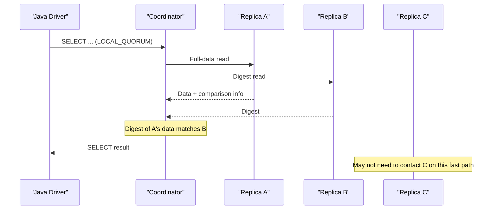
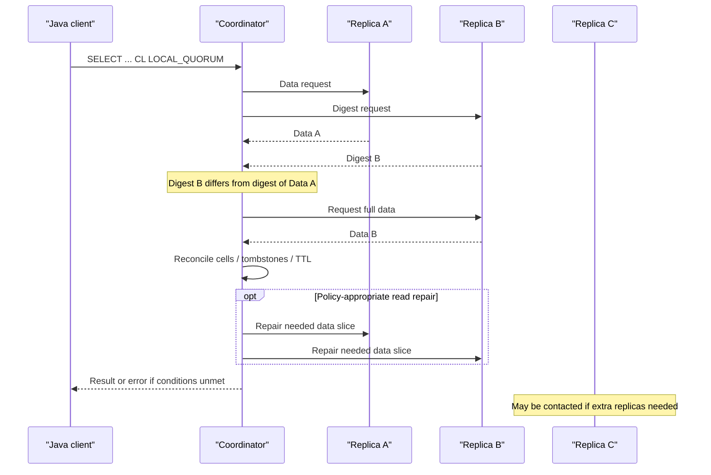
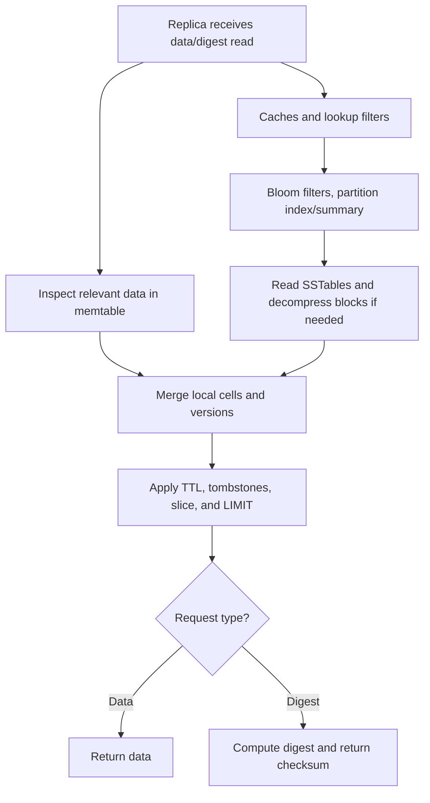

# Data Reads, Digest Reads, and Divergence Detection

## 1. Why Might One SELECT Need to Compare Multiple Replicas?

Apache Cassandra stores copies (*replicas*) of a partition according to the keyspace's replication strategy. For instance, with `NetworkTopologyStrategy` and a replication factor (RF) of 3 in a single data center, a partition has three designated replicas. They **do not necessarily hold identical state at every instant**: a write might have reached only a subset of replicas, a node may have temporarily lost connectivity, and cell versions may still be awaiting synchronization.

When the Java Driver sends a `SELECT` statement, the node receiving the request acts as the **coordinator**. Depending on the consistency level (CL), the coordinator needs enough replica responses to return a result. To avoid transmitting large payloads across nodes while still detecting many cases of divergence, Cassandra uses two key read mechanisms:

- **Full-data read (data request):** the replica sends the actual read data needed for the coordinator to assemble the CQL result.
- **Digest read (digest request):** the replica computes and returns a compact summary value representing the read content relevant to the query, allowing the coordinator to compare it against data from another replica.

This lesson belongs to the **Read Path and Caching** chapter in the `DATABASE_ENGINE_WIDE_COLUMN_CASSANDRA` module. It bridges distributed architecture, partition keys, query-driven table design, and replication/CL with memtable–SSTable reads, tombstone handling, read repair, and Java applications.

**After this lesson, you should be able to:**

1. Distinguish a data response from a digest response, and explain why a digest cannot replace data.
2. Trace the read path both when replicas agree and when a digest mismatch occurs.
3. Explain cell-level reconciliation, timestamps, TTLs, and tombstones.
4. Distinguish read repair from anti-entropy repair, and understand version/option impacts.
5. Calculate the required replica scope by CL, measure latency impact, and diagnose issues with tracing/metrics.
6. Practice safe CQL and configure read CLs from the Cassandra Java Driver.

> **Key principle:** matching schema, matching RF, and matching partition key do not guarantee that every replica holds the exact same set of data versions. *Schema agreement* means agreeing on definitions; *digest comparison* is a content check for a **specific read request**.

## 2. Roles on the Read Path

| Component | Role in a `SELECT` Request |
| --- | --- |
| **Java Driver / client** | Picks the receiving node via its load-balancing policy, sends CQL and CL; may use token-aware routing |
| **Coordinator** | Identifies the partition's replica set, orchestrates data/digest requests, waits for CL responses, reconciles, and returns results |
| **Natural replica** | Node assigned by the replication strategy to store the partition; reads local memtable, SSTables, and caches |
| **Full-data response** | Returns the data/versions needed for the coordinator to construct the read result |
| **Digest response** | Returns a checksum/verification value for the read content, not CQL rows ready to send directly to the client |
| **Resolver / reconciliation** | Compares and merges necessary versions when divergence is detected |
| **Read repair** | Can push reconciled data to missing/stale replicas during a read, per version and policy |

The coordinator **can** also be a replica for the partition, though it is not required. Token-aware drivers generally try to prefer a coordinator that is local or holds a replica to save a network hop; the final choice depends on policy and node health.

### From Partition Key to Replica Set

Consider the table:

```sql
CREATE TABLE read_lab.sensor_events_by_day (
    sensor_id text,
    event_day date,
    event_time timestamp,
    event_id uuid,
    reading double,
    PRIMARY KEY ((sensor_id, event_day), event_time, event_id)
) WITH CLUSTERING ORDER BY (event_time DESC, event_id ASC);
```

The partition key is the **pair** `(sensor_id, event_day)`. Cassandra hashes the encoded partition key into a token and uses the replication strategy to determine the natural replicas. The following query targets **one specific partition**:

```sql
SELECT event_time, event_id, reading
FROM read_lab.sensor_events_by_day
WHERE sensor_id = 'sensor-01'
  AND event_day = '2026-11-21'
LIMIT 10;
```

If a query scans multiple partitions or lacks proper key predicates, the coordinator may have to orchestrate more read branches. Thus, **query-driven table design** often dictates the cost of both data reads and digest reads.

## 3. How Do Full-Data Reads and Digest Reads Differ?

| Attribute | Full-data read | Digest read |
| --- | --- | --- |
| Purpose | Supply content for the read result | Compare read content across replicas |
| Network payload returned | Read data/versions, potentially large | Digest value smaller than the corresponding data |
| Can be returned directly as CQL rows? | Yes, after coordinator processing | **No** |
| Does it always read only from RAM? | No; may touch caches, memtable, and SSTables | **No**; the replica must still resolve the relevant content to compute the digest |
| Can it reveal divergence? | Serves as the baseline data compared against digests/other replicas | Differing digests signal that further reconciliation is needed |
| Cost | Local I/O + potentially larger network transfer | Local I/O/CPU to read and compute digest + fewer bytes transferred |

A digest is a **fingerprint of the read content relevant to the request**, not a checksum of the entire table, keyspace, or SSTable. A matching digest **does not prove all partitions on two replicas are identical**: it only indicates that the content compared within this request's scope showed no divergence under that digest check.

Moreover, a hash/digest is not an absolute mathematical proof: collisions are theoretically possible, and operationally Cassandra uses it as an efficient divergence-detection mechanism, **not** an immutable audit proof for the entire database.

### Replicas May Still Hit Disk for Digests

A common misconception is that "a digest read is always ultra-cheap because it only sends a hash." In reality, the replica must read and process the data matching the query in order to compute the digest. If a partition is huge or has many SSTables or tombstones, the local cost of a digest read remains substantial. **Digests save inter-node network bandwidth**, but they do not turn an expensive query into an I/O-free one.

## 4. Normal Read Path When Replicas Agree

Suppose a DC named `dc1` has RF = 3, with the partition replicated on A/B/C; a request uses `LOCAL_QUORUM`, requiring two responses in `dc1`. A typical execution asks A for full data and B for a digest:



This diagram shows **one typical flow**, not a guarantee that every `LOCAL_QUORUM` read always sends strictly one data request and one digest request. Cassandra may send extra requests, use speculative retry, and vary comparison/execution steps depending on version, replica health, and query type.

### Why Can It Complete Before Every Replica Replies?

The CL defines the request's success condition; it does **not** require waiting for every replica. With RF = 3 and `LOCAL_QUORUM`, once two valid responses arrive and required checks finish, the coordinator can return the result even if the third replica is not part of the primary response path. That does not guarantee replica C holds the same data as A/B.

With `LOCAL_ONE`, the read can complete from a single valid data response without quorum comparison. Hence `LOCAL_ONE` can be faster and more available, but it risks returning stale data if the queried replica missed the latest write.

## 5. Digest Mismatch: Divergence Detected—Now What?

A **digest mismatch** occurs when the coordinator receives non-matching content-verification results across compared replicas. This can reflect divergent data because a write has not reached all replicas, a node recently recovered, concurrent updates/deletes occurred, or data is awaiting repair.

The coordinator **cannot take a mismatched digest and deduce the exact column values**: a digest only indicates *that a difference exists*; it lacks the payload needed to reconcile.

A conceptual sequence:

1. The coordinator receives a full-data response from A and a digest response from B.
2. The digest is compared against A's data; a mismatch is detected.
3. The coordinator must request **additional full data** from the relevant replica(s) to obtain the versions needed for reconciliation.
4. The resolver merges data versions per Cassandra semantics (timestamps, tombstones, TTLs, column types).
5. Depending on version, table options, CL, and mismatch type, Cassandra may perform **read repair** on divergent replicas.
6. The coordinator returns the final result once CL and any blocking steps complete, or returns an error if it cannot finish in time.



### A Mismatch Does Not Mean a Replica Is "Corrupted"

A differing digest does not prove disk corruption or a broken entire SSTable. It is a signal to inspect **the content versions for that specific request**. It can trigger normal read repair, though frequent mismatches paired with read errors/timeouts warrant investigating node health, repair status, topology, or workload.

### Does a Mismatch Force an Error Back to the Application?

**No.** In many cases Cassandra reconciles successfully and returns a normal result; the application never sees "digest mismatch" as an exception. However, fetching extra data or waiting for read repair can increase latency. If insufficient responses arrive, a replica errors out, or a timeout expires, the client receives the corresponding read error.

## 6. Reconciliation: Cell-Level Merging, Not "Pick the Newest Whole Row"

Cassandra can hold multiple versions of a partition's data across memtables/SSTables and multiple replicas. Correctness of the read result depends on **data reconciliation rules**: cell timestamps, tombstones, TTLs, row structure, and version-specific tie-breakers.

Consider an illustrative example (timestamps are logical illustration values, not raw query output):

| Cell | Replica A | Replica B | Expected Result After Proper Reconciliation |
| --- | --- | --- | --- |
| `order_status` | `'PAID'`, timestamp 100 | `'SHIPPED'`, timestamp 105 | `'SHIPPED'` wins unless superseded by another version/tombstone |
| `delivery_note` | `'Gate 1'`, timestamp 108 | `'Gate 2'`, timestamp 102 | `'Gate 1'` has the newer version |
| `cancel_reason` | Tombstone timestamp 120 | `'Requested'`, timestamp 110 | Deletion marker overrides the older cell per tombstone rules |

The resulting row combines `order_status` from B, `delivery_note` from A, and the deleted state of `cancel_reason`. Therefore, saying "the coordinator picks the replica with the highest row timestamp" is **incorrect**.

### Timestamps and Conflicts

Normal writes in Cassandra are reconciled by timestamp within the appropriate scope. This does **not** guarantee that client-side timestamps always reflect business order if multiple writers have skewed clocks or supply custom timestamps. When two versions share an identical timestamp, Cassandra applies deterministic tie-breaking rules depending on cell type; never guess the final value solely by looking at application write wall-clock time.

### Tombstones and TTLs

- **Tombstones** represent deleted data. A replica with a newer tombstone can prevent an older value on another replica from reappearing.
- **TTLs** determine when data expires; expired cells follow deletion/expiration semantics during reads and compaction.
- Replicas can retain differing tombstones or stale versions temporarily, especially if a node missed a write or has not been repaired.
- `gc_grace_seconds` and anti-entropy repair schedules govern when tombstones can be safely purged from SSTables. Never lower `gc_grace_seconds` arbitrarily just because queries encounter many tombstones.

**Do not claim quorum reads will fix every "zombie data" scenario.** If a delete was missed for too long and its tombstone was unsafely purged, a single read repair does not substitute for proper repair procedures.

## 7. Reading at Sufficient CL and "Latest" Data: What Is Guaranteed and What Is Not

A read request's CL governs the number and scope of replica responses, not an algorithm that "compares all data across the cluster."

For a single DC, RF = 3:

| Read CL | Minimum Responses for Quorum Math | Divergence Detection Within Request |
| --- | ---: | --- |
| `ONE` / `LOCAL_ONE` | 1 | Does not require quorum comparison before returning |
| `TWO` | 2 | Can compare content between at least two replicas |
| `QUORUM` / `LOCAL_QUORUM` | 2 | Two replicas within CL scope; can detect mismatches |
| `ALL` | 3 | Requires every corresponding replica to succeed; sensitive to one slow/down node |

Quorum for RF = 3 is:

\[
Q = \lfloor RF/2 \rfloor + 1 = 2.
\]

With quorum reads and quorum writes in the same DC, the replica sets of successful reads and writes overlap under standard assumptions; the inequality `R + W > RF` can be used to reason about this. **However, do not interpret it as an absolute linearizability guarantee** for the entire system, especially with concurrent writes, custom timestamps, ambiguous client timeouts, LWTs, or multi-partition queries.

### Intuitive Example

A write `order_status = 'SHIPPED'` is acknowledged on two replicas A and B; C has not yet received it. A `LOCAL_ONE` read from C may see `'PAID'`. A `LOCAL_QUORUM` read in the same DC must gather two responses; under the relevant conditions, the read quorum overlaps the write quorum, allowing the coordinator to observe the newer version and reconcile.

If the previous write **was not acknowledged** at the intended CL, or if concurrent updates with different timestamps are in flight, you cannot promise that every subsequent quorum read immediately returns values in business order.

### `QUORUM` Differs from `LOCAL_QUORUM` Across Multiple DCs

Suppose the replication map is `dc1:3, dc2:2`:

- `LOCAL_QUORUM` in `dc1` requires 2 of 3 replicas in `dc1`.
- `LOCAL_QUORUM` in `dc2` requires 2 of 2 replicas in `dc2`.
- `QUORUM` across total RF = 5 requires 3 responses from replicas across the cluster-wide scope.

This directly impacts **cross-DC latency** and data freshness. The two levels cannot be treated as always equivalent.

## 8. Read Repair: When Reads Help Heal Divergent Replicas

*Read repair* is the mechanism that repairs divergence detected on the read path. It does not necessarily happen on every request:

- If participating replicas' digests/data match, no mismatch needs repair within that scope.
- If a read uses a CL satisfied by a single replica, the request may not compare enough replicas to detect drift.
- If a mismatch is found, the coordinator may fetch additional data and repair replicas per policy/version.
- Replicas **not involved** in the request may remain divergent; read repair does not mean the entire cluster is now consistent.

### Cassandra 4.x+: Understanding the `read_repair` Table Option

In Cassandra 4.x, the `read_repair` table option has notable modes:

| Mode | Practical Meaning | Trade-off |
| --- | --- | --- |
| `BLOCKING` | When eligible read repair is triggered, the read may wait to repair the required replicas before completing per the version's mechanism | Supports monotonic quorum reads, but increases tail latency when divergence occurs |
| `NONE` | Does not enforce the same blocking read-repair behavior | Better preserves atomicity of certain partition-level writes/batches, without the same monotonic quorum read guarantee |

Cassandra 4.0 documents the trade-off between **monotonic quorum reads** and **partition-level write atomicity** when choosing a read-repair policy. This is subtle: repairing only the queried slice can make part of a partition-level write/batch visible before another part if a query reads only a subset.

Example syntax **only for labs and supported versions**, not a recommendation to change production settings:

```sql
ALTER TABLE read_lab.sensor_events_by_day
WITH read_repair = 'BLOCKING';
```

Older Cassandra versions had different read-repair options/behaviors (such as probabilistic configuration in earlier releases), while newer releases may alter implementation details. **Check the documentation for your exact cluster version** before using this option or interpreting metrics; do not blindly apply Cassandra 3.x syntax/behavior to 4.x/5.x.

### Read Repair vs. Anti-Entropy Repair

| Characteristic | Read repair | Anti-entropy repair (`nodetool repair` and related mechanisms) |
| --- | --- | --- |
| Timing | During/after a read that detects divergence, per policy | Per operational schedule or repair job |
| Scope | Queried content and participating replicas | Can cover token ranges/data and replicas systematically |
| Trigger | Read + mismatch/policy condition | Proactively scheduled or on-demand |
| Interchangeable? | **No** | **No** |
| Cold/infrequently read nodes? | May never touch rarely queried partitions | Designed to cover cold/unread data when included in repair scope |

**Bottom line:** having read repair does not eliminate the need for anti-entropy repair. When increasing RF, adding a DC, or recovering a node, separate data streaming/repair applies; schema agreement does not confirm those completed.

## 9. Short-Read Protection: Why Does LIMIT Complicate Reconciliation?

When reading with `LIMIT`, Cassandra must return the requested number of **valid, visible** rows after reconciliation. Yet replicas may hold different row sets or tombstones that cause initially read rows to be filtered out.

Suppose we request the **3 latest events** of a partition:

```sql
SELECT event_time, event_id, reading
FROM read_lab.sensor_events_by_day
WHERE sensor_id = 'sensor-01'
  AND event_day = '2026-11-21'
LIMIT 3;
```

Illustration:

| Replica A Initial Read | Replica B Initial Read | What Can Happen After Reconciliation |
| --- | --- | --- |
| E5, E4, E3 | Tombstone E5, E4, E3 | E5 is eliminated; only E4, E3 remain |

If the coordinator merged only the first three rows from each replica and stopped, the result would **be missing a valid row** even though E2 still exists behind them. *Short-read protection* allows Cassandra to request additional data when it detects that the post-merge result shrank below the requested limit.

This illustrates a real-world issue with **LIMIT + tombstones/divergent data**; implementation details vary by version and query type. Do not confuse short-read protection with "digest reads": digests detect divergence, whereas short-read protection prevents returning too few valid rows when reconciliation trims the result.

### LIMIT Does Not Make the Entire Read Constant-Time

A `LIMIT 10` query may scan far more than 10 items in SSTables if many cells/rows are deleted, TTL-expired, or require cross-replica merging. With paging, each page can issue separate requests; multiple pages do not form an absolute snapshot transaction while data is changing.

## 10. Reading Inside a Replica: Caches, Memtable, SSTables, and Digest Cost

Every data or digest request still goes through the local read path. Participating components can include:



The diagram shows **logical components**, not implying Cassandra always accesses them in a fixed order across all versions.

| Component | Impact on Reads |
| --- | --- |
| **Memtable** | Holds recent unflushed writes; may participate in assembling the read result |
| **SSTable** | Immutable on-disk files; multiple SSTables may hold versions of the same partition |
| **Bloom filter** | Skips SSTables guaranteed not to contain the partition; false positives trigger extra checks |
| **Partition index/summary** | Helps locate the partition offset within an SSTable |
| **Key cache** | Reduces index/offset lookup work where applicable |
| **Row cache** | Can reduce I/O for cached data under suitable policies; limits/behavior vary by version |
| **Compaction** | Merges SSTables per strategy, affecting how many sources must be read |
| **Tombstones and TTL** | Force reads to process non-visible data, potentially increasing latency |

**Digest reads can still traverse these expensive steps.** A replica slowed by excessive SSTables or tombstones can return digest responses slowly; since the coordinator waits for CL, the overall request slows down.

## 11. Speculative Retry and Mismatch: Two Distinct Mechanisms

When a replica responds slowly, Cassandra can send a **speculative read** to another replica to reduce tail latency, per configured thresholds. This is **not synonymous** with detecting a digest mismatch.

| Scenario | Symptom | Primary Mechanism |
| --- | --- | --- |
| Replica A is slow, though data may match B | Not enough timely responses | Speculative retry may query another eligible replica |
| A and B both respond, digests differ | Compared content diverges | Fetch additional data, reconcile, and read repair as appropriate |
| Both slow and divergent | Multiple factors | May combine extra requests, reconciliation, and repair |

Speculative retry never relaxes `LOCAL_QUORUM` down to `LOCAL_ONE`. It generates extra read load, so aggressive speculative settings on an already saturated cluster can worsen the problem.

### Network/CPU Cost Across Cases

| Case | Typical Cost |
| --- | --- |
| Digest matches, CL satisfied | One or a few data/digest requests; less network payload than sending full data from all replicas |
| Digest mismatch | Extra full-data requests, reconciliation CPU, potential read repair |
| Dense tombstones | Extra local data reads/merges, potential short-read protection rounds |
| Speculative retry | Extra read requests; may lower latency at the cost of higher load |
| Slow replica I/O | Both data **and** digest responses can become slow |

Therefore, tracking mismatch/read-repair rates alongside latency, SSTable counts, tombstones, compaction, and speculative retries yields a much clearer picture than looking at CL alone.

## 12. Errors and Metrics to Observe

Not every read error means replicas hold conflicting data:

| Condition | Meaning | Investigation Path |
| --- | --- | --- |
| **Digest mismatch** | Divergence in the compared request content | Check write CL, recent down nodes, repair status, read repair, and latency |
| **ReadTimeout** | Insufficient valid responses before timeout | I/O, tombstones, network, GC, slow read repair/reconciliation |
| **ReadFailure** | Replica reported an execution failure affecting CL satisfaction | Replica logs, disk/corruption, resources, query limits |
| **Unavailable** | Insufficient live replicas available to satisfy CL when coordinating | RF/DC, node up/down state, CL, and topology |
| **Potentially stale result at ONE** | Quorum comparison not required | Check write/read CL, replica state, and freshness requirements |
| **Slow query without mismatch** | Likely data/partition/storage or network issue | Check caches, SSTables, tombstones, partition size, latency |

### Useful Tools

- `nodetool status`: node states, DC/rack, and topology distribution.
- `nodetool getendpoints ks table key`: natural replicas for a partition key; **not** a log of served requests.
- `nodetool tablestats`: table metrics, SSTables, caches, and version-dependent statistics.
- `nodetool tpstats`: thread pools, pending/dropped messages to spot bottlenecks.
- `TRACING ON` in `cqlsh`: observe a specific query; incurs overhead, do not enable on every request.
- Cassandra metrics: read latencies, read repair/digest mismatch/speculative retries, tombstones, and compaction per your version's metric set.
- Java Driver metrics/logs: request timeouts, retries, coordinator, local DC connections, and latency distributions.

**Never conclude from a single mismatch metric that the entire cluster is corrupted.** Inspect which keyspace/table/partition saw the increase, whether nodes went down or repairs ran recently, and whether read latency or business correctness is affected.

## 13. Safe Lab: Observing the Read Path Without Forcing Replica Drift

This lab assumes a **dedicated lab cluster with at least three Up/Normal nodes in DC `dc1`** to demonstrate RF = 3 and `LOCAL_QUORUM`. If your DC name differs, substitute it based on `nodetool status`. If you only have one node, use RF = 1 and practice only metadata/tracing—**do not simulate three-replica quorum results**.

### Step 1 — Check Topology

```bash
nodetool status
```

Note the DC, rack, number of `UN` nodes, and cluster health. Do not stop nodes, tamper with SSTables, or perform destructive actions just to manufacture a mismatch for this lesson.

### Step 2 — Create Lab Keyspace and Table

```sql
CREATE KEYSPACE IF NOT EXISTS read_lab
WITH replication = {
    'class': 'NetworkTopologyStrategy',
    'dc1': '3'
}
AND durable_writes = true;

CREATE TABLE IF NOT EXISTS read_lab.sensor_events_by_day (
    sensor_id text,
    event_day date,
    event_time timestamp,
    event_id uuid,
    reading double,
    PRIMARY KEY ((sensor_id, event_day), event_time, event_id)
) WITH CLUSTERING ORDER BY (event_time DESC, event_id ASC);
```

**Note:** `IF NOT EXISTS` does not verify that an existing keyspace/table has the expected RF, keys, or column types. If the object remains from an earlier run, inspect its definition before proceeding; do not overwrite data outside your lab.

### Step 3 — Verify Metadata and Schema Agreement

```sql
SELECT keyspace_name, replication
FROM system_schema.keyspaces
WHERE keyspace_name = 'read_lab';

SELECT column_name, kind, position, type
FROM system_schema.columns
WHERE keyspace_name = 'read_lab'
  AND table_name = 'sensor_events_by_day';
```

```bash
nodetool describecluster
```

Distinguish **schema agreement** from **replica data agreement**. A shared schema version only means observed nodes agree on schema definitions, not that every cell or tombstone in a partition is identical.

### Step 4 — Insert Test Data at an Appropriate CL

In `cqlsh`, `CONSISTENCY` is a shell convenience command setting the session consistency level:

```sql
CONSISTENCY LOCAL_QUORUM;

INSERT INTO read_lab.sensor_events_by_day (
    sensor_id, event_day, event_time, event_id, reading
) VALUES (
    'sensor-01', '2026-11-21',
    '2026-11-21T08:00:00Z',
    aaaaaaaa-aaaa-4aaa-8aaa-aaaaaaaaaaaa,
    28.5
);

INSERT INTO read_lab.sensor_events_by_day (
    sensor_id, event_day, event_time, event_id, reading
) VALUES (
    'sensor-01', '2026-11-21',
    '2026-11-21T08:01:00Z',
    bbbbbbbb-bbbb-4bbb-8bbb-bbbbbbbbbbbb,
    29.0
);
```

`CONSISTENCY` is not standard CQL to embed verbatim inside a Java prepared statement. A successful quorum write does not mean all replicas already hold the record at that exact moment.

### Step 5 — Compare LOCAL_ONE and LOCAL_QUORUM Reads

```sql
CONSISTENCY LOCAL_ONE;

SELECT event_time, event_id, reading
FROM read_lab.sensor_events_by_day
WHERE sensor_id = 'sensor-01'
  AND event_day = '2026-11-21'
LIMIT 10;

CONSISTENCY LOCAL_QUORUM;

SELECT event_time, event_id, reading
FROM read_lab.sensor_events_by_day
WHERE sensor_id = 'sensor-01'
  AND event_day = '2026-11-21'
LIMIT 10;
```

If both queries return the same rows, that is normal. It does **not** mean you observed a digest mismatch or read repair. In a healthy cluster, mismatches may not occur, and request tracing detail varies by version.

### Step 6 — Trace the Read Query

```sql
TRACING ON;

SELECT event_time, event_id, reading
FROM read_lab.sensor_events_by_day
WHERE sensor_id = 'sensor-01'
  AND event_day = '2026-11-21'
LIMIT 10;

TRACING OFF;
```

Observe the timestamps, coordinator, replica activities, and recorded latencies. If the trace does not explicitly print the words `digest` or `repair`, do **not** conclude those features are disabled; note the observability granularity of your Cassandra version and traced command.

### Step 7 — Clean Up the Lab Keyspace When Done

```sql
-- Warning: use only on the read_lab keyspace that you created and can drop completely.
DROP KEYSPACE IF EXISTS read_lab;
```

`DROP KEYSPACE` removes all tables and data in the keyspace; never run it in production or on shared objects.

## 14. Java Driver 4.x Example: Setting Read CL and Inspecting Execution Info

This snippet uses Cassandra Java Driver 4.x and Java 15+ text blocks. Assume `CqlSession session` is already connected to the lab cluster, its lifecycle is managed elsewhere, and the schema is ready.

```java
import com.datastax.oss.driver.api.core.CqlSession;
import com.datastax.oss.driver.api.core.DefaultConsistencyLevel;
import com.datastax.oss.driver.api.core.cql.BoundStatement;
import com.datastax.oss.driver.api.core.cql.PreparedStatement;
import com.datastax.oss.driver.api.core.cql.ResultSet;
import com.datastax.oss.driver.api.core.cql.Row;
import java.time.LocalDate;

// session is initialized externally.
PreparedStatement select = session.prepare("""
    SELECT event_time, event_id, reading
    FROM read_lab.sensor_events_by_day
    WHERE sensor_id = ? AND event_day = ?
    LIMIT 10
    """);

BoundStatement request = select.bind(
        "sensor-01",
        LocalDate.of(2026, 11, 21))
    .setConsistencyLevel(DefaultConsistencyLevel.LOCAL_QUORUM);

ResultSet result = session.execute(request);
for (Row row : result) {
    System.out.println(
        row.getInstant("event_time")
        + " -> " + row.getDouble("reading"));
}

// Coordinator can be retrieved from execution metadata to investigate latency.
System.out.println("Coordinator: "
    + result.getExecutionInfo().getCoordinator());
```

Notes:

- The driver selects the coordinator using its load-balancing policy, local DC, and token routing if enabled; the coordinator picks replicas by RF/DC/CL.
- `LOCAL_QUORUM` is a **statement-level** choice. There is no client API to tell the coordinator "request a digest from node B"; that is an internal Cassandra read-path detail.
- Returned `Row` objects are already processed by Cassandra; they do not expose per-replica digests for application-side reconciliation.
- `ResultSet` and execution metadata let you inspect the coordinator for a request, but do **not** prove which natural replicas responded.
- If tracing is needed, enable it according to driver/version support and operational rules, keeping in mind tracing overhead. Enable only on a small sample for diagnostics.
- If `LOCAL_QUORUM` times out, do not automatically drop to `ONE` or retry infinitely; examine data correctness and infrastructure root causes.

### Retries and Paging

For single-partition reads, use prepared statements and an appropriate page size to bound returned data. However, if a request or page is retried while the cluster is overloaded, replica work increases—including digest computation. Never treat multi-page paging as an atomic consistent snapshot while writers are updating data.

## 15. Diagnostic Scenario: Rising Digest Mismatches and High Read Latency

Suppose a dashboard shows rising read latency for `sensor_events_by_day`, accompanied by read-repair/digest-mismatch signals in Cassandra's version-specific metrics. Follow a structured investigation:

1. **Classify the read request:** query, partition key, CL, local DC, timestamp, page size, and result size.
2. **Check natural replicas:** read RF/strategy from `system_schema.keyspaces` and determine the sample partition's replica set with the appropriate tool.
3. **Inspect nodes:** `nodetool status`, node down/restart logs, disk I/O, GC, network, and compaction/repair status.
4. **Review recent write activity:** write CL, ambiguous timeouts, write bursts, TTL/`DELETE`s, and writers supplying custom timestamps.
5. **Trace sample reads:** compare normal vs. slow requests; look for extra fetch steps, reconciliation, or read repair if exposed by your tool/version.
6. **Evaluate local data:** many SSTables, tombstones, large partitions, short-read protection, and speculative traffic can drive latency.
7. **Fix the root cause:** restore node health, fix network issues, address workload/hot partitions, and run anti-entropy repair per runbook if needed.
8. **Re-measure after changes:** p95/p99 latency, timeouts, mismatch/read-repair rates, replica load, and business correctness.

### Conclusions Not to Jump To

| Observation | Wrong Conclusion | Better Interpretation |
| --- | --- | --- |
| Digest mismatches increase | "All replicas are corrupted" | Compared read content diverged; investigate cause and scope |
| `LOCAL_QUORUM` is slower than `LOCAL_ONE` | "Quorum should always be disabled" | Quorum waits for extra responses/comparison; find the slow replica or path |
| Read repair occurred | "Periodic repair is unnecessary" | Read repair only covers queried data within scope, not the whole dataset |
| All nodes are `UN` | "Every cell is synchronized" | Up nodes do not guarantee identical replica data |
| Schema versions match | "Digests are guaranteed to match" | Schema agreement covers definitions, not data comparison |
| No word `digest` in trace | "Cassandra is not using digests" | Trace verbosity depends on Cassandra version and request |
| Both CLs return identical values | "The entire table has been verified" | Only the queried partition/slice was checked |

## 16. Self-Check Exercises and Checklist

### Exercise A — Identify Data/Digest Roles

A `LOCAL_QUORUM` read with RF = 3 receives a data response from A and a matching digest from B. Questions:

1. What does the client receive? **The CQL result rows** assembled by the coordinator, not B's digest.
2. Can we conclude C matches A/B? **No.** C may not have participated in the request.
3. Did B skip reading SSTables because it only produced a digest? **No.** B still had to resolve the relevant content.

### Exercise B — Handling a Mismatch

A holds `order_status = 'PAID'` at timestamp 100; B holds `'SHIPPED'` at timestamp 105. Digests differ. What must the coordinator do?

**Answer:** request sufficient full data to compare/reconcile versions following timestamps/tombstones and the applicable read-repair policy; the final value cannot be deduced from two digest strings alone.

### Exercise C — Tombstone Resolution

A holds `cancel_reason='Requested'` at timestamp 110; B holds a tombstone at timestamp 120. Assuming no stronger competing version exists, what is the expected outcome?

**Answer:** the data is deleted per the newer tombstone; the stale string must not be resurrected just because A still holds it.

### Exercise D — Short-Read Protection

The client requests the three newest rows. After reconciliation, one top row is eliminated by a tombstone, leaving only two visible rows. Why might Cassandra fetch more?

**Answer:** it must fetch additional valid rows behind them to satisfy the `LIMIT` if qualifying data remains; it cannot stop just because three initial candidates were read.

### Exercise E — Read Repair vs. Anti-Entropy Repair

A partition is almost never read, yet one replica missed updates a long time ago. Should you rely solely on read repair?

**Answer:** No. Read repair depends on read requests encountering divergence; you must schedule anti-entropy repair/streaming and appropriate operational policies to cover cold data.

### Checklist Before Concluding a Read Error's Root Cause

| Question | Evidence |
| --- | --- |
| Does the query target a full partition key? | `PRIMARY KEY` and `WHERE`, no unexpected scans |
| What are the RF and local DC? | `system_schema.keyspaces`, `nodetool status` |
| How many responses does the CL require? | Computed from local/cluster-wide RF |
| How do data and digest reads flow? | Version-appropriate tracing/metrics; not inferred from row output |
| Is mismatch occurring, and in what scope? | Observable metrics/logs/traces; do not extrapolate to the whole table |
| Is reconciliation dominated by TTL/tombstones/timestamps? | Sample data, write/delete policies, logs |
| Is periodic repair running for cold data? | Runbooks and anti-entropy repair results |
| Are speculative requests or short reads significant? | Retry/latency metrics and appropriate tracing |
| Are replicas slowed by memtable/SSTables/caches/compaction? | `tablestats`, I/O, GC, and tombstone metrics |
| Does the Java app handle CL/timeouts/retries properly? | Statement configs, exception logs, load tests |

**Key takeaway:** Cassandra can read full data from one replica and digests from others to verify content without transferring full payloads across the network. When digests diverge, the coordinator fetches additional data to **reconcile by cell, timestamp, TTL, and tombstone**, and may trigger read repair per policy. Read repair does not replace anti-entropy repair; digests do not replace data; caches do not replace CL. Understanding the three layers—**coordinator/replica**, **data–digest–reconcile**, and **memtable/SSTable/cache**—helps you choose consistency levels and troubleshoot read latency accurately in Java applications.
