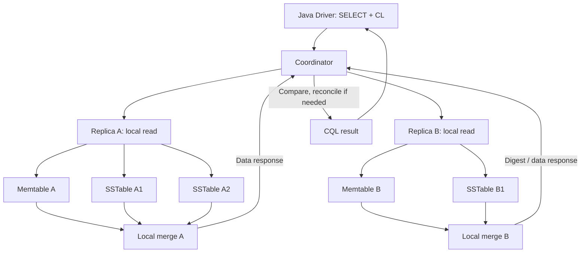
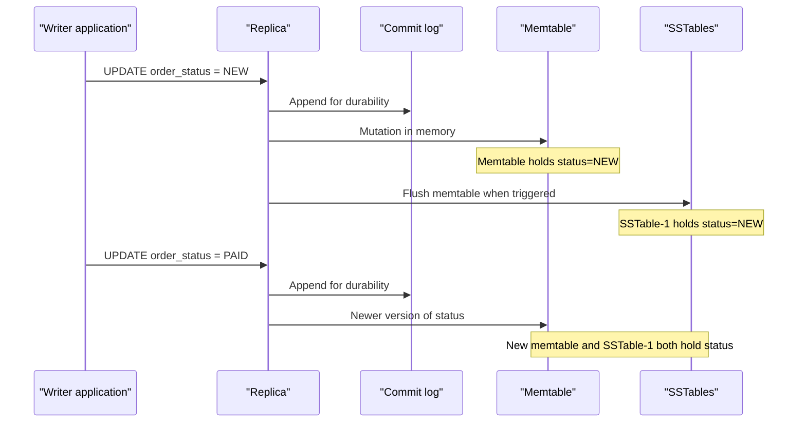
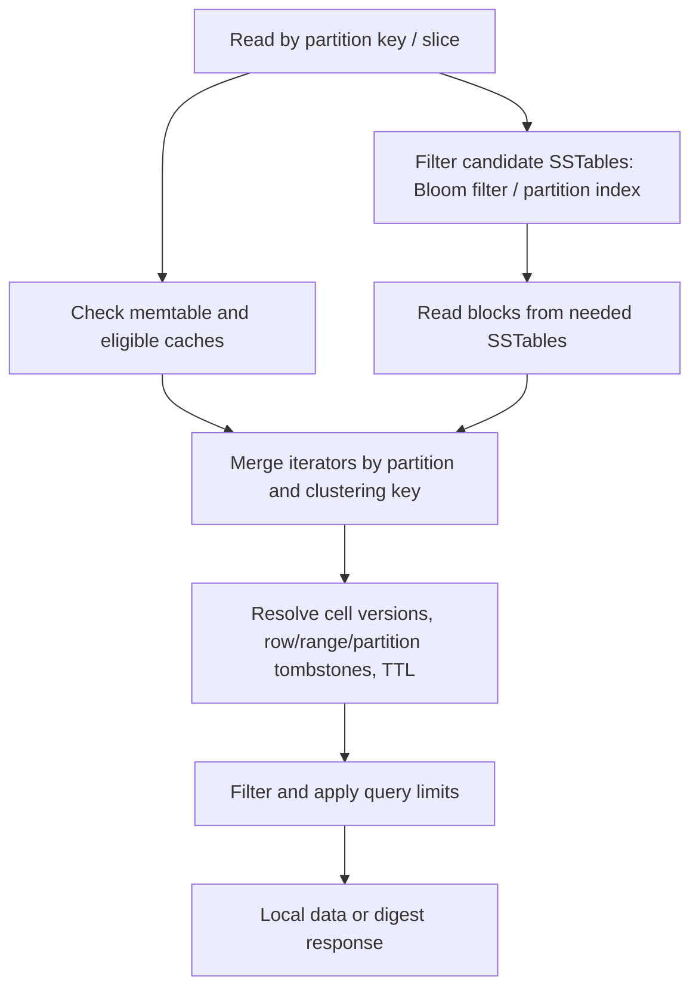
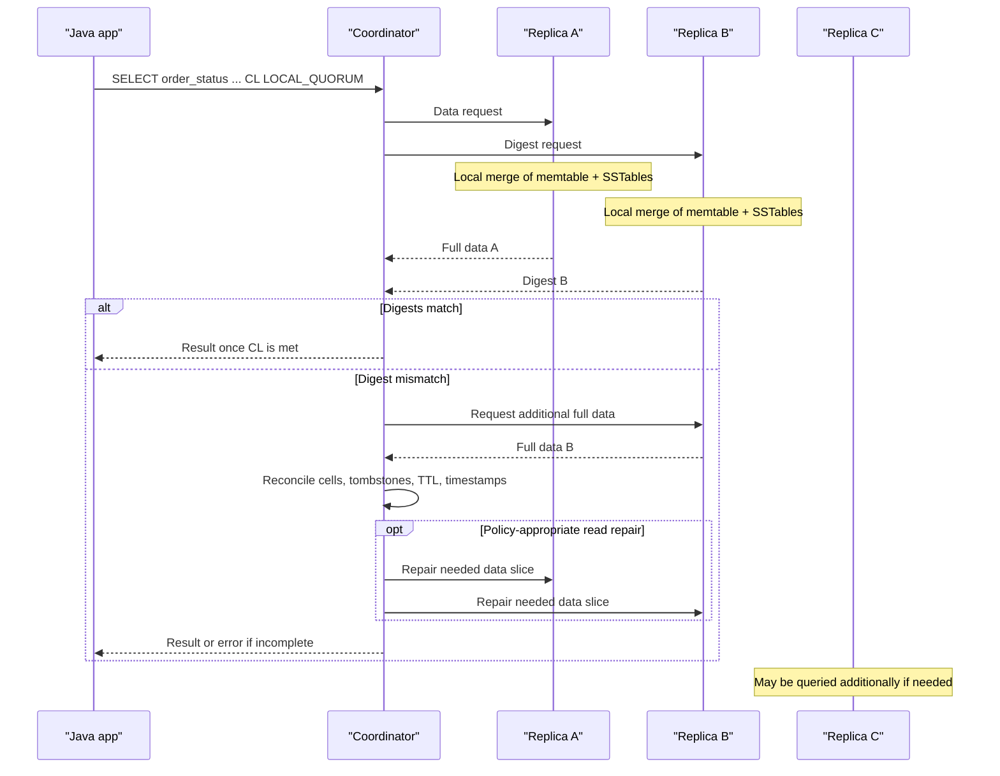

# Merging Versions from Memtable/SSTables and Replicas

## 1. A Row Can Exist in Multiple Places—Why Does SELECT Still Return One Row?

Apache Cassandra uses a **Log-Structured Merge-Tree (LSM-Tree)** storage model. On a single node, a partition may have new data in the **memtable**, while older versions of the same cells still reside across multiple immutable **SSTables** on disk. Cluster-wide, that partition is also replicated across multiple **replicas** per the keyspace's replication strategy.

Consequently, the result of a `SELECT` is not simply "fetch an entire row from one file." Cassandra must resolve **two levels of merging**:

1. **Local merge:** each replica reads the relevant portions of its memtable and SSTables, combining cell versions, tombstones, and TTLs to produce that node's local read result.
2. **Distributed reconciliation:** when the consistency level (CL) requires multiple replicas and divergent results are detected, the coordinator fetches full data from the involved replicas, picks valid versions, and performs read repair per the applicable mechanism and configuration.

Within the **Read Path and Caching** chapter of the `DATABASE_ENGINE_WIDE_COLUMN_CASSANDRA` module, this lesson connects query-driven table design, partition keys, replication/consistency, caching, compaction, repair, error handling, and Java Driver integration.

After this lesson, you should be able to explain:

- Why new writes to the memtable do not overwrite old SSTables in place.
- What determines the winning value when multiple versions of a cell exist.
- How tombstones, TTLs, and row/range deletions affect reads.
- The difference between local merging and cross-replica reconciliation.
- Why compaction and anti-entropy repair serve different roles from a read request.
- How to verify behavior with CQL `WRITETIME`, `TTL`, tracing, and the Java Driver.

> **Core takeaway:** Cassandra can store multiple physical representations of the same data while returning a single **logical view** after applying timestamp, deletion, and expiration rules. Having the same schema does not guarantee every replica holds the same data versions.

## 2. Overview of the Two Merge Layers



This diagram is a logical model. The order of accessing caches, memtable, and SSTables; the number of data/digest requests; and the exact replicas contacted depend on Cassandra version, query type, and CL. It does **not** mean Cassandra always reads every SSTable or always contacts strictly two replicas.

| Question | Local Merge at One Replica | Cross-Replica Reconciliation |
| --- | --- | --- |
| Source of versions | Memtable, SSTables, tombstones on **a single node** | Results/versions from **different nodes** |
| Executed by | Replica read path | Coordinator/resolver and participating replicas |
| Inputs | Partition key, clustering range, local data | Full-data/digest responses, CL, local read results |
| When needed? | Whenever local data may span multiple versions | When a request involves multiple replicas, especially on mismatch |
| Output | Logical view at one replica | Valid logical view across reconciled replicas |
| Relation to compaction/repair | Compaction reduces physical versions per rules | Read repair/anti-entropy repair resolves cross-replica divergence |

**Do not confuse:** a node can perform a completely accurate local merge while still **lacking** a newer write that only reached another replica.

## 3. Memtable Writes, SSTable Flushes, and Why Versions Overlap

A Cassandra write typically goes through the commit log and memtable; data in the memtable is later **flushed** into immutable SSTables. Subsequent writes to the same partition/cell do not edit old SSTables in place: they create newer versions in the memtable or in newer SSTables.



### Three Distinctions to Keep Clear

1. **The commit log is not scanned by the read path on every `SELECT`.** It exists for crash recovery of mutations; normal reads come from memtable/SSTables/caches.
2. **SSTables are immutable:** a new write does not open an old SSTable to mutate a cell in place. This LSM design supports high write throughput, though it can increase **read amplification** when reads must inspect multiple SSTables.
3. **Flushing is not compaction:** flushing writes a memtable to an SSTable; compaction reads and reorganizes SSTables per strategy rules to reduce the number of files and obsolete versions. Neither is equivalent to cross-replica anti-entropy repair.

### Example of Multiple Physical Versions on One Node

Suppose the `order_status` column for the same primary key appears as follows:

| Local Source | Stored Version | Logical Timestamp |
| --- | --- | ---: |
| SSTable-01 | `'NEW'` | 100 |
| SSTable-02 | `'PROCESSING'` | 130 |
| Current memtable | `'PAID'` | 160 |

When **no tombstone or overriding version exists**, the logical read returns `'PAID'`. Cassandra may keep all three physical representations prior to compaction; `SELECT` does not return three rows just because a cell has three versions.

Timestamps 100/130/160 in this example are **illustrative** numbers. Real CQL timestamps are typically in microseconds since the Unix epoch.

## 4. Local Merging When a Replica Executes a Read

Upon receiving a data or digest request, the replica locates the partition's data via the appropriate read-path components. It may consult:

- **Memtable:** unflushed data that may contain recent mutations.
- **Row cache** if enabled and on a valid hit; behavior and eligibility depend on configuration.
- **SSTable Bloom filters:** exclude files guaranteed not to contain the partition key; filters can have false positives, never false negatives.
- **Partition summary/index and index structures:** locate the partition and data blocks to read.
- **SSTable data blocks:** read, decompress, and extract relevant cells/rows/ranges.
- **Tombstones, TTLs, and query limits:** determine which data remains visible.



The diagram illustrates **components and responsibilities**, not a fixed internal code order across every version. Cassandra may skip reading certain SSTables when metadata, indexes, or filters allow pruning them.

### Merging by Key and Clustering Order

Consider a table with `PRIMARY KEY ((customer_id, order_month), created_at, order_id)`. Physical sources hold fragments of the same partition; on read, Cassandra merges them by:

- **Partition key:** `(customer_id, order_month)` identifies the logical partition.
- **Clustering columns:** `created_at` and `order_id` define ordering and logical rows within the partition.
- **Column names and cell metadata:** identify whether versions belong to the same cell or different cells.
- **Tombstones/TTL/timestamps:** decide whether a cell is live and which version is returned.

Clustering order dictates sort order on read—it is **not** a rule that "whichever row was written last comes first" or "newer SSTables always win."

## 5. Cell-Level Last-Write-Wins: Which Timestamp Wins?

In Cassandra, standard mutations carry a **write timestamp**; when competing versions of a cell exist, reconciliation generally favors the higher timestamp while accounting for deletion markers and special cases.

Example within one logical row:

| Cell | SSTable Version | Memtable Version | Visible Result |
| --- | --- | --- | --- |
| `order_status` | `'NEW'`, ts 100 | `'PAID'`, ts 140 | `'PAID'` |
| `total_amount` | `150000`, ts 110 | `120000`, ts 105 | `150000` still has the larger timestamp |
| `delivery_note` | `'Gate A'`, ts 120 | Cell absent | `'Gate A'` |

**Crucial point:** a mutation sent **later in wall-clock time** that carries a **smaller** timestamp will not overwrite an already-stored higher-timestamp value. Hence "last-write-wins" in Cassandra is a rule over **write timestamps**, not guaranteed arrival order of HTTP requests to your application.

### Same Row Does Not Mean Same "Row Version"

An `UPDATE` modifying only `order_status` does not automatically refresh `total_amount`'s timestamp. A single read can return cells with different timestamps originating from different physical sources. Do not think of Cassandra as picking one whole row from the newest SSTable and discarding all other cells.

### What If Timestamps Are Equal?

When two mutations share an identical timestamp, Cassandra applies deterministic tie-breaking rules based on cell type/value and deletion markers. **Do not** rely on identical timestamps to encode business ordering; the outcome is not "the last request to arrive wins." For contended business state updates, design explicit versioning, serialization, or lightweight transactions (LWTs) when strict preconditions are genuinely needed, accepting the associated cost.

### Exceptions to Remember

- **Counters** use dedicated mechanics and should not be interpreted like regular scalar cells.
- **Collections** and **UDTs** (especially frozen vs. non-frozen) have distinct cell representations; do not apply one simplistic formula to every type.
- **Partition/row/range tombstones** can shadow many cells even if individual cell timestamps look "newest" when viewed in isolation.

## 6. Tombstones: Why an Old Value Cannot "Come Back to Life"

Tombstones are deletion metadata. For a `delivery_note` cell:

| Physical Version | Timestamp |
| --- | ---: |
| Old SSTable: `delivery_note='Gate A'` | 100 |
| Memtable: tombstone deleting `delivery_note` | 150 |

A logical read does not return `'Gate A'` because the newer tombstone shadows the older version. Checking only data cells while ignoring tombstones leads to incorrect conclusions.

### Tombstones Have Multiple Scopes

| Type | Scope of Effect |
| --- | --- |
| **Cell tombstone** | Deletes a specific cell value |
| **Row deletion** | Deletes a matching logical row |
| **Range tombstone** | Deletes a range of clustering rows within a partition |
| **Partition deletion** | Deletes an entire partition scope |
| **TTL expiration** | Expired data becomes invisible and follows deletion/expiration semantics |

With a range tombstone over `created_at`, even if another SSTable still contains many rows within that range, the read path must exclude versions shadowed by the tombstone according to timestamp rules.

### Tombstones Must Not Be Purged Too Early

Cassandra retains deletion markers so a disconnected replica cannot resurrect stale data upon reconnecting. `gc_grace_seconds` governs eligibility for tombstone eviction during compaction, while safety also depends on repair, topology, and data distribution. Arbitrarily lowering this setting to "reduce tombstones" increases the risk of **zombie data** when an offline replica returns.

**Compaction is not an instant delete command:** old data and tombstones can persist physically until eviction conditions are met; logical reads must respect them beforehand.

## 7. TTL: Same Cell, With an Expiration Time

TTL (*time-to-live*) gives a value an expiration window. Once expired, the data is no longer returned as live even though SSTables may still hold its physical representation.

Example:

```sql
UPDATE merge_lab.orders_by_customer_month
USING TTL 120
SET delivery_note = 'Leave at reception'
WHERE customer_id = 11111111-1111-4111-8111-111111111111
  AND order_month = '2026-11-01'
  AND created_at = '2026-11-21T08:00:00Z'
  AND order_id = aaaaaaaa-aaaa-4aaa-8aaa-aaaaaaaaaaaa;
```

For supported columns, `TTL(delivery_note)` displays remaining lifetime, decreasing as time passes. `WRITETIME(delivery_note)` returns the corresponding write timestamp when the value is valid to query.

**Things not to assume:**

- An expired TTL does not mean the SSTable file is immediately purged on disk.
- Changing `default_time_to_live` later does not retroactively update TTLs on previously written cells.
- You cannot rely on a single `TTL()` query to audit retention across every row.
- Combining TTLs with client-supplied timestamps and clock skew can produce confusing edge cases; test on your cluster's exact version and time policy.

### TTLs and Multiple Versions

A cell with a TTL in an older SSTable and a newer non-TTL version in the memtable are resolved by each version's timestamp and metadata. You cannot simply say "this column once had a TTL, so all future writes will also expire at the same time."

## 8. Cross-Replica Reconciliation After Local Merging

Each replica knows only its **local** data. When a coordinator receives a read request, it identifies the partition's natural replicas via token and replication strategy, then selects replicas according to the CL.

A common optimization requests **full data** from one replica and **digests** from others. A digest is a checksum of the query-relevant content; it does not contain the cells needed to reconstruct the result on its own.



This is **illustrative**, not a guarantee that all Cassandra versions always send one data request and one digest request, or always perform read repair exactly as drawn. CL, speculative retry, query type, and `read_repair` policies alter the exact steps.

### Example When Two Replicas Hold Different Data

| Cell | Replica A After Local Merge | Replica B After Local Merge |
| --- | --- | --- |
| `order_status` | `'PAID'`, ts 200 | `'PROCESSING'`, ts 150 |
| `delivery_note` | `'Gate A'`, ts 210 | `'Gate B'`, ts 220 |
| `cancel_reason` | Tombstone ts 250 | `'Changed mind'`, ts 180 |

If the coordinator collects the required versions and no other version overrides them, the reconciled logical result is `order_status='PAID'`, `delivery_note='Gate B'`, and `cancel_reason` absent. **The result does not necessarily match the entirety of either A's row or B's row.**

### One Read Does Not Check the Whole Cluster

At RF = 3, a `LOCAL_QUORUM` read in one DC typically requires two local responses. The third replica might not be queried or might still lag behind. Matching digests between two participating replicas also **do not prove** they match every remaining replica or any other partition.

## 9. How Consistency Level Governs Divergence Detection

Suppose a keyspace has RF = 3 in a single DC and all three replicas are healthy:

| Read CL | Minimum Responses in Baseline Case | Ability to Observe Divergence |
| --- | ---: | --- |
| `ONE` / `LOCAL_ONE` | 1 | Can complete without comparing against another replica |
| `TWO` | 2 | Opportunity to cross-check data between two replicas |
| `QUORUM` / `LOCAL_QUORUM` | 2 | Queries a majority of replicas in the corresponding scope |
| `ALL` | 3 | Requires every eligible replica to respond; availability drops if one node is slow/down |

For replication factor \(RF\), quorum is:

\[
Q = \left\lfloor \frac{RF}{2} \right\rfloor + 1.
\]

When both writes and reads use quorum on the same RF = 3 replica set, the two successful response sets overlap under standard assumptions. This increases the likelihood of observing fresh data after an acknowledged write, but **does not automatically guarantee linearizability** under concurrent updates, client-assigned timestamps, ambiguous timeouts, or multi-partition queries.

### Two DCs Do Not Share One `LOCAL_QUORUM` Count

With `NetworkTopologyStrategy` and `dc1:3, dc2:2`:

- `LOCAL_QUORUM` in `dc1` requires 2/3 of `dc1`'s replicas.
- `LOCAL_QUORUM` in `dc2` requires 2/2 of `dc2`'s replicas.
- `QUORUM` evaluates total RF = 5, requiring 3 responses within the applicable scope.

**Remember:** reading at `LOCAL_QUORUM` in one DC does not prove data in another DC has caught up, especially after inter-DC network disruptions.

### Read Repair Across Versions

Starting in Cassandra 4.x, the `read_repair` table option is typically documented with `BLOCKING` or `NONE`, trading off **monotonic quorum reads** against **partition-level write atomicity**. Whether a read waits for repair depends on this option, query scope, and version. Earlier Cassandra releases had different options and behaviors; never apply one recipe blindly across all clusters.

**Read repair does not replace anti-entropy repair:** rarely read partitions may never trigger read-path divergence detection. `nodetool repair` (per operational runbooks) and streaming during topology/RF changes are separate mechanisms.

## 10. Compaction: Physical Merging Differs from SELECT-Time Merging

Suppose several SSTables contain data for the same partition. A `SELECT` must produce the correct logical view **even before compaction runs**. Compaction proactively merges and rewrites SSTables per its strategy, discarding obsolete physical versions once safety conditions allow.

| Operation | Execution | Primary Purpose | Do Not Confuse With |
| --- | --- | --- | --- |
| **Read-time local merge** | While a replica serves a read | Build logical result from existing memtable/SSTables | Rewriting new SSTable files |
| **Flush** | When a memtable flushes | Persist in-memory data into an SSTable | Replica sync or repair |
| **Compaction** | Background storage task | Merge/reorganize SSTables; evict old versions/tombstones safely | Ensuring all replicas are identical |
| **Read repair** | When a read detects divergence and policy allows | Repair data within the read's scope/participating replicas | Repairing the full token ring |
| **Anti-entropy repair** | Operational tool/workflow | Synchronize replica differences across planned ranges | Caching or flushing |
| **Streaming** | During node join/move/topology/RF change workflows | Transfer required data between nodes | Schema version agreement |

### Compaction Cannot Drop Tombstones Arbitrarily

A tombstone must remain long enough for other replicas to learn about the deletion. Safe eviction depends on Cassandra's compaction rules, involved SSTable scopes, `gc_grace_seconds`, and repair schedules. Never treat a manual `nodetool compact` as a magic "safely erase all tombstones" button.

### Why Many SSTables Cause Read Amplification

When a partition or cell spans many SSTables, a replica may have to:

1. Check metadata/Bloom filters across many files.
2. Probe partition indexes and relevant data slices.
3. Decompress blocks as needed and build merge iterators.
4. Reconcile cells, tombstones, and TTLs across local sources.

Effective compaction reduces this read work, but compaction itself consumes CPU, disk I/O, and temporary disk space. Choosing STCS, LCS, TWCS, or another supported strategy must be based on **workload and data lifecycle**, rather than assuming one strategy fits every table.

## 11. Caches Speed Up Lookup, Not Replace Reconciliation Rules

Cassandra includes caching and filtering structures to assist reads. Effectiveness and limits depend on version and configuration:

| Mechanism | Effect | What It Does Not Guarantee |
| --- | --- | --- |
| **Key cache** | Stores partition index/offset lookup hints in SSTables | Not a copy of the latest cell values |
| **Row cache** | Can serve certain read content from cache if enabled and hit | Does not bypass invalidation or consistency rules |
| **Bloom filter** | Excludes SSTables guaranteed not to hold the partition key | Not a data cache; subject to false positives |
| **OS page cache** | Reduces disk reads when blocks stay in OS memory | Does not alter timestamps or replica selection |
| **Memtable** | Holds unflushed mutations and participates in reads | Not data from all replicas |

**A cache hit does not create a new consistency level.** The coordinator still must satisfy CL; a replica responding fast from cache cannot override tombstones/TTLs or become the sole source of truth when another replica holds a newer version.

### When to Suspect Caching Effects?

If read latency drops sharply after a warm-up period, page cache, key cache, or row cache may be helping. However, if mismatches, tombstones, or hot partitions persist, enlarging caches alone will not fix the root cause. When benchmarking, always state cold vs. warm cache, concurrency, CL, RF, and compaction state.

## 12. CQL Lab: Observing Winning Timestamps on One Logical Row

This lab **does not require creating replica divergence** and requires no direct SSTable manipulation. Use only the scratch keyspace `merge_lab` and synthetic records on a single-node cluster with DC named `datacenter1`. If your DC name differs, substitute the exact name from `nodetool status`. RF = 1 is strictly for a single-node lab.

### Step 1 — Verify the DC

```bash
nodetool status
```

### Step 2 — Create Keyspace and Query-Driven Table

```sql
CREATE KEYSPACE IF NOT EXISTS merge_lab
WITH replication = {
    'class': 'NetworkTopologyStrategy',
    'datacenter1': '1'
}
AND durable_writes = true;

CREATE TABLE IF NOT EXISTS merge_lab.orders_by_customer_month (
    customer_id uuid,
    order_month date,
    created_at timestamp,
    order_id uuid,
    order_status text,
    total_amount decimal,
    delivery_note text,
    PRIMARY KEY ((customer_id, order_month), created_at, order_id)
) WITH CLUSTERING ORDER BY (created_at DESC, order_id ASC)
  AND default_time_to_live = 0
  AND comment = 'Lab: reading multiple cell versions';
```

If the keyspace or table already exists, `IF NOT EXISTS` does **not** re-verify its definition. Check the lab schema before proceeding; never overwrite someone else's data.

### Step 3 — Verify Keys Before Reading/Writing

```sql
SELECT keyspace_name, replication
FROM system_schema.keyspaces
WHERE keyspace_name = 'merge_lab';

SELECT column_name, kind, position, type, clustering_order
FROM system_schema.columns
WHERE keyspace_name = 'merge_lab'
  AND table_name = 'orders_by_customer_month';
```

You should see `customer_id` and `order_month` as partition key components, and `created_at` and `order_id` as clustering columns. Querying by `customer_id` **without `order_month`** is not a single-partition query.

### Step 4 — Insert a Synthetic Row

```sql
INSERT INTO merge_lab.orders_by_customer_month (
    customer_id, order_month, created_at, order_id, total_amount
) VALUES (
    11111111-1111-4111-8111-111111111111,
    '2026-11-01',
    '2026-11-21T08:00:00Z',
    aaaaaaaa-aaaa-4aaa-8aaa-aaaaaaaaaaaa,
    150000.00
);
```

At this point `order_status` is unset. The next commands use `USING TIMESTAMP` to observe precedence **on one specific cell**, not to simulate every detail of SSTable creation/flushing.

### Step 5 — Write Three Versions with Intentional Timestamps

```sql
-- Initial value, lower timestamp.
UPDATE merge_lab.orders_by_customer_month
USING TIMESTAMP 1760000000000000
SET order_status = 'NEW'
WHERE customer_id = 11111111-1111-4111-8111-111111111111
  AND order_month = '2026-11-01'
  AND created_at = '2026-11-21T08:00:00Z'
  AND order_id = aaaaaaaa-aaaa-4aaa-8aaa-aaaaaaaaaaaa;

-- Version with a higher timestamp.
UPDATE merge_lab.orders_by_customer_month
USING TIMESTAMP 1760000001000000
SET order_status = 'PAID'
WHERE customer_id = 11111111-1111-4111-8111-111111111111
  AND order_month = '2026-11-01'
  AND created_at = '2026-11-21T08:00:00Z'
  AND order_id = aaaaaaaa-aaaa-4aaa-8aaa-aaaaaaaaaaaa;

-- Sent later, yet its timestamp falls between the two above.
UPDATE merge_lab.orders_by_customer_month
USING TIMESTAMP 1760000000500000
SET order_status = 'PROCESSING'
WHERE customer_id = 11111111-1111-4111-8111-111111111111
  AND order_month = '2026-11-01'
  AND created_at = '2026-11-21T08:00:00Z'
  AND order_id = aaaaaaaa-aaaa-4aaa-8aaa-aaaaaaaaaaaa;
```

**Expected result:** `order_status='PAID'` wins because timestamp `1760000001000000` is highest, even though `'PROCESSING'` was sent later.

Manual timestamps here are strictly for practicing on synthetic data, not a recommendation for production application-assigned timestamps. In real systems, custom timestamps require strict policies to avoid clock skew, backward overwrites, and hard-to-recover state.

### Step 6 — Inspect Value and Write Timestamp

```sql
SELECT created_at, order_id,
       order_status, WRITETIME(order_status) AS status_ts,
       total_amount
FROM merge_lab.orders_by_customer_month
WHERE customer_id = 11111111-1111-4111-8111-111111111111
  AND order_month = '2026-11-01';
```

`WRITETIME(order_status)` reveals the write timestamp of the returned cell, where supported by column type and query. Seeing `'PAID'` alone does not prove why it won; the timestamp verifies the hypothesis.

**Lab limitation:** no `nodetool flush` or `compact` was run, so there is no evidence that the three mutations actually live in **three separate SSTables**. This experiment proves **logical version selection**, not physical SSTable file layout on disk.

### Step 7 — Observe TTL on Another Column

```sql
UPDATE merge_lab.orders_by_customer_month
USING TTL 120
SET delivery_note = 'Reception'
WHERE customer_id = 11111111-1111-4111-8111-111111111111
  AND order_month = '2026-11-01'
  AND created_at = '2026-11-21T08:00:00Z'
  AND order_id = aaaaaaaa-aaaa-4aaa-8aaa-aaaaaaaaaaaa;

SELECT delivery_note, TTL(delivery_note) AS remaining_seconds,
       WRITETIME(delivery_note) AS note_ts
FROM merge_lab.orders_by_customer_month
WHERE customer_id = 11111111-1111-4111-8111-111111111111
  AND order_month = '2026-11-01';
```

Once the TTL expires, `delivery_note` is no longer returned as a live value. The `TTL()` result depends on query execution time; do not assert it equals 120 after a delay. `order_status` retains its own behavior because no TTL was set on it in the statement above.

### Step 8 — Inspect the Read Path with Tracing (Optional)

```sql
TRACING ON;

SELECT created_at, order_id, order_status
FROM merge_lab.orders_by_customer_month
WHERE customer_id = 11111111-1111-4111-8111-111111111111
  AND order_month = '2026-11-01'
LIMIT 10;

TRACING OFF;
```

`TRACING` is a `cqlsh` shell utility. A trace can show the coordinator and read steps per Cassandra version, though it does **not** necessarily report every local merge step or SSTable count inspected. With RF = 1, this lab cannot be used to infer digest mismatch behavior across three replicas.

### Step 9 — Controlled Lab Cleanup

```sql
-- WARNING: use only when merge_lab is a lab keyspace that can be dropped completely.
DROP KEYSPACE IF EXISTS merge_lab;
```

`DROP KEYSPACE` removes all schemas and data in the keyspace. Never run it on production keyspaces or other people's data.

## 13. When You Need to Observe Multiple Real Replicas

To verify distributed reconciliation, you need a **multi-node lab cluster** with a suitable replication strategy and RF. For example, RF = 3 in DC `dc1` requires enough active replicas/nodes:

```sql
-- SAMPLE exclusively for a lab with three or more nodes in dc1.
-- Do not run if the cluster lacks the matching topology.
CREATE KEYSPACE IF NOT EXISTS merge_lab_multi
WITH replication = {
    'class': 'NetworkTopologyStrategy',
    'dc1': '3'
};
```

After creating the table, insert synthetic data and verify schema agreement:

```bash
nodetool status
nodetool describecluster
```

In `cqlsh`, you can compare requests:

```sql
CONSISTENCY LOCAL_ONE;
-- SELECT ... specifying the full partition key of the multi-node lab table.

CONSISTENCY LOCAL_QUORUM;
-- SELECT ... with the same partition key.
```

Both CLs returning the **same** result on a healthy cluster is normal; do not view that as a failed experiment. **Never intentionally shut down nodes, alter SSTables, or break replica sync** on a shared cluster just to manufacture a digest mismatch. For deep failure studies, use isolated environments, controlled fault injection, and your version's observability tools.

### Why Not Use `nodetool repair` as a Way to "Create Failures"?

Repair is a data synchronization tool, not a conflict-injection mechanism. It also carries I/O/network cost and version/topology constraints. Run it only via an operational runbook for a clear maintenance goal, not as an arbitrary demo step.

## 14. Java Driver 4.x: Reading and Observing Timestamps/CL

Example using Cassandra Java Driver 4.x and Java 15+ (text blocks). Assume `CqlSession session` is already created for the target cluster/keyspace and `merge_lab.orders_by_customer_month` holds data.

```java
import com.datastax.oss.driver.api.core.CqlSession;
import com.datastax.oss.driver.api.core.DefaultConsistencyLevel;
import com.datastax.oss.driver.api.core.cql.BoundStatement;
import com.datastax.oss.driver.api.core.cql.PreparedStatement;
import com.datastax.oss.driver.api.core.cql.Row;

import java.time.LocalDate;
import java.util.UUID;

// session is initialized, configured with local DC, and managed externally.
PreparedStatement select = session.prepare("""
    SELECT created_at, order_id, order_status,
           WRITETIME(order_status) AS status_ts
    FROM merge_lab.orders_by_customer_month
    WHERE customer_id = ? AND order_month = ?
    """);

UUID customerId =
    UUID.fromString("11111111-1111-4111-8111-111111111111");
LocalDate month = LocalDate.of(2026, 11, 1);

BoundStatement bound = select.bind(customerId, month)
    .setConsistencyLevel(DefaultConsistencyLevel.LOCAL_ONE);

for (Row row : session.execute(bound)) {
    String status = row.getString("order_status");
    Long writeTs = row.isNull("status_ts")
        ? null : row.getLong("status_ts");
    System.out.println(status + " (ts=" + writeTs + ")");
}
```

For an RF = 1 lab, `LOCAL_ONE` is appropriate for testing cell logic; **it cannot be used to prove cross-replica reconciliation across three replicas**. In multi-node production clusters, CL must be chosen according to RF/DC, freshness needs, and fault-tolerance targets.

### What the Driver Sees and Does Not See

- The driver receives **post-processed CQL results**, not raw SSTable copies or per-replica digests to merge on its own.
- `WRITETIME()` helps diagnose supported scalar cells, but does not expose older versions shadowed by tombstones.
- A `SELECT` through a coordinator does not prove all replicas are consistent.
- Use prepared statements and bind the full partition key so the driver can apply token-aware routing where eligible.
- Bound page size, retries, timeouts, and tracing; avoid infinite retries when the cluster is suffering compaction backlog or down replicas.
- Never have the application trigger `flush`, `compact`, or `repair` whenever it encounters stale data: those require dedicated operational workflows.

## 15. Performance: Why Can a Read Be Slow Even for a Single-Row Result?

Reading one logical row may require inspecting many physical versions. Factors that increase latency include:

| Phenomenon | Read-Path Consequence | How to Investigate |
| --- | --- | --- |
| Many SSTables containing the partition | Multiple checks, I/O, and merge iterators | `nodetool tablestats`, compaction metrics |
| Dense tombstones / range deletions | Must scan/filter many deleted cells/rows | Tombstone warnings, tracing, query shape, retention |
| Oversized / hot partition | Large read slices, concentrated CPU and I/O | Partition key/cardinality, p95/p99 latency |
| Mass TTL expirations | Invisible data still requires processing | TTL policy, TWCS/compaction where suitable |
| Cross-replica digest mismatch | Extra full-data reads, reconciliation CPU, possible repair | Read-repair metrics, RF/CL, node history |
| Speculative retry | Additional read requests to cut tail latency | Speculative metrics, rising CPU/network load |
| Cache miss / slow disk | Local I/O and decompression cost | Cache hit rates, disk metrics, GC/heap |
| Node missing data after RF/DC change | Reads vary by replica/CL | Streaming/anti-entropy repair, topology |

### Even a `LIMIT 10` Query Can Be Expensive

If leading rows are shadowed by tombstones or expired TTLs, Cassandra may have to scan further candidates to collect enough live rows. When replicas diverge, **short-read protection** can issue additional round trips to replenish rows dropped after reconciliation. `LIMIT` caps the returned row count; it does **not** guarantee only 10 cells are read from disk.

### Reducing Read Amplification Properly

1. Design **partition keys and buckets** around queries so partitions stay bounded.
2. Bound clustering slices and fetched data; avoid full-table scans whenever possible.
3. Choose TTL/retention and compaction strategies aligned with data lifecycle, and monitor tombstones.
4. Track SSTable counts, disk I/O, compaction backlog, and GC health.
5. Verify RF, CL, and read repair / anti-entropy repair when replica drift occurs.
6. Tune caches, speculative retry, and timeouts only after sufficient measurement.

Do not lower CL from `LOCAL_QUORUM` to `ONE` simply to hide a slow replica if business correctness requires quorum responses.

## 16. Exercises, Failure Scenarios, and Checklist

### Exercise A — Local Merge with Out-of-Order Send Times

An SSTable holds `price = 200`, timestamp 300. The memtable receives `price = 150`, timestamp 250. No tombstones or other versions exist. What should `SELECT price` return?

**Answer:** `200`, because timestamp 300 wins even though the ts 250 mutation arrived later.

### Exercise B — Cell-Level Merge, Not Whole-Row

Replica A has `status='PAID'` ts 160 and `note='Gate A'` ts 120. B has `status='NEW'` ts 90 and `note='Gate B'` ts 180. After proper reconciliation, what is the expected result?

**Answer:** `status='PAID'` from A and `note='Gate B'` from B. There is no rule selecting an entire row from a single replica.

### Exercise C — Tombstone Overrides Older Data

An SSTable holds `delivery_note='Reception'` ts 100; the memtable has a cell tombstone ts 200. After local merge, does the old value appear?

**Answer:** No, because the newer tombstone shadows the older version within its scope. This remains true even before compaction physically purges the old data.

### Exercise D — Cache and CL

Replica A has a row-cache hit and B has a cache miss; the request uses `LOCAL_QUORUM` with RF = 3. Is A's fast reply enough to return success to the client immediately?

**Answer:** No. The coordinator still needs enough responses to satisfy the CL; A's cache speed does not reduce the required replica count.

### Exercise E — Compaction vs. Repair

One node finished compacting all its SSTables, yet replica B is still missing an earlier write. Can we conclude the two nodes are synchronized?

**Answer:** No. Compaction reorganizes data **inside a single node**; resolving differences **across replicas** requires read reconciliation/read repair or anti-entropy repair.

### Exercise F — Limits of the `USING TIMESTAMP` Experiment

After three `UPDATE` statements in the lab, `WRITETIME(order_status)` returns the highest timestamp. Can we conclude Cassandra created three SSTables and compacted them together?

**Answer:** No. The lab only demonstrates logical version selection by timestamp; physical memtable/SSTable placement depends on flush/compaction and requires separate observability tools to inspect.

### Diagnostic Checklist

| Question | Appropriate Evidence |
| --- | --- |
| Does the query specify full partition key and clustering range? | CQL, `PRIMARY KEY`, sample data |
| Are there multiple local versions of the same cell? | `WRITETIME`, write history, SSTable/compaction metrics; never infer from value alone |
| Are tombstones/TTLs shadowing values? | `TTL`, deletion policy, tombstone metrics |
| Must many SSTables be merged? | `tablestats`, compaction backlog, disk I/O |
| Do replicas differ on the queried slice? | Digest mismatch/read-repair metrics, selective tracing |
| Do read and write CLs fit RF/DC? | `system_schema.keyspaces`, driver config, topology |
| Are replicas down or unrepaired after RF/DC changes? | `nodetool status`, streaming/repair runbooks |
| Are caches or speculative retries masking symptoms? | Cache hit rates, speculative requests, p95/p99 |
| Is Java manually setting write timestamps/TTLs? | Code, mapper, prepared statements, business logs |
| Verified after remediation? | Per-partition query results, latency, errors, repair metrics |

**Key takeaway:** on a Cassandra read, each replica may perform a **local merge** across multiple versions from its memtable and SSTables, obeying timestamps, tombstones, and TTLs. The coordinator may perform **cross-replica reconciliation** to satisfy the request's consistency level; digests, read repair, and anti-entropy repair have distinct scopes and roles. Compaction alters physical layout without replacing repair; caches accelerate lookup without overriding version-selection rules. Mastering both merge layers lets you design partition keys, choose CLs, and troubleshoot read latency or stale data in Java applications with solid evidence.
