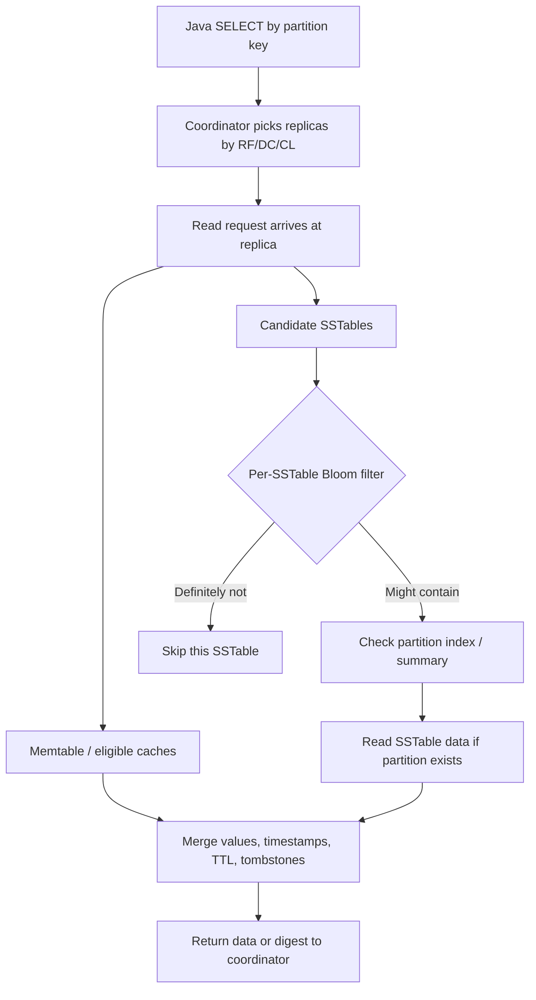
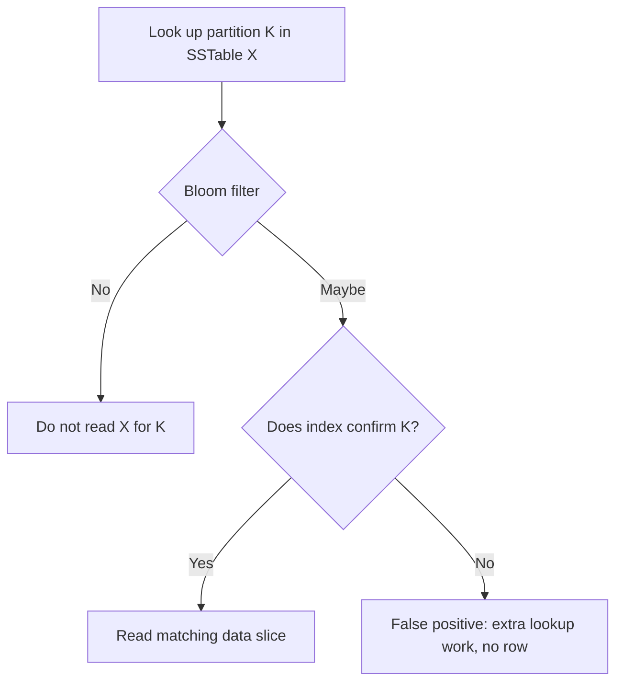
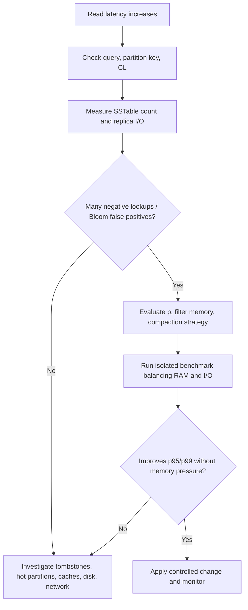

# Bloom Filters and What False Positives Mean

## 1. The Problem: One Partition May Span Many SSTables

Apache Cassandra uses an **LSM-tree**-like storage engine: mutations go into a memtable, and immutable SSTables are created on flush. Over time, a node can accumulate many SSTables, only a few of which contain data for the partition an application is querying.

For instance, a Java service needs to read an event from `sensor_events_by_day`:

```sql
SELECT event_time, event_id, reading
FROM telemetry.sensor_events_by_day
WHERE sensor_id = 'sensor-01'
  AND event_day = '2026-11-21'
LIMIT 20;
```

Assume the table's partition key is `(sensor_id, event_day)`. When the request reaches a replica, that node must determine which SSTables **might** contain that partition. Reading the index of every file—let alone the actual data—would generate heavy I/O.

**Bloom filters** solve part of this problem: as a probabilistic membership structure, they allow Cassandra to **quickly skip** SSTables guaranteed not to hold the target partition key. In return, the filter occasionally answers "might contain" for a partition that does not actually exist in that file. That case is a **false positive**.

In the **Read Path and Caching** chapter of the `DATABASE_ENGINE_WIDE_COLUMN_CASSANDRA` module, this topic connects local replica reads with partition key design, replication, CL, compaction, repair, performance monitoring, and the Java Driver.

**After this lesson, you should know:**

1. Which key a Bloom filter checks and where it sits in the read path.
2. How a bit array and hash functions yield "definitely not" or "might contain."
3. Why a false positive **never** causes Cassandra to return phantom rows.
4. How the false-positive rate affects read amplification, CPU, memory, and I/O.
5. How to read the `bloom_filter_fp_chance` option and `nodetool tablestats` metrics.
6. How to design experiments and evaluate config changes without harming a cluster.

> **Foundational conclusion:** A Bloom filter is an SSTable-access optimization—**not** a data source, not a business index, and not a substitute for consistency levels.

## 2. Where Do Bloom Filters Sit in Cassandra's Read Path?

A Cassandra query passes through two layers:

1. **Cluster layer:** the driver selects a coordinator; the coordinator determines natural replicas from the partition key's token and replication strategy; CL governs how many responses are needed.
2. **Replica layer:** each queried replica searches local memtables, caches, and SSTables, then merges versions, tombstones, and TTLs. Bloom filters assist **SSTable candidate selection** at this layer.



This diagram shows components and responsibilities; across Cassandra versions, caches, SSTable metadata, and other optimizations can change exact execution order. Never infer that every read always hits disk or checks every SSTable.

### What Object Is a Bloom Filter Attached To?

In Cassandra's traditional SSTable read path, a Bloom filter is built for **the partition keys contained within one SSTable**, not:

- One single Bloom filter for the entire cluster.
- A Bloom filter for deciding which node is a replica.
- An index containing arbitrary columns or `reading` values.
- A separate filter for every clustering row inside a partition.
- A mechanism to verify that data is repaired across replicas.

When a query supplies a composite partition key, such as `(sensor_id, event_day)`, Cassandra checks the **encoded partition key** as a whole; it does not test `sensor_id` and `event_day` independently.

### Can One Partition Have Versions in Multiple SSTables?

An SSTable stores data in immutable structures organized by partition/clustering keys. Mutations to the same partition at different times can land in **different SSTables** or the current memtable. Each SSTable's Bloom filter helps shortlist candidates; version merging is handled by the subsequent read-path stages.

## 3. How Bloom Filters Work with Bit Arrays and Hash Functions

Conceptually, a Bloom filter consists of:

- A **bit array** of `m` bits, initialized to 0.
- `k` hash/bit-address functions per key.
- On insert, set the `k` corresponding bit positions to 1.
- On lookup, check every bit position produced by hashing that key.

The Bloom filter does not need to store the full list of partition keys to answer membership queries. Because multiple keys share bits, the filter is memory-efficient, which is also why false positives occur.

### Tiny Illustration

Suppose we have a 16-bit array and two hash positions per partition key:

| Partition Key (Illustrative) | Bit Positions to Mark |
| --- | --- |
| `sensor-01 / 2026-11-21` | 2 and 9 |
| `sensor-02 / 2026-11-21` | 5 and 12 |

After inserting both keys, bits 2, 5, 9, and 12 equal 1:

```text
Index:      0  1  2  3  4  5  6  7  8  9 10 11 12 13 14 15
Bit:        0  0  1  0  0  1  0  0  0  1  0  0  1  0  0  0
```

Now suppose:

- Key `sensor-03 / 2026-11-21`, **never inserted**, hashes to positions **2 and 12**. Both bits are 1: the filter answers **"might contain,"** even though the key is absent. This is a **false positive**.
- Key `sensor-04 / 2026-11-21` hashes to positions **3 and 9**. Bit 3 is 0: the filter answers **"definitely not present"** in the represented key set.
- Key `sensor-01 / 2026-11-21` hashes to **2 and 9**, both 1: this is a **true positive**.

The bit positions above are purely illustrative, not real Cassandra hash outputs. Real Bloom filters use sizing and hashing schemes tailored to the SSTable's partition key count.

### Explaining the Asymmetry

If any required bit is 0, **the key was never inserted**: inserting a key sets all its mapped bits to 1. Conversely, if all mapped bits are 1, they might have been turned on by **other keys**. That is why a positive answer is only "might contain."

## 4. False Positives, True Positives, and False Negatives

For **one SSTable** and **one partition key**:

| Reality in SSTable | Bloom Filter Result | Term | Consequence |
| --- | --- | --- | --- |
| Partition key present | "Might contain" | **True positive** | Proceed to locate and read data as needed |
| Partition key absent | "Definitely not" | **True negative** | Safely skip the SSTable |
| Partition key absent | "Might contain" | **False positive** | Extra index/SSTable check discovers it is absent |
| Partition key present | "Definitely not" | **False negative** | **Does not occur** with a properly built and used Bloom filter under normal assumptions |

### Why Don't False Positives Corrupt SELECT Results?

A Bloom filter only decides **whether to check the SSTable further**. When the filter returns "might contain," Cassandra still checks the partition index, SSTable data, and verification steps to confirm whether the partition exists. If it does not exist, Cassandra does not fabricate a row.



**Do not confuse with "stale reads":** A stale result at CL `ONE` happens when a replica has not yet received a newer write. That is a replication/consistency issue—not a Bloom filter injecting old data.

### Conditions Behind "No False Negatives"

This property belongs to a **valid, intact Bloom filter**: every inserted key retains its marked bits. It does not mean storage hardware/filesystems are immune to corruption, nor does it mean one SSTable holds mutations written only to another replica.

If a read misses data due to corruption, lagged replication, or operational errors, never jump to blaming a Bloom filter false negative. Investigate each layer separately.

### "Partition Key Present" Does Not Guarantee "Visible Row"

An SSTable may contain a partition key while all relevant data is shadowed by tombstones, TTL-expired, outside the clustering slice, or filtered out by predicates. In that case, the Bloom filter produces a **true positive** even though `SELECT` returns zero rows. That is **not** a false positive with respect to partition-key membership.

## 5. Example: A Read Crossing Multiple SSTables

Suppose replica R has four SSTables containing different partitions, plus a memtable holding recent mutations:

| Local Source | Contains Target Partition `K`? | Bloom Filter for `K` | Next Step |
| --- | --- | --- | --- |
| Memtable | Yes | SSTable Bloom filter not used to skip memtable | Merge memtable data |
| SSTable-01 | Yes | True "might contain" | Read data at resolved offset |
| SSTable-02 | No | "Definitely not" | Skip |
| SSTable-03 | No | False "might contain" | Extra index probe; confirms `K` absent |
| SSTable-04 | Yes | True "might contain" | Read data, merge versions |

Here, the false positive on SSTable-03 **adds lookup work**, yet the logical result is still assembled accurately from the memtable, SSTable-01, and SSTable-04 after applying timestamps, tombstones, and TTLs.

### What Is the Exact Extra Cost?

When a false positive happens, the node may incur:

1. An extra lookup in the partition index or supporting index structures.
2. Access to metadata/file blocks if indexes/caches miss.
3. Extra CPU, memory, and I/O to verify that the partition is genuinely absent from that SSTable.

**Not every false positive costs one physical disk seek.** Partition indexes, key caches, OS page caches, and SSTable layouts mean real cost depends on workload and Cassandra version. Saying "10 false positives = 10 disk seeks" is an oversimplified example, not an operational law.

### What About Requests Touching Multiple Replicas?

Each replica maintains its own SSTable set and experiences its own observed false-positive rate. With `LOCAL_QUORUM`, the coordinator needs multiple replica responses; a replica slowed by excessive lookups can raise overall latency. **Bloom filters do not change the number of responses required by CL**, though they can affect how long a replica takes to build its data or digest response.

## 6. False Positives Are Probabilistic, Not a Per-Query Error Rate

A Bloom filter is configured with a target **false-positive probability**, denoted `p`. For example, `p = 0.01` targets roughly **1%** false positives on lookups for keys **not in the inserted set**, under proper sizing and load assumptions.

This does **not** mean:

- Exactly 1 out of every 100 `SELECT` queries returns wrong data.
- 1 out of every 100 returned rows is fabricated by Cassandra.
- Exactly 1% of all probes are always false positives regardless of key distribution.
- Every SSTable in a table exhibits the exact same live ratio at all times.

False-positive rate is defined over **negative probes against a filter**, not directly over CQL statement counts.

### Example Reading Across Many Negative Files

Suppose a read examines 40 SSTables, 30 of which **do not contain** the partition key. If their filters have roughly `p = 0.01`, the **approximate expected** number of false-positive probes is:

\[
E[\text{false-positive probes}] \approx N_{\text{negative SSTables}} \times p
=30\times 0.01=0.3.
\]

`0.3` is an **average over many similar lookups**, not one-third of an index probe or a per-query guarantee. Probes can be correlated; key skew, compaction policy, and cache state affect real outcomes.

If `p = 0.10`, the expected false-positive probes in this simple model rise to roughly `3`. That increase **can** degrade I/O and tail latency, particularly with many SSTables and cache misses.

### Do Not Infer False-Positive Ratio from One SELECT

Values from `nodetool tablestats` reflect Cassandra's internal counters over a specific scope and window. They do not necessarily equal configured `p` in a brief test; probe volume, writes, compaction, and partition distribution can cause observed ratios to diverge from the target.

## 7. Balancing Memory vs. False-Positive Probability

Bloom filters are not free. Allocating more bits per partition key generally lowers false-positive probability at the cost of more filter memory. Allocating fewer bits saves RAM but triggers more unnecessary index/SSTable checks when keys are absent.

In a standard Bloom filter with:

- `n`: number of inserted keys;
- `m`: number of bits;
- `k`: number of hash functions;

the false-positive probability is approximated by:

\[
p \approx \left(1-e^{-kn/m}\right)^k.
\]

Near the optimal number of hash functions:

\[
k_{\mathrm{opt}}\approx \frac{m}{n}\ln 2
\qquad\text{and}\qquad
\frac{m}{n}\approx-\frac{\ln p}{(\ln 2)^2}.
\]

These formulas illustrate the **fundamental Bloom filter trade-off**, rather than capturing every Cassandra implementation detail and storage overhead.

| Target Probability `p` | Approx. Bits / Partition Key (Ideal Model) | Trade-off |
| --- | ---: | --- |
| 10% (`0.10`) | 4.8 | Less memory, higher rate of unnecessary SSTable lookups |
| 1% (`0.01`) | 9.6 | Commonly cited balance point |
| 0.1% (`0.001`) | 14.4 | Higher memory footprint, fewer false positives |

For example, lowering target `p` from 1% to 0.1% increases ideal bits/key from ~9.6 to ~14.4—roughly **50% more** for the filter structure itself. That does not mean total node RAM or total latency changes by 50%; other caches, memtables, overheads, and workload mix also matter.

### Is "Lower `p` Is Always Better" True?

**No.** On a table that mostly reads partitions that always exist, Bloom filters mostly return true positives; lowering `p` saves very little negative-lookup overhead while consuming extra RAM. Conversely, with hundreds of SSTables and frequent queries for non-existent partition keys, a lower `p` can yield clear gains.

Decisions must weigh **latency, SSTable count, negative-lookup ratio, and memory budget**, not just whether "1%" looks small.

## 8. `bloom_filter_fp_chance` in Cassandra

Cassandra provides the `bloom_filter_fp_chance` table property to tune the target false-positive probability for SSTable Bloom filters, where supported by the version.

Example:

```sql
CREATE TABLE bloom_lab.events_by_device_day (
    device_id text,
    event_day date,
    event_time timestamp,
    event_id uuid,
    reading double,
    PRIMARY KEY ((device_id, event_day), event_time, event_id)
) WITH CLUSTERING ORDER BY (event_time DESC, event_id ASC)
  AND bloom_filter_fp_chance = 0.01;
```

For an existing table, alter it via DDL:

```sql
ALTER TABLE bloom_lab.events_by_device_day
WITH bloom_filter_fp_chance = 0.05;
```

These statements are **lab examples only**, not a recommendation to set `p = 0.05` in production. When altering table options:

- Cassandra updates a **schema option**; wait for schema agreement before treating the rollout as complete.
- Bloom filters on existing SSTables may **not be rebuilt immediately** merely because `ALTER TABLE` succeeded.
- Newly flushed or compacted SSTables use the updated setting at build time per the version's rules.
- Rewriting all older SSTables requires a resource-evaluated rewrite/compaction plan; **never** force a full compaction in production just to see counters change right away.
- Target `p` governs filter sizing; real-world impact depends on partitions per SSTable and query patterns.

### Defaults Are Not Immutable

Default `bloom_filter_fp_chance` values can depend on the compaction strategy and Cassandra version. Documentation across releases may specify different defaults for STCS, LCS, or TWCS. **Read the effective setting from cluster metadata** rather than assuming every Cassandra table defaults to `0.01`.

Check with:

```sql
SELECT table_name, bloom_filter_fp_chance, compaction
FROM system_schema.tables
WHERE keyspace_name = 'bloom_lab'
  AND table_name = 'events_by_device_day';
```

`DESCRIBE TABLE` in `cqlsh` is also useful for viewing table options. Remember `DESCRIBE` is a `cqlsh` utility, not a standard CQL query to pass verbatim through the Java Driver.

## 9. How Compaction and SSTable Counts Affect False Positives

Bloom filters are tied to individual SSTables. When a memtable flushes to a new SSTable, a corresponding filter is created for that file's partition keys. When compaction merges SSTables, it builds new SSTables with new filters matching their actual contents.

### Why Can Compaction Reduce "Extra Probes"?

Suppose a target partition resides in only one SSTable, while 60 other SSTables do not contain it. If a query checks filters across 61 files, each of the 60 negative files has probability `p` of producing a false positive.

After compaction, the number of candidate SSTables can drop substantially; thus the **opportunities for false positives** drop as well, even if `p` per filter stays unchanged. Still, the net effect depends on:

- How many resulting SSTables hold the partition key.
- New filter sizes and the query's negative-lookup ratio.
- Compaction strategy, levels/time windows, and file overlap.
- Cache hits, disk I/O, tombstones, and workload shifts.

### Do Not Mix Up "False-Positive Chance" and "SSTable Count"

| Metric | What It Describes | Typical Levers to Investigate |
| --- | --- | --- |
| `bloom_filter_fp_chance` | Target probability per SSTable Bloom filter | Memory budget vs. negative lookups |
| SSTables checked | Physical data fragmentation, compaction/index skipping | Compaction policy, workload shape, partition distribution |
| Observed false-positive ratio | Actual ratio over observed workload/interval | Query mix, file count, `p`, caches, and timing |
| Read latency | End-to-end request time including CL and local reads | I/O, CPU, network, tombstones, slow replicas, driver |

**Compaction is not cross-replica repair.** Compaction organizes data **within one node**; anti-entropy repair reconciles differences **across replicas**. Both are distinct from Bloom filters, which only prune SSTables during local reads.

## 10. How Bloom Filters Differ from Caches, Indexes, and Digest Reads

These concepts are easily conflated because all appear on the read path:

| Component | Question It Helps Answer | Scope |
| --- | --- | --- |
| **Bloom filter** | **Might** SSTable X contain partition key K? | Per SSTable on one replica |
| **Partition index/summary** | If the partition is in the SSTable, where is its offset/range? | Local SSTable |
| **Key cache** | Is part of the index/offset lookup cached to reduce I/O? | Node cache |
| **Row cache** | Can cached content be served without reading underlying storage? | Node/cache, per policy |
| **OS page cache** | Are data or index blocks already in OS RAM? | Node/OS |
| **Digest read** | Does read content at two replicas have matching checksums? | Cross-replica reconciliation by coordinator |
| **Secondary index** | Can partitions/rows be found by a non-primary-key column under supported rules? | Table index structure; execution varies by type/version |

### Frequent Confusion Pair: Bloom Filter vs. Digest

**Bloom filters** are built from partition keys to answer "could this file contain the key?" **Digests** are computed from query-matched read content to compare replicas. A digest mismatch can trigger full-data fetches, reconciliation, or read repair; a Bloom false positive only causes a wasted lookup on one SSTable.

Bloom filters **have no awareness of consistency levels**. Whether using `LOCAL_ONE` or `LOCAL_QUORUM`, each replica uses its own filters during local reads.

### Bloom Filters Do Not Support Arbitrary WHERE Predicates

For example, `events_by_device_day` has:

```sql
PRIMARY KEY ((device_id, event_day), event_time, event_id)
```

The filter checks **partition key `(device_id, event_day)`** in each SSTable; it does not filter rows by `reading > 30` or test whether a specific `event_time` exists. Clustering-column predicates are handled by indexes/slices/read-path structures; filters on non-primary-key columns may require an index or a different table model.

## 11. Safe CQL Lab: Observing Filters Without Forcing False Positives

This lab uses only the `bloom_lab` keyspace with synthetic data. Assume the lab node belongs to DC `datacenter1`. Verify first:

```bash
nodetool status
```

If your DC has a different name, substitute the exact name in the replication map. RF = 1 below is strictly for a single-node lab and does not provide production fault tolerance.

### Step 1 — Create Keyspace and Table

```sql
CREATE KEYSPACE IF NOT EXISTS bloom_lab
WITH replication = {
    'class': 'NetworkTopologyStrategy',
    'datacenter1': '1'
}
AND durable_writes = true;

CREATE TABLE IF NOT EXISTS bloom_lab.events_by_device_day (
    device_id text,
    event_day date,
    event_time timestamp,
    event_id uuid,
    reading double,
    PRIMARY KEY ((device_id, event_day), event_time, event_id)
) WITH CLUSTERING ORDER BY (event_time DESC, event_id ASC)
  AND bloom_filter_fp_chance = 0.01
  AND comment = 'Bloom filter teaching lab, disposable data';
```

`IF NOT EXISTS` does **not** verify existing definitions; if a keyspace/table with the same name already exists, check RF, primary key, and table options before writing.

### Step 2 — Inspect Actual Metadata

```sql
SELECT keyspace_name, replication
FROM system_schema.keyspaces
WHERE keyspace_name = 'bloom_lab';

SELECT table_name, bloom_filter_fp_chance, compaction
FROM system_schema.tables
WHERE keyspace_name = 'bloom_lab'
  AND table_name = 'events_by_device_day';

SELECT column_name, kind, position, type
FROM system_schema.columns
WHERE keyspace_name = 'bloom_lab'
  AND table_name = 'events_by_device_day';
```

Both `device_id` and `event_day` must appear as partition key components, with `event_time`/`event_id` as clustering columns. Proceed only once names and types match.

### Step 3 — Insert a Few Small Partitions

```sql
INSERT INTO bloom_lab.events_by_device_day (
    device_id, event_day, event_time, event_id, reading
) VALUES (
    'sensor-01', '2026-11-21',
    '2026-11-21T08:00:00Z',
    aaaaaaaa-aaaa-4aaa-8aaa-aaaaaaaaaaaa,
    27.5
);

INSERT INTO bloom_lab.events_by_device_day (
    device_id, event_day, event_time, event_id, reading
) VALUES (
    'sensor-02', '2026-11-21',
    '2026-11-21T08:00:00Z',
    bbbbbbbb-bbbb-4bbb-8bbb-bbbbbbbbbbbb,
    30.2
);
```

### Step 4 — Read Present and Absent Keys

```sql
-- Existing partition.
SELECT event_time, reading
FROM bloom_lab.events_by_device_day
WHERE device_id = 'sensor-01'
  AND event_day = '2026-11-21';

-- Partition not written in the example.
SELECT event_time, reading
FROM bloom_lab.events_by_device_day
WHERE device_id = 'sensor-99'
  AND event_day = '2026-11-21';
```

The second query is expected to return **zero rows**. It does not prove a false positive happened: most negative lookups are cleanly rejected by Bloom filters, and unflushed data may still sit in the memtable rather than SSTables.

### Step 5 — View Table Statistics

On the lab node, run:

```bash
nodetool tablestats bloom_lab
```

Depending on version, output may list metrics such as:

- **Bloom filter false positives:** counter of false-positive probes.
- **Bloom filter false ratio:** observed false-positive ratio per tool definition.
- **Bloom filter space used:** memory consumed by Bloom filters.
- **SSTable count / live SSTables**, along with related cache/latency metrics.

Output labels and metric collection vary by version. With **very little data**, there may be insufficient samples, no flushed SSTables yet, and false positives equal to 0. That is expected—**not a lab failure**.

### Step 6 — Do Not Force Cluster Changes Just to Increment Counters

There is no need to shut down nodes, corrupt data, trigger heavy full compactions, or generate millions of rows just to prove a probabilistic structure works. If you need to measure real differences, build an **isolated benchmark** with sufficient data and SSTables for stable ratios, tracking the metrics in Section 13.

### Step 7 — Clean Up the Lab Keyspace When Done

```sql
-- Run only when bloom_lab is a test keyspace safe to drop completely.
DROP KEYSPACE IF EXISTS bloom_lab;
```

`DROP KEYSPACE` deletes all tables and data in the keyspace. Never substitute a production keyspace or data belonging to another team.

## 12. Lab on Changing `p`: Observe Metadata Without Expecting Instant Impact

If `bloom_lab.events_by_device_day` is still present in your lab, try:

```sql
ALTER TABLE bloom_lab.events_by_device_day
WITH bloom_filter_fp_chance = 0.05;
```

After schema agreement:

```sql
SELECT table_name, bloom_filter_fp_chance
FROM system_schema.tables
WHERE keyspace_name = 'bloom_lab'
  AND table_name = 'events_by_device_day';
```

**Guaranteed expectation at the metadata layer:** once DDL applies, the live schema shows `0.05`. **Do not expect immediate performance changes:** existing SSTables may keep their old Bloom filters until rewritten.

### Comparing `0.01` vs. `0.05` Conceptually

| Setting | Statistical Meaning | Theoretical Impact |
| --- | --- | --- |
| `0.01` | Roughly 1% of negative probes may false-positive under target model | Larger filter, fewer wasted lookups |
| `0.05` | Roughly 5% of negative probes may false-positive under target model | Smaller filter, more wasted lookups |

These are **directional trade-offs**, not measured cluster benchmarks. Do not assume raising `p` fivefold makes read latency five times worse; reads hitting existing partitions, cache hits, and network/CL overhead may dominate.

### A Controlled Comparison Method

1. Keep schema/partition keys, sample data, request types, and CL identical.
2. Prepare equivalent datasets/SSTables in an isolated benchmark environment or normalized test runs.
3. Keep compaction state, heap, disk, warm/cold cache, and traffic as consistent as possible.
4. Observe Bloom false positives/ratio, filter space used, p50/p95/p99 read latency, disk I/O, and SSTable counts.
5. Separate reads for **existing** partitions from reads for **non-existent** partitions.
6. Run long enough for a statistically reliable sample and record the exact Cassandra version.

This is a benchmark design guide, **not a requirement to run a load test in STEP_4**.

## 13. Production Monitoring: Which Metrics Signal Bloom Filter Tuning?

A common symptom: read latency climbs and SSTable count on a node is high. If the Bloom false-positive ratio also rises, you may be paying for unnecessary negative lookups. Still, check the whole picture:

| Metric | What It Suggests | What Else to Verify |
| --- | --- | --- |
| Bloom filter false positives | Count of "might contain" hits where the key was absent | Negative lookup volume, SSTable count, measurement window |
| Bloom filter false ratio | Filter efficiency under observed workload | Version metric definition; sample size, old vs. new filters |
| Bloom filter space used | Memory cost of filters | Heap/off-heap usage, other caches, memory pressure |
| SSTable count / files read | Local data fragmentation/overlap | Compaction strategy, backlog, workload |
| Read latency p95/p99 | Client/coordinator tail latency experience | I/O, CPU, CL, tombstones, network, GC |
| Cache hit/miss | Whether indexes/data are served from memory | Cold/warm cache, memory pressure |
| Disk read IOPS / latency | Random I/O saturation or slow storage? | Storage saturation, OS cache, compaction |
| Tombstones scanned | Many deleted or TTL-expired records? | TTL, `DELETE`, partition design, repair |

### Diagnostic Workflow



Never conclude "false positives are causing data errors" from this metric. False positives **only affect SSTable access performance**; if clients see stale or missing data, investigate replication, CL, repair, timestamps/tombstones, and application logic separately.

### Does Read Repair Relate to Bloom Filters?

If the coordinator reads multiple replicas and gets a digest mismatch, it fetches extra full data to reconcile/read-repair. Those additional requests use the local read path, so Bloom filters affect their **execution cost**. However, a Bloom false positive **never triggers a digest mismatch**: the two mechanisms test completely different things.

## 14. Java Driver 4.x: Querying Present and Absent Partitions

The Java Driver does not expose a flag like "Bloom filter hit a false positive for this query" on `Row` objects. Bloom filter checks happen internally on replicas; the client sees logical rows, latency, and driver-supported request diagnostics.

Example using Cassandra Java Driver 4.x and Java 15+ text blocks. Assume `CqlSession session` is initialized for the cluster and local DC, and `bloom_lab` still exists.

```java
import com.datastax.oss.driver.api.core.CqlSession;
import com.datastax.oss.driver.api.core.DefaultConsistencyLevel;
import com.datastax.oss.driver.api.core.cql.BoundStatement;
import com.datastax.oss.driver.api.core.cql.PreparedStatement;
import com.datastax.oss.driver.api.core.cql.Row;

import java.time.LocalDate;

// session is created and its lifecycle is managed outside this example.
PreparedStatement select = session.prepare("""
    SELECT event_time, event_id, reading
    FROM bloom_lab.events_by_device_day
    WHERE device_id = ? AND event_day = ?
    """);

LocalDate day = LocalDate.of(2026, 11, 21);

// Key present in lab data.
BoundStatement existing = select.bind("sensor-01", day)
    .setConsistencyLevel(DefaultConsistencyLevel.LOCAL_ONE);

for (Row row : session.execute(existing)) {
    System.out.println(row.getDouble("reading"));
}

// Unwritten key: result will be empty even if a filter hits a false positive.
BoundStatement missing = select.bind("sensor-99", day)
    .setConsistencyLevel(DefaultConsistencyLevel.LOCAL_ONE);

Row missingRow = session.execute(missing).one();
if (missingRow == null) {
    System.out.println("No matching partition/row in read result");
}
```

**Observation:** Even if an SSTable produces a Bloom false positive for `sensor-99`, Cassandra verifies the index and never fabricates a row. In Java, `missingRow` remains `null` if no matching data exists; a false positive only makes the request take slightly longer.

### Proper Query Configuration Usually Matters More Than Prematurely Tuning `p`

- Bind the full **composite partition key** so queries target a single partition.
- Use prepared statements and avoid building dynamic queries with arbitrary identifiers.
- Choose CL (`LOCAL_ONE`/`LOCAL_QUORUM`, etc.) by RF/DC and freshness requirements, not by Bloom filter settings.
- Bound result sizes, paging, and clustering ranges appropriately.
- Track latency/errors from the driver, correlating with `nodetool tablestats` and server metrics to find local bottlenecks.

To measure Bloom filters, use **server-side** tooling. Never write infinite retry loops in Java just because a lookup for a non-existent key is slow.

## 15. Real-World Scenario: Feeling Like Bloom Filters "Aren't Working"

A log table has dozens of SSTables, many queries look up non-existent devices, and read latency is high. An engineer sees `bloom_filter_fp_chance = 0.01`, yet `nodetool tablestats` reports a large absolute count of false positives.

### Why Is There No Contradiction?

1. **Huge probe volume:** 1% of millions of negative probes is still a large number.
2. **Many SSTables:** one read can perform many Bloom checks, not just one.
3. **Workload shift:** the ratio of non-existent keys and partition distribution may differ from initial design assumptions.
4. **Mixed SSTable generations:** changing `bloom_filter_fp_chance` does not automatically rewrite all legacy SSTables.
5. **Metric scope:** cumulative counters vs. ratios may span different intervals or sample sets; interpret per your version's docs.

### Optimization Steps in Order

- Inspect partition keys and query shapes to prevent unintended scans.
- Measure SSTable count, compaction backlog, data size, and tombstones.
- Correlate Bloom false positives **together with** probe volume, ratio, and disk I/O.
- Check cache hit rates and memory pressure before lowering `p`.
- Benchmark the `p` trade-off on an equivalent workload; do not blindly lower it table-wide just because an absolute FP count looks large.
- Verify impact after natural compaction or planned rewrites, instead of expecting a schema change to alter every old filter instantly.

**A plausible outcome:** a lower `p` reduces index lookups but uses more RAM, evicts OS page cache, and actually worsens latency. That is why tuning decisions must rely on **whole-system** measurements rather than Bloom filter theory alone.

## 16. Self-Check Exercises and Checklist

### Exercise A — Understanding "Might Contain"

SSTable X's filter says "might contain K"; the partition index shows X does **not** contain K. What is this case? Does the client `SELECT` receive a row for K from X?

**Answer:** A false positive. Cassandra performs extra verification work but does not return a non-existent row.

### Exercise B — Looking for False Negatives

Assuming a filter was built properly from all partition keys in an SSTable, can the filter answer "definitely not" for a partition key that actually exists in that SSTable?

**Answer:** No. Absence of false negatives is a core property of a properly functioning Bloom filter. Any missing-data bugs from corruption or replication must be investigated separately.

### Exercise C — True Positive vs. Returned Rows

SSTable X contains partition K, but all remaining cells are shadowed by newer tombstones. The filter returns "might contain" and `SELECT` returns zero rows. Is this a false positive?

**Answer:** No. The filter accurately detected **the presence of the partition key in the SSTable**, while the CQL output depends on tombstones, TTLs, and other data sources.

### Exercise D — Approximate Trade-Off Math

A read checks 50 SSTables that **do not contain** the target partition. With target `p` = 1%, what is the expected number of false-positive probes in the simple model?

**Answer:** Approximately `50 × 0.01 = 0.5` probes. This is an expectation over many trials, not strictly 0.5 I/O operations on every single read.

### Exercise E — Changing `p` and Measuring Immediately

You change `bloom_filter_fp_chance` from `0.05` to `0.01`, and five minutes later see no change in I/O metrics. Can you conclude the DDL failed?

**Answer:** Not yet. Check `system_schema.tables` and schema agreement to verify the option; Bloom filters on existing SSTables may not have been rebuilt yet. Also, the workload might not be sensitive to false positives.

### Exercise F — Bloom Filters and Consistency

`LOCAL_QUORUM` is slower than `LOCAL_ONE` at RF = 3. Is a Bloom filter false positive definitely the cause?

**Answer:** No. Higher CL requires more replica responses; latency may come from network, I/O/tombstones, compaction, GC, or a slow replica. Bloom filters are only one piece of the local read path; measure before concluding.

### Checklist When Evaluating Bloom Filters

| Question | Evidence |
| --- | --- |
| Does the query include the full partition key? | CQL `WHERE`, `PRIMARY KEY`, and Java bindings |
| Which SSTables' filters are being checked? | Local read path and candidate SSTable count |
| Are false positives distinguished from `SELECT` rows? | Bloom filters only say "might contain"; indexes verify |
| What is the current configured `p`? | `system_schema.tables.bloom_filter_fp_chance` |
| Were SSTables built under the same config generation? | DDL history, flush/compaction, and file state |
| Does the observed false-positive ratio have enough samples? | `nodetool tablestats`/metrics over time |
| Are numerous SSTables causing read amplification? | SSTable count, compaction/backlog, I/O |
| Does filter memory impact other caches? | Filter space, memory pressure, cache hit rates |
| Are CL/RF/DC dominating latency? | Driver CL, replication policy, node/replica health |
| Benchmarked on an equivalent workload? | Query mix, missing-key ratio, warm/cold cache, p95/p99 |
| Is there a rollback plan if changing `p` hurts? | DDL migration, post-rewrite monitoring, alert thresholds |

**Key takeaway:** A Bloom filter is a probabilistic structure used to **skip SSTables guaranteed not to hold a partition key**. "Might contain" occasionally produces a **false positive**, causing Cassandra extra verification work without **ever fabricating rows**. Lowering `bloom_filter_fp_chance` can reduce negative-lookup I/O at the expense of higher memory usage; real-world gains depend on SSTable count, compaction, caches, queries, and CL. In distributed Cassandra, always separate **replica selection/consistency** from **local Bloom-filter read optimization**, making decisions from metadata and metrics rather than guessing from `p` alone.
