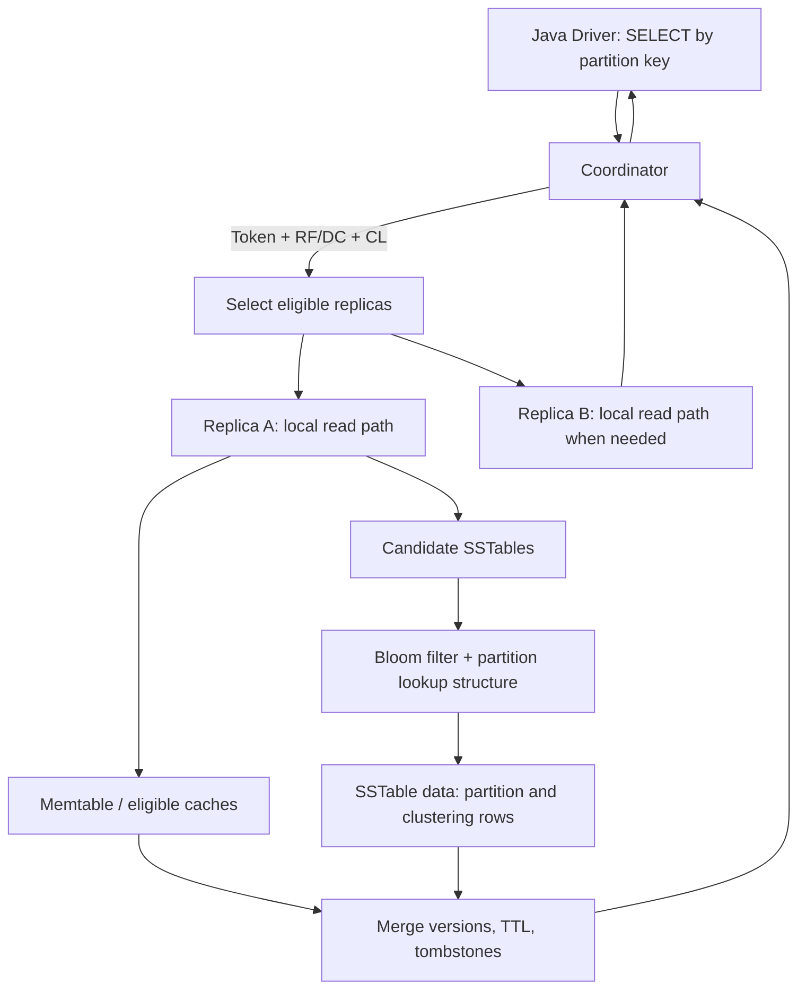
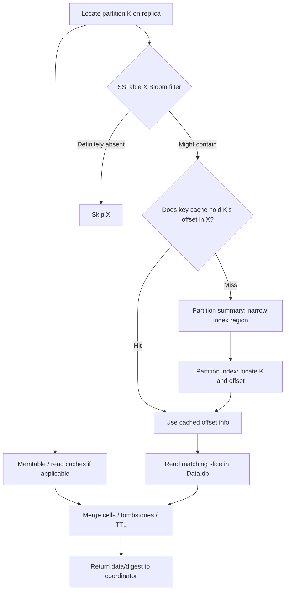

# Partition Index, Key Cache, and SSTable-Format Equivalents

## 1. The Problem: How to Locate a Partition in an SSTable Without Scanning the Whole File?

Apache Cassandra stores data in a distributed wide-column model. When a Java application sends a `SELECT` with a partition key, the coordinator identifies the replicas responsible for that partition. Next, **each replica** must locate the data in memory and across one or more immutable **SSTables** on disk.

A single SSTable can contain huge numbers of partitions. If every single-key read had to scan the entire contents of every SSTable, read latency would explode with file count and data size. Cassandra therefore uses structures for **partition lookup** and **skipping irrelevant files**:

- **Bloom filter:** eliminates SSTables guaranteed not to contain the partition key; a "might contain" answer must be checked further.
- **Partition index:** locates a partition's offset within SSTable data.
- **Partition summary:** in applicable formats, stores sampled index entries to narrow the search window.
- **Key cache:** on supported read paths/formats, caches previously resolved lookup offsets to avoid repeating index scans.
- **Trie index mechanisms:** newer SSTable formats can replace the traditional partition summary/index path with alternative lookup structures.

In the **Read Path and Caching** chapter of the `DATABASE_ENGINE_WIDE_COLUMN_CASSANDRA` module, this lesson links **query-driven partition key design**, LSM-trees, SSTables, caches, compaction, replication/consistency levels, repair, and Java Driver practice.

**Learning objectives:**

1. Distinguish selecting *replicas* from locating a *partition inside an SSTable*.
2. Explain the **Big** SSTable lookup path using Bloom filters, key cache, partition summary, and partition index.
3. Recognize why that path **does not apply verbatim** to every format, especially trie-indexed formats like **Bti**.
4. Understand key-cache hits/misses, flush/compaction effects, and differences from row cache and OS page cache.
5. Use CQL metadata, `nodetool`, and the Java Driver to observe performance without mistaking cache hits for data consistency.

> **Key point:** a partition index answers **"where does partition K sit inside this SSTable?"**. Key cache, when used, avoids repeating that lookup work. Neither verifies the newest cell version, selects replicas, nor replaces consistency levels.

## 2. Two Very Different Lookup Phases

Reading data involves at least two distinct lookup phases:

| Phase | Question | Deciding Information |
| --- | --- | --- |
| **Distributed routing** | Which replicas own partition K? | Partition key → token; replication strategy, RF/DC, and topology |
| **Local lookup** | On replica R, which SSTables might hold K, and where is K inside each file? | Memtable/caches, Bloom filter, partition index or trie index, SSTable data |



The diagram is a conceptual model. Cassandra may apply varying internal optimizations; not every request queries two replicas or touches disk.

### Composite Partition Key Example

Suppose a table is defined as:

```sql
CREATE TABLE example_ks.events_by_device_day (
    device_id text,
    event_day date,
    event_time timestamp,
    event_id uuid,
    temperature double,
    PRIMARY KEY ((device_id, event_day), event_time, event_id)
);
```

The partition key is **both columns** `(device_id, event_day)`. When querying:

```sql
SELECT event_time, event_id, temperature
FROM example_ks.events_by_device_day
WHERE device_id = 'sensor-01'
  AND event_day = '2026-11-21';
```

Cassandra computes a token from the encoded partition key to select natural replicas. Inside each relevant SSTable, the lookup structures also search by the **complete partition key**. Supplying `device_id` without `event_day` is not the same single-partition lookup.

## 3. An SSTable Is a Set of Components, Not One Simple File

An SSTable holds immutable data produced when a **memtable flushes** or **compaction** rewrites files. In traditional **Big**-style formats, an SSTable typically consists of separate logical/physical components for data, indexes, Bloom filters, metadata, and compression.

| Common Big-Format Component | Conceptual Role | What to Remember |
| --- | --- | --- |
| `Data.db` | Stores encoded partition data and rows/cells | Final data is read from here when needed |
| `Index.db` | Partition index: maps partition keys to data offsets | Not synonymous with a column secondary index |
| `Summary.db` | Partition summary used to quickly jump into an index range | Usually a sampled/sparse representation, not every row |
| `Filter.db` | Bloom filter of partition keys in the SSTable | Can have false positives; no false negatives under proper conditions |
| `Statistics.db` and related metadata | Statistics, configuration, SSTable metadata | Supports reading, maintenance, and file management |
| `CompressionInfo.db` when applicable | Metadata for locating/decompressing compressed chunks | Not a memory cache |

This list **illustrates the Big format only**. Component names, which files are always present, on-disk layout, and index structures **depend on Cassandra version, SSTable format, and configuration**. Never build operational tooling assuming every cluster has those exact filenames.

### Partition Index vs. Secondary Index

- **SSTable partition index:** a local storage structure for locating a partition key already stored in that file.
- **Secondary index / SAI:** a query feature for filtering on non-partition-key columns. It maintains separate index logic and data structures; never confuse it with `Index.db`.

A table **with zero secondary indexes** still needs a partition lookup structure when reading SSTables. Conversely, adding a secondary index does not eliminate the need to locate and read actual partition data.

## 4. Lookup Path in the Big Format: From Bloom Filter to Data.db

Consider a replica with immutable SSTables. Under the **Big format** and a query for partition key K, the steps are commonly described as:

1. The read path checks the memtable and relevant data sources/caches.
2. For candidate SSTables, Bloom filters prune files guaranteed not to contain K.
3. If K might be in an SSTable, the node may consult the **key cache** for its offset information.
4. On a key-cache miss, the **partition summary** narrows the search to a small region of the **partition index**.
5. The partition index gives the partition's offset in the SSTable data.
6. The node reads the required data/rows/clustering slice from `Data.db`, going through decompression and the OS page cache as needed.
7. The replica merges local sources and applies timestamps, tombstones, and TTLs before returning a data or digest response.



This is a **path describing traditional mechanics**, not a rigid API contract or guaranteed execution order across all releases. Some SSTables can be skipped due to clustering predicates, other metadata, or cache hits; newer formats use different index structures.

### Why Isn't the Bloom Filter Enough?

A Bloom filter only gives two answers:

- **"Definitely does not contain K"**: skip the SSTable.
- **"Might contain K"**: must check the index/read further to verify.

A Bloom false positive makes Cassandra probe the partition index only to learn K is absent from that SSTable. No phantom row is produced. Bloom filters avoid **unnecessary index lookups**, but they do not store real file offsets.

### Why Isn't the Partition Index Enough to Return a Result?

The partition index locates the partition's **offset**; column values still live in SSTable data, and other versions may live in the memtable or other SSTables. On read, the engine must resolve cell timestamps, TTLs, and tombstones. Even a partition present in the index may have zero **visible** rows matching the query.

## 5. Partition Index: Mapping Partition Keys to Data Offsets

In the traditional Big model, the partition index holds sorted entries for finding partition keys inside an SSTable. Each entry points to the start of the partition's data or the lookup metadata needed to reach it.

Illustrative example:

| Encoded Partition Key (Illustrative) | Data Offset (Illustrative) |
| --- | ---: |
| `(sensor-01, 2026-11-20)` | 0 |
| `(sensor-01, 2026-11-21)` | 4096 |
| `(sensor-02, 2026-11-21)` | 14336 |
| `(sensor-05, 2026-11-21)` | 24576 |

These offset numbers are purely explanatory; they are not real Cassandra internals and you **cannot** pass an offset to CQL `SELECT`. Real SSTables use format-specific key encodings, token ordering, and auxiliary structures.

### Finding a Partition vs. Finding a Clustering Row

With `PRIMARY KEY ((device_id, event_day), event_time, event_id)`:

- The **partition index** brings the reader to **partition** `(device_id, event_day)` in the SSTable.
- Once at the partition, fetching an `event_time` range or newest rows requires navigating **clustering rows** and intra-partition lookup structures.

Big-style formats may use **promoted index / row index** entries for wide partitions; trie-indexed formats organize them differently. Never treat the partition index as a standalone index for individual `event_time` or `temperature` values.

### Impact of Large Partitions

If a partition holds millions of clustering rows, finding the partition's offset is only step one. Cassandra still must locate the slice and merge matching data. Even with a 100% key-cache hit rate, a wide read on an oversized partition can still be slow.

That is why **query-driven partition keys and bucketing** matter more than blindly enlarging caches.

## 6. Partition Summary: Shrinking the Index Search Window

When a partition index grows large, scanning the whole index on every lookup would also cost I/O. In traditional Big formats, the **partition summary** stores sampled/sparse references into the index to jump straight to the **index interval** containing the target partition key.

Illustration where the index holds many keys while the summary stores samples:

```text
Partition index (full, illustrative):
  K001 K002 K003 K004 K005 K006 K007 K008 K009 K010 K011 K012 ...

Partition summary (sampled):
  K001 --------- K005 --------- K009 --------- ...

Finding K007:
  summary narrows down the range between K005 and K009
  -> scan smaller range in partition index
  -> verify K007 and its data offset
```

In practice, not every partition key is kept in the summary; sampling intervals and memory residency depend on format, configuration, and Cassandra's index summary management.

### Summary vs. Bloom Filter

| Attribute | Bloom Filter | Partition Summary |
| --- | --- | --- |
| Question | **Might** this SSTable contain K? | In **which region of the partition index** should we search for K? |
| Negative outcome | Can skip the SSTable entirely | Does not replace existence verification |
| False positives? | Yes | Not a Bloom-style probabilistic membership filter |
| Role | Eliminates lookups | Speeds up required index lookups |
| Target | SSTable partition keys | Sampled positions of the partition index in supported formats |

**Not every SSTable format has a partition summary of this exact kind.** For example, trie-indexed lookup paths can eliminate the need for a traditional `Summary.db` structure.

## 7. Key Cache: Saving Lookup Work, Not Caching Whole Rows

In the traditional read path, the **key cache** stores lookup metadata to quickly locate a partition key's position/index entry within **a specific SSTable**. For repeated reads against the same hot partitions, a cache hit bypasses part of the partition summary/index traversal.

Important points:

- **Cache keys are scoped to an SSTable context**, not a permanent global map from `order_id` to an offset across all versions.
- **Cached values are location metadata**, not full columns like `order_status` or `total_amount`.
- A partition can appear in multiple SSTables; each relevant SSTable must still be checked to merge versions.
- Flush/compaction creates new SSTables with different indexes/offsets; cache entries for old SSTables do not transfer to new files.
- A cache miss is not an error: Cassandra simply falls back to the format's index structure.
- Actual benefit depends on version, SSTable format, and the table's `caching` policy.

### Hit and Miss Scenarios

| Scenario | Typical Behavior in a Key-Cache-Supported Format |
| --- | --- |
| First read of K on SSTable X | Likely miss; traverses partition summary/index, then may cache the location info |
| Subsequent read of K while entry is resident | Likely hit; reduces index lookup work |
| SSTable X is compacted into SSTable Y | Offsets/descriptors change; requires fresh lookup or entry for Y |
| K is in memtable, absent from SSTable X | Bloom filter may skip X; X's key cache is not needed |
| K is in SSTable, but all cells are expired/deleted | Key-cache hit does not turn invisible data back into live rows |

### A Key-Cache Hit Does Not Mean Latest Data

If a newer write for K sits in the memtable or on another replica, the cached offset in an older SSTable **knows nothing about that newer write**. The read path must still merge all required local sources, and the coordinator must still satisfy CL.

A node with a **high key-cache hit rate** can still return stale data at `ONE` if the replica missed a recent write. That is a replication/consistency issue, not the key cache "routing wrongly."

## 8. Different SSTable Formats: Big vs. Trie-Indexed Bti

**Do not teach partition summary + `Index.db` + key cache as an immutable algorithm for every Cassandra release.**

Modern Cassandra versions can support multiple **SSTable formats**. A notable example is **Bti (trie-indexed SSTable)** introduced in Cassandra 5.x, which uses trie structures to locate partitions and intra-partition positions. This changes the index traversal path relative to the traditional Big model.

| Aspect | Traditional Big Path | Trie-Indexed / Bti Path |
| --- | --- | --- |
| Locating partition | Partition index, typically paired with partition summary | Trie-based index structure |
| Locating clustering rows | Internal Big-format index/promoted metadata | Trie-indexed row index structures |
| Illustrative filenames | `Index.db`, `Summary.db` alongside `Data.db` | Index components such as `Partitions.db`/`Rows.db`; exact names depend on version |
| Role of key cache | Helps avoid repeated index lookups | Do not assume identical cache interaction as Big; trie access has different cost/paths |
| What stays unchanged | Partition key, token/RF, CL, logical data semantics | Replica/CL requirements and data correctness guarantees remain identical |

**Always verify the exact Cassandra version and SSTable format in use.** Files from multiple generations/formats may coexist during upgrades. The presence or absence of a traditional filename is not proof that Cassandra "has no index."

### Why Can Trie Indexes Help?

Tries use prefix/key-path structures for search. With proper design, they can reduce lookup steps and memory overhead compared to legacy summary + partition index paths, and navigate inside partitions using matching structures.

This does **not** mean:

- Bti makes every query faster regardless of workload.
- Bloom filters or all other helper structures are obsolete.
- `Data.db` no longer needs to be read.
- Memtable/SSTable merging, tombstones, and TTLs go away.
- Choosing an SSTable format raises RF or alters consistency levels.

Format changes affect compaction, storage, and version compatibility; follow target-version upgrade/benchmark procedures rather than switching production formats based on a lesson example.

### Rule When Reading Docs or Interpreting Metrics

If older documentation describes *partition summary hits/misses* or *key cache hits* under Big while your newer cluster runs trie-indexed SSTables, do not force every observation into one diagram. Check:

1. The Cassandra release and configured/supported SSTable format.
2. Which format existing SSTables were actually written in.
3. Which index/cache metrics genuinely exist in that release.
4. Empirical performance measurements rather than assumptions about a data structure.

## 9. Locating a Partition vs. Locating a Clustering Slice Are Two Separate Steps

In wide-column Cassandra, the **partition key** determines data grouping; **clustering keys** determine ordering within the partition.

Example:

```sql
PRIMARY KEY ((device_id, event_day), event_time, event_id)
```

A query reading one partition and a time range:

```sql
SELECT event_time, event_id, temperature
FROM example_ks.events_by_device_day
WHERE device_id = 'sensor-01'
  AND event_day = '2026-11-21'
  AND event_time >= '2026-11-21T08:00:00Z'
  AND event_time < '2026-11-21T09:00:00Z';
```

Two search levels:

1. Locate partition `(sensor-01, 2026-11-21)` across local sources.
2. Inside the partition, locate clustering rows within the `event_time` interval, then read required columns and reconcile data.

**Partition-level key caching does not make clustering scans free.** For very wide partitions, format-specific row/clustering indexes, physical layout, and slice width heavily impact latency.

### LIMIT Still Does Not Guarantee Reading Only N Rows

If leading rows are eliminated by tombstones or expired TTLs, Cassandra may need to inspect more rows to return `LIMIT` valid results. Across multiple replicas, divergence can trigger extra fetches or short-read protection. Good indexing solves **locating**, not reconciliation cost.

## 10. How Key Cache, Row Cache, Bloom Filter, and OS Page Cache Differ

| Mechanism | What It Caches / Checks | Unit / Intended Benefit |
| --- | --- | --- |
| **Bloom filter** | Probabilistic test of whether a partition key is in an SSTable | Prunes irrelevant files; can false-positive |
| **Partition index / trie index** | Structure pointing to partition data locations | SSTable index lookup |
| **Partition summary** | Sampled positions to jump into index ranges faster | Accelerates index lookup in supported formats |
| **Key cache** | Partition index/location metadata within an SSTable where supported | Reduces repeated lookup work |
| **Row cache** | Row/partition representations per policy | Can avoid part of underlying data reads |
| **OS page cache** | Index or data file blocks resident in OS RAM | Reduces physical disk I/O |
| **Memtable** | Unflushed mutations; live data on the read path | Not an SSTable cache |

### An Example Not to Conflate

First read of K: Bloom filter says "maybe"; key cache misses; index lookup runs; `Data.db` holds data. Second read: key cache hits, and OS page cache is warm too. Lower latency likely comes from **multiple layers acting together**.

Never credit 100% of a speedup to the key cache merely because its hit rate rose. For real performance analysis, track cache metrics, SSTables read per query, disk I/O, and replica/coordinator latencies together.

## 11. Configuring and Inspecting `caching` in CQL

Cassandra supports the **`caching` table option** for key-cache/row-cache policies in applicable versions. Common syntax example:

```sql
CREATE TABLE index_lab.events_by_device_day (
    device_id text,
    event_day date,
    event_time timestamp,
    event_id uuid,
    temperature double,
    PRIMARY KEY ((device_id, event_day), event_time, event_id)
) WITH CLUSTERING ORDER BY (event_time DESC, event_id ASC)
  AND caching = {'keys': 'ALL', 'rows_per_partition': 'NONE'};
```

This is a table creation template; `index_lab` must exist first. In the example:

- `keys = 'ALL'` enables key caching per supporting configuration and format.
- `rows_per_partition = 'NONE'` disables row caching for rows of this table.
- It does **not** mean Cassandra instantly pins every partition key in RAM without limits.
- Actual cache residency is governed by node configuration, eviction, load, and version/format.

To change the option on a **lab table**:

```sql
ALTER TABLE index_lab.events_by_device_day
WITH caching = {'keys': 'NONE', 'rows_per_partition': 'NONE'};
```

Never alter this setting on a production table just to test a hypothesis. After DDL, verify **schema agreement**, metadata, and workload impact. On trie-indexed formats, do not assume the same `caching.keys` setting produces the exact same index-lookup effect as on Big.

### Table Policy vs. Node Cache Memory Budget

- **Table option** `caching` declares the caching policy for that table.
- **Server configuration** (such as key-cache capacity limits; setting names vary by release) bounds node-wide memory budgets.
- **Runtime metrics** show entry counts, hits/misses, and effectiveness over time.

Setting `keys='ALL'` does not command Cassandra to preload all index entries into RAM immediately. Under tight memory, competing caches, and heavy I/O, hit rates can still remain low.

### Inspecting Actual Table Definitions

```sql
SELECT table_name, caching, compaction, compression
FROM system_schema.tables
WHERE keyspace_name = 'index_lab'
  AND table_name = 'events_by_device_day';
```

`system_schema.tables` shows the configured option, **not** runtime key-cache hit rates. Keep schema correctness separate from runtime performance.

## 12. CQL Lab: One Partition, Multiple Clustering Rows

**Prerequisites:** use a dedicated lab cluster. Examples assume one node in DC `datacenter1`; if `nodetool status` reports a different name, substitute it accurately in the replication map. RF = 1 is strictly for a single-node lab and provides no production fault tolerance.

### Step 1 — Verify Node and DC

```bash
nodetool status
```

### Step 2 — Create Keyspace and Test Table

```sql
CREATE KEYSPACE IF NOT EXISTS index_lab
WITH replication = {
    'class': 'NetworkTopologyStrategy',
    'datacenter1': '1'
}
AND durable_writes = true;

CREATE TABLE IF NOT EXISTS index_lab.events_by_device_day (
    device_id text,
    event_day date,
    event_time timestamp,
    event_id uuid,
    temperature double,
    PRIMARY KEY ((device_id, event_day), event_time, event_id)
) WITH CLUSTERING ORDER BY (event_time DESC, event_id ASC)
  AND caching = {'keys': 'ALL', 'rows_per_partition': 'NONE'}
  AND comment = 'Disposable partition-index and cache lab';
```

If an object with the same name already exists, `IF NOT EXISTS` **does not verify** the old table structure; verify keyspace/table/primary key before continuing. Use only synthetic data you are allowed to delete.

### Step 3 — Inspect Metadata

```sql
SELECT keyspace_name, replication
FROM system_schema.keyspaces
WHERE keyspace_name = 'index_lab';

SELECT table_name, caching, compaction
FROM system_schema.tables
WHERE keyspace_name = 'index_lab'
  AND table_name = 'events_by_device_day';

SELECT column_name, kind, position, type, clustering_order
FROM system_schema.columns
WHERE keyspace_name = 'index_lab'
  AND table_name = 'events_by_device_day';
```

Verify: `device_id` and `event_day` must be partition keys; `event_time`/`event_id` must be clustering columns. The caching policy must match what you intend to test.

### Step 4 — Insert Data Across Same and Different Partitions

```sql
INSERT INTO index_lab.events_by_device_day
    (device_id, event_day, event_time, event_id, temperature)
VALUES
    ('sensor-01', '2026-11-21', '2026-11-21T08:00:00Z',
     aaaaaaaa-aaaa-4aaa-8aaa-aaaaaaaaaaaa, 27.5);

INSERT INTO index_lab.events_by_device_day
    (device_id, event_day, event_time, event_id, temperature)
VALUES
    ('sensor-01', '2026-11-21', '2026-11-21T08:10:00Z',
     bbbbbbbb-bbbb-4bbb-8bbb-bbbbbbbbbbbb, 28.0);

INSERT INTO index_lab.events_by_device_day
    (device_id, event_day, event_time, event_id, temperature)
VALUES
    ('sensor-02', '2026-11-21', '2026-11-21T08:00:00Z',
     cccccccc-cccc-4ccc-8ccc-cccccccccccc, 31.0);
```

The first two rows share partition key `(sensor-01, 2026-11-21)` with different clustering keys. The third row belongs to a different partition.

### Step 5 — Read Partition and Clustering Slice

```sql
SELECT event_time, event_id, temperature
FROM index_lab.events_by_device_day
WHERE device_id = 'sensor-01'
  AND event_day = '2026-11-21';

SELECT event_time, event_id, temperature
FROM index_lab.events_by_device_day
WHERE device_id = 'sensor-01'
  AND event_day = '2026-11-21'
  AND event_time >= '2026-11-21T08:05:00Z';

SELECT event_time, event_id, temperature
FROM index_lab.events_by_device_day
WHERE device_id = 'sensor-99'
  AND event_day = '2026-11-21';
```

Expected:

- The first query returns two rows from one partition, ordered by the declared clustering order.
- The second query returns only the `event_time = 08:10` row.
- The third query is empty if no one wrote `sensor-99` in the lab.

The empty query may be rejected quickly by a Bloom filter, or it may incur an index lookup on a false positive. **The CQL result itself does not directly reveal which occurred.**

### Step 6 — Inspect Runtime Metrics

On the lab node, you can check:

```bash
nodetool info
nodetool tablestats index_lab
```

Different Cassandra versions print **key cache** stats (capacity, entries, hits/requests, hit rate), **SSTable count**, Bloom filter statistics, and latencies under varying labels. Do not assume every version/format exposes every legacy metric.

**Why might metrics barely change?** New writes may still sit in the memtable; queries may hit other caches; the table is tiny; no SSTables hold the partition yet; or the SSTable format does not use the exact Big key-cache path. This lab is for understanding mechanics and tooling, not performance benchmarking.

### Step 7 — Trace a Query If Needed

In `cqlsh`:

```sql
TRACING ON;

SELECT event_time, event_id, temperature
FROM index_lab.events_by_device_day
WHERE device_id = 'sensor-01'
  AND event_day = '2026-11-21'
LIMIT 10;

TRACING OFF;
```

Tracing reveals coordinator/execution steps at your version's detail level, **not necessarily exposing every key-cache hit or partition-summary read**. Never leave tracing permanently enabled across production traffic.

### Step 8 — Clean Up Only When Safe to Delete

```sql
-- WARNING: run only on a self-owned index_lab keyspace that is safe to drop.
DROP KEYSPACE IF EXISTS index_lab;
```

`DROP KEYSPACE` deletes all lab tables and data. Never run it on production keyspaces or another team's lab.

## 13. Hit Rate and Read Latency: Interpreting Numbers Properly

A practical question: **If key-cache hit rate rises from 60% to 95%, is latency guaranteed to drop sharply?** You cannot conclude that from one number alone.

| Metric | What It Measures | Limitation |
| --- | --- | --- |
| Key cache hits / requests / hit rate | Share of lookups served from key cache per version metric definition | Not the percentage of `SELECT`s served purely from RAM |
| Key cache size / capacity | Memory/entries allocated to key cache | Does not reflect OS page cache or row cache |
| SSTables per read / SSTable count | Number of files/sources potentially inspected | Does not give exact index lookup cost across all formats |
| Bloom filter false positives | Cases where filter falsely answered "maybe" | Not fabricated rows |
| Local read latency | Node-level read processing time | Affected by merges/tombstones/I/O/caches |
| Client read latency p95/p99 | End-to-end wait time at client | Adds coordinator, CL, network, retries, slow replicas |
| Compaction backlog / disk I/O | Local storage pressure | Often dominates reads far more than cache hits |

### Simple Quantitative Illustration

Suppose a Big-style partition lookup has:

- Key-cache lookup and common overhead: 0.05 ms;
- On cache miss, average extra index lookup cost: 0.8 ms;
- Data read/merge/tombstone processing: 3 ms.

In this **illustrative** model:

| Key-Cache Hit Rate | Expected Lookup Cost (ms) | Approx. Total Local Read (ms) |
| --- | ---: | ---: |
| 0% | `0.05 + 0.8 = 0.85` | `3.85` |
| 50% | `0.05 + 0.5 × 0.8 = 0.45` | `3.45` |
| 100% | `0.05` | `3.05` |

This is **not a Cassandra benchmark**. It simply shows why improving one component does not proportionally shrink total latency. When network/CL or large payloads dominate, key-cache hit rate may have an even smaller impact.

### Distinguish Cache Hit Rate from Cache Usefulness

A table repeatedly reading the same few partitions can achieve a high hit rate. Yet if those partitions are huge, tombstone/row merging remains heavy. Conversely, a table with small key lookups, a warm OS page cache, and efficient trie indexing may show great latency even without high key-cache metrics.

Always measure **p95/p99 latency, disk I/O, bytes read, and SLOs** alongside cache metrics.

## 14. Compaction, Flush, and Eviction Change Index/Cache Behavior

### Flush Creates New SSTables

Unflushed writes sit in the memtable. When a flush creates a new SSTable, matching index/Bloom/filter structures are built for that **new file**. Subsequent reads may need to check that file as well.

### Compaction Rewrites Data

Compaction reads SSTables per table policy, merges/reorganizes them, and writes new SSTables. This can:

- Reduce the number of SSTables checked in many workloads.
- Build fresh partition index or trie index structures.
- Invalidate offset info tied to older SSTables.
- Temporarily increase I/O, CPU, and latency while running.

Never assume key-cache entries from a compacted SSTable remain valid for the new file's offsets; cache lifecycles are tied to SSTable identifiers.

### Eviction Under Finite Memory

Key caches consume a finite memory budget. As new entries arrive beyond capacity, older entries are evicted per cache policy. A large table experiencing mostly **random cold-key** reads can exhibit low hit rates even if table caching allows all keys.

### Index Summary Has Its Own Budget in Applicable Formats

Traditional index summaries also consume memory and use adaptive sampling per Cassandra configuration. Distinguish **summary** memory from **key cache** memory; never lump them together as "row cache." With trie formats, mechanisms and metrics may differ.

### Repair Is Not a Key-Cache Warm-Up Command

Repair reconciles replica differences over data ranges; it is not an index-lookup optimizer. When reads are slow after RF/topology changes, separate replica-data/streaming/repair issues from single-node cache/index behavior.

## 15. Java Driver 4.x: Querying the Right Partition and Client-Side Observability

A Java application cannot directly pick `Index.db`, partition summary, or a node's key cache per statement. The driver selects a coordinator via policy; Cassandra handles local replica lookups internally.

Example using **Apache Cassandra Java Driver 4.x** and Java 15+ text blocks, assuming `CqlSession session` is initialized and lifecycle-managed externally:

```java
import com.datastax.oss.driver.api.core.CqlSession;
import com.datastax.oss.driver.api.core.DefaultConsistencyLevel;
import com.datastax.oss.driver.api.core.cql.BoundStatement;
import com.datastax.oss.driver.api.core.cql.PreparedStatement;
import com.datastax.oss.driver.api.core.cql.ResultSet;
import com.datastax.oss.driver.api.core.cql.Row;

import java.time.LocalDate;

PreparedStatement ps = session.prepare("""
    SELECT event_time, event_id, temperature
    FROM index_lab.events_by_device_day
    WHERE device_id = ?
      AND event_day = ?
      AND event_time >= ?
    LIMIT 20
    """);

BoundStatement read = ps.bind(
        "sensor-01",
        LocalDate.of(2026, 11, 21),
        java.time.Instant.parse("2026-11-21T08:05:00Z"))
    .setConsistencyLevel(DefaultConsistencyLevel.LOCAL_ONE);

ResultSet result = session.execute(read);
for (Row row : result) {
    System.out.println(row.getInstant("event_time")
            + " => " + row.getDouble("temperature"));
}

System.out.println("Coordinator: "
        + result.getExecutionInfo().getCoordinator());
```

Explanation:

- Bind both `device_id` and `event_day` so the query targets the **composite partition key**.
- `event_time >= ?` narrows the clustering slice within the partition, separate from the partition index's job.
- `LOCAL_ONE` fits this RF = 1 lab; production must pick CL based on RF, DC, and freshness needs.
- `getCoordinator()` reveals the coordinator node from execution metadata; it **does not show which SSTables were checked or key-cache hits/misses**.
- Measuring cache/index behavior requires combining server-side metrics and tracing rather than inferring from a `Row`.

### Caution When Reading Repeatedly to "Warm the Cache"

An application measuring repeated reads on the same partition may see speedups from multiple layers: OS page cache, key cache, row cache, JIT/warm connections, different chosen replicas, or compaction state. A trustworthy benchmark controls for all of these.

### Never Trigger Cache/Schema Edits from a Java Request Handler

Avoid patterns like "whenever a query is slow, run `nodetool compact` or `ALTER TABLE caching`." Those are heavy operational/schema actions requiring dedicated review, not per-request handlers.

## 16. Diagnostic Runbook: Distinguishing Index Misses from Other Causes

If reads on `events_by_device_day` are slow, proceed in order:

1. **Check query and partition key:** does `WHERE` supply the full partition key, and is the clustering slice bounded?
2. **Verify RF/DC and CL:** how many replicas is the coordinator waiting on, is WAN involved, and which node is slow?
3. **Check format and version:** traditional index path or trie-indexed; do key-cache metrics reflect the active read path?
4. **Inspect SSTables and compaction:** file count, disk I/O, compaction backlog, tombstones, large partitions.
5. **Read cache/index metrics:** hits/requests, memory, index summary if applicable, Bloom false positives, cache evictions.
6. **Compare workload:** hot repeated keys vs. random keys, missing-key lookups, cold vs. warm, slice width.
7. **Controlled benchmark:** before/after altering table `caching` or server cache budgets in a matching environment.
8. **Rollback-ready rollout:** record prior settings, wait for schema agreement on DDL, monitor p95/p99 and memory/GC.

| Symptom | Possible Cause | How to Verify |
| --- | --- | --- |
| Low key-cache hit rate | Random keys, large working set, evictions, data still in memtable, or different format | Query mix, cache metrics, version/format |
| High hit rate yet slow reads | Large partitions, tombstones, many SSTables, slow I/O or CL | Tracing, `tablestats`, p95/p99, node health |
| Many Bloom false positives | Filter says "maybe" for keys absent from SSTable | `bloom_filter_fp_chance`, metrics, SSTable count, workload |
| Changed `caching`, latency unchanged | Cache cold, workload insensitive, different format/index, or other bottleneck | Compare metadata and metrics over time |
| Cache hit rate drops after compaction | New files/indexes; old entries no longer apply | Compaction schedule, before/after metrics |
| `LOCAL_QUORUM` slower than `LOCAL_ONE` | Waiting on more replicas, slow network, or slow replica | RF/DC/CL, tracing, and driver metadata |
| One specific partition is very slow | Many clustering rows/tombstones or wide query slice | Data model, clustering predicates, tombstone metrics |
| Missing-key queries are slow | Many SSTables or false-positive lookups, cache/index probes | Bloom/filter metrics, SSTable count, I/O |
| No `Index.db` like in old docs | Non-Big SSTable format or changed file layout | Actual Cassandra version and SSTable format |

**Criterion for concluding:** only claim "key cache is the bottleneck" when data proves index lookups are a major cost and tuning cache improves latency/resources. Otherwise, prioritize fixing partition design, compaction backlog, or slow replicas based on evidence.

## 17. Applied Exercises and Summary

### Exercise A — Pick the Right Layer

An application connects to node A; partition K has natural replicas B, C, and D. What does B's `Index.db` help with?

**Answer:** It helps **B locate partition K inside a local Big-format SSTable**. It does not decide whether A routes requests to B or C; replica selection is handled by tokens/RF/CL and the coordinator.

### Exercise B — Bloom Filters Can False-Positive

SSTable X's Bloom filter says "might contain K," yet index lookup finds no K. Can the key cache make K "appear"?

**Answer:** No. That is a Bloom false positive; caches/indexes locate or verify data, never invent non-existent records.

### Exercise C — Does Key Cache Guarantee Latest Data?

SSTable-01 holds `status='NEW'`, while the memtable holds `status='PAID'` for the same primary key with a newer timestamp. SSTable-01 gets a key-cache hit. Assuming no tombstones or other versions, what must `SELECT status` return?

**Answer:** `'PAID'`. A cache hit only locates SSTable-01; it cannot ignore newer mutations in the memtable.

### Exercise D — How Does Partition Summary Differ from Key Cache?

The summary narrows down the index region near K, while the key cache already holds a valid offset entry for K in SSTable X. Which step can the Big path skip?

**Answer:** It can skip traversing the partition summary/index for K in X, reading data directly from the cached offset when needed.

### Exercise E — SSTable Format Changes

An older guide states reads always go through `Summary.db` and `Index.db`. A newer cluster uses trie-indexed format. Should you conclude Cassandra dropped partition indexing?

**Answer:** No. Newer formats use **corresponding index structures**; understand trie indexes and file layouts of your actual release rather than forcing every case onto a Big diagram.

### Exercise F — Performance and Cache Decisions

Key-cache hit rate is high, yet `LOCAL_QUORUM` still shows high p99 latency and one replica has a compaction backlog and dense tombstones. Should you immediately increase key-cache RAM?

**Answer:** Not yet. Investigate the slow replica, SSTable count, tombstones, I/O, and query shape; caching only offsets part of lookup cost.

### Pre-Optimization Checklist

| Question | Required Evidence |
| --- | --- |
| Does the query target the full partition and clustering range? | `PRIMARY KEY`, `WHERE`, prepared statement |
| Which coordinator and CL did the client choose? | Java execution metadata, RF/DC, policy |
| Which SSTable format is the node using? | Version/format and corresponding index mechanism |
| Which SSTables must be checked? | Bloom filters / SSTable count, metrics |
| Is key cache used on this path? | Version- and format-specific docs/config/metrics |
| Does key-cache hit rate have enough samples? | Hits/requests over time and query mix |
| Is index summary / trie lookup cost significant? | Server metrics, tracing, appropriate benchmarks |
| Is data still in the memtable? | Flush state and workload |
| Where does read amplification come from? | SSTable count, tombstones, partition size, I/O |
| Are compaction/repair and caching roles confused? | Runbooks, topology, and distinct mechanisms |
| Does the config change actually improve SLOs? | Before/after p95/p99, CPU/RAM, disk, error rate |

**Key takeaway:** in the **Big** SSTable format, partition index and partition summary help locate **partition offsets**, key cache skips repeated index traversals, and Bloom filters prune files guaranteed not to hold the key. In **trie-indexed formats like Bti**, lookups use matching trie structures rather than assuming the exact same `Summary.db`/`Index.db` flow. Regardless of format, locating a partition **does not replace** merging memtable/SSTable data, choosing replicas, or satisfying CL. To optimize Cassandra reads from Java, start with **proper partition keys and queries**, then measure caches/indexes, SSTable counts, compaction, latencies, and replica health on the exact version you run.
