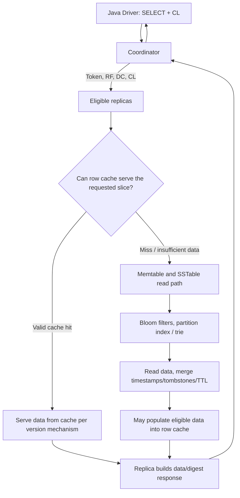
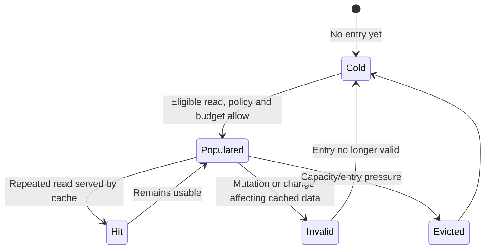
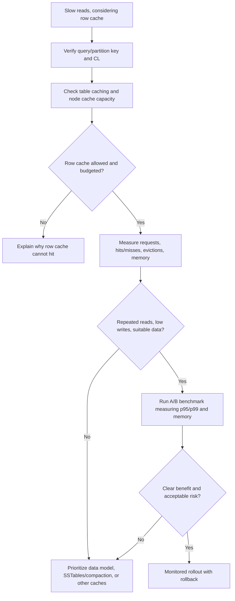

# Row Cache and Eligibility Conditions by Config and Version

## 1. What Problem Does Row Cache Solve on Cassandra's Read Path?

Apache Cassandra is a distributed wide-column database. A Java application sends a CQL query to a **coordinator**; the coordinator identifies replicas using the partition key, replication strategy, and consistency level (CL). On each replica, data is located across the memtable, relevant SSTables, and read-support structures.

For workloads that repeatedly read the same set of partitions, locating SSTables, reading blocks, decompressing, and merging versions can become a substantial cost. **Row cache** is an *optional* mechanism that keeps read partition data in node memory so subsequent reads can bypass part of the SSTable work.

However, **row cache is not suitable for every table by default**. It consumes RAM, is invalidated when data changes, and its support/behavior depends on Cassandra version, table caching policy, SSTable format, and node configuration.

This lesson belongs to the **Read Path and Caching** chapter of the `DATABASE_ENGINE_WIDE_COLUMN_CASSANDRA` module; it connects query-driven partition key design with RF/DC, CL, memtables/SSTables, compaction, repair, error handling, and the Java Driver.

After this lesson, you will be able to:

1. Distinguish **row cache**, **key cache**, Bloom filters, memtables, and the OS page cache.
2. Understand `caching = {'keys': ..., 'rows_per_partition': ...}` and when row cache actually receives memory allocation.
3. Identify suitable workloads: repeated reads, small/medium partitions, low write churn.
4. Explain cache invalidation, cache misses, evictions, and the impact of TTLs/tombstones.
5. Observe behavior via `system_schema`, `nodetool`, metrics, and Java Driver queries.
6. Design controlled benchmarks before enabling row cache in production.

> **Principle:** Row cache is a **node-local** performance optimization. It does not increase the replication factor, alter the consistency level, guarantee fresh data across all replicas, or replace anti-entropy repair.

## 2. Where Does Row Cache Sit in the Read Path?



This is a **conceptual** diagram, not a mandatory source-code order. A row-cache hit may satisfy only part of a query's needs, and cache/local-read-path components follow version-specific ordering and conditions.

### Two Questions Not to Confuse

| Question | Responsible Component |
| --- | --- |
| Which nodes own partition K? | Token + replication strategy + topology |
| How many replicas must the read wait for? | Consistency level |
| On a replica, which SSTable holds partition K? | Bloom filters, partition index, or trie index |
| Can partition K's data be served from RAM instead of re-reading SSTables? | Row cache, other caches, and memtable depending on the case |
| Is multi-version data consistent? | Local merge, reconciliation, timestamps, TTL/tombstones |

**Even when replica A has a row-cache hit**, a `LOCAL_QUORUM` request in an RF = 3 DC still requires enough quorum responses (typically 2). Caching never allows the coordinator to skip CL requirements.

## 3. What Does Row Cache Actually Store?

In Cassandra, row cache operates at **partition scope** with a policy governing **how many rows per partition** may be cached. The name "row cache" does not mean every arbitrary query gets an independent cache entry for each filtered logical row.

Consider the table:

```sql
CREATE TABLE cache_lab.events_by_device_day (
    device_id text,
    event_day date,
    event_time timestamp,
    event_id uuid,
    temperature double,
    PRIMARY KEY ((device_id, event_day), event_time, event_id)
) WITH CLUSTERING ORDER BY (event_time DESC, event_id ASC);
```

A partition is identified by the **pair `(device_id, event_day)`**. Inside it, there can be many clustering rows ordered by `(event_time, event_id)`. When table policy allows, row cache can retain a **partition or the leading N rows of a partition per configuration**, not a "secondary index" over arbitrary `temperature` values.

### Illustrating a Frequently Read Partition

| Clustering Row in Partition | Event Time | Temperature |
| --- | --- | ---: |
| E3 | 08:20 | 29.1 |
| E2 | 08:10 | 28.5 |
| E1 | 08:00 | 27.6 |

With clustering order `event_time DESC`, the leading rows in storage/query order correspond to the most recent events. A cache policy capping `rows_per_partition` can benefit queries that frequently ask for **those leading rows**.

Conversely, querying an older time range outside the cached prefix has no guaranteed cache hit. Cassandra falls back to the SSTable read path for uncached ranges.

### Row Cache Is Not a Permanent Copy of the Table

- Cached entries can be **evicted** under memory pressure.
- Cached entries can be **invalidated** when the partition is written or deleted to avoid serving stale state.
- Caches are **per-node**, never automatically replicated across replicas.
- Caching is not a backup; node restarts or operational events leave the cache cold while data remains safely persisted in storage.
- Never infer that all rows of a partition exist simply because a cache lookup hits.

## 4. Two Configuration Layers Must Both Allow Row Cache

For row cache to actually take effect, verify both the **table policy** and the **node memory budget**. These are two separate layers.

### 4.1. The `caching` Table Option

Example:

```sql
CREATE TABLE cache_lab.events_by_device_day (
    device_id text,
    event_day date,
    event_time timestamp,
    event_id uuid,
    temperature double,
    PRIMARY KEY ((device_id, event_day), event_time, event_id)
) WITH CLUSTERING ORDER BY (event_time DESC, event_id ASC)
  AND caching = {'keys': 'ALL', 'rows_per_partition': '5'};
```

In CQL versions supporting this syntax:

- `'keys': 'ALL'` enables the **key caching** policy; this does not enable row caching.
- `'rows_per_partition': '5'` targets caching **up to/the leading five rows per partition** per version mechanics.
- `'rows_per_partition': 'NONE'` disables row caching **at the table level**.
- `'rows_per_partition': 'ALL'` allows caching the entire partition when other limits allow.

**Important:** `'ALL'` does not guarantee *every* partition stays cached, does not make node memory infinite, and does not turn every query into a hit. Check your version's implementation limits and mechanics.

### 4.2. Server Configuration and Row Cache Capacity

Cassandra releases typically expose node-level settings such as `row_cache_size_in_mb` in server configuration. When **row cache capacity is 0 or disabled on the node**, a permissive table policy alone is **not enough** for caching to operate.

Server configuration may also include parameters for cache persistence/warming, cache providers, or memory management. Exact names, defaults, dynamic reload support, or restart requirements **vary by version**; verify against running config and official docs rather than copying legacy parameters verbatim into production.

### Two-Condition Matrix

| Table `rows_per_partition` | Node Has Non-Zero Row Cache Capacity? | Expected Outcome |
| --- | --- | --- |
| `NONE` | Yes | Table does not use row cache per policy |
| `5` or `ALL` | No / capacity 0 | No effective row caching despite permissive table policy |
| `5` or `ALL` | Yes | **Possible** row cache hits once eligible data is populated |
| `5` or `ALL` | Yes, but working set is huge | Frequent evictions and low hit rate |

**Never conclude row cache is active merely because `system_schema.tables.caching` shows `rows_per_partition='ALL'`.** Metadata only shows table policy; verify node capacity, metrics, and workload.

## 5. CQL Syntax to Enable, Cap, and Disable Row Cache on a Table

On an **existing lab table**:

```sql
-- Allow caching up to / the leading 10 rows per partition per supported policy.
ALTER TABLE cache_lab.events_by_device_day
WITH caching = {'keys': 'ALL', 'rows_per_partition': '10'};

-- Allow caching the entire partition where eligible.
ALTER TABLE cache_lab.events_by_device_day
WITH caching = {'keys': 'ALL', 'rows_per_partition': 'ALL'};

-- Disable row cache for the table while keeping key caching enabled.
ALTER TABLE cache_lab.events_by_device_day
WITH caching = {'keys': 'ALL', 'rows_per_partition': 'NONE'};
```

These examples are separated to show **different configuration states**, not a sequence to run back-to-back in production. In a real cluster, altering `caching` is DDL; coordinate migrations, verify schema agreement, measure read latency, and keep a rollback plan.

### Why Prefer a Bounded Count Over `ALL`?

For a partition with many clustering rows, caching the whole partition can consume huge memory and evict other entries. If an application usually reads only the five newest events, testing `'5'` is far more reasonable than `'ALL'`.

However, **do not** infer that `rows_per_partition='5'` means Cassandra stores at most five rows in the table. It is a **cache policy**, not a TTL, write cap, or CQL `LIMIT 5`. Queries without `LIMIT` can still read more rows from storage.

### Checking Effective Table Options

```sql
SELECT table_name, caching, comment
FROM system_schema.tables
WHERE keyspace_name = 'cache_lab'
  AND table_name = 'events_by_device_day';
```

In `cqlsh`, you can also use:

```sql
DESCRIBE TABLE cache_lab.events_by_device_day;
```

`DESCRIBE TABLE` is a **`cqlsh` utility**, not a standard `SELECT` statement to pass verbatim into the Java Driver. Compare metadata against intended settings; `CREATE TABLE IF NOT EXISTS` does not update policies on an already-existing table.

## 6. Conditions That Cause Row Cache to Be Used or Bypassed

| Condition | Expected Impact |
| --- | --- |
| Node allocates zero row-cache capacity | No effective row caching |
| Table sets `rows_per_partition='NONE'` | Read path skips row cache per policy |
| Table enables cache and read pattern qualifies | Opportunity to populate/hit cache |
| First read, cold cache | Typically hits SSTable/memtable path; may populate cache |
| Repeated reads on same partition and cached slice | Opportunity for cache hits and lower I/O |
| Query asks for clustering slice outside cached prefix | May bypass cache or fetch remainder from storage |
| Partition receives writes/deletes | Affected entry may be invalidated, requiring repopulation |
| Cache full or working set exceeds budget | Evictions and rising cache misses |
| Workload mostly random keys/scans | Low entry reuse, typically poor effectiveness |
| Very fresh data mostly in memtable | Row cache may offer little gain over in-memory reads |

**There is no universal rule that "once row cache is on, every SELECT against the table is cached."** Clustering ranges, ordering, filter predicates, table structure, and Cassandra version can all prevent cache hits.

### Examples of Suitable vs. Unsuitable Queries

With `events_by_device_day` ordered by `event_time DESC`:

```sql
-- Target a single partition, fetching a few newest events.
SELECT event_time, temperature
FROM cache_lab.events_by_device_day
WHERE device_id = 'sensor-01'
  AND event_day = '2026-11-21'
LIMIT 5;

-- Still the same partition, but querying an older slice.
SELECT event_time, temperature
FROM cache_lab.events_by_device_day
WHERE device_id = 'sensor-01'
  AND event_day = '2026-11-21'
  AND event_time < '2026-11-21T08:00:00Z';
```

The first query **may** benefit if the leading five rows are cached. The second may require data beyond the cached portion. Neither table name nor `LIMIT` proves a cache hit: measure actual cache metrics.

## 7. Cache Lifecycle: Warming, Invalidation, and Eviction

A simplified lifecycle:



### Cache Warming

Row cache typically pays off only after being **warmed** by qualifying reads. Early in a rollout or right after a node restart, entries do not exist yet. Comparing cold vs. warm query latency without documenting cache state easily misleads analysis.

### Invalidation on Writes

In standard Cassandra row-cache implementations, mutations to a cached partition can **invalidate** its entry to avoid serving stale data. Never assume every `UPDATE` patches individual cells inside the row cache in place while keeping the entry warm.

Invalidation is a **correctness safeguard**, not a bug to work around by forcing hits. For continuously written partitions, constant invalidation and repopulation can make row cache counterproductive.

### Eviction Under Finite Memory

If the number of repeatedly read partitions exceeds cache capacity, entries are evicted according to the version's eviction policy. One table with huge partitions—or multiple tables competing for node cache memory—can evict "hot" entries before their next read.

### TTLs, Tombstones, and Compaction

- **TTLs:** expired data must not remain visible simply because it once entered the cache. Caching must respect time-validity metadata per version.
- **Tombstones:** deletions must be reflected on reads; cached entries must never resurrect deleted data.
- **Compaction:** reorganizes SSTables; never treat it as turning row cache into a source of truth or fixing cross-replica divergence.
- **Repair/streaming:** inter-replica data operations interact with cache validity internally, but are not tools for "warming the row cache."

Never test row cache by deleting production data, lowering `gc_grace_seconds`, or forcing full compactions. Keep experiments inside a lab.

## 8. Which Workloads Are Worth Testing with Row Cache?

| Workload | Typical Suitability | Rationale |
| --- | --- | --- |
| Repeated reads over a **small/medium** partition set, rare updates | **Worth testing** | High entry reuse, avoids repeated SSTable I/O |
| Repeated queries for the **leading** clustering rows of partitions | **Worth testing with limits** | Bounded `rows_per_partition = N` can fit well |
| Read-heavy reference tables, rarely changing data | **Worth testing** | Rare invalidations, stable working set |
| Every request reads a brand-new partition, huge cardinality | **Usually low value** | Few hits and heavy eviction churn |
| Partitions under continuous mutations | **Usually low value** | Frequent cache invalidations |
| Huge partitions with `rows_per_partition='ALL'` | **High risk** | Heavy memory usage, eviction/memory pressure |
| Wide scans, queries mismatched to cached partition/slice | **Usually unsuitable** | Storage reads still dominate |
| Very recent data mostly in memtable | **Measure first** | SSTable savings may be minimal |
| Ultra-short TTLs or heavy continuous deletes | **Use caution** | Short cache lifetimes, lots of churn/tombstones |

### Example of a Suitable Table

An IoT service has `device_settings_by_id`, partitioned by `device_id`, where each partition holds a small configuration set updated only a few times a day. Thousands of requests repeatedly read popular devices: row cache **can** help when the working set fits the budget.

### Example of a Poorly Suited Table

`events_by_device_day` receives new writes every second for the same partition. Even if a dashboard always queries the latest events, continuous writes keep invalidating the cache. Partition bucketing, tight clustering slices, SSTable/compaction tuning, and key/OS page caching usually yield more value than enabling row cache.

**Never judge by table name alone.** Read/write ratio, key distribution, partition size, retention, and query shape determine effectiveness.

## 9. Row Cache vs. Key Cache, Bloom Filters, and OS Page Cache

| Component | What It Stores or Checks | Role |
| --- | --- | --- |
| **Row cache** | Cached row/partition data slice per policy | Avoids part of repeated local data reads |
| **Key cache** | Partition offset/index lookup info in SSTables on supported paths/formats | Avoids repeating index lookups |
| **Bloom filter** | Probabilistic check of whether an SSTable may hold a partition key | Prunes SSTables guaranteed not to hold the key; can false-positive |
| **Partition index / trie index** | Points to partition/row locations inside an SSTable file | Locates data on disk |
| **OS page cache** | File blocks resident in OS RAM | Reduces physical device I/O for indexes/data |
| **Memtable** | Unflushed mutations | Live data source on the read path, not merely a cache |

### Distinguishing Example

A fast read might happen because:

1. Data is still in the memtable.
2. Row cache served the read.
3. Key cache sped up partition offset lookup.
4. Index/data blocks were already warm in the OS page cache.
5. The selected replica is in the local DC over a low-latency link.

Therefore, "the second read was faster than the first" is **not sufficient proof** that row cache worked. Correlate row-cache metrics alongside other layers.

### Row Cache Is Not an Application-Level Query Cache

A Redis or Caffeine cache in Java has application-managed semantics and invalidation. Cassandra's row cache lives on **each replica**, governed by table policy and server config. Never replace an application cache design by assuming Cassandra shares one consistent row cache across all nodes.

## 10. How Do SSTable Format and Cassandra Version Affect Caching?

Across Cassandra versions, the SSTable read path can use different index structures:

- **Traditional Big SSTable format:** typically explained via Bloom filters, partition summary, partition index, and key cache where applicable.
- **Trie-indexed SSTables (e.g., Bti in Cassandra 5.x):** use trie structures to locate partitions and clustering rows, without necessarily traversing `Summary.db` and `Index.db` like Big.

**Row cache is a conceptually separate layer from the partition index.** Still, actual cache behavior and payoff depend on the read path and optimizations of your exact version and format.

| What to Verify | Why It Matters |
| --- | --- |
| **Cassandra version** | Option names, defaults, cache behavior, and metrics can differ |
| **Actual SSTable format** | Partition lookup path and cache-miss cost can differ |
| **Effective table `caching`** | Whether row cache is allowed and `rows_per_partition` setting |
| **Node row-cache capacity** | Whether memory budget allows entries to be populated/hit |
| **File state after upgrades/compaction** | SSTables from different generations/formats may coexist |

Never claim "enabling row cache makes Bti faster than Big" or vice versa without measuring on the same workload and version. Nor should you treat cache advice written for Cassandra 2.x/3.x as automatically true for 4.x/5.x.

### Defaults and Support Are Not Immutable Contracts

Many Cassandra deployments leave **row cache disabled by default** due to memory cost and workload sensitivity. Yet **never assume a fixed hardcoded default** without reading live node config and table metadata.

During rolling upgrades or mixed-version operations, verify version constraints across the upgrade scope; never copy an old tutorial's `ALTER TABLE caching` command assuming every node interprets and optimizes it identically.

## 11. Consistency Level and Row Cache: How Fresh Is the Data?

Suppose keyspace `NetworkTopologyStrategy` has RF = 3 in `dc1`. Natural replicas for partition K are A, B, and C; A has a row-cache hit, B misses, and C just received a new mutation.

**A cache hit on A cannot substitute for responses from B or C when CL requires multiple replicas.**

| Read CL | Min Responses in Single DC RF=3 | How Row Cache Affects It |
| --- | ---: | --- |
| `LOCAL_ONE` | 1 | Can lower latency on the queried replica; risks stale data if that replica missed a write |
| `LOCAL_QUORUM` | 2 | Each replica hits/misses independently; coordinator still waits for two valid responses |
| `ALL` | 3 | One cache hit cannot compensate for a down/slow replica; hurts availability |

**Newer data on C** does not mean A has a "broken cache." If A missed the mutation due to lagged replication or an outage, that is an issue of **response scope and replica state**. A's cache must respect the data/metadata A knows about, and has no automatic awareness of mutations on C.

### Data Reads, Digest Reads, and Caching

The coordinator can request **full data** from one replica and a **digest** from another; both requests can leverage eligible local read-path components. On a digest mismatch, the coordinator fetches extra data to reconcile and may perform read repair per policy and version.

Row cache is not a "cluster-wide digest," does not detect divergent replicas, and does not replace anti-entropy repair. Schema agreement checks schema definitions only—it does not verify row-cache contents or identical replica data.

### Quorum Does Not Guarantee Linearizability Everywhere

Combining write and read quorums with RF allows response sets to intersect under suitable assumptions, yet concurrent timestamps, LWTs, ambiguous timeouts, multi-partition queries, and concurrent writes still require dedicated analysis. Enabling caching neither strengthens nor weakens those logical guarantees.

## 12. Performance: Row Cache Payoff Must Exceed Memory Cost

A cache's net benefit depends on **hit rate** and **avoided cost**. A simple model:

- A read touching SSTables and merging data: 4 ms on a replica.
- When served by row cache: 0.3 ms.
- Hit rate is `h`.

Expected local cost in this simplified model:

\[
E[T_{\mathrm{local}}] \approx h\cdot 0.3 + (1-h)\cdot 4.
\]

| Assumed Hit Rate | Approx. Average Local Cost |
| --- | ---: |
| 0% | 4.00 ms |
| 25% | 3.08 ms |
| 50% | 2.15 ms |
| 90% | 0.67 ms |

These figures are a **teaching model**, not a Cassandra benchmark. Real systems also incur cache population, eviction, invalidation, CPU, network, coordinator, CL, batching, concurrency, and long-tail latency distributions.

### Why Can p99 Still Be Bad Despite a High Hit Rate?

- Remaining cache misses may concentrate on **oversized partitions** or a slow replica.
- `LOCAL_QUORUM` must wait for the second replica; one replica's hit is not enough.
- Frequently updated partitions trigger invalidations precisely under heavy load.
- Row-cache memory can starve the OS page cache, memtables, or other caches.
- Entry creation and cache management overhead can outweigh saved I/O.

Therefore, measure p50/p95/p99, CPU, memory, GC, disk I/O, throughput, and **hit rate over time**, not just a single average ratio.

## 13. Observing Row Cache: Metadata, `nodetool`, and Metrics

### Table CQL Metadata

```sql
SELECT keyspace_name, table_name, caching
FROM system_schema.tables
WHERE keyspace_name = 'cache_lab'
  AND table_name = 'events_by_device_day';
```

This query confirms the table option recorded by Cassandra. It does **not** report node-level row-cache capacity or hit counts.

### Node Tools

```bash
nodetool info
nodetool tablestats cache_lab
```

Depending on version, output may include:

| Example Metric / Label | Meaning to Understand |
| --- | --- |
| Row Cache size / capacity | Currently used memory / node cache budget |
| Row Cache entries | Number of entries retained per cache mechanics |
| Row Cache requests / hits | Cache lookups and hits |
| Row Cache hit rate | Hit ratio per metric definition and window |
| Row Cache misses | Lookups not satisfied from cache |
| SSTable count, read latency | I/O and read-amplification context |
| Tombstone / cache-related metrics | Factors slowing reads outside the cache |

Labels and fields printed by `nodetool info`/`tablestats` **are not identical across all releases**. Cassandra also exposes metrics via JMX/Prometheus exporters depending on setup; check **RowCache** metrics for your running version and understand counter reset/window semantics.

### Be Careful with Hit-Rate Metrics

- If table policy enables row cache while **node capacity = 0**, zero/low hits are completely normal.
- If a table is brand new and writes still sit in the memtable, unchanged metrics do not mean caching code is broken.
- After a node restart or working-set shift, the cache may simply be cold.
- High hit rate on one node says nothing about other replicas.
- Cumulative counters growing over time do not isolate a post-release window; compare identical intervals.

**Never** rely on a single faster `SELECT` to prove row cache works. Pair server metrics with Java client latency distributions.

## 14. Safe CQL Lab: Testing Table Policy and Observing Cache Metrics

This lab uses the dedicated `cache_lab` keyspace with synthetic data. Assume a single-node lab cluster in DC `datacenter1`. If your DC differs, substitute the exact name from `nodetool status`. RF = 1 is strictly for lab use—**not** a production fault-tolerant setup.

### Step 1 — Check Node and DC

```bash
nodetool status
```

### Step 2 — Create Lab Keyspace

```sql
CREATE KEYSPACE IF NOT EXISTS cache_lab
WITH replication = {
    'class': 'NetworkTopologyStrategy',
    'datacenter1': '1'
}
AND durable_writes = true;
```

`IF NOT EXISTS` only suppresses duplicate-name errors; it does not verify replication settings on an existing keyspace. Stop if `cache_lab` is not an environment you are allowed to drop.

### Step 3 — Create Table with Bounded Cache Policy

```sql
CREATE TABLE IF NOT EXISTS cache_lab.events_by_device_day (
    device_id text,
    event_day date,
    event_time timestamp,
    event_id uuid,
    temperature double,
    PRIMARY KEY ((device_id, event_day), event_time, event_id)
) WITH CLUSTERING ORDER BY (event_time DESC, event_id ASC)
  AND caching = {'keys': 'ALL', 'rows_per_partition': '5'}
  AND comment = 'Disposable row-cache training data';
```

If the table already exists, `IF NOT EXISTS` **does not verify primary key or `caching`**. Inspect metadata right after creation; never write to a table with the wrong schema or someone else's data.

### Step 4 — Read Metadata to Verify Schema

```sql
SELECT table_name, caching
FROM system_schema.tables
WHERE keyspace_name = 'cache_lab'
  AND table_name = 'events_by_device_day';

SELECT column_name, kind, position, type, clustering_order
FROM system_schema.columns
WHERE keyspace_name = 'cache_lab'
  AND table_name = 'events_by_device_day';
```

Both `device_id` and `event_day` must be partition keys; `event_time` and `event_id` must be clustering keys.

### Step 5 — Insert a Few Small Rows

```sql
INSERT INTO cache_lab.events_by_device_day (
    device_id, event_day, event_time, event_id, temperature
) VALUES (
    'sensor-01', '2026-11-21', '2026-11-21T08:00:00Z',
    aaaaaaaa-aaaa-4aaa-8aaa-aaaaaaaaaaaa, 27.5
);

INSERT INTO cache_lab.events_by_device_day (
    device_id, event_day, event_time, event_id, temperature
) VALUES (
    'sensor-01', '2026-11-21', '2026-11-21T08:10:00Z',
    bbbbbbbb-bbbb-4bbb-8bbb-bbbbbbbbbbbb, 28.1
);

INSERT INTO cache_lab.events_by_device_day (
    device_id, event_day, event_time, event_id, temperature
) VALUES (
    'sensor-01', '2026-11-21', '2026-11-21T08:20:00Z',
    cccccccc-cccc-4ccc-8ccc-cccccccccccc, 29.0
);
```

### Step 6 — Repeatedly Read the Same Partition

```sql
SELECT event_time, event_id, temperature
FROM cache_lab.events_by_device_day
WHERE device_id = 'sensor-01'
  AND event_day = '2026-11-21'
LIMIT 5;

-- You can re-run the SELECT above to observe cache metrics in the lab.
```

**Expected business result:** three rows in clustering order. **Not guaranteed:** that the second run is definitely a row-cache hit; the server may have zero cache capacity configured, data may still be in the memtable, or your version/read path may not cache the request as assumed.

### Step 7 — Read Before/After Metrics

```bash
nodetool info
nodetool tablestats cache_lab
```

Record node, timestamp, cache size/capacity, requests/hits/misses if present, SSTable count, and read latency. **Never** change `row_cache_size_in_mb` or restart production nodes to run an exercise; modify server config only in authorized labs per version documentation.

### Step 8 — Compare One Table Option Change

In the lab only:

```sql
ALTER TABLE cache_lab.events_by_device_day
WITH caching = {'keys': 'ALL', 'rows_per_partition': 'NONE'};

SELECT table_name, caching
FROM system_schema.tables
WHERE keyspace_name = 'cache_lab'
  AND table_name = 'events_by_device_day';
```

Verify schema agreement after DDL. Use identical measurement windows if comparing metrics, though **you cannot draw performance conclusions** from three rows and a handful of `SELECT`s.

### Step 9 — Clean Up the Lab

```sql
-- WARNING: run only when cache_lab is a disposable test keyspace.
DROP KEYSPACE IF EXISTS cache_lab;
```

`DROP KEYSPACE` deletes all tables and data in the keyspace; never run it in production or environments with data to preserve.

## 15. Controlled Benchmark Before Enabling Row Cache in Production

A useful experiment isolates row-cache impact from compaction, OS page cache, node load, and CL.

### Designing Two Scenarios

| Factor | A — Without Row Cache | B — Testing Row Cache |
| --- | --- | --- |
| Table / schema | Identical primary key and types | Same as A |
| Workload | Identical read/write rates and partition distribution | Same as A |
| Row cache | `rows_per_partition='NONE'` | Appropriate `rows_per_partition='N'` or `'ALL'` |
| Node memory budget | Explicitly recorded | Controlled allocation |
| CL / RF / DC | Fixed | Fixed |
| Data size / SSTable count | Verified | Kept equivalent or differences noted |
| Cache state | Cold/warm explicitly tracked | Cold/warm explicitly tracked |
| Metrics | p50/p95/p99, disk I/O, CPU, memory, GC, timeouts | Same metrics + row-cache hits/evictions |

### Execution Steps

1. **Pick a representative workload**: read/write ratio, hot partition distribution, clustering slices, and existing vs. missing keys.
2. **Measure baseline** with row cache off, recording SSTable, compaction, node, and driver states.
3. **Enable with bounds** in a matching lab/staging cluster, confirming both table policy and server budget.
4. **Warm up** and measure over steady windows; separate cold vs. warm results.
5. **Monitor invalidations/evictions** and memory—not just cache hit rate.
6. **Compare workload p95/p99**, timeouts, I/O, CPU, and overall resource usage.
7. **Define rollback thresholds**: memory pressure, GC spikes, shrinking OS page cache, worse p99, or insufficient payoff.

### Common Benchmarking Pitfalls

- Repeatedly reading one tiny partition gives a flattering hit rate unrepresentative of real traffic.
- Unflushed data leaves no SSTable reads for the cache to avoid.
- Simultaneously switching CL from `LOCAL_QUORUM` to `LOCAL_ONE` makes comparisons unfair.
- Compaction changes, node additions, or external client traffic running during the benchmark.
- One replica is cache-warm while another is cold; coordinator routing skews p99.
- Setting `ALL` on massive partitions exhausts memory and hurts the very workload you wanted to speed up.

Deployment decisions must rest on **overall net benefit and operational risk**, not a flashy hit ratio.

## 16. Java Driver 4.x: Use Prepared Statements, Not "Force Row Cache Hit"

The Java Driver provides no per-`SELECT` flag like "read from row cache." The application sends CQL, binds the partition key, and chooses CL; Cassandra decides how each replica serves the read internally.

Example using **Cassandra Java Driver 4.x** and Java 15+ (text blocks), assuming `CqlSession session` is connected to the target cluster/local DC and managed externally:

```java
import com.datastax.oss.driver.api.core.CqlSession;
import com.datastax.oss.driver.api.core.DefaultConsistencyLevel;
import com.datastax.oss.driver.api.core.cql.BoundStatement;
import com.datastax.oss.driver.api.core.cql.PreparedStatement;
import com.datastax.oss.driver.api.core.cql.ResultSet;
import com.datastax.oss.driver.api.core.cql.Row;

import java.time.LocalDate;

PreparedStatement query = session.prepare("""
    SELECT event_time, event_id, temperature
    FROM cache_lab.events_by_device_day
    WHERE device_id = ? AND event_day = ?
    LIMIT 5
    """);

BoundStatement read = query.bind(
        "sensor-01", LocalDate.of(2026, 11, 21))
    .setConsistencyLevel(DefaultConsistencyLevel.LOCAL_ONE);

ResultSet result = session.execute(read);
for (Row row : result) {
    System.out.println(
        row.getInstant("event_time") + " -> "
        + row.getDouble("temperature"));
}

System.out.println("Coordinator: "
    + result.getExecutionInfo().getCoordinator());
```

In an RF = 1 lab, `LOCAL_ONE` fits the practice setup. In production, choose CL based on RF/DC and freshness requirements—never alter CL just to "make cache hits easier."

### What Can Java Observe?

- **CQL results** after Cassandra processes data and CL.
- Coordinator and execution metadata exposed by the driver.
- Latencies, error rates, and timeouts/retries via client metrics or instrumentation.

Java **cannot** directly inspect per-request row-cache hits/misses on `Row` or `ResultSet`. To verify cache activity, correlate server metrics with sent requests.

### Caution with Caching and Concurrent Writes

If a service writes new state and immediately reads it back, examine CL, concurrency, write outcomes/timestamps, and replica state. Row cache is not transactional, does not preserve business ordering, and does not replace LWTs. When suspecting stale reads, investigate replication/CL/writes before blaming the cache.

## 17. Runbook When Row Cache Delivers No Benefit

| Symptom | Possible Cause | Inspection Step |
| --- | --- | --- |
| `caching.rows_per_partition='ALL'` yet hits = 0 | Zero node row-cache capacity, cold cache, ineligible queries | Node config, table metadata, cache requests/size |
| Low hit rate | Random keys, oversized working set, evictions, write invalidation | Partition distribution, read/write mix, evictions/requests |
| High hit rate yet high p99 | CL waiting on other replica, hot partition, tombstones, network | Tracing, coordinator/replica metrics, SSTables |
| Second read still slow | Cache not populated / slice mismatch, I/O or GC dominates | Cache metrics, key/clustering query, OS page cache |
| Good after warm-up, bad after deploy | Restart, eviction, workload shift, or flush/compaction | Compare cold/warm windows, node lifecycle |
| Enabling cache starves RAM | Huge partitions, `ALL`, oversized cache budget | Row-cache size, RSS/heap, OS cache, GC |
| Data differs across replicas | Replication lag/error, failed write CL, offline node | RF/DC, read/write CL, repair/streaming |
| Queries on older slices miss | Cache retains leading partition rows; query outside range | Clustering order, `rows_per_partition`, tracing |
| Metrics differ from older docs | Different version / SSTable format / counter semantics | Check actual version docs and metrics |

### Short Diagnostic Flow



**Do not resort to risky shortcuts** like arbitrarily lowering CL, taking replicas offline, running unplanned full compactions, or editing production server memory without approval just to "make the cache work."

## 18. Practice Exercises and Summary Checklist

### Exercise A — Reading Table Policy

Given `caching = {'keys':'ALL','rows_per_partition':'NONE'}`. Is row cache enabled by table policy? Does `keys='ALL'` mean caching whole rows?

**Answer:** Row cache is disabled by table policy. `keys='ALL'` controls key caching, **not** row caching.

### Exercise B — Policy Enabled, No RAM Allocated

A table sets `rows_per_partition='ALL'`, while the node sets row-cache capacity to 0. Can we conclude the cache is active?

**Answer:** No. The table permits it, yet **the node allocates zero row-cache budget**; verify node config and metrics before expecting hits.

### Exercise C — Wide Partitions

A partition contains 200,000 events; the app typically reads only the 3 newest events. Should you enable `'ALL'` right away?

**Answer:** No. Evaluate caching only the leading rows with a bounded `rows_per_partition`, review bucketing/partition size, and benchmark. Caching massive whole partitions wastes memory.

### Exercise D — Continuously Mutated Data

A device writer updates a partition every second while readers also query it heavily. Why might row cache still fail to help despite high read volume?

**Answer:** Writes invalidate the entry, causing constant misses and repopulation churn. Measure real workloads, not read rate alone.

### Exercise E — Cache Hit and CL

Replica A gets a row-cache hit while B misses; the request uses `LOCAL_QUORUM` with RF = 3. Can A return the final result immediately on its own?

**Answer:** No, not from A alone. The coordinator still must satisfy the CL response count; row cache only reduces part of A's local read cost.

### Exercise F — One SELECT Faster After Warm-Up

The second read runs faster than the first. Is that proof enough that row cache is effective?

**Answer:** Not yet. Inspect row-cache metrics; OS page cache, key cache, memtable, JIT, warm connections, and replica choice could also explain the speedup.

### Pre-Production Checklist

| Question | Required Evidence |
| --- | --- |
| Does the workload repeatedly read the same partitions? | Partition key distribution, read/write ratio, profiling |
| Do partitions fit memory, and is full caching needed? | Size/row counts and chosen `rows_per_partition` |
| Does table policy allow row cache? | `system_schema.tables.caching` |
| Does the node allocate real row-cache memory? | Version-specific config and metrics |
| Does the version/format have notable cache behavior? | Release docs and actual SSTable format |
| Do frequent mutations cause invalidation churn? | Read/write metrics and hot-partition profiles |
| Do CL/RF/DC match business requirements? | Keyspace replication and Java statement CL |
| Were cache effects isolated from OS page cache/compaction? | Cold/warm benchmarks and I/O metrics |
| Does cache RAM cause memory pressure or evictions? | Cache size, RSS/heap, OS cache, eviction counts |
| Is the improvement visible from Java? | p50/p95/p99, throughput, timeouts/errors |
| Is there a clear rollback path if ineffective? | Prior DDL/table options, runbook-based node config revert |

**Key takeaway:** Row cache can cut repeated read costs for frequently accessed partitions, but only pays off when **table policy enables it, the node allocates real capacity, the workload reuses entries, and constant invalidations/evictions do not negate it**. It differs from key cache (which stores SSTable lookup positions), does not replace Bloom filters or memtables, and never bypasses RF/CL. The right workflow starts with **query-driven partition keys**, checks version/configuration, and validates gains with metrics and A/B benchmarks rather than flipping `rows_per_partition='ALL'` on every table.
