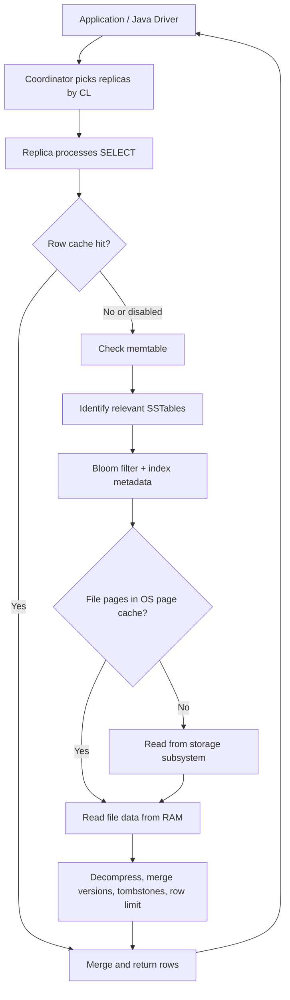

# OS Page Cache and Frequently Accessed Working Sets

**Chapter:** Read Path and Caching  
**Module:** `DATABASE_ENGINE_WIDE_COLUMN_CASSANDRA` — Apache Cassandra

This lesson sits within Apache Cassandra's distributed architecture and wide-column model: partition key selection, query-driven table design, read/write consistency levels, CQL, replication, compaction, repair, error handling, and Java connectivity.

When a Cassandra query runs for the first time, data may need to be read from storage. When the same key is queried again, part of the data and metadata may already reside in the **operating system page cache (OS page cache)**, making subsequent reads faster. However, a fast read is not necessarily a "cache hit," and free RAM alone does not tell you directly how much I/O Cassandra requires.

This lesson answers three operational questions: where Cassandra relies on the page cache along the read path; how the **working set** (frequently accessed data) governs hot-data retention; and how to measure properly so you avoid false conclusions from "first read vs. second read" experiments.

## 1. Learning Objectives

After completing this lesson, you will be able to:

1. Distinguish **Linux page cache**, **Cassandra key cache**, **row cache**, **memtable**, Bloom filters, and index summaries.
2. Explain why the exact same CQL statement can produce different physical I/O at different times.
3. Define the working set by **partition, clustering range, access frequency, and replica**, rather than total table size alone.
4. Run controlled hot/warm/cold read experiments, verified with CQL and Linux/Cassandra tools.
5. Recognize how compaction, read repair, streaming, flushes, paging, and memory limits affect cache hit rates.
6. Interpret `MemAvailable`, `Cached`, disk read throughput, page faults, and p95/p99 latency cautiously.
7. Recommend query and cache improvements grounded in measurements—without assuming "add more cache" fixes every slow query.

## 2. Memory Layers to Distinguish

Cassandra does not have a single monolithic "cache." A read request can traverse multiple data and metadata layers with distinct lifecycles:

| Component | What Does It Hold? | Owned By | Primary Role |
| --- | --- | --- | --- |
| **Memtable** | Unflushed mutations/rows not yet written to SSTables | Cassandra, heap/off-heap memory per config/version | Serves recent writes and merges with SSTable data; **not page cache**. |
| **Row cache** | Partition data cached per Cassandra policy | Managed by Cassandra | Can bypass part of SSTable reads on hits; often disabled by default or unsuitable for many workloads. |
| **Key cache** | Offsets/metadata for locating partitions inside SSTables | Managed by Cassandra | Reduces index lookup work when reading SSTables; **does not store full row contents**. |
| **Bloom filter** | Probabilistic structure checking which SSTables may contain a partition key | Cassandra, mainly native/off-heap memory | Skips SSTables guaranteed absent; can false-positive, never false-negative when healthy. |
| **Index summary / index metadata** | Lookup checkpoints, partition and clustering indexes on SSTables | Cassandra and filesystem (data-dependent) | Locates byte ranges to read inside an SSTable. |
| **OS page cache** | File data/metadata pages kept in RAM by the OS | Node kernel | Avoids re-reading disk blocks when accessed file pages are already in RAM. |
| **Storage cache** | Cache in controller/SSD or storage subsystem | Storage device / infrastructure | Can cut I/O latency even on OS page cache misses. |

**Key point:** a `key cache hit` does not equal a `data page cache hit`. Key cache helps locate where data sits, yet the target data pages might not reside in the OS page cache. Conversely, even on a key-cache miss, index and data pages on disk might already be cached by Linux.

Row cache is an application choice based on **query shape**, not a replica of the OS page cache. In many workloads, leveraging the page cache and SSTable structures outperforms enabling row cache across all tables. Never equate caches inside a Cassandra node with result caches in applications, proxies, or CDNs.

## 3. How Does the OS Page Cache Work?

On Linux, when Cassandra reads SSTable files using page-cache-backed I/O, the kernel retains read file pages in RAM. If a later read needs the same resident page, data is served from memory. If the page was evicted under memory pressure or never read before, the kernel fetches it from storage.

Cassandra uses multiple file access mechanisms depending on version, configuration, and SSTable component; some operations use memory mapping. For reads routed through page-cache-backed paths, **`mmap` does not bypass the page cache**. Never infer from a single diagram that *all* Cassandra I/O must flow through the page cache or that every cache miss becomes a single physical read of fixed size.

### 3.1. Cache Lives at the Node Level, Not the Cluster Level

The OS page cache is a kernel resource on **each individual host**. With a replication factor (RF) of 3:

- Rows for the same partition key are stored on three replicas.
- Each replica has its own SSTables, index metadata, page cache, and memory pressure.
- The coordinator handling a CQL request may pick different replicas based on consistency level, read policy, locality, and node health.
- A second read from the application is **not guaranteed** to hit the same replica warmed by the first read.

Therefore, in experiments comparing OS page cache effects, pin the topology and observe **the node actually reading the data**. Never treat "running `cqlsh` on node X" as proof that reads only use X's page cache: the connected node may act as coordinator and forward the read to another replica.

### 3.2. "Used" Memory Is Not Always "Wasted" Memory

Linux uses RAM not currently needed by applications to cache files. For example:

```bash
free -h
grep -E '^(MemTotal|MemFree|MemAvailable|Cached|Buffers|Dirty|Writeback):' /proc/meminfo
```

Two commonly misunderstood figures:

- Low `MemFree` alone does not prove RAM exhaustion; the kernel may be using RAM for caching and can reclaim it when applications need memory.
- `MemAvailable` estimates how much memory can be allocated to applications without excessive swapping; it is far more useful than `MemFree` for host memory pressure, though it remains an **estimate**, not RAM reserved exclusively for Cassandra.

`Cached` in `/proc/meminfo` does not mean "Cassandra data currently cached." It is a kernel metric covering all files and processes on the host; inside containers, host metrics and cgroup limits can differ substantially. Kernel memory, slab, anonymous pages, and other caches also require separate inspection.

**Do not aim to drive `Cached` to 0.** Page cache is normal, beneficial Linux behavior. Kernel cache reclamation under memory pressure is expected; data reuse rates and I/O performance determine whether available RAM is sufficient.

## 4. Where Does the Page Cache Sit on Cassandra's Read Path?

Consider a query supplying the full partition key:

```sql
SELECT event_time, event_id, event_type, amount_cents
FROM lab_read_cache.events_by_account
WHERE tenant_id = 't1'
  AND account_id = 101
  AND event_time >= '2026-11-01T00:00:00Z'
  AND event_time <  '2026-12-01T00:00:00Z'
LIMIT 50;
```

Simplified diagram:



The diagram shows core components, **not a strict mandatory sequence of internal calls**. In practice, Cassandra may read the memtable and multiple SSTables, consult Bloom filters/indexes, check tombstones, and pick newest versions. Having data in the memtable does not guarantee skipping SSTables.

The page cache backs multiple file page types: compressed SSTable data pages, certain index/metadata pages, and actively accessed files. **Data is usually compressed on disk**, so bytes read from the page cache still require decompression and row decoding. Kernel cache hits cut physical I/O—they **do not eliminate CPU, tombstone merging, consistency checks, or network hops**.

### 4.1. Read Latency Has Multiple Components

An approximate breakdown:

```text
Read latency
≈ network coordination + queueing + SSTable/index lookup
  + memtable/SSTable access + (physical I/O if needed)
  + decompression/merging/tombstone filtering + serialization/response
```

For the same query, a warm cache reduces the physical I/O term. Yet if latency is dominated by network, GC, tombstone scans, decompression CPU, or coordinator overload, a warm page cache may barely move the needle. A single query can hit RAM for some pages and SSD for others: avoid labeling an entire query strictly "cache hit" or "cache miss" when it touches many pages.

## 5. Working Set: Which Data Truly Needs to Stay Hot?

The **working set** is the set of pages/data likely to be re-accessed within a time window. In Cassandra, it is dictated by **access patterns**, not raw table size alone. Consider three workloads:

| Workload | Access Characteristics | OS Page Cache Expectation |
| --- | --- | --- |
| **Hot keys:** 90% of requests target a small group of accounts | High reuse across partitions and clustering ranges | Popular SSTable/index pages tend to stay cached; warm reads do far less I/O. |
| **Uniform random** across millions of partitions | Low page reuse probability | Lower cache hit rate when working set exceeds available RAM. |
| **Time-range scans** on newest data | Touches mainly a few recent SSTables/clustering slices | Recent pages can stay hot, though wide scans and compaction can churn them out. |

Do not estimate the working set by summing total keyspace disk usage unless queries genuinely touch nearly all of it. Conversely, a "small" table can still trigger heavy I/O if competing apps fight for RAM and continuously evict the page cache.

### 5.1. Rough Page-Based Sizing, Not Logical Row Count

Suppose a node continuously touches ~800,000 distinct data/metadata chunks, each corresponding to a frequently needed **8 KiB file page**. Rough estimate:

```text
800,000 × 8 KiB ≈ 6.10 GiB of hot data on the node
```

This is purely an illustration, **not a formula to derive RAM from Cassandra row counts**. One partition can span many pages; one page can hold many rows; page count also depends on compression, partition size, Bloom/indexes, SSTable count, and read patterns. RF = 3 does not mean every node holds three copies of every row; calculate the data footprint and access pattern **per replica**.

For a credible estimate:

1. Collect query frequencies by query type and accessed key over concrete windows (e.g., 15 minutes, 1 hour, 24 hours).
2. Identify which partitions are hot and how many clustering rows/ranges each query reads.
3. Observe SSTable counts, compressed data size, and per-node page cache / physical reads.
4. Compare against remaining host RAM after accounting for JVM heap, native/off-heap, kernel, and other services.
5. Compare across multiple windows: peak hours, compaction, backup/repair, and flush bursts.

Working sets can **shift continuously** (such as a rolling 24-hour window). Cache needs enough room for pages likely to be re-read before eviction; keeping every page ever touched is neither feasible nor necessary.

### 5.2. Key Design Directly Shapes the Working Set

Consider the business goal "fetch the 20 newest events for an account":

- Table with partition key = `(tenant_id, account_id)`, clustering = descending time: queries target one partition and read a narrow slice, typically giving strong locality.
- Table with partition key = random event UUID: requires querying many partitions or a different read model, increasing fan-out and scattered page touches.
- Massive multi-year partitions: a latest-events query may read a narrow slice, yet overly broad queries and tombstones can force touching many pages.

Adding cache **cannot fix a key design** that forces each request to scan many partitions. Optimize partition count and rows scanned first.

## 6. Lab: Creating a Table with Hot Keys and Cold Keys

To verify, use a stable **dedicated Cassandra lab cluster**. Examples target Cassandra 4.1/5.x, either a single-node lab or a multi-node single-DC cluster; the DC name below is `datacenter1`—replace it with your actual verified name.

```bash
nodetool status
cqlsh
```

In `cqlsh`:

```sql
SELECT data_center, release_version FROM system.local;

CREATE KEYSPACE IF NOT EXISTS lab_read_cache
WITH replication = {
    'class': 'NetworkTopologyStrategy',
    'datacenter1': 1
}
AND durable_writes = true;

CREATE TABLE IF NOT EXISTS lab_read_cache.events_by_account (
    tenant_id text,
    account_id int,
    event_time timestamp,
    event_id uuid,
    event_type text,
    amount_cents bigint,
    PRIMARY KEY ((tenant_id, account_id), event_time, event_id)
) WITH CLUSTERING ORDER BY (event_time DESC, event_id ASC);
```

**Key design explanation:**

- Partition key is `(tenant_id, account_id)`, so accounts 101 and 102 live in distinct partitions.
- `event_time` is the first clustering column, supporting time-range queries.
- `event_id` prevents key collisions when multiple events share the same timestamp.
- `event_type` and `amount_cents` are regular columns returned by this access pattern, not part of partition routing.

Insert a small dataset to verify **CQL correctness**:

```sql
INSERT INTO lab_read_cache.events_by_account
(tenant_id, account_id, event_time, event_id, event_type, amount_cents)
VALUES ('t1', 101, '2026-11-20T10:00:00Z',
        10000000-0000-4000-8000-000000000101, 'PAYMENT', 150000);

INSERT INTO lab_read_cache.events_by_account
(tenant_id, account_id, event_time, event_id, event_type, amount_cents)
VALUES ('t1', 101, '2026-11-20T10:05:00Z',
        10000000-0000-4000-8000-000000000102, 'REFUND', -20000);

INSERT INTO lab_read_cache.events_by_account
(tenant_id, account_id, event_time, event_id, event_type, amount_cents)
VALUES ('t1', 102, '2026-11-20T10:07:00Z',
        10000000-0000-4000-8000-000000000103, 'PAYMENT', 42000);

INSERT INTO lab_read_cache.events_by_account
(tenant_id, account_id, event_time, event_id, event_type, amount_cents)
VALUES ('t1', 103, '2026-11-20T10:09:00Z',
        10000000-0000-4000-8000-000000000104, 'PAYMENT', 25000);

CONSISTENCY ONE

SELECT event_time, event_type, amount_cents
FROM lab_read_cache.events_by_account
WHERE tenant_id = 't1' AND account_id = 101
LIMIT 20;
```

Expected output: two events for account 101, ordered `10:05` before `10:00`. A four-row dataset is **far too small to demonstrate page-cache gains**: pages may already be in the memtable, metadata caches, or page cache from the write itself. This step only verifies schema and query correctness.

## 7. Designing an Interpretable Hot/Warm/Cold Experiment

A benchmark with a few rows running `SELECT` twice usually leads to false conclusions. To observe differences between **repeated access** and **broadly distributed key access**, create a dataset larger than available page-cache RAM in the **lab**, or large enough to shift I/O metrics noticeably. Hold data size, compaction state, concurrency, and CL constant across both test groups.

### 7.1. Two Workload Groups

| Group | Key Access | Measurement Plan | Expected Observation |
| --- | --- | --- | --- |
| H — hot | Repeatedly pick from 20–100 fixed accounts | Warm up adequately, then measure p50/p95/p99 | Popular data/index pages stay cached; disk reads per request drop. |
| R — random/cold | Pick across tens of thousands of accounts with little reuse | Same query count, CL, and page size | Distributed working set; physical I/O and tail latency may be higher. |

**Seed background data:** for instance, populate 50,000–200,000 accounts with multiple events each so data sits on SSTables and the total working set is sizable. Scale appropriately for your lab hardware; do not treat these numbers as universal defaults. If data remains unflushed in the memtable, tests may primarily measure Cassandra RAM reads.

With the Java Driver, load data using prepared statements and per-partition batching **aligned with the access pattern**, avoiding huge multi-partition logged batches. After loading finishes, let background flushes/compaction settle before comparing. Never inject `nodetool flush` or `nodetool compact` into production benchmark flows just to create a "clean" state.

### 7.2. Control CQL Queries

Read a hot partition:

```sql
CONSISTENCY ONE

SELECT event_time, event_id, event_type, amount_cents
FROM lab_read_cache.events_by_account
WHERE tenant_id = 't1' AND account_id = 101
LIMIT 20;
```

Read another partition (to avoid conflating hot and cold keys):

```sql
SELECT event_time, event_id, event_type, amount_cents
FROM lab_read_cache.events_by_account
WHERE tenant_id = 't1' AND account_id = 102
LIMIT 20;
```

Read with a clustering range:

```sql
SELECT event_time, event_id, event_type, amount_cents
FROM lab_read_cache.events_by_account
WHERE tenant_id = 't1' AND account_id = 101
  AND event_time >= '2026-11-20T00:00:00Z'
  AND event_time < '2026-11-21T00:00:00Z'
LIMIT 20;
```

With many events loaded, vary `LIMIT 20` across values to compare read/deserialization work and touched pages. `LIMIT` caps returned rows; it does **not guarantee** reading only that many rows from disk, especially with tombstones or multiple SSTables.

### 7.3. Do Not Call Restarting Cassandra a "Cold Start"

The OS page cache lives in the kernel. **Restarting the Cassandra process does not clear the Linux page cache.** Instead, a restart resets memtables, key/row caches, JIT compilation, connection pools, and other state, introducing major confounding variables.

A controlled cold experiment uses a fresh host/VM, an untouched dataset, or a cache-management procedure **strictly on an isolated lab host**. Never drop caches on a shared host or production node just to measure—it impacts every service on the machine. If you cannot guarantee a cold state, label group R **"low-reuse / random access"** rather than claiming every request is a cache miss.

### 7.4. Avoiding Memtable Effects in Measurements

Recently written data can sit in the memtable; Cassandra may answer part of a query without reading SSTables at all. To measure OS page-cache interaction:

1. Finish loading data before starting the benchmark.
2. Wait for background writes, flushes, and compaction to reach a steady baseline.
3. Use tracing/metrics to confirm queries are reading SSTables rather than memtables alone.
4. Observe physical disk I/O over the exact measurement window rather than judging from latency alone.
5. If you trigger a flush in a lab, document it explicitly because it alters SSTable layout and cache residency.

## 8. Hot Reads with Java Driver 4.x

The example below illustrates **a measurement harness**, not a replacement for a dedicated load-testing tool. Assume the keyspace/table already contains data for accounts 1–20,000 and `session` is connected to the proper local datacenter. The query binds the full composite partition key so groups differ only in **key distribution**, not CQL text.

```java
import com.datastax.oss.driver.api.core.CqlSession;
import com.datastax.oss.driver.api.core.DefaultConsistencyLevel;
import com.datastax.oss.driver.api.core.cql.PreparedStatement;
import com.datastax.oss.driver.api.core.cql.Row;

import java.util.Arrays;
import java.util.Random;

public final class ReadCacheExperiment {
    private static final int REQUESTS = 10_000;

    static long[] measure(CqlSession session,
                          PreparedStatement select,
                          int keySpace,
                          long seed) {
        Random random = new Random(seed);
        long[] elapsedMicros = new long[REQUESTS];

        for (int i = 0; i < REQUESTS; i++) {
            int accountId = 1 + random.nextInt(keySpace);
            long started = System.nanoTime();

            Row first = session.execute(
                select.bind("t1", accountId)
                      .setConsistencyLevel(DefaultConsistencyLevel.ONE)
                      .setPageSize(20)
            ).one();

            // Reading a single row does not mean scanning the entire partition.
            // With LIMIT 20, this measures time to fetch the first row.
            elapsedMicros[i] = (System.nanoTime() - started) / 1_000L;

            if (first == null) {
                // Must know whether accountId has data before
                // using these numbers as valid working-set measurements.
            }
        }
        return elapsedMicros;
    }

    static long percentile(long[] samples, double p) {
        long[] copy = Arrays.copyOf(samples, samples.length);
        Arrays.sort(copy);
        int position = (int) Math.ceil(p * copy.length) - 1;
        return copy[Math.max(0, Math.min(position, copy.length - 1))];
    }

    public static void run(CqlSession session) {
        PreparedStatement select = session.prepare(
            "SELECT event_time, event_type, amount_cents " +
            "FROM lab_read_cache.events_by_account " +
            "WHERE tenant_id = ? AND account_id = ? LIMIT 20"
        );

        // Independent warm-up: do not include warm-up samples in reported metrics.
        measure(session, select, 20, 11L);

        long[] hot = measure(session, select, 20, 12L);
        long[] random = measure(session, select, 20_000, 13L);

        System.out.printf("hot p50=%d us, p95=%d us, p99=%d us%n",
            percentile(hot, 0.50), percentile(hot, 0.95),
            percentile(hot, 0.99));
        System.out.printf("random p50=%d us, p95=%d us, p99=%d us%n",
            percentile(random, 0.50), percentile(random, 0.95),
            percentile(random, 0.99));
    }
}
```

**Code sample limitations:** Timing `session.execute(...).one()` includes client, network, coordinator, cache layers, and first-row retrieval; it **cannot isolate "page cache time" directly**. Every account must hold real rows, otherwise empty queries in the random group invalidate the comparison. The driver also handles paging automatically; time to **first row** is not time to consume all pages.

For credible performance measurements:

- Populate both groups evenly with equal rows/partition and identical clustering spans.
- Repeat runs multiple times, swap group order, and log warm-up phases.
- Align Cassandra and OS metrics by timestamp with client latencies.
- For throughput/concurrency benchmarks, use dedicated load tools (e.g., `cassandra-stress` with custom profiles) or a rate-controlled multi-client harness; never extrapolate production throughput from this synchronous loop.
- If RF > 1, ensure both groups distribute equivalently across replicas at the same CL; otherwise results may reflect caches on **different replicas**.

## 9. Observing Memory, Disk Reads, and Latency Simultaneously

Below are standard Linux commands. Run them on the **actual Cassandra node**, not just the client host, after verifying permissions and installed packages (`iostat` usually comes from `sysstat`).

```bash
# Snapshot of node kernel memory state:
free -h
grep -E '^(MemAvailable|Cached|Dirty|Writeback):' /proc/meminfo

# Host CPU, swap, and block I/O over time:
vmstat 1 10

# Per-device I/O; inspect r/s, rkB/s, await, %util:
iostat -dx 1 10
```

Correlate with Cassandra metrics from the node:

```bash
nodetool info
nodetool tablestats lab_read_cache.events_by_account
nodetool tablehistograms lab_read_cache events_by_account
nodetool tpstats
```

Command names, columns, and specific metrics vary across Cassandra releases. `nodetool info` typically reports node-level memory/row-cache/key-cache status; `tablestats` provides table, Bloom filter, and SSTable statistics; `tablehistograms` shows per-table read latency/efficiency histograms. None of these tools are direct counters of Linux page-cache hits.

### 9.1. Read Metrics in Pairs, Never Infer from One Number

| Simultaneous Observation | Plausible Interpretation | What Else to Check |
| --- | --- | --- |
| p95 drops and device `rkB/s` drops in the hot group | Cache/working set may be reducing physical I/O. | Did anything else change? Same row payload returned? Memtable, replica, row cache, background traffic? |
| Linux `Cached` grows after many `SELECT`s | Kernel may be retaining newly read file pages. | Are pages from SSTables, another process, or other files? Any background tasks running? |
| Low `MemFree`, high `MemAvailable`, swap = 0 | Likely normal page-cache usage, not necessarily memory pressure. | Direct reclaim, major faults, latency, cgroup limits, native RAM, and GC? |
| Read latency rises while disk reads stay low | Bottleneck may be CPU, network, tombstones, queues/locks, or another replica. | Request trace, GC, thread pools, coordinator/replica metrics. |
| Disk reads spike during compaction/streaming | Background I/O may contend for bandwidth and churn cache residency. | Compaction progress, SSTable creation, network throughput. |
| Good key-cache hit rate yet query stays slow | Only lookup metadata is cached; data still needs I/O or merge CPU. | Physical I/O and SSTable/row scan time. |
| Same query fast on node A, slow on node B | Working set and RAM cache are per-node. | Placement, RF, CL, heap/off-heap, compaction state, underlying disk. |

**Caution with `iostat`:** These are **device-level** metrics combining Cassandra and other processes. High `%util`, rising `await`, or falling `rkB/s` is not standalone proof of page-cache hit rates. Check whether other workloads share the host.

### 9.2. Distinguishing Cache Hits from Page Faults

When files are accessed via `mmap`, accessing a page already in RAM triggers a **minor page fault** to map it, while fetching from disk triggers a **major page fault**. However, not all Cassandra reads use `mmap` or surface via process page-fault counts. Zero major faults does not prove data sits in the OS page cache: standard kernel buffered I/O reads blocks without counting major page faults against the process in the same way.

Therefore, combine **block I/O counters + latency + tracing + I/O path knowledge** rather than treating page-fault counts as Cassandra's cache-miss counter.

## 10. Factors That Shift the Working Set

### 10.1. Flush and Compaction

SSTables are immutable files. When a memtable flushes, recent mutations land in brand-new SSTables whose file pages may not yet be warm in the read path. When compaction merges/replaces SSTables, files and page offsets change. Warm pages of **old files** do not magically become warm pages of **new files**.

Observable consequences:

- After compaction, some hot queries temporarily incur higher disk reads until new SSTables warm up in cache.
- Compaction itself performs heavy read/write I/O, competing with queries for RAM/page cache and bandwidth.
- Compaction reduces SSTable count and evicts tombstones when eligible, offsetting the transient working-set rebuild cost.

Never conclude "compaction always slows queries down" or "compaction always improves caching." Net impact depends on compaction strategy, data age, query distribution, and storage health.

### 10.2. Repair, Bootstrap, Streaming, and Backup

Repair, bootstrap, and streaming read or transfer large SSTable volumes on a node. This I/O can:

1. Compete for disk bandwidth with queries.
2. Put pressure on the page cache, evicting hot pages prematurely.
3. Produce new files/metadata, shifting SSTable counts and read paths.

Backups/snapshots use filesystem mechanisms, yet copying, uploading, or scanning files still affects I/O. Record background activity status during cache tests. If p99 rises during repair, **do not automatically** blame cache misses alone: I/O contention, CPU, network, or compaction may also be responsible.

### 10.3. JVM Heap and Native / Off-Heap Memory

On a host with finite RAM, Cassandra shares memory among JVM heap, native/off-heap allocations, network buffers, OS page cache, and OS overhead. An oversized heap leaves less RAM for the page cache; an undersized heap triggers GC pressure or OOMs. Never tune heap size by a simplistic fixed ratio.

Monitor alongside:

- Total JVM RSS and native memory footprint.
- Heap used, GC pauses, and allocation rates.
- Container/cgroup memory limits if applicable.
- `MemAvailable`, swap/reclaim activity, disk read latency, and read p95/p99.

A node with large `Cached` and healthy JVM heap can still struggle if random reads outpace SSD throughput.

### 10.4. Replication and Consistency Level

Keep write/read consistency levels constant across comparisons. With RF = 3:

- At `ONE`, reads can be served by a single replica, so that chosen replica's cache strongly shapes latency.
- At `LOCAL_QUORUM`, enough replicas must respond, adding network and digest/reconciliation steps beyond one node's page cache.
- Reading the same partition at different times can return different versions under concurrent writes, hinted handoff, repair, or lagged replicas.

Cache quality never replaces consistency levels. A replica with a warm cache holding stale data is **not** an acceptable source of truth when business rules demand stronger consistency.

## 11. Diagnosing Three Classic Scenarios

### Scenario A: High Latency Right After Restarting Cassandra

**Hypothesis:** key cache, row cache, and JIT are cold, new file pages have not been read yet, or startup background work is consuming I/O/CPU. **Never assume the OS page cache was wiped just because the process restarted.**

Steps:

1. Verify node health and normal ring status.
2. Compare client latency for the exact same query type, CL, and row count before/after restart.
3. Inspect `nodetool info`, Cassandra cache stats, GC logs, and physical I/O.
4. Observe warm-up over several minutes on real traffic; verify whether the host/VM itself rebooted (which would clear OS page cache).
5. If the node was replaced or bootstrapped, account for streaming and new SSTable compaction.

### Scenario B: Plenty of RAM, Yet Random Reads Remain Slow

**Hypothesis:** the working set exceeds available page-cache RAM, or queries fan out across too many partitions/SSTables.

Check:

- Are queries providing full partition keys and bounded clustering ranges?
- What are partition counts, SSTable counts, row sizes, and tombstone ratios?
- Are accessed keys repeated frequently enough to benefit from caching?
- Have per-node disk latency and bandwidth been checked?

Remediation may involve query-driven table redesign, tighter time buckets, an appropriate compaction strategy, or scaling I/O or RAM based on measurements. Increasing Java heap **does not** directly enlarge the OS page cache.

### Scenario C: Single-Account Query Is Fast, Aggregate Load Is Slow

**Hypothesis:** a single-key benchmark measures warm cache, while production reads millions of distinct accounts. One hot key vs. the real distribution have completely different locality.

Run groups H and R with identical queries, rows per partition, and concurrency, comparing p50/p95/p99 and disk reads. If they diverge sharply, base working-set sizing on **actual key distribution**—never use a single-account microbenchmark to size cluster capacity.

## 12. Optimize Root Causes Instead of "Turning On Every Cache"

| Measured Symptom | Evidence-Based Action | What to Avoid |
| --- | --- | --- |
| Queries read many partitions to return few rows | Redesign partition keys/clustering columns and tables around queries. | Adding page-cache RAM while leaving wide scans intact. |
| Hot working set barely exceeds RAM; high physical reads | Evaluate free host RAM, full-node memory budget, SSD capacity, and locality. | Arbitrarily enlarging JVM heap, shrinking page cache. |
| Heavy tombstone/SSTable scans despite warm disk cache | Analyze TTLs/deletes, compaction, and partition layout. | Looking only at `Cached` and assuming caching is fine. |
| Concentrated hot traffic where row cache could help | Run controlled row-cache benchmark on matching workload; measure write overhead/RAM. | Enabling row cache cluster-wide without validation. |
| Low key-cache hit rate, many SSTable index lookups | Inspect key-cache config, capacity, key distribution, and SSTable counts. | Assuming key cache stores row data. |
| Tail latency spikes during repair/compaction windows | Schedule and throttle background tasks per runbooks; monitor I/O. | Dropping Linux caches to "fix" latency. |

### Misconceptions to Remember

- **"Data is on SSD, so page cache isn't needed."** SSDs are fast yet still much slower than RAM for many read patterns; page cache also cuts device wear and I/O contention.
- **"RAM is nearly full, so Cassandra is about to OOM."** Linux intentionally uses spare RAM for caching; evaluate `MemAvailable`, reclaim, swap, and actual memory budgets.
- **"95% key-cache hit rate means 95% of queries avoid disk."** Key cache stores lookup offsets, not all data pages.
- **"Restarting Cassandra clears the read cache."** Page cache belongs to the kernel; restarting only the process does not guarantee cold disk reads.
- **"First query slow, second query fast proves page cache."** Memtables, key cache, row cache, JIT, connection pools, replica routing, and storage caches may all contribute.
- **"`LIMIT 10` means at most 10 rows are read from disk."** Tombstones, SSTable overlap, clustering ranges, and index lookups can force far more I/O.

## 13. Experiment Log Template

Record this table for **each workload group and measurement window**, even when results contradict expectations:

| Attribute | Sample Entry |
| --- | --- |
| Cassandra version, RF, read CL | Cassandra 5.x; RF=1; ONE |
| Node / hardware and RAM | node-1; NVMe; host memory / cgroup limit |
| Dataset | Total accounts, rows/partition, SSTable count, compressed size |
| Workload group | H: 20 hot keys; R: 20,000 random keys |
| Request count, concurrency, page size | 10,000; 1 synchronous client; page size 20 |
| Warm-up and order | H warm-up; measure H; measure R; reverse order on next run |
| Read p50 / p95 / p99 | Measured values per group |
| I/O | r/s, rkB/s, await, and timestamp window |
| Memory | `MemAvailable`/`Cached`, heap/native, cgroup |
| Background activity | flush, compaction, repair, streaming |
| Assessment | Hypothesis supported/refuted and next verification step |

Never fill the results column with assumed placeholder numbers as if they were real measurements. If group R returns many empty queries or a different row count from H, mark the run **incomparable** and fix the test data first.

## 14. Self-Check Questions

1. What is the difference between what Linux page cache and Cassandra key cache store? Why doesn't a key-cache hit guarantee zero disk I/O?
2. Can a single query touch both the memtable and SSTables? What are the roles of Bloom filters and index summaries?
3. Why is low `MemFree` insufficient to prove a node is out of RAM? How does `MemAvailable` help, and what are its limits?
4. Do two identical `SELECT`s at `CONSISTENCY ONE` with RF = 3 necessarily hit the same replica and OS page cache?
5. Is the working set defined by total rows in the keyspace or by pages re-accessed within a time window? Give an example.
6. Does restarting the Cassandra process clear the OS page cache? Why must process restarts be distinguished from host replacement/OS reboots?
7. If a table holds 100 GiB of data but 90% of queries touch the newest 2 GiB, does every node necessarily need 100 GiB of page cache? What extra assumptions must you verify?
8. Why can compaction both reduce the number of SSTables read and temporarily invalidate hot cached pages?
9. If read p99 spikes during repair while `Cached` stays high, what are at least three additional metrics/states you must check?
10. Why is a Java loop reading the first row of 20 accounts insufficient to compute Linux's cache hit rate?
11. What should you inspect if, after changing a partition key, I/O per query drops even though total physical data size stayed the same?
12. When a query reads purely from the page cache, which latency components still remain?

### Operational Checklist

- [ ] Clearly identify the query's read path, partition key, and clustering range.
- [ ] Classify whether workload is hot keys, random keys, or time-range scans.
- [ ] Distinguish OS page cache from row cache, key cache, and memtables.
- [ ] Inspect p95/p99 latency alongside actual I/O, memory, and replica metrics.
- [ ] Record flush/compaction/repair/streaming status during benchmarks.
- [ ] Never label a run "cold cache" without controlling cold state.
- [ ] Never judge node health from `MemFree` or `Cached` in isolation.
- [ ] Never drop Linux caches on production nodes to run benchmarks.
- [ ] Fix access patterns first when queries touch too many partitions or SSTables.
- [ ] Validate improvements across repeated controlled runs at identical consistency levels.

**Key takeaway:** The OS page cache helps Cassandra avoid repeated physical file reads, yet its payoff depends on the **actual working set**, re-access intervals, per-node RAM capacity, and resource contention. Strong read performance starts with **query-driven key design**, followed by memory sizing, targeted caching choices, and correlated monitoring across Cassandra, Linux, and the application.
