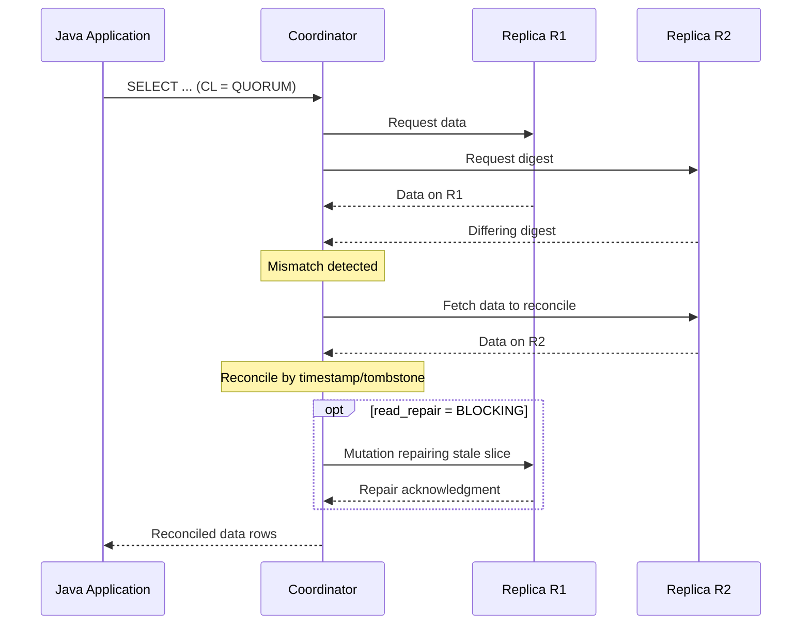

# Read Repair on the Cassandra Read Path and Its Scope of Guarantees

## 1. What Problem Does Read Repair Solve?

Apache Cassandra is a **distributed wide-column** database management system. Data is partitioned by **partition key**, replicated across multiple replicas per **replication factor (RF)**, and clients select a **consistency level (CL)** per operation. This underpins query-driven table design, CQL reads/writes, and Java application access.

In a distributed system, replicas holding the same partition do not always have identical state at every moment. For example:

- One replica temporarily lost connectivity while a new mutation arrived.
- A write received enough acknowledgments for quorum while the remaining replica lagged behind.
- Hinted handoff is still replaying, or a newly recovered replica lacks recent updates.
- Data drifted after a prolonged outage, requiring **anti-entropy repair**.

**Read repair** is a mechanism Cassandra uses **during certain reads** to detect divergent data among participating replicas and repair part of that discrepancy. It supports read-time consistency requirements, yet **it is not a full-cluster synchronization sweep**.

Example with RF = 3, partition key `sku = 'book-01'`:

| Replica | Currently Stored Value | Illustrative Logical Timestamp |
| --- | --- | --- |
| R1 | `stock = 10` | 100 |
| R2 | `stock = 12` | 200 |
| R3 | `stock = 12` | 200 |

If a `QUORUM` read compares R1 and R2, Cassandra detects the divergence. The coordinator reconciles per Cassandra's data rules, determines `stock = 12` wins in this example, and—depending on read-repair policy—may write the missing update back to the stale replica.

**Never misunderstand read repair as "picking the majority value across replicas."** Cassandra resolves cells by timestamp, tombstones, and cell rules. The number of responding replicas sets the observation scope; it never overrides version-resolution rules.

## 2. Where Does Read Repair Sit on the Read Path?

On a single replica, data can reside in the **memtable** and immutable **SSTables**. The read path can leverage Bloom filters, partition indexes, key cache, or row cache per configuration and query pattern. Those caches/metadata structures accelerate local lookup; they **do not replace cross-replica version comparison**.

Conceptually, a query requiring responses from multiple replicas passes through these steps:

1. **The coordinator identifies the partition and natural replicas** from the partition key and topology.
2. **Sends read requests** to eligible replicas. A common path fetches full data from one replica and a **digest** (compact summary) from others; exact selection and optimizations vary by version.
3. **Compares results/digests.** If compatible, the coordinator completes the read per CL. On a **digest mismatch**, the coordinator fetches the full data needed to compare.
4. **Reconciles values:** resolves timestamps, tombstones, TTLs, and differing versions to produce the correct result across the observed dataset.
5. **Read repair when configured:** sends repair mutations to out-of-date replicas within the **just-read data slice**; some modes wait for acknowledgment before returning.



This diagram is a learning model—not a fixed contract on request counts, selected replicas, or optimization order across every Cassandra release. If replicas return matching digests, **no write-back repair occurs**. Nor does read repair happen merely because a statement contains `SELECT`.

### What Does a Digest Mismatch Mean?

A digest represents the data within the query's scope. On a mismatch, the coordinator must fetch full content and reconcile; it cannot decide "which digest is newer" from hash values alone.

At low CLs like `ONE`, the coordinator can complete a read from **a single replica** without comparing two replicas. If that replica is stale, the result can be stale; never view `ONE` as automatically detecting and healing divergence. Even with `QUORUM`, a replica not participating in that read may remain stale.

## 3. Distinguishing Quorum Reads from Repairing All Replicas

Suppose one datacenter has RF = 3 with replicas R1, R2, and R3:

```text
State before read:
R1: stock=10 (stale)
R2: stock=12 (fresh)
R3: stock=12 (fresh)

Reading at LOCAL_QUORUM requires responses from 2 replicas in the DC.
Coordinator picks R1 and R2 -> detects mismatch -> reconciles stock=12.

If repair for R1 completes:
R1: stock=12
R2: stock=12
R3: stock=12 (already fresh)
```

In another scenario, suppose **R3 is also stale**, yet only R1 and R2 are queried for the request. After read repair between R1 and R2, **R3 may remain stale** because it was outside the repair scope.

| Concept | What It Guarantees / Controls | What It Does Not Guarantee |
| --- | --- | --- |
| `QUORUM` or `LOCAL_QUORUM` | Requires a majority of replicas to respond within scope | Every replica was checked and repaired |
| Read result reconciliation | Produces values from collected versions per Cassandra rules | Having observed all mutations across every replica |
| Blocking read repair | Waits for policy-required repair acknowledgments on mismatch | Having scanned the whole table, all partitions, and all replicas |
| `nodetool repair` | Anti-entropy tool to synchronize chosen token ranges/replicas | Replacing read CL or permanently preventing future replica drift |

Therefore, an application observing fresh data after read repair only proves the result was constructed **within the query, topology, and CL used**. Never conclude "the entire cluster is now repaired."

## 4. Two Read Repair Modes in Cassandra 4.x and Later

In Apache Cassandra 4.x/5.x, tables expose the `read_repair` option, notably:

| Mode | Primary Behavior | Trade-off |
| --- | --- | --- |
| `BLOCKING` | When read-path repair is triggered, the coordinator waits for policy-required repair acks before returning; default in Cassandra 4.x | Supports **monotonic quorum reads**, but can raise read latency and expose slow-replica issues |
| `NONE` | Does not perform read-path write-back read repair | Avoids a partial read repairing individual rows and breaking partition-level atomicity of multi-row mutations; loses monotonic quorum read guarantee provided by blocking read repair |

Verify your **actual Cassandra version** before relying on option names. Cassandra 3.x had different read-repair configurations/mechanics, including probabilistic background read repair in some releases; never carry old settings directly to 4.x/5.x without checking version documentation.

Example table using `BLOCKING`:

```sql
CREATE KEYSPACE IF NOT EXISTS read_repair_lab
WITH replication = {
    'class': 'NetworkTopologyStrategy',
    'dc1': 3
};

CREATE TABLE IF NOT EXISTS read_repair_lab.inventory_by_sku (
    sku text PRIMARY KEY,
    stock int,
    updated_at timestamp
) WITH read_repair = 'BLOCKING';
```

In Cassandra 4.x/5.x environments supporting this option, you can switch policies:

```sql
ALTER TABLE read_repair_lab.inventory_by_sku
WITH read_repair = 'NONE';

-- Switch back after evaluating consistency and latency requirements:
ALTER TABLE read_repair_lab.inventory_by_sku
WITH read_repair = 'BLOCKING';
```

**Note:** this setting applies at the **table** level; individual `SELECT`s cannot arbitrarily override table policy. Do not alter `read_repair` in production just to test an example without assessing application impact.

### `BLOCKING` Does Not Mean "Wait Until Every Replica Has New Data"

When a mismatch is detected and blocking read repair runs, Cassandra waits for the acknowledgments required by the mechanism and the read's CL. **There is no rule to wait for every replica cluster-wide.** Non-participating replicas or unqueried data slices can still remain unrepaired.

Furthermore, when data already matches and no mismatch is detected, `BLOCKING` does not generate extra repair writes.

### `NONE` Does Not Mean "Ignore Newer Data" on Read

When reading from multiple replicas and observing differing versions, Cassandra still **reconciles the read result** to return data matching query semantics. `NONE` skips the write-back repair step on the read path—it does not tell the coordinator to blindly return the first replica's stale row when divergence was seen.

## 5. Guaranteeing Monotonic Quorum Reads

**Monotonic reads** express the property that once a client observes a newer state, subsequent reads in the same scope will not suddenly revert to an older state. In Cassandra, this specifically refers to **monotonic quorum reads** backed by blocking read repair.

Suppose RF = 3 in one DC:

1. R1 and R2 hold newer version `v2`; R3 still holds `v1`.
2. The first `LOCAL_QUORUM` read happens to query R1 and R3, detecting a mismatch.
3. With `BLOCKING`, the coordinator finishes repairing the required scope before returning `v2`.
4. Subsequent `LOCAL_QUORUM` reads—even if picking a different replica pair—cannot revert to `v1` from an unrepaired quorum under the valid quorum model.

Quorum intersection rule within one RF set:

```text
RF = 3
Quorum size = floor(3 / 2) + 1 = 2

Any two quorum sets share at least one replica in common.
```

**Conditions required for this reasoning:** same partition/query scope, quorums within the same replica set (such as the same DC under `LOCAL_QUORUM`), and no concurrent writes, TTL expirations, or new deletes altering the value; timestamps, topology, and read paths are accurately accounted for. This is not a global guarantee across two datacenters using **non-overlapping** local quorums.

Monotonic quorum reads are also **distinct** from:

- **Linearizability:** all operations appearing atomic at a single global point in time.
- **Read-your-writes:** a client guaranteed to see its own just-executed write under all conditions and CLs.
- **Multi-partition atomicity:** entire batches/transactions spanning multiple partitions appearing together in a consistent snapshot.

Enabling `BLOCKING` alone does not provide those three guarantees.

## 6. Trade-Off: Monotonic Reads vs. Partition-Level Write Atomicity

For a mutation affecting **multiple rows within one partition**, Cassandra applies it atomically at the partition level. However, when one replica has the full update while another lags behind, a query reading only **part** of the partition can cause blocking read repair to repair only the queried rows.

Consider the table:

```sql
CREATE TABLE IF NOT EXISTS read_repair_lab.document_fields_by_id (
    document_id text,
    field_name text,
    value text,
    PRIMARY KEY ((document_id), field_name)
) WITH read_repair = 'BLOCKING';
```

The application updates two rows in the same partition together in a batch:

```sql
BEGIN BATCH
  UPDATE read_repair_lab.document_fields_by_id
  SET value = 'approved'
  WHERE document_id = 'doc-1' AND field_name = 'status';

  UPDATE read_repair_lab.document_fields_by_id
  SET value = 'reviewer-7'
  WHERE document_id = 'doc-1' AND field_name = 'reviewer';
APPLY BATCH;
```

Suppose one replica received both updates while another replica missed them. Next, the application queries only:

```sql
SELECT value
FROM read_repair_lab.document_fields_by_id
WHERE document_id = 'doc-1' AND field_name = 'status';
```

If read repair triggers for the **`status` row**, the stale replica gets `status` repaired while `reviewer` remains stale. Looking at physical state on that replica, two changes meant to move together are now present **partially/out of sync** due to slice repair. That is why Cassandra docs explain the trade-off between:

- `BLOCKING`: favors **monotonic quorum reads**.
- `NONE`: favors preserving **partition-level write atomicity** against partial read-repair side effects.

Do not mistake `NONE` for multi-partition ACID transactions or a guarantee that every read observes a global snapshot. It avoids one source of partial partition repair; applications still must account for CL, conditional mutations, concurrent writes, and data modeling.

### Choosing by Business Requirement

| Primary Requirement | Direction to Evaluate |
| --- | --- |
| Quorum reads must never "go backward" to stale values | `BLOCKING` with appropriate CL/quorum and clear awareness of its bounds |
| Multi-row single-partition mutations must avoid partial read repair | Evaluate `NONE` and test workload semantics |
| Conditional updates preventing lost updates | Use **LWT / `IF`** on appropriate keys; read repair does not replace CAS |
| Re-syncing replicas after prolonged outages | Schedule **anti-entropy repair** |
| Strong consistency across multiple partitions | Redesign data boundaries or use an external coordination/transaction mechanism |

## 7. Scope Limits of Read Repair: Boundaries to Remember

### 7.1. Only the Queried Data

Reading `WHERE sku = 'book-01'` never checks `sku = 'book-02'`. In tables with many clustering rows per partition, querying one clustering slice does not repair the remaining rows in that partition.

```sql
-- Inspecting only one row in partition doc-1:
SELECT value
FROM read_repair_lab.document_fields_by_id
WHERE document_id = 'doc-1'
  AND field_name = 'status';

-- Reading the entire partition has a wider scope:
SELECT field_name, value
FROM read_repair_lab.document_fields_by_id
WHERE document_id = 'doc-1';
```

Even the second query touches only the replicas contacted by the coordinator for that read. Never force the application to scan giant partitions hoping to heal the cluster; fix the partitioning model and use proper operational repairs.

### 7.2. Only Replicas Participating in That Read/Repair Flow

Cassandra selects replicas using topology, CL, node health, and read optimizations. Replicas **not contacted** can retain stale versions. Across multiple datacenters, `LOCAL_QUORUM` in one DC does not automatically update replicas in another DC.

### 7.3. Not a Substitute for Periodic Repair

These are two distinct operations:

| Criterion | Read Repair | Anti-Entropy Repair (`nodetool repair`) |
| --- | --- | --- |
| Trigger | On the read path when divergence is detected and policy permits | Operational command / scheduled maintenance |
| Scope | Data within executed queries and participating replicas | Token ranges, tables/keyspaces, and replicas per repair flags |
| Purpose | Reconcile read results and potentially heal queried slice | Compare and synchronize replicas across selected data ranges |
| Impact | Can add latency to live read queries | Generates background network, I/O, and CPU load while running |
| Substitutability | Insufficient for unread/cold data | Does not replace choosing read CL or read-time mismatch handling |

Hinted handoff is not an unlimited substitute either: hints have finite retention windows/configs, and replicas can miss mutations when hints expire or are disabled. Post-outage data recovery requires a proper repair strategy.

### 7.4. TTLs, Tombstones, and Clocks / Timestamps

Differences across replicas are not merely "a smaller number." Cassandra must handle cell timestamps, TTLs, and tombstones during reconciliation.

- Deletions are stored as **tombstones**, which must be retained so lagged replicas cannot resurrect deleted values.
- Expired TTLs do not erase data physically from all SSTables immediately.
- Writes with skewed custom timestamps can disrupt precedence rules even when read repair runs.
- Read repair does not replace tuning `gc_grace_seconds`, compaction strategies, or repair schedules.

Never proactively delete tombstones or drop `gc_grace_seconds` just "to make read repair faster"; doing so can resurrect deleted data.

## 8. Hands-On CQL Example

The exercise below shows how to configure and observe read behavior. It **does not intentionally break replicas** in production.

### Step 1 — Prepare Keyspace and Table

```sql
CREATE KEYSPACE IF NOT EXISTS read_repair_lab
WITH replication = {
  'class': 'NetworkTopologyStrategy',
  'dc1': 3
};

CREATE TABLE IF NOT EXISTS read_repair_lab.inventory_by_sku (
    sku text PRIMARY KEY,
    stock int,
    updated_at timestamp
) WITH read_repair = 'BLOCKING';
```

Substitute `dc1` and RF for your real cluster; this example assumes three replicas in one DC. On a single-node lab, RF = 3 with `LOCAL_QUORUM` will lack enough replicas to succeed.

### Step 2 — Write and Read by Partition Key

```sql
INSERT INTO read_repair_lab.inventory_by_sku
    (sku, stock, updated_at)
VALUES ('book-01', 12, '2026-11-20 10:00:00+0000');

SELECT sku, stock, updated_at
FROM read_repair_lab.inventory_by_sku
WHERE sku = 'book-01';
```

In `cqlsh`, set the session CL:

```text
CONSISTENCY LOCAL_QUORUM;
TRACING ON;
```

Re-run `SELECT`, inspect the trace if available, then turn tracing off:

```text
TRACING OFF;
```

Tracing reveals the coordinator, read stages, and timing details; **seeing no repair line in the trace does not mean read repair is broken**, because when replicas already match there is no mismatch to repair. Tracing adds load, so enable it only selectively for diagnostics.

### Step 3 — Inspect Table Options

In `cqlsh`, view the table schema:

```text
DESCRIBE TABLE read_repair_lab.inventory_by_sku;
```

Check the `read_repair` value printed with the schema. Exact display depends on version/tool; if your tool/version does not support the option, verify your Cassandra version before running `ALTER TABLE`.

### Step 4 — Simulating Replica Divergence

You cannot reliably force read repair via `INSERT`/`SELECT` on a healthy cluster. To test digest mismatches, use an **isolated test cluster** and controlled fault-injection tooling to make one replica lag/stale, then restore topology before comparing CLs. Never manually delete SSTable or commit log files to manufacture divergence.

In your lab notes, record:

1. RF, node count, and DC name.
2. Read/write CLs and table `read_repair` policy.
3. Before/after query results and participating replicas in traces.
4. Presence or absence of digest mismatches and write-back repair.
5. Read latency in `BLOCKING` vs. `NONE` under **identical test conditions**.

Never take a measurement on a cluster with zero mismatches and conclude `BLOCKING` and `NONE` always perform identically.

## 9. Using Java Driver 4.x for Explicit Read CL

Read repair is internal to Cassandra; Java applications **do not call a "repair" API per `SELECT`**. Applications choose appropriate queries and CLs, while `BLOCKING`/`NONE` lives in the table schema.

```java
import java.util.OptionalInt;

import com.datastax.oss.driver.api.core.CqlSession;
import com.datastax.oss.driver.api.core.DefaultConsistencyLevel;
import com.datastax.oss.driver.api.core.cql.BoundStatement;
import com.datastax.oss.driver.api.core.cql.PreparedStatement;
import com.datastax.oss.driver.api.core.cql.ResultSet;
import com.datastax.oss.driver.api.core.cql.Row;

public final class InventoryRepository {
    private final CqlSession session;
    private final PreparedStatement selectBySku;

    public InventoryRepository(CqlSession session) {
        this.session = session;
        this.selectBySku = session.prepare(
            "SELECT stock FROM read_repair_lab.inventory_by_sku WHERE sku = ?"
        );
    }

    public OptionalInt findStock(String sku) {
        BoundStatement statement = selectBySku.bind(sku)
            .setConsistencyLevel(DefaultConsistencyLevel.LOCAL_QUORUM);

        ResultSet result = session.execute(statement);
        Row row = result.one();
        if (row == null || row.isNull("stock")) {
            return OptionalInt.empty();
        }
        return OptionalInt.of(row.getInt("stock"));
    }
}
```

Here, `LOCAL_QUORUM` requires responses from a majority of replicas in the local DC. If the table uses `BLOCKING` and encounters a mismatch, latency can rise because the read waits on repair writes. A read timeout does not mean data was lost; distinguish network timeouts, slow replicas, lost quorum, contention, and disk saturation.

Never swap `LOCAL_QUORUM` for `LOCAL_ONE` just to bypass timeouts when business logic relies on quorum reads. Changing CL alters consistency boundaries, including the coordinator's ability to detect divergent replicas.

## 10. Diagnosing When Read Repair Impacts Latency

When queries suddenly slow down, separate read repair from other read-path causes: cache misses, large partitions, too many SSTables, tombstones, GC pauses, slow disks, and network latency between replicas and coordinator.

| Symptom | Possibilities to Examine | Diagnostic Action |
| --- | --- | --- |
| Quorum reads slow after a node outage | Recovered replica has stale data; digest mismatches/repairs rising | Inspect selective traces, logs, read-repair metrics, and node health |
| `ONE` is fast while `LOCAL_QUORUM` is slow | Quorum waits on more replicas; possible mismatches | Check per-replica latency, CL, network, and read repair |
| One specific partition is slow | Large partition, many tombstones/SSTables, or divergent data | Inspect partition model, queries, metrics, and compaction |
| Replicas still divergent after a long outage | Read repair misses unqueried slices; missing operational repair | Schedule appropriate anti-entropy repair |
| Switching to `NONE` reduces some slow reads | May eliminate blocking write-back repair on the read path | Re-evaluate monotonic quorum read and partition atomicity needs |
| Trace shows little or no repair steps | Data already matched or no mismatch compared | Never conclude read repair is broken from a single query |

Cassandra releases differ in JMX/metric names and scopes; check the metrics of your actual running version. `nodetool tablestats` helps inspect table read stats, but **does not prove a specific read repair just happened**. `nodetool repair` is a separate maintenance operation and should not be run blindly to see if a slow query clears up without assessing load and scope first.

### Performance, Availability, and Guarantees

Blocking read repair can increase read/write traffic on replicas during divergence while extending query completion time. If a replica needing repair fails to reply in time, clients may see timeouts. Disabling write-back repair via `NONE` cuts some of this cost while changing consistency semantics. Evaluate using **workload, SLAs, CL, topology, and mutation patterns** rather than optimizing a single latency chart in isolation.

## 11. Common Misconceptions

| Misconception | Accurate Understanding |
| --- | --- |
| "Every `SELECT` repairs all replicas." | Only detects mismatches on queried slices and participating replicas; not every query triggers repair |
| "`QUORUM` means all replicas are identical." | Quorum only requires a majority within scope; non-participating replicas may stay stale |
| "Read repair picks the majority value." | Cassandra reconciles by timestamps, tombstones, and cell rules; quorum does not vote on values |
| "`BLOCKING` linearizes every query." | It is a read/repair policy on mismatch that supports monotonic quorum reads under proper conditions |
| "`NONE` means no data reconciliation." | `NONE` skips write-back read repair; the coordinator still reconciles observed divergent data |
| "Read repair replaces `nodetool repair`." | Read repair never touches unread data; operational repair covers whole token ranges |
| "Caching makes read repair unnecessary." | Caching speeds up local access; it is not a cross-replica version sync mechanism |
| "Read repair is always safe for multi-row batches." | Repairing only queried slices can alter observable partition-level write atomicity |

## 12. Self-Assessment Practice Questions

**Exercise 1 — Quorum with one stale replica.** RF = 3; R1 holds `v1` while R2/R3 hold `v2`. A `LOCAL_QUORUM` read picks R1 and R2. Explain how divergence is detected, what gets reconciled, and which replica may be repaired under `BLOCKING`. If only R2 and R3 were picked, is read repair guaranteed to happen?

**Exercise 2 — Reading part of a partition.** A batch updates two clustering rows in the same partition. One replica missed the entire batch; a client `SELECT`s only one row, and read repair heals that row. Why can this affect partition-level write atomicity? When should `NONE` be considered?

**Exercise 3 — Never-read replicas.** An old partition exists on multiple replicas, yet applications have not read it for months. Will read repair reliably fix divergence in that partition? Which operational mechanism is required?

**Exercise 4 — Multi-DC Java application.** An app in DC1 uses `LOCAL_QUORUM` on a `BLOCKING` table. An app in DC2 uses its own `LOCAL_QUORUM`. Can we conclude all reads across both apps are globally monotonic? Why or why not?

**Guided answers:**

- Exercise 1: mismatch is detected via digest comparison; the coordinator fetches needed data, reconciles by timestamp/tombstone, and repairs R1 as needed. Picking R2 + R3 when both match may **detect no mismatch** and leave R1 unrepaired.
- Exercise 2: read repair heals only the queried row, leaving the sibling row stale on that replica. `NONE` avoids partial read-path write-back, though it does not solve multi-partition transactions.
- Exercise 3: no. Anti-entropy repair with proper scope and schedule is required rather than relying on read traffic.
- Exercise 4: no. Two local quorums in separate DCs may not overlap; analyze replication, write paths, and global requirements.

## 13. Pre-Adoption Checklist

- [ ] Identify the actual RF, DC names, and read/write CLs used by applications.
- [ ] Verify whether tables are configured with `read_repair = 'BLOCKING'` or `'NONE'` on your Cassandra version.
- [ ] Distinguish **returning a reconciled result** from **writing repair mutations back to replicas**.
- [ ] Understand read repair only touches the **data slice and replicas involved in that read**.
- [ ] Weigh the trade-off between **monotonic quorum reads** and **partition-level write atomicity**.
- [ ] Maintain a separate **anti-entropy repair** schedule for unread data and recovered replicas.
- [ ] Track digest mismatches, read latencies, node health, tombstones, and SSTables when investigating.
- [ ] Never treat read repair as LWT, multi-partition transactions, backups, or a substitute for query-driven partition key design.

**Key takeaway:** Read repair lets Cassandra detect and potentially heal divergent data **right on the read path** by comparing responses across queried replicas. `BLOCKING` supports monotonic quorum reads at the cost of extra latency and potential partial-partition repair; `NONE` omits read-path write-back repair to preserve partition-level write atomicity against that side effect. Read repair's scope is always narrower than token-range operational repair; reliable Java applications must combine CL, replication, schema, contention control, and anti-entropy repair workflows.
