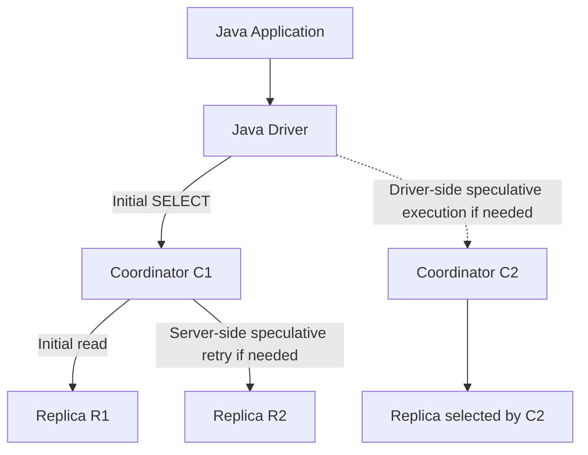

# Server-Side Speculative Retry and How It Differs from the Driver

> **Chapter:** Read Path and Caching  
> **Scope:** Apache Cassandra—a distributed *wide-column* database—and Java applications using Cassandra Java Driver 4.x.  
> **Objective:** Understand when a Cassandra coordinator sends an extra read request to another replica; distinguish this mechanism from driver speculative execution and retry policies; and evaluate its impact on latency, consistency, read amplification, and operations.

## 1. Scenario: One Slow Replica Stretches the Latency Tail

A Java API reads records by partition key. The table is replicated across three replicas (`RF = 3`). Most requests complete fast, yet occasionally the chosen replica is stalled on I/O, compaction, or CPU pressure. If the coordinator simply waits on that replica, the tail of the latency distribution (p95, p99) spikes even though healthy replicas are ready.

**Server-side speculative retry** is a mechanism where Cassandra proactively sends **an additional read request to another replica** when the initial read has not gathered enough responses within a configured time threshold. It is a form of *hedged read*: issuing extra work to raise the odds of an early reply.

The word "retry" in the name is misleading. It does **not necessarily mean re-sending after a failure**. The initial read may still be running, and the extra request can execute **in parallel** with it.

Suppose there are three replicas R1, R2, and R3. For a query needing one replica response, an illustrative timeline is:

```text
Client                    Coordinator                   Replica
   |                           |                            |
   | ---- SELECT key -------> | ---- read R1 ------------> R1 (slow)
   |                           |                            |
   |                           | -- threshold exceeded ->   |
   |                           | ---- read R2 ------------> R2 (fast)
   |                           | <--- result from R2 -------|
   | <---- result ----------- |                            |
   |                           |       R1 may still run     |
```

The wait threshold can be based on observed latency percentiles or a fixed duration, depending on policy configuration and Cassandra version. Once an extra response satisfies the consistency level, the coordinator completes the read earlier. **Never interpret this as Cassandra always sending two requests for every `SELECT`.**

## 2. Which Layer of the Read Path Owns Speculative Retry?

Pinpoint **coordinator** vs. **driver** clearly before configuring anything:



The two extra arrows have **different origins**:

- **Server-side speculative retry:** decided by **Cassandra coordinator C1**. C1 remains the coordinator for the original request; it selects an extra replica to read for that same request.
- **Driver-side speculative execution:** decided by the **Java Driver**. The driver sends **an additional execution of the same statement** to a different coordinator while the first execution has not yet finished.

The path through C2 can trigger **a whole new set of replica reads**. If both C1 and C2 also trigger server-side speculative retries, read load multiplies across both tiers. That is why you must understand the boundary before enabling both.

Related concepts with distinct purposes:

| Term | Who Decides? | When? | Primary Action |
| --- | --- | --- | --- |
| **Server speculative retry** | Cassandra coordinator | A replica read is slower than the table's policy threshold | Sends an extra read request to another replica |
| **Driver speculative execution** | Java Driver | An execution has not completed after a configured delay | Sends another execution of the statement to a different coordinator |
| **Driver retry policy** | Driver | An execution **already returned an error/timeout** and policy allows recovery | Decides whether to retry, switch nodes, or surface the error |
| **Read repair** | Cassandra | Version divergence must be resolved during reads under supported policy | Repairs inconsistent data across replicas |
| **Hinted handoff** | Cassandra | Target replica missed a write mutation under hint-eligible conditions | Stores and replays hints for the **write** path, not a hedged read |

Only the first three rows are directly compared when optimizing read tail latency; read repair and hinted handoff are not alternate names for speculative retry.

## 3. How Does the Server Decide to Issue an Extra Read?

Conceptually, a read request passes through these steps:

1. The driver sends `SELECT` to a coordinator.
2. The coordinator resolves the partition key, token-owning replicas, replica health, and required consistency level (`CL`).
3. The coordinator sends initial read requests to selected replicas. Depending on `CL` and version, requests may include full-data and digest reads to verify consistency.
4. If sufficient valid responses have not arrived and the table's speculative retry threshold is exceeded, the coordinator **may** send an additional read request to an unused eligible replica.
5. Once enough responses satisfy `CL` and required read checks finish, the coordinator returns the result or error per protocol.

This model describes behavior conceptually rather than representing every implementation branch across Cassandra 3.x, 4.x, 5.x, or CQL-compatible engines.

### Crucial Conditions

- **An eligible fallback replica must exist.** If `RF = 1` or every eligible replica was already contacted, speculative retry cannot invent an extra replica.
- **Consistency level stays unchanged.** A `LOCAL_QUORUM` read still needs `LOCAL_QUORUM` valid responses; querying an extra replica never downgrades the requirement to `ONE`.
- **Does not rescue systemic failures.** If replicas are slow because most nodes face I/O saturation, a hot partition, or shared network congestion, the extra request will likely be slow too.
- **Adds load.** Every extra replica read consumes CPU, network, memory, SSTable reads, and can pollute caches.
- **Not a data-model fix.** Wrong partition keys, overly wide scans, or heavy tombstone scans do not magically become cheap just by sending another read.

### Example with `RF = 3`

| Read `CL` | Minimum Valid Responses in One DC with RF=3 | Extra Read Opportunity |
| --- | --- | --- |
| `ONE` | 1 | Can try another replica if the first read is too slow |
| `LOCAL_QUORUM` | 2 | Can query the third replica if a response is still missing |
| `ALL` | 3 | No fourth replica exists in an RF=3 set; speculative retry cannot avoid waiting for all three |

This example assumes three eligible replicas in the same datacenter without special placement constraints. With multiple datacenters or different replication strategies, `LOCAL_QUORUM` calculations depend on the **local datacenter's RF**.

## 4. Configuring Server-Side Speculative Retry

### The `speculative_retry` Table Option

Apache Cassandra provides the `speculative_retry` table property. Common policies across versions include:

| Policy Form | Practical Meaning | Trade-off |
| --- | --- | --- |
| `NONE` | Do not proactively send hedged reads via table speculative policy | Zero extra load from this mechanism; higher tail latency exposure |
| `ALWAYS` | Tends to send extra hedged read requests whenever an eligible replica exists | May lower latency in some cases, but sharply increases read load |
| `99PERCENTILE` or version-supported percentile syntax | Uses observed read latency percentile as threshold | Adapts to latency distribution, yet the threshold is not a fixed SLO |
| Fixed time value such as `20ms` | Triggers after a fixed delay per supported version | Easy to relate to SLOs; can trigger massive fan-out during broad slowdowns |

**Exact syntax and valid values depend on Cassandra version.** Some docs or distributions use `99p`, `99PERCENTILE`, or other policy combinations. Check your running cluster's version documentation and live schema definitions before editing production. Never assume cluster defaults from this lesson alone.

Example for a lab environment supporting the syntax above:

```cql
CREATE TABLE IF NOT EXISTS lab.events_by_device (
    device_id text,
    event_time timestamp,
    event_id uuid,
    payload text,
    PRIMARY KEY ((device_id), event_time, event_id)
) WITH CLUSTERING ORDER BY (event_time DESC, event_id ASC);

ALTER TABLE lab.events_by_device
WITH speculative_retry = '99PERCENTILE';
```

To disable it for controlled comparisons:

```cql
ALTER TABLE lab.events_by_device
WITH speculative_retry = 'NONE';
```

Illustrative fixed-threshold example where supported by your version:

```cql
ALTER TABLE lab.events_by_device
WITH speculative_retry = '20ms';
```

These commands assume keyspace `lab` exists; never run them on production tables without validating policy, load impact, and rollback plans.

### A Percentile Is Not a Latency Guarantee

Suppose the 99th percentile of relevant coordinator read measurements is roughly 80 ms. Under the corresponding policy, speculative retry triggers if the read lacks sufficient responses past that threshold. That **does not mean 99% of requests finish under 80 ms**, nor does it guarantee an 80 ms API p99. End-to-end time also includes:

- Waiting in the Java Driver and connection queues.
- Client–coordinator network hops.
- Replica reads, digests, and reconciliation when needed.
- Result streaming, paging, serialization, and application processing.

In particular, under rapidly shifting load, a threshold based on past percentiles can lag or cause many concurrent requests to fire hedged reads simultaneously.

## 5. Java Driver Speculative Execution: The Client-Tier Counterpart

Java Driver 4.x includes a speculative execution policy that sends the same statement to **another coordinator** after a configured delay if the initial request has not yet completed.

Example HOCON configuration in standard Java Driver 4.x layout:

```hocon
datastax-java-driver {
  advanced.speculative-execution-policy {
    class = ConstantSpeculativeExecutionPolicy
    delay = 100 milliseconds
    max-executions = 2
  }
}
```

With a constant policy, the driver schedules additional executions at `delay` intervals while no response has arrived, up to the `max-executions` limit enforced by your driver version. This is an **experimental example**, not an optimal value or default recommendation. Check exact syntax and parameter definitions for your driver version.

### The Idempotence Requirement

The driver must know a statement can be safely re-executed without unintended side effects. For standard `SELECT`s, you can mark the statement **idempotent**, allowing the driver to apply its configured speculative execution policy.

Java Driver 4.x example:

```java
import com.datastax.oss.driver.api.core.CqlSession;
import com.datastax.oss.driver.api.core.DefaultConsistencyLevel;
import com.datastax.oss.driver.api.core.cql.BoundStatement;
import com.datastax.oss.driver.api.core.cql.PreparedStatement;
import com.datastax.oss.driver.api.core.cql.ResultSet;
import com.datastax.oss.driver.api.core.cql.Row;
import java.time.Instant;
import java.util.UUID;

public final class DeviceReads {
    private final CqlSession session;
    private final PreparedStatement read;

    public DeviceReads(CqlSession session) {
        this.session = session;
        this.read = session.prepare(
            "SELECT event_id, event_time, payload " +
            "FROM lab.events_by_device " +
            "WHERE device_id = ? AND event_time >= ? " +
            "LIMIT ?"
        );
    }

    public void readRecent(String deviceId, Instant from, int limit) {
        if (limit < 1 || limit > 100) {
            throw new IllegalArgumentException("limit must be between 1 and 100");
        }

        BoundStatement statement = read.bind(deviceId, from, limit)
            .setConsistencyLevel(DefaultConsistencyLevel.LOCAL_QUORUM)
            .setIdempotent(true)
            .setPageSize(limit);

        ResultSet result = session.execute(statement);
        for (Row row : result) {
            UUID eventId = row.getUuid("event_id");
            Instant eventTime = row.getInstant("event_time");
            String payload = row.getString("payload");
            System.out.printf("%s %s %s%n", eventId, eventTime, payload);
        }
    }
}
```

This example assumes `CqlSession` is connected and the keyspace/table exists. `setIdempotent(true)` is a **declaration of re-execution safety**, not a per-statement switch turning on speculative execution. The driver also needs a configured policy and a fallback coordinator available.

**Never mark arbitrary statements idempotent blindly.** Counter updates, operations with external side effects, timestamp-sensitive behaviors, or non-repeatable mutations must be evaluated individually. With speculative execution, two executions run **concurrently**; risks cannot be wished away by assuming the first attempt failed.

### Where Does the Driver Send the Extra Execution?

Typically, the driver uses its host-selection policy and connection state to try another coordinator. The two executions may reach C1 and C2, yet **both coordinators may still query overlapping replicas**.

Consequently:

- Two different coordinators do **not** guarantee two disjoint replica sets.
- Client–coordinator network requests increase, and total replica read volume increases too.
- The slow original request does not "roll back" work already done simply because the hedged attempt returned first.

## 6. Do Not Confuse Speculative Execution with the Driver Retry Policy

You can distinguish them by their **triggering event**:

```text
                  A SELECT waiting for reply
                            |
                   +--------+--------+
                   |                 |
           Slow beyond threshold   Error / timeout returned
                   |                 |
          Speculative execution    Retry policy evaluates
          sends parallel attempt   error and picks action
                   |                 |
           Two concurrent attempts May fail, retry,
           may be in flight        or try next coordinator
```

The driver retry policy handles **error responses** according to idempotence and consistency rules. Speculative execution targets **wait time before receiving a result**, even when the original request has not failed.

One query can experience both mechanisms in complex incidents, so during debugging record which coordinator received the request, which extra executions fired, what errors occurred, and which execution returned to the client.

In particular, never assume a timeout means the server did nothing. For non-idempotent writes, driver retries can produce unintended outcomes. This lesson focuses on the **read path** precisely because speculative reads are far easier to keep safe than speculative writes.

## 7. How Much Load Does Each Mechanism Add?

Estimates illustrating *request amplification*:

| Scenario | Client → Coordinator | Coordinator → Replica | Key Risk |
| --- | --- | --- | --- |
| No speculation | 1 request | Initial reads needed for CL | Tail latency if one replica is slow |
| Server speculative retry only | 1 request | Potential extra read to another replica | Higher read I/O on replicas |
| Driver speculative execution only | Up to 2 concurrent executions | Each coordinator runs its own read path | Duplicate work across coordinators/replicas |
| Both server and driver enabled | 2 or more executions | Each coordinator may also fan out to extra replicas | Multi-tier fan-out and resource contention |

This is a **qualitative model**, not a fixed-count guarantee. Actual executions depend on `CL`, RF, topology, policy settings, replica health, and whether requests finish before thresholds fire.

Consider a system where p99 rises because disks across all replicas are saturated. Aggressive speculative retry **pours even more reads** onto those same disks, making p99 worse. Conversely, if one outlier replica lags while peers have spare headroom, moderate speculative reads can shave off the latency tail.

Thus, **hedging is not a way to add serving capacity**. It trades extra resource consumption for a higher probability of fast completion.

## 8. Impact of Caches, SSTables, and Query Patterns

Speculative retry sits inside **Read Path and Caching**, yet is not a cache itself. A replica can be fast or slow depending on:

- **Key cache / row cache (if enabled):** hits/misses alter I/O; each replica has independent cache state.
- **Bloom filters, partition index, index summary:** govern SSTable/partition lookups and disk seeks.
- **SSTables and compaction:** partitions spread across many SSTables or active compaction raise tail latency.
- **Tombstones:** queries scanning many deletion markers run slowly on **every** replica; speculative retry never removes tombstones.
- **Partition size and query shape:** massive partitions, wide slices, or expensive `ALLOW FILTERING` queries cannot be fixed by hedging.
- **Repair and replica health:** data drift, errors, or overloaded replicas add read overhead.

A reply from a second replica may arrive faster due to a warm cache, cleaner SSTables, or lighter node load. Yet there is no guarantee the second replica is always faster; measure real operational telemetry.

### Speculative Retry Never Alters Read Data Semantics

Suppose a client sets `LOCAL_QUORUM`; issuing an extra read must still obey response-combining and reconciliation rules for that CL. Speculative retry must never be treated as lowering CL, skipping distributed data checks, or replacing replication/repair design.

If your business requires strict conditional updates, use LWTs and appropriate locking/key design. Server speculative retry on reads never turns a plain `SELECT` + `UPDATE` pair into an atomic transaction.

## 9. Observing and Verifying Which Tier Sends Extra Requests

You need **two independent telemetry streams**: server and driver.

### Server Side

Depending on Cassandra version and monitoring setup, collect:

- Per-table read latency histograms, including p95/p99 and throughput.
- Metrics/tracing for speculative retries and extra replica reads.
- Replica health: CPU, disk, pending read tasks, dropped messages, compaction, GC, and network.
- Read timeout rates and completed vs. total request counts.

In test environments, `cqlsh` offers tracing:

```cql
TRACING ON;

SELECT event_id, event_time, payload
FROM lab.events_by_device
WHERE device_id = 'sensor-01'
LIMIT 20;

TRACING OFF;
```

Tracing reveals a query's execution path and can help spot extra read activity. **Event names vary across versions**, so never build automated checks matching one hardcoded log string. Tracing incurs overhead; never leave it enabled broadly in production.

Note that a fast read **will not trigger** speculative retry. Observing the mechanism requires representative load and enough samples—never break a production node just to capture a trace.

### Driver Side

Collect:

- Counts of **speculative executions** initiated by the driver and how often a speculative attempt won.
- Client-observed latency, retries/timeouts, and selected coordinator.
- Open connections, queued requests, saturation, and per-host in-flight counts.
- End-to-end Java API latency, especially p95/p99 per query type.

Never infer "the driver speculated" merely because Cassandra server speculative-retry metrics rose. Conversely, the driver can issue two executions even when the server table has `speculative_retry='NONE'`.

### Easy-to-Misread Log Timeline

```text
15:00:00.000  Driver sends SELECT to Coordinator C1
15:00:00.040  C1 sends extra read to R3 (server speculative)
15:00:00.100  Driver still waiting, sends SELECT to C2
15:00:00.125  C2 returns result to driver
15:00:00.150  C1 finishes too late
```

This is an **illustrative timeline**, not raw Cassandra logs. One Java call spawned two coordinator executions plus one server-side speculative retry inside C1. Looking only at the final 125 ms latency without tracking read counts hides the true resource cost.

## 10. Controlled Comparative Experiment

Practice in a lab cluster with at least one partition replicated across multiple replicas, realistic test data, and metric access. Never inject faults into production.

### Step A — Prepare a Partition-Key Query

```cql
INSERT INTO lab.events_by_device
  (device_id, event_time, event_id, payload)
VALUES ('sensor-01', '2026-11-21T03:00:00Z',
        11111111-1111-4111-8111-111111111111, 'ok');

SELECT event_id, event_time, payload
FROM lab.events_by_device
WHERE device_id = 'sensor-01'
LIMIT 20;
```

This single test only illustrates a valid partition-key query; measuring real p99 requires many partitions, realistic data sizes, concurrent reads, and production-like load distributions.

### Step B — Measure Baseline

Disable server-side speculative policy on the lab table and leave driver speculative execution off, then measure **p50/p95/p99**, throughput, CPU, disk I/O, timeouts, and actual replica read counts.

### Step C — Enable One Tier at a Time

1. Enable server speculative retry on the table while keeping driver defaults. Measure latency **and** extra replica reads.
2. Reset the server to baseline, then enable driver speculative execution **strictly for idempotent SELECTs**. Measure latency and coordinator execution counts.
3. If needed, test both with explicit caps; verify whether marginal latency gains justify the compounded load.

Test under both low and high load, warm/cold caches, and when one replica lags behind peers. For every run, record Cassandra version, driver version, RF, CL, and policy settings so results remain reproducible.

### Step D — Use Quantitative Decision Criteria

| Metric | Question to Answer |
| --- | --- |
| API and Cassandra read p95/p99 | Did tail latency drop enough to meet SLOs? |
| Total replica reads per client read | How much extra work is each request paying? |
| Speculative triggers vs. wins | Is hedging firing too often without winning? |
| CPU, disk I/O, network, compaction, pending tasks | Does the cluster have headroom when fan-out rises? |
| Timeouts, retries, error rates | Do errors spike under peak load? |
| Fast vs. slow node gap | Are we masking an outlier or a cluster-wide bottleneck? |

**Hypothetical example:** API p99 drops from 220 ms to 160 ms, yet read I/O jumps 80% on a near-saturated cluster. That is rarely a safe trade-off. Conversely, a sizable p99 drop for only 2–3% extra reads on a cluster with ample headroom may be well worth it. Decide against your own SLOs and resource budgets.

## 11. Decision Matrix Across Scenarios

| Context | First Consideration | Explanation |
| --- | --- | --- |
| One replica is intermittently slow; peers have headroom | Moderate server speculative retry | Can fetch from a spare replica without duplicating coordinator execution |
| Tail latency sits at coordinator, client–coordinator link, or overloaded host | Driver speculative execution for idempotent `SELECT`s | Routing to another coordinator bypasses coordinator-tier bottlenecks |
| Driver already fires multiple executions while server also fans out | Cap one or both policies and re-measure | Prevents multiplicative load amplification |
| RF=1 or CL requires every replica to reply | Fix local read path, load balance, and root failures | No spare replica exists for hedging |
| Tombstone scans or hot partitions across all replicas | Fix table model, TTLs, queries, and compaction | Hedged reads hit the exact same local cost |
| Queries spike only when one node has GC/I/O pauses | Investigate the sick node alongside hedging evaluation | Speculation hides symptoms without curing root causes |
| Non-idempotent writes, counters, or side effects | Do not enable speculative execution blindly | Concurrent dual execution can corrupt business results |

### Recommended Order of Analysis

First analyze the **actual read path**: partition keys, rows returned, caches, SSTables, and replicas awaited. Next measure whether the tail sits **at replicas** or **at the coordinator/client link**. Only once the bottleneck tier is clear should you test its matching policy—always with bounded fan-out and resource metrics.

Never pick `ALWAYS` or ultra-short delays merely because a few test calls look faster. Under concurrent spikes, simultaneous speculative reads surge right when the cluster has the least spare capacity.

## 12. Common False Claims

**"Cassandra server speculative retry and Java Driver retry are the same mechanism."** False. One runs on the coordinator when a replica is slow; driver retry handles errors, and driver speculative execution is a third distinct mechanism.

**"Enabling server speculative retry creates a second coordinator."** False. The original coordinator sends an extra read to another replica; a second coordinator is only contacted when the driver issues a separate execution or reroutes.

**"Speculative retry lets `LOCAL_QUORUM` finish with one response."** False. CL never drops; a spare replica simply helps gather the required valid responses sooner.

**"Setting `99PERCENTILE` makes API p99 equal that threshold."** False. It only sets a trigger threshold on part of the coordinator's read path, not an end-to-end latency SLA.

**"Enabling both tiers together is always faster."** False. Each extra driver execution can trigger multiple replica reads; if replicas are saturated, multi-tier fan-out makes things worse.

**"Use speculative execution for every `UPDATE` because Cassandra writes are idempotent."** False. Idempotence must be evaluated per statement, including counters, timestamps, LWTs, and side effects—never assumed from CQL verb alone.

**"Seeing a request timeout means the replica did no work."** False. Timeout only means the reply missed the deadline; server-side work may still have executed.

## 13. Self-Check Exercises

1. RF=3, CL=ONE: R1 is slow while R2 is healthy. What can the coordinator do when `speculative_retry` allows, and which node remains coordinator?
2. RF=3, CL=ALL: Why doesn't sending "one more read" across the same three replicas bypass waiting for all three?
3. The driver sets a 100 ms delay and the table triggers server speculation after 40 ms. If a query has not finished by 120 ms, which extra branches may already be in flight?
4. Compare the triggering event of the driver **retry policy** vs. driver **speculative execution**.
5. Why must `setIdempotent(true)` be genuinely true for business logic? Does it enable speculative execution on its own, or merely permit the driver to apply its policy?
6. After enabling hedging, p99 drops yet CPU and disk I/O surge. Which extra metrics will you gather before deciding to keep the policy?
7. If every replica scans huge numbers of tombstones, which should you fix first: speculative policy or data model and queries?
8. Explain why changing `speculative_retry` never alters a table's consistency level or replication factor.

## 14. Key Takeaways

- **Server speculative retry:** a single coordinator sends an extra read to another replica when the initial read path lags.
- **Driver speculative execution:** the driver sends another execution of the same statement to a different coordinator before the first completes; restrict strictly to verified idempotent statements.
- **Driver retry policy:** reacts to errors or timeouts on a failed attempt, unlike pre-error hedging.
- **Consistency remains unchanged:** every read must still satisfy its query CL; fan-out never replaces replication or repair.
- **Account for total cost:** one Java call can spawn multiple coordinator executions and multiple replica reads; monitor both tiers together.
- **How to evaluate:** measure p95/p99 **alongside** extra read counts, throughput, and CPU/I/O load on production-like data.

**Core message:** Speculative retry trades extra server resources to cut the risk of waiting on one slow replica; driver speculative execution uses another coordinator to avoid waiting on a slow execution. Target the exact tier causing tail latency, cap fan-out, and measure whole-system impact.
