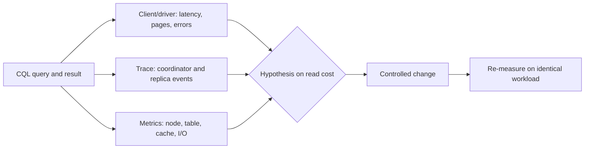

# Correlating Traces, Metrics, and Results to Pinpoint Read Cost

## 1. The Problem: A Query Returning Few Rows Can Still Be Very Expensive

In Apache Cassandra, reading a partition is not merely fetching a row from disk. The coordinator selects replicas based on **partition key, replication, and consistency level**; each replica may read from the **memtable**, check **Bloom filters**, locate data in **SSTables**, merge multiple versions and tombstones, and return data or a digest to the coordinator. The coordinator may reconcile replies across multiple replicas before returning results. End-to-end latency seen by a Java application also includes network hops, scheduling, paging, and client-side decoding.

This creates a common paradox: a `LIMIT 20` query returns only 12 rows yet takes hundreds of milliseconds. The number **12 returned rows** reveals nothing about how many SSTables replicas read, how many tombstones were scanned, how long network waits took, or how many pages were fetched.

This lesson belongs to the **Read Path and Caching** chapter of the `DATABASE_ENGINE_WIDE_COLUMN_CASSANDRA` module. Its scope covers distributed architecture, wide-column and query-driven table design, partition keys, read/write consistency levels, compaction, repair, error handling, and Java connectivity. The goal is to investigate **read cost by correlating three evidence sources**:

1. **Query results and client telemetry:** did it return the right data, how many rows/pages/bytes, how long did it take, and did timeouts/retries occur?
2. **Query trace:** which nodes, stages, and wait intervals did that specific execution pass through?
3. **Metrics:** over a representative window, did node/table latency, SSTable counts, tombstones, cache misses, queues, I/O, or error rates climb?

After this lesson, you will be able to run controlled tracing, read relevant metrics, form bottleneck hypotheses, and re-verify under identical query conditions—without extrapolating cluster-wide performance from a single trace.

## 2. Three Complementary Perspectives

| Perspective | Observation Scope | Questions It Answers Well | Blind Spots |
| --- | --- | --- | --- |
| **Client results & latency** | One request/page or full read loop in the app | What did the user get? How long did it take? Any retries, paging, deserialization? | Does not pinpoint whether cost sits in replica, coordinator, or client. |
| **CQL trace** | One traced execution and its recorded events | Which nodes ran it? Which stages waited or read heavily? | Adds overhead; events are not guaranteed complete; does not show cluster-wide p95/p99 distributions. |
| **Node / table / cache metrics** | Many requests on a node over a time window | Trends, tail latency, tombstones, SSTables per read, cache hits/misses, queues? | Does not isolate one query when multiple workloads share the node. |

An approximate view of end-to-end time:

```text
Application-observed time
  ≈ client/driver wait + network
    + coordinator/replica serving the request
    + decoding/processing results
    + fetching subsequent pages (if the app reads all rows)
```

This is a **conceptual breakdown**, not an instruction to sum `source_elapsed` values in a trace. Stages overlap concurrently and metrics span different scopes. Measuring until the first page arrives is often far shorter than measuring until **all pages are consumed**.



## 3. Running Example: Reading Sensor Data by Day

Suppose we have a practice keyspace `read_lab_ks` with replication matching the lab topology. On a single-DC three-node cluster, you can create the following (replace `dc1` with your actual DC name):

```sql
CREATE KEYSPACE read_lab_ks
WITH replication = {'class': 'NetworkTopologyStrategy', 'dc1': '3'};

CREATE TABLE read_lab_ks.events_by_device (
    device_id text,
    bucket_day date,
    event_ts timestamp,
    event_id uuid,
    temperature decimal,
    payload text,
    PRIMARY KEY ((device_id, bucket_day), event_ts, event_id)
) WITH CLUSTERING ORDER BY (event_ts DESC, event_id ASC);
```

If your lab has a different node count, adjust **RF on the test keyspace** to match your topology and learning goal; an RF higher than available nodes in the DC makes `LOCAL_QUORUM`/`ALL` unachievable. Never alter replication on production keyspaces for a lab exercise.

```sql
INSERT INTO read_lab_ks.events_by_device
    (device_id, bucket_day, event_ts, event_id, temperature, payload)
VALUES
    ('sensor-7', '2026-11-21', '2026-11-21T08:00:00+0000',
     11111111-2222-3333-4444-555555555555, 27.1, 'sample-a');

INSERT INTO read_lab_ks.events_by_device
    (device_id, bucket_day, event_ts, event_id, temperature, payload)
VALUES
    ('sensor-7', '2026-11-21', '2026-11-21T08:01:00+0000',
     aaaaaaaa-bbbb-cccc-dddd-eeeeeeeeeeee, 27.4, 'sample-b');
```

Read a slice within the partition:

```sql
SELECT event_ts, event_id, temperature, payload
FROM read_lab_ks.events_by_device
WHERE device_id = 'sensor-7'
  AND bucket_day = '2026-11-21'
  AND event_ts >= '2026-11-21T08:00:00+0000'
  AND event_ts <  '2026-11-21T09:00:00+0000'
LIMIT 100;
```

In this schema, the **composite partition key** is `(device_id, bucket_day)`; `event_ts` and `event_id` are clustering columns. The query routes to a single partition and bounds the clustering range, making it clean for read-cost analysis. Two sample rows only confirm syntax; real performance testing requires representative data volumes, versions, tombstones, and load.

### Always Record the Query Context

Before measuring, lock down the **exact CQL and bound values**, keyspace, schema, Cassandra version, consistency level, measurement window, DC and coordinator, page size, pages read, returned row/byte counts, and client timing method. Hold these constant across comparisons; changing CL and page size together makes results ambiguous.

## 4. Enabling Tracing Properly in `cqlsh`

The commands below are for test environments or a **selectively sampled request**:

```sql
CONSISTENCY LOCAL_QUORUM
PAGING 100
ELAPSED ON
TRACING ON

SELECT event_ts, event_id, temperature, payload
FROM read_lab_ks.events_by_device
WHERE device_id = 'sensor-7'
  AND bucket_day = '2026-11-21'
  AND event_ts >= '2026-11-21T08:00:00+0000'
  AND event_ts <  '2026-11-21T09:00:00+0000'
LIMIT 100;

TRACING OFF
```

`TRACING ON` makes `cqlsh` print trace events after the query completes; `ELAPSED ON` prints `cqlsh`-observed duration; `PAGING 100` sets the page size in **rows**. If a result spans multiple pages, fetching subsequent pages generates additional read work; always record whether you read **one page** or **the full result set**.

Trace output typically has columns like:

```text
Tracing session: <session-uuid>

activity                        | timestamp            | source       | source_elapsed | client
--------------------------------+----------------------+--------------+----------------+---------
Execute CQL3 query              | ...                  | 192.0.2.10   |              0 | ...
... send read request to replica| ...                  | 192.0.2.10   |           ...  | ...
... process partition/SSTables  | ...                  | 192.0.2.11   |           ...  | ...
... receive response            | ...                  | 192.0.2.10   |           ...  | ...
...                             | ...                  | ...          |            ... | ...
```

This is an **illustrative layout**, not live log output. Exact `activity` strings and which events appear vary by Cassandra version, CL, cache state, and read path. Inspect the meaningful fields:

- **Session ID:** used to retrieve this execution's trace later.
- **`source`:** node emitting the event; distinguish coordinator from replicas.
- **`activity`:** recorded step such as sending/receiving messages, reading SSTables, merging, or reconciling data; never hardcode interpretation to one version's exact string.
- **`timestamp` and `source_elapsed`:** help reconstruct timeline order within a trace; **never sum all `source_elapsed` numbers** as total latency, since timestamps come from nodes and parallel stages.
- **Total time and results:** compare against `ELAPSED`/driver latency and returned row counts, keeping tracing overhead in mind.

Once you have a session ID, `cqlsh` can display it again with:

```text
SHOW SESSION <session-uuid>
```

`SHOW SESSION` is a **`cqlsh` command**, not SQL; replace the placeholder with the UUID printed by the trace. Alternatively, query the system trace tables after turning tracing off to reduce noise:

```sql
SELECT session_id, coordinator, duration, request, started_at
FROM system_traces.sessions
WHERE session_id = 12345678-1234-1234-1234-123456789abc;

SELECT event_id, activity, source, source_elapsed, thread
FROM system_traces.events
WHERE session_id = 12345678-1234-1234-1234-123456789abc;
```

The UUIDs above are **placeholders**, not real trace sessions. Traces are persisted asynchronously with a configured TTL; events can arrive late or be dropped, so an empty query does not prove a request never ran. Never leave tracing enabled continuously across production load: trace collection adds work, stores extra data, and can record sensitive CQL or bound values.

## 5. Reading a Trace Across the Distributed Read Path

For a partition read, trace events are commonly grouped into these stages:

| Event Group / Stage | What to Check | What Can Be Inferred With Supporting Evidence |
| --- | --- | --- |
| Coordinator receives and parses query | Is the coordinator busy, parsing/preparing repeatedly, or running mixed queries? | Prepared statements and driver routing cut some overhead, though they cannot fix schema flaws. |
| Replica selection and request dispatch | How many replicas were contacted, DC/rack, CL, response wait? | Cross-DC hops or a slow node can inflate tail latency. |
| Replica reads memtable/caches/SSTables | Many SSTables, Bloom filters, or merge/reconciliation steps? | High read amplification, fragmented data, or tombstones can drive CPU/I/O. |
| Digest / data responses | How were full data and digests requested per CL and version? | Coordinator may spend extra effort reconciling; never infer read repair from digests alone. |
| Read repair / speculative retry (if present) | Extra read branches or replica divergence? | Potential extra network/CPU cost; confirm with metrics and replica state. |
| Serialization / paging and return | Page size, row size, page count, client wait time | Large payloads or many pages can dominate end-to-end duration. |

**A large time gap between two lines is not necessarily the cost of the operation between them**: events can log asynchronously; nodes can have clock skew; and traces do not capture all client-side wait time. Look for **repeated patterns** across multiple traces of the same query type, then cross-check node metrics over the matching window.

### Caching Shows Up Indirectly

Cassandra uses multiple read-support layers:

1. **Memtable:** holds unflushed mutations and can satisfy part of a read.
2. **Key cache:** accelerates locating partition offsets in SSTables; **never caches full `SELECT` results**.
3. **Row cache:** caches data per version/table rules and limits; may be disabled and is not effective for every query.
4. **Chunk cache / OS page cache / buffers:** reduce repeated block reads depending on version and config.
5. **Bloom filters, partition index, index summary:** skip or narrow SSTable lookups; Bloom filters are probabilistic structures, **not a cache of returned rows**.

Fewer SSTable accesses on a second traced read may suggest data was in the memtable or cached, yet **traces alone cannot prove cache hits**. Check hit/miss metrics and repeated-workload tests.

## 6. Collecting Metrics from the Right Nodes, Tables, and Time Windows

Common administrative commands:

```bash
# Node and lab table overview
nodetool status
nodetool tablestats read_lab_ks.events_by_device
nodetool tablehistograms read_lab_ks.events_by_device

# Coordinator and queue overview
nodetool proxyhistograms
nodetool tpstats

# If compaction I/O contention is suspected
nodetool compactionstats
```

`nodetool` normally queries **a single node**. For distributed incidents, collect metrics from **the coordinator and the actual participating replicas**, not only the host the app connects to. `tablestats` and `tablehistograms` inspect table-level stats; `proxyhistograms` gives an aggregate coordinator view—**it does not prove one single table caused the spike**. `tpstats` surfaces thread pool backlogs, while `compactionstats` shows compaction pressure.

To track p95/p99, throughput, and minute-by-minute shifts, your monitoring pipeline should scrape Cassandra metrics via **JMX or a metrics collector**. Some versions/setups also expose metrics via virtual tables; check actual support. Many metrics are **cumulative counters since node startup**: compute **deltas/rates over a window**, never compare cumulative totals across two nodes or across restarts as current rates.

### Essential Read-Path Metric Groups

| Metric / Group | Observation Layer | How to Use When Correlating Traces |
| --- | --- | --- |
| `ClientRequest.Read.Latency`, `Timeouts`, `Failures`, `Unavailables` | Coordinator | When p99 and errors spike on coordinator, isolate request handling/network/replicas and capture matching traces. |
| `Table.CoordinatorReadLatency` | Coordinator, per table | Identifies which table/workload drives coordinator read latency; not a local disk metric. |
| `Table.ReadLatency` | Replica, per table | Local read cost; compare against coordinator/client latency to isolate network, peer waits, or client work. |
| `Table.SSTablesPerReadHistogram` | Replica, per table | Number of SSTable data files accessed per partition read; high values point to read amplification. |
| `Table.TombstoneScannedHistogram`, `TombstoneWarnings`/`Failures` | Replica, per table | Tombstones scanned, warnings, and aborts; explains queries returning few rows yet scanning deleted/TTL data. |
| `Table.LiveScannedHistogram` | Replica, per table | Live cells scanned; high values indicate wide partitions or broad slices. |
| `Table.LiveSSTableCount`, `Compaction.PendingTasks` | Replica, per table or compaction | Context for SSTable accumulation and lagging compaction; never claim causation from one number alone. |
| `Table.KeyCacheHitRate`; `Table.RowCacheHit/Miss` | Local cache, per table | Confirms whether caching is active; interpret rates alongside request counts and config. |
| `Cache.KeyCache/RowCache/ChunkCache` | Node-wide cache | Use `HitRate`, `Hits/Misses`, and `Size`/`Capacity` to see which caches are hot vs. missing. |
| `Table.BloomFilterFalseRatio` | SSTable lookup | False positives add extra lookups; not synonymous with row-cache misses or total disk I/O. |
| `Table.SpeculativeRetries` | Coordinator, per table | Rising counts indicate coordinator hedging around slow tails; inspect slow replicas and CL. |
| Thread pool pending/dropped messages, CPU/GC, disk latency, network | Node / host | If traces show big gaps while table read metrics look normal, inspect queues, CPU, I/O, and network. |

**Note:** `SSTablesPerReadHistogram` counts SSTables **actually opened during a partition read**; SSTables pruned by Bloom filters, min/max keys, or partition indexes are not necessarily counted. A high `BloomFilterFalseRatio` adds lookup work without automatically explaining high p99. High cache hit rates likewise cannot eliminate network or large-page latency.

Never use a cluster-wide average latency as proof representing a hot table's p99. Break metrics down **by node, DC, table, and time window**. Two nodes with different traffic or one node after restart cannot be compared via raw cumulative counters.

## 7. Correlating All Three Sources: Six-Step Investigation Workflow

### Step 1 — Confirm Real Cost and Define the Measurement

Record **end-to-end p50/p95/p99 latency** per query type, timeouts, throughput, and rows/bytes per page. Separate time to **first page** from time to **exhaust all pages**. Check driver retries and speculative execution: one API call can generate multiple CQL executions.

### Step 2 — Verify Query Validity and Results

Verify the schema and `WHERE` clause supply the **full partition key**, check for multi-partition scans or `ALLOW FILTERING`, check for overly wide ranges, and remember `LIMIT` caps **live rows** while scans may read far more. Record actual returned row counts, types, and `payload` sizes; never equate `LIMIT` with an I/O budget.

Wrong or missing rows require separate investigation: consistency level, TTL, timestamps/tombstones, unsynced replicas, or app bugs. **A fast read returning wrong data** is never a valid optimization.

### Step 3 — Capture Controlled Sample Traces

Sample requests with **identical query shapes and representative bound values** during both normal and slow periods. Record trace IDs, coordinators, replica lists, and total durations. Avoid treating one outlier trace as universal; tracing itself adds overhead.

### Step 4 — Isolate the Node/Table from Traces

If most time sits in one replica or waiting on replies, pull local read, queue, disk/GC/network metrics for that node. If multiple replicas open many SSTables, inspect table/compaction/tombstone metrics. If traces are short yet the app is slow, focus on client networking, driver pools, deserialization, and multi-page fetches.

### Step 5 — Correlate Metrics in the Exact Same Time Window

Pull delta/rate and percentile metrics over the **same observation window** to see whether they spike alongside slow requests. Distinguish **temporal correlation** from **causation**; co-located workloads on the same node can elevate `ReadLatency` even if the traced query was not the primary culprit.

### Step 6 — Test One Change and Re-Measure

Prioritize changes addressing the root cause directly: narrow partitions/ranges, trim columns/payloads, tune page size, fix queries/schemas, adjust compaction/TTL/repair per runbooks, or resolve node I/O and queue saturation. **Change only one primary variable at a time** so before/after latency and correctness stay comparable under equivalent load.

## 8. Realistic Correlation Table Example (Hypothetical Numbers)

Suppose an application reads the 20 newest events for a device/day; three runs are recorded at comparable times with identical CL:

| Run | Client / Result | Trace Clues | Metrics in Window | Hypothesis to Verify |
| --- | --- | --- | --- | --- |
| A | 20 rows, 12 ms end-to-end | Few SSTable steps, fast replica replies | Low local read p95; few tombstones | Healthy baseline; no bottleneck evidence. |
| B | 20 rows, 210 ms | One replica slow to read/merge, peers fast | High `ReadLatency` p99 on that node; high disk await/queues | Local node, disk, or compaction bottleneck. |
| C | 8 rows, 430 ms | Many steps reading/filtering deleted rows | `TombstoneScannedHistogram` up, SSTables/read up | TTL/deletes causing read amplification; `LIMIT 20` did not cap scanned tombstones. |
| D | 20 rows, 320 ms to consume all | First trace/page fast; multiple subsequent pages | Local read near baseline; high bandwidth or client decode time | Cost sits in paging, network transfer, or client decoding. |

**Numbers above are illustrative only**, not universal Cassandra thresholds. In B, another factor like GC or network could be responsible; in C, if many SSTables are read without rising tombstones, inspect fragmentation/compaction and partition size. Changing cache settings solely from seeing "20 rows, 210 ms" lacks sufficient evidence.

### Three Patterns to Distinguish

**1. Many SSTables, few tombstones:** one partition spans versions across many SSTables; local reads inspect and merge many files. Check compaction strategy, pending compactions, SSTables per read, partition distribution, and I/O cost. Changing compaction requires evaluating write amplification and disk headroom.

**2. Many tombstones, few live rows:** `DELETE`s, expired TTLs, or `NULL` updates leave deletion markers that reads must scan. Results may be empty while nodes scan thousands of tombstones. Check TTL patterns, bucketing, query time bounds, and compaction/repair health; never arbitrarily drop `gc_grace_seconds` to "purge tombstones faster" at the risk of resurrecting deleted data on unsynced replicas.

**3. Fast local reads, slow coordinator/client:** examine CL (e.g., `LOCAL_QUORUM` waiting on peers), inter-node/cross-DC network latency, speculative retries, driver pools, page size, and payload size. Adding replica caches will not speed up client serialization or cross-DC hops.

## 9. Caching: Choose by Metrics, Not a Wish for "Less Disk I/O"

### Key Cache

Key cache speeds up **locating partition offsets inside SSTables**. A high `KeyCacheHitRate` cuts index lookup cost, yet a query still merging many SSTables or tombstones remains slow. Inspect hits/misses, cache capacity, hot-key skew, and p95/p99 before enlarging it.

### Row Cache

Row cache cuts read work for suitable patterns, yet consumes RAM and hurts when data mutates constantly or queries hit unrepeated keys. In many setups it is disabled by default; when `RowCacheHit`/`RowCacheMiss` stay zero, it may simply be off. Never treat `0% hit rate` as an emergency bug to fix blindly.

### Bloom Filters and Other Layers

Bloom filters exclude SSTables **guaranteed not to hold** the target partition; false positives force checking files that lack the partition. Lowering `bloom_filter_fp_chance` to reduce false positives **uses more memory** and does not immediately rebuild all existing SSTables: changes apply as new SSTables are flushed or rewritten. Before changing it, inspect false-positive ratios, SSTables/read, memory usage, and actual disk I/O.

Chunk cache, OS page cache, and memtables can make repeat reads far cheaper than cold reads. **Warm-cache benchmarks** must be explicitly labeled; testing "read one key 1,000 times" looks much rosier than real traffic spanning millions of distinct keys.

## 10. Measuring from the Java Driver: First Page vs. Full Result Set

With Cassandra Java Driver 4.x, measure both milestones using a prepared statement (illustrative; assumes `session` and imports are in place):

```java
PreparedStatement ps = session.prepare(
    "SELECT event_ts, event_id, temperature, payload " +
    "FROM read_lab_ks.events_by_device " +
    "WHERE device_id = ? AND bucket_day = ? " +
    "AND event_ts >= ? AND event_ts < ?"
);

BoundStatement request = ps.bind(
    "sensor-7",
    LocalDate.of(2026, 11, 21),
    Instant.parse("2026-11-21T08:00:00Z"),
    Instant.parse("2026-11-21T09:00:00Z")
).setConsistencyLevel(DefaultConsistencyLevel.LOCAL_QUORUM)
 .setPageSize(100)
 .setTracing(true); // Enable selectively only during diagnostics.

long start = System.nanoTime();
ResultSet result = session.execute(request);
long firstPageReady = System.nanoTime();

int count = 0;
for (Row row : result) {
    // Driver may fetch additional pages during iteration.
    row.getString("payload");
    count++;
}
long allPagesRead = System.nanoTime();

System.out.printf(
    "First page: %.2f ms; all pages: %.2f ms; rows: %d%n",
    (firstPageReady - start) / 1_000_000.0,
    (allPagesRead - start) / 1_000_000.0,
    count
);
UUID traceId = result.getExecutionInfo().getTracingId();
System.out.println("Trace: " + traceId);
```

`firstPageReady` reflects the synchronous call returning the initial page; `allPagesRead` includes iterating and fetching any additional pages. Both still include Java scheduling, GC, connection handling, and network. When tracing is enabled, `getTracingId()` links to the trace session; across multiple pages, each page fetch can carry its own execution info, so do not assume one ID covers the whole stream. **Never enable tracing broadly** on every application request.

Also collect driver metrics for **in-flight requests, connection pools, request latencies, timeouts, retries, and speculative executions** where supported by your driver version/extensions. Tagging queries by logical application name/use case links p99 charts to exact CQL patterns without leaking PII or full payloads into metric labels.

## 11. Reusable Investigation Worksheet

| Field | Values to Record |
| --- | --- |
| Timestamp / environment | Date/time, cluster, DC, Cassandra version, concurrent workload |
| Query and bound values | CQL, keyspace/table, partition key, clustering range, `LIMIT` |
| CL / driver | Read CL, page size, timeouts, retries/speculative execution, coordinator |
| Outcome | Row and page counts, payload size, expected correctness, timeout vs. success |
| Client latency | p50/p95/p99, first-page vs. all-pages (when applicable) |
| Trace | Session ID, participating nodes, slow stages, potentially dropped events |
| Replica metrics | `ReadLatency`, `SSTablesPerReadHistogram`, tombstones, live scanned, caches |
| Node metrics | CPU, GC, disk IOPS/latency, network, queues/thread pools, compaction |
| Hypothesis and test | One evidence-backed cause, single variable change, re-measurement plan |
| Before/after comparison | Same load, same dataset, latency, accurate row counts, resource cost |

Set clear guardrails for experiments: tracing and read probes add load, especially on large partitions. In production, collect only **minimal representative samples**, watch impact, and disable tracing immediately after gathering evidence. Store traces per security policies since statements and bound values may contain sensitive data.

## 12. Practice Exercises and Self-Check Questions

1. Using `events_by_device` with the two rows from Section 3, run `SELECT` at `LOCAL_QUORUM` with `TRACING ON`, and record the result, total duration, and session ID. Distinguish `source` from `source_elapsed` in the trace.
2. Switch to `PAGING 1` to force `cqlsh` to fetch multiple pages for two rows. Record how many fetches happen and why total user interaction time differs from single-page time. Reset to `PAGING 100` afterward.
3. Capture `tablestats`, `tablehistograms`, and `proxyhistograms` before and after a test window. Identify which metrics are **table-scoped**, which are **coordinator/node-scoped**, and which are counters requiring delta computation.
4. Insert additional short-TTL rows in the **lab**, wait for expiration, and query the range. Observe live row counts and tombstone metrics. Do not expect a tiny lab with a few rows to shift full histograms visibly right away; explain why.
5. Suppose the client observes p99 = 350 ms while replica `ReadLatency` is only a few milliseconds. List the remaining components to inspect and how traces guide the search.
6. When cache hit rate climbs yet p99 does not drop, give at least three plausible explanations (e.g., tombstones, cross-DC network, paging, CPU/GC, wide scan ranges).

**Capstone question:** A `SELECT ... LIMIT 20` returns 8 rows in 400 ms. You must gather **at least one piece of evidence from each group**—client/result, trace, and metrics—before deciding whether to tune caches, compaction, or schema. What does each piece prove, and what does it still leave unproven?

## 13. References

- [Apache Cassandra — cqlsh](https://cassandra.apache.org/doc/stable/cassandra/managing/tools/cqlsh.html): `TRACING ON/OFF`, `SHOW SESSION`, `PAGING`, and `ELAPSED`.
- [Apache Cassandra — Monitoring metrics](https://cassandra.apache.org/doc/stable/cassandra/managing/operating/metrics.html): latency, SSTables/read, tombstones, caches, speculative retries, thread pools, and dropped messages.
- [Apache Cassandra — Storage Engine](https://cassandra.apache.org/doc/stable/cassandra/architecture/storage-engine.html): memtables, SSTables, compaction, and read path.
- [Apache Cassandra — Bloom Filters](https://cassandra.apache.org/doc/stable/cassandra/managing/operating/bloom_filters.html): false-positive semantics and memory/disk trade-offs.
- [Apache Cassandra — nodetool tablestats](https://cassandra.apache.org/doc/stable/cassandra/managing/tools/nodetool/tablestats.html) and [tablehistograms](https://cassandra.apache.org/doc/stable/cassandra/managing/tools/nodetool/tablehistograms.html): per-table statistics and diagnostic histograms.

**Conclusion:** Read cost in Cassandra cannot be measured by returned row count alone. **Results** show application impact, **traces** reveal one execution's path, and **metrics** expose resource trends and consumption. Only when all three perspectives align should you adjust schemas, partitions/ranges, caches, compaction, repair, or driver configuration.
