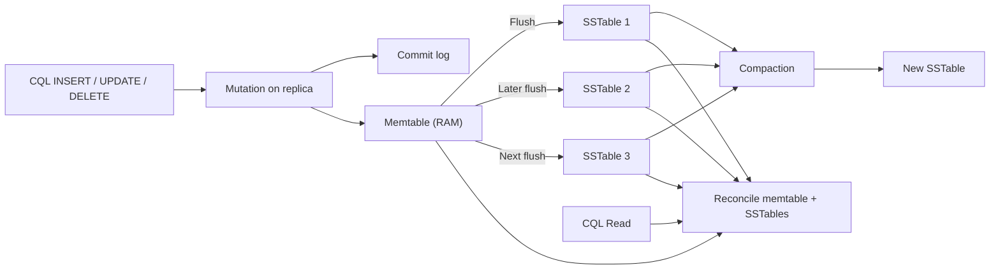
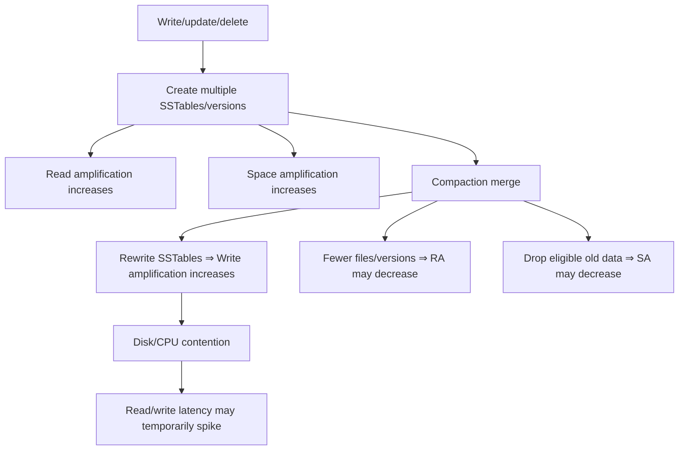

# Read/Write/Space Amplification in an LSM-Tree

> **Chapter:** SSTables and compaction  
> **Module:** `DATABASE_ENGINE_WIDE_COLUMN_CASSANDRA` — Apache Cassandra, a distributed wide-column database.  
> **Focus:** Understanding why Cassandra writes fast using memtables and immutable SSTables, yet pays read, rewrite, and storage costs; knowing how to measure and choose a compaction strategy per workload.

Cassandra organizes data on each node following the **Log-Structured Merge Tree (LSM-tree)** model. New writes pass through the commit log, update the in-memory memtable, and are flushed out to **immutable SSTable** files. Multiple SSTables coexist, holding data versions, tombstones, and potentially overlapping partitions. **Compaction** merges them to optimize storage state.

The trade-offs appear across three metrics:

- **Read amplification (RA):** to serve one logical read, how many structures must the system inspect / how much physical data must it read?
- **Write amplification (WA):** to write a given amount of logical data, how much physical data must the system ultimately write, including compaction rewrites?
- **Space amplification (SA):** to store a given amount of *live* data, how much extra disk space must be allocated for old versions, tombstones, temporary files, and auxiliary metadata?

No compaction strategy optimizes all three goals absolutely across every workload. Partition key design, CQL query patterns, TTL settings, update frequency, and disk conditions also govern actual costs.

## 1. Learning Objectives

After this lesson, you will be able to:

1. Trace the path of a mutation from commit log and memtable to SSTables, compaction, and read results.
2. Define RA, WA, and SA with **clear denominators and measurement scopes**, avoiding mixing per-node and cluster-wide costs.
3. Explain why multiple overlapping SSTables make reads harder, multi-round compaction increases writes, and old versions/tombstones increase disk usage.
4. Compare **SizeTieredCompactionStrategy (STCS)**, **LeveledCompactionStrategy (LCS)**, **TimeWindowCompactionStrategy (TWCS)**, and **UnifiedCompactionStrategy (UCS)** where supported by the version.
5. Design benchmarks for p95/p99 latency, SSTables-per-read, disk usage, write throughput, and compaction backlog on real workloads.
6. Distinguish compaction from repair/replication, and identify risks from tombstones, TTLs, snapshots, and disk-full states.

## 2. From CQL Write to One or More SSTables

### 2.1. Why Are SSTables Immutable?

On a node receiving a valid mutation, the typical write path is:

1. Write the mutation to the **commit log** for crash recovery if the process dies before the memtable is flushed.
2. Update the table's **memtable** in RAM.
3. When conditions are met, **flush the memtable** into an immutable SSTable on disk.
4. Subsequent writes/updates/deletes can create new SSTables containing values or tombstones for the same key.
5. Compaction merges sets of SSTables per the configured strategy; when safe, it discards obsolete data that is no longer needed.



This diagram is conceptual. Once compaction finishes, valid input files are replaced/deleted when no longer needed; the diagram does not depict caches, Bloom filters, intra-SSTable indexes, compression, or repeated compaction cycles.

**Immutability** means Cassandra does not directly edit individual rows in the middle of an SSTable on every update. Thus the normal write path is mostly append/sequential, at the trade-off that **a key may appear in multiple SSTables** until merged.

### 2.2. Reads Must Merge Multiple Data Sources

For a query specifying the full partition key, Cassandra can locate replicas by token; at each replica, the read path may need to:

- Read fresh data in the memtable.
- Use caches/partition indexes/index summaries and Bloom filters to avoid opening SSTables that cannot contain the partition.
- Read from candidate SSTables that may contain the partition and merge cells by timestamp/tombstone.
- Apply TTLs, deletion markers, and clustering range bounds to determine the logical result.

For example, the same partition has this history:

| Time | Storage component | Content |
|---|---|---|
| T1 | SSTable A | `status = 'NEW'` |
| T2 | SSTable B | `status = 'PAID'` |
| T3 | SSTable C | Tombstone deleting a column |
| T4 | Memtable | Another updated value of the same partition |

A `SELECT` may have to examine **multiple sources** to know the true state. After compaction, the number of overlapping files can drop, though not every old record can always be removed immediately.

### 2.3. What Does Compaction Do and Not Do?

Compaction selects input SSTables, reads the relevant versions, performs merge/reconciliation, and writes **new output SSTables**. This:

- Can reduce the number of files and data versions checked on reads.
- Can drop shadowed versions or tombstones eligible for removal.
- Can improve data layout and reclaim space once old files are replaced.
- **Consumes extra I/O, CPU, and temporarily requires disk space** for outputs.

Compaction is **local to each node**; it **does not replace anti-entropy repair between replicas**. Replication factor (RF) and consistency level (CL) still govern data distribution and request acknowledgment across the cluster. A node with cleanly compacted SSTables may still lack mutations held by another replica.

## 3. Read Amplification: How Much Work Does One Logical Read Do?

### 3.1. Useful Definitions

In an LSM-tree context, read amplification expresses the amount of physical reading or storage-structure inspection required relative to one logical read. There are multiple valid ways to measure it:

\[
RA_{\mathrm{files}}=\frac{\text{number of SSTable inspections}}{\text{number of logical read queries}}
\]

\[
RA_{\mathrm{bytes}}=\frac{\text{total bytes actually read from storage}}{\text{useful data bytes returned}}
\]

**Do not conflate the two units.** An SSTable checked via Bloom filter or index does not necessarily trigger a disk read; one SSTable might require multiple I/Os for a large range query. Caches and the OS also alter the amount of physical I/O observed.

When measuring, explicitly state whether it is **per query at a single replica/node** or **total work across all replicas**. A `LOCAL_QUORUM` read can touch multiple replicas; do not misinterpret a per-replica metric as total cluster cost.

### 3.2. File-Based Calculation Example

Suppose out of 1,000 partition read queries:

- 800 queries inspect one SSTable.
- 150 queries inspect three SSTables.
- 50 queries inspect seven SSTables.

We get:

\[
RA_{\mathrm{files}}=
\frac{800\times1+150\times3+50\times7}{1000}=1.6
\]

An average of **1.6 SSTables inspected per query**. However, the last 50 queries may dominate p99 latency; therefore, inspect histograms, percentiles, and “hot” partition groups, **not just the average**.

These are illustrative numbers, not default Cassandra benchmark figures.

### 3.3. What Increases RA?

- **Many SSTables with overlapping token/clustering ranges:** versions of the same key spread across many files.
- **Frequent consecutive updates/deletes:** must inspect new mutations, old mutations, and tombstones before returning results.
- **Compaction backlog:** small SSTables accumulate faster than they are merged.
- **Range scans or large partitions:** more rows/chunks/blocks must be scanned; may touch many files even when the partition key is known.
- **Heavy tombstones:** skipping deleted or TTL-expired cells still consumes resources.
- **Cache misses:** for the same SSTable count, actual physical I/O is higher.
- **Queries not aligned with partition keys:** coordinator must contact many nodes broadly or filter inefficiently; this also introduces **distributed read amplification** beyond the SSTable level.

### 3.4. How Do Bloom Filters Help?

An SSTable's Bloom filter essentially answers “partition **definitely absent**” or “**possibly present**”. It helps avoid some negative disk reads.

- **False positives:** the Bloom filter can say “possibly present” even though the partition does not exist → must still check deeper.
- **No false negatives by design:** if it says “absent”, that SSTable does not contain the partition.
- For a partition actually present in multiple SSTables, the Bloom filter **cannot eliminate the cost of reading older versions**.
- RAM for Bloom filters, key cache, index summaries, and OS page cache strongly affects measured results.

Distinguish queries **not finding a partition** (negative lookup) from queries **finding a partition with many versions** (positive lookup); their cost models differ.

## 4. Write Amplification: How Many Times Is the Same Data Rewritten?

### 4.1. Definition and Scope

One definition for comparing compaction policies on **a single node**:

\[
WA_{\mathrm{SSTable}}=
\frac{\text{total SSTable output bytes written by flush + compaction in period}}
{\text{new logical input data bytes in the same period}}
\]

Measurement is meaningful only when specifying how input bytes are counted, system state (steady state vs. building/backfilling), compressed vs. uncompressed bytes, and time window. Over too short a window, compaction of old data can artificially spike the ratio, while unexecuted backlog makes it artificially low.

**Do not arbitrarily fold RF into the same metric.** If RF = 3, three replicas store data on three nodes and total cluster physical writes increase, yet `WA_SSTable` as defined above is **a single-node cost**, not the replication factor.

If you want to measure **total disk write cost**, you must additionally account for commit logs, indexes, metadata, write-ahead/log overhead, compaction, and replica count. That ratio is distinct from `WA_SSTable`.

### 4.2. Numerical Example

Suppose during a steady-state period on one node:

- 100 GiB of new logical data (normalized to the same byte basis for comparison).
- Flushes produce 100 GiB of new SSTables.
- Subsequent compaction rounds write an additional 300 GiB of output total.

Then:

\[
WA_{\mathrm{SSTable}} = \frac{100+300}{100}=4
\]

This can be expressed as **1× write for flush and 3× rewrite from compaction**. If the 300 GiB of compaction has not finished by the end of the measurement window, observed numbers will not accurately describe lifecycle cost; record backlog and compare under identical conditions.

When writing the same data to three replicas at RF = 3, total cluster bytes written also depend on per-replica data, configs, and independent per-node compactions. Do not deduce cluster WA is exactly 12 from a single-node example.

### 4.3. What Increases WA?

- **LCS or multi-tier mechanisms that rewrite frequently:** a data range may be merged multiple times as it moves across levels.
- **Updates/deletes on the same partition:** multiple versions/tombstones create extra data to write and process.
- **Late-arriving data relative to time buckets:** window-based compaction strategies may have to do extra work.
- **Switching compaction strategies / backfilling / rebuilding indexes:** can spike I/O during transition periods.
- **Broad manual compactions:** generate large writes and require free disk space.
- **Compression settings and SSTable format:** affect physical byte counts; compare using consistent measurement methods.

Cassandra can ACK writes before compaction happens, because the write path is commit log + memtable. However, prolonged compaction backlog contends for disk I/O and CPU, leading to **degraded p95/p99 read/write latency**, flush pressure, and disk-full risk. “Fast writes at ACK time” does not mean low WA.

## 5. Space Amplification: How Much Disk Does Live Data Need?

### 5.1. Definition Without Confusion

Within the same node/table scope and **the same byte representation**, we can estimate:

\[
SA_{\mathrm{SSTable}}=
\frac{\text{SSTable data bytes currently occupying disk}}
{\text{equivalent live data bytes if storing only the latest version}}
\]

The numerator may include old versions, tombstones, and metadata; the denominator must be an estimate of a live snapshot **on the same node, with the same compression/encoding**. Using logical uncompressed bytes as the denominator while using compressed SSTable bytes as the numerator yields a ratio that no longer isolates LSM overhead.

Clearly state whether **snapshots/hard links, indexes, commit logs, temporary compaction files, and filesystem overhead** are included. They impact real disk headroom even if excluded from `SA_SSTable`.

### 5.2. SA and Safe Capacity Example

Suppose on one node:

| Component | Size |
|---|---:|
| Estimated live snapshot, same encoding/compression | 400 GiB |
| Existing SSTables, including old versions and tombstones | 640 GiB |
| Temporary output files of ongoing compaction | 100 GiB |
| Snapshots/hard links retaining old SSTables | 90 GiB |

From this:

\[
SA_{\mathrm{SSTable}}=\frac{640}{400}=1.6
\]

If the temporary/snapshot portions in this example **genuinely occupy additional independent disk blocks** not already included in the 640 GiB, total space needed at this moment is:

\[
640+100+90=830\ \text{GiB}
\]

The disk footprint factor relative to the live snapshot is `830/400=2.075`. **This is not a universal standard SA formula**, rather an operational sizing metric for a specific situation. With hard-linked snapshots, shared blocks must not be double-counted; base calculations on actual occupied blocks.

**RF = 3** may cause the cluster to require three copies of live data (excluding repair/streaming/indexes); do not mix the RF multiplier with single-node SA. Separate the question “how much overhead does one copy carry?” from “how many copies does the cluster need?”.

### 5.3. Why Does Deleted Data Persist?

Cassandra writes **tombstones** to represent deletions; they are needed to prevent an old returning replica from resurrecting a deleted record. Tombstones or TTL-expired data are not necessarily purged as soon as the application stops seeing them:

- **gc_grace_seconds** rules and compaction safety checks apply.
- Old data may exist in overlapping SSTables not yet compacted together.
- Repairs, downed replicas, and missed deletes increase resurrection risk if grace periods are arbitrarily lowered.
- Expired TTLs create a logically “deleted” state; physical bytes are freed only when compaction/cleanup safely runs and no files hold references.
- Hard-linked snapshots/backups can retain disk blocks even after original SSTables are replaced.

**Do not set `gc_grace_seconds` very low to fix a full disk** without evaluating repairs, node downtime history, tombstone purge mechanics, and recovery requirements. Doing so can break logical consistency.

## 6. How Are the Three Amplifications Related?



Aggressive compaction can lower steady-state RA and SA at the cost of higher WA and immediate I/O. Deferring compaction can lower short-term WA, yet compaction debt builds up, RA/SA climb, and the system risks running out of disk.

| Action or phenomenon | RA | WA | SA | Explanation |
|---|---|---|---|---|
| Many small flushes, backlog | Usually increases | Temporarily low | Increases | Many unmerged SSTables |
| Aggressive compaction | Usually drops once done | Increases | May decrease | Rewrites to reduce overlap/versions |
| Continuous updates to same partition | Increases pre-compaction | Increases over lifecycle | Increases pre-purge | Multiple versions/tombstones |
| Query-aligned partition key | Reduces fan-out/broad reads | Little direct impact | Little direct impact | Better replica and partition targeting |
| TTL for time-series data | May rise while holding tombstones | Strategy-dependent | Eventually drops if purged | Requires managing expiry and compaction |
| Effective cache/Bloom tuning | Reduces physical read I/O | Minor overhead | Slight RAM/metadata increase | Does not delete old versions |
| Increasing RF | Can raise total read work per CL | Increases total cluster writes | Increases total cluster storage | Not a single-node compaction optimization |

These directional trends are **conceptual, not guarantees for every workload**.

## 7. STCS, LCS, TWCS, and UCS: What Costs Does Each Trade Off?

The compaction strategy determines **which SSTables are merged, when, and over what scope**. An appropriate configuration depends on write/read patterns, TTLs, update density, and Cassandra version.

### 7.1. SizeTieredCompactionStrategy (STCS)

STCS typically groups SSTables of **similar size** to merge into a larger file. It is a straightforward choice for write-heavy workloads without a clear time-based TTL pattern.

**Tendencies:**

- WA can be relatively low when not repeatedly compacting across many deep levels.
- Multiple SSTables have overlapping token ranges; RA for frequently updated partitions can be high.
- SA and **temporary free disk** needs can be substantial: new outputs coexist before old inputs are deleted.
- After many flushes/updates, a table may hold several large overlapping files.

**Good when:** prioritizing write throughput, reads are not overly random/p99-sensitive, sufficient headroom exists, and backlog is monitored.

**Must verify:** SSTables per read, disk occupancy during compaction, and tombstone cleanup effectiveness.

### 7.2. LeveledCompactionStrategy (LCS)

LCS organizes SSTables into **levels**; at stable levels (excluding L0), the design aims for **non-overlapping token ranges among SSTables within the same level**. A partition read typically only needs to check one file per stable level, plus L0 files/edge cases.

**Tendencies:**

- Better RA for many point-lookup patterns because overlap is bounded per level.
- WA is typically **higher than STCS** because data is rewritten as it moves and merges between levels.
- Steady-state SA can be tighter, though temporary files, tombstones, and snapshots still exist.
- Watch out for compaction debt and p99 latency under very heavy writes or slow disks.

**Good when:** read-heavy, frequent random/partition-key queries, predictable latency requirements, and sufficient write I/O budget.

**Must verify:** level depth, SSTable size, write rate, read latency, and compaction throughput.

### 7.3. TimeWindowCompactionStrategy (TWCS)

TWCS groups data by **time windows**. It fits time-series data **written roughly in time order**, especially when most rows share similar TTLs and the workload rarely modifies old data.

Idea:

- SSTables within the active window are merged to limit small files.
- Closed windows are rarely rewritten; once all data in an SSTable/window expires and becomes eligible, the entire SSTable can be dropped without scanning row-by-row to remove tombstones.
- Hence WA can be low for immutable/time-TTL data, SA is reclaimed in batches, and RA aligns well with time-partitioned queries.

**Critical warning:** writing historical backfills, updating old columns, wildly varying TTLs across rows, or flushes mixing data from multiple time periods erode TWCS advantages and can delay dropping expired SSTables. Do not view TWCS as an automatic fix for all tombstones.

**Good when:** time-ordered logs/events/metrics, nearly append-only writes, consistent TTLs, queries by tenant/day/hour.

### 7.4. UnifiedCompactionStrategy (UCS)

Some newer Cassandra versions (notably Apache Cassandra 5.x and above where available) support **UnifiedCompactionStrategy**, allowing compaction policy tuning toward read/write/space amplification goals and workload traits rather than picking a single fixed STCS or LCS philosophy.

- Priorities can be tuned for read latency, write overhead, or space.
- You must understand the exact **version-specific** parameters (such as scaling parameter configs) before applying.
- Do not assume option names, defaults, or UCS benefits are identical across all distributions.
- Do not switch an entire cluster at once just because “UCS is more optimal”; benchmark on a representative workload, monitoring compaction accumulation rate and temporary space needs.

### 7.5. Qualitative Comparison

| Strategy | Typical RA | Typical WA | SA/headroom | Suitable workloads |
|---|---|---|---|---|
| **STCS** | Can be high due to SSTable overlap | Often lower than LCS on many write loads | Needs reserve when merging large files | Write-heavy, less latency-sensitive reads |
| **LCS** | Often low for partition lookups | Often high due to multi-level rewrites | Steady state can be compact; still needs temp space | Heavy random reads, strict p99 |
| **TWCS** | Depends on time window/partition | Can be low for immutable TTL data | Efficiently drops eligible windows; wrong pattern spikes SA | Append-only metrics, logs, events + TTL |
| **UCS** | Configurable per trade-off | Configurable per trade-off | Must measure per parameters and build | Complex workloads on UCS-supporting clusters |

This table reflects **design tendencies**. Workloads with large partitions, out-of-order writes, a very hot key, or long TTLs can invert results. Never treat a strategy name as proof of performance.

## 8. CQL Example: How Does Workload Affect Amplification?

### 8.1. Designing a Table by Partition Key for Reads

The lab uses datacenter `dc1`. RF = 3 is appropriate only if the lab topology has enough nodes/replicas; adjust before running.

```sql
CREATE KEYSPACE IF NOT EXISTS lab_lsm
WITH replication = {
    'class': 'NetworkTopologyStrategy',
    'dc1': 3
};

CREATE TABLE IF NOT EXISTS lab_lsm.events_by_tenant_day (
    tenant_id uuid,
    event_day date,
    event_time timestamp,
    event_id timeuuid,
    event_type text,
    payload text,
    PRIMARY KEY ((tenant_id, event_day), event_time, event_id)
) WITH CLUSTERING ORDER BY (event_time DESC, event_id DESC)
  AND compaction = {
    'class': 'TimeWindowCompactionStrategy',
    'compaction_window_unit': 'DAYS',
    'compaction_window_size': '1'
  }
  AND default_time_to_live = 604800;
```

An event has partition key `(tenant_id, event_day)`, so queries by tenant and day target the partition cleanly:

```sql
CONSISTENCY LOCAL_QUORUM;

INSERT INTO lab_lsm.events_by_tenant_day (
    tenant_id, event_day, event_time, event_id, event_type, payload
) VALUES (
    11111111-1111-1111-1111-111111111111,
    '2026-11-21',
    '2026-11-21 08:00:00+0000',
    7c627d5a-a6b0-11ef-8ae8-0242ac120002,
    'checkout',
    'sample'
);

SELECT event_time, event_id, event_type
FROM lab_lsm.events_by_tenant_day
WHERE tenant_id = 11111111-1111-1111-1111-111111111111
  AND event_day = '2026-11-21'
LIMIT 50;
```

A TTL of 604,800 seconds equals 7 days. This example **intentionally uses nearly immutable data** so TWCS can shine. If event status must be updated continuously, consider a separate table or a different strategy; do not assume updates into closed windows are cheap.

### 8.2. What Happens When Updates/Deletes Are Added?

Suppose the application later updates `payload` three times or deletes a row:

```sql
UPDATE lab_lsm.events_by_tenant_day
SET payload = 'revised'
WHERE tenant_id = 11111111-1111-1111-1111-111111111111
  AND event_day = '2026-11-21'
  AND event_time = '2026-11-21 08:00:00+0000'
  AND event_id = 7c627d5a-a6b0-11ef-8ae8-0242ac120002;

DELETE FROM lab_lsm.events_by_tenant_day
WHERE tenant_id = 11111111-1111-1111-1111-111111111111
  AND event_day = '2026-11-21'
  AND event_time = '2026-11-21 08:00:00+0000'
  AND event_id = 7c627d5a-a6b0-11ef-8ae8-0242ac120002;
```

Once flushed into multiple SSTables:

- Old values and tombstones can reside in different files.
- Reading the same partition must reconcile multiple versions, raising RA before compaction.
- Versions and tombstones still occupy space, raising SA.
- Compaction handling them must rewrite data, raising WA.

With TWCS, updates or deletes on **older events** also impair window-based expiration; this is a signal to re-evaluate strategy fit.

### 8.3. Experimenting with Changing Strategy on a Lab Table

A table read frequently by partition with little TTL can use LCS as an experiment:

```sql
-- Perform only on an isolated lab table to compare; do not apply blindly to production.
ALTER TABLE lab_lsm.events_by_tenant_day
WITH compaction = {
    'class': 'LeveledCompactionStrategy'
};
```

Changing compaction strategy can trigger substantial background conversion/compaction rather than converting all SSTables to the new layout immediately. Detailed parameters such as SSTable size and throughput options depend on version; consult the exact deployment docs.

**Do not reuse a single production table and flip-flop STCS/LCS/TWCS to “quickly test”.** Strategies leave different file histories; meaningful comparisons require reproducible datasets and environments.

## 9. Measuring the Three Amplifications: Where to Get Metrics?

### 9.1. Per-Node Monitoring Commands

The following `nodetool` commands are for observation in labs/clusters with permitted access:

```bash
nodetool status
nodetool tablestats lab_lsm.events_by_tenant_day
nodetool tablehistograms lab_lsm events_by_tenant_day
nodetool compactionstats
nodetool compactionhistory
nodetool tpstats
```

Metric names, output formats, and command support can vary by Cassandra version. Record your version and run `nodetool help <command>` if syntax differs.

| Observation target | Question | Amplification link |
|---|---|---|
| SSTable count, SSTables per read | How many files must each read check? | RA |
| Bloom filter false positives, read latency | How much I/O do negative lookups cost? | RA |
| Bytes flushed, bytes compacted, compaction throughput | How many bytes were rewritten by compaction? | WA |
| Pending/active compaction | Is compaction debt growing continuously? | RA/SA about to rise, WA not yet fully incurred |
| Live disk used, total disk used, snapshots | What makes up current occupied space? | SA and headroom |
| Droppable tombstone ratio, tombstone read stats | How much “logically deleted” data still lingers? | RA/SA, slow-read risk |
| Disk read/write IOPS and bandwidth | Is there resource contention with queries? | RA/WA translating into p99 |
| Compaction failure, disk fullness | Is compaction being blocked? | Backlog/disk-full risk |

**Some metrics must be pulled from monitoring/JMX/Prometheus depending on version**, as not every metric appears in `tablestats`. Specifically, “bytes physically written during compaction” or “per-SSTable compression ratio” must have their exact source and unit verified.

### 9.2. Designing a Read Amplification Benchmark

Select a representative set of partitions:

1. **Hot partition** updated continuously.
2. **Cold partition** mostly read-only.
3. **Non-existent partition** to test negative lookups.
4. **Large partition** with many clustering rows.
5. **Partition with tombstones/TTL** to evaluate merging.

For each type, fix CQL, CL, and page size, run at target QPS, and measure p50/p95/p99, SSTables per read, disk read bandwidth, and cache misses. Run a warm-up pass when appropriate, clearly noting whether the benchmark is **cold-cache** or **warm-cache**. Compare after compaction catches up, then test again during a backlog period.

### 9.3. Designing a Write Amplification Benchmark

Measure on the same node, same table, over a sufficiently long window:

- **Input logical bytes:** from the ingestion pipeline or application telemetry, clearly defining how they are counted.
- **SSTable bytes from flushes:** count only new outputs.
- **SSTable bytes from compactions:** aggregate over the window including all rewrites.
- **Commit log and index overhead:** track separately if reporting end-to-end WA.
- **RF/replicas:** report per-node first then aggregate cluster-wide, without multiplying by an arbitrary factor.
- **Compaction backlog:** if significant pending work remains, note that full lifecycle WA has not yet been observed.

Compute ratios from measured data while comparing p99 write latency and disk write throughput. **Fast writes accompanied by a continuously growing backlog is an unsustainable result.**

### 9.4. Designing a Space Amplification Benchmark

Take a logical snapshot of **live keys/values** over a defined scope; measure live data using the same encoding/compression if possible. At the same point in time, measure:

1. SSTable disk bytes in the active table.
2. Temporary compaction files not yet deleted by the system.
3. Snapshots/hard-linked SSTables still holding blocks.
4. Indexes/commit logs and others if computing total disk footprint.

Report **two numbers**: `SA_SSTable` (per the chosen definition) and **required disk headroom**. Do not run full-table `SELECT COUNT(*)` in production just to estimate live rows; broad count queries in Cassandra can be very expensive. Use ingestion telemetry, sampling, snapshot/offline jobs, or dedicated statistics systems instead.

### 9.5. Experiment Result Table

| Scenario | Read p99 | SSTables/read | Flush+compact bytes | Live data | SSTables on disk | Pending compactions |
|---|---:|---:|---:|---:|---:|---:|
| STCS, write-heavy | *Measure* | *Measure* | *Measure* | *Measure* | *Measure* | *Measure* |
| LCS, write-heavy | *Measure* | *Measure* | *Measure* | *Measure* | *Measure* | *Measure* |
| TWCS, uniform TTL | *Measure* | *Measure* | *Measure* | *Measure* | *Measure* | *Measure* |
| TWCS, late-arriving data | *Measure* | *Measure* | *Measure* | *Measure* | *Measure* | *Measure* |

Do not pre-fill fake numbers as if they were real benchmarks. When analyzing, include cluster specs, RF, CL, compression, partition size, UPDATE/DELETE ratio, TTL, and QPS so others can reproduce the test.

## 10. Interaction with Replication, Repair, Streaming, and CL

LSM is fundamentally a **per-node** storage mechanism. Yet Cassandra is also a distributed system; the three amplifications must be examined at two levels:

| Level | Cost drivers |
|---|---|
| **On-node SSTables** | Flush/compaction, Bloom filter/caches, versions/tombstones |
| **Replicas and cluster** | RF copies, read/write CL, read repair, anti-entropy repair, bootstrap/replace streaming |

For example, with RF = 3 and `LOCAL_QUORUM`:

- A mutation is sent to the appropriate replicas; each replica has its own commit log, memtable, and compaction cycle.
- A read query may require multiple replicas to respond depending on CL and cluster health.
- Compaction on node A **does not** prove node B also has the newest data.
- Repair can stream data between replicas, adding SSTables/mutations and indirectly creating additional compaction pressure.
- Bootstrap/replace/decommission involve SSTable streaming and require disk headroom; if concurrent compaction overloads the node, both latency and topology-change completion suffer.

**Do not confuse “merging local SSTables” with “reconciling data across replicas”.** Lowering `gc_grace_seconds` or skipping repair schedules to clear tombstones faster increases the risk of deleted data reappearing when an old replica returns.

## 11. Impact on Java Applications and CQL Queries

Compaction runs in the background, so Java applications do not select SSTables or trigger merges themselves. Still, **query paths** and **retry behavior** dictate load amplification.

Example using DataStax/Apache Cassandra Java Driver 4.x:

```java
import com.datastax.oss.driver.api.core.CqlSession;
import com.datastax.oss.driver.api.core.DefaultConsistencyLevel;
import com.datastax.oss.driver.api.core.cql.BoundStatement;
import com.datastax.oss.driver.api.core.cql.PreparedStatement;
import com.datastax.oss.driver.api.core.cql.ResultSet;
import java.net.InetSocketAddress;
import java.time.LocalDate;
import java.util.UUID;

public class EventReader {
    public static void main(String[] args) {
        UUID tenant = UUID.fromString("11111111-1111-1111-1111-111111111111");
        LocalDate day = LocalDate.of(2026, 11, 21);

        try (CqlSession session = CqlSession.builder()
                .addContactPoint(new InetSocketAddress("127.0.0.1", 9042))
                .withLocalDatacenter("dc1")
                .build()) {
            PreparedStatement select = session.prepare(
                "SELECT event_time, event_type FROM lab_lsm.events_by_tenant_day " +
                "WHERE tenant_id = ? AND event_day = ? LIMIT 50"
            );

            BoundStatement query = select.bind(tenant, day)
                .setConsistencyLevel(DefaultConsistencyLevel.LOCAL_QUORUM)
                .setPageSize(50);

            ResultSet rows = session.execute(query);
            rows.forEach(row ->
                System.out.println(row.getInstant("event_time") + " " +
                                   row.getString("event_type")));
        }
    }
}
```

The Java Driver maps `date` to `LocalDate` accordingly; this example uses the Java Driver 4.x API. The snippet assumes the cluster/keyspace is prepared with the right DC and sufficient RF/replicas for the chosen CL.

**To avoid raising RA from the application side:**

- Supply the **full partition key** and appropriate clustering bounds; do not scan huge numbers of partitions with an under-constrained query.
- Avoid `SELECT *` or fetching overly large partitions when only a few columns/rows are needed.
- Set appropriate page sizes and timeouts; `LIMIT` only caps logical output rows and does not guarantee fewer SSTables are read.
- Do not retry endlessly when p99 rises due to disk/compaction backlog; uncontrolled retries worsen system congestion.
- Track per-query p99, QPS, page counts, and unavailables/timeouts alongside Cassandra table metrics.

**To avoid raising WA from the application side:** eliminate redundant updates, avoid rewriting identical values needlessly, use appropriate TTLs, and choose partition/bucket keys that prevent overly hot partitions; useless writes still become SSTables and compaction work.

## 12. Diagnosing Four Real-World Scenarios

### 12.1. “INSERTs are still fast, but SELECT p99 keeps getting slower”

**Possibility:** memtables accept writes fast, but flushes produce SSTables faster than compaction merges them; RA increases. Other causes include tombstone-heavy reads, cache misses, or large partitions.

**Check:** `nodetool tablestats`, SSTables per read, `compactionstats`, disk I/O, and per-partition p99. If pending compactions keep rising, verify disk headroom, throughput, and strategy fit before hastily raising concurrency.

### 12.2. “Disk is full even though the app DELETEd millions of rows”

**Possibility:** DELETEs wrote tombstones while old versions remain in SSTables, purge conditions aren't met yet, or snapshots retain files.

**Check:** actual disk space, snapshots, tombstone ratios, compaction backlog, `gc_grace_seconds`, repair schedules, and SSTable overlap. **Do not slash grace periods or run major compaction recklessly** when disk is nearly full; major compaction can require substantial temporary space.

### 12.3. “Switched STCS to LCS, reads got faster but CPU/IO increased”

This is a predictable trade-off: LCS reduces overlap, yet data may be rewritten across multiple levels. Compare read p99, disk write bandwidth, compaction backlog, and long-term WA. If the cluster is mostly write-ingest with few reads, lower RA may not justify higher WA.

### 12.4. “TWCS uses a 7-day TTL, yet old files aren't being cleaned up”

**Possibility:** late writes/TTLs landed in old windows, SSTables mix live data of varied ages, compaction/window closing has not met purge rules, or snapshots hold blocks.

**Check:** data timestamps, actual TTLs, out-of-order ingestion, TWCS configuration, SSTable creation times, compaction logs, snapshots, and GC grace. Do not conclude TWCS is broken just because bytes haven't vanished right at the 7-day mark.

## 13. Safe Decision-Making and Operational Workflow

### Before Choosing a Strategy

1. Profile the workload: read/write QPS, point lookups vs. range queries, update/delete ratio, TTLs, late-arriving data.
2. Inspect partition keys, partition sizes, clustering, and query shapes. If the schema doesn't fit the queries, changing compaction will rarely save p99.
3. Measure baseline RA/WA/SA with explicit definitions and check disk headroom.
4. Consider STCS as a candidate for write-heavy loads, LCS for heavy point reads, TWCS for matching-TTL time series, and UCS when available and tuning expertise exists — **candidates to test**, not absolute rules.
5. Build a reproducible benchmark with sufficient data volume, tombstones/TTLs, and hot-partition skew.

### When Changing Strategy or Raising Compaction Throughput

1. Pick a small test scope and an appropriate traffic window.
2. Ensure enough free disk for compaction inputs/outputs, avoiding collisions with large streaming/repair jobs.
3. Monitor `compactionstats`, disk utilization, read/write p99, SSTables per read, and dropped/tombstone warnings.
4. Confirm compaction debt trends down as the system returns to steady state.
5. Halt rollout and execute the prepared recovery plan if latency, disk, or correctness degrades.

### After Stabilizing

1. Compare metrics over matching time windows, traffic, RF/CL, cluster size, and data retention.
2. Document accepted trade-offs: e.g., trading extra disk write I/O for lower read p99.
3. Maintain **repair, backup, and snapshot monitoring** schedules; compaction does not replace them.
4. Re-evaluate when workloads evolve: e.g., shifting from append-only to heavy updates, mixed TTLs, or rapid tenant growth.

## 14. Self-Check Exercises

**Exercise 1 — Compute RA.** Across 2,000 reads, 1,400 queries inspect 1 SSTable, 400 inspect 2 SSTables, and 200 inspect 6 SSTables. Compute `RA_files` and explain why p99 can still be high.

**Exercise 2 — Compute WA.** A node ingests 50 GiB of normalized data, flushes write 50 GiB, and subsequent compactions write another 150 GiB. Compute `WA_SSTable`, then explain why you cannot multiply the result by RF = 3 without redefining the metric.

**Exercise 3 — Compute SA.** On one node, the live snapshot equals 200 GiB compressed, existing SSTables occupy 320 GiB on the same basis, temporary compaction files take 40 GiB, and snapshots hold 60 GiB of independent blocks. Compute `SA_SSTable` and the relative disk footprint.

**Exercise 4 — Choose a Strategy.** Two workloads: (A) append-only logs with a 14-day TTL written near event time; (B) user profiles updated 100 times/day with strict random-read p99. Propose candidate strategies and two metrics to measure for each workload.

**Exercise 5 — Tombstones.** Why can Cassandra return “row no longer exists” after a DELETE and flush even though old data remains in SSTables? Why can't a tombstone be deleted immediately upon being seen?

**Exercise 6 — Distinguish Measurement Levels.** A cluster with RF = 3, `LOCAL_QUORUM`, has one node running compaction. Distinguish compaction I/O on that node, replicas written per RF, and replicas participating in reads per CL.

### Answer Hints

1. `(1400×1 + 400×2 + 200×6)/2000 = 1.7`; the group reading six SSTables can lengthen the latency tail.
2. `(50+150)/50 = 4`; this is a single-node ratio, not the cluster total.
3. `320/200 = 1.6`; footprint `(320+40+60)/200 = 2.1` assuming those extra blocks genuinely do not overlap.
4. Test TWCS for A; test LCS/UCS (per version support) for B while benchmarking STCS as a baseline. Measure p99/SSTables per read and disk writes/compaction backlog.
5. The tombstone wins read-path reconciliation; purging too early risks an old replica resurrecting the record.
6. Compaction is local storage work; RF governs cluster data copies; CL governs request acknowledgment conditions. Three distinct quantities.

## 15. Key Takeaways

- **LSM-trees trade initial write speed for later read/merge work.** Memtables and immutable SSTables make writes fast, yet yield multiple versions of a key.
- **RA** describes read work exceeding one logical read; **WA** describes bytes rewritten over the storage lifecycle; **SA** describes excess space beyond live data.
- Compaction can lower RA and SA, at the cost of higher WA, disk bandwidth, and CPU; delaying it indefinitely builds compaction debt.
- **STCS/LCS/TWCS/UCS** reflect different priorities and mechanisms. Measure against query shape, updates/deletes, TTLs, data age, and headroom rather than choosing by name.
- Tombstones, TTLs, snapshots, RF, CL, repair, and streaming all shape operations. **Compaction is node-local**, not a consistency guarantee across replicas.
- An optimization decision is valid only when paired with **explicit metric definitions, workload profile, time window, measurement method, and resource limits**.
