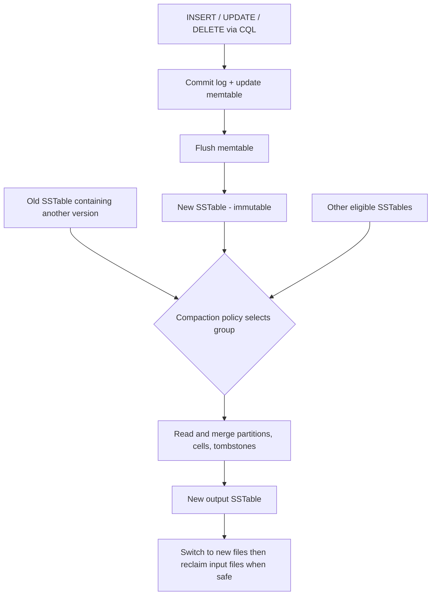
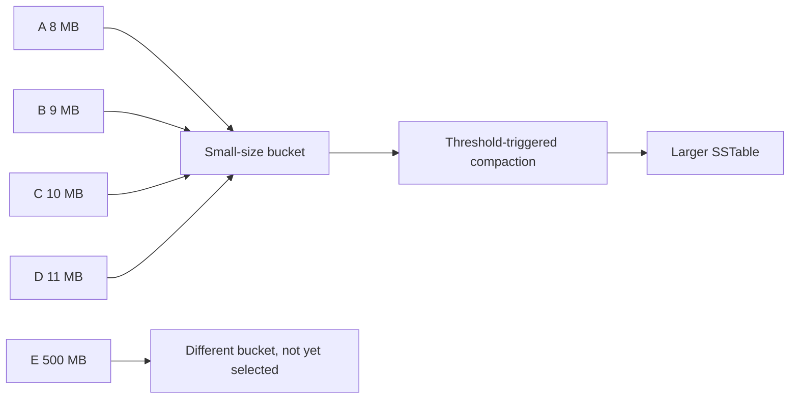
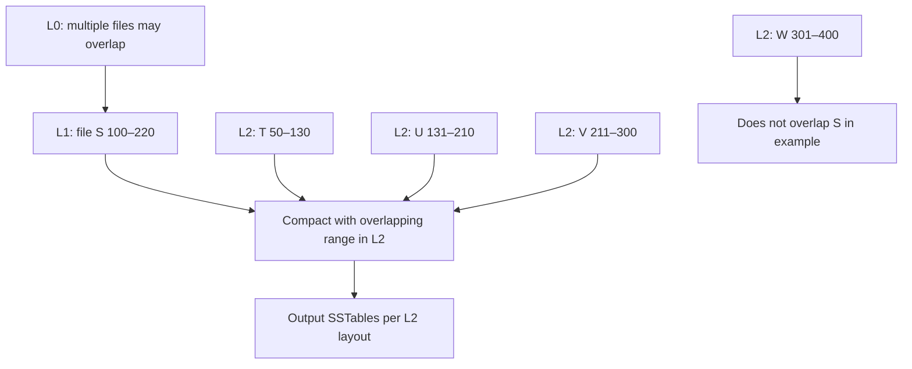

# Purpose of Compaction and How Cassandra Selects SSTables to Merge

## 1. The Problem: Why Does Already-Written Data Still Need to Be Merged?

**Apache Cassandra** is a distributed **wide-column** database optimized for sequential writes using an architecture close to a **log-structured merge tree (LSM tree)**. Data flows through the commit log and memtable before the memtable is written to an **SSTable** (*Sorted String Table*) on disk. An SSTable is a sequentially written and essentially **immutable** structure: updating a value typically creates a new version in the memtable/new SSTable instead of modifying the old file in place.

Thanks to this, the write path can be fast. In return, after many flushes, disk holds many SSTables, which may simultaneously store old/new versions of a partition or tombstones. A read must find and reconcile relevant data from the memtable and SSTables that could contain that partition. **Compaction** addresses the accumulation of files and versions by reading multiple input SSTables, merging records according to Cassandra's rules, and writing new SSTables.

This lesson belongs to the **SSTables and compaction** chapter of the `DATABASE_ENGINE_WIDE_COLUMN_CASSANDRA` module. The focus is not merely defining compaction, but **why merging is needed and which algorithms decide which SSTables are selected in a given run**. Those decisions affect read/write latency, disk space, TTLs/tombstones, operational resources, and the effectiveness of query-driven table design.

### Learning Objectives

After this lesson, you will be able to:

1. Describe the path from memtable flush to SSTable, and thereby explain the purpose of compaction.
2. Distinguish **deciding when to compact** from **deciding which input files to select**.
3. Compare SSTable selection across **STCS**, **LCS**, **TWCS**, and **UCS** where supported by the version.
4. Explain why old versions/tombstones cannot be removed arbitrarily and how repair affects which SSTables can be merged.
5. Observe compaction work with CQL, `nodetool`, and metrics, and choose a strategy based on workload.

## 2. From One UPDATE to Multiple SSTables

The diagram below depicts the flow on **a single replica**. With a replication factor greater than one, each replica manages storage and compaction locally based on its own state.



Example of a row written across three flush cycles:

| SSTable | Represented data (simplified) | State |
| --- | --- | --- |
| `A.db` | `customer=42, name="An", ts=100` | Older value |
| `B.db` | `customer=42, name="Anh", ts=200` | Newer value |
| `C.db` | `customer=42, phone="090...", ts=250` | Column added |

When reading `customer=42`, Cassandra must combine relevant values to return a state consistent with written data and the read consistency level. If A, B, and C are selected in the same compaction batch, the output can contain the name from B and the phone number from C; the old name cell in A no longer needs to be kept within **that input SSTable set**.

**However, you cannot assume all old data gets deleted.** There may still be SSTables outside the compaction group, replicas that have not yet received a tombstone, or unmet tombstone-retention safety conditions. That is why input selection and old-data purging rules are tightly linked.

### Four Main Purposes

- **Reduce read amplification:** limit the number of SSTables that may need to be checked when reading the same partition.
- **Reclaim space from shadowed versions:** drop cell versions that have been superseded once safety conditions are satisfied.
- **Support TTL and tombstone handling:** reclaim expired/deleted data when eligible; running compaction does not automatically clear every tombstone.
- **Organize SSTables by strategy:** maintain size tiers, levels, or time windows to match the read/write path.

In return, compaction must **read input SSTables and write output SSTables**, consuming disk I/O, CPU, memory, caches, and temporarily requiring additional disk space. It creates **write amplification**. Therefore, the goal is not “as much compaction as possible”.

## 3. Distinguishing Flush, Compaction, Repair, and Replication

| Operation | When does it happen? | Where does data go? | Does it replace compaction? |
| --- | --- | --- | --- |
| **Memtable flush** | When memory/thresholds/flush conditions trigger | Memtable → new SSTable | No; flushing actually increases SSTable count |
| **Compaction** | Scheduler/strategy finds eligible SSTable group or appropriate admin action | Multiple local SSTables → local output SSTable | It is the merge process itself |
| **Repair** | On operational schedule or incident to sync replicas | Reconciles and streams data between replicas within repair scope | No; repair does not simply merge local SSTables |
| **Replication** | Per keyspace config and placement on writes/reads | Data placed on replicas selected by token/DC/rack | No; each replica still needs its own compaction |
| **Cleanup** | After topology changes and token-range ownership updates | Removes data the node no longer legitimately owns | Different purpose, different safety conditions |

Compaction is **not a consensus protocol**, does not determine read/write consistency levels, and cannot heal a replica missing records because it does not communicate or reconcile with other replicas. With RF = 3, three nodes can select different compaction batches at different times while still serving the same logical data.

Repair tasks can produce **repaired/unrepaired** or **pending repair** SSTables and run anti-compaction to mark repaired ranges. This repair state becomes a constraint on SSTable selection for compaction; not every SSTable sharing a partition range can be arbitrarily merged together.

## 4. Selection Mechanism: From Candidates to Compaction Tasks

Cassandra uses a table-level **compaction strategy** to determine how SSTables are organized and to propose work to the execution system. There are two separate questions:

1. **Is it time to compact?** Are there enough compatible SSTables in a bucket/level/window? Are there pending background tasks, tombstone compactions, or manual requests?
2. **Which SSTables should be selected?** An input set must obey strategy logic, resource limits, and repair-state constraints, including whether data already belongs to the same group.

At a high level:

```text
All SSTables of a table on one node
    ↓ classify by repair state, strategy attributes, and disk topology
Groups eligible to compact together
    ↓ apply STCS / LCS / TWCS / UCS
Eligible and prioritized candidate groups
    ↓ check task limits, no overlap with running tasks, available resources
Input SSTables locked for a compaction task
    ↓ merge + write new files + update metadata / references
Output SSTables, old files reclaimed when no longer referenced
```

Specific decisions vary by version and scheduler. **Two SSTables containing the same partition key will not necessarily be picked to merge immediately**, nor are the smallest files always prioritized.

### Key Terms to Know

| Term | Meaning in this lesson |
| --- | --- |
| **SSTable candidate** | A file eligible to participate in a compaction task |
| **Bucket** | A group of files with similar traits, such as similar sizes in STCS |
| **Level** | An SSTable organization tier in LCS, with different rules at L0 and higher tiers |
| **Time window** | A time interval used to group SSTables in TWCS |
| **Overlap** | Files whose token/partition ranges may intersect; affects how many files reads may need to check |
| **Repaired/unrepaired/pending repair** | Repair-related states constraining which SSTables can merge together |
| **Compaction backlog** | Pending tasks or estimated bytes still awaiting compaction |
| **Read/write/space amplification** | Extra read, rewrite, and disk-space overhead from storing multiple structures/versions |

## 5. SizeTieredCompactionStrategy (STCS): Selecting Similarly Sized SSTables

**STCS** organizes SSTables into **size-based buckets**. When a bucket has enough files, the strategy prioritizes selecting a group of similarly sized files to merge into a larger file. Limits such as `min_threshold` and `max_threshold` affect the minimum/maximum eligible file count in a task.

### Illustrative Example

Suppose the same table on a node has SSTables with **the same repair state**:

| File | Size | Notes |
| --- | ---: | --- |
| A | 8 MB | Close to small group |
| B | 9 MB | Close to small group |
| C | 10 MB | Close to small group |
| D | 11 MB | Close to small group |
| E | 500 MB | Vastly different size |

With `min_threshold = 4`, a **typical** selection is A + B + C + D, producing a larger SSTable while leaving E untouched. This is only a simulated example to understand **size-based selection logic**; actual buckets, priority order, output size, and task timing depend on version, average size, thresholds, overwritten data, and resources.

A file F = 9 MB with a different **repaired** state from files A–D **will not automatically be grouped into the same candidate set** merely because its size matches.



### Characteristics and Trade-Offs

- Suits many **write-heavy** workloads producing relatively uniform SSTable sizes; typically generates less early compaction than level-balancing strategies.
- Reads may have to inspect multiple SSTables of varying sizes; read amplification can be high, especially when a partition spans many file generations.
- Very large/isolated SSTables may wait a long time before finding enough candidates to be selected again; old versions or tombstones inside these files can linger.
- Large compaction phases can cause I/O spikes and require disk space for both inputs and outputs.

**Illustrative** configuration example:

```sql
ALTER TABLE app_ks.events_by_device
WITH compaction = {
    'class': 'SizeTieredCompactionStrategy',
    'min_threshold': '4',
    'max_threshold': '32'
};
```

Do not copy commands into production without verifying the table exists, the workload, and the current configuration. Changing the strategy is a **schema change**, after which data is gradually reorganized across compactions; there is no guarantee all SSTables are rewritten immediately.

## 6. LeveledCompactionStrategy (LCS): Selecting SSTables by Level and Overlapping Token Ranges

**LCS** divides SSTables into **levels**. Core idea:

- **L0** can hold multiple SSTables with overlapping token ranges.
- From **L1 upward**, the strategy maintains non-overlapping token ranges **within the same level** (per implementation rules).
- A task typically selects an SSTable from one level and **the token-overlapping SSTables in the next level** to rewrite, restoring level invariants.

### Candidate Selection Example

Suppose file `S` at level L1 has token range `[100, 220]`. At L2 there are four files:

| File | Level | Token range | Overlaps with S? |
| --- | --- | --- | --- |
| S | L1 | [100, 220] | Source file |
| T | L2 | [50, 130] | Yes, range 100–130 |
| U | L2 | [131, 210] | Yes |
| V | L2 | [211, 300] | Yes, range 211–220 |
| W | L2 | [301, 400] | No |

If S is selected from L1 to promote/push down to L2, a typical task includes T, U, and V as inputs because they overlap the token range; **W is not selected by default**. Depending on version and planning, additional files or different priority orders may apply. This example illustrates **per-level overlap rules**, not an exact scheduler prediction.



LCS typically **reduces read amplification** because level organization bounds the number of SSTable regions checked on reads, especially for frequently updated/read queries. In return, the same data may be rewritten multiple times as it moves across levels, increasing **write amplification** and I/O pressure. It fits read-heavy tables or keys with frequent updates where stable read performance outweighs extra write cost.

Example:

```sql
ALTER TABLE app_ks.profile_by_user
WITH compaction = {
    'class': 'LeveledCompactionStrategy',
    'sstable_size_in_mb': '160'
};
```

`sstable_size_in_mb` is the target SSTable size option for the LCS mechanism; **160** is illustrative only—you must measure impact and check version/disk limits. Raising or lowering target size will not fix hot partitions by itself and does not eliminate the need for repair.

## 7. TimeWindowCompactionStrategy (TWCS): Selecting by Time Window

**TWCS** targets **time-series** data written primarily in chronological order, usually with similar TTLs across records. The strategy groups SSTables by **time window**, then organizes/merges eligible files **within that window**. The active window may use STCS-like behavior to limit file count; once an older window closes, compaction produces a more stable group of SSTables.

Example one-day window configuration:

```sql
ALTER TABLE app_ks.sensor_events_by_day
WITH compaction = {
    'class': 'TimeWindowCompactionStrategy',
    'compaction_window_unit': 'DAYS',
    'compaction_window_size': '1'
};
```

Suppose files belong to the same repair-state group:

| SSTable | Typical data/metadata time | Candidates |
| --- | --- | --- |
| A | Nov 20, day-20 window | Same day-20 group |
| B | Nov 20, day-20 window | Can merge with A |
| C | Nov 21, day-21 window | Current group |
| D | Nov 21, day-21 window | Can merge with C |

TWCS does not actively merge all windows into one huge file: files from Nov 20 are generally not merged together with Nov 21 during background compaction. Window assignment is based on **timestamps managed by Cassandra for the SSTable** (including the SSTable's max timestamp), not arbitrary grouping by directory name or an `event_day` column.

### Why Is TWCS Good for TTL?

When data in a window shares similar creation and expiration times, **the entire SSTable** can become expired and eligible for relatively efficient reclamation, instead of reading/rewriting to strip individual values. However, safe deletion still depends on tombstone rules, `gc_grace_seconds`, related data, and replica state; “TTL expired” **does not mean** “the file vanishes at that exact instant”.

### Pitfalls of Late-Arriving Data and Overwrites

- Late writes carrying older timestamps, or the same partition updated across multiple windows, can leave files holding timestamps spanning multiple ranges.
- SSTables “contaminated” by timestamps from other windows can block whole-file expiration and increase read amplification.
- Workloads frequently updating/deleting older data are usually **unsuitable** for pure TWCS; consider time/TTL-oriented table designs and different strategies.
- Inappropriate manual compaction can break window separation and hurt TTL reclamation. Understand the plan before forcing major compaction on a TWCS table.

Choose `compaction_window_size` based on write rate, SSTable size, TTL, late-arrival cycle, and data volume per window, not merely because the schema has a date column.

## 8. UnifiedCompactionStrategy (UCS): Tunable Trade-Offs

In **supported** Apache Cassandra versions, notably the **5.0** line, **UCS** provides more flexible SSTable organization and selection across read/write/disk-space goals. Rather than locking into a single fixed “size-bucket” or “level” paradigm, UCS uses density/size properties of SSTable groups and configuration parameters to choose merge structures, balancing **read amplification**, **write amplification**, and **space amplification**.

You cannot guess which files will be picked from the UCS name alone: the algorithm and parameters such as **scaling parameters** must be checked against documentation for the **exact Cassandra version**. On clusters without UCS support, `ALTER TABLE ... UnifiedCompactionStrategy` is not an available option.

| Criterion | STCS | LCS | TWCS | UCS (where available) |
| --- | --- | --- | --- | --- |
| Dominant selection mechanism | Group SSTables of **similar size** | Levels + **token overlap** | **Time windows**, then select files inside window | Group by density/properties, **trade-off parameters** |
| Common suitable workloads | Write-heavy, less strict read optimization | Read/update-heavy, p99-sensitive reads | Roughly chronological time-series, TTL | Workloads needing trade-off tuning on supported versions |
| Read amplification | Can be high | Usually lower than STCS | Depends on involved windows/files | Depends on configuration |
| Write amplification | Usually lower than LCS | Can be high | Per-window | Depends on scaling |
| Key caveats | Large files linger, tombstones hard to reclaim | I/O and temp space during heavy rewrites | Late arrivals, mixed-window timestamps | Must know parameters/version and measure in practice |

There is no universally winning strategy. This table is an **initial orientation**, not a substitute for benchmarking real queries.

## 9. Tombstones and TTL: Why Can't They Be Deleted Arbitrarily During Compaction?

In Cassandra, `DELETE` typically writes a **tombstone**, a logical marker indicating data was deleted. TTLs also lead to expired states that must be respected when reconciling versions. Because a replica might temporarily miss a delete operation, if a node drops a tombstone too early, an older version remaining on another replica can reappear during data exchange (*zombie data*).

Condensed example:

```text
t=100: replicas A and B hold row X = "open"
t=200: client DELETEs X; replica A receives tombstone, B is offline
t=300: A compacts but must retain the deletion marker while unsafe to purge
t=400: B comes back; repair/sync per procedure informs B that X was deleted
```

If A purges the tombstone while B still holds the old version, B can bring back the stale value. **`gc_grace_seconds` is not a guaranteed deletion timer**; purge eligibility depends on elapsed time, SSTables that may hold relevant data, overlap, replica/repair info, and safety rules of the Cassandra version. Newer versions may add extra tombstone safeguards under specific conditions; never assume setting `gc_grace_seconds = 0` is always safe.

### How Does SSTable Selection Affect Tombstone Purging?

Suppose a new tombstone sits in SSTable B while an older version of the row sits in SSTable A. If compaction runs only on B with other files while **A remains outside the input set**, the system must act cautiously not to drop the deletion marker while stale data can still be read. Selecting the proper input set and tracking token-overlapping SSTables helps Cassandra decide whether tombstones can be purged safely.

Therefore:

- An SSTable with many tombstones is **not guaranteed** to be scheduled for compaction immediately; the strategy and related thresholds may decide otherwise.
- `tombstone_threshold` and related options in some strategies can trigger extra tasks; they do not guarantee every tombstone is dropped when run.
- **Regular repair** and keeping replicas from staying offline too long are operational responsibilities tied to safe deletes. Compaction does not replace repair.
- Expiring entire partitions by TTL schedule can be efficient with TWCS when the data model and timestamps align; safety rules still apply.

## 10. Repair State and Input Selection Boundaries

Many simplified explanations reduce compaction to “pick the N smallest SSTables”. In reality, Cassandra tracks **repaired, unrepaired, and pending repair** data groups. Mixing groups improperly can lose information needed for incremental repair, so the scheduler does not treat them as interchangeable.

| Factor | Meaning during SSTable selection |
| --- | --- |
| Same table | Compaction processes SSTables within a single table on a replica; never merges across tables |
| Same repair-state group | Avoids merging repaired files with incompatible unrepaired/pending-repair files |
| Same bucket/level/window per strategy | Primary rule determining input groupings |
| Not in use by another task | Cannot simultaneously rewrite the same input SSTable in conflicting tasks |
| Sufficient resources and task slots | Scheduler may defer even when a valid candidate group exists |
| Eligible for tombstone purge | Depends on data safety; independent of whether a compaction task is allowed to run |

Do not intervene by manually deleting SSTables in the data directory or altering repair state manually to “force balance”. Improperly editing metadata/files risks data loss or breaking repairability.

## 11. Workload Scenarios for Strategy Selection

### 11.1. Continuously Updated Profile Table

A Java application reads profiles by `user_id`, and each update may rewrite a few columns. The same partition appears in multiple SSTables, and read p99 climbs as SSTable count grows. **LCS** is often worth testing because it bounds overlap across levels; monitor compaction I/O and disk headroom.

```sql
CREATE TABLE IF NOT EXISTS app_ks.profile_by_user (
    user_id uuid PRIMARY KEY,
    display_name text,
    preferences map<text, text>,
    updated_at timestamp
) WITH compaction = {'class': 'LeveledCompactionStrategy'};
```

### 11.2. Daily Device Log Table with Fixed TTL

An IoT service writes mostly new events over time, and the application queries by `device_id` and `event_day`. If data arrives in order with rare historical edits, **TWCS** can help group similar ages/TTLs. However, the chronological order of data entering SSTables, timestamps, and TTLs are the deciding factors, **not just the `event_day` key**.

```sql
CREATE TABLE IF NOT EXISTS app_ks.sensor_events_by_day (
    device_id text,
    event_day date,
    event_time timestamp,
    event_id uuid,
    value double,
    PRIMARY KEY ((device_id, event_day), event_time, event_id)
) WITH CLUSTERING ORDER BY (event_time DESC, event_id ASC)
  AND default_time_to_live = 604800
  AND compaction = {
      'class': 'TimeWindowCompactionStrategy',
      'compaction_window_unit': 'DAYS',
      'compaction_window_size': '1'
  };
```

Example TTL is **604,800 seconds = 7 days**. Do not assume a one-day window is optimal for every data volume. If devices send delayed old events or modify events frequently, test and measure the risk of mixing windows.

### 11.3. Write-Heavy, Read-Light Ingestion Table

A table storing batch ingestions with many independent keys, few updates, and non-strict read p99 requirements can test **STCS** to reduce write amplification compared to LCS. If SSTable count, read latency, or tombstone backlog climbs, re-evaluate the strategy rather than just raising compaction throughput.

### 11.4. When to Consider UCS?

On Cassandra 5.x supporting UCS, it can serve as a candidate when systematically tuning read/write/disk costs. Define SLAs and measure before/after on a real query suite. Scaling parameters do not change **partition key** fundamentals: an oversized hot partition still must be addressed in the data model.

## 12. How to Inspect Compaction on a Cluster

Examples use keyspace `app_ks` and table `sensor_events_by_day`; substitute your cluster's table names in practice. To view the active strategy:

```sql
SELECT keyspace_name, table_name, compaction
FROM system_schema.tables
WHERE keyspace_name = 'app_ks'
  AND table_name = 'sensor_events_by_day';
```

To inspect activity on a node:

```bash
nodetool status app_ks
nodetool compactionstats
nodetool tablestats app_ks.sensor_events_by_day
nodetool compactionhistory
```

Column names, details, command flags, and metrics vary by Cassandra version. `nodetool status` shows whether nodes are Up/Normal, `compactionstats` shows running/pending compactions, `tablestats` surfaces SSTable counts, data sizes, partitions, and read/write latencies; `compactionhistory` shows completed tasks. For exact syntax, run `nodetool help <command>` on your running version.

**Metrics to examine side by side** over the same time window:

| Symptom | Preliminary interpretation | Next things to check |
| --- | --- | --- |
| SSTable count rising steadily | Flushes outpacing compaction merges | Write rate, flush rate, strategy, backlog |
| Read latency and SSTables-per-read rising | Read amplification may be increasing | Partition model, SSTable overlap, caches, LCS/STCS |
| Pending compactions high, disk I/O saturated | Background tasks falling behind or hitting resource limits | Throttling, disk bandwidth, concurrency, workload |
| Free disk dropping during compaction | Input/output files temporarily coexisting | Disk headroom; snapshots and temp files |
| Heavy tombstones, expired data lingering | Not yet eligible to purge or mismatched file selection | `gc_grace_seconds`, repair, TTL, overlap |
| TWCS has odd windows / aging files | Late arrivals, timestamp overwrites, multi-gen files | Inspect data timestamps and ingestion schedule |
| Uneven data across replicas | Possibly topology, differing flush/compaction progress, or repair | Per-node `tablestats`, replication, repair status |

Do not use **absolute SSTable count** as the sole metric: a small table with 50 files and a large table with 50 files do not necessarily share the same problem. Optimization must consider read/write latency, QPS, CPU/disk I/O, free disk, and business goals.

### Tuning Throughput and Risks of Manual Compaction

Compaction uses node I/O and CPU. Cassandra provides mechanisms to throttle/tune compaction throughput depending on version and config. Raising this limit can clear backlogs faster but competes with live read/write requests.

Commands like `nodetool compact <keyspace> <table>` are **proactive maintenance** actions, not a “quick fix” for every table. On large datasets, they can read/write huge byte volumes, spike temporary disk usage, and raise p99; with **TWCS**, ill-informed manual compaction can destroy time-window separation benefits. Before running in production, have a concrete goal, disk headroom plan, metric monitoring, and load-shedding plan.

**Never manually delete SSTable files to free disk space.** When reclaiming snapshots, running cleanup, repairing, or handling corrupted files, use Cassandra's version-appropriate tools/procedures alongside verified backups/restores.

## 13. Java Access Example: Why Should Applications Care About Compaction?

Java applications using DataStax/Apache Cassandra Java Driver 4.x do not choose which SSTables compact. That is Cassandra's job. Yet application code observes **symptoms** such as p99 read latency, timeouts, and variance across partitions. Example query properly scoped by partition key:

```java
import com.datastax.oss.driver.api.core.cql.PreparedStatement;
import com.datastax.oss.driver.api.core.cql.BoundStatement;
import com.datastax.oss.driver.api.core.cql.Row;
import java.time.LocalDate;

// Assume CqlSession session is already configured with the proper local DC.
PreparedStatement prepared = session.prepare("""
    SELECT event_time, event_id, value
    FROM app_ks.sensor_events_by_day
    WHERE device_id = ? AND event_day = ?
    LIMIT 100
    """);

BoundStatement statement = prepared.bind(
    "sensor-42",
    LocalDate.of(2026, 11, 21)
);
long start = System.nanoTime();
Row first = session.execute(statement).one();
long elapsedNs = System.nanoTime() - start;
// Emit elapsedNs, result/timeout, and anonymized partition key to metrics.
```

The example uses text blocks and therefore requires Java 15+ (Java 17 is a solid choice in many modern projects). `session.execute` demonstrates the synchronous API; production systems may use async calls and driver metrics. When latency climbs, inspect Cassandra metrics and `nodetool compactionstats` instead of blindly “changing CL” or increasing retries. Read behavior also depends on caches, partition modeling, consistency level, network, and background load.

**Note:** calling `.one()` fetches only one row from the result; to benchmark an entire page or full result set, explicitly specify actual rows read, fetching/paging, and measure duration accordingly.

## 14. Scenario-Based Selection and Troubleshooting Guide

| Scenario | Investigation and action path |
| --- | --- |
| Write-heavy, acceptable read latency | Start with STCS or version-appropriate UCS; monitor SSTable count/backlog |
| Read-heavy, repeated updates on same key | Try LCS, control disk I/O, watch write amplification and p99 |
| Time-series, mostly append, uniform TTL | Try TWCS with fitting window; check for late-arriving data |
| Table with heavy tombstones | Evaluate strategy, TTLs, repair, purge conditions; do not blindly set `gc_grace_seconds=0` |
| Compaction backlog surging | Inspect compactionstats, disk bandwidth, table count, flush rate, and throttling |
| Disk space nearly full | Check input/output sizes, snapshots, backups, temp files; avoid large compactions without headroom |
| Increasing RF, adding/removing nodes | Separate streaming/cleanup/repair from normal compaction; verify topology state before concluding |
| After changing strategy, data not yet reorganized | Wait for scheduler progress and measure; do not assume one ALTER rewrites every SSTable |

**A repeatable diagnostic workflow:**

1. Record Cassandra version, table name, compaction map, RF/DC, key model, and query patterns.
2. Collect 15–30 minutes of metrics (illustrative window), comparing comparable traffic hours: read/write p50/p95/p99, disk I/O, CPU, SSTable count, and pending compactions.
3. Inspect large/hot partitions, update/delete ratio, TTLs, late-arriving data, snapshots, and repair schedules.
4. Determine whether to change **strategy**, tune **throughput**, fix the **table model**, or simply wait for maintenance tasks to finish.
5. Test changes on staging/lab with realistic data volume and distribution; observe enough flush/compaction cycles before comparing.
6. If rolling out to production, deploy with monitoring, disk headroom, and a rollback/recovery plan. Re-measure the same metrics and update runbooks.

## 15. Self-Check Questions

1. Why doesn't a new `UPDATE` directly modify a value inside an old SSTable, and how does this affect the number of files reads must check?
2. STCS selects four 8–11 MB files to merge while leaving out the 500 MB file in the example. What is the main reason?
3. Why does LCS typically include token-overlapping files from the next level? What happens if those overlapping files are skipped?
4. What does TWCS base its windows on? Is simply having an `event_day` column enough to guarantee clean window grouping?
5. Why might a tombstone that is already “old enough” in elapsed time still not be purged?
6. Among compaction, repair, and replication, which operation reconciles data across replicas?
7. If `nodetool compactionstats` shows a high backlog while query p99 looks normal, what else should you check before increasing compaction throughput?
8. Does increasing `num_tokens` or changing consistency level directly solve a hot partition or compaction backlog?
9. What consequences for TTLs and SSTable count can a TWCS table face when receiving many late-arriving events?
10. Why does a manual major compaction carry risks on a large data table?

## 16. Conclusion

**Compaction** merges SSTables locally to manage multiple data versions, control file counts, and reclaim eligible data, in exchange for reading/rewriting files and temporarily using disk space. **Input SSTable selection** is the core trait of each compaction strategy: **STCS** relies on size, **LCS** relies on levels and intersecting token ranges, **TWCS** relies on time windows, and **UCS** (on supported versions) tunes trade-offs via data groupings/parameters. All of them must respect repair state, tombstone purge conditions, and resource limits.

The right decision is not finding one universally “best” strategy, but picking the **strategy aligned with your read/write model and data lifecycle**, measuring on a representative workload, and monitoring compaction backlog, latency, and disk capacity in operations.
