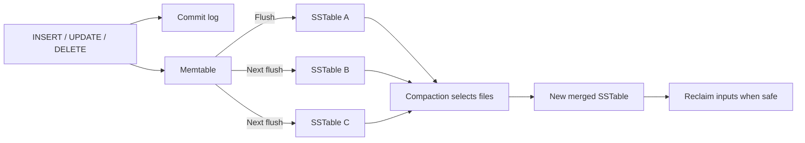

# STCS, LCS, TWCS, and Workload Characteristics to Match

Apache Cassandra stores flushed records on disk as **immutable SSTables**. Each memtable flush can produce one or more new SSTables, while subsequent UPDATEs/DELETEs append new versions or tombstones rather than editing old files in place. **Compaction** selects which SSTables to merge, writes new SSTables, and discards input files when safe. Consequently, the choice of compaction strategy directly impacts read speed, disk rewrite volume, expiration cleanup speed, spare capacity needs, and stability under load.

This lesson belongs to the **SSTables and compaction** chapter of the **DATABASE_ENGINE_WIDE_COLUMN_CASSANDRA** module. The focus is on matching **SizeTieredCompactionStrategy (STCS)**, **LeveledCompactionStrategy (LCS)**, and **TimeWindowCompactionStrategy (TWCS)** to *real workload characteristics*, rather than picking by name or default. The content connects to partition key design, CQL, replication, consistency, repair, troubleshooting, and Java applications. No single strategy is optimal for every table.

## 1. Learning Objectives

After this lesson, you will be able to:

1. Explain why immutable SSTables give rise to compaction and distinguish it from **flush**, **repair**, and **backup**.
2. Describe SSTable selection in **STCS**, levels in **LCS**, and time windows in **TWCS**.
3. Compare **read amplification**, **write amplification**, **space amplification**, tombstones/TTL, and latency stability.
4. Relate strategies to continuous ingest, read-heavy loads, time-ordered events, updates/deletes, backfills, and retention.
5. Declare compaction in CQL, inspect metrics via nodetool/metrics, and design a controlled benchmark.
6. Spot bad decisions: changing strategy to fix a **hot partition**, forcing major compaction, or using TWCS on tables with frequent historical updates.

## 2. First: What Problem Does Compaction Solve?

Suppose a table tracks order state. A key `order_id` initially has `status = 'NEW'`, later updated to `'PAID'`, and finally `'SHIPPED'`. Versions of the same key may temporarily reside in different SSTables. On read, Cassandra must combine data from the memtable/SSTables and choose the winning version by timestamp rules while accounting for tombstones.



**Flush** persists new data in the memtable into an SSTable; **compaction** reads and rewrites existing SSTables to organize them more efficiently. **Repair** compares/synchronizes data across replicas, while **backup/snapshot** retains copies for recovery; these operations are related but cannot substitute for one another.

| Phenomenon as SSTables multiply | Practical impact |
| --- | --- |
| Same partition/cell in multiple SSTables | Queries may have to inspect more files, indexes, Bloom filters, and data versions. |
| Tombstone in one file, old data in another | Tombstones cannot be purged recklessly, or deleted data could resurrect. |
| Small SSTables continuously produced by writes | File and metadata counts grow; read paths and compaction scheduling grow more complex. |
| Compaction writes new files | Consumes CPU, disk I/O, and temp space; can contend with live queries. |

The three strategies differ mainly in **which SSTables are selected to merge, when, and with what goal**. None of the strategies changes the partition key, replication factor, or consistency level. Strategy selection is typically configured **per table**, so tables in the same keyspace can use different strategies.

## 3. Three “Amplification” Concepts to Distinguish

| Metric | Interpretation | Why it affects SLA |
| --- | --- | --- |
| **Read amplification** | Number of SSTables/data regions or I/O ops inspected to serve one logical query. | High values increase CPU, disk reads, and `p95/p99` latency tail. |
| **Write amplification** | How many times data is rewritten by flushes, compaction, and file reorganization relative to input data. | High values drive disk I/O, CPU, SSD wear, and compaction backlog. |
| **Space amplification** | Physical space consumed by multiple versions, tombstones, input/output SSTables, snapshots, and temp headroom relative to live data. | High values create capacity pressure and disk-full risk during compaction. |

These concepts are **trend measures**, not fixed constants per strategy. A table with the same row count but heavy UPDATEs/DELETEs, tombstones, or repairs incurs different costs than an append-only table. Nor does **table-wide** SSTable count equal the number of SSTables actually touched for **a specific partition/range**.

Always evaluate a workload using five questions:

1. Is it continuous **new writes** or heavy **updates/deletes** on the same keys?
2. Do queries target **one partition + clustering range** or touch many partitions/large scans?
3. Does data have a **relatively uniform TTL** and **time-based retention**?
4. Are there frequent **late arrivals, backfills, out-of-order timestamps**, or historical repairs/streaming?
5. Is the priority **write throughput**, **read p99**, **timely expiration cleanup**, or **I/O/storage budget**?

## 4. STCS — SizeTieredCompactionStrategy

**STCS** groups and compacts SSTables of roughly similar sizes. Once a group meets the threshold count, it is selected to merge; smaller files form larger files, and those larger files can become candidates for subsequent compaction rounds. Thresholds are typically controlled by `min_threshold` and `max_threshold`.

Conceptual example (not a rigid execution schedule):

```text
4 SSTables around 100 MB
    -> compact
1 SSTable around 400 MB

Multiple SSTables around 400 MB
    -> can compact into a larger SSTable
```

**Strengths**:

- Often suits **high write loads** with continuous ingestion and relaxed strictness on absolute read latency.
- Does not enforce a rigid level hierarchy; rewrite cost can be lower than LCS on certain workloads.
- Easy starting point for tables whose data does not follow strict time/TTL patterns.

**Trade-offs**:

- Multiple SSTables of different sizes can overlap the same key ranges; read queries must touch more files.
- Can require **substantial free disk space** when compacting large files because inputs and outputs coexist during compaction.
- Reclaiming tombstones/expired data can be slow if related files rarely compact together; you cannot rely on `gc_grace_seconds` alone to predict exact space-reclaim dates.
- Read latency can fluctuate as SSTable counts or compaction backlogs grow.

**Commonly fits:** large ingestion tables, batch writes, few point lookups requiring ultra-low p99; tables with updates/late writes where TWCS breaks down. **Unsuitable when:** high read-latency stability is required on tables with heavy SSTable overlap.

### STCS CQL

```sql
CREATE TABLE IF NOT EXISTS compaction_lab.write_heavy_by_bucket (
  tenant_id text,
  bucket_day date,
  event_id timeuuid,
  payload text,
  PRIMARY KEY ((tenant_id, bucket_day), event_id)
) WITH compaction = {
  'class': 'SizeTieredCompactionStrategy',
  'min_threshold': '4',
  'max_threshold': '32'
};
```

These thresholds **illustrate valid options**, not fixed optimal recommendations for every cluster. Each version has its own defaults/limits; avoid tuning without measuring backlog and read/write impact.

## 5. LCS — LeveledCompactionStrategy

**LCS** organizes SSTables into **levels**. At stabilized levels from L1 upward, SSTables within the same level are organized so **token/key ranges do not overlap** per strategy rules; overlapping data from a prior level is compacted into the next level. **L0** is an important exception: newly flushed SSTables can overlap each other, and excessive L0 backlog still causes read amplification.

```text
L0: New SSTables, may overlap
    AAAAA    BBBBBB    CCCCC

L1: Multiple small SSTables, non-overlapping key ranges within level
    |---1---|---2---|---3---|

L2: Larger tier than L1, also partitioned into ranges within level
    |-------4-------|-------5-------|

When data moves between levels, selected SSTables are read
and rewritten to preserve level organization invariants.
```

**Strengths**:

- For **key/partition reads** across substantial historical data, the number of SSTables examined is typically easier to bound than STCS when levels are healthy.
- Read latency can be **more predictable**, suiting read-heavy or `p95/p99`-sensitive workloads.
- Output files have a configurable target size via `sstable_size_in_mb`.

**Trade-offs**:

- **Write amplification and disk I/O** are usually higher than STCS because data is rewritten multiple times across levels.
- If ingestion exceeds compaction capacity, L0/backlog grows and read benefits degrade sharply.
- Must monitor write latency, pending compactions, files per level, CPU/disk bandwidth, and spare capacity.
- LCS cannot cure oversized partitions, hot partitions, poor query modeling, or full-table scans.

**Commonly fits:** **read-heavy** tables queried by primary key, user/account profile tables updated fairly often that still require steady read latency. **Needs caution:** extreme write workloads with constrained I/O, where LCS can build backlog and contend with the read path.

### LCS CQL

```sql
CREATE TABLE IF NOT EXISTS compaction_lab.profile_by_user (
  user_id uuid PRIMARY KEY,
  display_name text,
  settings_json text,
  updated_at timestamp
) WITH compaction = {
  'class': 'LeveledCompactionStrategy',
  'sstable_size_in_mb': '160'
};
```

The **160 MB** value here is an example setting, **not a universal benchmark or rule**. SSTable size, level count, and efficiency depend on the data, Cassandra version, memory capacity, and disk throughput.

## 6. TWCS — TimeWindowCompactionStrategy

**TWCS** partitions SSTables into **time windows** based on data **timestamps**, then compacts primarily within the same window. When new data arrives continuously with advancing timestamps, older windows stop receiving updates, reducing rewrites of old data. This is the classic choice for **append-only time-series with uniform TTLs and clear retention**.

```text
Window 1 (Day 1): [Compacted old SSTables]
Window 2 (Day 2): [Compacted old SSTables]
Window 3 (Day 3): [Compacted old SSTables]
Window 4 (Day 4): [Active SSTables receiving writes, may use
                   size-based compaction within the active window]
```

**Key advantages**:

- Older windows remain mostly static, avoiding reading/rewriting historical data on every new ingest wave.
- With relatively uniform TTLs and time-bounded data lifecycles, an SSTable can become **fully expired**; when safety checks pass, Cassandra can drop the entire SSTable without scanning/rewriting individual rows.
- Well suited for storing telemetry/logs/metrics over time with retention-based expiration.

**Specific risks**:

- **Updating old records** with newer timestamps, ingesting historical data, restore/streaming, and clock skew can mix “old” and “new” data into SSTables across different windows.
- If an SSTable contains both expired and unexpired data, the ability to **drop the whole SSTable** diminishes; tombstones may be kept longer.
- Reads spanning multiple windows must inspect multiple SSTables; TWCS does not automatically index arbitrary time-range queries.
- Mixed TTLs, non-TTL rows, or repeated updates/deletes on the same partition over time erode the strategy's benefits.
- Arbitrarily changing window size can cause uneven SSTable distribution and compaction backlog.

**Do not confuse:** TWCS organizes **SSTables by timestamp and window**, not automatically CQL-partitioning by day. To keep queries narrow, the application still must design **partition keys and clustering keys** around queries.

### TWCS CQL

```sql
CREATE TABLE IF NOT EXISTS compaction_lab.metrics_by_device_day (
  device_id text,
  event_day date,
  ts timeuuid,
  cpu_percent double,
  PRIMARY KEY ((device_id, event_day), ts)
) WITH CLUSTERING ORDER BY (ts DESC)
  AND default_time_to_live = 604800
  AND compaction = {
    'class': 'TimeWindowCompactionStrategy',
    'compaction_window_unit': 'DAYS',
    'compaction_window_size': '1'
  };
```

Here:

- **TTL = 604,800 seconds (7 days)** assumes keeping data for 7 days from write time. Every row uses a uniform default TTL, favoring window-batch expiration.
- **Window = 1 day** is an illustrative choice. Window sizing depends on ingest rate, retention, files per window, query patterns, and compaction capacity; there is no rule that “7-day TTL always means 1-day window”.
- `event_day` in the partition key enables querying one device/day, while `ts` supports time-ordered reads within the partition. Partitioning by day does not automatically force SSTables into matching day windows if actual write timestamps/timing differ.

## 7. Decision Comparison Table

| Criterion | STCS | LCS | TWCS |
| --- | --- | --- | --- |
| **SSTable selection principle** | Groups similarly sized files. | Compacts across levels, bounding overlap within stable levels. | Groups by timestamp windows, compacting primarily within windows. |
| **Typical workload** | Write-heavy, continuous ingest, moderate reads. | Read-heavy, key lookups, strict p99 stability. | Append-only time-series, fairly uniform TTL/retention. |
| **Read amplification** | Can be high with many overlapping files. | Often lower/steadier when levels are healthy. | Depends on window/file count; wide multi-window reads can be costly. |
| **Write amplification** | Often more acceptable than LCS on heavy writes. | Often high due to multi-level rewrites. | Can be low for immutable old data; rises if late writes mix windows. |
| **Compaction headroom** | Can need substantial temp space when merging large files. | Needs headroom for continuous rewrites and compaction. | Needs headroom for active window and expired/tombstone files not yet safe to drop. |
| **TTL/tombstones** | Reclaimed depending on compactions of involved files. | Reclaimed per compaction/overlap; requires tombstone monitoring. | Great fit for uniform TTLs and whole-file expiration eligibility. |
| **Updating old data** | Generally more flexible than TWCS. | Fits point reads and updates when I/O is sufficient. | Usually a warning sign if frequent. |
| **Notable risks** | Overlapping files and free disk demands. | Compaction backlog, write amplification. | Backfills/clock skew/mixed TTLs mixing windows and delaying file drops. |
| **Fixes bad query schema?** | No. | No. | No. |

This table is a **starting guide for experimentation**, not an absolute performance ranking. Final decisions must rest on concrete queries, datasets, and metrics.

## 8. Three Workload Examples and Initial Decisions

### Case A — Continuous Event Ingestion, Few Reverse Lookups

A system ingests messages per tenant at hundreds of thousands of events/hour, mostly new inserts. Users occasionally look up by `tenant_id + bucket_day`, with relaxed p99; data is kept long-term with periodic backfills.

**Start by testing STCS.** Why: heavy writes and backfills make TWCS unattractive. Measure SSTable counts, read latency on large partitions, pending compactions, and free disk. If key reads take priority over ingestion, include LCS in the comparison.

### Case B — Frequently Read User Profiles

Table `profile_by_user` serves login/UI, receiving heavy SELECTs by `user_id` and UPDATEs when profiles change. No uniform time-based TTL. Read SLA has tight p99.

**Start by testing LCS.** Why: aims to bound files checked during point lookups. Measure `p95/p99` read latency and write amplification; if disks cannot keep up with compaction, tune throughput/hardware and compare STCS. Never sacrifice cluster availability just for good p99 in a short benchmark.

### Case C — Daily Metrics Expiring After Seven Days

Devices continuously send measurements timestamped close to write time, rarely editing old data. Queries mainly target one device/day or a short time range; records expire under a uniform TTL.

**Start by testing TWCS** with a sufficiently small, sensible window for ingest/retention. Measure how quickly old files become fully expired, space reclaim rate, SSTables per window, and impact of late-arriving events. If backfills are frequent or TTLs vary, re-test STCS/LCS or split tables.

### Decision Check Question

A “time-series” system updates many historical days every hour using the current timestamp, and some records have no TTL. Should you choose TWCS just because the data has a timestamp column? **No.** You must analyze actual timestamps, update rules, TTL variance, and expired-SSTable drop eligibility. The “time-series” label alone does not prove **append-only, time-ordered, uniform-retention** behavior.

## 9. TTL, Tombstones, Repair, and TWCS Safety

In Cassandra, an expired TTL cell becomes logically deleted data; tombstones and related metadata ensure stale values from other replicas/SSTables cannot reappear. Eligibility to drop tombstones depends on the grace period, overlapping data, and other safety checks, **not just TTL expiration**.

Example of a TWCS table with a 7-day TTL:

```text
Day 1: write event A (7-day TTL)
Day 8: A expires logically; normal queries no longer return A.
Afterward: the SSTable containing A may still occupy disk space.
Once gc grace / overlap and expiration conditions are met:
           a fully expired SSTable can be dropped.
```

**Never assume all Day-1 data is physically deleted right at the start of Day 8.** The same SSTable may contain entries with different TTLs, non-TTL entries, or late updates. The strategy requires compaction and specific safety checks before reclaiming space.

### Why Do gc_grace_seconds and Repair Matter?

When a replica is down for a long time, it may hold stale versions of records deleted on other replicas. If tombstones are purged too early and the old replica returns, deleted data risks **resurrection (zombie data)**. Therefore:

1. Keep `gc_grace_seconds` and repair schedules aligned with maximum replica downtime, TTL policies, and version behavior.
2. Ensure repair runs frequently enough per operational policy so replicas catch up on deletions.
3. Do not lower `gc_grace_seconds` to 0 to “help TWCS delete faster” without proving safety across the full replica and repair lifecycle.
4. Do not enable options that bypass safety checks when dropping expired SSTables just for short-term disk relief.

### Out-of-Order Writes and Repair/Streaming

TWCS assigns windows from data/SSTable timestamps; **an SSTable is typically bucketed by its maximum timestamp**. When inserting old data with current timestamps, updating the same key days later, or streaming files carrying timestamps from different windows, expired TTL data can end up in the same file as newer data. When that happens, the benefit of “dropping whole old-window files” diminishes.

**Operational recommendations:** synchronize clocks across nodes, avoid arbitrary manual `USING TIMESTAMP`, clarify backfill pipelines, verify repair/streaming behavior under TWCS, and monitor files lingering past retention. If long-term historical ingestion is required, consider a **separate backfill table** or a different read model so main-ingest windows stay uncontaminated.

## 10. CQL Practice: Three Tables, Three Strategies

Examples assume a lab cluster with datacenter `dc1`, at least three available replicas, and version-appropriate CQL. Adjust RF to match your actual lab; do not deploy a single-node VM with RF = 3 and mistake CL errors for compaction bugs.

### Step 1 — Initialize the Keyspace

```sql
CREATE KEYSPACE IF NOT EXISTS compaction_lab
WITH replication = {
  'class': 'NetworkTopologyStrategy',
  'dc1': 3
}
AND durable_writes = true;
```

The three `CREATE TABLE` statements from earlier sections create three independent test tables: `write_heavy_by_bucket` (STCS), `profile_by_user` (LCS), and `metrics_by_device_day` (TWCS). Data is not automatically copied between them; for a fair benchmark, **load data with the same distribution and query mix** into equivalently normalized schemas/tables, varying only the strategy.

### Step 2 — Write and Read by Proper Partition

```sql
CONSISTENCY LOCAL_QUORUM;

INSERT INTO compaction_lab.metrics_by_device_day
  (device_id, event_day, ts, cpu_percent)
VALUES ('device-01', '2026-11-21', now(), 72.5);

INSERT INTO compaction_lab.metrics_by_device_day
  (device_id, event_day, ts, cpu_percent)
VALUES ('device-01', '2026-11-21', now(), 70.0);

SELECT ts, cpu_percent
FROM compaction_lab.metrics_by_device_day
WHERE device_id = 'device-01'
  AND event_day = '2026-11-21'
LIMIT 100;
```

The query specifies the full partition key `(device_id, event_day)` and uses clustering order to fetch recent timestamps. **`LIMIT 100` only caps returned rows**, and does not replace measuring the read path; for a hot partition, reads and compaction can still be expensive.

### Step 3 — Inspect Table Configuration

In cqlsh:

```sql
DESCRIBE TABLE compaction_lab.write_heavy_by_bucket;
DESCRIBE TABLE compaction_lab.profile_by_user;
DESCRIBE TABLE compaction_lab.metrics_by_device_day;
```

Inspect the `compaction` map to verify the active strategy and options; also inspect `default_time_to_live` and `gc_grace_seconds` when evaluating TWCS. Defaults vary by version and deployment, so do not guess from example docs.

### Step 4 — Change Strategy Only with Evidence

Example CQL switching a **lab** table from STCS to LCS:

```sql
ALTER TABLE compaction_lab.write_heavy_by_bucket
WITH compaction = {
  'class': 'LeveledCompactionStrategy',
  'sstable_size_in_mb': '160'
};
```

Changing `compaction` via `ALTER TABLE` **does not instantaneously transform every existing SSTable**. The cluster must process subsequent files/compactions to achieve the new layout; during transition, I/O, backlog, and disk demand can rise. Never experiment directly in production or rapidly toggle changes just to measure a few minutes and draw conclusions.

## 11. Observability: What to Measure to Confirm Strategy Fit?

Common commands on a Cassandra node (exact syntax/field names vary by version):

```bash
nodetool status
nodetool tablestats compaction_lab.profile_by_user
nodetool tablehistograms compaction_lab profile_by_user
nodetool compactionstats
```

Measure across **all involved nodes**, not just a lightly loaded node. Key metrics to inspect:

| Measurement group | Metrics / questions |
| --- | --- |
| **Read latency** | p50/p95/p99 for key GETs, intra-partition ranges, and bounded scans; how many SSTables examined per read? |
| **Write latency & throughput** | Writes/sec at target consistency, p95/p99 while compaction contends? |
| **SSTable counts/levels** | Total and per-level/window distribution; is L0 growing steadily in LCS? |
| **Compaction backlog** | Pending/running compactions, bytes processed, I/O, task duration, and hourly/daily stability? |
| **Disk footprint** | Live/total disk space, free disk, temp compaction files, lingering snapshots? |
| **Tombstone/TTL** | Tombstones scanned per read, expired SSTables still on disk, lag from expiry to reclaim? |
| **Replica health** | Hints, repairs, active streaming, node lag; are they skewing the benchmark? |
| **Host resources** | CPU, GC, read/write IOPS, disk throughput/latency, network, and memory. |

**Do not watch only total SSTable count or table size.** An STCS table with few SSTables can still read slowly due to huge partitions; an LCS table with many SSTables across the full token range can still read fast thanks to minimal per-key overlap. Measure **real queries + disk/compaction metrics** together.

### Controlled Experimentation

1. Prepare lab tables with **equivalent schemas and data**, varying only compaction strategy. Control hardware/nodes, replication, consistency, and driver settings.
2. Build a dataset matching projected production partition count, partition-size distribution, UPDATE/DELETE ratio, TTLs, write delays, and backfills.
3. Run phases **ingest → steady state → mixed reads → TTL expiry → repair/backfill**. Do not run benchmarks too short for real compaction to kick in.
4. Collect p50/p95/p99, throughput, bytes rewritten, disk high-water mark, and metrics from the table above. Separate warm-cache vs. cold-cache runs.
5. Compare under the **same SLA**: e.g., LCS achieves better read p99 while write throughput drops and compaction backlog climbs; TWCS reclaims better under uniform TTLs while wide multi-window scans do not improve.
6. Hold non-compaction variables steady: active node count, dataset, background load, repair timing, token distribution, and Java driver connections.

| Benchmark scenario | STCS observations | LCS observations | TWCS observations |
| --- | --- | --- | --- |
| Continuous heavy ingest | Write throughput, large files awaiting compaction, disk headroom | L0 backlog, bytes rewritten, write p99 | Active-window backlog, files/window |
| Point reads during ingest | Read latency driven by overlap | Read p99 benefit vs. write cost | Do reads span many windows or only recent ones? |
| Heavy updates/deletes | Tombstones and overlap | Rewrites, tombstones, and backlog | Cross-window data reducing whole-file drop eligibility |
| Uniform TTL and expiration | Reclaim time, compaction dependency | Reclaim and rewrite cost | Ability to drop fully expired SSTables |
| Historical data backfill | Absorption capacity and read tail | Added pressure on levels | Timestamp mixing into newer windows |

## 12. Tuning Windows and Thresholds: Avoid Unfounded “Optimization”

### For STCS

- If too few similarly sized SSTables exist, compaction may not trigger promptly, leaving many files around.
- Forcing overly aggressive compaction increases disk I/O without fixing reads if the schema scans too broadly.
- Free space planning must cover input/output SSTables of large compactions **plus** concurrent snapshots/streaming.

### For LCS

- Monitor **SSTable distribution by level**, especially L0. Growing L0 signals flushes outpacing compaction capacity.
- `sstable_size_in_mb` changes file counts/management overhead and compaction unit size; benchmark rather than adjusting arbitrarily.
- If pending compactions persist, inspect disk IOPS/bandwidth, CPU, competing repair/streaming, and compaction throughput limits before merely tweaking thresholds.

### For TWCS

- Too small a window can create excessive SSTables/window and metadata, especially at low write rates or multi-day spreads.
- Too large a window mixes rows with different expiration times into one SSTable, delaying whole-file drops.
- Choose window size based on **SSTable generation rate, retention, TTL distribution, timestamp separation, and query pattern**, not just common UI date ranges.
- If historical data arrives late frequently, reconsider redesigning the ingest pipeline/table before multiplying window counts.

**Major compaction** can create huge files and consume heavy I/O/disk; do not treat it as a default “quick cleanup” button. On TWCS, merging data across incompatible windows destroys time-based separation; only run it per tested, version-appropriate runbooks.

## 13. Relationship with Partition Keys, Replication, and Java

### Proper Schema Is a Prerequisite

In a metrics system, partition `((device_id, event_day), ts)` fetches one day for one device. If a single device emits too many points per day, the partition can still become oversized even with TWCS. You can split by `hour_bucket` or `shard_id` and aggregate in Java/API:

```sql
-- Alternative schema option, used only when workload requires splitting partitions.
CREATE TABLE IF NOT EXISTS compaction_lab.metrics_by_device_hour (
  device_id text,
  event_day date,
  hour_bucket tinyint,
  ts timeuuid,
  cpu_percent double,
  PRIMARY KEY ((device_id, event_day, hour_bucket), ts)
) WITH compaction = {
  'class': 'TimeWindowCompactionStrategy',
  'compaction_window_unit': 'HOURS',
  'compaction_window_size': '6'
};
```

With this schema, the application must know **hour_bucket** when querying; for a full-day report, it queries/merges multiple partitions in a bounded manner. Compaction strategy cannot replace query-aligned key design.

### Replication and Consistency

- Each replica of a partition maintains **its own SSTable/compaction state**. Three replicas do not necessarily compact at the same time or hold identical SSTable counts.
- `LOCAL_QUORUM` with RF = 3 requires two replicas to respond; switching STCS to LCS **does not** increase/decrease RF, turn reads into linearizable reads, or alter winner-timestamp rules.
- Repair/hinted handoff/streaming can create new data/SSTables and affect compaction backlog; during benchmarks, record sync state and repair schedules.
- If a replica misses data due to an outage, **compaction does not pull data from other replicas**. Hints, repair, or rebuild mechanisms are required.

### Java 4.x Applications

Prepared statements in the Java driver target the right partition; compaction is normally a **table/server-side** configuration, and applications should not issue `ALTER TABLE` per request:

```java
import java.time.LocalDate;
import com.datastax.oss.driver.api.core.ConsistencyLevel;
import com.datastax.oss.driver.api.core.cql.PreparedStatement;
import com.datastax.oss.driver.api.core.cql.BoundStatement;
import com.datastax.oss.driver.api.core.cql.Row;
import com.datastax.oss.driver.api.core.cql.ResultSet;

PreparedStatement select = session.prepare(
    "SELECT ts, cpu_percent FROM compaction_lab.metrics_by_device_day " +
    "WHERE device_id = ? AND event_day = ? LIMIT 100");

BoundStatement bound = select.bind(
        "device-01", LocalDate.of(2026, 11, 21))
    .setConsistencyLevel(ConsistencyLevel.LOCAL_QUORUM);

ResultSet rows = session.execute(bound);
for (Row row : rows) {
    // Process timeuuid and cpu_percent for each event.
}
```

To measure performance, applications should log **query type, partition key (or hashed key for privacy), returned row count, latency, timeouts**, and concurrency. Do not change retry policies or page sizes between benchmark rounds and blame/credit compaction for every difference.

## 14. Common Mistakes

| Claim | Correction |
| --- | --- |
| “Cassandra uses SSTables so every compaction is the same.” | Strategies select/merge files by different rules, impacting read/write/space. |
| “LCS is always best because fewer files overlap.” | Trades off heavy rewrites and compaction backlog; under high ingest L0 can grow. |
| “STCS always frees tombstones quickly.” | Requires eligible compactions and safety checks; large files can linger a long time. |
| “TWCS fits every table with a timestamp.” | Requires append-only, mostly increasing timestamps, and matching TTL/retention; late writes defeat it. |
| “TWCS automatically partitions data by day.” | CQL partition keys must be designed explicitly; SSTable windows are separate. |
| “Seven-day TTL means disk is freed right after seven days.” | TTL expires logically first; tombstone/SSTable drops depend on grace, overlap, compaction, and safety. |
| “With repair enabled, `gc_grace_seconds` can immediately be set to 0.” | Must account for extended downtime, tombstone lifecycle, and repair runbooks; lowering blindly risks zombies. |
| “Few total SSTables in a table always means good p99.” | Must check SSTables touched per key, partition size, tombstones, caches, and I/O. |
| “Changing compaction via ALTER changes metrics immediately.” | Switching strategies alters compaction scheduling, which can take time and heavy I/O. |
| “Compaction fixes hot partitions or broad ALLOW FILTERING scans.” | Schema/query/load are root causes; compaction does not alter data access paths. |
| “Node UP means replicas are synced and compacted.” | Node status does not prove repair finished or SSTable layouts match. |

## 15. Hands-On Exercises and Completion Criteria

### Exercise A — Justified Strategy Selection

For the following three workloads, pick STCS/LCS/TWCS to test first, then list at least **two metrics** to validate:

1. **Log ingest**: continuous writes, occasional historical backfills, few point SELECTs, long retention without TTL.
2. **Customer profile**: continuous GETs by ID, scattered UPDATEs, strict read p99 SLA, no TTL.
3. **Monitoring metrics**: append-only, uniform 7-day TTL, minimal late data, dashboards querying recent ranges.

Describe one scenario that would force the initial choice **to change** (e.g., log ingest suddenly needing tight read p99, or metrics beginning to receive multi-month backfills).

### Exercise B — Benchmark with Results Table

Create a lab environment and load identically distributed workloads into equivalently designed tables across the three strategies. Fill in the table below (**measured** data, never guessed):

| Strategy | Workload | Read p95/p99 | Write p95/p99 | SSTables/level/window | Pending compactions | Disk peak / reclaimed |
| --- | --- | --- | --- | --- | --- | --- |
| STCS | ... | ... | ... | ... | ... | ... |
| LCS | ... | ... | ... | ... | ... | ... |
| TWCS | ... | ... | ... | ... | ... | ... |

If TWCS performs worse on a heavy-update workload, explain it via **timestamps/windows and overlap**, rather than vaguely concluding “TWCS is slow”.

### Exercise C — Tombstone Analysis

A TWCS table has a 7-day TTL. On Day 8, SELECT no longer returns Day-1 events, yet disk usage has not dropped. Explain **at least three valid causes** (grace period, SSTable not fully expired, entries with different TTLs, mixed-window data, compaction/snapshots) and one observation/verification method for each.

### Exercise D — Operational Plan Review

An operations team wants to run major compaction across the whole table and lower `gc_grace_seconds` to 0 to reclaim disk space. Point out the zombie-data resurrection risk, I/O/disk-space cost, impact on TWCS, and required evidence before approving any change.

**Lesson completion** means the learner can defend a choice using three layers of evidence: **(a)** actual query shape and partitions, **(b)** update/TTL/timestamp behavior, and **(c)** read/write/compaction/disk metrics on a representative workload.

## 16. Self-Check Questions

1. Why can LCS reduce SSTable overlap within each level yet still suffer L0 backlog?
2. Why can STCS save write amplification yet need large disk headroom during some compactions?
3. With TWCS, what conditions allow an old SSTable to be dropped as a whole file? Why do non-TTL rows in that file cause trouble?
4. Why don't two tables both having a timestamp column necessarily share the same best compaction strategy?
5. Why don't a 7-day TTL and 1-day window guarantee disk space is reclaimed after exactly 7 days?
6. Why can purging tombstones early while an old replica is out of sync resurrect deleted data?
7. Does switching STCS to LCS change RF, consistency, or partition keys? If not, which mechanisms handle those separately?
8. Which metrics would you present to prove LCS's read benefits justify its higher write cost?

## 17. References

- [Apache Cassandra Documentation — Compaction](https://cassandra.apache.org/doc/latest/cassandra/managing/operating/compaction/overview.html): compaction mechanics, STCS, LCS, TWCS, and version-specific options.
- [Apache Cassandra Documentation — Storage Engine](https://cassandra.apache.org/doc/latest/cassandra/architecture/storage_engine.html): memtables, immutable SSTables, commit log, and compaction effects.
- [Apache Cassandra Documentation — CQL CREATE TABLE](https://cassandra.apache.org/doc/latest/cassandra/developing/cql/ddl.html): declaring `WITH compaction`, TTL, and `gc_grace_seconds`.
- [Apache Cassandra Documentation — Repair](https://cassandra.apache.org/doc/latest/cassandra/managing/operating/repair.html): tombstone safety and replica convergence.
- [Apache Cassandra Documentation — nodetool](https://cassandra.apache.org/doc/latest/cassandra/managing/tools/nodetool/nodetool.html): inspecting tablestats, compactionstats, and tablehistograms by version.

**Key Takeaway:** STCS groups files by **size** to serve ingestion; LCS organizes **levels** to control overlap and stabilize reads; TWCS groups by **time windows** to leverage append-only data with TTLs. Ask about **queries/partition keys, update-delete ratio, timestamps/retention, p99, and disk I/O budget**, then measure on a representative cluster and dataset. A good compaction strategy pays off only when table design and replica/repair operations are also sound.
