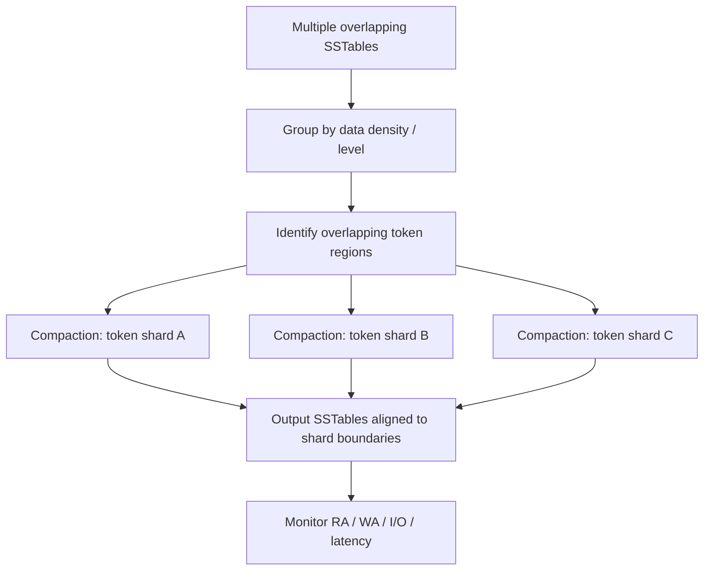
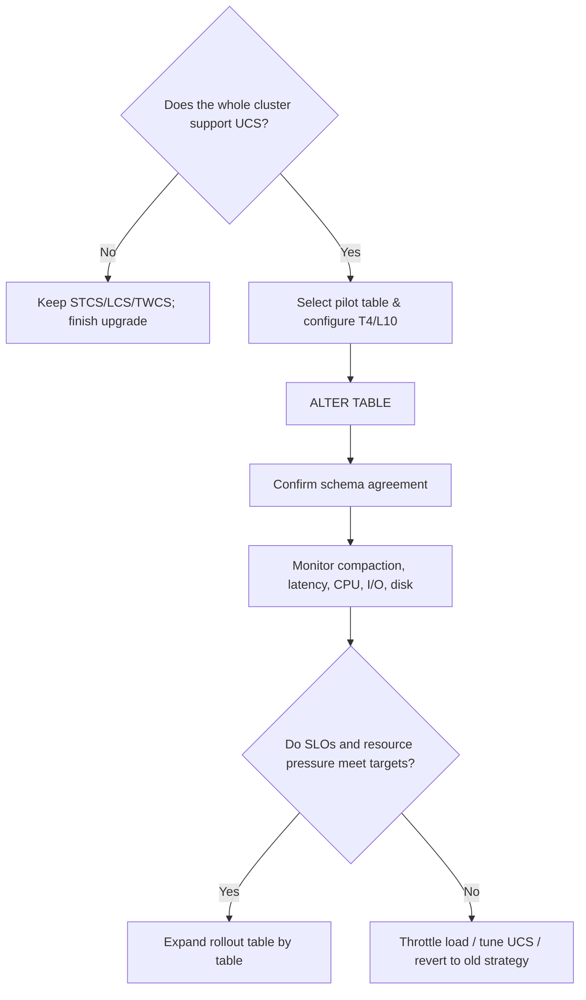

# UCS and Version Support Requirements

> **Chapter:** SSTables and compaction  
> **Module:** `DATABASE_ENGINE_WIDE_COLUMN_CASSANDRA` — Apache Cassandra

**Unified Compaction Strategy (UCS)** is Apache Cassandra's compaction strategy that lets you tune between read priority and write priority within a single model. The critical point for rollout is that **UCS was introduced in Apache Cassandra 5.0**: a cluster running Cassandra 4.1 or earlier cannot simply configure `UnifiedCompactionStrategy` and expect it to work. On a cluster undergoing a multi-node upgrade, you must verify **the version of the entire cluster** before enabling this strategy on any table.

This lesson explains how UCS works, when it is supported, how to declare and inspect it via CQL, how it compares with STCS/LCS/TWCS, and which risks must be controlled during migration. The context is distributed Cassandra using the wide-column model: partition key choice, query-driven table design, replication, consistency levels, repair, and Java applications still govern operational outcomes even though compaction is configured per table.

**Learning Objectives**

- Explain the role of SSTables and compaction in Cassandra's write/read paths.
- State the **Apache Cassandra 5.0 or higher** requirement for using UCS in the official Apache distribution.
- Explain `scaling_parameters` such as `T4`, `L10`, `N`, and per-tier options.
- Write CQL `CREATE TABLE` / `ALTER TABLE` statements selecting UCS and inspect the current configuration.
- Plan a monitored migration from STCS/LCS/TWCS with a rollback plan.
- Distinguish what UCS can optimize from what must still be addressed via data modeling, replication, repair, or application design.

## 1. Why Does Cassandra Need Compaction?

On a replica, mutations are written to the **commit log** and **memtable**. When a memtable flushes, Cassandra creates one or more **SSTables**, which are structured, immutable data files. New data can land in a different SSTable from older versions of the same row or from deletion tombstones.

When reading a partition, Cassandra may have to inspect multiple SSTables and merge the relevant versions. **Compaction** reorganizes and merges SSTables to limit the number of sources to check, reduce read cost, and assist in purging expired/deleted data when safety conditions are satisfied.


Compaction is not free:

- **Read amplification (RA):** the number of SSTable sources/files checked to serve a single read. Many overlapping SSTables usually make reads harder.
- **Write amplification (WA):** the volume of data rewritten by compaction after the initial write. More frequent compaction increases write cost and background I/O.
- **Space amplification (SA):** extra space required for multiple data versions, tombstones, and compaction output files written before old files can be freed.

No strategy makes all three costs zero at all times. The right strategy depends on read/write ratio, partition size, TTLs, updates/deletes, disk type, RAM capacity, I/O headroom, and latency targets.

## 2. How Does UCS Change SSTable Organization?

Legacy strategies are typically selected by workload class:

- **SizeTieredCompactionStrategy (STCS):** merges similarly sized SSTables; often efficient in rewrite volume, yet may leave many SSTables overlapping token ranges.
- **LeveledCompactionStrategy (LCS):** organizes by level to bound overlap and aid read queries, yet usually rewrites data more heavily.
- **TimeWindowCompactionStrategy (TWCS):** groups SSTables by time windows, useful for mostly immutable time-series data with TTLs written roughly in chronological order.

**UCS (UnifiedCompactionStrategy)** unifies tiered and leveled traits into a flexibly configurable mechanism. Instead of relying solely on SSTable size, UCS uses **density**:

\[
d = \frac{s}{v}
\]

Where `s` is SSTable size, and `v` is the fraction of the token range covered by the SSTable **within the token space actually owned by the node**. With vnodes, `v` cannot be computed simply as the difference between the largest and smallest tokens.

Based on density, UCS arranges SSTables into tiers with thresholds scaling by a fanout factor; when an overlapping group of SSTables exceeds the threshold, UCS selects files to compact. UCS also splits outputs along **token-space shard boundaries**, enabling compactions in non-overlapping parts to run in parallel.



The practical benefit of this splitting is avoiding processing one giant SSTable monolith in a single task, letting parameters tune the read/write balance, and supporting large datasets on high-density nodes. However, **UCS does not replace a good partition key**: an overly hot or wide partition, queries not modeled for Cassandra, or saturated disks will still cause problems.

## 3. Version Support Requirements: What Must Be Verified First

### Compatibility Matrix for Official Apache Cassandra

| Apache Cassandra Version | `UnifiedCompactionStrategy` | Action path |
| --- | --- | --- |
| 3.x | **Not supported** | Use a strategy included in the running version; plan upgrades along supported paths. |
| 4.0.x | **Not supported** | Use appropriate STCS/LCS/TWCS; do not put UCS in `WITH compaction`. |
| 4.1.x | **Not supported** | Same; Cassandra 4.1 does not include UCS in official Apache releases. |
| **5.0.x** | **Supported** | UCS may be used after verifying version and cluster health. |
| Releases after 5.0 | **Consult docs for exact branch and distribution** | Do not assume options/defaults are identical to 5.0; verify before applying. |

Official release notes list Unified Compaction Strategy as a **new feature in Cassandra 5.0**. Any claim that an older release includes UCS must be verified against the **actual documentation and binaries** of that distribution; never assume vendor backports match official Apache Cassandra.

### Why Must the Entire Cluster Be Checked?

Cassandra stores compaction definitions in the **table schema**, and that schema propagates across nodes. Nodes running versions that do not recognize `UnifiedCompactionStrategy` or its options may fail to process schema/table state as expected.

**Safe operations rule:** during a rolling upgrade from 4.x to 5.0, keep compaction configs compatible with the older version **until all nodes serving the keyspace/table have upgraded and schema agreement is reached**. Only then pilot UCS on a narrow-scope table before expanding. Never enable UCS while the cluster is in a mixed-version state.

Additional checks beyond version:

1. **Binary and deployment type:** Apache Cassandra OSS vs. derived distributions; managed services may restrict DDL or compaction strategies.
2. **Schema agreement:** all nodes share the same schema version, with no upgrade in progress.
3. **Configuration compatibility:** class name, option keys, and value syntax for the running build.
4. **Capacity and I/O:** sufficient headroom for output SSTables, compaction, and concurrent tasks like repair/streaming.
5. **Recoverability:** tested backups, monitored change plan, and rollback procedure.
6. **Application impact:** tuning compaction does not alter CQL queries or primary keys, yet background I/O can shift Java client p95/p99 latencies.

### Verifying Version and Configuration Before Migration

On **each node**, an operator with permissions can run:

```bash
nodetool version
nodetool status
nodetool describecluster
```

- `nodetool version` reports the Cassandra version of the contacted node; run on every node or via equivalent fleet management so you don't inspect only the coordinator.
- `nodetool status` helps spot nodes not in the expected state.
- `nodetool describecluster` shows schema versions across the cluster; verify that schema agreement has been achieved.

In `cqlsh`, inspect the current compaction configuration:

```sql
SELECT keyspace_name, table_name, compaction
FROM system_schema.tables
WHERE keyspace_name = 'telemetry'
  AND table_name = 'events_by_device';
```

The system table in the example shows how to query schema; keyspace/table names are illustrative. You can also run `DESCRIBE TABLE telemetry.events_by_device;` in `cqlsh` to view the CQL table definition.

**Do not conclude the cluster supports UCS just because “the driver connected successfully”.** A Java application using a CQL-compatible driver can still connect to Cassandra 4.1, which does not make a 4.1 server understand a Cassandra 5.0 strategy class.

## 4. Understanding `scaling_parameters`: Favoring Reads or Writes?

UCS uses `scaling_parameters` to tune the trade-off between RA and WA. Common values are written as:

| Value | Interpretation | Good starting point for testing | Trade-off |
| --- | --- | --- | --- |
| `T4` | Tiered, fanout 4; close to STCS behavior with threshold 4 | Write-heavy or mixed loads aiming to lower WA | May increase the number of SSTables checked on reads. |
| `T8` | Tiered, fanout 8 | Heavy write loads or suitable time-series | Fewer compactions, potentially more SSTables per read. |
| `L10` | Leveled, fanout 10; close to LCS characteristics | Read-heavy, updates/deletes needing bounded overlap | Higher background write cost than tiered modes. |
| `N` | Neutral point, equivalent to T2/L2 | Seeking a middle ground in experiments | Still requires benchmarking before wide adoption. |
| `T8, T4, N, L4` | Customized per density level | Workloads with differing requirements across tiers | Harder to operate; measure data before fine-tuning. |

Intuition: **higher tiered values** generally lower write amplification at the cost of higher read amplification; **leveled modes** reduce overlapping read sources at the cost of rewriting data more often.

In a multi-value configuration like `T8, T4, N, L4`, UCS applies entries sequentially across tiers; if actual tiers exceed the number of listed values, UCS reuses the **last value** for higher tiers. Do not interpret this list as “an order to run four compaction tasks”.

Two other common options:

- `target_sstable_size`: target output SSTable size, e.g. `'512MiB'` or `'1GiB'`. Smaller values can aid streaming/repair and shorten tasks at the cost of more files and metadata overhead; larger values do the reverse.
- `base_shard_count`: base shard count for token-range splitting, e.g. `'4'`. This is **not** the replication factor and **not** the application's partition count.

Options and defaults can vary by release; advanced parameters such as controlling expiration, overlap, or SSTable growth must be checked against docs for the exact branch before tuning. Only tune after collecting a baseline of your data and load.

## 5. CQL Examples: Using UCS in Cassandra 5.0

Suppose keyspace `telemetry` already exists with topology-appropriate replication, and **every node serving the table runs Apache Cassandra 5.0**. The table is designed for the query “read events for a device on a given day”:

```sql
-- Execute only after verifying the entire cluster supports UCS.
CREATE TABLE telemetry.events_by_device (
    device_id text,
    event_date date,
    event_id timeuuid,
    payload text,
    PRIMARY KEY ((device_id, event_date), event_id)
) WITH compaction = {
    'class': 'UnifiedCompactionStrategy',
    'scaling_parameters': 'T4'
};
```

Partition key `(device_id, event_date)` bounds events per partition by day. However, if a device generates huge event counts per day, you still need extra bucketing to spread load and cap partition size. UCS does not shrink partitions by itself.

### Switching an Existing Table from STCS or LCS

After collecting a baseline, you can run:

```sql
-- Example switching to a configuration close to STCS behavior:
ALTER TABLE telemetry.events_by_device
WITH compaction = {
    'class': 'UnifiedCompactionStrategy',
    'scaling_parameters': 'T4',
    'target_sstable_size': '1GiB',
    'base_shard_count': '4'
};

-- Or a read-oriented option, after evaluating write amplification:
ALTER TABLE telemetry.events_by_device
WITH compaction = {
    'class': 'UnifiedCompactionStrategy',
    'scaling_parameters': 'L10',
    'target_sstable_size': '256MiB',
    'base_shard_count': '8'
};
```

These two `ALTER` statements are **two independent illustrative options**, not to be run back-to-back just to “optimize”. The second statement overwrites the settings chosen by the first.

UCS allows changing `scaling_parameters` live and adapts gradually; a full-table major compaction is not required when switching from STCS/LCS to UCS. However:

- Changing configuration **does not guarantee zero immediate I/O cost**: background compactions will still be scheduled to reshape SSTables.
- Do not interpret `ALTER TABLE` as “all old SSTables instantly converted to another format”.
- Compaction strategy is distinct from **SSTable format**. Changing strategy does not reset data or alter partition keys, replication factor, or consistency levels.
- For data with heavy tombstones and TTLs, safety rules around `gc_grace_seconds`, replica health, and repair still apply. Never enable `unsafe_aggressive_sstable_expiration` merely to reclaim space fast, as it can cause correctness issues.

### Tuning Across Multiple Levels

```sql
ALTER TABLE telemetry.events_by_device
WITH compaction = {
    'class': 'UnifiedCompactionStrategy',
    'scaling_parameters': 'T8, T4, N, L4',
    'target_sstable_size': '512MiB'
};
```

This advanced configuration illustrates mixing tiered and leveled behavior across levels. Start with simple parameters, measure, and test on a representative table before broad rollout.

## 6. Does UCS Completely Replace STCS, LCS, and TWCS?

**In Cassandra 5.0+, Apache documentation recommends UCS for most workloads**, yet “recommended” does not mean “every running table must migrate immediately”, nor does it guarantee UCS is always the default in every version/distribution.

| Situation | Approach |
| --- | --- |
| New table, cluster fully on 5.0+ | Can pick UCS as the first candidate, starting with `T4` or target-aligned settings. |
| Existing table using STCS, write-heavy | Test UCS `T4` under the same workload; compare write p99, read p99, disk I/O, and SSTable counts. |
| Existing table using LCS, read-heavy | Test UCS `L10`; evaluate RA/WA, CPU, compaction rate, and metadata memory cost. |
| Mostly immutable time-series table with clear TTL pattern | UCS can handle time-series; compare against existing TWCS, especially expired SSTables and late-write behavior. |
| Cluster still has 4.1 nodes | Keep the old strategy; finish the upgrade first. |
| Very low free disk or saturated I/O | Stabilize storage and relieve pressure before pushing major compaction changes. |

**Regarding TWCS:** TWCS uses explicit time windows; UCS organizes primarily by density and token overlap, though it can also handle many TTL/time-series workloads well. The two strategies are **not algorithmically identical**. Measure late-arriving writes, scattered TTLs, and disk reclaim behavior when deciding to switch.

**Regarding defaults:** when checking “what is Cassandra's default compaction?”, verify the exact version, table creation template, and live schema state; some docs/branches still state STCS as default even while UCS is recommended for new workloads. The reliable approach is reading each table's `compaction` attribute.

## 7. Controlled Migration Process

### Before Switching

1. **Verify version readiness:** every node must support UCS; confirm schema agreement, binaries, and service provider constraints.
2. **Inventory target tables:** record strategies, options, TTL/tombstone tables, time-series data, partitioning, and read/write traffic.
3. **Capture baseline:** p50/p95/p99 read/write latencies, pending compactions, disk throughput/await, CPU, SSTable counts, disk usage, and tombstones.
4. **Assess capacity:** ensure headroom for output SSTables and other tasks; expand storage first if space is tight.
5. **Prepare rollback plan:** save old `WITH compaction` definitions and every option value used; know how to revert the strategy and define rollout abort criteria.

### During Migration



- Change **one table or small group at a time**; avoid switching an entire keyspace containing many large tables at once.
- Verify schema agreement and test representative `SELECT/INSERT/UPDATE/DELETE` operations afterward.
- Give background compactions time to settle; observe across sufficiently long cycles and peak load—short benchmark snapshots are insufficient.
- Do not run table-wide `nodetool compact` as a “mandatory” step when switching strategies; major compaction creates heavy I/O and can require substantial temporary disk space.
- If errors, latency, pending compactions, disk usage, or cluster health degrade sharply, **halt rollout** before touching the next table.

### After Switching

Re-check:

```sql
SELECT keyspace_name, table_name, compaction
FROM system_schema.tables
WHERE keyspace_name = 'telemetry'
  AND table_name = 'events_by_device';
```

```bash
nodetool compactionstats
nodetool tablestats telemetry.events_by_device
nodetool tpstats
```

`nodetool compactionstats` shows running/pending compaction tasks; `tablestats` provides table stats including metrics for SSTables and latencies; `tpstats` tracks thread pools/queues. Depending on Cassandra version, metric field names and layouts vary, so use long-term monitoring rather than relying on a single CLI snapshot.

**Configuration rollback** may mean resetting `WITH compaction` back to the prior strategy if supported by the version, though reverting does not instantaneously undo all SSTable layout changes created while UCS was active. I/O volume and behavior during recovery must continue to be measured.

## 8. Which Metrics Show Whether UCS Is Actually Helping?

| Metric | Expected when tuning works | Warning signs to investigate |
| --- | --- | --- |
| Primary query read p95/p99 | Drops or stabilizes at target | Rises due to overlapping SSTables, I/O, or cache misses |
| Write p95/p99 | Stays within SLO while compaction runs | Rises alongside pending compactions and disk await |
| Pending compactions | Does not accumulate endlessly under expected load | Climbs steadily over time |
| SSTable count/overlap | Fits the chosen strategy | Excessive SSTables slowing reads and inflating metadata |
| Disk utilization and IOPS | Headroom remains for reads, writes, repairs, streams | Devices constantly saturated, deep I/O queues |
| Free disk capacity | Sufficient room for compaction outputs | Risk of disk full even when table size isn't growing fast |
| Tombstone/TTL behavior | Expired data reclaimed under safety conditions | Tombstone buildup or slow reads due to tombstones |
| CPU, heap/off-heap | No excessive strain on nodes | Proliferation of small SSTables causing metadata overhead |

Compare carefully: to conclude UCS outperforms STCS/LCS/TWCS, hold workload, data volume, cache warmup, partition distribution, RF, CL, and I/O conditions constant. A simultaneous change in topology or Java driver batch size invalidates before/after comparisons.

## 9. Does Java Application Code Need Changes?

**Usually no:** compaction is a **server-side table schema** property. The Java Driver sends CQL reads/writes while Cassandra uses the strategy to organize SSTables in the background. Queries specifying proper partition keys remain unchanged.

Example using Java Driver 4.x querying one device for one day:

```java
import java.time.LocalDate;
import com.datastax.oss.driver.api.core.CqlSession;
import com.datastax.oss.driver.api.core.cql.PreparedStatement;
import com.datastax.oss.driver.api.core.cql.ResultSet;

public final class EventReader {
    private final CqlSession session;
    private final PreparedStatement select;

    public EventReader(CqlSession session) {
        this.session = session;
        this.select = session.prepare(
            "SELECT event_id, payload " +
            "FROM telemetry.events_by_device " +
            "WHERE device_id = ? AND event_date = ?");
    }

    public ResultSet readDay(String deviceId, LocalDate day) {
        return session.execute(select.bind(deviceId, day));
    }
}
```

Switching from STCS to UCS does not require modifying the CQL snippet above. However, the application still needs to:

- Query by proper partition key; never rely on UCS to fix cluster-wide scan queries.
- Monitor read/write timeouts, latency, and retries. Compaction I/O contention can shift p99.
- Choose read/write consistency levels matching replication and business needs; UCS does not turn `LOCAL_QUORUM` into `ONE` or vice versa.
- Maintain repair/backups and tombstone control; switching strategy does not replace consistency/repair.
- Test large datasets, hot partitions, and replica-loss scenarios during rollout.

## 10. Common Misconceptions

**“Is there any way to enable UCS in Cassandra 4.1 via `ALTER TABLE`?”**  
In official Apache Cassandra 4.1: **no**. UCS was introduced in Apache 5.0. Follow supported upgrade procedures first, then switch strategy once the whole cluster is ready.

**“Is upgrading only the coordinator to 5.0 enough?”**  
No. Table schema is distributed state; all involved replicas/nodes must understand the strategy and schema version. Never enable it while the cluster runs mixed versions.

**“Does switching to UCS immediately fix a full disk?”**  
No. Compaction creates output SSTables and can increase I/O and disk demand while running. Resolve disk shortage first.

**“Is T4 better than L10 in every scenario?”**  
No. T4 generally reduces rewrite cost; L10 favors reducing read amplification. Choose based on real queries and benchmark numbers.

**“Does UCS purge tombstones automatically without repair?”**  
No. Tombstone purging still depends on safety conditions, grace periods, replica state, and storage details. Never use unsafe expiration options as a shortcut around consistency requirements.

**“Is UCS a storage mode or a substitute for partition keys?”**  
No. It is a per-table SSTable compaction strategy. Partition key hashing/tokens, replication, and CQL data modeling remain separate layers of Cassandra.

## 11. Practice Exercises and Review Questions

### Exercise 1 — Assessing Version Support

A three-node cluster has two Cassandra 5.0 nodes and one Cassandra 4.1 node still in a rolling upgrade. The team wants to switch `telemetry.events_by_device` to UCS because read p99 looks slow.

- Should `ALTER TABLE ... UnifiedCompactionStrategy` be run right now?
- Which steps must be completed first?

### Exercise 2 — Choosing Initial Settings by Workload

Table A is read very frequently by partition key with heavy updates. Table B collects append-only events at very high write rates with infrequent aggregate reads. On a fully upgraded 5.0 cluster, pick **one starting configuration to benchmark** for each table from `T4` and `L10`, plus two metrics to monitor.

### Exercise 3 — Planning a Migration

A table currently uses LCS with only 7% free disk space and growing pending compactions. Should you switch to UCS and run full-table major compaction at the same time? Propose an action sequence.

### Exercise 4 — Reading CQL

```sql
ALTER TABLE telemetry.events_by_device
WITH compaction = {
    'class': 'UnifiedCompactionStrategy',
    'scaling_parameters': 'T8, T4, N, L4'
};
```

Explain what the parameter list means. If there are more than four levels, which value does the fifth level use?

<details>
<summary>Answer Hints</summary>

1. Not yet. Finish the cluster-wide upgrade, verify health/schema agreement, backups, and baselines; then pilot on an appropriate table.
2. Table A can test `L10` to curb read amplification; Table B can test `T4` for lower rewrite cost. Monitor read/write p99, pending compactions, and I/O under identical load.
3. No. Prioritize restoring disk headroom/I/O capacity, diagnosing the root cause of the compaction backlog, taking backups, and measuring a baseline before piloting a switch when headroom exists.
4. `T8` for the first level, `T4` for the next, `N` for the third, `L4` for the fourth; higher levels reuse `L4`.

</details>

## Key Takeaways

- UCS stands for **Unified Compaction Strategy**, introduced in **Apache Cassandra 5.0**; not usable directly in Apache 4.1 or earlier.
- Confirm **all nodes support it, upgrade is complete, and schema agreement is reached** before changing compaction across the cluster.
- `T4` favors writes, `L10` favors reads, `N` is neutral; a `scaling_parameters` list can vary by tier.
- UCS organizes SSTables by density and token shards to allow parallel compaction and tuning between RA/WA.
- CQL `ALTER TABLE ... WITH compaction` is a schema change; it does not instantly rewrite all data, fix partition keys, or replace replication/repair.
- Pilot with baselines, monitor latency, compaction backlog, I/O, and disk space before rolling out; **do not run cluster-wide major compaction merely because you switched to UCS**.

### Official Documentation

- [Apache Cassandra — New Features in 5.0 (UCS)](https://cassandra.apache.org/doc/stable/cassandra/new/)
- [Apache Cassandra — Unified Compaction Strategy](https://cassandra.apache.org/doc/stable/cassandra/managing/operating/compaction/ucs.html)
- [Apache Cassandra — Compaction overview](https://cassandra.apache.org/doc/stable/cassandra/managing/operating/compaction/overview.html)
- [Apache Cassandra — CQL compaction options](https://cassandra.apache.org/doc/stable/cassandra/reference/cql-commands/compact-subproperties.html)
