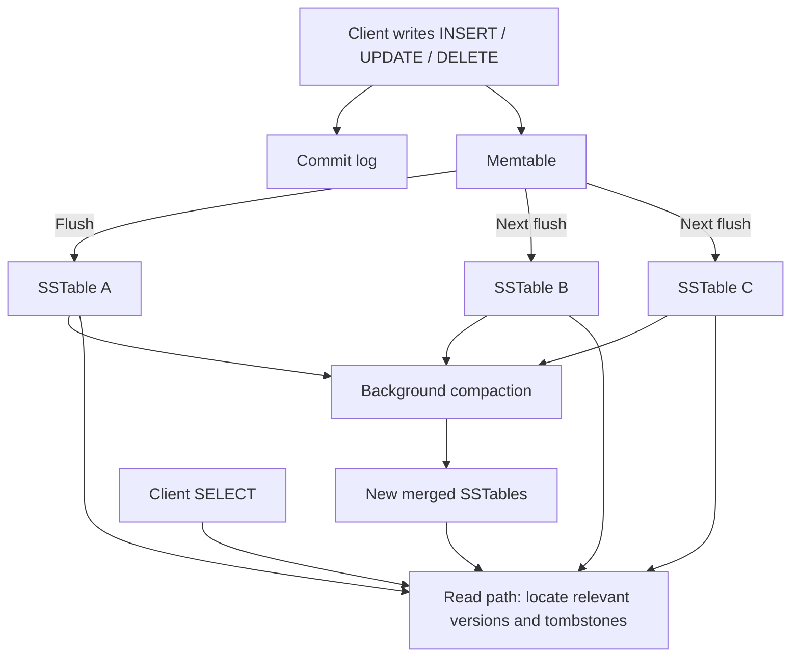
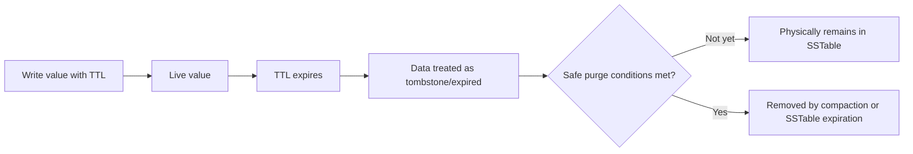

# Configuring Compaction Strategies for Updates, TTL, and Time-Series Data

**Chapter:** SSTables and compaction  
**Module:** `DATABASE_ENGINE_WIDE_COLUMN_CASSANDRA` — Apache Cassandra

Apache Cassandra writes data using an **LSM-tree** architecture: updates enter the commit log and memtable; after flushing, data becomes **immutable SSTable** files on disk. When the same key is updated, deleted, or expires via TTL, multiple versions and tombstones can coexist across multiple SSTables. **Compaction** reads and combines SSTables to reduce the number of files checked on reads, merge versions, and purge expired data when safety conditions are met.

In the Cassandra module, understanding partition keys, query-driven table design, consistency levels, replication, repair, and Java connectivity forms the foundation for reliable data operations. This lesson tackles the next question: **how should compaction strategies be configured differently for frequently updated tables, TTL tables, and time-series tables?**

This is a technical guide with examples executed in a **test cluster**. Never modify a production table's configuration without measuring load, free disk space, and a recovery plan.

## 1. What Do You Need to Understand and Practice?

After this lesson, you will be able to:

1. Explain the differences between **flush**, **compaction**, **TTL expiration**, **tombstones**, and **repair**.
2. Compare **SizeTieredCompactionStrategy (STCS)**, **LeveledCompactionStrategy (LCS)**, **TimeWindowCompactionStrategy (TWCS)**, and **UnifiedCompactionStrategy (UCS)** in supported versions.
3. Predict the impact of **frequent overwrites**, **chronological appends**, **uniform TTLs**, and **late writes/backfills** on SSTable count and read/write costs.
4. Write proper CQL `WITH compaction = ...` and `ALTER TABLE ... WITH compaction = ...` for each table class.
5. Inspect `nodetool tablestats`, `compactionstats`, `tablehistograms`, and schema to evaluate changes.
6. Explain when tombstones can be purged and why you should **never** lower `gc_grace_seconds` or force compaction as a shortcut to delete data.
7. Select a strategy backed by reasoning on **read amplification**, **write amplification**, disk space, and data requirements.

Illustrative configuration values below are **starting points for labs**, not universal optimal defaults for every cluster. Check documentation for your exact **Cassandra major/minor version** and distribution.

## 2. Where Does Compaction Impact the Write and Read Paths?

### 2.1. A Single Record Can Span Multiple SSTables



This diagram illustrates the concept: during compaction, old and new SSTables may temporarily coexist; old files are removed only when safe and unreferenced. Actual reads may use memtables, caches, Bloom filters, SSTable indexes, and multiple replicas depending on configuration.

**Three types of amplification:**

| Concept | Meaning | Common symptoms |
| --- | --- | --- |
| **Read amplification** | A query must inspect multiple structures/SSTables to assemble a valid row | `SSTables per read` rises, read p95/p99 rises |
| **Write amplification** | A logical mutation is rewritten multiple times across compaction rounds | Busy background I/O, CPU, and disk; effective write throughput drops |
| **Space amplification** | Disk space consumed by old versions, tombstones, and compaction outputs | SSTable disk size exceeds live data; disk headroom needed |

No strategy optimizes all three in every scenario. The right choice depends on actual workload: update frequency on the same keys, TTL distribution, acceptable read latency, record volume, and per-partition query patterns.

### 2.2. Immutable SSTables Do Not Mean UPDATE Creates a Visible Duplicate Row

Suppose:

```sql
UPDATE lab_compaction.accounts_by_id
SET points = 10 WHERE account_id = 'acct-1';

UPDATE lab_compaction.accounts_by_id
SET points = 20 WHERE account_id = 'acct-1';
```

Cassandra writes new mutations; on read, it reconciles versions by **cell timestamp** and Cassandra conflict-resolution rules to return the valid value (assuming no concurrent/anomalous timestamps). Compaction merges versions **at the storage level**, but is not what solely determines the logical result of a `SELECT`.

### 2.3. Flush, Compaction, Repair, and Cleanup Are Four Distinct Concepts

- **Flush:** writes memtable contents to an SSTable; does not necessarily merge old SSTables.
- **Compaction:** processes data **per replica** to reduce overlap, reorganize, and drop expired data when safe.
- **Repair:** compares/synchronizes replicas to heal divergence across nodes; does not replace compaction's tombstone cleanup logic.
- **Cleanup:** operational task removing data a node no longer owns after topology changes; not a cure-all for compaction issues.

**Compaction does not replace replication or consistency levels.** If RF=3 and one replica missed a new mutation, switching STCS to LCS will not synchronize that replica. You must read/write at appropriate CLs, monitor hinted handoff, and repair when needed.

## 3. Four Strategies to Distinguish

### 3.1. SizeTieredCompactionStrategy — STCS

STCS groups SSTables of **similar sizes** and compacts them once eligible. It typically delivers strong write throughput on heavy write loads because it does not continuously push SSTables across multiple levels like LCS.

**Usually fits:** high-volume sequential writes, few latency-sensitive random reads, or workloads lacking clear enough TTL/time-series traits for TWCS.

**Trade-offs:** multiple SSTables with overlapping key ranges; reads may need to check many files, especially with frequent updates to the same partition. Large compaction waves also cause I/O load and require temporary free disk space.

Example:

```sql
WITH compaction = {
  'class': 'SizeTieredCompactionStrategy',
  'min_threshold': '4',
  'max_threshold': '32'
}
```

`min_threshold` and `max_threshold` set the input SSTable count bounds for a compaction bucket; they are not hard caps on total SSTable count. These values merely illustrate syntax: tweaking thresholds blindly can increase queued files or trigger huge compaction tasks.

### 3.2. LeveledCompactionStrategy — LCS

LCS organizes SSTables into multiple **levels**; at managed levels, SSTables have bounded token/key overlap. Random reads typically check fewer SSTables than STCS on suitable workloads.

**Usually fits:** heavily read tables with p99-sensitive partition-key point lookups and updates/overwrites, accepting higher background write cost to lower read amplification.

**Trade-offs:** data may be rewritten multiple times as it moves across levels; write amplification, SSD I/O, and compaction pressure can climb. Do not assume LCS is better when the workload is mostly ingest with few reads.

Example:

```sql
WITH compaction = {
  'class': 'LeveledCompactionStrategy',
  'sstable_size_in_mb': '160'
}
```

Target SSTable size is a parameter affecting file counts and compaction work. Do not treat `160` as a universal value across every version/distribution.

### 3.3. TimeWindowCompactionStrategy — TWCS

TWCS divides SSTables into **time windows** based on write timestamps inside SSTables, then compacts primarily SSTables within the same window. Once an old window stops receiving writes, TWCS can retain a few large SSTables for that window. When all data in an old SSTable expires via TTL and meets safety conditions, dropping the entire file can be more efficient than purging individual tombstones.

**Usually fits:** **append-only** or near-immutable time-series written in chronological order with fairly uniform TTLs and rare backfills/overwrites into old ranges.

**Trade-offs:** if data arrives late or old rows are rewritten with timestamps outside the current window, data for the same partition/cell can scatter across windows. Older-window SSTables can continue holding live data or tombstones linked to data in other windows, breaking clean expiration/file drops and raising read cost.

Example:

```sql
WITH compaction = {
  'class': 'TimeWindowCompactionStrategy',
  'compaction_window_unit': 'DAYS',
  'compaction_window_size': '1'
}
```

TWCS does not set TTL by itself: if automatic expiration is needed, configuring the table's `default_time_to_live` or per-mutation `USING TTL` is a separate step.

### 3.4. UnifiedCompactionStrategy — UCS (Supported Versions)

UCS is a modern strategy in **Apache Cassandra 5.0+**, designed to tune trade-offs between leveled/size-tiered behavior across diverse workloads. It is worth benchmarking on mixed workloads: heavy updates, heavy reads, or non-uniform TTLs.

**Things to verify:** tuning syntax such as `scaling_parameters`, task selection algorithms, and defaults can vary across minor releases/distributions. Never copy a UCS config verbatim from another cluster without checking official docs for your exact version.

Basic example in a UCS-capable cluster:

```sql
WITH compaction = {
  'class': 'UnifiedCompactionStrategy'
}
```

After taking a baseline, tune parameters only after measuring read/write p99, write amplification, backlog, and disk headroom. UCS does not mean every time-series TTL table should abandon TWCS.

### 3.5. Orientation Comparison Table

| Strategy | Common target workloads | Strengths | Key risks |
| --- | --- | --- | --- |
| STCS | High ingest, light reads, simple workloads | Good write throughput; familiar setup | Overlapping SSTables and huge compactions; reads can get costly |
| LCS | Read-heavy, key lookups, frequent updates | Bounds SSTables inspected on reads | Higher write amplification and background I/O |
| TWCS | Append-only time-series, fairly uniform TTL | Window-scoped compaction and expiration | Late writes, overwrites, mixed TTLs hamper window cleanup |
| UCS (5.0+) | Mixed workloads needing tuning/benchmarking | Flexible trade-off tuning mechanism | Requires understanding version, parameters, and resource monitoring |

Do not treat this table as an automatic decision: what matters is measuring **read latency, pending compactions, SSTables per read, disk headroom, and tombstone ratio** on a production-equivalent workload.

## 4. Preparing a Lab Cluster and Three Sample Tables

Use a dedicated Cassandra 4.1/5.x cluster (for STCS/LCS/TWCS examples), at least one node for syntax practice or three nodes to observe replica effects. This lesson does not require inducing failures or stopping nodes. If testing UCS, use a compatible Cassandra 5.0+ cluster. Verify your environment:

```bash
nodetool status
cqlsh
```

In `cqlsh`:

```sql
SELECT data_center, release_version FROM system.local;
```

Create the lab keyspace. If your datacenter is not `datacenter1`, update the name before running. RF=1 below is **for demo only** and tolerates zero replica loss.

```sql
CREATE KEYSPACE IF NOT EXISTS lab_compaction
WITH replication = {
  'class': 'NetworkTopologyStrategy',
  'datacenter1': 1
}
AND durable_writes = true;
```

### 4.1. Frequently Updated Table — Testing LCS

```sql
CREATE TABLE IF NOT EXISTS lab_compaction.accounts_by_id (
    account_id text PRIMARY KEY,
    points int,
    tier text,
    updated_at timestamp
)
WITH compaction = {
    'class': 'LeveledCompactionStrategy',
    'sstable_size_in_mb': '160'
};
```

Read pattern `WHERE account_id = ?` is highly selective, yet each account may be updated many times, easily generating multiple cell versions and tombstones across SSTables over time.

### 4.2. Write-Heavy, Long-Retention, Read-Light Event Table — Testing STCS

```sql
CREATE TABLE IF NOT EXISTS lab_compaction.raw_events_by_shard (
    shard_id int,
    event_id timeuuid,
    source text,
    payload text,
    PRIMARY KEY ((shard_id), event_id)
)
WITH CLUSTERING ORDER BY (event_id DESC)
AND compaction = {
    'class': 'SizeTieredCompactionStrategy',
    'min_threshold': '4',
    'max_threshold': '32'
};
```

**Partition design note:** using `shard_id` here only illustrates compaction mechanics; never funnel all events into a few unbounded partitions. In real systems, partitions typically combine shard and time bucket to bound size. Compaction cannot fix a poorly designed partition key.

### 4.3. Uniform-TTL Time-Series — Testing TWCS

```sql
CREATE TABLE IF NOT EXISTS lab_compaction.metrics_by_device_day (
    device_id text,
    bucket_day date,
    observed_at timestamp,
    sample_id timeuuid,
    value double,
    PRIMARY KEY ((device_id, bucket_day), observed_at, sample_id)
)
WITH CLUSTERING ORDER BY (observed_at DESC, sample_id DESC)
AND default_time_to_live = 2592000
AND gc_grace_seconds = 864000
AND compaction = {
    'class': 'TimeWindowCompactionStrategy',
    'compaction_window_unit': 'DAYS',
    'compaction_window_size': '1'
};
```

Parameter meanings:

- `default_time_to_live = 2592000`: 30 × 24 × 60 × 60 seconds, applied by default to columns written to the table (unless overridden by another TTL). TTL expiration makes data logically invisible, **not** immediately erased as bytes on disk.
- `gc_grace_seconds = 864000`: 10-day grace in this example, preserving the window to propagate tombstones to replicas that missed mutations/deletes. Never tweak grace to “speed up” cleanup without checking repairs and safety constraints.
- `compaction_window_unit = DAYS`, `compaction_window_size = 1`: groups SSTables into one-day windows; **does not** force partitions to be one day wide. `bucket_day` is a **data model** decision.
- `observed_at` is the application's **event time**. TWCS groups SSTables by storage mutation timestamp; distinguish those two concepts, especially with backfills and `USING TIMESTAMP`.

**Choose partition buckets** by volume: devices emitting a few hundred samples/day can use daily buckets; hundreds of thousands of samples/sec require smaller buckets or sharding. Never give each device an unbounded partition and expect TWCS to save it.

## 5. Experiment 1 — Frequently Updated Data

Goal: observe how updating the same key repeatedly creates versions in the LSM while compaction reconciles them in the background per strategy.

```sql
CONSISTENCY ONE

INSERT INTO lab_compaction.accounts_by_id
    (account_id, points, tier, updated_at)
VALUES ('acct-01', 10, 'BASIC', '2026-11-21T00:00:00Z');

UPDATE lab_compaction.accounts_by_id
SET points = 20, updated_at = '2026-11-21T00:01:00Z'
WHERE account_id = 'acct-01';

UPDATE lab_compaction.accounts_by_id
SET points = 35, tier = 'SILVER',
    updated_at = '2026-11-21T00:02:00Z'
WHERE account_id = 'acct-01';

SELECT account_id, points, tier, updated_at
FROM lab_compaction.accounts_by_id
WHERE account_id = 'acct-01';
```

Assuming no concurrent writes or unusual timestamps, the returned row has `points = 35` and `tier = 'SILVER'`. That is the **logical state**, not proof that all old SSTables have been deleted.

Reads and writes can both occur before memtable flush. To study the mechanics, inspect SSTable files and stats after natural flushes/compactions; avoid spamming `nodetool flush` and `nodetool compact` just to tidy up metrics, since forced flushes create extra small SSTables and distort the workload.

Measurement questions:

- How many SSTables are checked per read after thousands of updates on the same key group?
- As update rate increases, how do read p99 and pending compactions change?
- Under CPU and I/O saturation, does LCS preserve its read advantage or build a backlog?
- If key reads are very infrequent, can STCS or tuned UCS reduce write amplification while still meeting SLAs?

**Do not assume LCS is always best for UPDATEs.** If writes vastly outnumber reads or updates pound a narrow hot key set continuously, compaction rewrites can become the bottleneck. Decide by measurement.

## 6. Experiment 2 — TTL and Tombstones

### 6.1. TTL Works Based on Mutation Expiration Time

Write a time-series sample:

```sql
INSERT INTO lab_compaction.metrics_by_device_day
    (device_id, bucket_day, observed_at, sample_id, value)
VALUES (
    'sensor-01',
    '2026-11-21',
    '2026-11-21T10:00:00Z',
    now(),
    28.5
);

SELECT bucket_day, observed_at, sample_id, value
FROM lab_compaction.metrics_by_device_day
WHERE device_id = 'sensor-01'
  AND bucket_day = '2026-11-21';

SELECT TTL(value)
FROM lab_compaction.metrics_by_device_day
WHERE device_id = 'sensor-01'
  AND bucket_day = '2026-11-21';
```

`TTL(value)` reports the remaining seconds for the column if the row exists and has a TTL, per your running version's CQL behavior. With multiple rows in a partition, `SELECT TTL(value)` can return multiple values; restrict the full key when tracking a specific sample.

TTL counts from the **time written to Cassandra**, not automatically from `observed_at`. For instance, ingesting an event today whose `observed_at` is from last week with a 30-day TTL will not expire in 23 days just because the event time is older. This affects retention policies and TWCS whole-SSTable drops.

You can override TTL per mutation:

```sql
INSERT INTO lab_compaction.metrics_by_device_day
    (device_id, bucket_day, observed_at, sample_id, value)
VALUES (
    'sensor-01',
    '2026-11-21',
    '2026-11-21T10:05:00Z',
    now(),
    29.1
)
USING TTL 3600;
```

This sample expires earlier than most 30-day data in the table. Mixing disparate TTLs in the same window/SSTable **prevents all files in that window from expiring together**. To optimize time-based deletion, avoid mixing wildly different TTLs in one TWCS table; split tables by retention policy if necessary.

### 6.2. What Happens When TTL Expires?



TTL expiration creates a logically deleted state similar to a tombstone. **Never** assume `TTL = 30 days` means bytes vanish from disk at the exact 30-day mark.

With tombstones, Cassandra must prevent “resurrection”: an older replica may still hold the pre-delete value. If tombstones are purged from updated replicas and an out-of-date replica returns, stale data can reappear. Hence `gc_grace_seconds`, repair, SSTable overlap, timestamps, and Cassandra version all matter.

**Do not oversimplify to a formula like “TTL + gc_grace equals guaranteed file deletion time”.** Those are only factors governing eligibility. Compaction runs when scheduled/resourced and must inspect relevant data ranges; at that instant, overlapping SSTables or unexpired values may still exist.

### 6.3. “Dropping Whole SSTable” vs. “Stripping Tombstones Inside SSTable”

TWCS excels when data in each window shares similar age and TTL: once all data in a window's SSTable expires and passes safety checks, the system can drop the file without reading and rewriting all records.

Conversely, an SSTable holding columns with 1-hour TTL, 30-day TTL, and no TTL retains **some live data** for a long time. It cannot drop the entire SSTable just because most rows expired; compaction must do heavier work and TWCS benefits diminish.

## 7. Experiment 3 — Choosing Windows for Time-Series Data

Suppose a table receives steady traffic and all samples expire after **30 days**. Some options:

| Window | Approx. live windows in 30 days | Pros | Cons to measure |
| --- | ---: | --- | --- |
| 1 hour | ~720 | Small data per window; hourly cleanup possible | Many windows/SSTables to track; affects multi-range reads |
| 1 day | ~30 | Intuitive trade-off for daily ingest | One day may be too large at very high ingest |
| 7 days | ~5 | Fewer window groups | Larger files/groups; block expiration slower; file-grouping changes |

These numbers are **approximate interval counts**, not exact SSTable counts; each window can contain multiple SSTables depending on flush rate, compaction, and data volume.

For 30-day data, starting with a **1-day** window is easy to verify in a lab. Re-evaluate afterward based on:

- Daily write rate and SSTable size per window.
- Whether queries typically read **one day** or **multiple weeks**.
- Degree of late arrivals and backfills hitting old windows.
- SSTables per read, live/expired disk space, pending compactions, and p99.
- Whether retention policy is stable or mixes distinct TTL groups.

### 7.1. TWCS Windows Are Not Partition Key Bucketing

Two separate decisions:

```text
Partition key:
    (device_id, bucket_day) -> controls how many samples one partition holds
TWCS window:
    DAYS x 1 -> controls which timestamp interval groups SSTables
```

Daily-bucketed tables **do not** automatically enable TWCS. Enabling TWCS **does not** automatically partition tables by day. You must design both because Cassandra still needs tight partition-key queries:

```sql
SELECT observed_at, value
FROM lab_compaction.metrics_by_device_day
WHERE device_id = 'sensor-01'
  AND bucket_day = '2026-11-21'
  AND observed_at >= '2026-11-21T08:00:00Z'
  AND observed_at <  '2026-11-21T11:00:00Z';
```

This query uses clustering column `observed_at` to bound the intra-partition slice; no `ALLOW FILTERING` is needed when querying by primary key. If a user needs 30 days, the application identifies the relevant `bucket_day` values and queries those partitions in a controlled manner instead of scanning the entire table.

### 7.2. Late Writes: A Critical Warning

A device offline for a week may upload backlogged data today. Depending on mutation timestamps and write paths, “old” records can land in the current window or past windows, breaking the assumption that **each window receives writes close together in time**.

Illustrative example of client-supplied write timestamps:

```sql
-- Test in LAB ONLY: using a past timestamp as a backfill scenario.
INSERT INTO lab_compaction.metrics_by_device_day
    (device_id, bucket_day, observed_at, sample_id, value)
VALUES (
    'sensor-02',
    '2026-11-15',
    '2026-11-15T12:00:00Z',
    now(),
    26.3
)
USING TIMESTAMP 1794744000000000;
```

`USING TIMESTAMP` expects **microseconds since Unix epoch** (unlike `TTL`, which uses seconds). This value is the **write timestamp**, governing version reconciliation and TWCS windowing; it does not automatically mirror `observed_at` if the application computes it wrong.

To avoid date/epoch mistakes, convert using proper time libraries in real applications and validate timestamps before sending. A wildly skewed timestamp in the past or future can unexpectedly make mutations “win/lose” against others, making reads and compaction unpredictable.

If backfills are frequent, prioritize:

1. Defining retention by **ingest time** vs. **event time**; these two policies differ.
2. Measuring late-arrival rates and reopened windows.
3. Considering separating backfill streams into another table/pipeline and merging in the application.
4. If mixed updates and multi-epoch writes dominate, benchmark UCS/STCS/LCS against SLAs instead of forcing TWCS just because the table has a timestamp column.

Do not assume tweaking `compaction_window_size` solves every late-write scenario.

## 8. Non-Uniform TTLs and Mutable Data: Does TWCS Still Fit?

Consider three business patterns:

### Pattern A — Append-Only Sensors, 30-Day Retention

Data is written once, mostly arrives on the same day, with uniform 30-day TTL. TWCS is a strong candidate because SSTables share similar ages and expire cleanly as blocks. If events arrive minutes or hours late but are written with current timestamps, verify they do not excessively mix historical windows.

### Pattern B — Continuously Updated Session State, 1-Hour TTL

For example, the same `session_id` key is updated repeatedly to extend its lifetime. Each UPDATE creates a new version/TTL and leaves obsolete data/tombstones; data for the same key spans many SSTables and windows. Thus TWCS is usually **not the first choice**. LCS or UCS (if supported) may fit better depending on read/write ratio and data size.

### Pattern C — Audit Logs with Two Retention Tiers

Some events have a 7-day TTL, others 365 days. If mixed in the same SSTables, files containing live 365-day events cannot be dropped whole on Day 7 even though many rows expired. It is better to consider **two tables per retention policy**, e.g. `audit_short` and `audit_long`, avoiding keeping files pinned by a small live fraction.

### Quick Decision Table

| Data pattern | Signals | Starting point to test | What to verify |
| --- | --- | --- | --- |
| Hot lookup/update | Same keys overwritten, read p99 matters | LCS or UCS 5+ | Write amplification, compaction backlog |
| Append log, no TTL, light reads | Very heavy writes, few random reads | STCS or UCS 5+ | Disk headroom, SSTables/read |
| Time-series fixed 30-day retention | Append-only, nearly uniform TTL, few late writes | TWCS | Window count, expired SSTables, event/ingest skew |
| Time-series with frequent backfills | Multi-day timestamp skew, edits to old data | Test UCS/STCS/LCS or split backfill path | Timestamp overlap, p99, TTL cleanup efficiency |
| Mixed 1-hour/1-year TTL table | SSTables hold both live and expired data | Split retention or benchmark other strategies | Tombstone ratio, disk usage |
| Frequently rewritten key set | Heavy UPDATE/DELETE, renewed TTLs | LCS/UCS per read/write mix | Tombstones, disk I/O, tail latency |

## 9. Configuring and Changing Strategies with CQL

### 9.1. Creating Tables with a Compaction Strategy

The `CREATE TABLE` examples in Section 4 declare strategies directly. For an existing table, you can alter it:

```sql
-- Run in lab only: switch updated table to STCS for comparison.
ALTER TABLE lab_compaction.accounts_by_id
WITH compaction = {
  'class': 'SizeTieredCompactionStrategy',
  'min_threshold': '4',
  'max_threshold': '32'
};

-- Restore LCS configuration if it proves better after benchmarking.
ALTER TABLE lab_compaction.accounts_by_id
WITH compaction = {
  'class': 'LeveledCompactionStrategy',
  'sstable_size_in_mb': '160'
};
```

**Core point:** `ALTER TABLE ... WITH compaction` updates the strategy configuration; it does **not** synchronously rewrite all legacy SSTables in one transaction. Afterward, monitor background compaction cycles, I/O, pending tasks, SSTable characteristics, and performance over a sufficient period.

If testing UCS on verified Cassandra 5.0+:

```sql
ALTER TABLE lab_compaction.accounts_by_id
WITH compaction = {
  'class': 'UnifiedCompactionStrategy'
};
```

Do not run UCS commands on Cassandra 4.1 merely because the strategy name appears in newer documentation.

### 9.2. Changing TTL Does Not Change Windows

```sql
ALTER TABLE lab_compaction.metrics_by_device_day
WITH default_time_to_live = 604800;
```

This statement sets the default TTL for **subsequent writes** (7 days) when no explicit TTL overrides it. It does not alter TTLs of already-existing cells, move data across TWCS windows, or delete current SSTables. When changing retention policies, account for old data still holding 30-day TTLs while new data holds 7-day TTLs: **mixing TTLs within files** can complicate whole-SSTable drops.

Restore the lesson's example setting:

```sql
ALTER TABLE lab_compaction.metrics_by_device_day
WITH default_time_to_live = 2592000;
```

### 9.3. Do Not Use `nodetool compact` as a “Free Disk Now” Button

Forcing major compaction can create huge SSTables, spike I/O and temporary disk usage, and break optimizations of certain strategies, especially TWCS workloads. Subsequent compactions may not recover that cost quickly.

In production:

- Do not blindly force full compaction on large tables just because disk usage climbed.
- Check version-specific docs for `nodetool compact` flags; run only with a maintenance plan and ample free disk.
- Prefer inspecting metrics first to identify why SSTables aren't dropping: live data remaining, SSTable overlap, ineligible tombstones, or compaction backlog.

## 10. Observing via nodetool, Schema, and Metrics

### 10.1. Inspect State Instead of Guessing

```bash
nodetool status

nodetool tablestats lab_compaction.accounts_by_id
nodetool tablestats lab_compaction.metrics_by_device_day

nodetool compactionstats

nodetool tablehistograms lab_compaction accounts_by_id
nodetool tablehistograms lab_compaction metrics_by_device_day
```

Depending on Cassandra version, syntax, stat names, and formatting can vary; run `nodetool help <command>` on the cluster if needed. Never judge from a single metric snippet while ignoring workload and node health.

In `cqlsh`:

```sql
SELECT keyspace_name, table_name, compaction,
       default_time_to_live, gc_grace_seconds
FROM system_schema.tables
WHERE keyspace_name = 'lab_compaction';
```

Inspect schema to confirm which strategy is **actually** configured. If DDL runs on a multi-node cluster, verify schema agreement and observe every replica; do not conclude from a single node.

### 10.2. What Does Each Metric Tell You?

| Metric / group | Meaning | Proper interpretation |
| --- | --- | --- |
| **SSTable count** | Current SSTable count for a table/replica | Rising is not automatically an error; compare against data volume and strategy |
| **SSTables per read** | SSTables involved in serving queries | Cross-check with p95/p99 and query shape to assess read amplification |
| **Pending compactions** | Queued compaction workload | Continuously high alongside poor throughput suggests falling behind ingest |
| **Bytes compacted / compaction throughput** | Compaction I/O volume and pace | Interpret alongside disk/CPU limits and application load |
| **Droppable tombstone estimate** | Estimate of reclaimable tombstones | Estimate only; does not guarantee compaction will reclaim that exact amount |
| **Live disk space used / total disk space used** | Data size and overhead on replica | Compare against physical free disk, not just table-level stats |
| **Read/write latency percentiles** | Direct SLA impact | Compare p50/p95/p99 before and after strategy changes |
| **GC, CPU, disk queue, I/O wait** | Node resource pressure | Helps separate compaction bottlenecks from query/GC/network issues |

Measure across **multiple windows**, including peak hours, active background compaction, and concurrent repair/streaming. A single `compactionstats` snapshot rarely represents normal load.

### 10.3. Sample Experiment Log

| Checkpoint | Strategy | Load profile | SSTables/read | Pending compactions | Read p99 | Disk used | Notes |
| --- | --- | --- | --- | --- | --- | --- | --- |
| Before | LCS | 5,000 updates/s + 1,000 reads/s | *actual* | *actual* | *actual* | *actual* | Baseline |
| After | STCS | Same workload | *actual* | *actual* | *actual* | *actual* | Observed after stabilizing |
| After | UCS 5+ | Same workload | *actual* | *actual* | *actual* | *actual* | If cluster supports it |

Numbers 5,000/s and 1,000/s are **illustrative load targets**, not collected measurements. For valid comparative benchmarks, hold hardware, RF/CL, partition schema, data size, TTL, key distribution, warmup, and p99 measurement method constant.

Avoid judging a strategy solely by **compaction duration**: the ultimate goal is meeting read/write and retention SLAs within acceptable CPU, I/O, and disk headroom costs.

## 11. Failure Scenarios and Remediation Paths

### 11.1. Disk Usage Grows Even Though TTL Expired

**Possible causes:** live cells remain in SSTables; SSTables ineligible for drop; tombstone grace; overlap; late writes into closed windows; compaction backlog; older records written without TTL.

**Action:** check `default_time_to_live` and per-key actual TTLs, backfill behavior, compaction status, disk used metrics, and droppable tombstones. Distinguish **logical expiration** from **physical byte reclamation**.

### 11.2. Read p99 Rises During Heavy Writes

**Possible causes:** too many overlapping SSTables, hot partitions, compaction falling behind, disk I/O contention, or queries lacking proper partition keys.

**Action:** verify read paths and partition keys first. If point lookups are SLA-sensitive, benchmark LCS/UCS; mitigate hot partitions/refine data model if needed. Changing compaction alone cannot fix broad scan queries.

### 11.3. TWCS Accumulates Too Many Historical SSTables

**Possible causes:** window too small, late writes, backfills, app using deeply backdated `USING TIMESTAMP`, flushing many tiny SSTables, or mixed TTLs.

**Action:** examine write-time distribution, windows, and daily volumes. Stop mixing backfills into live ingest or isolate pipelines; test another window size once measured. Do not force full compaction out of habit.

### 11.4. Tombstone Scans Cause Timeouts

**Possible causes:** mass row deletes, bulk TTL expirations, overly wide range reads, oversized clustering/partitions, compaction not yet reclaiming eligible tombstones.

**Action:** narrow queries by partition/clustering range, review TTL and bucketing design, inspect tombstone metrics and repair state. Never turn on `ALLOW FILTERING` just to “push results through” if it widens scans.

### 11.5. Replicas Diverge After Node Downtime

**Possible causes:** missed mutations, insufficient hinted handoff, repair not run, or deleted data exceeding grace before the old replica returned.

**Action:** inspect node status, RF/CL, and cluster anti-entropy repair procedures. Picking a compaction strategy **does not** make replicas converge when mutations were missed. Never shrink `gc_grace_seconds` to save disk unless repair guarantees support it.

## 12. Strategy Selection Across Three Business Cases

### Case 1: Frequently Updated Customer Profiles

A service updates loyalty points, profile status, and activity timestamps multiple times per hour. API reads by `customer_id`, prioritizing low p99. Data lives long-term, mostly without TTL.

**Initial candidates:** LCS or UCS (if Cassandra 5+). LCS reduces overlap on reads at the cost of higher rewrites; UCS requires benchmarking to pick trade-offs. If updates are extreme, watch write rates into hot partitions and load distribution.

**Do not pick TWCS** merely because there is an `updated_at` column: data is **overwritten on the same keys**, unlike append-only logs.

### Case 2: 30-Day Telemetry

Devices report temperature every minute; the app queries the latest 1–24 hours and auto-expires data after 30 days. Nearly immutable pattern, rare late writes.

**Initial candidate:** TWCS, 1-day window, uniform 30-day TTL, partitioned by device + day if size fits. Measure late-arrival rate and old-SSTable expiration. If querying 30 days across 30 partitions is needed, the application explicitly pages and merges queries; TWCS does not change that requirement.

**Checkpoints:** sensors with vastly different volumes, oversized partitions, misuse of `USING TIMESTAMP`, mixing 1-hour/30-day TTLs, and read p99 when spanning multiple windows.

### Case 3: Audit Events with Mixed Retention Periods

Audit events are written once, yet carry 7-day, 90-day, and indefinite retention policies. Queries look up by tenant and day, with occasional historical backfills.

**Candidates:** split tables by retention policy so data sharing an SSTable shares similar expiration times; 7/90-day append-only tables can test TWCS; indefinite-retention and backfill tables can test STCS/UCS. Weigh duplicated storage overhead, table count, and cross-table query needs.

**Do not** mix all TTLs into one TWCS table and expect clean “by-day” disk reclamation.

## 13. Hands-On Check of Java Application and TTL

With Java Driver 4.x, applications can record event timestamps **without manually setting backdated write timestamps**, avoiding unintended changes to mutation timestamp ordering. The `observed_at` column still captures event time.

```java
import com.datastax.oss.driver.api.core.CqlSession;
import com.datastax.oss.driver.api.core.DefaultConsistencyLevel;
import com.datastax.oss.driver.api.core.cql.PreparedStatement;
import com.datastax.oss.driver.api.core.cql.Row;

import java.time.Instant;
import java.time.LocalDate;

public final class SensorWriteExample {
    public static void write(CqlSession session,
                             String deviceId,
                             LocalDate bucketDay,
                             Instant observedAt,
                             double value) {
        // sample_id has type timeuuid; now() generates a new id for this write.
        // When retrying the same event, the application must reuse a stable id.
        PreparedStatement insert = session.prepare(
            "INSERT INTO lab_compaction.metrics_by_device_day " +
            "(device_id, bucket_day, observed_at, sample_id, value) " +
            "VALUES (?, ?, ?, now(), ?)"
        );

        session.execute(
            insert.bind(
                deviceId,
                com.datastax.oss.driver.api.core.data.CqlDate
                    .fromDaysSinceEpoch((int) bucketDay.toEpochDay()),
                observedAt,
                value
            ).setConsistencyLevel(DefaultConsistencyLevel.ONE)
        );
    }

    public static void read(CqlSession session,
                            String deviceId,
                            LocalDate bucketDay) {
        PreparedStatement read = session.prepare(
            "SELECT observed_at, value " +
            "FROM lab_compaction.metrics_by_device_day " +
            "WHERE device_id = ? AND bucket_day = ?"
        );

        var rows = session.execute(
            read.bind(
                deviceId,
                com.datastax.oss.driver.api.core.data.CqlDate
                    .fromDaysSinceEpoch((int) bucketDay.toEpochDay())
            ).setConsistencyLevel(DefaultConsistencyLevel.ONE)
             .setPageSize(100)
        );

        for (Row row : rows) {
            System.out.println(row.getInstant("observed_at") +
                               " -> " + row.getDouble("value"));
        }
    }
}
```

**Explanation:** `bucket_day` is a CQL `date` bound with `CqlDate`; `observed_at` uses `Instant`; `sample_id` is a `timeuuid` generated by CQL `now()`. If the application needs idempotent retries for a sample, **do not** invoke a fresh `now()` on every retry: pre-generate a stable `timeuuid` for the event and rebind the exact same key. This sample code demonstrates single-shot writes for the lab.

When **non-duplicating retries** are required, the application should generate deterministic sample keys at the source and reuse the exact `(device_id, bucket_day, observed_at, sample_id)`. Compaction cannot fix logical duplicates caused by retrying with new keys. If TTL is a critical policy, clarify whether retention starts at **ingest time** or **event time** and design accordingly.

## 14. Self-Check Questions

1. Why can an `UPDATE` on the same primary key cause multiple data versions to appear in different SSTables even though the client reads one value?
2. Why does LCS typically reduce read amplification yet increase write amplification compared to STCS on many workloads?
3. Why is TWCS especially effective for append-only time-series with nearly uniform TTLs?
4. Is a customer table with an `updated_at timestamp` column where records change constantly a good TWCS candidate? Explain.
5. With a 30-day TTL and 1-day window: roughly how many historical windows exist? Why must you not assume that equals the exact SSTable count?
6. Why doesn't lowering `default_time_to_live` from 30 days to 7 days expire all existing records after 7 days?
7. If an app writes last month's data today without `USING TIMESTAMP`, which timestamp does TWCS use for windowing? Does `observed_at` dictate TWCS windows automatically?
8. Why can a file holding a few non-TTL cells block TTL's whole-SSTable drop benefit?
9. Why shouldn't `nodetool compact` be used routinely to force tombstone deletion?
10. Name three metrics for deciding to switch STCS to LCS and three metrics for evaluating whether TWCS expires data cleanly.
11. Which mechanism guarantees two replicas hold consistent data: choosing a compaction strategy or running appropriate replication/repair?
12. If a Java retry calls `now()` for `sample_id`, why can a single event turn into two rows even when `observed_at` is identical?

### Pre-Production Configuration Change Checklist

- [ ] Classified the table by **overwrite intensity**, **read/write ratio**, **TTL**, and **late arrivals/backfills**.
- [ ] Verified partition keys, partition sizes, clustering queries, and RF/CL; not expecting compaction to fix key design.
- [ ] Checked strategy and options supported in the **running Cassandra version**.
- [ ] Captured baseline p50/p95/p99, SSTables/read, pending compactions, disk usage, I/O wait, CPU, and tombstones.
- [ ] Preserved sufficient disk headroom for compaction outputs and reasonable rollback/recovery.
- [ ] Not lowered `gc_grace_seconds` without proving replica repair and safe deletion guarantees.
- [ ] If TWCS: fairly uniform TTL, volume-fitting window, controlled backfills/timestamps, minimal late-write mixing.
- [ ] Tested `ALTER TABLE` in a lab, observing transition and steady-state effects across multiple compaction cycles.
- [ ] For strict-SLA data, tested alongside compaction and repair/streaming to measure tail latency.
- [ ] Documented decision, rationale, and monitoring plan; re-measured whenever workload or retention policy changes.

**Key Takeaway:** **STCS** leans toward heavy writes; **LCS** leans toward random reads; **TWCS** fits nearly append-only time-series with uniform TTLs and minimal late writes; **UCS** adds tunable trade-offs on supported versions. The right choice comes not from strategy names, but from **update patterns, data age, TTLs, partition design, I/O costs, and real workload measurements**. Compaction organizes data *inside each replica*; protecting distributed data still requires replication, consistency levels, and repair.
