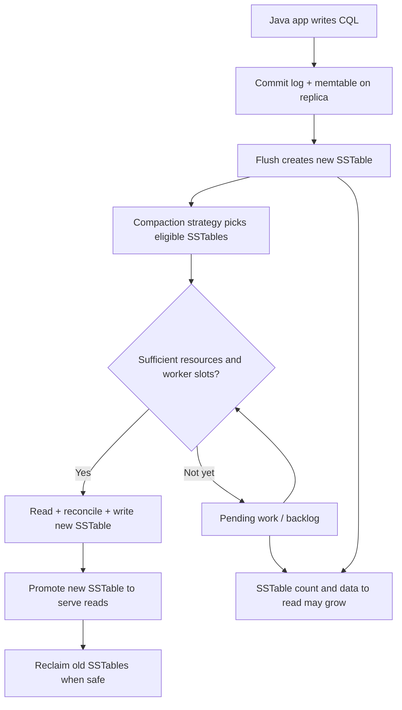
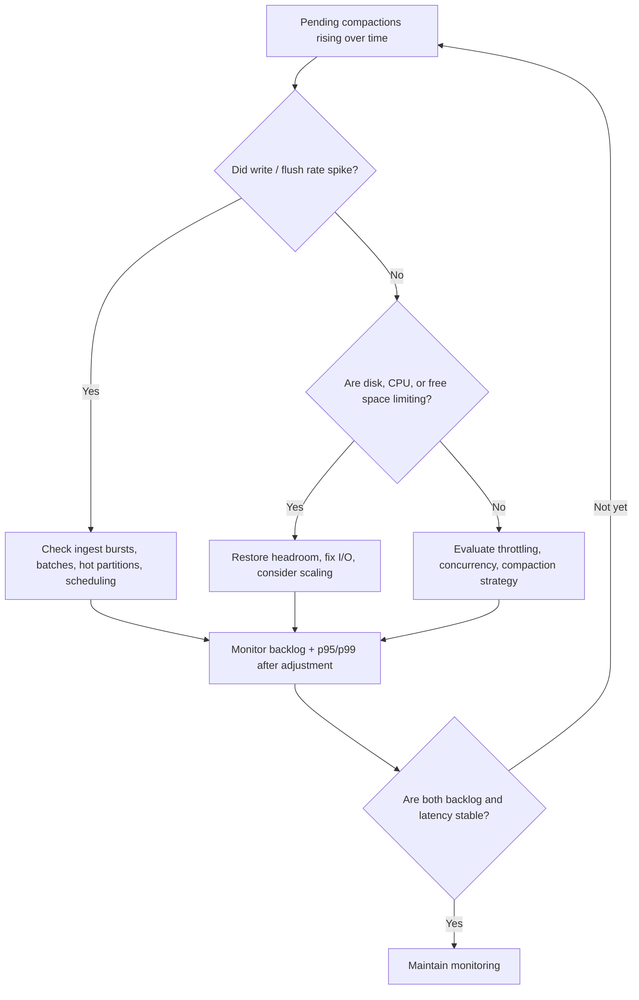

# Compaction Backlog, Processing Rate, and Latency Impact in Apache Cassandra

## 1. Why Is Compaction Backlog an Operational Issue?

Apache Cassandra is a **distributed wide-column** database: tables are modeled around queries, data is distributed by **partition key**, and each partition is copied across replicas per replication settings. On each replica, new mutations are written to the commit log and memtable; when the memtable is **flushed**, Cassandra creates **immutable SSTables** on disk.

Because SSTables are not modified in place, subsequent updates or deletes land in newer SSTables. A read may need to reconcile data from **the memtable and multiple SSTables** to return the valid version based on timestamps, TTLs, and tombstones.

**Compaction** is a background task that reads a set of SSTables, merges data, and writes new SSTables according to the table's compaction strategy. It keeps the number of SSTables checked on reads under control, manages disk space, and reclaims expired data **when safety conditions are met**.

**Compaction backlog** occurs when eligible compaction work is generated faster than the node can complete it over a period of time. If backlog persists, the node may retain more SSTables, increase read I/O, and consume extra disk; conversely, running compaction too aggressively can contend for resources with Java application queries.

The goal is not merely “how to drive pending tasks to 0”, but **keeping compaction pace aligned with the workload while protecting latency and availability**.

## 2. Data Flow and Where Backlog Accumulates



A new SSTable does not necessarily trigger a compaction task right away. Depending on **Size-Tiered**, **Leveled**, **Time-Window**, or another strategy, Cassandra selects specific SSTable sets only when their respective criteria are met. Even when pending tasks equal 0, a table still has SSTables and can generate future work.

Concepts to distinguish:

| Concept | Meaning | Notes |
| --- | --- | --- |
| **Flush** | Memtable → new SSTable | Usually increases SSTable count; not compaction |
| **Compaction task** | Job merging/rewriting a selected set of SSTables | Size and cost per task vary widely |
| **Pending tasks** | Estimated/queued compaction tasks reported by the node | Not an exact byte count and not an SSTable count |
| **Compaction throughput** | Compaction processing rate over a time window | Requires understanding measurement and node I/O limits |
| **Backlog** | Eligible unfinished work accumulating over time | Key concern is sustained trend and SLA impact |
| **Read amplification** | A query must inspect multiple structures/files or read more data than returned | Bloom filters, indexes, caches, and compaction strategies can cut actual cost |
| **Write amplification** | A unit of logical data may be rewritten multiple times by flushes and compaction | Increases depending on strategy, update rate, and TTLs |

## 3. Modeling Work Arrival Rate vs. Service Rate

To reason about backlog, temporarily express workload in **a unified equivalent unit**, such as estimated GiB of compaction input, or a consistent system work metric:

- `B(t)`: backlog at time `t`.
- `λ` (*arrival rate*): rate at which new compaction work becomes eligible, in work-units/hour.
- `μ` (*service rate*): rate at which the node completes work, in the **same unit** as `λ`.

In a simplified model with roughly steady rates:

```text
B(t + Δt) ≈ max(0, B(t) + (λ - μ) × Δt)

If λ > μ persists  → backlog grows.
If λ ≈ μ           → backlog struggles to shrink.
If λ < μ           → backlog has room to drain gradually.
```

**Important note:** the application's CQL write rate (`MiB/s`) **cannot automatically be plugged in as `λ`**. One byte of newly written data can trigger many bytes of reads/rewrites across compaction cycles, and each strategy selects SSTables differently. Likewise, throughput reported by `nodetool` cannot simply be subtracted from ingest rate when the two metrics measure different quantities.

### Controlled Calculation Example

Suppose monitoring has already normalized backlog and both rates into **the same equivalent work unit**:

| Quantity | Assumed value |
| --- | --- |
| Initial backlog `B` | 90 GiB-equivalent |
| New work `λ` | 20 GiB-equivalent/hour |
| Processing capacity `μ` | 35 GiB-equivalent/hour |
| Backlog drain rate | `μ − λ = 15 GiB-equivalent/hour` |
| Estimated time to clear backlog | `90 / 15 ≈ 6 hours` |

This is a **planning model**, not a promise the node will finish in 6 hours. Task sizes are uneven, ingest rates fluctuate, fresh flushes arrive continuously, and compaction may rewrite data multiple times.

If `λ` suddenly jumps to `45 GiB-equivalent/hour` while `μ` stays at 35, backlog will tend to grow by roughly 10 GiB-equivalent/hour. Watching **trends over time** is far more useful than a single snapshot saying “pending = 12”.

### Should You Use Pending Task Count to Estimate Time?

Do not mechanically compute “12 pending tasks × average task duration”:

- One task might process a few MiB while another processes tens of GiB.
- The compaction strategy may split or reselect work as new SSTables appear.
- Pending task count is a policy-based estimate, not a guarantee of a fixed FIFO queue.
- Runtime depends on disk read/write speed, compression, CPU, caches, and I/O contention.

Track **pending tasks, active compactions, bytes processed, flush rate, SSTable count, disk space, and query latency** together.

## 4. How Does Backlog Affect Read Latency?

When a backlog persists, a partition can span many SSTables. Cassandra still uses Bloom filters, partition indexes, key caches, and statistics to skip unnecessary reads, yet scanning more candidate sources increases cost.

A specific query may need to:

1. Check the memtable and SSTables that could hold the partition.
2. Locate the partition inside candidate files.
3. Merge cell versions, timestamps, TTLs, and tombstones to determine current live data.
4. Gather enough replica responses for the read CL; if replicas diverge, some read paths can also trigger read repair.

The impact usually shows up clearly in **p95/p99 latency**, where the slowest queries pay disk-read overhead or heavy version reconciliation:

| Symptom | Possible underlying mechanism | User-visible result |
| --- | --- | --- |
| Many SSTables involved for one partition | More indexes/files to examine | Slower reads, increased scattered I/O |
| Old SSTables hold many versions/tombstones | Must reconcile and filter expired data | CPU, I/O, and tail latency climb |
| Compaction reading/writing high volume | Competes for disk bandwidth and caches | Foreground queries slow down even while compaction helps drain backlog |
| Disk nearly full | Little room for output SSTables; background tasks can fail | Stability and write sustainability degrade |

**SSTable count is not a direct formula for latency.** A table with many small SSTables across non-overlapping time windows can be cheaper to read than a table with fewer SSTables containing huge partitions, dense tombstones, or queries missing the partition key. Check query patterns, “SSTables per read” stats, and actual latencies.

## 5. How Does Backlog Affect the Write Path?

Cassandra's write path normally appends to the commit log and updates the memtable, not compaction itself. However, write throughput can suffer indirectly:

- **Busy disks:** compaction reads old SSTables and writes new ones, competing for IOPS/bandwidth with the commit log, flushes, and the read path.
- **Slow flushes:** memtables struggle to free memory; old commit-log segments cannot be reclaimed easily while unflushed data remains.
- **Disk pressure:** compaction needs temporary space for output SSTables before dropping input files; low free space increases failure risk.
- **CPU/GC:** decompression, data reconciliation, and recompression during compaction compete with request handling.
- **Backpressure/throttling:** if a node falls behind background work, write latency can climb due to backpressure and resource contention.

Therefore, speeding up compaction **does not always lower write latency immediately**. Sometimes backlog drains faster while `INSERT`/`UPDATE` p99 worsens because compaction consumes most of the I/O.

### Three Common Phases

```text
Phase A — Compaction keeps up:
  Low/stable pending, controlled SSTable count,
  steady read/write p95/p99.

Phase B — New work arrives faster:
  Pending climbs across multiple samples, SSTable count/space grow,
  read p99 may creep upward.

Phase C — Pushing compaction too aggressively:
  Pending may drop, yet disk I/O and CPU run hot,
  foreground read/write latency can spike abruptly.
```

The operational goal is balancing **compaction debt** against **headroom for the foreground workload**.

## 6. How Does Compaction Strategy Change Backlog?

The compaction strategy determines **which SSTables are selected, when they merge, and how heavily data is rewritten**. Consequently, two tables with identical logical write rates can experience vastly different compaction pressure.

| Strategy | Typically suited problem | Characteristics around backlog and latency |
| --- | --- | --- |
| **Size-Tiered Compaction Strategy (STCS)** | Write-heavy, mutable data, prioritizing relatively low write cost | Merges similarly sized SSTables; may leave many SSTables on reads; large compactions can consume heavy I/O |
| **Leveled Compaction Strategy (LCS)** | Latency-sensitive read workloads needing bounded overlapping SSTables per level | Cuts read amplification in many cases, yet typically increases write amplification and background work |
| **Time-Window Compaction Strategy (TWCS)** | Time-series/TTL data written roughly chronologically | Groups by time windows; efficient when chronological and uniform-TTL, disadvantaged by very late backfills |
| **Unified Compaction Strategy (UCS)** | Supported Cassandra versions needing tunable balance of read/write/space | Customizable compaction policy; traits and defaults vary by version—evaluate via version docs and dedicated testing |

Do not treat this as an absolute ranking. The “best” strategy depends on partition model, updates vs. append-only, TTLs, deletes, read patterns, disk capacity, Cassandra version, and cluster configuration.

### TWCS Example for Sensor Data

A Java application records measurements by device and day, querying the latest readings within a day. Daily bucketing bounds partition size:

```sql
-- Example assumes a cluster whose real datacenter is named dc1.
CREATE KEYSPACE IF NOT EXISTS compaction_lab
WITH replication = {
    'class': 'NetworkTopologyStrategy',
    'dc1': 3
};

CREATE TABLE IF NOT EXISTS compaction_lab.readings_by_device_day (
    device_id text,
    bucket_day date,
    measured_at timestamp,
    temperature_c double,
    PRIMARY KEY ((device_id, bucket_day), measured_at)
) WITH CLUSTERING ORDER BY (measured_at DESC)
  AND default_time_to_live = 604800
  AND compaction = {
      'class': 'TimeWindowCompactionStrategy',
      'compaction_window_unit': 'DAYS',
      'compaction_window_size': '1'
  };
```

Assume measurements are written close to observation time and retained for 7 days. When data in closed windows is rarely edited, aged SSTables have a chance to be reclaimed efficiently. However:

- Writing **historical backfills** can mix timestamps across SSTables in multiple windows, raising overlap risk and hurting TTL cleanup efficiency.
- If the same partition is updated continuously at many times, TWCS performance may fall short of assumptions.
- TTL expiration does not mean SSTables vanish immediately. Tombstones, time spans, safety rules, and compaction policy still apply.
- Do not blindly shrink `gc_grace_seconds` just to drop files faster; maintain repair guarantees and safety for lagging replicas.

For workloads frequently updating old data or performing heavy random reads, evaluate STCS/LCS/UCS instead of defaulting to TWCS.

## 7. Observing Backlog with `nodetool` and Time-Series Metrics

On a **Cassandra node**, from an administrative environment with proper permissions:

```text
nodetool compactionstats
nodetool getcompactionthroughput
nodetool tablestats compaction_lab.readings_by_device_day
nodetool tablehistograms compaction_lab readings_by_device_day
```

These are **observability** commands; applications must not run them inside CQL request paths. Exact metric names and formats can differ across Cassandra versions. Run `nodetool help` on your operating version if detailed syntax is needed.

### Reading `compactionstats` Properly

Output usually includes:

- **Pending tasks:** unfinished compaction task count as estimated by the version/strategy.
- **Active compactions:** running tasks, involved keyspace/table, bytes processed so far, and total expected bytes.
- **Throughput:** processing rate or related metrics if provided by the version.

**Illustrative** example (not fixed output):

```text
pending tasks: 18
active compactions: 2

Sample 10:00  pending=18
Sample 10:05  pending=27
Sample 10:10  pending=35
```

Three consecutive snapshots show backlog trending upward. Yet that alone is insufficient to conclude “compaction is CPU-bound”. Write volume may have spiked, the strategy may have just queued large tasks, or disk/compression/low free space may be slowing throughput.

### Reading Related Metrics

| Metric source | What to look for? | Why |
| --- | --- | --- |
| `nodetool compactionstats` | Pending, active, compaction progress | Track work trend on the node |
| `nodetool getcompactionthroughput` | Configured throughput cap (where applicable in version) | See if compaction is throttled by configuration |
| `nodetool tablestats` | SSTable count, data size, local read/write latency, memtables | Tie backlog to specific tables and foreground impact |
| `nodetool tablehistograms` | Latency distribution and SSTables per read per version support | Spot read amplification and tail latency |
| Metrics/JMX/monitoring | IOPS, disk throughput, queue depth, CPU, GC, p95/p99, flushes, free disk | Pinpoint real hardware/resource limits |
| Application metrics | QPS, hot partition keys, batch size, timeout rate, request p99 | Correlate backlog with user queries |

Specifically, `pending tasks = 0` at one instant does not guarantee the cluster is “completely healthy”. A large compaction might already be running, many SSTables may not yet meet merge criteria, or the application's schema itself may be causing read amplification.

### Recording Metrics Every 5 Minutes Over an Observation Window

| Time | Pending tasks | SSTables | Disk util | CQL read p99 | CQL write p99 |
| --- | ---: | ---: | ---: | ---: | ---: |
| 10:00 | 8 | 46 | 55% | 32 ms | 18 ms |
| 10:05 | 17 | 54 | 74% | 45 ms | 21 ms |
| 10:10 | 31 | 63 | 91% | 88 ms | 35 ms |
| 10:15 | 42 | 71 | 95% | 130 ms | 71 ms |

These numbers are **synthetic data for learning analysis**. If a similar trend appears in production, investigate write rate, running compactions, I/O utilization, SSTable count, read amplification, and query shape together. Correlation alone does not prove a single root cause.

## 8. Throttling Compaction Throughput: Raise or Lower?

Cassandra provides per-node compaction throughput throttling; exact configuration and command names vary by version. `nodetool getcompactionthroughput` inspects the current setting and `nodetool setcompactionthroughput` can adjust the limit on supported versions.

**Raising throughput** can help drain backlog when:

- Disks and CPU still have spare capacity.
- The current configured cap is the actual bottleneck.
- User workloads retain adequate I/O headroom.
- Enough disk space exists for temporary output SSTables.

**Lowering throughput** can make sense when compaction contends with CQL reads/writes and pushes p99 past SLA, especially during peak hours. In exchange, backlog and SSTable counts may grow.

Avoid:

- Setting an extreme cap just to make `pending tasks` drop fast.
- Disabling throttling without checking I/O tolerance and flush times.
- Adjusting only one node and assuming the whole cluster is fine.
- Leaving throughput capped too low long-term when ingest exceeds processing capacity.

### Experimentation Workflow for Tuning

1. **Record baseline:** pending tasks over time, flush rate, disk util/latency, CPU, memory, SSTables/read, and request p95/p99.
2. **Identify limits:** throughput setting, storage device speed, concurrent compactors, GC/CPU, free space, strategy, and workload type.
3. **Make a small change in test or controlled scope:** adjust limit or parallelism per version, keeping rollback to old settings ready.
4. **Measure long enough:** verify backlog actually shrinks alongside read/write p95/p99, flush backlog, and I/O errors.
5. **Evaluate outcome:** if backlog drops while application p99 breaches SLA, the setting has missed its goal.

Never assume “throughput = 64 MiB/s is optimal” for every cluster. The right threshold depends on I/O, workload, SSTable sizes, compression, and how many tables compact on the same node.

## 9. Backlog Is Not Always Solved by Tuning

A sound troubleshooting workflow starts from root causes:



### Typical Root Causes

**1. Ingest grew while infrastructure did not.** If the app ingests data faster than sustainable long-term capacity, adding compactors on already-saturated disks usually just shifts the bottleneck. Consider sensible batching, spreading partition keys, trimming unnecessary data, adjusting ingest SLAs, or scaling capacity.

**2. Heavy updates/deletes/tombstones on hot keys.** Cassandra may have to keep many versions and tombstones across SSTables; compaction gets heavy and reads slow down. Revisit the wide-column model, TTLs, partition sizing, and query-driven access patterns.

**3. Compaction strategy mismatches workload.** For example, TWCS used on time-series data where the app constantly updates very old rows; overlapping SSTables and expiration lifecycles can turn unfavorable.

**4. Slow or nearly full disks.** Compaction must write new SSTables before deleting inputs. Tight workspace can stall progress; read/write latencies can also spike sharply.

**5. Misconfigured throttling or parallelism.** Too-low throttling causes backlog buildup; too-high compaction concurrency causes I/O contention. This is a per-node balancing act.

**6. Other background tasks contending for resources.** Repair, streaming, backups/snapshots, flushes, and compaction all consume I/O. Never isolate a pending-task metric from the node's operational schedule.

## 10. Actions to Avoid During High Backlog

| Rash action | Risk | Safer alternative |
| --- | --- | --- |
| Running major compaction `nodetool compact` immediately across all tables/nodes | Demands heavy I/O and disk space; can break TWCS/LCS layouts and worsen tail latency | Find root cause and plan controlled compaction only when truly needed |
| Manually deleting SSTables or commit logs to free disk | Data loss, broken recoverability, and replica divergence | Follow Cassandra's maintenance/recovery tools |
| Switching compaction strategy live under heavy load | Can trigger resource-heavy data reorganization | Benchmark, verify disk headroom, and roll out cleanly |
| Lowering `gc_grace_seconds` so tombstones vanish faster | Risks resurrecting deleted data if a replica wasn't safely synced | Respect repair strategy and tombstone lifecycle |
| Lowering consistency level when p99 degrades | Alters read/write consistency guarantees | Investigate I/O, topology, backlog, and define clear consistency SLAs |
| Raising compaction throughput without bounds | Starves foreground queries of resources | Increase step-by-step while tracking p95/p99 and free space |

Compaction **does not replace repair**: it merges SSTables on **one replica**, whereas anti-entropy repair reconciles data **between replicas**. A node with zero backlog can still hold stale data from missed mutations. Likewise, compaction does not replace backups.

## 11. CQL Practice: Generating Controlled Read/Write Load

### Preparing the Test Table

Use the `readings_by_device_day` table created in Section 6 with your test cluster's actual datacenter and suitable replication factor. Pick a CL consistent with available replicas; e.g. when three replicas in the local DC are up, use `LOCAL_QUORUM`:

```text
CONSISTENCY LOCAL_QUORUM;
```

Insert a few records:

```sql
INSERT INTO compaction_lab.readings_by_device_day
    (device_id, bucket_day, measured_at, temperature_c)
VALUES ('sensor-a', '2026-11-20', '2026-11-20 10:00:00+0000', 23.8);

INSERT INTO compaction_lab.readings_by_device_day
    (device_id, bucket_day, measured_at, temperature_c)
VALUES ('sensor-a', '2026-11-20', '2026-11-20 10:01:00+0000', 24.1);

SELECT measured_at, temperature_c
FROM compaction_lab.readings_by_device_day
WHERE device_id = 'sensor-a'
  AND bucket_day = '2026-11-20'
LIMIT 20;
```

With only a few records, you **cannot** create meaningful compaction backlog; this step merely verifies schema, partition keys, and CL before running a load generator in an **isolated lab**.

### Measured Experimentation

1. Capture baselines with `nodetool compactionstats`, `tablestats`, `tablehistograms`, and disk/app metrics.
2. Run a controlled write workload across many devices and evenly distributed partition keys; keep query shape constant.
3. Log metrics every 5 minutes: flush rate, pending tasks, SSTable count, disk util, CQL read/write p95/p99.
4. Stop the workload and observe whether backlog drains or continues climbing.
5. Change one variable at a time (e.g. workload rate or a lab-approved config), comparing with the same scorecard.

Never deliberately fill disks or generate millions of tombstones on a production cluster. Compaction tests must bound data volume and watch free disk because compaction retains both inputs and outputs while running.

## 12. Connecting to Java Applications: Measuring Latency in Context

Cassandra Java Driver 4.x lets you configure consistency levels and prepared statements. The application is not responsible for invoking compaction per write; **compaction is a node-level mechanism**.

```java
import java.time.LocalDate;

import com.datastax.oss.driver.api.core.CqlSession;
import com.datastax.oss.driver.api.core.DefaultConsistencyLevel;
import com.datastax.oss.driver.api.core.cql.BoundStatement;
import com.datastax.oss.driver.api.core.cql.PreparedStatement;
import com.datastax.oss.driver.api.core.cql.ResultSet;

public final class ReadingRepository {
    private final CqlSession session;
    private final PreparedStatement findLatest;

    public ReadingRepository(CqlSession session) {
        this.session = session;
        this.findLatest = session.prepare(
            "SELECT measured_at, temperature_c " +
            "FROM compaction_lab.readings_by_device_day " +
            "WHERE device_id = ? AND bucket_day = ? LIMIT 100"
        );
    }

    public ResultSet findLatest(String deviceId, LocalDate bucketDay) {
        BoundStatement statement = findLatest.bind(deviceId, bucketDay)
            .setConsistencyLevel(DefaultConsistencyLevel.LOCAL_QUORUM)
            .setPageSize(100);
        return session.execute(statement);
    }
}
```

Application-side timing must cover both executing the call and consuming the corresponding rows; for paged queries, timing only the first page does not represent reading all pages. Also track driver retries/timeouts and distinguish client-perceived latency from **local read latency** on the node.

If API p99 climbs at the same time pending compactions rise, correlate over **the same time window** against SSTables per read and disk latency. That correlation is a hypothesis to test, not proof that compaction caused every slow request.

### Separating Application Errors from Compaction Progress

- CQL requests can time out due to slow coordinator/replicas, network, GC, or unmet CL; pending compactions are just one signal.
- Replicas can return quorum-unavailable errors when nodes go down; raising compaction throughput cannot fix that.
- Setting driver timeouts overly high can mask bad tail latency; evaluate SLAs and load capacity first.
- Reading by proper partition key and clustering range is usually far more effective than broad scans/filters, even after compaction finishes.

## 13. Diagnostic Scenarios

**Scenario A — Backlog grows while p99 stays steady.** Pending tasks climb during a planned ingest burst, yet disk util remains low and API p99 stays under SLA. What should you do?

**Hint:** Watch the trend and how quickly backlog drains after the burst; no need to change throughput immediately. Check whether `λ` drops back below `μ` once the ingest wave ends.

**Scenario B — Pending drops while write p99 doubles.** After raising compaction throughput, pending drops fast, yet disk util nears 100% and writes slow down. Can you declare tuning a success?

**Hint:** Not yet. Evaluate foreground SLAs in parallel. Lower or rebalance throughput/concurrency based on baseline and headroom.

**Scenario C — High SSTable count yet reads are quite fast.** A TWCS table has many files from different days, and queries only read today's partitions. Should you force major compaction right away?

**Hint:** No. Raw SSTable count does not reflect cost for a specific query. Measure SSTables per read, latency, and time-window rules first; major compaction may do harm.

**Scenario D — Compaction backlog after restore.** A newly restored node is running streaming, repair, and compaction concurrently; pending rises and free disk drops. What takes priority?

**Hint:** Check node health, free space, aggregate I/O, streaming/repair schedules, and request serving health. Stagger background tasks per operational runbooks to reduce contention instead of just cranking up compaction throughput.

## 14. Operational Checklist and Key Takeaways

- [ ] Understand **flush → SSTable → compaction** and SSTable immutability.
- [ ] Distinguish **pending tasks**, **active compactions**, **processing rate**, and **SSTable disk size**.
- [ ] Evaluate backlog trends over time; never conclude from a single snapshot.
- [ ] Never subtract CQL ingest rate directly from compaction I/O rate when units of work differ.
- [ ] Monitor read/write `p95/p99`, disk util/latency, free space, memtable/flushes, and SSTables per read together.
- [ ] Choose STCS/LCS/TWCS/UCS based on **workload and version**, not a generic “best default”.
- [ ] Adjust throughput/concurrency incrementally and measure SLA impact before rolling out.
- [ ] Keep repair, replication, backups, and tombstone policies separate from compaction.
- [ ] Never use major compaction or manual file deletion as an improvised backlog fix.
- [ ] Design partition keys and Java/CQL queries properly to minimize read amplification at the source.

**Key Takeaway:** **Compaction backlog** is a form of “background processing debt”: when new work arrives faster than compaction can process it over an extended period, SSTables accumulate and drive up read amplification, disk usage, and p99 latency. Yet running compaction too fast also steals resources from the read/write path. Effective Cassandra operations require measuring **both processing speed and request-serving quality**, then tuning strategies, configs, and data models per workload.
