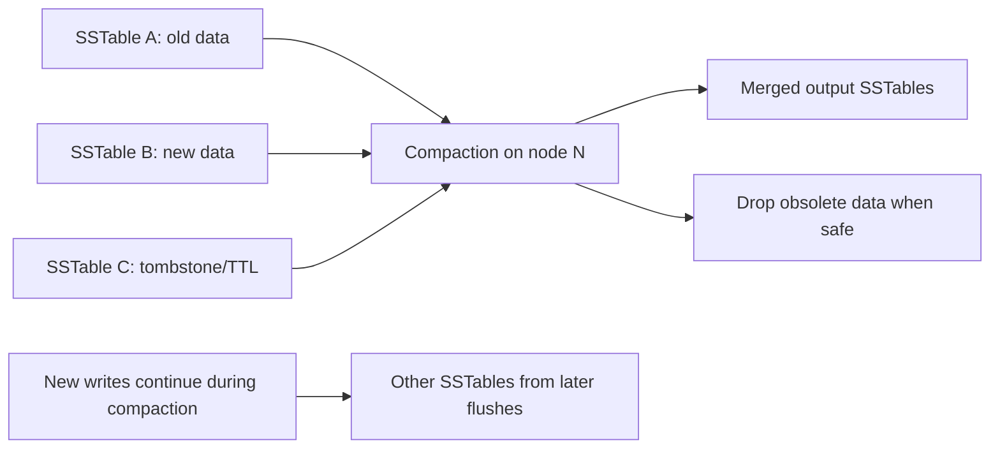
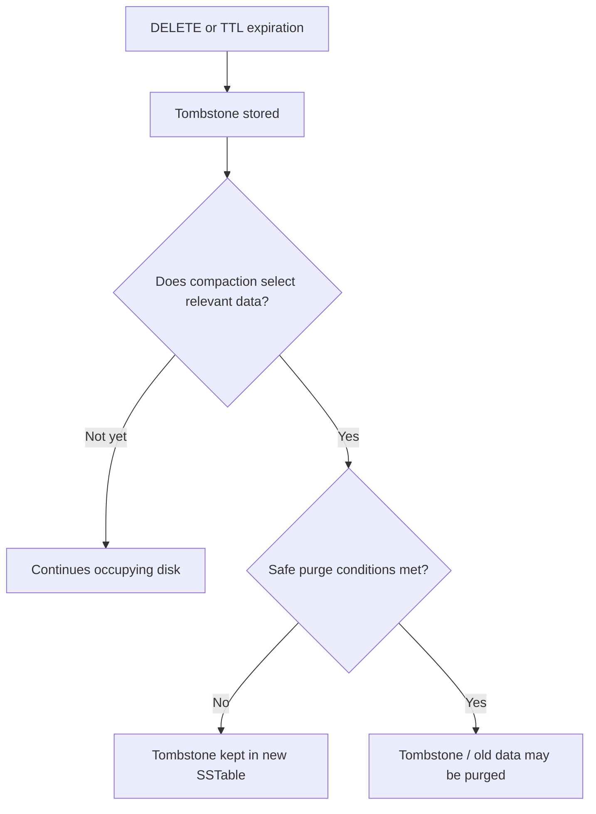

# Major Compaction, Manual Operations, and Impact Scope

## 1. Goals and Context

In Apache Cassandra, writes first update the **commit log** and **memtable**; when the memtable flushes, data becomes immutable **SSTables** on disk. New writes, updates, deletes, and TTL expirations can create additional SSTables holding data versions or **tombstones**. When reading a partition, Cassandra may need to inspect and reconcile data across multiple SSTables. **Compaction** is the background process that reads a group of SSTables, merges required versions, and writes new SSTables according to the table's **compaction strategy**.

Beyond system-scheduled compaction, operators can trigger **major compaction** via `nodetool compact`. This is a resource-intensive operation that rewrites local data on disk; its effectiveness and consequences vary by compaction strategy, Cassandra version, traffic load, and repair state.

This lesson belongs to the **SSTables and compaction** chapter of the `DATABASE_ENGINE_WIDE_COLUMN_CASSANDRA` module. Learners will connect wide-column modeling, partition keys, replication, and consistency levels with SSTable operations, tombstones, repair, troubleshooting, and Java application latency investigation.

After this lesson, you should be able to:

1. Explain what major compaction does and how it differs from automatic compaction and repair/cleanup/flush tools.
2. Identify the **node – keyspace – table – SSTable group** scope of a manual run.
3. Choose or avoid major compaction based on STCS, LCS, TWCS, or another strategy supported by the running version.
4. Estimate risks across disk, I/O, CPU, read/write latency, and replica impact.
5. Collect before/after metrics and verify results without mistaking “fewer SSTables” for “cluster-wide consistency”.

## 2. What Does Major Compaction Actually Do?

Normal compaction takes a subset of SSTables selected by the strategy, merges records by timestamp/tombstone, writes new SSTables, and discards input SSTables once unreferenced. This process **does not execute a new CQL UPDATE** and does not alter partition key design.

**Major compaction** is a manual request to compact a larger set of SSTables or all eligible SSTable groups for a table on that node. Under **SizeTieredCompactionStrategy (STCS)**, the common mental model is merging existing SSTables into one large SSTable. However, **you must never guarantee only a single SSTable file will remain**:

- Cassandra may separate groups by **repaired/unrepaired/pending repair** state and other internal constraints.
- Version, compaction strategy, SSTable sizes, or **split output** options can produce multiple output SSTables.
- New writes/flushes occurring while the job runs produce new SSTables outside the active compaction's input set.
- An actual SSTable also comprises multiple **component files** (data, index, statistics, etc.); “one SSTable” does not mean one OS file.



Compaction can reduce the number of SSTables checked on reads, while simultaneously causing **write amplification** from reading and rewriting many bytes, using CPU for compression/decompression, and contending for I/O with normal requests. It is not a way to “reorganize the whole cluster” or “force all replicas into sync”.

## 3. Distinguishing Major Compaction from Related Operations

| Operation | Direct purpose | Important scope and limits |
| --- | --- | --- |
| **Automatic/minor compaction** | Strategy automatically picks SSTable groups to merge regularly | Per node and per table, per background schedule/budget. |
| **`nodetool compact` / major compaction** | Manually requests compacting an eligible set of SSTables | **Targeted node**, chosen keyspace/table; does not automatically run on all replicas. |
| **`nodetool flush`** | Persists memtable to SSTables | Can **increase** SSTable count before compaction; not equivalent to major compaction. |
| **`nodetool repair`** | Synchronizes data between replicas over a repair range | Cannot be replaced by local major compaction. |
| **`nodetool cleanup`** | Purges data/token ranges a node no longer owns after topology changes | Not simply merging SSTables to optimize reads. |
| **`nodetool garbagecollect`** | Attempts to purge eligible tombstones under safety rules | Distinct from major compaction; not a way to bypass repair/gc grace conditions. |
| **Snapshot/backup** | Preserves data state for recovery | Snapshots may hold links to old SSTables and prevent disk reclamation after compaction. |

**No cross-cluster transactional boundary:** while `nodetool compact` runs, applications can keep reading/writing the table; coordinators still use normal replication factor (RF) and consistency level (CL). If one replica slows down under compaction I/O, queries needing ACKs/responses from that replica may experience higher latency or timeouts even though RF and CL are unchanged.

## 4. Impact Scope: Node First, Then Keyspace and Table

Typical commands:

```bash
# Run on the node to compact:
nodetool compact demo_ks events_by_device

# Or connect to the admin service of a specific node:
nodetool -h cassandra-node-1 compact demo_ks events_by_device
```

Analyzing the scope of the second command:

1. **Node:** `cassandra-node-1` is the node whose admin interface `nodetool` contacts. Compaction runs on **SSTables stored on that node**. That node may own many token ranges/vnodes.
2. **Keyspace:** `demo_ks` selects the data namespace. RF and placement remain governed by keyspace config; the command does not change RF.
3. **Table:** `events_by_device` restricts work to SSTables of the named table. It does **not** automatically compact other denormalized tables, secondary indexes, or materialized views as a single logical transaction; separate structures have their own storage tasks.
4. **Eligible SSTables:** in practice partitioned by strategy and metadata such as repaired/unrepaired; output is not guaranteed to merge every file into one.

**One command does not cover the entire cluster.** With RF = 3, running on node A does not cause nodes B and C to compact even though they hold replicas of the same partitions. Affecting multiple nodes requires planning execution separately on those nodes while tracking per-node latency and resources.

Before running, always check syntax supported by the **deployed version**:

```bash
nodetool help compact
nodetool status
```

Some versions offer options like `--split-output` or `--user-defined`. `--split-output` can split output per applicable mechanics to avoid one giant SSTable; `--user-defined` specifies exact input SSTables and requires deep familiarity with files/metadata. **Never copy flags from documentation of a different version.** In particular, avoid running `nodetool compact` **without a keyspace/table** unless intentionally targeting the broad scope described in your version's help.

### Example: RF = 3 Does Not Mean Compaction Multiplies by Three

Suppose the partition for `customer_id='cust-42'` has three natural replicas A, B, C:

```text
                  Keyspace RF = 3
                      Partition P
                    /     |     \
             Replica A  Replica B  Replica C
                |          |          |
             SSTables    SSTables    SSTables
                |
         nodetool compact A
                |
      Only SSTables on A are rewritten
```

Compaction does not copy compacted SSTables from A to B/C, nor does it alter repair state on B/C. Each replica's SSTable set may differ due to flush timing, streaming, compaction, and prior incidents.

## 5. Major Compaction Under Different Compaction Strategies

An answer like “major compaction is always good because fewer SSTables remain” is wrong. The **compaction strategy** defines how SSTables are created and picked, so manual intervention must be evaluated in that context.

| Strategy | Characteristics | Considerations before major compaction |
| --- | --- | --- |
| **STCS — SizeTieredCompactionStrategy** | Merges similarly sized SSTables in tiers | Major can create a huge SSTable; small SSTables written afterward rarely match its tier, hurting long-term cleanup of old versions/tombstones. |
| **LCS — LeveledCompactionStrategy** | SSTables organized by levels and overlap/size invariants | Manual major can incur heavy I/O and disrupt level balance; automatic compaction is usually better for normal operations. Do not assume output matches STCS. |
| **TWCS — TimeWindowCompactionStrategy** | Groups data by time windows, commonly for TTL/time-series | Manual intervention can break window separation or hinder dropping expired windows; avoid forcing merges across windows of different ages without understanding version semantics and late writes. |
| **UCS — UnifiedCompactionStrategy** (on supported versions) | Self-balancing write/read/space amplification per config | Do not infer major behavior from STCS. Check exact version docs and `nodetool help`, observing scheduler/SSTable groupings. |

### 5.1. STCS: A Huge Post-Major SSTable Can Become a Burden

Suppose before major compaction a node has many 100–300 MB SSTables. Major can create a multi-GB output if all inputs are eligible and disk allows. As writes continue, new SSTables are much smaller; STCS groups similarly sized tiers, so that huge old output may not enter another compaction for a long time. Data updated/deleted inside that huge output may wait far longer to be safely purged in a later compaction.

Consequence: **stats right after major may look prettier while tombstone longevity, read amplification, and future disk usage worsen**. Evaluating impact requires an observation window after normal write traffic resumes.

### 5.2. TWCS: Preserving Time-Window Semantics

TWCS helps when a table writes chronological data, many values share similar TTLs, and older windows rarely receive writes. An expired window's SSTable can be dropped once safety conditions pass. If an operation/write path mixes data from different time periods into the same SSTable, younger live data can pin files holding older data, impairing TTL cleanup.

Before compacting a TWCS table, inspect **the version's actual grouping behavior**, TTLs, data timestamps, late arrivals, and time-window distribution. Never use major compaction as “routine maintenance” on every TTL table.

### 5.3. LCS/UCS: Avoid Interfering with the Scheduler Without Evidence

LCS and UCS optimize different goals, usually with continuously managed rewrite costs and SSTable layouts. A massive merge request can monopolize resources the scheduler needs for normal backlog. Start from `SSTablesPerRead`, write/read latency, pending compactions, and disk usage; run major only with a concrete hypothesis and after checking impact under the active strategy.

## 6. Tombstones and TTL: Major Is Not an “Erase Everything” Button

Cassandra writes tombstones to mark deletions or TTL expirations; a replica must keep deletion info long enough to stop a disconnected replica from resurrecting old data (**zombie data**). Compaction can drop tombstones and shadowed versions **when safety conditions are met**, not merely because an operator ran `compact`.

Conditions to consider:

- **`gc_grace_seconds`:** the table's tombstone protection window; tombstones younger than this threshold are typically ineligible for removal.
- **Overlapping SSTables and old data:** must verify no older data outside the input set could be “resurrected” if the tombstone is purged early.
- **Repair and interrupted replicas:** local compaction does not prove all replicas saw the delete; repair schedules and workload traits dictate real safety.
- **Repaired/unrepaired grouping:** when incremental repair/anti-compaction splits SSTables into separate groups, compaction cannot merge them arbitrarily, so even major can leave multiple outputs and tombstones.
- **TTL, partition size, and windows:** a tombstone can persist until an eligible compaction runs; TTL expiration does not mean disk space is returned immediately.



Hence a major compaction may **barely reduce disk usage** even when a table holds many tombstones. Never arbitrarily lower `gc_grace_seconds` or skip repairs to “force” faster deletion; such changes risk data correctness.

## 7. Operational Costs and Risks

| Cost source | Why it rises during major compaction? | Metrics to monitor |
| --- | --- | --- |
| **Disk free / temporary space** | Input SSTables remain needed while writing outputs; substantial rewrite space may be required | Free space, SSTable file growth rate, low-disk alerts. |
| **Disk throughput and latency** | Reading many SSTables and writing large outputs competes with foreground reads/writes | IOPS, throughput, disk await, p95/p99 CQL latency. |
| **CPU / compression / decompression** | Merging, checksumming, and compression consume CPU | CPU, compaction throughput, GC, request queues. |
| **Node internal bandwidth** | Host disk I/O increases; can also impact co-located streaming/repair | Compaction backlog, active streaming, pending tasks. |
| **Availability at high CL** | Slow replicas may fail to respond in time for quorum or ALL reads/writes | Timeouts, Failures, Unavailables; per-DC latency. |
| **Snapshots/backups** | Snapshots hold hard links or copies referencing old SSTables | Disk usage does not drop proportionally even when live SSTable count drops. |

**Never use a rigid capacity ratio like “always need exactly 2× disk”.** Additional space depends on compression, live data/tombstones, input SSTable count, output sizes, snapshots, and concurrent compactions. Free headroom must be evaluated from real node metrics and reserve policies. When disk is nearly full, running major to “free space fast” is dangerous because it must **write outputs before deleting inputs**.

A node running compaction is not necessarily marked `DOWN`; however, if disk saturates, applications can still encounter read/write timeouts. On multi-replica clusters, **stagger** operations across nodes/DCs and proceed only when metrics, traffic, and availability for your CL allow.

## 8. Operational Workflow: Observe → Decide → Run → Verify

### Step 1 — Specify Goal and Scope

Identify the real problem: rising SSTables per read, rising tombstone scans, stalled compaction backlog, or a specific maintenance need? Write down **node**, **keyspace**, **table**, **compaction strategy**, **Cassandra version**, and a measurable goal. Never accept “run major to clean up data” as a concrete enough goal.

Inspect schema/compaction settings via CQL:

```sql
SELECT keyspace_name, table_name, compaction, gc_grace_seconds
FROM system_schema.tables
WHERE keyspace_name = 'demo_ks'
  AND table_name = 'events_by_device';
```

With multiple DCs, confirm actual RF/CL and involved replicas. Assess impact across the **entire read/write path** when one node endures heavy I/O, even though compaction runs only on that node.

### Step 2 — Capture Baseline on the Exact Node

```bash
nodetool status
nodetool compactionstats
nodetool tablestats demo_ks.events_by_device
nodetool tablehistograms demo_ks events_by_device
nodetool tpstats
```

**Syntax note:** `nodetool tablestats` commonly takes `keyspace.table`, whereas `tablehistograms` takes keyspace and table as two arguments in common versions. Before copying into a runbook, confirm with `nodetool help tablestats`/`nodetool help tablehistograms` on your cluster.

Also collect JMX/monitoring metrics: `LiveSSTableCount`, `SSTablesPerReadHistogram`, `ReadLatency`, `WriteLatency`, `TombstoneScannedHistogram`, pending compactions/bytes written, and disk/CPU. Measure **rates, percentiles, and time windows** instead of comparing cumulative counters across restarts.

### Step 3 — Verify Preconditions Before Acting

Before running, verify:

- Enough free disk remains for outputs with real margin; check whether snapshots pin old files.
- No giant repair/streaming/compaction is competing for the same disks; plan to avoid overlapping loads.
- Node is healthy; cluster can still meet **workload CL** if this node slows down.
- Table strategy won't make major counterproductive (especially STCS after long steady writes, or TTL-based TWCS tables).
- Baseline recorded for comparison, execution window scheduled, monitoring plan ready, and failure handling defined.

For critical workloads, confirm backup/snapshot/restore policies. Snapshots can raise disk requirements, so factor in the cost of taking or retaining snapshots.

### Step 4 — Execute Manually with Exact Scope

Only after proper evaluation, run on **one selected node**:

```bash
nodetool -h cassandra-node-1 compact demo_ks events_by_device
```

If running directly on the target node, omit `-h cassandra-node-1`. **Do not run simultaneously across all nodes** just because RF = 3. If an environment allows `--split-output`, treat it as **an intentional alternative invocation**, not a follow-up step right after regular major compaction.

Monitor progress/resources:

```bash
nodetool -h cassandra-node-1 compactionstats
nodetool -h cassandra-node-1 tablestats demo_ks.events_by_device
```

`compactionstats` displays active tasks, pending tasks, and estimated progress. Seeing “no active compactions” is necessary to wrap up monitoring, yet **does not prove** performance goals were met.

### Step 5 — If Compaction Causes Severe Impact

First identify which task is running and which node it impacts. Depending on version, `nodetool` offers mechanisms to stop active compactions (typically via `nodetool stop`, with task-type/ID constraints); check `nodetool help stop` and operational runbooks before using. **Stopping compaction does not roll back CQL mutations**, nor does it guarantee disk immediately returns to its prior state. Never kill the Cassandra process or manually delete SSTable files to “stop fast”.

If intervention is not needed yet, throttle competing tasks per environment procedures, watch disk/latency, and let compaction finish. Distinguish genuine low-disk alerts from transient “pending” increases caused by normal backlog.

### Step 6 — Compare After Completion

Re-run stats on the **same node**, table, and representative time window. Check at least:

1. **Data:** partition-key CQL queries and business outputs remain accurate; never use `SELECT COUNT(*)` on a massive table as a sanity check.
2. **SSTables:** did live SSTable count and sizes change as expected? Are there repaired/unrepaired groups or new SSTables from flushes?
3. **Performance:** read/write p95/p99, SSTables/read, tombstones scanned, and disk I/O after load stabilizes.
4. **Capacity:** did free disk rise? Are snapshots/hard links or large outputs preventing expected reclamation?
5. **Cluster:** are other replicas healthy, and did timeouts/repair/streaming shift? Local major **does not prove** replicas have converged.

With STCS/TWCS, keep monitoring after normal write/TTL workloads resume. Results immediately post-major may not reflect behavior a few days later.

## 9. Repeatable CQL and nodetool Lab

Run this lab on a **test cluster**, not production data. First create a `lab_ks` keyspace with suitable replication (e.g. matching local topology). Then create an STCS table:

```sql
CREATE TABLE lab_ks.events_by_bucket (
    device_id text,
    bucket_day date,
    event_ts timestamp,
    event_id timeuuid,
    payload text,
    PRIMARY KEY ((device_id, bucket_day), event_ts, event_id)
) WITH compaction = {'class': 'SizeTieredCompactionStrategy'};
```

Write a few rows (run multiple times with varying timestamps) then flush **on the node holding the partition's replica**:

```sql
INSERT INTO lab_ks.events_by_bucket
    (device_id, bucket_day, event_ts, event_id, payload)
VALUES ('sensor-9', '2026-11-21', toTimestamp(now()), now(), 'A')
USING TTL 120;

INSERT INTO lab_ks.events_by_bucket
    (device_id, bucket_day, event_ts, event_id, payload)
VALUES ('sensor-9', '2026-11-21', toTimestamp(now()), now(), 'B')
USING TTL 120;

SELECT event_ts, event_id, payload
FROM lab_ks.events_by_bucket
WHERE device_id = 'sensor-9'
  AND bucket_day = '2026-11-21'
LIMIT 20;
```

```bash
# On the selected lab node:
nodetool flush lab_ks events_by_bucket
nodetool tablestats lab_ks.events_by_bucket
nodetool compactionstats

# Run AFTER measuring baseline and verifying disk headroom:
nodetool compact lab_ks events_by_bucket

# Inspect again:
nodetool compactionstats
nodetool tablestats lab_ks.events_by_bucket
```

**How to interpret results:** a single flush does not necessarily create multiple large SSTables; automatic compaction may run in parallel. Thus a few-row lab **does not guarantee** stark before/after differences. To see clear effects, use enough data/flushes to create multiple SSTables within reasonable resource limits and inspect logs/metrics; do not disable compaction cluster-wide just to stage tidy numbers.

After TTL expires, rows stop returning while tombstones may remain ineligible for removal. With a 120-second TTL and longer default `gc_grace_seconds`, major does not guarantee “complete cleanup” immediately. The exercise asks learners to explain **why query results, SSTable count, and disk usage can change independently**.

### Practical Expectations

| Observation | Valid conclusion | Invalid conclusion |
| --- | --- | --- |
| Live SSTable count drops on node A | The table's SSTable set on A was partially rewritten/merged. | Nodes B/C also compacted; data was repaired. |
| Disk used drops | Some old data/SSTables were purged and unreferenced. | Every tombstone was deleted; zero risk of stale reads remains. |
| Local read p95 drops | Read work on that node/measured query set may be cheaper. | Every Java query in all DCs is permanently faster. |
| Read p99 rises during compaction | I/O/CPU/queues may be contending with foreground reads. | Compaction is definitely the sole cause without checking metrics and traces. |
| `nodetool compactionstats` shows no active tasks | No compaction tasks are currently running at sample time. | Business outcomes, disk, latency, and repair are verified. |

## 10. Operational Case: TTL Table with Heavy Tombstones and Slow Reads

**Hypothetical scenario:** A daily log table uses `TimeWindowCompactionStrategy`, a 7-day TTL, and heavy write volume. The Java application gets timeouts reading partitions for the current day. `tablestats` shows high tombstone scans, rising pending compactions, and nearly full disks. Someone proposes: “run major compaction on all nodes to clear tombstones”.

Analyze in order:

1. **Identify workload:** do queries specify the full partition key (e.g. device + day), scan an overly wide range, or use `ALLOW FILTERING`? What are the live/tombstone cell counts and actual latencies?
2. **Verify data:** which window do the tombstones belong to? Are there late arrivals or updates hitting older windows? Did TTL just expire or pass the safety window?
3. **Evaluate strategy:** TWCS groups by window; manual major compaction can erode the “drop entire old windows” advantage if young and old data get mixed.
4. **Evaluate disk:** nodes are nearly full; major may require large extra space while writing outputs, so disk-exhaustion risk may outweigh immediate benefit.
5. **Evaluate replication/CL:** if all replicas run huge compactions at once, `LOCAL_QUORUM` read latency can spike across the board. Running one node and observing is safer load control when intervention is truly needed.
6. **Choose evidence-based fixes:** examine partition/bucket design, read range bounds, TTL/timestamp policies, compaction backlog, throughput/disk, repair, and late-arriving data. Major is **a special tool**, not the default answer.

A “high tombstones” metric alone does not prove major will reduce tombstones; you must verify **which tombstones are purge-eligible, which SSTables will compact, and whether enough disk remains for normal traffic afterward**.

## 11. Connection to Java Applications and Consistency

When Cassandra runs major compaction on a replica, the Java Driver needs no CQL changes:

```java
PreparedStatement find = session.prepare(
    "SELECT event_ts, event_id, payload " +
    "FROM lab_ks.events_by_bucket " +
    "WHERE device_id = ? AND bucket_day = ? LIMIT 20"
);

BoundStatement statement = find.bind(
    "sensor-9", LocalDate.of(2026, 11, 21)
).setConsistencyLevel(DefaultConsistencyLevel.LOCAL_QUORUM);

ResultSet result = session.execute(statement);
for (Row row : result) {
    // Process results in clustering order.
}
```

This snippet is illustrative, assuming driver 4.x, `session`, and imports are present. Major compaction **does not change RF/CL**, partition keys, CQL APIs, or record formats. However, the app may feel **elevated tail latency** because a replica is I/O-bound. If timeouts occur, inspect request timeouts, retry/speculative execution, traces, and metrics; never assume data was lost or raise CL to fix latency.

For production systems with strict consistency requirements, repair/compaction schedules must be coordinated to avoid piling too much concurrent I/O onto the same nodes. **Compaction does not prove cross-replica consistency**: repair/anti-entropy is a separate mechanism, and repair policies must be designed independently.

## 12. Common Mistakes

| Claim | Reality |
| --- | --- |
| “Running `nodetool compact` on one node compacts all RF = 3 replicas.” | False; only local SSTables on the targeted node, for the specified keyspace/table. |
| “Major always leaves behind exactly one file.” | False; multiple SSTable components, repaired groups, strategies, disk boundaries, and fresh flushes can yield multiple outputs. |
| “Major replaces repair.” | False; compaction merges local data, while repair compares and synchronizes across replicas. |
| “Lots of tombstones means running major deletes them all.” | False; tombstones must meet safety conditions and participate in eligible compactions. |
| “Running major more often boosts performance.” | False; frequent manual runs can increase write amplification and disrupt automatic balance, especially in STCS/TWCS. |
| “Running major on a nearly full disk frees space right away.” | Dangerous; outputs must be written before inputs are freed, and snapshots may pin old files. |
| “Compaction finished so the cluster won't time out anymore.” | Does not follow; re-measure read/write latencies, RF/CL, network, I/O, GC, and all replicas. |
| “Disabling automatic compaction stabilizes state.” | Causes SSTable/tombstone buildup and slow reads; requires a strong rationale and re-enable plan. |

## 13. Self-Check Questions and Completion Criteria

1. Keyspace RF = 3 has replicas A/B/C. You run `nodetool -h A compact ks tbl`. Which replica was acted on directly? Why do B/C still have different SSTable counts from A?
2. Why can a major compaction in STCS lower SSTable count today yet hinder compacting that giant output with small new-write SSTables in coming weeks?
3. Why shouldn't major compaction be used by default on a TWCS table with TTLs and late-arriving data?
4. A tombstone is 10 minutes old; the table's `gc_grace_seconds` is several days. If major runs, is the deleted data guaranteed to be freed from disk?
5. When free disk is very low, why can major fail even when the goal is reclaiming space?
6. A Java query at `LOCAL_QUORUM` times out while node A compacts. Which metrics and replicas should you check before blaming a root cause?
7. Once `nodetool compactionstats` shows zero active tasks, which metrics must be compared to conclude major helped?

**Completion criteria:** the learner can explain node/keyspace/table/SSTable boundaries, inspect compaction strategies and repair states, follow a baseline – single-node execution – monitoring – re-measurement workflow, never confuse compaction with repair, and never judge effectiveness by SSTable count alone.

## 14. Reference Documentation

- [Apache Cassandra Documentation](https://cassandra.apache.org/doc/stable/): storage architecture, compaction strategies, and version-specific operations.
- [Apache Cassandra — nodetool compact](https://cassandra.apache.org/doc/stable/cassandra/managing/tools/nodetool/compact.html): syntax, scope, and options supported in the documented version.
- [Apache Cassandra — nodetool compactionstats](https://cassandra.apache.org/doc/stable/cassandra/managing/tools/nodetool/compactionstats.html): compaction status and progress.
- [Apache Cassandra — Storage Engine](https://cassandra.apache.org/doc/stable/cassandra/architecture/storage-engine.html): relationship between memtables, SSTables, and compaction.
- [Apache Cassandra — nodetool tablestats](https://cassandra.apache.org/doc/stable/cassandra/managing/tools/nodetool/tablestats.html): SSTable, tombstone, and table statistics.

**Conclusion:** Major compaction is **a heavy SSTable rewrite operation on a targeted node**, shaped by compaction strategy, repair metadata, and disk state. It can reduce read work in specific circumstances, yet can also spike I/O, produce unwieldy future SSTables, or disrupt latency. Sound decisions rely on measurable goals, exact scope, safety checks, and before/after evidence.
