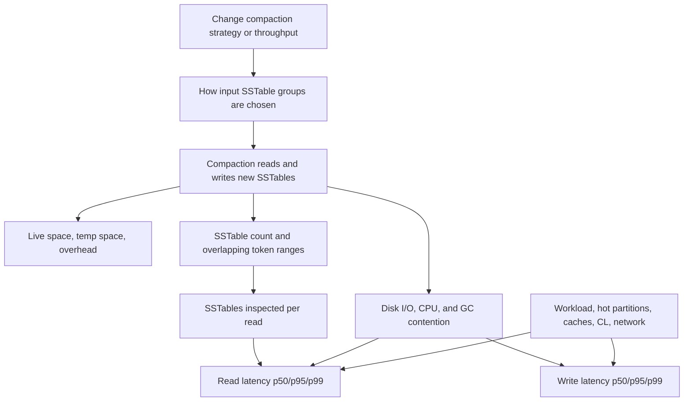
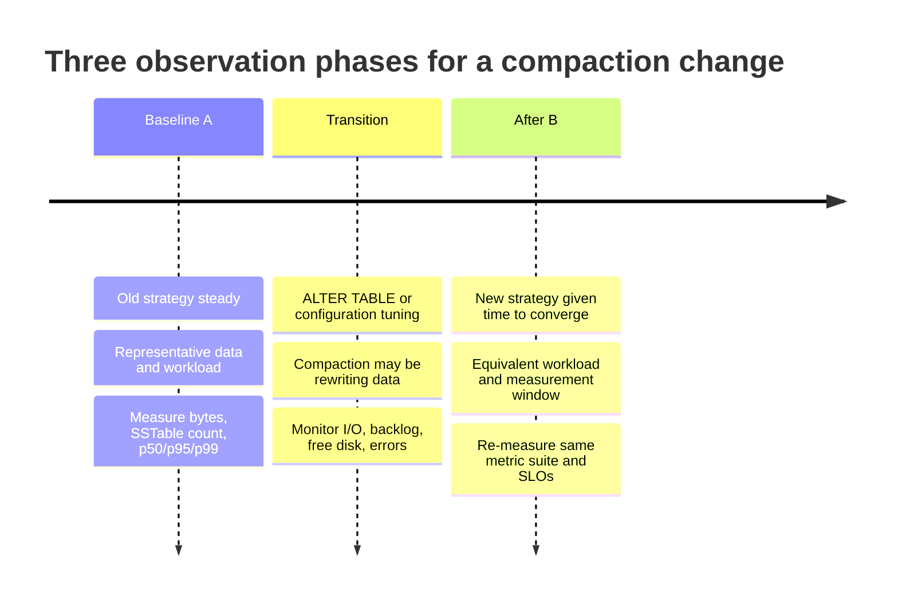

# Observing Before/After Changes via Disk Space, SSTable Count, and Latency in Apache Cassandra

## 1. Why Measure All Three Metric Categories?

In **Apache Cassandra's** **wide-column** architecture, data is written to the commit log and memtable, then flushed into immutable **SSTables**. Multiple SSTables can hold different versions of the same partition. **Compaction** merges eligible SSTables, reorganizes data per the table's strategy, and can purge obsolete data or tombstones when safe.

When changing **compaction strategy**, tuning compaction throughput, altering write/TTL patterns, or changing the partition model, operators must prove outcomes with **before-and-after metrics** rather than relying solely on `ALTER TABLE` succeeding.

This lesson belongs to the **SSTables and compaction** chapter in the `DATABASE_ENGINE_WIDE_COLUMN_CASSANDRA` module: understanding distributed architecture, query-driven table design, read/write consistency levels, CQL practice, replication, compaction, repair, troubleshooting, and Java applications.

The three main observation categories are:

| Category | Question to answer | What the metric does not prove by itself |
| --- | --- | --- |
| **Disk space** | How many bytes do the table and node occupy, and is there enough headroom for compaction? | Fewer bytes do not always mean faster reads or safe data |
| **SSTable count** | How many SSTables exist, and how many files are typically touched on reads? | Fewer files do not always mean less I/O or better p99 |
| **Latency** | How did user/application-perceived read/write p50, p95, and p99 change? | Latency shifts can stem from workload, caches, network, repair, GC, or consistency level |

**Goal:** know how to pick matching metrics, measure at the proper scope, control confounding variables, and draw verifiable conclusions. Compaction is **local to each replica**; when a keyspace has RF greater than one, nodes can be at different flush/compaction stages. Therefore, metrics must be analyzed **per table, per node, and per time window**.

## 2. Causal Model: From SSTables to Query Experience

A compaction change can affect all three metrics, yet not in the same direction:



Three factors to understand before observing:

1. **Read amplification:** a single read may have to query multiple SSTables/versions. A strategy like **LeveledCompactionStrategy (LCS)** can reduce SSTable overlap even when **total file count rises**, because LCS typically uses smaller target SSTables and levels organized by token range.
2. **Write amplification:** compaction reads and rewrites data; configurations reducing read cost can come at the price of higher I/O, CPU, or write cost.
3. **Space amplification:** multiple versions, tombstones, coexisting input/output files during compaction, and snapshots can raise disk bytes before they drop. Never manually delete SSTable files to create free space.

Consequently, success criteria must be declared **before making changes**. For instance: “Reduce read p99 on table `profile_by_user` under identical load without pushing write p99 past SLO, without exhausting disk space, and without harming data consistency”.

## 3. First, Precisely Define “Disk Space”

“Cassandra disk space” has several distinct measures and scopes:

| Metric | Typical measurement scope | When to use? |
| --- | --- | --- |
| **Live SSTable disk space** in `nodetool tablestats` | Bytes of live SSTables belonging to one table on **one node** | Compare storage efficiency of a table on the same node |
| **Total SSTable disk space** in `tablestats` | Total SSTable bytes as counted by the running version, potentially including files/snapshots outside the live set | Analyze the gap versus live space |
| **Disk used/free** via OS, e.g. `df` | Entire filesystem/volume | Assess actual free space available for compaction |
| **SSTable count** in `tablestats` | Number of SSTables counted for the table at sample time on the node | Analyze file counts and compaction trends |
| **Application logical bytes** | Payloads/business records before replication, compression, and overhead | Measure business data volume, not physical storage |

**Do not directly compare** `Owns (effective)` from `nodetool status <keyspace>` against a single table's live SSTable GB. Ownership estimates token-range share under replication, whereas bytes depend on actual partition sizes and SSTables.

For example, RF = 3 with 500 GiB of logical data **does not mean** a node always holds exactly 500 GiB or the cluster uses exactly 1,500 GiB. Compression, tombstones, snapshots, replica copies, partition distribution, and compaction cause physical usage to differ from naive estimates. Before/after comparisons must use **the same metric** from **the same set of nodes**.

### Conditions for Fair Space Measurements

- Same table, same nodes, same live/total metric definition; standardize on `GiB` (2^30 bytes) or `GB` (10^9 bytes), never mixing units.
- Same logical record count and partition distribution when measuring **strategy impact**—do not measure alongside a batch TTL expiration or RF change.
- Account separately for snapshots/backups and old-file cleanup; if `df` drops while `live SSTable bytes` stays flat, investigate storage outside live SSTables.
- Always check **free disk/headroom** when switching strategies: transitions can retain old and new files simultaneously, causing disk usage to peak before stabilizing.
- Across multiple nodes/DCs, report per-node figures before aggregating; never let one “clean” node represent the entire cluster.

## 4. SSTable Count: Look at Both File Count and Read Scope

SSTable count is easy to fetch and useful for spotting trends, yet it is a **preliminary** indicator:

- **STCS (SizeTieredCompactionStrategy):** typically groups similarly sized SSTables; a few huge files can persist long-term. Total file count may be low while many SSTable generations still hold the same partition.
- **LCS (LeveledCompactionStrategy):** organizes SSTables into levels; files are relatively small and files within higher levels have non-overlapping token ranges. **Total file count may increase** while each read inspects fewer relevant files.
- **TWCS (TimeWindowCompactionStrategy):** groups by time windows; window count and late-arriving data can raise files per window. You cannot call a TWCS table “bad” merely because many files span multiple windows.
- **UCS (UnifiedCompactionStrategy, supported versions):** structure depends on read/write/space trade-off parameters; never impose one universal SSTable count threshold across all setups.

**Mandatory companion metric when evaluating reads:** **SSTables per read** or its equivalent histogram, alongside read latency and cache hit rate. A table jumping from 100 to 250 SSTables after switching to LCS while SSTables touched per read drops from ~7 to 2 is a completely plausible scenario. That is a conceptual example, not a guarantee from LCS.

Measure SSTable count continuously: it normally climbs after flushes and drops after compaction tasks. **A single snapshot taken right after a flush can mislead.** Take multiple samples over time and note when compactions are actively running.

## 5. Latency Must Be Measured on Both Client and Server

Application SLAs care about **end-to-end duration**; Cassandra metrics explain server-side processing. Both belong side by side:

| Metric | Meaning | Caveats |
| --- | --- | --- |
| **Client read/write p50** | Median operation latency seen by the app | May stay flat even while p99 spikes sharply |
| **Client p95/p99/p99.9** | Tail latency, vital for user experience and timeouts | Needs sufficient samples and comparable load |
| **Server read/write latency** per table/node | Processing time inside Cassandra | Excludes client network, queueing, and retries |
| **SSTables per read** | How many SSTables are hit during reads | Interpret alongside cache, partitions, and query shape |
| **Timeout, retry, failure rate** | Share of requests failing to complete as expected | Measuring only successful requests creates “artificially pretty” latency |
| **CPU, GC, disk I/O, network** | Sources of noise or bottlenecks | Especially critical during heavy compaction reads/writes |

p99 latency is the threshold below which roughly 99% of samples fall in a measurement window. **p99 is not the maximum latency**, and p99 values from two sample sets do not add or subtract linearly. When aggregating across nodes or time windows, recompute percentiles from proper histograms/raw samples rather than averaging p99s.

**Consistency note:** the exact same `SELECT` at `LOCAL_ONE` vs. `LOCAL_QUORUM` has different cost; similarly, page size, returned row count, read repair, speculative execution, and retries shift latency. Hold these fixed when isolating compaction impact. Measure reads and writes separately because a strategy that reduces read amplification can raise write amplification.

## 6. Planning a Three-Phase Before/After Comparison

The strongest measurement model is **A → Transition → Steady B**:



### Phase A — Baseline

1. Record **Cassandra version**, node/DC/rack topology, replication factor, `system_schema.tables.compaction`, TTL, and `gc_grace_seconds`.
2. Record data scale and distribution: partition count, partition sizes, update/delete rate, hot-key ratio, per-node table disk size.
3. Fix the workload: read/write queries, requests/s, read:write ratio, client count, concurrency, payload size, paging, CL, Java client placement, and retry policy.
4. Warm up the app/connections/caches using a repeatable procedure, **excluding warm-up from primary stats**.
5. Collect **multiple windows** long enough for tail latency; save p50/p95/p99, successful throughput, timeouts/retries, CPU/disk/GC, live bytes, total bytes, SSTable count, and compaction backlog.

### Transition Phase — Do Not Equate with “After”

1. Apply exactly **one change** under study, e.g., switching `SizeTieredCompactionStrategy` → `LeveledCompactionStrategy` on the test table.
2. Log change timestamp, logs, new config, and any concurrent bootstrap/repair/snapshot/backup events.
3. Watch active compactions and pending tasks. During this phase, SSTable count, disk usage, CPU, and p99 may **rise before falling**.
4. Keep free disk safe; never force major compaction in production merely to finish a benchmark faster. “Work in progress” metrics remain valuable, yet must be labeled **transient**.

### Phase B — Steady-State Results

1. Confirm no abnormal strategy-transition compactions remain; backlog has stabilized for the workload or sits at an explainable level.
2. Repeat the exact same workload, CL, logical data volume, client count, concurrency, page size, and sufficient sample window. If TTLs or logical sizes shifted meaningfully between A and B, **state the difference explicitly** rather than attributing every effect to the strategy.
3. Compare across the **same nodes and same table**, adding DC/cluster totals where appropriate.
4. Inspect both read p99 **and** write p99, successful requests, timeouts, and free disk; verify data correctness with appropriate validation queries.
5. For stronger causal proof, repeat on staging with the same dataset/seed or use a control group; avoid casually rolling back strategies in production just for cleaner charts.

Duration of each phase depends on flush/compaction cycles and workload; **never set an arbitrary rule like “wait 10 minutes and it has converged”**. Large datasets can require multiple cycles to become representative.

## 7. Observation Tools Across CQL, nodetool, and OS

### 7.1. Confirming Compaction Strategy in Schema

```sql
SELECT keyspace_name, table_name, compaction,
       default_time_to_live, gc_grace_seconds
FROM system_schema.tables
WHERE keyspace_name = 'lab_compaction'
  AND table_name = 'events_by_device_day';
```

`compaction` is a map describing the table's strategy/options. An `ALTER TABLE` updates metadata, yet **does not guarantee** all existing SSTables were immediately rewritten into the new layout.

### 7.2. Per-Node Observations

Run the same command set on **every compared node**:

```bash
# Node status, tokens, DC, Load.
nodetool status lab_compaction

# Storage and SSTable stats for the exact table.
nodetool tablestats lab_compaction.events_by_device_day

# Partition size and read/write latency distributions per table.
nodetool tablehistograms lab_compaction events_by_device_day

# Running/pending tasks and compaction history.
nodetool compactionstats
nodetool compactionhistory

# Server thread pools/queues to help pinpoint bottlenecks.
nodetool tpstats
```

Specific contents and metric names in `nodetool tablestats` vary by version. Look for fields corresponding to **SSTable count**, **Space used (live/total)**, **SSTables per Read**, **Read latency**, and **Write latency**. Record **units**, **scope**, and **windowed vs. cumulative**: some values are cumulative counters, while others are distributions or point-in-time averages. Never subtract before/after cumulative metrics as two independent samples without checking whether they reset on restarts.

`nodetool status` reports whole-node `Load` as measured by the tool; it **does not replace** per-table byte counts. `compactionstats` reflects active/queued work, while `compactionhistory` helps trace past runs without measuring application latency.

### 7.3. Free Disk and Snapshots

On a Linux node, for example:

```bash
# Read-only; replace path with the node's data directory.
df -h /var/lib/cassandra
```

Compare total disk usage against live SSTable bytes. Gaps can stem from snapshots, commit logs, other Cassandra files, other keyspaces' data, temporary SSTables, or filesystem allocation. **Never manually delete SSTable files** to “balance” numbers. Before cleaning up snapshots or altering retention, follow established backup/recovery policies.

### 7.4. Recording Reproducible Metrics

For each measurement window, log:

```text
run_id, phase, timestamp_start, timestamp_end
cluster_version, table, node_id, dc, rack, replication
compaction_strategy, options, TTL, gc_grace_seconds
live_sstable_bytes, total_sstable_bytes, disk_free_bytes
sstable_count, sstables_per_read_p95, compaction_pending
client_read_p50_ms, client_read_p95_ms, client_read_p99_ms
client_write_p50_ms, client_write_p95_ms, client_write_p99_ms
read_rps, write_rps, timeout_rate, retry_rate
cpu_utilization, disk_iops, disk_throughput, gc_pause
data_version, client_version, consistency_level, page_size
```

This is a **suggested reporting schema**, not a Cassandra table you need to create. Save raw histograms/time-series alongside summary tables so percentiles can later be recomputed and spikes inspected.

## 8. CQL Practice: Switching STCS to LCS in a Lab

Practice on a test keyspace/table. `dc1` is an illustrative DC name only; substitute your real topology and avoid running directly in production.

```sql
CREATE KEYSPACE IF NOT EXISTS lab_compaction
WITH replication = {
    'class': 'NetworkTopologyStrategy',
    'dc1': '3'
};

CREATE TABLE IF NOT EXISTS lab_compaction.events_by_device_day (
    device_id text,
    event_day date,
    event_time timestamp,
    event_id uuid,
    payload text,
    PRIMARY KEY ((device_id, event_day), event_time, event_id)
) WITH CLUSTERING ORDER BY (event_time DESC, event_id ASC)
  AND compaction = {
      'class': 'SizeTieredCompactionStrategy'
  };

-- Read with full partition key, avoiding full-table scans.
SELECT event_time, event_id, payload
FROM lab_compaction.events_by_device_day
WHERE device_id = 'sensor-42'
  AND event_day = '2026-11-21'
LIMIT 100;
```

For a meaningful test, load representative data across multiple flushes or enough for compaction to create files. **A table with just a few rows cannot clearly demonstrate compaction impact.** When loading data, keep partition keys reasonably diverse with realistic update/delete ratios and avoid accidentally building one giant partition.

After completing the baseline, apply **one change**:

```sql
ALTER TABLE lab_compaction.events_by_device_day
WITH compaction = {
    'class': 'LeveledCompactionStrategy',
    'sstable_size_in_mb': '160'
};
```

`160` is an experimental parameter, not a blanket recommendation for every cluster/disk. Verify valid options for your **Cassandra version**. After `ALTER TABLE`, watch `compactionstats`, free disk, and `tablestats`; evaluate Phase B only once data, compaction schedules, and workload are steady enough to compare.

Do not repeatedly run `ALTER TABLE` between measurements, force manual compaction just to lower counts, or change RF/TTL/queries/CL at the same time; if multiple variables shift, you can no longer tell what caused the change.

## 9. Sample Results Table: SSTable Count Rises Yet Reads Get Faster

Suppose a test switches STCS → LCS on one table on one node, running **the same logical data volume and workload**. Numbers below are **synthetic figures for practicing interpretation**, not measurements from a real Cassandra cluster.

| Metric | Baseline A | During transition | Steady After B |
| --- | ---: | ---: | ---: |
| Live SSTable space | 310 GiB | 326 GiB | 335 GiB |
| SSTable count | 110 | 265 | 190 |
| SSTables/read (p95) | 7 | 5 | 2 |
| Client Read p99 | 90 ms | 128 ms | 52 ms |
| Client Write p99 | 20 ms | 35 ms | 27 ms |
| Pending compactions | 0 | 48 | 0 |
| Free disk | 600 GiB | 410 GiB | 560 GiB |

Interpretation:

- **Live space increased:** `335 − 310 = 25 GiB`, roughly **+8.1%**. This is not necessarily an error; LCS may trade space/writes to cut read cost.
- **SSTable count increased:** `190 − 110 = 80` files (**+72.7%**). You cannot call the result bad based on file count alone.
- **SSTables/read p95 dropped:** from `7` down to `2`, roughly a **71.4%** reduction; aligns with bounding read overlap.
- **Read p99 dropped:** `(90 − 52) / 90 ≈ 42.2%`. This is positive if request mix, throughput, CL, caches, and error rates truly matched.
- **Write p99 rose:** `(27 − 20) / 20 = 35%`; must be checked against write SLOs and I/O causes before declaring success.
- **During transition**, read p99 hit 128 ms and free disk dropped by 190 GiB; that is the reorganization cost. Rollout plans must budget for peak load and space, not just steady-state After results.

The final verdict depends on SLAs: if the application requires read p99 ≤ 60 ms and write p99 ≤ 30 ms, the After scenario meets both (on this synthetic data) at higher disk cost. If write p99 must be ≤ 22 ms, it **fails** even though reads improved.

### Distinguishing Fluctuation Patterns

| Observed result | Initial interpretation | Follow-up check |
| --- | --- | --- |
| Live bytes down, count down, read p99 down | Possibly compaction purged old data and cut read amplification | TTL/DELETEs, identical workload, any compaction backlog remaining |
| Count up, SSTables/read down, read p99 down | Possibly level organization improved reads | Write I/O, CPU, and free disk space |
| Count down yet read p99 worse | File count does not reflect total read work | Large partitions, disk seeks, caches, CL, rows/query |
| Live bytes flat yet `df` drops | Overhead outside live SSTables was reclaimed | Snapshots, temp files, backups, commit logs |
| Read p99 improves yet timeouts rise | Stats on successful requests only may be biased | Failure rates, retries, and offered load |
| p99 degrades during transition, improves after convergence | Compaction contended for CPU/disk during reorganization | I/O headroom and tolerance during rollout |
| Nodes trend in opposite directions | Skewed partitions/hot keys or differing compaction progress | Per-node/DC metrics, RF, and repair |

## 10. Calculating Changes and Avoiding Statistical Pitfalls

For a metric with matching units and scope:

```text
absolute_delta = after - before
relative_change_percent = 100 * (after - before) / before
latency_reduction_percent = 100 * (before - after) / before
```

Precondition: `before != 0` when dividing for ratios. If initial pending tasks equal 0, standard percentage change cannot be computed. For multi-node total space, **sum raw bytes**, never sum percentages; for tail latency, **never** average per-node p99s.

### Mistakes That Easily Skew Reports

1. **Different traffic:** Hour A had 2,000 RPS while Hour B had 500 RPS; lower p99 does not prove a better strategy.
2. **Different data:** TTLs just expired, cleanup deleted ranges, or partition counts shifted; disk reduction may not come from the strategy.
3. **Different read consistency:** `LOCAL_ONE` versus `LOCAL_QUORUM`; different replica counts participate.
4. **Different client setup:** thread counts, connection pools, retries, speculative execution, driver version, JVM/GC, or network placement changed.
5. **Measuring before convergence:** compaction is still rewriting legacy files; metrics reflect migration rather than steady state.
6. **Bad per-node aggregation:** one hot node has terrible p99 while an overall average hides it. Inspect per-node/partition distributions before summarizing.
7. **Excluding timed-out requests:** keeping only successful request latencies makes p99 look artificially good. Report failures/timeouts alongside offered load.
8. **Coordinated omission:** closed-loop load generators stall when the server slows down, underreporting true tail latency; document load methodology and use tools that correct for it when needed.
9. **Looking only at SSTable count:** higher file count in LCS does not mean more SSTables *touched per read*.
10. **Forgetting snapshots:** `df` fills up even when `live SSTables` look small. Distinguish active references from snapshots/backups.

For trustworthy comparisons, run multiple trials with the same seed/workload and present **cross-run distributions**. One isolated p99 point during cluster maintenance is insufficient for long-term config decisions.

## 11. Measuring from a Java Driver 4.x Application

The Java application measures **real client-side experience**, while Cassandra measures server-side components. The sample below shows how to time a query using a full partition key. Assume `CqlSession session` is already built with the proper local DC; requires Java 17+ for text blocks.

```java
import com.datastax.oss.driver.api.core.DefaultConsistencyLevel;
import com.datastax.oss.driver.api.core.cql.BoundStatement;
import com.datastax.oss.driver.api.core.cql.PreparedStatement;
import com.datastax.oss.driver.api.core.cql.ResultSet;
import com.datastax.oss.driver.api.core.cql.Row;
import java.time.LocalDate;

PreparedStatement prepared = session.prepare("""
    SELECT event_time, event_id, payload
    FROM lab_compaction.events_by_device_day
    WHERE device_id = ? AND event_day = ?
    LIMIT 100
    """);

BoundStatement statement = prepared.boundStatementBuilder()
    .setString(0, "sensor-42")
    .setLocalDate(1, LocalDate.of(2026, 11, 21))
    .setConsistencyLevel(DefaultConsistencyLevel.LOCAL_QUORUM)
    .build();

long startNs = System.nanoTime();
try {
    ResultSet result = session.execute(statement);
    int rows = 0;
    for (Row ignored : result) {
        rows++;
    }
    long elapsedNs = System.nanoTime() - startNs;
    // Emit elapsedNs, rows, run_id, stage, and anonymized key to histogram/log.
} catch (RuntimeException error) {
    long elapsedNs = System.nanoTime() - startNs;
    // Record timeout/error; do not drop failed attempts from reporting.
    throw error;
}
```

The example deliberately uses `LIMIT 100` to avoid unbounded reads, yet the `for` loop may still fetch pages if results are large enough. For benchmarks, fix page size, row count, result consumption behavior, and retry policy; stopping after `.one()` is a different measurement. In multi-client setups, use benchmarking/driver metrics tools with accurate histograms, recording percentiles over **the exact same window** as `nodetool`/JMX metrics; never compute p99 from a handful of requests.

Keep the **prepared statement** and query shape identical between A and B. When isolating compaction, do not alter CQL queries, CL, or application code in the same test. When latency degrades, correlate client p99 against SSTables/read, CPU/disk/GC, compaction backlog, and errors to pinpoint the bottleneck.

## 12. Boundary: Space and Latency Do Not Prove Data Correctness

Compaction is not repair. It merges files **on one node**, whereas **repair** reconciles replicas across token ranges. A cluster with fast reads and lean disks can still suffer out-of-sync replicas, stale data, or consistency bugs if repair/availability schedules are neglected.

- For tombstones/TTL, data is only physically removed when safety checks pass. **Never set `gc_grace_seconds` to 0 solely to shave bytes** without evaluating repairs/offline replicas and stale-data resurrection risk.
- After changing RF, adding/removing nodes, or running cleanup, do not attribute all disk changes to compaction because **replica/token ownership** changed.
- If changing the partition key model to fix a hot partition, add partition-size and key-distribution checks; compaction strategies do not split one partition across multiple tokens.
- Never run `nodetool compact` (major compaction) on huge tables or TWCS tables merely to force SSTable count down; it can burn I/O/space and break time-window behavior.
- Business correctness must be verified using proper queries/checksums, replica health, repair, and separate backup/restore tests; **the three metric groups in this lesson are operational and performance evidence**, not complete proof of correctness.

## 13. Reusable Before/After Report Template

```text
GOAL:
  Change: STCS -> LCS on lab_compaction.events_by_device_day
  Hypothesis: reduce SSTables/read and read p99 at target write/read load
  Acceptance thresholds: read p99 <= ...; write p99 <= ...;
                         timeout <= ...; min free disk >= ...

CONTEXT:
  Cassandra version, node/DC/RF, partition key, TTL, repair state
  Query shape, CL, page size, client JVM/driver, retry/speculation
  Dataset version/seed, partition count, rows/partition, hot-key distribution
  Offered RPS, concurrency, read:write mix, workload duration

BASELINE A:
  Per node: live_bytes, total_bytes, df_free, sstable_count
  Per node: sstables/read histogram, compaction backlog, disk I/O
  Client: read/write p50, p95, p99, throughput, timeout/retry

TRANSITION:
  ALTER timestamp, pending compactions, peak disk used,
  peak CPU/IO, p99 during migration, errors, node health

STEADY AFTER B:
  Same metrics and scope as A, trial count, raw histograms
  Absolute and % deltas, SLO checks, comparison caveats

CONCLUSION:
  What improved/regressed? Under what measurement conditions?
  Is evidence sufficient to attribute effects to the change?
  Action (keep/tune/rollback) and decision owner
```

### When Do You Declare “Success”?

Declare a change successful only when **business SLOs**, peak capacity, and both read/write latencies meet targets under tightly controlled measurement. You might keep LCS despite higher SSTable count and live bytes because read p99 dropped; or reject it because write latency or disk headroom breached SLOs. Metrics must explain **trade-offs** against concrete goals, never chase a single isolated number.

## 14. Practice and Self-Check Questions

1. After `ALTER TABLE` to LCS, SSTable count rises from 150 to 280 while SSTables/read p95 drops from 8 to 2. Why can't you call the change a failure just because file count rose?
2. `tablestats` shows live bytes unchanged, yet node `df` usage rose by 100 GiB. Which disk consumers should you check?
3. If Before read p99 was 100 ms at 5,000 RPS and After read p99 is 40 ms at 700 RPS, can you conclude compaction improved latency by 60%? How should you re-test?
4. Why must baseline, transition phase, and steady-state after phase be separated?
5. Why measure write p99 and timeouts when switching STCS to LCS even if the goal is optimizing reads?
6. Why shouldn't you average per-node p99s to produce a “cluster-wide p99”?
7. A post-scale-out cleanup reduces table disk space. Why can't that reduction be attributed solely to the compaction strategy?
8. TTL expired yet live bytes haven't dropped. Which remaining conditions/tasks are involved?
9. When a Java app reads only one row from a `ResultSet`, how does that differ from iterating through all pages in a benchmark?
10. In a production report, what metadata must be saved so someone else can reproduce the conclusion?

**Key Takeaway:** To observe Cassandra compaction impact, compare **live/total space and free disk**, **SSTable count alongside SSTables-per-read**, and **client read/write latencies alongside server metrics**, on the **same table, same nodes, and equivalent workload**. Never treat the transition phase as steady state, never draw final conclusions from a single metric, and always interpret trade-offs against concrete SLOs.
