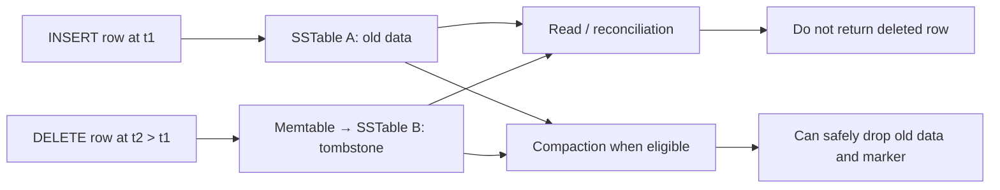
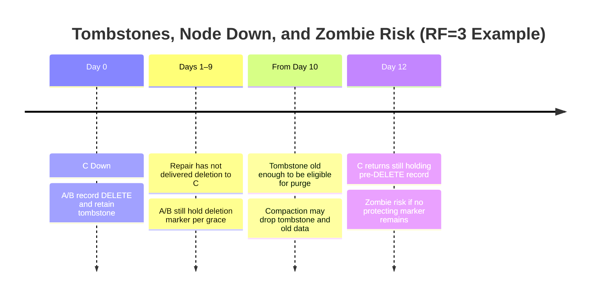

# Relationship Between Repair, Node Downtime, and Tombstone Retention Time

> **Chapter:** Tombstones and Reclamation  
> **Module:** `DATABASE_ENGINE_WIDE_COLUMN_CASSANDRA` — Apache Cassandra, a distributed wide-column database using a query-driven data model.  
> **Focus:** Why deleting a row with CQL does not mean every replica knows that row was deleted; how `gc_grace_seconds`, repair, and node downtime work together to prevent data from "coming back to life."

In Apache Cassandra, a `DELETE` statement or an expired TTL value does not necessarily erase data bytes from SSTables right away. Cassandra writes a **tombstone** (deletion marker) so replicas can reconcile data versions. If a node fails to receive the deletion marker because it is down, that node can retain the **old value**. The deletion marker must stay alive long enough for the deletion information to reach the stale node before compaction removes it.

That is why three mechanisms must be considered together:

1. **Replication and consistency level (CL):** determines which replicas receive a mutation and how many ACKs suffice for the request to succeed.
2. **Repair:** synchronizes discrepancies across replicas; helps propagate surviving deletion markers to replicas that missed them.
3. **Tombstone retention time and compaction:** establishes a protection window before tombstones are allowed to be purged; it is not an automatic schedule guaranteeing all nodes have received the delete.

A common operational mistake is seeing `DELETE` return success at `QUORUM`, waiting past `gc_grace_seconds`, and assuming the data is safe. Quorum ACKs, repair, and garbage collection are **three distinct mechanisms**. A node returning after too long an absence can still bring back old data.

## 1. Learning outcomes

After completing this lesson, you will be able to:

- Distinguish **logical deletion** during reads from **physical reclamation** in SSTables.
- Explain the relationship between `gc_grace_seconds`, node Down status, hinted handoff, anti-entropy repair, and compaction.
- Describe **zombie data** (deleted data reappearing), conditions that heighten the risk, and how to avoid it.
- Schedule repairs with a **safety margin** based on tombstone retention time and realistic outage durations.
- Analyze an RF=3, CL=`LOCAL_QUORUM` scenario and recognize why "write succeeded" does not prove every replica updated.
- Practice CQL, observe node/repair/tombstone metrics, and handle a node returning after a prolonged outage.
- Integrate safe checks and retries into a Java application.

## 2. From DELETE command to tombstones in the LSM-tree

### 2.1. Cassandra does not update all old SSTables in place

Cassandra stores data in memtables and **immutable SSTables**. A row may already have been flushed to SSTable A. When a client deletes the row, Cassandra writes a mutation representing the deletion into the active write path (commit log, memtable), which later flushes to another SSTable.

On reads, Cassandra merges cells/rows from memtables and SSTables using timestamp and deletion rules. A tombstone with an appropriate timestamp **shadows** old data, causing the row to disappear from `SELECT`, even though the old data bytes may still sit on disk.



Common deletion forms include **cell tombstones**, **row tombstones**, **partition tombstones**, **range tombstones** (deleting multiple clustering rows), and **TTL** expiry. Each type has a different shadowing scope, yet all tie into tombstone retention rules and preventing old data from returning.

### 2.2. Logical deletion differs from physical reclamation

| Point in time | CQL read | SSTable state |
|---|---|---|
| Before DELETE | Row is returned if still live | Holds data version |
| DELETE written to queried replica | Typically does not return row, as tombstone shadows old value | Old value and tombstone may coexist |
| After some compactions | Still does not return row | Some older versions are merged or dropped |
| After tombstone is **eligible** for removal and compaction processes it | Does not return row if replicas were safely synced | Corresponding bytes can be freed |
| An old replica returns under unsafe conditions | Risk of observing old data again | Old replica still holds pre-DELETE value |

**Do not infer from "SELECT returns no rows" that the tombstone has been reclaimed.** A row can be shadowed on the read path long before bytes are cleaned from SSTables.

### 2.3. Timestamps govern merging, not packet arrival time

Cassandra uses the mutation/cell timestamp for conflict resolution. Suppose:

- `INSERT` at timestamp `t1`.
- `DELETE` at timestamp `t2`, with `t2 > t1`.

When both are present, the tombstone at `t2` shadows the data at `t1`. An offline replica unaware of `t2` still retains the `t1` data version. If all relevant deletion markers are purged from healthy replicas **before the stale replica is synchronized**, the `t1` record can be treated as valid data when the old node returns.

This is the underlying mechanism behind **zombie data**, not Cassandra "failing to understand DELETE."

## 3. Replication factor and consistency level do not replace repair

Consider a keyspace with **RF=3 in datacenter `dc1`**. For a given partition, the three replicas holding data are A, B, and C.

Suppose C goes down. The application sends `DELETE` at CL `LOCAL_QUORUM`:

```text
                      DELETE row, LOCAL_QUORUM
  Client ────▶ Coordinator ────▶ A (Up) ── ACK
                      │
                      ├────────▶ B (Up) ── ACK
                      │
                      └────────▶ C (Down) ── Misses delete

               Client gets ACK because 2/3 quorum is met.
               C can still store the old record.
```

With three full replicas in the local DC, quorum is:

\[
Q=\left\lfloor \frac{3}{2} \right\rfloor+1=2.
\]

**DELETE is ACKed once 2/3 quorum is reached**; that proves the request condition in the local DC was met, not that C stored the deletion marker. After C comes back, a mechanism to deliver missed mutations, or repair to reconcile replica states, is required.

Important points:

- `LOCAL_QUORUM` only computes quorum within the local DC. In multi-datacenter setups, never assume replicas in other DCs have updated.
- `ALL` requires ACKs from all replicas yet does not solve every failure/race scenario, and makes writes unavailable when a node is Down.
- RF sets the desired replica count; it does not promise replicas are strictly synchronized at all times.
- When the node comes back Up, if reads touch both the old version and the tombstone, reconciliation can keep shadowing the old data. **The primary danger arises when the deletion marker is dropped before the old replica is repaired.**

### 3.1. Why isn't one successful read enough?

Suppose you run:

```sql
SELECT * FROM some_keyspace.some_table
WHERE partition_key = ...;
```

and get 0 rows at `LOCAL_QUORUM`. That only observes the outcome of **one read path at one point in time**. It does not prove replica C (or replicas in other DCs) was repaired. You must assess repair coverage, node state, failure history, and compaction/purge progress; read-repair on a few partitions does not replace full repair across all token ranges.

## 4. What is `gc_grace_seconds`?

`gc_grace_seconds` is a **Cassandra table property** representing the minimum duration (in seconds, evaluated under the version's garbage collection rules) that a tombstone must pass before it **may** be considered for purging during compaction.

The common default configuration in Apache Cassandra is:

```text
gc_grace_seconds = 864000
                 = 10 × 24 × 60 × 60
                 = 10 days
```

**Verify the actual value on your table and running version.** This value can be configured differently. Do not treat 10 days as a guarantee that every cluster always uses 10 days.

### 4.1. "Eligible to purge" differs from "guaranteed to be purged"

A tombstone **does not vanish on the exact final second** of `gc_grace_seconds`. Removal also depends on:

- Whether compaction runs on the relevant SSTables.
- Whether the tombstone might shadow older data in another uncompacted SSTable.
- Metadata, timestamps, safety checks, and the version's compaction policies.
- Purge-restricting options/configs, such as policies that only purge repaired tombstones in Cassandra versions that support and enable them.
- Whether snapshots/hard links retain replaced SSTable blocks.

Thus, `gc_grace_seconds` **is not a TTL** and not an active file-deletion timer. It creates a **protection window** before a tombstone can be reclaimed.

### 4.2. Why not set `gc_grace_seconds = 0` to save space?

In multi-replica systems, a node can go down or lose network connectivity. If tombstones are compacted away before that node receives the deletion, the old node returning can cause deleted data to reappear.

Setting a tiny value or 0 to fix tombstone warnings/disk pressure can **increase zombie data risk**. Only evaluate changes after understanding all version mechanics, table type, repair capability, outage durations, access patterns, and data protection mechanisms. For ordinary production tables, lowering grace as a simple optimization trick is unsafe.

## 5. Timeline of zombie data

Illustrative scenario:

- Table has RF=3.
- `gc_grace_seconds = 864000` (10 days).
- Replica C is Down when A and B receive `DELETE`.
- No hinted handoff is successfully delivered to C.
- Repair between replicas does not finish before tombstones on healthy replicas become eligible for purge.

**Note:** The milestones below are only a risk model. Cassandra does not necessarily purge tombstones on exact day 10; compaction can occur later and other conditions apply.



### 5.1. Conditions allowing data to "come back to life"

For a zombie to appear, a chain of causes is typically required:

1. Replica C **misses the delete mutation**.
2. C holds the old data version.
3. Healthy replicas **no longer retain a deletion marker sufficient to shadow** the old data due to purging/storage state.
4. C returns and exchanges data with other replicas; the old value can re-propagate via read/repair or other sync mechanisms.
5. Subsequent queries may see rows the user had deleted.

**A node being Down longer than grace does not automatically create zombies.** Risk depends on whether tombstones were actually purged, whether C truly missed deletes, and other conditions. However, it is a **severe incident signal**, never resolved by merely running a `SELECT` and letting the node resume serving.

### 5.2. A safer timeline

If C recovers on day 3 and all relevant data ranges are repaired/synchronized while the tombstone still exists, C can receive the deletion marker and no longer hold a stale copy capable of resurrecting. Afterward, compaction can process the tombstone per safety policies.

```text
Day 0      DELETE; C misses mutation
Day 3      C returns, receives valid hints or successful repair
Day 4      Coverage verified, replicas synchronized
Day 10+    Tombstone may become purge-eligible when compaction sees it is safe
```

An easy rule to remember:

> **Repair must finish in time so replicas that missed deletions receive the deletion markers before protecting markers can be dropped.**

Do not cite "repair ran" as proof. Only **repairs that completed successfully and covered all required ranges/replicas** count for prevention.

## 6. How does repair protect tombstones?

**Anti-entropy repair** compares data across replicas for token ranges, detects differences, and synchronizes discrepancies. When one replica holds a tombstone and another holds old data, repair can propagate the deletion state so the stale replica stops treating that data as live.

### 6.1. Repair is not compaction

| Mechanism | Primary scope | Goal |
|---|---|---|
| **Compaction** | SSTables on **one node** | Merge data/tombstones, reduce files, reclaim space when eligible |
| **Repair** | **Multiple replicas** of token ranges | Synchronize data discrepancies across replicas |
| **Hinted handoff** | Mutations buffered/replayed for temporarily unavailable replica | Partially compensate missed writes within the hints window |
| **Read repair** | Replicas participating in certain read paths | Fix certain discrepancies detected during reads |
| **Topology streaming** | Nodes receiving/handing off token ranges during bootstrap/replace/decommission | Place data onto the proper replicas for the new topology |

Repair can trigger streaming and lead to SSTables/compaction afterward, yet repair's job is **restoring consistency across replicas**. Compaction alone never detects that a copy on another node missed a delete.

### 6.2. Repair duration and safety margin

Let:

- `G`: actual `gc_grace_seconds` of the table, expressed in days for this problem.
- `D`: longest duration a replica can remain un-updated due to downtime/network issues.
- `R`: time from when the node becomes repairable until **full-coverage repair completes**.
- `M`: safety margin for delays, scheduling errors, retries, and clock skew.

A **cautious operational guideline**:

\[
D + R + M < G
\]

This is not a "guaranteed theorem" for all versions/topologies: per-row tombstone timestamps, compaction safety, repair mode, RF/DC, and other failure events all matter. Nevertheless, if outage duration plus actual repair time **approaches or exceeds** grace, the setup should not be considered safe.

Examples:

| Scenario | `G` | `D` | `R` | `M` | Assessment |
|---|---:|---:|---:|---:|---|
| Short node down, fast repair | 10 days | 1 day | 2 days | 2 days | 5 < 10: buffer margin remains |
| Repair takes several days | 10 days | 4 days | 4 days | 2 days | 10 = 10: zero safety margin left |
| Extended replica disconnect | 10 days | 12 days | 1 day | 1 day | 14 > 10: must treat as zombie risk |

Numbers are **hypothetical examples**, not default repair schedule recommendations for every cluster.

### 6.3. Repair must cover the right scope

An effective repair schedule must verify:

- **All relevant token ranges** are repaired per cluster policy.
- **Required replicas across relevant datacenters** are synced; do not infer from one command in one DC that all DCs are safe.
- Repair sessions **finished successfully**, rather than merely starting or timing out partway.
- New/recovered replicas have valid state to participate; if a replica is too stale, replacement/rebuilding from a trusted source may be needed instead of ordinary repair.
- **Incremental vs. full repair** configuration, tables/keyspaces, node counts, and version-specific schedules are evaluated. Do not assume one repair mode run on one node solves the whole problem.

**You cannot repair deleted data whose trace has vanished completely.** If the necessary deletion marker was already purged on every healthy source, repair has no deletion event to reconcile and "prove" the stale copy should be deleted.

### 6.4. Can repair finish while a node is still Down?

If a required replica is Down, **do not consider repair status full-coverage** just because a command was launched. Depending on repair scope/path, the task may fail, abort, or only sync participating nodes. Once the node recovers, verify coverage and run the appropriate sync workflow before declaring it safe.

Track both **last successful repair** and **longest Down node**. A dashboard showing only a green light for "repair job scheduled" will miss repairs that ran and failed.

## 7. Hinted handoff, TTL, and read repair: benefits and limits

### 7.1. Is hinted handoff enough?

When replica C is temporarily unavailable, the coordinator can store a **hint** to replay the mutation later. Hints help recover missed writes within configured windows and permitted states.

However:

- Hint retention is bounded by settings such as `max_hint_window` and version execution conditions.
- Hints may not be created/delivered in all cases; the existence of hints does not prove they were replayed completely.
- Hints do not replace full token-range repair and must not be relied upon to guarantee a node Down for multiple days received every delete.
- If old data has already "resurrected," seeing an empty hints queue proves nothing about data correctness.

**Treat hints as a short-term recovery aid, and repair as the long-term reconciliation mechanism.**

### 7.2. Can read repair prevent zombies?

Read repair (per version semantics and configuration) can fix some discrepancies when corresponding replicas are read. Yet a table with millions of partitions has vast amounts of data **never read during the grace window**. You cannot expect read repair to touch all old data, especially while a Down node does not participate in reads.

### 7.3. TTL also creates deletion-state retention requirements

A value written with `USING TTL` expires logically when its expiry time arrives. In storage, TTL/expiry metadata and tombstone semantics prevent replicas from serving expired values as live data.

Differences from explicit DELETE:

- TTL is attached to data on write under cell semantics; replicas receiving the data carry the expiry metadata.
- DELETE is a new mutation; an offline replica can miss the command altogether.
- Both create tombstone/compaction pressure; both require evaluating retention and safe purge eligibility.
- **Do not assume TTL solves the entire Down-node problem.** A replica can still miss other updates or deletes after a TTL write; design still requires proper repair and operations.

## 8. Tombstone reclamation conditions during compaction

To reclaim disk space, Cassandra needs compaction or a valid mechanism processing SSTables. However, a tombstone passing grace age is only **one of the conditions**.

### 8.1. Reasons tombstones remain after grace

1. **No eligible compaction:** the file has not been selected as an input.
2. **Old data sits in another SSTable:** dropping the tombstone alone would expose the old record; the engine must check data overlap safety.
3. **Not all data has expired by TTL:** in time-window workloads, an SSTable may still contain live data.
4. **Repair/purge-protection options:** some versions tie tombstone purge eligibility to repaired state; check your active configuration.
5. **Snapshots holding blocks:** the SSTable was replaced in active data, yet filesystem snapshots/hard links still occupy disk space.
6. **Disk/compaction backlog:** insufficient disk I/O or free output space slows or fails compaction.

### 8.2. Major compaction is not an "erase now" button

`nodetool compact` and manual compaction commands can generate heavy I/O, require temporary free space, and alter how SSTables are grouped. They **do not bypass tombstone protection conditions**.

Do not run major compactions across production just because data was DELETEd yet disk usage has not shrunk; first check sizes, snapshots, SSTable overlap, grace, repair coverage, and free space.

### 8.3. Space optimization must not break recoverability

Strategies like **TimeWindowCompactionStrategy (TWCS)** can be advantageous when time-series data is nearly immutable, shares a uniform TTL, and expired SSTables can be dropped by time window. However, if the system experiences long-term node outages, late deletes/updates, or uneven TTLs, repair safety and resurrection risk must still be weighed.

Do not switch compaction strategies just to work around `gc_grace_seconds`.

## 9. Practical scenarios and how to evaluate them

| Scenario | Data on replicas | Main issue | Reasonable action |
|---|---|---|---|
| C Down 15 min, DELETE at quorum | A/B have tombstone, C may be stale | Temporary missed mutation | Check hints and C's state; repair on schedule |
| C Down 3 days, grace 10 days | C may have missed many deletes | Need sync before purge | Run full repair, confirm completion and safety margin |
| C Down 12 days, grace 10 days | Risk that healthy replicas lost tombstones | Zombie risk if C simply rejoins | Isolate C, evaluate replacement/rebuild from trusted replicas |
| Repair ran but failed on 30% of ranges | Portion of data still unreconciled | "Job ran" is insufficient | Fix errors, rerun missing ranges, record coverage |
| DELETE quorum, other DC disconnected | Local DC has tombstone, remote may be stale | Grace applies across all replicas to protect | Verify cross-DC repair/sync per policy |
| Tombstones past grace yet disk unchanged | Files/tombstones still present | Compaction/snapshot/overlap | Inspect SSTables, compaction, and disk; avoid rushing grace changes |
| Old node returns with months-old disk | Data may carry stale timestamps | High correctness risk | Do not serve directly; follow replace/rebuild runbook |

### 9.1. Node Down past grace: handling by risk level

If a replica returns after an outage **longer than the tombstone retention period**:

1. **Keep the node isolated from cluster traffic** during assessment. Do not boot up an old disk image and let the node resume its role as if nothing happened.
2. Determine exact **Down duration**, potentially affected tables/keyspaces, each table's grace, DELETE/TTL activity, and truly completed repair history.
3. Inspect healthy replicas and backups; identify trusted data sources.
4. Consider **replacing/rebootstrapping/rebuilding the node from healthy replicas** per the Cassandra procedure for your exact version and topology. Local old data on the Down node should not be trusted by default.
5. Run verification/reconciliation and repair per runbook after recovery, monitoring tombstones and data state.
6. If resurrection is suspected, use backups/audits/business logs to identify records needing re-deletion; normal repair does not regenerate lost "deletion intent."

The steps above are a decision framework, **not an automated command sequence to paste onto a production cluster**. Procedures for replacing a node/host ID, IP, and topology are highly version-dependent.

### 9.2. Failures when repairing close to the grace deadline

If repair runs once every 7 days while grace is 10 days, a job taking 3 days or failing and retrying can **wipe out the safety margin**. Monitor:

- Repair **completion** time, not just scheduler start time.
- Percentage of token ranges/replicas truly covered.
- Maximum continuous node Down hours and network-partitioned DCs.
- Repair failure counts, backlog, and time required to rerun.
- Oldest tombstone age risking purge before repair finishes.

A periodic schedule may look good on paper yet fail to protect data if jobs repeatedly fail to complete.

## 10. CQL practice in a lab cluster

### 10.1. Create a table with known RF and grace

**Run in a lab only.** Example using one datacenter named `dc1` with enough nodes for RF=3:

```sql
CREATE KEYSPACE IF NOT EXISTS lab_delete
WITH replication = {
    'class': 'NetworkTopologyStrategy',
    'dc1': 3
};

CREATE TABLE IF NOT EXISTS lab_delete.events_by_account (
    account_id uuid,
    event_id timeuuid,
    occurred_at timestamp,
    payload text,
    PRIMARY KEY ((account_id), event_id)
) WITH CLUSTERING ORDER BY (event_id DESC)
  AND gc_grace_seconds = 864000;
```

The schema is designed to query by `account_id` (partition key); `event_id` is the clustering column. Cassandra uses the partition key to compute tokens and select replicas per the replication strategy. Thus both **DELETE** and **repair** relate to the token ranges holding this partition.

### 10.2. Insert, read, delete, then read again

```sql
CONSISTENCY LOCAL_QUORUM;

INSERT INTO lab_delete.events_by_account (
    account_id, event_id, occurred_at, payload
) VALUES (
    11111111-1111-1111-1111-111111111111,
    7c627d5a-a6b0-11ef-8ae8-0242ac120002,
    '2026-11-21 08:00:00+0000',
    'demo'
);

SELECT event_id, payload
FROM lab_delete.events_by_account
WHERE account_id = 11111111-1111-1111-1111-111111111111;

DELETE FROM lab_delete.events_by_account
WHERE account_id = 11111111-1111-1111-1111-111111111111
  AND event_id = 7c627d5a-a6b0-11ef-8ae8-0242ac120002;

SELECT event_id, payload
FROM lab_delete.events_by_account
WHERE account_id = 11111111-1111-1111-1111-111111111111;
```

If the delete is acknowledged and the read replicas reflect the deletion, the final `SELECT` will omit the row. This **does not prove** every replica stored the tombstone or that disk space was reclaimed. Verify using the repair and node-availability signals below.

To inspect the created property, run in `cqlsh`:

```sql
DESCRIBE TABLE lab_delete.events_by_account;
```

Output should show `gc_grace_seconds` matching the configured value. If a version/tool displays attributes differently, inspect the corresponding schema metadata rather than guessing.

### 10.3. Observing SSTables, compaction, nodes, and repair

Inspection/statistics commands:

```bash
nodetool status
nodetool tablestats lab_delete.events_by_account
nodetool compactionstats
nodetool tpstats
```

Look for:

- Which nodes are `UN`, `DN`, or transitioning topology; verify DC/rack and required replicas.
- SSTable count, tombstone histograms, droppable tombstone ratio, and disk usage (if displayed by your version).
- Compaction pending/active tasks, errors, or backlog.
- Repair logs: token ranges, neighbors/participants, success/failure status, and completion timestamps.
- Tombstone/slow-read warnings and timeout signals from the Java Driver.

"Droppable tombstone ratio" metrics are **estimates of reclamation potential**, not a list of tombstones guaranteed to be purged immediately.

### 10.4. Running repair following a lab procedure

In a test environment, an example **full repair** command might be:

```bash
# Syntax and scope must be checked against nodetool help for your running version.
nodetool repair --full lab_delete events_by_account
```

The command above **is not automatically a cluster-wide repair from a single run on one node**. With vnodes, datacenters, and incremental/full repair policies, you must define a schedule/scope with sufficient coverage and track results and participating nodes. Do not use this command as a "zombie cure" after tombstones have already been purged.

> Never test setting grace to 0 or taking a node Down for over 10 days in production. To verify timing, use simulations or an isolated lab and take a snapshot before injecting faults.

## 11. Fault-injection plan to test the three-way relationship

A meaningful test must record **exact timestamps, which replicas received the deletion, and tombstone state at repair time**.

### 11.1. Safe test in a multi-node lab

Suppose A/B/C are replicas of the same partition (RF=3):

1. Prepare data per section 10 CQL; verify A/B/C are all Up and replicas are synced before testing.
2. Isolate C using lab tooling and **record the Down start timestamp**; never apply network isolation in production.
3. Delete the row at `LOCAL_QUORUM` while A/B are Up; record response, timestamp, and logs.
4. Verify the application reads 0 rows while C does not necessarily know about the delete; **do not conclude C is safe**.
5. Bring C back **before the grace deadline**; check hinted handoff and run repair across sufficient scope per the lab runbook.
6. Wait for repair to complete, verify the row on appropriate read paths, and confirm C received the deletion.
7. Inspect compaction/tombstone metrics and record remaining protection time.

Another test can **simulate** a node Down longer than grace in an isolated environment. The goal is observing conditions that can cause resurrection; never use results as an excuse to delete tombstones manually or bring stale nodes into production.

### 11.2. Assertions to verify

| Aspect | Assertion |
|---|---|
| Write path | DELETE is ACKed at expected CL; request ID/timestamp logged |
| Membership | Know which node went Down and when |
| Replica state | A Down node is never assumed to have received the tombstone |
| Repair | Coverage includes the right ranges/replicas/DCs and completes successfully |
| Read correctness | No deleted rows appear in results after synchronization |
| Long outage handling | Nodes exceeding grace are isolated and recovered via safe procedure |
| Disk reclamation | Expect cleanup only when compaction qualifies; do not set exact deadlines equal to grace |
| Monitoring | Alerts fire before Down duration + repair backlog exceeds the safety margin |

### 11.3. Failure scenarios to rehearse

- Repair job fails partway through with nobody noticing.
- Node goes Down right while DELETE is being written at quorum.
- Hinted handoff exceeds the hint retention window; node comes back missing deletes.
- Network partition between two datacenters while monitoring repair only in the local DC.
- System has multiple tables with different `gc_grace_seconds` values; one table is safe while another is near deadline.
- Compaction shrinks disk usage, then application checks detect deleted data reappearing.
- Replacing a failed node from a healthy source instead of using an untrusted old disk image.

## 12. Java Driver: confirming DELETE properly without misconceptions about replicas

A Java application communicates with Cassandra via CQL and consistency levels. The client **does not write tombstones directly**, yet it must issue writes and handle timeouts carefully.

DataStax/Apache Cassandra Java Driver 4.x example:

```java
import com.datastax.oss.driver.api.core.CqlSession;
import com.datastax.oss.driver.api.core.DefaultConsistencyLevel;
import com.datastax.oss.driver.api.core.cql.BoundStatement;
import com.datastax.oss.driver.api.core.cql.PreparedStatement;
import com.datastax.oss.driver.api.core.cql.ResultSet;
import java.net.InetSocketAddress;
import java.util.UUID;

public class DeleteEventExample {
    public static void main(String[] args) {
        UUID accountId =
            UUID.fromString("11111111-1111-1111-1111-111111111111");
        UUID eventId =
            UUID.fromString("7c627d5a-a6b0-11ef-8ae8-0242ac120002");

        try (CqlSession session = CqlSession.builder()
                .addContactPoint(new InetSocketAddress("127.0.0.1", 9042))
                .withLocalDatacenter("dc1")
                .build()) {
            PreparedStatement delete = session.prepare(
                "DELETE FROM lab_delete.events_by_account " +
                "WHERE account_id = ? AND event_id = ?"
            );
            BoundStatement deleteQuery = delete.bind(accountId, eventId)
                .setConsistencyLevel(DefaultConsistencyLevel.LOCAL_QUORUM);
            session.execute(deleteQuery);

            PreparedStatement select = session.prepare(
                "SELECT event_id FROM lab_delete.events_by_account " +
                "WHERE account_id = ? AND event_id = ?"
            );
            ResultSet result = session.execute(
                select.bind(accountId, eventId)
                    .setConsistencyLevel(DefaultConsistencyLevel.LOCAL_QUORUM)
            );

            System.out.println("Found after delete: " +
                               (result.one() != null));
        }
    }
}
```

With RF=3 in `dc1` and enough healthy replicas, a successful DELETE at `LOCAL_QUORUM` indicates **the write path satisfied quorum**, not a certificate of completed repair.

### 12.1. A timeout does not tell whether DELETE failed

If the client times out:

- The mutation may already have reached one or more replicas.
- Some replicas may have stored the deletion, while the client did not receive enough ACKs.
- Unbounded retries can increase load and create new timestamps, interacting with concurrent writes.
- For business flows requiring deletion assurance, log request IDs/audits, define retry/idempotency policies, and add a source-state reconciliation step.

Reading 0 rows after a retry is only an application-level observation; cluster operations must still ensure Down nodes are repaired before tombstones can purge.

### 12.2. Query-driven table design and TTL

When a Java application writes multiple tables serving different query patterns (for instance, `events_by_account` and `events_by_type`), it must update/delete in **each table** with proper semantics. Tombstones and `gc_grace_seconds` apply per table and may differ. Repairing one table does not prove an application-derived table is consistent with business state.

Have an audit/CDC mechanism or reconciliation job for self-managed views, in addition to Cassandra repair.

## 13. Monitoring and response runbook

### 13.1. Before an incident

1. Document `gc_grace_seconds` of critical tables, RF per DC, application CLs, and repair strategy.
2. Establish a repair schedule ensuring **completion within grace with a buffer margin**; alert on failed/partial jobs or duration overruns.
3. Track continuous node Down durations and age of most recent repair coverage.
4. Maintain backups/snapshots and node replacement/rebootstrap procedures verified on the exact Cassandra version.
5. Monitor disk space, SSTables, tombstones, and compaction backlog; avoid compaction stalls caused by full disks.
6. Designate owners to approve node replacement or sensitive data handling; never reset grace just to "clean disk."

### 13.2. When a node is Down

1. Identify node/host ID, Down timestamp, token ranges, and datacenter.
2. Check remaining quorum, error rates/timeouts, and whether applications are still generating DELETE/TTL activity.
3. Estimate **time remaining before the grace threshold** on affected tables; factor in repair time and margin.
4. If Down duration is short, restore connectivity and complete repair/reconciliation per policy.
5. If past or approaching grace, **do not let the old node rejoin automatically** without evaluation; consider replacing/rebuilding from healthy replicas.
6. Preserve logs and event timestamps to support investigation if zombies are suspected.

### 13.3. After recovery

1. Confirm required replicas are Up/Normal and topology is accurate.
2. Confirm repair **succeeded across required scope** with no leftover partial work.
3. Cross-check samples of deleted records, TTLs, multiple DCs, and related derived tables.
4. Monitor for zombie data or reappearing events via business audits/reports.
5. Watch compaction, disk headroom, and tombstone statistics; do not expect bytes to drop right at the `gc_grace_seconds` mark.
6. Update repair schedules, alert thresholds, and assumptions about maximum allowed node Down duration.

## 14. Calculation and analysis exercises

### Exercise 1 — Timeline

A table has `gc_grace_seconds = 864000`. C is Down for 4 days, repair after C returns takes 3 days, and operational margin needs 2 extra days. Compute total `D + R + M` and compare with `G`. If one repair task fails and needs an extra 3 days to rerun, what changes?

### Exercise 2 — Why is QUORUM not enough?

RF=3 in `dc1`, A/B Up, C Down; client executes DELETE at `LOCAL_QUORUM` and receives success. Which statement is true: (a) all replicas deleted the row; (b) two ACKs in the local DC sufficed for client success; (c) tombstones were definitely purged? Explain.

### Exercise 3 — Zombie data

A/B once held a tombstone, C missed DELETE. A/B compact and purge the tombstone after grace; later C returns. Sketch the sequence of events that can cause old data to reappear. If A/B **still hold the tombstone**, does the risk conclusion change?

### Exercise 4 — Hinted handoff and repair

Why does an empty hints queue **not** prove C received every delete? What information is needed to evaluate repair coverage?

### Exercise 5 — TTL and disk size

A table uses a 7-day TTL; after day 8, the application reads no old data, yet disk usage barely drops. Give at least three reasons unrelated to TTL "not working."

### Exercise 6 — Node returning too late

A node was disconnected for 15 days, several tables have a 10-day grace, and the last repair occurred before the node went Down. Should you turn the node back on, run `nodetool repair`, and conclude it is safe? Propose an investigation and recovery plan.

### Answer hints

1. `D + R + M = 4 + 3 + 2 = 9` days, less than 10 yet with a very thin margin. If repair needs 3 extra days, total becomes 12, exceeding grace: no safety margin remains.
2. **(b)**. `LOCAL_QUORUM` proves the 2/3 ACK condition in the local DC, not that C knows about the delete or that tombstones were cleaned.
3. If all deletion markers were dropped, `t1` data from C no longer has tombstone `t2` to shadow it and can re-propagate. If markers remain on healthy replicas, synchronization of the deletion may still be possible, though actual state must be verified rather than assumed safe.
4. Hints have retention windows and delivery conditions and can be missing or unapplied. You need per-session repair status, token ranges, participating replicas/DCs, completion times, and any failures.
5. Tombstones not yet purge-eligible, compaction has not run/touched relevant SSTables, SSTables mix live data, snapshots hold blocks, or disk/compaction backlog.
6. **No.** Keep the old node isolated, inspect healthy sources, logs/backups/repair history, and evaluate replacement/rebootstrap per your version's runbook; business reconciliation may be needed if zombie data is suspected.

## 15. Key takeaways

- Cassandra writes deletion markers to represent `DELETE` and expiry; **logical deletion** generally occurs before **physical reclamation**.
- With RF=3, DELETE at `LOCAL_QUORUM` can succeed while one replica is Down; that replica can still retain old data.
- `gc_grace_seconds` is the **minimum protection window before a tombstone can be purged**, not a guarantee it vanishes after exact seconds or that all replicas are synced.
- **Repair must actually complete in time** and cover sufficient ranges/replicas/DCs to propagate missed deletions. Hints, read repair, or one successful SELECT do not fully replace anti-entropy repair.
- If a node is offline past the tombstone retention time, do not let the old replica return unconditionally: **zombie data** can occur when tombstones are purged and stale values re-propagate.
- Compaction reclaims files/tombstones when eligible; it does not repair other replicas on its own and cannot recreate lost deletion intent.
- Sustainable design and operations require combining **query-driven schema, appropriate RF/CL, repair with a safety margin, Down-node monitoring, backups, and a node-replacement runbook**.
