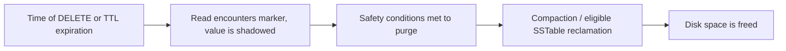
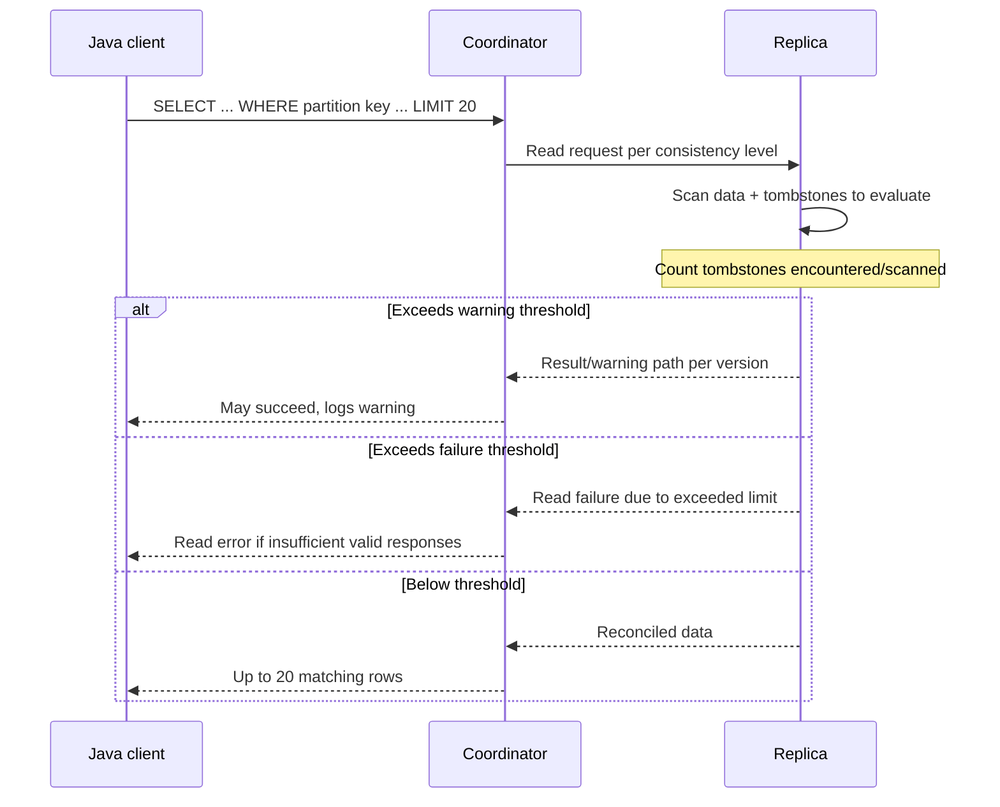

# Warning and Failure Thresholds When Reading Too Many Tombstones in Apache Cassandra

## 1. Why can a query returning few rows still fail?

In **Apache Cassandra**, a `DELETE` statement usually does not erase data from disk right away. It writes a **tombstone** — a timestamped deletion marker — so replicas know the old value is no longer valid. Data with a **TTL** can also become expired data and be processed like tombstones on the read path. **Compaction** later gets the opportunity to reclaim invalidated data when safety conditions are satisfied.

Suppose a table holds millions of expired sensor records. The application requests:

```sql
SELECT event_time, payload
FROM iot_lab.events_by_device
WHERE device_id = 'sensor-42'
LIMIT 20;
```

Even though the client only requested at most **20 live rows**, Cassandra may have to walk through tens or hundreds of thousands of deletion/expiration markers while searching for matching rows. The number of records **returned** does not directly reflect the number of entries **scanned**. Too many tombstones in a single read drive up CPU, I/O, and latency, and can trigger **warnings** or **read failures** when configured thresholds are exceeded.

This lesson belongs to the **Tombstones and Reclamation** chapter of the `DATABASE_ENGINE_WIDE_COLUMN_CASSANDRA` module, connecting to distributed architecture, partition keys, query-driven table modeling, CQL, replication, compaction, repair, incident operations, and the Java Driver. The focus is:

1. Understand `tombstone_warn_threshold` and `tombstone_failure_threshold`, and what they count.
2. Know why `LIMIT`, TTL, and a large partition can trigger errors even when a query looks small.
3. Observe logs, metrics, CQL, and `nodetool` to isolate hot queries/partitions.
4. Remediate with safe query and data-lifecycle design, **not** merely raising thresholds to hide errors.
5. Monitor from the Java application, classify errors, and verify improvements against SLOs.

## 2. How do tombstones appear and persist?

### 2.1. Common sources of tombstones

| Source | What happens logically | Note |
| --- | --- | --- |
| Row/column/partition `DELETE` | Creates a timestamped deletion marker to shadow old data | Deleting many rows by clustering range can create a **range tombstone** |
| `USING TTL` or `default_time_to_live` | Data expires after configured duration | TTL expiry does not mean freeing bytes on disk immediately |
| Collection updates, element-delete operations | Can generate tombstones depending on type and operation | Large collections and repeated replacements are always worth checking |
| Writing `null` to a column in supported CQL contexts | Typically carries value-deletion semantics | Must be distinguished from omitting the column from the statement |
| Periodic/batch deletes | Accumulates deletion markers in frequently read key ranges | Large batches do not automatically make deletion cheaper |

SSTables in Cassandra are **immutable** structures: a delete command cannot go to every copy of an old value and edit it in place. Tombstones must be stored and propagated through reads, writes, and repairs to prevent old data from a replica that missed the delete from "coming back to life."

### 2.2. Three milestones you must not confuse



- **Logically deleted:** a semantically valid query no longer returns the deleted data.
- **Physically reclaimable:** time and safety conditions involving tombstones, other SSTables, replicas, and repair policy are satisfied.
- **Physically reclaimed:** compaction or SSTable reclamation has actually completed; space may still be held by snapshots/backups.

`gc_grace_seconds` relates to the minimum time deletion markers must generally be retained in traditional workflows to avoid zombie data when replicas go offline. It is **not** a "file-deletion timer," and passing that milestone does not mean bytes vanish right away. Safety reclamation mechanics in newer Cassandra versions may have extra conditions; always verify against the running version.

## 3. Where are thresholds enforced in the read path?

Cassandra reads from memtables and SSTables that may hold the requested partition/range; data and tombstones are reconciled by timestamp/deletion precedence. When a replica executes the read path, it may have to scan many tombstones even when very few live rows are returned.



This diagram is a **conceptual model**, not every protocol phase/read repair detail of every Cassandra release. Counting and threshold checks happen during read processing on the server/replica; the final outcome reaching the client also depends on version, replicas, consistency level, and ability to gather enough responses.

### 3.1. Two thresholds to distinguish

| Common setting name in `cassandra.yaml` | Role | Typical behavior |
| --- | --- | --- |
| `tombstone_warn_threshold` | **Warning** mark when a read path scans many tombstones | Logs an appropriate server/client warning; the query **can still succeed** |
| `tombstone_failure_threshold` | **Abort/reject** mark for a read scanning too many tombstones | Can trigger a "too many tombstones" error or read failure |

In many Cassandra 3.x/4.x versions, commonly seen reference values are **1,000** for warning and **100,000** for failure. These are **historical illustrative marks**, **never assumed defaults for your running version or distribution**. Check the configuration file, documentation, and exact option keys of your real release. Detailed counting mechanics (such as cell tombstones, range markers, expired data) can also vary across versions; never convert "100,000 tombstones" straight into "100,000 DELETE statements."

Configuration example to **read and understand**, not a guide to paste directly into production:

```yaml
# Verify defaults and option names for your exact Cassandra version.
tombstone_warn_threshold: 1000
tombstone_failure_threshold: 100000
```

With these two values:

- Read path scanning below warning threshold: typically no dedicated tombstone count warning.
- Read path scanning above warning threshold yet below failure threshold: can return valid data **with a warning**; slow or resource-heavy requests still require investigation.
- Read path exceeding failure threshold: Cassandra can proactively **fail the read** to prevent the query from putting excessive pressure on the node.

Verify boundary **`>` vs. `>=`**, counting rules, error reporting, and warning behavior in the code/docs of your exact version; never treat a threshold as a guarantee that a query sitting just below the limit is fast and safe.

### 3.2. It counts scanned tombstones in a query, not total tombstones in the table

Distinguish carefully:

| Metric | Question answered | Do not infer |
| --- | --- | --- |
| Tombstones **scanned in a read** | How many deletion markers did one request execution walk through? | Does not reflect total deleted data across the whole table |
| Tombstones **existing on disk** | How many deletion markers/expired values sit in SSTables? | Does not mean every query must scan all of them |
| Tombstones **purged** | Markers physically removed by compaction when safe | Does not necessarily reduce read failure rates for a query hitting a bad partition |
| **Live rows returned** | How many rows did the application receive? | Does not represent scan cost at the replica |

A table holding many tombstones where the application always reads a very small partition may rarely hit warnings. Conversely, a single partition holding lots of expired data in a frequently read slice can trigger warnings even if the table-wide tombstone total is modest.

## 4. Why don't LIMIT or paging guarantee avoiding thresholds?

Suppose partition `sensor-42` stores time-ordered data:

```text
Partition sensor-42, clustered by event_time:
[expired][expired][expired] ... 80,000 entries ...
[deleted][deleted] ... 40,000 entries ...
[live][live] ... 20 entries ...
```

A `LIMIT 20` query must find **20 live rows** matching the condition. If most entries preceding the live data region were deleted or expired, the engine still has to walk past a massive number of tombstones. Several different cases:

| Query style | What it bounds | Limitation |
| --- | --- | --- |
| `LIMIT 20` | Number of matching rows returned | Does not directly cap tombstones inspected |
| Paging/fetch size | Rows per page at protocol/client layer | Does not guarantee each page scans only a few tombstones |
| `WHERE` with full partition key + narrow clustering range | Narrows the search region | Still must scan tombstones within that region |
| Multi-partition query or `ALLOW FILTERING` | Can widen the scan scope | Easily amplifies cost; not a tombstone cure |
| `COUNT(*)` over a large scope | Requests logical row count | Can scan huge amounts of data/tombstones; usually unsuitable for OLTP |

**Changing clustering order** or filtering with a clustering predicate only helps when it matches how the application actually queries. You cannot use `ORDER BY` to arbitrarily override partitioning rules; Cassandra enforces query bounds via partition and clustering keys.

## 5. Concrete scenario: TTL on an unbounded partition

### 5.1. An error-prone design

Example from an event-storage system:

```sql
-- Run in a lab keyspace; adjust DC to match your cluster.
CREATE KEYSPACE IF NOT EXISTS iot_lab
WITH replication = {
    'class': 'NetworkTopologyStrategy',
    'dc1': 3
};

CREATE TABLE IF NOT EXISTS iot_lab.events_by_device (
    device_id text,
    event_time timestamp,
    event_id uuid,
    payload text,
    PRIMARY KEY (device_id, event_time, event_id)
) WITH CLUSTERING ORDER BY (event_time DESC, event_id ASC)
  AND default_time_to_live = 604800;
```

TTL = **604,800 seconds (7 days)**. With this schema, **all events of the same device** belong to **one partition** because `device_id` is the sole partition key. A device emitting continuously over months can accumulate huge historical spans, many SSTables/versions, and expiration markers. Even though TTL limits **live** rows, it does not automatically keep the physical partition small right away.

A query that looks reasonable yet becomes dangerous when the newest region also holds many expired/deleted events:

```sql
SELECT event_time, payload
FROM iot_lab.events_by_device
WHERE device_id = 'sensor-42'
LIMIT 20;
```

Under another assumption, if the newest data is always live, that query can return quickly. The lesson is not "every `LIMIT` scans all of history," but rather **you must measure the actual read path**. If an application runs `SELECT` across old time ranges or frequently deletes within the queried range, that same partition easily drives high tombstone scans.

### 5.2. Illustrating thresholds with hypothetical numbers

Suppose on one replica, a read has to scan:

| Case | Tombstones scanned | Live rows returned | Possible outcome with 1,000 / 100,000 thresholds |
| --- | ---: | ---: | --- |
| A | 120 | 20 | Below warning threshold |
| B | 4,500 | 20 | Warning; may succeed |
| C | 125,000 | 3 | Read error due to exceeding failure threshold |

Numbers are **hypothetical for explanation**, not benchmark results. Scan counts rise due to data/tombstone distribution, not solely returned row counts. A read failure on one replica may not fail the coordinator when multiple replicas exist and consistency level allows gathering enough responses; conversely, depending on circumstances the client may receive an error even though another replica had healthy data. Hence inspect **per-node logs and actual consistency level**.

## 6. Fixing via table modeling: partitioning by day

One approach for time-based events is adding a day bucket to the **partition key**:

```sql
CREATE TABLE IF NOT EXISTS iot_lab.events_by_device_day (
    device_id text,
    event_day date,
    event_time timestamp,
    event_id uuid,
    payload text,
    PRIMARY KEY ((device_id, event_day), event_time, event_id)
) WITH CLUSTERING ORDER BY (event_time DESC, event_id ASC)
  AND default_time_to_live = 604800
  AND compaction = {
      'class': 'TimeWindowCompactionStrategy',
      'compaction_window_unit': 'DAYS',
      'compaction_window_size': '1'
  };
```

Now `(device_id, event_day)` identifies the partition. Querying one day's events:

```sql
SELECT event_time, event_id, payload
FROM iot_lab.events_by_device_day
WHERE device_id = 'sensor-42'
  AND event_day = '2026-11-21'
  AND event_time >= '2026-11-21T08:00:00Z'
  AND event_time <  '2026-11-21T09:00:00Z'
LIMIT 100;
```

The full partition key predicate and `event_time` clustering slice narrow the read scope. To fetch multiple days, the application **explicitly** queries each daily partition, merges results in the desired order, and applies load limits. Never try to work around this with `ALLOW FILTERING` over the whole table.

### Considerations before changing schemas

- **Partition size:** if a device produces millions of events/day, daily buckets may still be too large; split by hour or controlled shard, then handle read fan-out.
- **Time-based reads:** the new partition key requires the application to know `event_day`; querying by `device_id` without the day will no longer work.
- **TWCS is no silver bullet:** it suits mostly append-only data, uniform TTLs, and consistent write timestamps. Late arrivals, updates to old data, or SSTables holding multiple time generations can reduce old-file reclamation.
- **Data migration:** `CREATE TABLE` does not automatically move data from the old table. Migrating requires a backfill plan, dual-write/cutover, consistency checks, testing, and rollback.
- **TTL & repair:** you still need a valid repair schedule and enough disk headroom; never use new buckets as an excuse to turn off tombstone protection.

For Java applications, batching lots of events into a gigantic partition or repeatedly writing/deleting collections can also create expensive read paths; review the query model and data lifecycle before tuning thresholds.

## 7. Diagnosing from logs, metrics, and nodetool

### 7.1. Identifying which queries and replicas scan many tombstones

When receiving warnings or read failures:

1. Record **timestamp, keyspace, table, CQL shape, consistency level, page size, timeout, and rows returned**; keep sensitive data safe.
2. Check Cassandra logs on **the involved replicas** around the same timestamp. Warnings usually mention scanned tombstone counts or thresholds; exact messages vary by release.
3. Separate **too many tombstones** from general timeouts, unavailable replicas, read repair, GC pauses, or saturated disk I/O. A `ReadFailure` stack trace alone is not definitive proof.
4. Correlate logs with **p95/p99 latency**, GC, I/O, compaction backlog, partition size, and TTL/DELETE timing.
5. Capture sample queries and failing partitions; check whether non-failing partitions share the same model/TTL.

**Simulated** log example, not a fixed Cassandra format:

```text
WARN  ... Read scanned 8400 tombstones for
          iot_lab.events_by_device device_id=sensor-42
ERROR ... Tombstone read threshold exceeded: scanned=122000
```

What matters are **scanned counts**, **keyspace/table**, **query shape**, and **logging node**. Never paste real keys, customer data, or confidential request payloads directly into public tickets.

### 7.2. Properly scoped inspection commands

Run on nodes where observation is permitted; field names can vary across Cassandra versions:

```bash
# Cluster health and load distribution.
nodetool status iot_lab

# SSTable count, disk usage, latency, and tombstones/slice if supported by version.
nodetool tablestats iot_lab.events_by_device

# Partition size and read/write distributions; not a direct tombstone histogram substitute.
nodetool tablehistograms iot_lab events_by_device

# Compaction backlog/queues and active compaction work.
nodetool compactionstats
nodetool tpstats
```

Useful fields in `tablestats` in many versions include **Average tombstones per slice (last five minutes)**, **Maximum tombstones per slice (last five minutes)**, **SSTable count**, **Space used (live)**, and **Read latency**. Not every version emits all fields or identical units; record **version, field name, time window, and sample count**. A low average metric can hide a hot partition with extreme tombstone scan counts; rely on histograms/percentiles and per-request logs.

In environments with JMX/Prometheus, look for per-table metrics such as **TombstoneScannedHistogram** and **LiveScannedHistogram** (JMX names/paths vary by release), alongside read latency, request failures, and compaction. **Server-side** metrics do not match end-to-end Java client latency.

### 7.3. Selective tracing in a lab

Tracing a query can show read execution steps. In **cqlsh** in a lab environment:

```sql
TRACING ON;

SELECT event_time, payload
FROM iot_lab.events_by_device
WHERE device_id = 'sensor-42'
LIMIT 20;

TRACING OFF;
```

Tracing adds overhead and may record query contents and debug details. **Never enable tracing broadly under high load**. Tracing helps observe query behavior, yet cannot replace all logs/metrics; one clean trace does not negate p99 spikes or errors happening on a different partition.

## 8. Four common causes of heavy tombstone scans

| Cause | Symptom pattern | Evidence to look for | Remediation direction |
| --- | --- | --- | --- |
| Wide partition, TTL-expired data | Slow scans over a large partition/clustering range, high tombstone logs | Partition size, TTL, SSTable count, clustering slice | Partition by time/shard, narrow ranges |
| Daily range or multi-row deletes | After a `DELETE` job, the same query slows down | Job timing, range tombstones, deleted row counts | Design data lifecycle, delete by suitable bucket/partition |
| Broad scans / `ALLOW FILTERING` | p99 grows with table size while returned rows stay small | Query shape, missing partition key, scan metrics | Add query-serving table with proper keys, remove uncontrolled scans |
| Tombstones unpurged due to compaction/repair | Past TTL long ago yet SSTables still hold markers | `tablestats`, `compactionstats`, repair state, TTL/gc grace | Check compaction strategy, purge safety, repair schedule |

Causes can occur simultaneously. For example, a bulk delete job generates tombstones and a `COUNT(*)` query scans broadly while compaction backlog piles up due to disk saturation. Simply raising `tombstone_failure_threshold` can let queries keep burning resources longer and impact other users.

## 9. Warnings vs. read failures: application impact

A **warning** means the server flagged an expensive read path; it does not necessarily raise an exception on the client. Conversely, upon hitting a **read failure** condition, the API may surface an error depending on replica responses and consistency level.

| Situation | Possible CQL response | What should the application do? |
| --- | --- | --- |
| Many tombstones, below warning | Normal result | Still monitor p99, scan histograms, partition sizes |
| Above warning, below failure | Result can still succeed; server/driver warning | Log warnings, inspect query/schema, prioritize fixing before hitting failure |
| Replica exceeds failure | Coordinator may return read failure when valid responses fall short | Capture traces, classify errors; do not retry the same query infinitely |
| Request timeout from I/O/GC | Timeouts are not necessarily caused by tombstones | Check root cause, metrics, network, query, and logs |
| Only one partition fails repeatedly | Other requests on the table still succeed | Investigate data distribution/hot keys, not just table-wide averages |

For a failing request, raising consistency level, lowering consistency level, or switching coordinators **does not cure tombstones**. Those change guarantee levels and read behavior; the core issue is **the volume of useless data scanned**.

### Should you retry?

Retrying can make sense for transient errors within known bounds, yet reading the exact same partition/range that tripped the tombstone failure threshold usually **will not heal itself** on retry. Infinite or synchronized retries can worsen CPU/disk I/O. Instead:

1. Enforce retry limits, backoff/jitter, and circuit breakers aligned with SLOs.
2. Surface `read failure` or `timeout` explicitly; never assume it means "no data exists."
3. If product rules allow, split requests by **meaningful keys/ranges** rather than silently skipping ranges and returning incomplete results without notice.
4. Fix the underlying query and data model; test on simulated data with production-like tombstone density.

## 10. Java Driver 4.x pattern: measuring and classifying errors

The example below queries a daily partition, fixes the consistency level, and captures end-to-end timing. Uses Java 17+ for text blocks; `CqlSession session` is assumed already configured with local DC and proper authentication.

```java
import com.datastax.oss.driver.api.core.DefaultConsistencyLevel;
import com.datastax.oss.driver.api.core.cql.BoundStatement;
import com.datastax.oss.driver.api.core.cql.PreparedStatement;
import com.datastax.oss.driver.api.core.cql.ResultSet;
import com.datastax.oss.driver.api.core.cql.Row;
import com.datastax.oss.driver.api.core.servererrors.ReadFailureException;
import com.datastax.oss.driver.api.core.servererrors.ReadTimeoutException;
import java.time.Instant;
import java.time.LocalDate;

PreparedStatement prepared = session.prepare("""
    SELECT event_time, event_id, payload
    FROM iot_lab.events_by_device_day
    WHERE device_id = ? AND event_day = ?
      AND event_time >= ? AND event_time < ?
    LIMIT 100
    """);

BoundStatement statement = prepared.boundStatementBuilder()
    .setString(0, "sensor-42")
    .setLocalDate(1, LocalDate.of(2026, 11, 21))
    .setInstant(2, Instant.parse("2026-11-21T08:00:00Z"))
    .setInstant(3, Instant.parse("2026-11-21T09:00:00Z"))
    .setConsistencyLevel(DefaultConsistencyLevel.LOCAL_QUORUM)
    .build();

long start = System.nanoTime();
try {
    ResultSet rs = session.execute(statement);
    int rows = 0;
    for (Row row : rs) {
        rows++;
    }
    long latencyNs = System.nanoTime() - start;
    // Record latency histogram, rows, table, shape, request-id, CL.
} catch (ReadFailureException error) {
    // Read failure: check server logs to distinguish tombstones from other causes.
    long latencyNs = System.nanoTime() - start;
    // Log request-id, error type, coordinator, anonymized key, latencyNs.
    throw error;
} catch (ReadTimeoutException error) {
    long latencyNs = System.nanoTime() - start;
    // A timeout does NOT by itself prove tombstone_failure_threshold was exceeded.
    throw error;
}
```

Measure both successful and failed requests; note that iterating through the entire `ResultSet` can trigger paging, making measured time differ from just calling `.one()`. For production telemetry, combine Java Driver histograms, slow query logs, Cassandra metrics, and synchronized timestamps. The code snippet is an illustrative core, omitting `main`, session lifecycle, PII security, and metrics frameworks.

**Note:** the exact exception class depends on the Cassandra/driver response path. Seeing `ReadFailureException` is not enough to conclude tombstones caused it; correlate with server logs/metrics. Never lump every read error under a "tombstone failure" label.

## 11. Raising thresholds: a controlled last resort, not a root-cause fix

These two configuration keys are **self-defense mechanisms** for nodes. Raising the failure threshold can let a read keep scanning massive volumes while **amplifying latency and resource pressure** on a loaded cluster. Lowering thresholds too aggressively can fail valid queries that are legitimately expensive yet within SLOs.

Procedure for evaluating a threshold change, if genuinely necessary:

1. **Prove the cause:** gather "scanned tombstones" logs, histograms, and query shapes; distinguish scan warnings from other infrastructure faults.
2. **High-priority fixes first:** shrink scan scope with narrower partitions/ranges; inspect TTLs, deletions, compaction backlog, and repair. Re-measure before deciding to touch thresholds.
3. **Assess risk:** load-test concurrently with heavy queries; record CPU, GC, disk I/O, p95/p99, timeouts, free disk, and replica pressure.
4. **If adjusting:** pick a justified value, bound scope/load/maintenance window, and roll out uniformly per **exact version** procedures. Verify restart or dynamic reconfiguration requirements of your running release.
5. **Monitor and roll back:** define SLOs and rollback triggers if tail latency, disk/CPU, or read failures on other workloads rise; document before/after configurations.

**Never** disable safety guards outright or set them arbitrarily huge to "clear errors." That only turns a fast-failing dangerous query into a prolonged resource drain. Treat warnings as **early signals to investigate**, not "log noise" to silence by arbitrarily bumping limits.

## 12. Compaction, gc_grace_seconds, and repair: improving without creating zombies

### 12.1. Why can compaction help?

When SSTables containing deleted/expired records are merged, the engine can drop old versions and tombstones that **meet safety conditions**, thereby reducing data to scan. However:

- Not all SSTables are picked at once; STCS, LCS, TWCS/UCS decide grouping priorities.
- A tombstone may still need retention because another unmerged SSTable holds shadowed data.
- Repaired/unrepaired/pending-repair files may sit in separate compaction groups.
- Space is freed only when old files lose all references and related snapshots/backups are handled per policy.

Never run `nodetool compact` or major compactions casually in production expecting to "wipe all tombstones clean." Heavy compaction generates I/O load, requires temporary disk space, and on TWCS tables can disrupt time-window organization.

### 12.2. Why not set gc_grace_seconds = 0 as a knee-jerk reaction?

Suppose two replicas A, B hold an old value; B is offline when A receives DELETE. If the tombstone on A is purged too early, B returns carrying the old value with no deletion marker left to reconcile against; that is **zombie data** risk. In setups requiring periodic repair, repair cadence and allowed replica offline duration must align with tombstone retention. Newer safety features may alter specific conditions, yet **never deduce safety from a single parameter**.

If you want to reduce tombstone retention time, evaluate Cassandra version, complete repair mechanics, replica state, compaction strategy, and deletion semantics. Only change parameters after review, backups, measurement, and understanding risks.

### 12.3. When is TWCS helpful?

For mostly append-only time-series data with uniform TTLs and matching timestamps, **TimeWindowCompactionStrategy** groups data by time window. When an entire SSTable truly expires and meets conditions, Cassandra can reclaim the file more efficiently. Yet TWCS does not remove all tombstones immediately and cannot fix a query missing its partition key. Late writes, updates to old data, and timestamps spanning multiple windows reduce TWCS benefits.

## 13. Production incident troubleshooting runbook

| Step | Action | Evidence to retain |
| --- | --- | --- |
| 1. Confirm | Locate specific tombstone warning/error logs; note version and both threshold settings | Timestamp, node, keyspace/table, scanned count |
| 2. Scope | Group errors by query shape, partition key/hot key, clustering range, CL | Request-id, metrics, affected request rate |
| 3. Check resources | Cross-check CPU, heap/GC, disk I/O, compaction backlog, read p99 | Per-node and per-DC timeseries |
| 4. Relieve pressure | Cap concurrency/retries of bad queries, use proper partition/range queries, enable product-permitted fallbacks | SLOs, error rates, and throughput after shedding |
| 5. Fix root cause | Review TTL/delete patterns, partition sizes, TWCS/compaction, data model, and repair | Migration/test/rollback plan |
| 6. Verify | Replay equivalent workload; compare tombstones scanned, p95/p99, timeouts, resources | Before/after, raw logs, and metrics |

### Signals requiring prioritized action

- Repeated warnings spiking on a few hot partitions, especially alongside rising p99 and CPU.
- Read failures with explicit tombstone messages; requests returning only a few rows while replicas scan tens of thousands of markers.
- Rising compaction backlog and SSTable counts, shrinking free disk, and growing query errors over time.
- A delete job or TTL change suddenly altering warning rates.

### Actions that should NOT be treated as fixes

- Increasing `LIMIT` or using tiny page sizes hoping the engine skips tombstones.
- Using `ALLOW FILTERING` or `COUNT(*)` on large tables for a "quick check."
- Infinite retries of the same query or repeatedly deleting/recreating the same partition.
- Lowering consistency level without understanding business read requirements.
- Manually deleting SSTable files or setting `gc_grace_seconds = 0` to force tombstones away.
- Raising failure thresholds very high and declaring the issue solved.

## 14. Lab practice and evaluation criteria

**Suggested lab:**

1. Create `events_by_device` and `events_by_device_day` as in the examples, adjusting `dc1` and RF for your test cluster; never test on customer data.
2. Write a test loader generating a sufficiently large number of events: one group of partitions with short TTL / heavy deletes, and a control group with intact data. Record total row counts before expiration.
3. After TTL expires, run `SELECT` with the same `LIMIT` while varying partition scope and clustering range. Measure client p50/p95/p99, rows returned, warnings/errors, server tombstone histograms, and CPU.
4. Compare queries on a long partition against daily-bucket queries; **keep load, consistency level, logical data, and environment equivalent** as closely as possible. Analyze why returned row counts match while scanned entries differ.
5. Observe `nodetool tablestats`, `compactionstats`, and logs before/after background compaction runs. Do not force heavy ops just to make charts look nice; unpurged data must be explained via time/safety conditions.
6. Try increasing offered load/concurrency within lab limits to understand warning/failure behavior; never tweak thresholds to induce errors in production.

**Result table template** (fill in real measurements, never use dummy numbers as results):

| Configuration | Read p99 | Tombstones scanned p95/p99 | Warnings/s | Read failures/s | CPU/disk |
| --- | --- | --- | --- | --- | --- |
| Long partition + TTL, wide read | … | … | … | … | … |
| Long partition + narrow clustering range | … | … | … | … | … |
| Daily partition + time range | … | … | … | … | … |

If the tombstone histogram does not emit the exact requested percentiles, record the actual metric name and observation window — never fabricate p95/p99. A remediation is only meaningful when it **reduces scanned tombstone volume or SLO impact**, not merely when warning messages disappear.

## 15. Self-check questions

1. Why can `SELECT ... LIMIT 20` still hit `tombstone_failure_threshold`?
2. How do `tombstone_warn_threshold` and `tombstone_failure_threshold` differ in purpose and client impact?
3. In a 100-million-row table, is a large table-wide tombstone count enough to conclude every query is slow?
4. After TTL expires, why might SSTable bytes not drop and warnings not vanish immediately?
5. What causes besides tombstones can produce `ReadTimeoutException` or `ReadFailureException`?
6. Why can changing the partition key from `device_id` to `(device_id, event_day)` reduce scan scope?
7. Should `gc_grace_seconds = 0` be set to remove tombstones fast? What safety conditions must be checked?
8. Why can TWCS work well for TTL time-series yet perform poorly with late-arriving data or historical updates?
9. When a query starts crossing warning thresholds without failing yet, what metrics/logs should be captured to act proactively?
10. Why can raising the failure threshold turn an easily spotted error into a larger resource problem?

## 16. Conclusion

**Tombstone warning/failure thresholds are protective bounds on Cassandra's read path**, tied to **how many tombstones a replica must scan to fulfill a request**, not merely how many rows are returned or total markers in a table. `tombstone_warn_threshold` is an early signal of expensive queries; `tombstone_failure_threshold` can block overly heavy reads. Both must be interpreted according to your **exact version and actual configuration**.

The sustainable solution is **query-driven partition/clustering modeling, narrow enough read scopes, proper TTL/deletes, and safe compaction and repair**, combined with Java application logs/metrics and SLOs. **Never treat raising thresholds or prematurely purging tombstones as a substitute for fixing an overloaded read path.**
