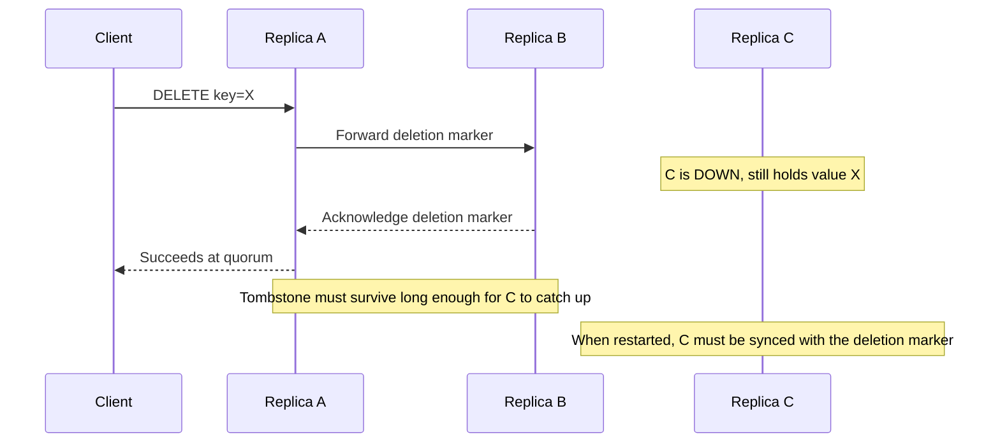
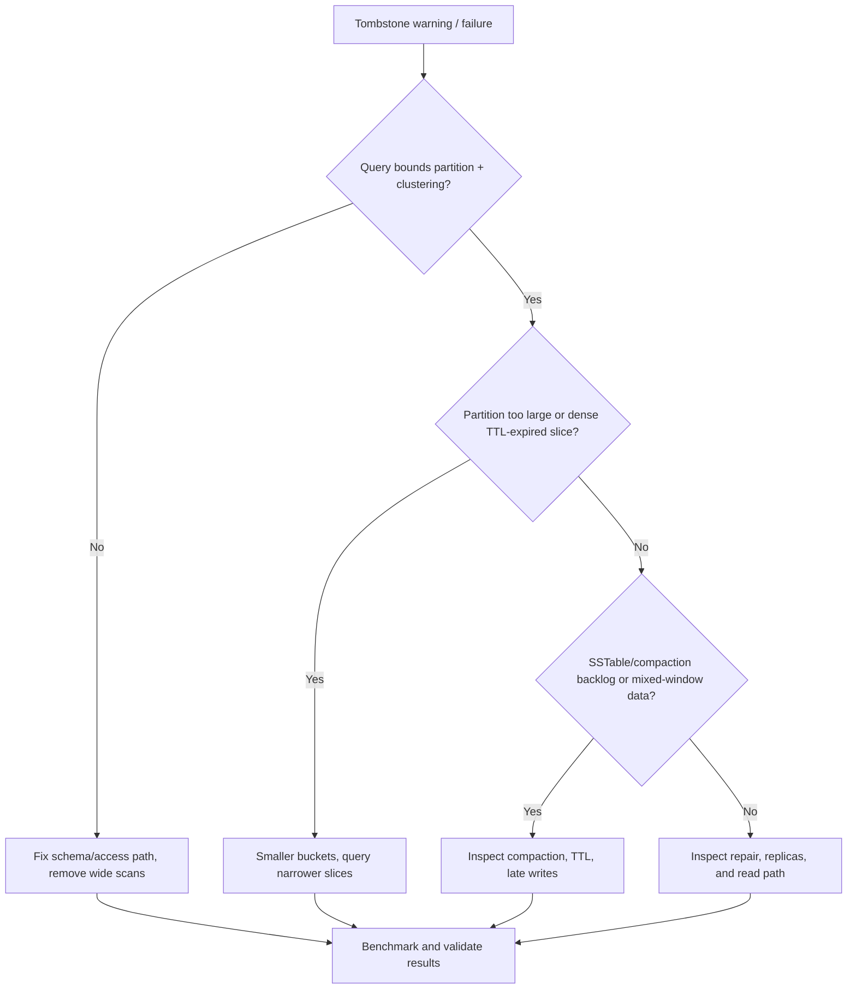

# Limits of Adjusting gc_grace or Read Thresholds to Treat Symptoms

An Apache Cassandra query can return very few rows yet still have to traverse thousands or millions of **tombstones** (deletion markers). When seeing tombstone warnings or rejected read queries, two tempting reactions are **lowering `gc_grace_seconds`** to "delete fast" and **raising the read warning/failure thresholds** to "let the query keep running." Both only touch one part of the mechanism, can mask table design flaws, and can even cause deleted data to **reappear** if replica synchronization is unsafe.

This lesson belongs to the **Tombstones and Reclamation** chapter in the **DATABASE_ENGINE_WIDE_COLUMN_CASSANDRA** module. The focus is on the limits of changing parameters as symptom relief, safety conditions for tombstone reclamation, diagnosing from CQL and metrics, and long-term solutions through **partition keys, query-driven table design, TTL, compaction, repair, replication, and Java applications**.

## 1. Learning objectives

After this lesson, you will be able to:

1. Explain how tombstones arise from `DELETE`, TTL expiration, and data-replacement operations; distinguish **logical deletion** from **physical reclamation**.
2. Analyze why tombstones must be retained for a time when Cassandra replicates data asynchronously across multiple replicas.
3. Identify conditions for safely lowering `gc_grace_seconds` and the **zombie data** mechanism when tombstones are dropped early.
4. Distinguish `tombstone_warn_threshold` and `tombstone_failure_threshold` from solutions that actually reduce the amount of data scanned.
5. Use CQL queries, `nodetool`, tracing, and metrics to locate the partitions/queries causing tombstone scans.
6. Propose fixes to **schema, partitioning, query paths, TTL, compaction strategy, and repair schedules** based on root causes.
7. Design a controlled lab experiment and a configuration-change checklist with clear measurement and rollback criteria.

## 2. What is a tombstone and why can't it be deleted immediately?

Cassandra uses an LSM write model: new writes go to the memtable and flush into immutable SSTables. When needing to delete a row, part of a partition, or a clustering key range, Cassandra normally does not immediately find and erase every old copy across all SSTables/replicas. Instead, it writes a **tombstone** carrying deletion time information; the read path reconciles values and tombstones so deleted data is not returned.

Tombstones also arise when data **expires by TTL**. Expired records may stop appearing in SELECT from their expiration time onward, yet the physical data and deletion metadata can still sit in SSTables until eligible for reclamation.

| Concept | Proper understanding |
| --- | --- |
| **Live cell/row** | Data still valid under timestamp, TTL, and tombstone rules as observed by a read. |
| **Tombstone** | Logical deletion marker, applicable to a cell, row, partition, or clustering key slice; used to shadow old values. |
| **TTL expiration** | Point when data logically expires. Does not mean disk space is reclaimed right away. |
| **`gc_grace_seconds`** | Minimum safety duration in standard tombstone reclamation policy; must combine with replica state, repair, and compaction conditions. |
| **Compaction** | Merges SSTables and can drop shadowed data/tombstones when safety conditions are satisfied. |
| **Repair** | Reconciles data across replicas so they receive any missed mutations/deletes. |
| **Tombstone scan** | Work the read path performs traversing deletion markers to locate live rows. Can be costly even when SELECT returns few rows. |

A DELETE creating a tombstone **does not shrink SSTables in place**. Furthermore, a tombstone not yet past grace is not *ignored* by queries: it is still actively used to exclude deleted data from results. Thus, reducing tombstone retention does nothing to "hide tombstones from SELECT immediately."

### Time-based table example

An application logs events per tenant and wants to fetch the 100 most recent events:

```sql
CREATE KEYSPACE IF NOT EXISTS tombstone_lab
WITH replication = {
  'class': 'NetworkTopologyStrategy',
  'dc1': 3
}
AND durable_writes = true;

CREATE TABLE IF NOT EXISTS tombstone_lab.events_by_tenant_day (
  tenant_id text,
  event_day date,
  occurred_at timestamp,
  event_id uuid,
  payload text,
  PRIMARY KEY ((tenant_id, event_day), occurred_at, event_id)
) WITH CLUSTERING ORDER BY (occurred_at DESC, event_id DESC)
  AND default_time_to_live = 604800
  AND gc_grace_seconds = 864000
  AND compaction = {
    'class': 'TimeWindowCompactionStrategy',
    'compaction_window_unit': 'DAYS',
    'compaction_window_size': '1'
  };
```

The example uses **dc1 with three nodes** and RF = 3; adjust RF for your lab environment if different. Seven-day TTL, ten-day grace, and one-day window are **illustrative values**, not optimal parameters. `event_day` helps target a partition for single-tenant/day queries, though at extreme throughput smaller buckets are still needed to avoid overly wide partitions. Use this config only in a lab before evaluating TTL, late writes, and repair on your real workload.

```sql
CONSISTENCY LOCAL_QUORUM;

INSERT INTO tombstone_lab.events_by_tenant_day
  (tenant_id, event_day, occurred_at, event_id, payload)
VALUES (
  'tenant-a', '2026-11-21', '2026-11-21T08:05:00+0000',
  11111111-1111-4111-8111-111111111111, 'temperature=37'
);

SELECT occurred_at, event_id, payload
FROM tombstone_lab.events_by_tenant_day
WHERE tenant_id = 'tenant-a'
  AND event_day = '2026-11-21'
LIMIT 100;
```

The dates only illustrate a queried partition; TTL starts from **actual write time**, not from the `event_day` value passed by the application. To test TTL on fresh data in a lab, use your environment's current date or a table without a default TTL and pass a short TTL per statement.

## 3. Why are tombstones still needed after a replica deletes?

Suppose three replicas A, B, C hold the same partition; consistency level `LOCAL_QUORUM` for RF = 3 requires two responses in the local DC.



This is a logical example, not a literal hop-by-hop network protocol trace. **Replica C, which missed DELETE,** can still hold the old value. Tombstones on A/B must remain in the system until C catches up via **hinted handoff, repair, or an appropriate synchronization mechanism**.

### Timeline of zombie data formation

| Time | Replicas A and B | Replica C | Key takeaway |
| --- | --- | --- | --- |
| `t0` | Hold value X | Holds X | All three replicas agree on initial data. |
| `t1` | Receive DELETE X, retain tombstone | Down, still holds X | Quorum can confirm deletion, yet not all replicas have it. |
| `t2` | Grace passes; compaction later **actually drops** tombstone | Still down, holds X | Proof that "X was deleted" may be lost on A/B. |
| `t3` | No marker left to override X | C returns with old X | Subsequent repair/read paths risk spreading value X back. |

**Zombie data** is a record once deleted that reappears because a replica retained an old copy after the required tombstone was dropped from other replicas. Grace expiring is **not enough** to guarantee zombies will occur: it also depends on compaction, actual data/metadata, and synchronization progress. However, lowering grace **narrows the protection window**, increasing the likelihood of this scenario.

Consequences:

- High RF does not solve this on its own if a replica can stay offline longer than tombstone retention.
- A single `nodetool status` showing all nodes `UN` **does not prove** deletion markers have converged.
- Hinted handoff has retention limits and conditions; **it cannot replace repair** in long-term tombstone protection schedules.
- Repair run **after deletion markers have been dropped from all sources** may be too late to know old values should be deleted.

## 4. What does `gc_grace_seconds` actually control?

`gc_grace_seconds` is a **per-table** setting, in seconds, used when deciding when a tombstone becomes eligible for removal once compaction has sufficient safety information. In the standard model, a tombstone must surpass the grace period relative to its deletion/expiry metadata; actual removal also remains subject to SSTable overlap checks and compaction strategy.

```text
DELETE command or TTL-expired data
         ↓
Logically deleted: SELECT no longer returns valid old data
         ↓
Tombstone stays in memtable/SSTable to protect lagging replicas
         ↓
Grace period elapses (necessary condition, not a delete button)
         ↓
Compaction/reclamation evaluates involved SSTables and safety rules
         ↓
Tombstone + shadowed data may be physically dropped
```

### Commonly misunderstood limitations

1. **Lowering grace does not trigger compaction by itself.** Without suitable compaction running, tombstones stay in SSTables and queries can still scan past them.
2. **Being past grace does not guarantee reclamation.** Other files may hold overlapping data, records may remain unexpired, and level/window structure or tombstone retention rules can block removal.
3. **Lowering grace does not immediately change how many rows queries must inspect.** Wide partitions, `ALLOW FILTERING`, or scanning clustering ranges packed with expired records still trigger warnings.
4. **Grace does not fix missing repairs.** If a replica is absent for a long period and never receives tombstones before they are cleaned, zombie risk rises.
5. **Grace is not retention.** TTL governs when data loses logical validity; grace/compaction influence when disk usage is reclaimed.
6. **One grace value does not fit all systems.** You must know max outage duration, repair execution capacity, backup/restore practices, deletion patterns, and SLAs.
7. **Grace does not guarantee timely physical erasure of confidential data.** To meet timed data-erasure mandates, you need explicit deletion/protection procedures for backups and verified storage lifecycles.

A commonly seen value is **864000 seconds (10 days)**, yet verify your **Cassandra version and actual table configuration**; never assume a default across all distributions or managed services. Lowering `gc_grace_seconds` to `0` is a correctness-sensitive change on multi-replica clusters; never use it as a default optimization on tables with DELETE/UPDATE or replicas that can go offline.

### What evidence is needed before considering lowering grace?

- **Replica map and failure domains**: RF, number of DCs/racks, read/write consistency choices, and how long nodes can stay unreachable.
- **Proven successful repair schedule**: not just a configured cron; evidence repair covers required data, failed/pending states, and intervals between successful runs.
- **Outage and recovery time**: worst-case scenarios including incident detection, node replacement, bootstrap/rebuild, and data catch-up time.
- **Data/deletion patterns**: uniform vs. scattered TTLs, manual DELETEs, updates on the same keys, clock skew, and backfills; snapshot/restore can reintroduce old data.
- **Pre-change validation capability**: lab simulations, recovery runbooks, tombstone scan metrics, bytes reclaimed, latency, and rollback plans.

One invariant to uphold: **every replica that can return to service must catch up on deletion info before surviving replicas lose the needed deletion markers**. Never turn that into a mechanical formula "grace = repair interval": leave margin for failed jobs, offline nodes, streaming, and execution time.

## 5. Tombstone read thresholds: warnings and blocking queries

Cassandra includes settings such as **`tombstone_warn_threshold`** and **`tombstone_failure_threshold`** in `cassandra.yaml`, with exact names, scope, and restart requirements depending on version. They warn on or limit the number of tombstones **scanned on the read path**, not when data is removed from SSTables.

| Parameter | Purpose | What raising it **does not** do |
| --- | --- | --- |
| `tombstone_warn_threshold` | Emits a warning when a read on a node inspects too many tombstones. | Does not reduce tombstones, CPU/I/O, read amplification, or read duration. |
| `tombstone_failure_threshold` | Protects the node by rejecting a read scanning excessive tombstones. | Does not fix schema, data, or consistency; merely lets resource-heavy queries go further before being blocked. |

Some Cassandra releases default to **warning around 1,000** and **failure around 100,000 scanned tombstones**; these are **reference points for illustration**, not mandatory standards. Check your running version, real logs, and configuration docs before defining thresholds. The system may return warnings to client/logs, or throw tombstone/timeout read errors; exception names vary by driver and version.

### Why doesn't raising thresholds cure the disease?

Suppose a query scans through 150,000 tombstones to find 5 live rows:

```text
Before adjustment:
    LIMIT 5 → scans 150,000 tombstones → exceeds threshold, read blocked.

After raising failure threshold higher:
    LIMIT 5 → still must scan 150,000 tombstones.
    May return 5 rows if CPU/I/O/time budget suffices,
    yet can also time out, spike GC, or slow down other queries.
```

**`LIMIT 5` caps returned rows**, not how many entries Cassandra inspects. The query must walk past deleted rows to locate live rows. Raising the failure threshold can swap a "scanned too many tombstones" error for **read timeouts**, high tail latency, or cluster-wide resource pressure.

### Two completely independent settings

| Adjustment | Primary effect | Risk if treated as a long-term fix |
| --- | --- | --- |
| **Lowering `gc_grace_seconds`** | Allows some tombstones to qualify for earlier removal **when eligible compaction runs**. | **Zombies/resurrection**, losing deletion markers when a replica recovers late. |
| **Raising warning threshold** | Fewer warnings emitted. | Reduced ability to spot degrading queries/schemas. |
| **Raising failure threshold** | Lets reads scan more tombstones before rejection. | CPU, I/O, GC, timeouts, noisy-neighbor impact on nodes/tenants; root symptoms remain. |
| **Shortening TTL or running bulk DELETEs** | Data expires logically sooner or creates more tombstones. | Can **increase** tombstones scanned during the transition window. |
| **Forcing major compaction** | Attempts to consolidate SSTables into a new file. | Heavy I/O and temporary space, does not guarantee safe tombstone drop; can degrade TWCS. |

If an emergency requires adjusting a threshold so critical queries keep running, treat it as a **bounded short-term mitigation** with capacity assessment, controlled rollout, p95/p99 tracking, an expiration date for the override, and a root-cause remediation plan. Never raise thresholds indefinitely or silence warnings without monitoring.

## 6. Why can a single query scan so many tombstones?

Tombstone scans depend on the **data access path** and SSTable/memtable state, not simply returned row counts. Common causes:

| Cause | Mechanism | Symptom |
| --- | --- | --- |
| **Overly wide partition** | One partition accumulates data over time; queries walk slices packed with TTL-expired items. | Single tenant/key is slow; small `LIMIT` still scans many tombstones. |
| **Short TTLs at high write rates** | Rows expire continuously before compaction reclaims physically. | Reads slowest on older timestamp slices; tombstones scanned spike after expiry waves. |
| **Dense row/cell deletes** | Many tombstones scattered among live rows. | Scanning clustering ranges to gather N live rows incurs heavy I/O. |
| **Range/partition DELETE** | Marker shadows a large set of rows; still must reconcile timestamps against other files. | Repeated queries over deleted regions; multiple SSTable versions. |
| **Broad queries / `ALLOW FILTERING`** | Predicates fail to narrow partition/clustering; Cassandra inspects lots of data before filtering. | Partitions/rows scanned vastly exceed result counts. |
| **Compaction backlog / SSTable overlap** | Many files hold overlapping data and tombstones; reclamation is ineligible. | Pending compactions, high SSTables per read, heavy disk I/O. |
| **Time-mixed TWCS** | Late writes, backfills, skewed timestamps, or uneven TTLs prevent dropping whole window SSTables. | Expired files linger persistently; expired and live data share files. |
| **Unsynced replicas** | Tombstones must stay while repair is incomplete, or reclamation is blocked by other state. | Failing repair schedules; nodes recently back from outage. |

A SELECT succeeding at a lower consistency level can also appear faster than reading from another replica due to differing data, SSTables, and caches. **Never infer that lowering consistency level is a tombstone fix**; it alters consistency guarantees while the tombstone source remains.

### Query design that shrinks read scope

If the application typically fetches events within one hour instead of reading all data of a tenant:

```sql
SELECT occurred_at, event_id, payload
FROM tombstone_lab.events_by_tenant_day
WHERE tenant_id = 'tenant-a'
  AND event_day = '2026-11-21'
  AND occurred_at >= '2026-11-21T08:00:00+0000'
  AND occurred_at <  '2026-11-21T09:00:00+0000'
LIMIT 100;
```

This query specifies the **full partition key and a clustering key range**. If the primary access pattern is hourly and a day holds too many events, add `hour_bucket` to the partition key; when full-day reports are needed, the application must read/merge bounded buckets. **Compaction strategies cannot replace query-driven data partitioning.**

## 7. Diagnostic workflow before touching configuration

A tombstone warning should be investigated starting from **the triggering query** and then expanding to table and nodes. Never start by editing `gc_grace_seconds` or `cassandra.yaml`.

### Step 1 — Gather evidence from application errors

Record:

- Sanitized CQL pattern; partition key/bucket, clustering bounds, `LIMIT`, `ALLOW FILTERING`, and sort direction.
- Consistency level, page size, deadline, exception class, warning message, timestamp, coordinator/DC, and retry count.
- Rows returned, `p50/p95/p99`, RPS, timeout rate, and query skew by tenant/partition.
- When the issue started: after a TTL change, DELETE/backfill, repair, schema edit, or ingest spike?

Java applications should log **query shapes and key sizes/types**, avoiding logging raw sensitive customer data.

### Step 2 — Inspect actual table configuration

In `cqlsh`:

```sql
DESCRIBE TABLE tombstone_lab.events_by_tenant_day;
```

Verify `PRIMARY KEY`, `CLUSTERING ORDER`, `default_time_to_live`, `gc_grace_seconds`, and `compaction`. Also verify keyspace RF/topology and repair schedules. Never guess TTL from `event_day` values: TTL counts from write time.

### Step 3 — Inspect nodes and tables

Illustrative commands, run on **nodes holding relevant replicas** and across multiple nodes to compare:

```bash
nodetool status
nodetool tablestats tombstone_lab.events_by_tenant_day
nodetool tablehistograms tombstone_lab events_by_tenant_day
nodetool compactionstats
nodetool tpstats
```

Depending on Cassandra version, outputs can report tombstones scanned per read, live cells scanned, SSTable count, pending compactions, and read/write latencies. If your system uses JMX/Prometheus, monitor **TombstoneScannedHistogram**, **LiveScannedHistogram**, read latency, and SSTables read per table; exact names depend on version and exporter.

These numbers are **investigative leads**, not proof about a specific query from a single mean value. Rare queries triggering huge scans can hide behind low averages.

### Step 4 — Trace a few representative queries

```sql
TRACING ON;

SELECT occurred_at, event_id, payload
FROM tombstone_lab.events_by_tenant_day
WHERE tenant_id = 'tenant-a'
  AND event_day = '2026-11-21'
LIMIT 100;

TRACING OFF;
```

Tracing has cost; enable it selectively in a lab or per monitoring runbooks. Cross-reference tombstone warnings, read latency, rows/partitions inspected, and participating replicas; never enable tracing for all requests under heavy load.

### Step 5 — Pinpoint the root cause



Only after understanding the root cause and service limits should you consider temporary threshold adjustments or `gc_grace_seconds` changes under an independent plan with data-safety review.

## 8. Root-cause fixes grouped by cause

| Symptom | Priority fix | Why it works better than tweaking thresholds |
| --- | --- | --- |
| SELECT uses `ALLOW FILTERING` on events table | Design a query table with the right partition key or add a dedicated read table. | Reduces data actually scanned. |
| Single-tenant partition too wide, short TTL | Partition by day/hour/shard per traffic; query latest range. | Bounds rows/tombstones per query. |
| Bulk deletes via row-by-row DELETE | Revisit planned TTL retention; separate tables/buckets by lifecycle; drop whole tables/buckets per runbook when data is no longer needed. | Avoids continuously scattering tombstones. |
| Append-only time-series table, uniform TTL | Evaluate `TWCS` with an appropriate window and monitor fully expired SSTables. | Enables dropping whole files once eligible, cutting rewrites. |
| TWCS with backfills/historical updates | Isolate backfill streams, adjust table/compaction model, normalize timestamps. | Reduces mixing expired and live data inside SSTables. |
| Failing repairs, long-offline replicas | Restore replicas and repair/rebuild per runbook before considering lowering grace. | Delivers deletion markers to all serviceable replicas. |
| High SSTable count / pending compactions | Inspect disk/CPU capacity, compaction strategy, backlog, SSTable overlap, and streaming/repair schedules. | Addresses real reclamation ability and read amplification. |
| Large query feeding a dashboard every second | Pre-aggregated/bucketed tables, idempotent pipelines, or analytics engine. | Avoids repeatedly reading expired historical volumes. |

**Do not abuse `TRUNCATE` or `DROP TABLE` as tombstone-cleaning shortcuts**, as those are destructive data changes. Use them only when an entire table/bucket has reached end-of-life confirmed by business owners with backup, replica, schema, and permission checks.

## 9. Checklist when `gc_grace_seconds` genuinely needs changing

Changing grace is a **data-preservation decision**, distinct from ordinary performance tuning. Before changing:

1. **Clarify the goal:** reduce disk usage, speed up SELECT, or reduce warnings? If the goal is faster SELECTs, lowering grace does not guarantee it.
2. **Audit blast radius:** tables/keyspaces, RF per DC, read/write consistency, how long replicas can leave the cluster, snapshots/restores.
3. **Measure real repairs:** timestamp and scope of the latest successful repair, failed jobs, unsynced data ratios, ongoing rebuild/streaming tasks.
4. **Check deletion styles:** uniform vs. mixed TTLs, explicit DELETEs, updates with new timestamps, prior `gc_grace_seconds` changes, late writes.
5. **Choose a safety margin:** grace duration must **exceed** a realistic window for all replicas to catch up on deletes, including outages, detection/remediation, repair, and operational error margin.
6. **Lab-test it:** simulate a replica absent for short/long durations, DELETE at quorum, replay/repair, and check for zombies after compaction with test data.
7. **Before/after monitoring and rollback plan:** latency, tombstone scans, SSTable count, bytes reclaimed, repair completion, and data validation. Restoring the old grace value does not rebuild dropped tombstones.

Example **for syntax illustration only**, not a production change recommendation:

```sql
-- Reset ten-day grace window on a lab table.
ALTER TABLE tombstone_lab.events_by_tenant_day
WITH gc_grace_seconds = 864000;
```

This is a **single-table** setting; altering metadata does not instantly delete or restore tombstones. When lowering grace, the scary part is that **data/tombstones already dropped after compaction do not reappear if you raise grace back up**. Config rollback is not data-loss rollback; you need repair/backup plans and verification.

### Cases requiring special caution

- **RF greater than 1 with potentially long replica outages:** never set grace shorter than repair/catch-up capacity.
- **Multi-DC deployments:** network latency, failovers, cross-DC repair/streaming, and single-DC outages add complexity.
- **Tables with arbitrary DELETEs or UPDATEs on old values:** do not assume data disappears solely via uniform TTLs.
- **Data restored from old snapshots:** can carry values already deleted in the live cluster; requires recovery workflows that avoid creating zombies.
- **Tables using TWCS:** some append-only/uniform-TTL workloads may justify custom grace values after review, yet "TWCS" by itself **does not** make grace = 0 safe in all circumstances.

## 10. Checklist when warning/failure thresholds must be adjusted

If a failure threshold is protecting the cluster from an expensive query, raising the failure threshold must bound scope, duration, and resources:

| Check | What to know before changing |
| --- | --- |
| **Why is the query scanning so many tombstones?** | CQL, partitions, buckets, TTLs, live vs. expired row counts. |
| **Worst-case scan volume** | Max/p99 tombstones scanned, partition sizes, concurrency, and retry rates. |
| **Node resources** | CPU, GC, heap, disk IOPS/latency, read thread saturation, compaction backlog. |
| **Configuration scope** | Per-node/config file, whether cluster-wide consistency is required, and restart vs. dynamic reload behavior per version. |
| **Protect other workloads** | Rate limits, query isolation, timeouts, application-side circuit breakers. |
| **Sunset the override** | Owner, deadline to fix query/schema, and metrics required to restore protective thresholds. |

The warning threshold is an **observability channel**: raising it without changing the query mainly reduces visibility into warnings. The failure threshold is a **protective guardrail**: raising it widens the server-side scan blast radius. If read timeouts follow the change, do not keep bumping thresholds reflexively; shrink query scope and retry counts instead.

You cannot fix tombstone errors by switching to `CONSISTENCY ONE` or setting infinite timeouts. Lower consistency alters serving replicas and stale-read risk; longer timeouts hold resources longer. Protecting correctness and cluster capacity matters more than making a single request "succeed" in a lab.

## 11. Lab: proving query changes beat threshold changes

**Objective:** create small data, observe tombstones after DELETE/TTL, compare full-partition SELECT against clustering-range SELECT; no need to generate hundreds of thousands of tombstones to trip the failure threshold. This lab does *not* conclusively prove physical reclamation times or zombie behavior without dedicated replica-down/repair scenarios.

### Step 1 — Lab table without default TTL

```sql
CREATE TABLE IF NOT EXISTS tombstone_lab.events_for_probe (
  tenant_id text,
  bucket_day date,
  occurred_at timestamp,
  event_id uuid,
  payload text,
  PRIMARY KEY ((tenant_id, bucket_day), occurred_at, event_id)
) WITH CLUSTERING ORDER BY (occurred_at DESC, event_id DESC)
  AND gc_grace_seconds = 864000;
```

### Step 2 — Create a TTL row and an explicit tombstone

```sql
CONSISTENCY LOCAL_QUORUM;

-- One longer-lived row and one row testing a short TTL.
INSERT INTO tombstone_lab.events_for_probe
  (tenant_id, bucket_day, occurred_at, event_id, payload)
VALUES ('lab', '2026-11-21', '2026-11-21T08:00:00+0000',
        11111111-1111-4111-8111-111111111111, 'live');

INSERT INTO tombstone_lab.events_for_probe
  (tenant_id, bucket_day, occurred_at, event_id, payload)
VALUES ('lab', '2026-11-21', '2026-11-21T08:10:00+0000',
        22222222-2222-4222-8222-222222222222, 'short-ttl')
USING TTL 60;

INSERT INTO tombstone_lab.events_for_probe
  (tenant_id, bucket_day, occurred_at, event_id, payload)
VALUES ('lab', '2026-11-21', '2026-11-21T08:20:00+0000',
        33333333-3333-4333-8333-333333333333, 'delete-me');

DELETE FROM tombstone_lab.events_for_probe
WHERE tenant_id = 'lab'
  AND bucket_day = '2026-11-21'
  AND occurred_at = '2026-11-21T08:20:00+0000'
  AND event_id = 33333333-3333-4333-8333-333333333333;
```

Wait 60 real seconds in the test environment; the fixed `occurred_at` value is only a clustering key and does not shift when TTL expires. The `live` row remains, `short-ttl` logically expires, and `delete-me` is deleted. Do not expect disk space to shrink immediately.

### Step 3 — Compare read paths

```sql
-- Read entire partition.
SELECT occurred_at, event_id, payload
FROM tombstone_lab.events_for_probe
WHERE tenant_id = 'lab' AND bucket_day = '2026-11-21'
LIMIT 10;

-- Read a narrow range avoiding the two deleted/TTL timestamps.
SELECT occurred_at, event_id, payload
FROM tombstone_lab.events_for_probe
WHERE tenant_id = 'lab'
  AND bucket_day = '2026-11-21'
  AND occurred_at >= '2026-11-21T07:55:00+0000'
  AND occurred_at <  '2026-11-21T08:05:00+0000'
LIMIT 10;
```

Both queries may return the single `live` row, yet the read path **can differ** because the second query only inspects a narrow time slice. With three lab rows, latency differences will be tiny; the point is understanding mechanics, not claiming performance benchmarks from a toy dataset.

### Step 4 — Record observations

Capture selective tracing, `nodetool tablestats`, scanned tombstone histograms, read latency, and `nodetool compactionstats` before/after phases. To benchmark seriously, scale row counts in a **lab cluster**, keep schema/CL constant, and measure multiple runs. Distinguish cache states, SSTable counts, background compactions, and reads from different replicas.

### Step 5 — Simulate "wrong fixes" on paper

On the same dataset and query, suppose you raise failure threshold from 100,000 to 1,000,000 or lower grace from 10 days to 1 day:

| Assumption | Reduces tombstones inspected right now? | What can happen |
| --- | --- | --- |
| Raise failure threshold | **No** | Query is allowed to scan even more before blocking, risking timeouts/node load. |
| Lower gc grace | **Not immediately** | Tombstones only become removable after compaction and safety checks; raises zombie risk for lagging replicas. |
| Constrain clustering range | **Possibly**, if skipping deleted regions | Cassandra visits a narrower span, usually lowering I/O and tombstones scanned. |
| Partition into smaller buckets | **Possibly**, if query targets right bucket | Shrinks historical data searched inside one partition; adds fan-out work when querying many buckets. |

Focus on **measuring scanned data and accurate results**. Never lower grace in production to wait and see if a random zombie appears.

## 12. Java driver: handling timeouts and bounding query scope

In a Java application, a SELECT reading many tombstones can throw timeouts or log warnings. Blindly retrying the same broad query increases load, especially when many clients retry together. A better approach is designing endpoints that take one tenant, bucket, and bounded time interval.

Java Driver 4.x example; `CqlSession session` is already configured with contact points and local datacenter:

```java
import java.time.LocalDate;
import java.time.Instant;
import com.datastax.oss.driver.api.core.ConsistencyLevel;
import com.datastax.oss.driver.api.core.cql.BoundStatement;
import com.datastax.oss.driver.api.core.cql.PreparedStatement;
import com.datastax.oss.driver.api.core.cql.ResultSet;
import com.datastax.oss.driver.api.core.cql.Row;

PreparedStatement query = session.prepare(
    "SELECT occurred_at, event_id, payload " +
    "FROM tombstone_lab.events_by_tenant_day " +
    "WHERE tenant_id = ? AND event_day = ? " +
    "AND occurred_at >= ? AND occurred_at < ? LIMIT 100");

BoundStatement bound = query.bind(
        "tenant-a", LocalDate.of(2026, 11, 21),
        Instant.parse("2026-11-21T08:00:00Z"),
        Instant.parse("2026-11-21T09:00:00Z"))
    .setConsistencyLevel(ConsistencyLevel.LOCAL_QUORUM)
    .setPageSize(100);

ResultSet rows = session.execute(bound);
for (Row row : rows) {
    // Process data; track elapsed time and driver warnings.
}
```

Things to remember:

- Prepared statements enforce properly typed parameters and fix **partition key + clustering range**; they do not turn a badly modeled table into an efficient query.
- `setPageSize(100)` controls result paging, **not** a cap of fewer than 100 tombstones read. Deleted rows are not counted toward live rows returned.
- Bounding queries by day/hour shrinks scan sources; also control bucket counts and concurrency when merging multiple results.
- On timeouts, distinguish I/O/compaction saturation from tombstone scan failures; emit metrics and use bounded retries/backoff. Never infinitely resend the exact same query.
- `LOCAL_QUORUM` preserves local consistency guarantees; never lower it just to hide slow reads.

If an endpoint needs reports across millions of rows over many days, consider **pre-aggregated tables** or an analytics system rather than using Cassandra as a full-history scanner every time.

## 13. Compaction operations and data reclamation

Compaction strategy impacts how tombstones get merged and removed:

- **STCS** groups similarly sized SSTables; some tombstones may wait a long time because related files have not compacted together.
- **LCS** organizes files into levels, lowering read overlap in steady-state levels yet incurring higher write cost; tombstone removal still requires overlap and safety checks.
- **TWCS** often shines for **append-only data, uniform TTLs, and ingest-ordered timestamps**; *fully expired* SSTables can be dropped whole when eligible, though late writes, upserts, mixed TTLs, or mixed windows erode its advantage.

Checking whether an SSTable is fully expired must rely on metadata/metrics and actual compaction behavior, not merely counting calendar days. Never use **major compaction** as a "delete tombstones button": it can create huge files, burn I/O and temporary disk space, or disrupt window organization. Verify strategy, compaction lag, snapshots holding SSTables, and repair safety requirements first.

## 14. Common mistakes

| Claim | Issue and fix |
| --- | --- |
| "Lowering `gc_grace_seconds` directly speeds up SELECT." | It only affects reclamation eligibility during compaction; until then SELECT still scans the data. |
| "Once grace expires, tombstones vanish right away." | Compaction and SSTable/overlap safety conditions are still needed; space may not drop yet. |
| "Setting grace to 0 is safe if DELETE succeeded at QUORUM." | An absent replica can retain old data; once source tombstones drop, zombies can appear. |
| "Raising `tombstone_failure_threshold` makes queries more efficient." | Queries still scan the same markers; more resources are burned before rejecting. |
| "Raising warn threshold until warnings stop means it's fixed." | Only silences observability signals without removing tombstones. |
| "`LIMIT 10` reads at most 10 rows/tombstones." | Must skip many deleted rows to find 10 live rows. |
| "Writing TTL makes data disappear from disk on expiration." | TTL ends logical liveness; SSTables/tombstones stay until safe reclamation. |
| "Just run repair after the node comes back up." | Repair running too late after sources dropped tombstones may lack deletion info. |
| "Compaction replaces repair." | Compaction is **local** storage optimization; repair syncs **across replicas**. |
| "Changing consistency to ONE fixes slow queries." | Only changes responding replicas and consistency risk; scanned data remains. |
| "TWCS guarantees dropping data right when TTL expires." | Still constrained by gc grace, fully-expired checks, mixed windows, snapshots, and compaction schedules. |
| "A tombstone error means data is corrupted." | Usually a read-path safety guardrail; investigate query/schema and replica state. |

## 15. Comprehensive exercises

### Exercise A — Spotting a latent configuration flaw

An RF = 3 cluster spans three racks. Replica C can stay offline for up to **12 days** before replacement/rebuild. Data has manual DELETEs and UPDATEs; comprehensive repair jobs occasionally fail. The team proposes lowering `gc_grace_seconds` from 10 days to **1 day** because SELECTs are slow.

Answer:

1. Why won't this proposal make SELECTs fast immediately?
2. Sketch the timeline creating a zombie if C misses a DELETE.
3. What operational data must be verified before choosing any different grace?
4. What query/schema/retention changes should be tried first?

**Expected points:** highlight the mismatch between how long a replica can miss deletion info and how long markers are allowed to survive; never claim "repair runs weekly" without evidence of successful completion.

### Exercise B — Read thresholds and resource impact

An API needs the 20 latest events yet scans **180,000 tombstones**. Current failure threshold is lower than that number. Operations wants to raise it to 500,000.

Simple math: tombstones scanned **remain 180,000** after the change; only the cutoff moves. Design two options to reduce scanned volume using partition buckets/ranges and one pre-aggregation option. List metrics to judge effectiveness: `p95/p99`, `TombstoneScannedHistogram`, disk reads, CPU/GC, and timeouts.

### Exercise C — Distinguishing logical deletion from reclamation

A TWCS table has a 7-day TTL and 10-day grace; on day 8, SELECT stops returning early events yet disk usage has not dropped. List at least **four possible causes** and how to check each:

- tombstones have not passed grace;
- SSTables hold live data/other TTLs or mixed windows;
- compaction has not run / is backlogged;
- snapshots or backup hard links still hold files on disk;
- data was reclaimed yet disk usage comes from other files.

Do not assume "TWCS is broken" before checking why the cluster retains those SSTables.

### Exercise D — Evaluating configuration changes

Write a one-page incident proposal for a production tombstone incident covering **affected queries**, scanned tombstone counts, frequency, RPS/p99 impact, RF/repair/outages, non-config fixes, risks of changing grace/thresholds, bounded temporary mitigations, rollback criteria, and post-change data-reconciliation schedules.

### Completion criteria

Learners succeed when they can explain: **(a)** how tombstones protect correctness against lagging replicas, **(b)** physical conditions for tombstones to be purged, **(c)** how warning/failure thresholds govern the read path rather than cleanup, and **(d)** a measurable schema/query/TTL/compaction/repair change that reduces scans without breaking data correctness.

## 16. Self-check questions

1. Why must a tombstone persist even after two out of three replicas acknowledged DELETE?
2. Does grace expiration mean data has been erased from every SSTable and backup?
3. If lowering `gc_grace_seconds` causes disk usage to drop after compaction, does that prove there is zero zombie risk?
4. Why can raising the failure threshold cause timeouts or higher GC instead of speeding up SELECT?
5. Why doesn't `LIMIT 10` cap the number of tombstones scanned?
6. When can TWCS reclaim a fully expired SSTable, and why do backfills/updates make that harder?
7. When assessing whether grace can be lowered, why do **successfully completed** repairs matter more than scheduled ones?
8. When an API hits tombstone errors, what CQL shape, partition keys, read latencies, and metrics should be inspected before editing config?

## 17. References for version-specific lookup

- [Apache Cassandra — Tombstones](https://cassandra.apache.org/doc/latest/cassandra/managing/operating/compaction/tombstones.html): tombstones, grace, and removal conditions during compaction.
- [Apache Cassandra — Compaction](https://cassandra.apache.org/doc/latest/cassandra/managing/operating/compaction/overview.html): SSTable mechanics, strategy selection, data reclamation.
- [Apache Cassandra — CQL DDL](https://cassandra.apache.org/doc/latest/cassandra/developing/cql/ddl.html): `WITH gc_grace_seconds`, TTL, schema, and table options.
- [Apache Cassandra — Repair](https://cassandra.apache.org/doc/latest/cassandra/managing/operating/repair.html): why timely repair is needed before tombstone retention expires.
- [Apache Cassandra — cassandra.yaml](https://cassandra.apache.org/doc/latest/cassandra/managing/configuration/cass_yaml_file.html): tombstone warning/failure settings per release.
- [Apache Cassandra — nodetool](https://cassandra.apache.org/doc/latest/cassandra/managing/tools/nodetool/nodetool.html): inspecting table and compaction state.

**Remember:** `gc_grace_seconds` is a **guardrail protecting deletion markers against late-arriving replicas**, while read tombstone thresholds are **resource-protection guardrails**. Lowering the first guardrail risks zombies; raising the second lets a bad query consume even more resources. Sustainable solutions start by measuring what queries scan, narrowing partitions and clustering ranges, designing aligned TTL/compaction policies, maintaining reliable repairs, and changing parameters only with clear evidence of risks and benefits.
